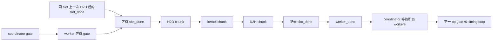

# Stage 6：Asynchronous Execution

## 当前独立动作约定

以下命令从项目根目录执行。先单独构建要使用的目标，再选择运行、校验或分析；后续动作缺产物只报错，不自动编译。源码或编译配置变化后必须重新执行构建。

`CUDA_ARCH=sm_89 python3 commands/build/run.py host_transfer`
`CUDA_ARCH=sm_89 python3 commands/build/run.py stream_pipeline`
`CUDA_ARCH=sm_89 python3 commands/build/run.py concurrent_kernels`

日志固定为 commands/<action>/log/，重复同动作覆盖该目录；先阅读或手动保留需要对照的结果再重跑。历史 results/ 不写入。本页历史分析链接不代表新入口已通过 GPU 复验。


## 学习目标与文档依据

完成本阶段后，应能区分host API返回、device操作完成、Event包围区间和多stream区间重叠；写出buffer复用依赖；用相同工作量比较串行、流水线和kernel并发。主教材为[BPG 13.1传输与重叠章节](https://docs.nvidia.com/cuda/archive/13.1.0/cuda-c-best-practices-guide/index.html#asynchronous-and-overlapping-transfers-with-computation)。页锁定内存和合适的stream安排为异步传输/重叠提供条件，收益仍需在当前设备实测。

`Async`并不保证所有调用对host非阻塞。pageable参数可能触发staging和同步，内部资源也可能使API阻塞；见当前实验Toolkit对应的[Runtime 13.4同步语义](https://docs.nvidia.com/cuda/cuda-runtime-api/api-sync-behavior.html)。不能由API名称推导出本次发生了overlap。

| 程序 | 基线 / 对照 | 主要问题 |
| --- | --- | --- |
| host_transfer | pageable / pinned，同样调用cudaMemcpyAsync并同步 | 单向传输吞吐、host提交成本及大小效应 |
| stream_pipeline | pageable_serial / pinned_serial / pinned_pipeline / pageable_pipeline | 固定chunk/buffer时memory type与streams分别影响什么 |
| concurrent_kernels | serial / concurrent，同样jobs个kernel | 多个小grid能否实际并发，是否改善整组耗时 |

源码：[传输](host_transfer.cu)、[流水线](stream_pipeline.cu)、[并发](concurrent_kernels.cu)、[公共事件协议](async_common.cuh)。本阶段使用传统CUDA Core的FMA循环，无cp.async；SM80+ cp.async保留为可选扩展，不影响必做实验验收。

## 先分清传输完成与 API 返回

在根目录先运行 `CUDA_ARCH=sm_89 python3 commands/verify/run.py host_transfer`，再分别运行 `CUDA_ARCH=sm_89 python3 commands/run/run.py host_transfer --direction h2d --variant pageable --n 4099 --warmup 1 --repeats 2 --iterations 3` 与只把 `--variant pageable` 改成 `--variant pinned` 的对照。**预期**数据校验均通过，计时区间可能不同，但 4099 个元素太小，不能以时间排定总体传输性能。先读 `samples.csv` 的 `event_scope`、`e2e_scope`，再解释为何 API 返回不一定表示设备操作完成；若失败先查是否支持锁页、分配与同步错误及本次日志。流水线和多个 kernel 的重叠等理解单次传输边界后再测，不能用两条 stream 的存在代替时间线证据。

## 从代码建立模型

host_transfer的N表示float元素数，单向requested=4N B；h2d和d2h分开运行。pageable用new[]，pinned用cudaMallocHost，分配/锁页/释放都在计时外。因此数据适用于已复用host buffer的传输，不回答每次临时pin/unpin是否划算。其block参数是通用CLI元数据，对Runtime copy没有kernel block意义。

流水线与并发都执行`x=fmaf(x,1.0001f,0.01f)`的rounds轮递推，读一次输入、写一次结果；每线程一条依赖链，源码算术量为2×N×rounds FLOP。CPU使用相同float常数的std::fma逐轮参考，全输出检查有限值和`abs_error≤1e-5+1e-5*abs(reference)`；copy逐位相等。reference、NaN重置和验证不计时，每个计时样本之后检查结果。重复op从相同input重算，避免跨op递推改变问题。

| 模型量 / op | stream_pipeline | concurrent_kernels |
| --- | --- | --- |
| H2D、D2H | 各4N B，包含在Event范围 | Event不含；单次host E2E各4N B |
| kernel逻辑读写 | 8N B | 8N B |
| CSV requested_bytes | H2D+D2H=8N，kernel字节另列 | kernel读写8N |
| device分配 | 8×min(chunk,N)×buffers B | 8N B |
| launch数量 | ceil(N/chunk) | jobs |

这些requested不是实测DRAM流量，也不能把不同路径的字节相加除以同一时间称为某一层带宽。流水线GFLOP/s含传输和协调成本；并发Event的GFLOP/s只含kernel组与协调。相同公式的列也必须先核对scope再比较。

K个等大chunk、单独阶段时长H/C/D的串行模型为`K(H+C+D)`；理想三阶段流水为`H+C+D+(K−1)max(H,C,D)`。它假设足够buffer、阶段可在独立资源上重叠、没有提交间隙或带宽竞争。尾chunk、双向copy共享瓶颈、同SM计算竞争、事件/API成本都会偏离。不能把串行profile中单阶段时间直接视为并发时不变的常数。

## 依赖协议与正确性

所有stream用cudaStreamNonBlocking创建。coordinator在每个op开始记录gate；每个worker等待gate，随后执行自己的chunk或job，最后记录worker_done；coordinator等待所有worker_done，再记录下一op的gate或计时stop。这样Event终点不会在其他stream完成之前出现，batch中相邻op也保持全局顺序。



chunk c使用`slot=c%buffers`、`worker=c%effective_streams`，serial的effective_streams=1。slot有input/output两个device数组；第一次无需等待，之后复用前等待该slot上次D2H后记录的事件，避免覆盖仍在使用的输入/输出。host输入只读，输出按chunk分成不重叠区间，host只在coordinator同步完成后访问。buffer数独立于stream数，故需要显式跨stream复用依赖；不能假设c%buffers和c%streams永远一致。

`order=interleaved`按每chunk的H→K→D顺序提交。`order=phased`按最多buffers个chunk组成一组，先发该组全部H，再全部K，再全部D；每chunk仍使用同一worker，所以各自H→K→D依赖不变。组内slot唯一，所有D及其done提交之后才开始下一组的slot等待，不会产生等待尚未record的事件。单copy引擎下这种顺序可能改善重叠，实际效果见分析；serial也遵循所选order，比较时需保持一致。

事件被重录前发出的wait引用当时记录的状态，不会转向后来重录的工作，见[Runtime 13.1 Event语义](https://docs.nvidia.com/cuda/archive/13.1.0/cuda-runtime-api/group__CUDART__EVENT.html)。`slot.used`跨op保留，prepare在上次join完成后清空数据，随后gate把初始化顺序传播到workers。这个有向依赖证明与边界测试、Sanitizer互补；racecheck零告警不能代替对host异步buffer生命周期的证明。

并发实验按`[floor(N*j/jobs),floor(N*(j+1)/jobs))`划分范围，每个job非空且输出互不重叠。两个variant都发出jobs个同参数kernel，仅worker分配不同；不拿一个大kernel与四个小kernel混作纯并发对照。concurrentKernels能力为0时保留serial、报告concurrent未测。能力非0也不保证本次kernel真的重叠。

## 运行与参数边界

从项目根目录执行；CUDA_ARCH替换为当前设备实际目标。

```bash
CUDA_ARCH=sm_89 python3 commands/run/run.py host_transfer --direction h2d --n 4194304
CUDA_ARCH=sm_89 python3 commands/run/run.py host_transfer --direction d2h --n 4194304
CUDA_ARCH=sm_89 python3 commands/run/run.py stream_pipeline --n 1048576 --chunk 65536 --streams 3 --buffers 3 --rounds 128
CUDA_ARCH=sm_89 python3 commands/run/run.py concurrent_kernels --n 4096 --jobs 4 --rounds 4096
```

| 程序 | 默认参数 | 有效范围 |
| --- | --- | --- |
| host_transfer | n4194304，direction h2d，warmup3/repeats11/iterations10 | direction h2d/d2h |
| stream_pipeline | n1048576，chunk65536，streams3，buffers3，rounds128，3/11/10 | streams/buffers1..8，chunk1..2^23，rounds1..4096，chunks≤4096；order interleaved/phased，默认interleaved |
| concurrent_kernels | n4096，jobs4，rounds4096，5/21/100 | jobs1..8且≤N，rounds1..16384 |

共同N≤2^23，N×rounds≤2^29次CPU参考更新；最多3个host float数组且≤128 MiB；device分配默认≤256 MiB且≤设备可用显存一半。block默认256，kernel检查设备上限，tail以实际count保护。禁止零预热、非法variant/方向/超限分配；失败不发布有效CSV，已有CSV不覆盖。

Event是批量span/K，含启动/事件间隙；host_batch是批量提交至完成/K。host_e2e是另一独立单次样本：传输实验为copy+sync，流水线为全流水+join+sync，并发为整输入上传+jobs+整输出回读+sync。不能把这三列相减当精确开销分解。完整参数和scope随CSV保存。

## 验证与工具选择

```bash
CUDA_ARCH=sm_89 python3 commands/verify/run.py host_transfer
CUDA_ARCH=sm_89 python3 commands/verify/run.py stream_pipeline
CUDA_ARCH=sm_89 python3 commands/verify/run.py concurrent_kernels
CUDA_ARCH=sm_89 python3 commands/sanitizer/run.py stream_pipeline
CUDA_ARCH=sm_89 python3 commands/static/run.py stream_pipeline
CUDA_ARCH=sm_89 python3 commands/nsys/run.py stream_pipeline --variant pinned_pipeline --n 1048576 --chunk 65536 --streams 3 --buffers 3 --rounds 128
CUDA_ARCH=sm_89 python3 commands/nsys/run.py concurrent_kernels --variant concurrent --n 4096 --jobs 4 --rounds 4096
CUDA_ARCH=sm_89 python3 commands/ncu/run.py concurrent_kernels --variant concurrent
```

34个GPU CTest覆盖双向copy、小N、chunk>N、不整chunk、不整jobs、buffers/streams不等和buffers1；CLI检查统计/单位/覆盖保护。四类Sanitizer独立运行，各程序的正式性能不引用插桩时间。

PTX/SASS确认transform的global读写、FMA和循环，以及register/local/shared资源；它无法证明跨stream重叠。host_transfer的被测工作是Runtime copy，静态kernel检查明确Not Applicable，不能引用头文件里未调用的transform作为copy证据。

NSYS先验证stream、kernel/copy数量和字节，再计算时间区间。定义kernel区间并集U_K、copy区间并集U_C，copy-compute重叠为`|U_K∩U_C|`；kernel并发用“至少两个kernel同时活跃”的时间长度。它们是时间线观测，不能直接当成节约的墙钟时间。使用源码提交顺序和runtime correlation核对多stream活动；按device start简单排序可能把chunk重排。分析报告明确初验、warmup、batch和E2E属于哪些范围。

NCU可补充SM使用率、资源、memory throughput和stall；不可用时写Not Tested。需要保留并发时，先查当前工具的replay/serialization行为，不用可能串行化的profile证明原始并发。当前NSYS与普通计时分开记录。

## 思考题与验收

1. 为什么pinned+多stream仍可能没有收益？如何区别缺少重叠与已有重叠但提交成本过高？
2. 为什么buffers1时增加stream不能让同一slot的生命周期重叠？
3. 计时stop若只放在coordinator但不join，遗漏什么？
4. N固定时减少chunk会改变哪些量？增加streams时为什么固定buffers？
5. 同一时间线中kernel活跃时间之和为什么能大于其并集？
6. 为什么小grid并发的结果不能直接推广到已经占满GPU的任务？

[分析记录](analysis.md)包含预测、采样、证据反推、干预及复测；[练习](exercises.md)与[答案](answers.md)分开。验收要求三程序正确、buffer依赖明确、普通与插桩范围分开、实际交集计算可复核，并报告未发生收益的条件。只看API capability或一次耗时下降不算overlap证据。

已有trace的可复算例（项目根目录执行，仅读取已保存SQLite/CSV）：

```bash
python3 scripts/analyze_async_timeline.py \
  results/20261023T165348Z_stage6-long-compute-analysis_2pqd3h9w/phased.sqlite \
  results/20261023T165307Z_nsys_gt7nwqge/instrumented_samples.csv
```

新trace先用`nsys export --type sqlite --output 新路径 原始timeline.nsys-rep`导出到独立分析目录，再将数据库与同次instrumented_samples.csv传给脚本；不能拿普通CSV匹配插桩trace。完整导出/分析命令和退出码见[实际分析命令](../../results/20261023T165348Z_stage6-long-compute-analysis_2pqd3h9w/commands.jsonl)。脚本支持本阶段两种提交顺序，计数/形状/依赖不符合时直接失败，不静默丢弃多余活动。
