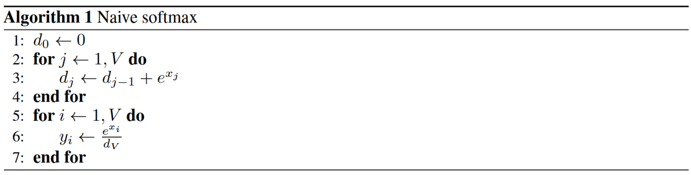
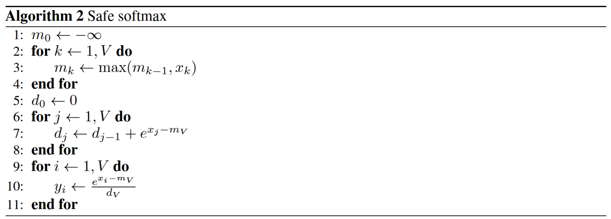
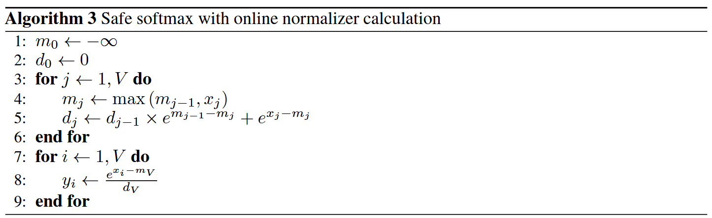

# Online Softmax

ref:
- Online normalizer calculation for softmax

> In this paper we propose a way to compute classical Softmax with fewer memory accesses and hypothesize that this reduction in memory accesses should improve Softmax performance on actual hardware.

## Original softmax

### Algorithm 1 Naive softmax

Function $ y = \text{Softmax}(x) $ is defined as:

$$
y_i = \frac{e^{x_i}}{\sum_{j=1}^{V} e^{x_j}} \tag{1}
$$

where $ x, y \in \mathbb{R}^V $. The naive implementation (see algorithm 1) scans the input vector two times 
- one to calculate the normalization term $ d_V $ 
- and another to compute output values $ y_i $ 

effectively doing three memory accesses per vector element: **two loads and one store**.

### Algorithm 2 Safe softmax

Note that $ x_i $ might be very large and $ e^{x_i} $ can easily overflow. For instance, the maximum number that float16 can support is 65536, which means that for $ x \geqslant 11 $, $ e^x $ would exceed the effective range of float16.

To mitigate this issue, mathematical software often employs a trick known as the "safe" softmax:

$$
\frac{e^{x_i}}{\sum_{j=1}^N e^{x_j}} = \frac{e^{x_i - m}}{\sum_{j=1}^N e^{x_j - m}} \tag{6}
$$

where $ m = \max_{j=1}^N (x_j) $, so that we can confirm each $ x_i - m \leqslant 0 $, which is safe because the exponential operator is accurate for negative inputs.

> Unfortunately, on real hardware, where the range of numbers represented is limited, the line 3 of the algorithm 1 can overflow or underflow due to the exponent. There is a safe form of (1), which is immune to this problem:

$$
y_i = \frac{e^{x_i - \max_{k=1}^{V} x_k}}{\sum_{j=1}^{V} e^{x_j - \max_{k=1}^{V} x_k}} \tag{2}
$$

All major DL frameworks are using this safe version for the Softmax computation: TensorFlow

Algorithm 3-pass safe softmax Notations

- $ \{m_i\} $: $ \max_{j = 1}^i \{x_j\} $, with initial value $ m_0 = -\infty $.
- $ \{d_i\} $: $ \sum_{j = 1}^i e^{x_j - m_N} $, with initial value $ d_0 = 0 $, $ d_N $ is the denominator of safe softmax.
- $ \{y_i\} $: the final softmax value.

But Safe Softmax does three passes over input vector: 
- The first one calculates the maximum value $ m_v $, 
- The second one - normalization term $ d_V $, 
- And the third one - final values $ y_i $, see algorithm 2; 

This results in 4 memory access per vector element overall. We want to improve on that.

### Algorithm 3 Online normalizer calculation

The algorithm 3 calculates both the maximum value m and the normalization term d in **a single pass** over input vector with negligible additional cost of two operations per vector element. It reduces memory accesses from 4 down to 3 per vector element for the Softmax function evaluation. 

If we fuse the 3 passes in a single loop, we can reduce the global memory access time from 3 to 1. We can create another sequence $ d'_i := \sum_{j=1}^i e^{x_j - m_i} $ as a surrogate for original sequence $ d_i := \sum_{j=1}^i e^{x_j - m_N} $ to remove the dependency on $ N $, and the $ N $-th term of these two sequence are identical: $ d_N = d'_N $. We can also find a recurrence relation between $ d'_i $ and $ d'_{i - 1} $:

$$
\begin{align*}
d'_i &= \sum_{j=1}^i e^{x_j - m_i} \\
&= \left( \sum_{j=1}^{i - 1} e^{x_j - m_i} \right) + e^{x_i - m_i} \\
&= \left( \sum_{j=1}^{i - 1} e^{x_j - m_{i - 1}} \right) e^{m_{i - 1} - m_i} + e^{x_i - m_i} \\
&= d'_{i - 1} e^{m_{i - 1} - m_i} + e^{x_i - m_i} \tag{10}
\end{align*}
$$

This recurrent form only relies on $ m_i $ and $ m_{i - 1} $, and we can compute $ m_j $ and $ d'_j $ together in the same loop:

Essentially, the algorithm keeps the maximum value $ m $ and the normalization term $ d $ as it iterates over elements of the input array. At each iteration it needs to adjust the normalizer $ d $ to the new maximum $ m_j $ and only then add new value to the normalizer.

> More about the proof see also [Online normalizer calculation for softmax](https://arxiv.org/pdf/2302.00705.pdf).

### Parallel online normalizer calculation

The lines 1-6 of the algorithm 3 define a sequential way of calculating the normalization term in a single pass over input vector. Modern computing devices allow running multiple threads concurrently; We need to have a parallel version of the algorithm to fully utilize devices. We define a generalized version of the online normalizer calculation:

$$\begin{bmatrix} m_V \\ d_V \end{bmatrix} = \begin{bmatrix} x_1 \\ 1 \end{bmatrix} \oplus \begin{bmatrix} x_2 \\ 1 \end{bmatrix} \oplus ... \oplus \begin{bmatrix} x_V \\ 1 \end{bmatrix} \tag{3}$$

where $ x_i, m_V, d_V \in \mathbb{R} $. The binary operation $ \oplus: \mathbb{R}^2 \times \mathbb{R}^2 \to \mathbb{R}^2 $ is defined as:

$$\begin{bmatrix} m_i \\ d_i \end{bmatrix} \oplus \begin{bmatrix} m_j \\ d_j \end{bmatrix} = \begin{bmatrix} \max{(m_i, m_j)} \\ d_i \times e^{m_i - \max{(m_i, m_j)}} + d_j \times e^{m_j - \max{(m_i, m_j)}} \end{bmatrix} \tag{4}$$

Applying (3) sequentially from left to right is equivalent to running lines 1-6 of the algorithm 3. The operation $ \oplus $ is associative, which enables parallel evaluation of (3). It is also commutative, which provides the flexibility needed to make parallel implementations more efficient. We omit the proofs for these two statements for brevity.

### Softmax and top-k fusion

> See also [Online normalizer calculation for softmax](https://arxiv.org/pdf/2302.00705.pdf)
