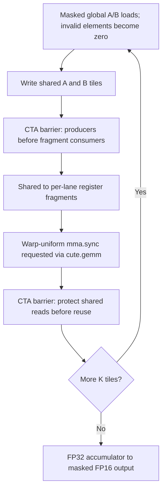

# CuTe C4.1–C4.10：SM89 小规模学习实验

## 状态与边界

只使用现有 `.venvs/cute`，核对到 `nvidia-cutlass-dsl==4.8.1`。父任务已串行完成小规模 GPU 功能校验：[20261105T060524Z-learn-9jj6_yq0/cute/results.json](../../runs/20261105T060524Z-learn-9jj6_yq0/cute/results.json) 记录 **23/23 PASS，`mode=functional-only`，每 case 两次正确性检查**，并保存实际 PTX/cubin。**这不是性能或 sanitizer 验证，也不是任意输入/配置的完整正确性证明。** 本次文档更新只读取既有结果与产物、复核源码；没有新 GPU 运行、编译或 kernel 修改。

| 任务 | 实现与已记录验证 | 边界 / 尚未验证 / 未实现 |
| --- | --- | --- |
| C4.1 | 阅读本地 add 示例；显式 stream 的 JIT/launch；4 个 add case 通过 | 仅本次小输入功能验证 |
| C4.2 | 四种真实 CuTe Layout，逐点对照独立公式 | CPU 检查通过，不推断访问效率 |
| C4.3 | `composition`、`logical_divide`、真实 TiledCopy/MMA partition 的域与覆盖检查 | 静态映射不是 GPU 正确性证明 |
| C4.4 | Copy、朴素 transpose、32×32 shared transpose；8 个 case 通过重复 poison 校验 | 未做 sanitizer 或性能对比 |
| C4.5 | 固定 512 元素 CTA tile，真实 Copy Atom/TiledCopy；4 个 v1 copy case 通过 | 同步搬运，不宣称 `cp.async` |
| C4.6 | 4 个 v4 copy case 通过；完整 tile 的 PTX 可见 `v4.b32` 搬运 | 仅静态 PTX 宽度观察；bank conflict、性能未测量 |
| C4.7 | 16×8×16 最小 MMA 通过；已保存 PTX 含 `mma.sync.aligned.m16n8k16` | 未检查 SASS，不推断吞吐或资源占用 |
| C4.8 | 单 warp CTA、32×32×16 shared tile；32×32×32 GEMM 通过，PTX 含 MMA | 同步教学实现；无高性能结论 |
| C4.9 | M/N/K 尾块零填充与写回 predicate；37×53×29 case 按公共容差通过 | 仅该尾块 case；未做更广边界覆盖或 sanitizer |
| C4.10 | 可选的两组固定 tile、同输入、stage=1 对照入口与依赖说明 | **两个可选 case 均未运行；多 stage / 异步流水线未实现**；资源、时间对比未采集 |

默认 23 个小正确性 case，不进行配置扫描；可选两个固定 tile case 后共 25 个。没有 scalar GEMM 后备路径；MMA 编译失败即报告失败。`stages != 1` 明确抛出 `NotImplementedError`，不能把同步循环冒充多级流水线。

## 文件与公共接口

- `experiments/cute_suite.py`：`experiment_specs()` 无 GPU 依赖地列举配置；`get_experiments()` 构造公共 `Experiment`；入口调用公共 `run_cli()`。
- `experiments/cute_layouts.py`：独立 CPU CLI，要求 `--output DIR`。
- `experiments/cute/kernels.py`：Vector、Transpose、SharedCopy、WarpGemm。
- `experiments/cute/workloads.py`：`prepare(inputs, config) -> Workload`，真实编译产物回调。

遵守 [公共契约](../../benchmarks/CONTRACT.md)，不复制生成器、参考结果或计时器。父任务此次通过公共 `benchmarks/runner.py` 完成 23 个默认 case 的集成功能验证；运行记录中的 `metadata.validation` 为 `runtime validation belongs to results.json`，实际状态以每 case 的 `correctness` 与顶层计数为准。

## 已记录的小规模功能结果

证据：[results.json](../../runs/20261105T060524Z-learn-9jj6_yq0/cute/results.json)。记录环境为 RTX 4060 Laptop GPU、CC 8.9、CuTe DSL 4.8.1、Python 3.12.15、torch 2.15.0、torch CUDA runtime 13.2；这不是对未来运行环境或任意 Toolkit PTX JIT 兼容性的保证。

- 默认 23 个 case 均为 `PASS`，失败数 0；没有 `--bench` 或 `--tile-comparison`，C4.10 的两个可选 ID 不在本次结果中。
- 每 case 两次输出 NaN poison、同步 launch、CPU 参考比较，共 **46 次正确性比较**。已核对公共 runner 的对应循环，且当前 runner/kernel 的 SHA256 与本次 [源码哈希记录](../../runs/20261105T060524Z-learn-9jj6_yq0/source-sha256.json) 一致。
- 两轮记录的 `max_abs_error` 和 `max_rel_error` 均为 0。copy/transpose 的 `rtol=atol=0`，add 为 `1e-6`，GEMM 为 `2e-3`。GEMM 参考为 NumPy float64 计算后转成输出 dtype；这里的零误差指与保存的 FP16 参考输出一致，不代表未舍入数学结果精确。
- 23 个 case 均保存 `kernel.ptx`、`kernel.cubin` 和 `compiler-artifacts.json`；本次静态复核了全部 **69 项 artifact SHA256**，均与结果记录一致，23 个 cubin 均有 ELF 文件头。kernel MLIR 未保留；PTX 指令观察见文末。
- 全部 `timing.status` 为 `not measured: functional-only run`，硬件计数器未测量。`startup` 包含 prepare/首次 launch+同步等主机端开销，**不能当作 kernel 性能数据**；缓存未清空，不能宣称冷缓存编译时间。没有 sanitizer、SASS/资源统计、bank conflict 或吞吐结论。

仅更新解释，不改写原始运行证据。

## 使用方法

从 `cuda-python-dsl-lab` 根目录执行。下面是后续复现/可选运行示例，不是本次记录的逐字命令；默认功能运行已由上述证据确认，C4.10 与 benchmark 命令尚未运行。任何新的 GPU 工作仍须父任务串行安排。

### CPU：索引代数（无需 GPU）

```bash
.venvs/cute/bin/python -m experiments.cute_layouts --output runs/cute-c4-layouts
```

使用新的输出目录，不覆盖已有 `layout-checks.json` / `layout-algebra.mlir`。JSON 保存每个坐标、预期索引、shape/stride、partition 与覆盖结果；MLIR 是**实际静态代数 IR，不是 GPU kernel 的编译产物**。不导入 torch、不调用 `cute.compile`、不查询 CUDA 设备。

开发时使用现有环境在内存中运行了 `run_checks()`：**17 项检查，4468 个静态索引，通过 MLIR verifier 和 JSON 序列化**；另通过四个 Python 源文件的 AST 语法检查、kernel decorator/import 检查，以及 23/25 个 case 的 ID 唯一性检查。父任务随后执行的 [CPU layout 日志](../../runs/20261105T060524Z-learn-9jj6_yq0/03-C4.2-layouts.log) 同样记录 17 项 / 4468 个索引通过、退出码 0。CPU 代数检查与 GPU 功能结果分别记录，不作为性能证据。

### GPU：仅在父任务串行授权后

先由父任务确认实际设备、CC、驱动和 Toolkit，不能借用历史环境记录。适配器在 `prepare` 中限定 SM89，编译选项显式为 `--gpu-arch=sm_89`。

```bash
# 默认仅小正确性；公共 runner 负责两次 poison / launch / reference 检查。
.venvs/cute/bin/python -m experiments.cute_suite --output runs/cute-c4-small

# 首先可只打通基础 copy/add/transpose。
.venvs/cute/bin/python -m experiments.cute_suite --output runs/cute-c4-basics --ids C4.1.add.n255,C4.4.copy.n4099,C4.4.transpose.naive.37x53,C4.4.transpose.shared.37x53

# C4.10 只注册两组固定配置，不扫描，不自动启用 benchmark。
.venvs/cute/bin/python -m experiments.cute_suite --tile-comparison --output runs/cute-c4-tiles --ids C4.10.gemm.tile16x16x16.37x53x29,C4.10.gemm.tile32x32x16.37x53x29

# 仅在正确性通过且仍有父任务串行授权时，可显式增加 --bench。
.venvs/cute/bin/python -m experiments.cute_suite --tile-comparison --output runs/cute-c4-timing --ids C4.10.gemm.tile16x16x16.37x53x29,C4.10.gemm.tile32x32x16.37x53x29 --bench --warmup 10 --repeat 50 --batches 5
```

### 精确支持的 GPU case ID

默认注册：

```text
C4.1.add.n1
C4.1.add.n255
C4.1.add.n256
C4.1.add.n4099
C4.4.copy.n1
C4.4.copy.n255
C4.4.copy.n256
C4.4.copy.n4099
C4.4.transpose.naive.32x32
C4.4.transpose.shared.32x32
C4.4.transpose.naive.37x53
C4.4.transpose.shared.37x53
C4.5.shared-copy.v1.n1
C4.5.shared-copy.v1.n255
C4.5.shared-copy.v1.n256
C4.5.shared-copy.v1.n4099
C4.6.shared-copy.v4.n1
C4.6.shared-copy.v4.n255
C4.6.shared-copy.v4.n256
C4.6.shared-copy.v4.n4099
C4.7.mma.16x8x16
C4.8.gemm.32x32x32
C4.9.gemm.37x53x29
```

仅添加 `--tile-comparison` 后注册：

```text
C4.10.gemm.tile16x16x16.37x53x29
C4.10.gemm.tile32x32x16.37x53x29
```

上面 23 个默认 ID 均出现在已记录的 GPU 功能验证中且通过；两个 C4.10 可选 ID 尚未运行，不得将默认 32×32 tile 的通过结果当作可选比较已完成。C4.2/C4.3 在 CPU CLI 内运行，不交给 GPU `--ids`。

## C4.1：Python、JIT 与 launch

[已有 add 示例](../../examples/cute_vector_add.py) 的 `@cute.jit launch` 构造 launch，`@cute.kernel vector_add` 才描述 GPU 线程执行代码。本实验同样区分：

1. **Python / 编译时**：`Vector.add`、tile、Copy Atom 宽度、`WarpGemm` 的 BM/BN/BK 都是对象配置。`cutlass.const_expr` 和 `range_constexpr` 明确静态选择/展开。
2. **JIT host wrapper**：`__call__` 用 tensor shape 构造 grid，显式传入 `cuda.CUstream`。当前 DLPack tensor shape/stride 是静态 specialization；不同小 shape 可以分别编译。
3. **GPU kernel**：thread/block index、内存读写、运行期 predicate、CTA barrier 和 MMA。边界 predicate 不包围集体 MMA 或 CTA barrier，避免部分线程跳过同步。

`prepare` 一次性完成 CPU→CUDA 输入复制、输出分配、DLPack 包装和 `cute.compile`。`Workload.launch` 只复用这些对象并发射 kernel，不分配 torch tensor、不算参考、不转换 DLPack。

**计时 stream**：每次 launch 都读取 `torch.cuda.current_stream(device)`，转换成 `CUstream` 后显式传入编译函数；不假定默认 stream 0。公共 runner 的事件、poison 和本次发射必须位于相同的当前 torch stream。分配、编译与 CPU 参考不属于 kernel 计时。若 runner 用其他 stream 记录事件却不建立依赖，其结果无效，不能靠这段说明修正错误计时。

## C4.2/C4.3：手算与真实代数

四种基本映射逐点与独立公式核对：

| Layout shape:stride | 输入域 | 索引公式 |
| --- | --- | --- |
| `8:2` | `0 <= i < 8` | `2*i` |
| `(3,4):(4,1)` | `r<3,c<4` | `4*r+c`，row-major |
| `(3,4):(1,3)` | 同上 | `r+3*c`，column-major |
| `((2,3),4):((1,8),2)` | `((i<2,j<3),k<4)` | `i+8*j+2*k`，嵌套且无重叠 |

Composition 使用 `outer=(4,6):(6,1)`、`inner=(4,3):(1,8)`。`composition(outer, inner)(i,j)` 是 `outer(inner(i,j))`，不是相反。`inner=i+8*j` 是 outer 的**标量逻辑坐标**；CuTe 按第一 mode 优先展开它，故 `outer(q)=6*(q%4)+q//4`，结果为 `6*i+2*j`。不是将 `q` 当作已经算好的物理地址。

`logical_divide((6,8):(8,1), (2,4))` 的域是 `((r,tile_r),(c,tile_c))`，shape 为 `((2,3),(4,2))`；逐点验证 `(r+2*tile_r)*8+c+4*tile_c` 并检查 48 个元素恰好覆盖一次。该小练习整除；GPU tails 另用 predicate 处理，不能从整除练习推断尾块安全。

Partition 对**真实 identity tensor** 调用 `TiledCopy.get_slice(tid).partition_S/D`，再逐项读取坐标。两种布局均核对源/目标对应、线程归属、全覆盖且无重叠：

- v1：线程 `t` 拥有 `t+128*j, j=0..3`。
- v4：线程 `t` 拥有 `4*t+j, j=0..3`。

MMA 静态检查对 16×8、16×16、32×32 tile 的 A/B/C 分别验证 `partition_A/B/C`。这是 fragment 元素坐标归属检查，不执行乘加、不证明浮点结果或生成指令。

## C4.4–C4.6：Copy / Transpose / Shared

Copy/add 每 CTA 256 线程，每线程一个元素；`index < N` 保护读写。朴素 transpose 用输入 row-major 线性索引，写 `out[col,row]`，保留作为基线。

Shared transpose：32×32 tile，256 线程每线程处理 4 项。共享 layout 为 `(32,32):(33,1)`；生产线程按输入连续列加载，消费者交换线程拥有的行列以连续写输出。尾部先零填充，写回仍检查边界。中间 CTA barrier 保护**不同线程**的 shared 读写依赖。padding 是设计，不是 bank-conflict 测量结论。

Shared copy：两种配置都使用 128 线程、512 个 FP32、同一紧凑 shared tile，仅改变 thread/value partition 与 Copy Atom 的 32/128-bit 请求宽度。完整 tile 用 `cute.copy(TiledCopy, ...)`；尾 tile 用同一 partition 的逐元素 masked 读写，**不对不完整向量发射 128-bit 访问**。新分配 torch tensor 的基地址按 16 bytes 对齐；不假定任意矩阵行跨度对齐。

依赖：`global load → shared write → CTA barrier → shared read → global store`。本 copy 的生产者/消费者拥有相同位置，因此 barrier 是保守的 CTA 可见性保证，并非声称存在跨线程交换。相比之下 shared transpose 和 GEMM 的 barrier 保护实际跨线程消费。代码没有异步提交/等待，也不叫它异步流水线。

默认 `N=4099` 同时覆盖完整 512 元素 tile 和一个 3 元素 tail；其他默认向量都是 tail，不能仅凭它们证明宽向量分支正确。

## 同步与 partition 源码复核

本次只读复核 `experiments/cute/kernels.py`，其内容与上述运行的源码哈希一致；**未发现所审实现中明显的同步/partition 正确性问题**，未修改 kernel。检查依据如下：

- Vector / naive transpose 的有效线性索引唯一，越界线程不读写；无需跨线程同步。
- Shared transpose 的生产、消费映射都是 1024 个 tile 坐标的双射，消费者换用转置线程归属。所有 256 个线程在载入循环后无条件到达同一个 CTA barrier；读 shared 在 barrier 后，越界位置先初始化。tile 只使用一次，无需再为下轮覆盖添加 barrier。
- SharedCopy 的 full/tail 条件只依赖 block ID 与 shape，是 CTA 一致条件。v1/v4 的 source/destination partition 匹配，各覆盖 512 元素且不重叠；tail 检查保护实际 global 读写，不发射部分有效的宽向量事务。barrier 位于两条加载分支合流之后；本例生产/消费所有权相同，因此它是保守同步，不是缺失了跨线程 exchange。
- WarpGemm 的协作加载按 `tid+32*j` 唯一覆盖 A/B shared tile；每轮先零填充无效 M/N/K 元素。第一次 CTA barrier 保护 shared 写→fragment 读，第二次保护上一轮 shared 读→下一轮覆盖；循环次数对 CTA 一致，MMA 和两次 barrier 都不在 lane-dependent predicate 中。`partition_A/B/C` 与 fragment 形状一致，epilogue 对有效输出只写一次。

以上为源码逻辑审查，加上指定小样例的功能结果；**不能代替 racecheck/synccheck/memcheck**。未测试的边界、可选 tile、多 stream 切换以及其他架构不因 23/23 自动获得验证。

## C4.7–C4.10：真实 MMA 与同步 GEMM

安装包明确支持 SM80+ 的 `MmaF16BF16Op(Float16, Float32, (16,8,16))`。这里使用 32 线程组成的一个 warp，`make_tiled_mma(..., (1,1,1))`。不是 Hopper WGMMA、Blackwell tcgen05，也不是每线程 scalar dot product。

输入是公共接口的 `A[M,K]`、`B[K,N]`，FP16；在 kernel 内将 B 协作加载为 shared `B_tile[N,K]` 的 K-major 布局，而不是在 `prepare` 偷偷预转置输入。A shared 同样为 K-major。`partition_A/B` 指定每 lane 的 fragment，逐元素 shared→register **加载**后，只有 `cute.gemm(tiled_mma, acc, ra, rb, acc)` 执行乘加。累加 FP32，epilogue 最后转成 FP16；不使用 TF32。

- 最小 case：CTA tile=16×8×16，一个 K tile。
- 默认 GEMM：CTA/warp tile=32×32×16，多个 warp MMA 指令覆盖输出 tile；不是 32×32 的一条硬件指令。
- 可选比较：16×16×16 与 32×32×16，同一 37×53×29 输入、32 线程、stage=1；不做自动调参。
- M/N/K 越界的 shared 位置每轮置零。M/N 尾部 epilogue 有 predicate，不写无效输出。所有有效输出都被覆盖，便于公共 runner poison 检查。

同步依赖图（单 stage）：



理论 shared payload：`(BM+BN)*BK*2` bytes，最小 MMA 为 768 bytes，16×16 tile 为 1024 bytes，32×32 tile 为 2048 bytes。它们是源码逻辑存储量，**不是编译后的资源测量**；分配对齐、寄存器数、spill、occupancy 应看真实 cubin/工具输出。未测量性能、资源占用、bank conflict、缓存命中率、DRAM 流量。多 stage、`cp.async` 和重叠流水线均未实现，不注册虚假的 stage=2/3 case。

## 编译证据与版本依据

直接检查了本环境的以下安装源码（统一前缀：`.venvs/cute/lib/python3.12/site-packages/nvidia_cutlass_dsl/dsl_packages/cutlass/`）：

- `cute/core.py`：`make_layout`、`composition`、`logical_divide`、`local_tile`。
- `cute/atom.py`：`make_tiled_copy_tv`、`partition_S/D`、`make_tiled_mma`、`partition_A/B/C`、`make_fragment_A/B/C`。
- `cute/nvgpu/common.py`：`CopyUniversalOp`、`num_bits_per_copy`。
- `cute/nvgpu/warp/mma.py`：`MmaF16BF16Op`、SM80+ 和 FP16/FP32/m16n8k16 约束。
- `cute/algorithm.py`：`cute.copy` / `cute.gemm` 签名和 fragment 约定。
- `memory/smem.py`、`utils/smem_allocator.py`：shared tensor 分配。
- `cute/runtime.py`：`from_dlpack` 的对齐参数。
- `base_dsl/compiler.py`、`base_dsl/jit_executor.py`：`--keep-ptx`、`--keep-cubin`、`--dump-dir`，以及 `__ptx__` / `__cubin__` / `__mlir__` 属性。

同时阅读本项目 `examples/cute_vector_add.py`。安装的 torch vendored `torch/_vendor/quack/gemm_sm80.py` 可用于核对 SM80-family MMA 构造方式，但其 `__call__` 明确抛出 `NotImplementedError`，**没有把它当作可运行 GEMM 示例**。没有借用 `main/latest` 的未知 API，没有下载或安装其他版本。

`prepare` 请求真实 PTX/cubin，临时编译目录由闭包保持到 Workload 生命周期结束；公共 runner 调用 `artifacts()` 得到 `kernel.ptx`、`kernel.cubin`（若存在），以及 `compiler-artifacts.json`。只有内容确实像 PTX / ELF 才导出；缺失就写 unavailable，不把文件名或解释文字冒充代码。`__mlir__` 有实际 IR 时才额外导出，本实现不保证保留 kernel MLIR。临时目录不是最终证据，最终保存由公共 runner 负责。

上述运行已实际保存 23 组 PTX/cubin，产物位于各 case 的 `artifacts/` 子目录，不只是 API 名称或占位文件。本次检查下列匹配 PTX，头部均为 `.version 9.4`、`.target sm_89`：

| 具体产物 | 静态观察 |
| --- | --- |
| [C4.4 shared transpose 37×53](../../runs/20261105T060524Z-learn-9jj6_yq0/cute/011-C4.4.transpose.shared.37x53/artifacts/kernel.ptx) | shared store/load 之间有 `bar.sync 0` |
| [C4.5 v1 copy N=4099](../../runs/20261105T060524Z-learn-9jj6_yq0/cute/015-C4.5.shared-copy.v1.n4099/artifacts/kernel.ptx) | 完整 tile 使用 `ld.global.b32` / `st.shared.b32`；保留 CTA barrier 与 shared→global 路径 |
| [C4.6 v4 copy N=4099](../../runs/20261105T060524Z-learn-9jj6_yq0/cute/019-C4.6.shared-copy.v4.n4099/artifacts/kernel.ptx) | 完整 tile 可见 `ld.global.v4.b32`、`st.shared.v4.b32`、`ld.shared.v4.b32`、`st.global.v4.b32`；tail 为有条件的标量访问 |
| [C4.7 最小 MMA](../../runs/20261105T060524Z-learn-9jj6_yq0/cute/020-C4.7.mma.16x8x16/artifacts/kernel.ptx) | 1 处 `mma.sync.aligned.m16n8k16.row.col.f32.f16.f16.f32`，前后各有 `bar.sync 0` |
| [C4.8 GEMM 32×32×32](../../runs/20261105T060524Z-learn-9jj6_yq0/cute/021-C4.8.gemm.32x32x32/artifacts/kernel.ptx) | K 循环体内 8 处同型 `mma.sync`，shared 写/读与复用的两处 barrier 保留 |
| [C4.9 GEMM 37×53×29](../../runs/20261105T060524Z-learn-9jj6_yq0/cute/022-C4.9.gemm.37x53x29/artifacts/kernel.ptx) | 同样 8 处同型 `mma.sync`，保留两处 barrier；对应尾块功能 case 通过 |

三个 MMA/GEMM case 的 `compiler-artifacts.json` 均记录 `mma_sync_in_ptx=true`，本次也直接检查了 PTX 指令文本。这里的 1/8 是**静态指令位置数**，不是运行期执行计数、吞吐或资源指标；PTX 向量宽度也不等价于实际内存事务/bank-conflict 测量。cubin 已保存并核验哈希，但本次未反汇编 SASS，未运行 profiler 或 sanitizer，不据此声称硬件指令级性能或全面同步安全。
