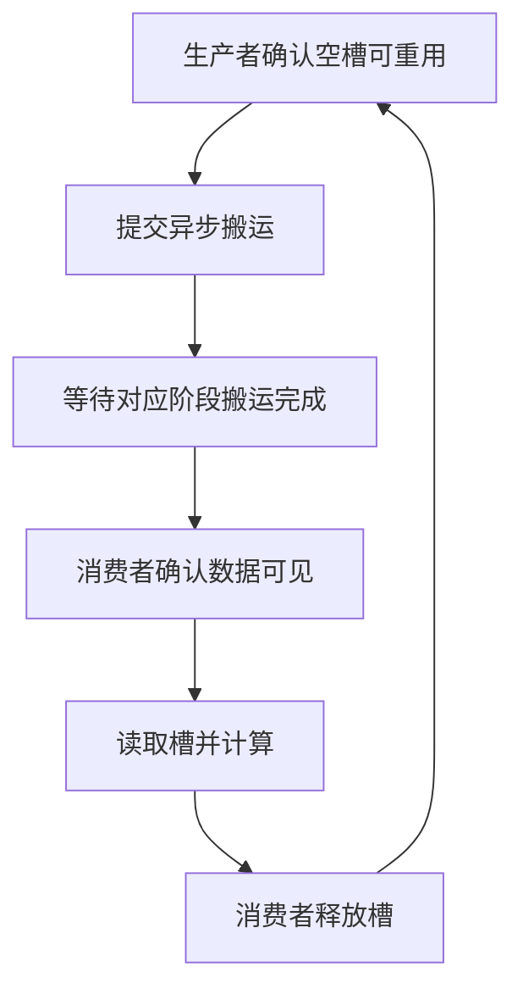

# 08 — H7.1–H7.8：H20 阶段的执行边界

本次检测到的设备为 SM89，未连接 H20。**以下任务未实现、未运行、未验收**；不写只会返回 SKIPPED 的假 kernel，也不以 SM89 的 cp.async 或同步 CuTe GEMM 冒充 SM90 TMA/WGMMA。

| 计划编号 | 仍需实现的交付 | 开始前提 |
| --- | --- | --- |
| H7.1 | 固定二维布局的普通 Global→Shared→Global 基线 | H20 上重做基础示例；现有 1D Copy 仅供参考 |
| H7.2 | TMA descriptor、对齐/布局、transaction barrier 与可见性协议 | 匹配已安装版本的 SM90 API/示例 |
| H7.3 | TMA 双缓冲，producer/consumer 时间线 | H7.2 功能和同步协议验证 |
| H7.4 | 基线/TMA/双缓冲对照，分离 descriptor 开销 | 先小规模功能，再经授权的计时 |
| H7.5 | SM90 普通流水线 GEMM，全部等待/依赖标注 | 不能将当前 CuTe 单 stage SM89 GEMM 当作完成 |
| H7.6 | SM90 producer/consumer 对照 | 核对 warp specialization 支持范围，排除 Blackwell 专用路径 |
| H7.7 | 合法 Stage 或角色资源调整 | 保留基线、barrier/共享内存/寄存器预算 |
| H7.8 | Gluon/CuTe 代码位置与依赖对照 | 分开记录实际运行和只阅读的部分 |

## 后续同步推导模板（不是已实现协议）

需要分别证明：异步操作完成、线程/warp 间先后关系、数据可见性、必要 proxy 同步和 barrier phase 复用。上图只表述逻辑依赖，**不是任意 TMA API 的充分同步实现**；具体作用域、arrival count、transaction bytes、parity/phase 应以目标版本源码和生成指令为依据。

现有 Gluon 单/双缓冲的 SM89 源码和实测在 [03-gluon.md](03-gluon.md)，可作为学习前置，但不代替 H7 验收。没有修改系统驱动、性能权限或重置 GPU。
