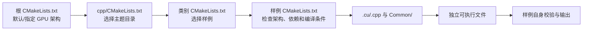

# `cuda-samples` 初步解读：整体架构与功能

本文分析 [`third-party/cuda-samples`](../third-party/cuda-samples/README.md)，依据当前工作区源码和说明文件。它是一个按主题组织的 **CUDA 功能示例集**：每个样例围绕一项 API、编程技巧、库或应用场景，提供可阅读的源码及运行入口。它不是一个单体 CUDA 应用；仓库自己的说明也明确指出，样例集合不能当作完整的 CUDA 验证套件或统一性能基准。

## 本地入口与维护边界

本目录只有这份分析导航，**没有自维护执行脚本或需要拆分的 `lab.sh`**。被引用的 `../third-party/cuda-samples/` 是独立第三方仓库，其源码、构建文件和运行工具不在本次迁移范围；不把上游 `run_tests.py` 包装成本地万能入口，也不改动上游脚本或已有 build/日志。

若以后增加本地实操入口，应按动作使用 `commands/<action>/run.sh` 与同目录 `output.log`，编译、运行分开并复用共享源码/build；run 不隐式重建，不创建时间戳目录、快照或自动归档。本次只更新边界说明，没有构建或运行样例。

## 1. 一眼看清仓库结构

```text
cuda-samples/
├── README.md、CHANGELOG.md     仓库说明、版本记录与样例索引
├── CMakeLists.txt               C++ 工程入口，设置目标 GPU 架构并进入 cpp/
├── cmake/                       公共构建逻辑、架构筛选、安装规则和工具链文件
├── Common/                      C++ 样例共用的 helper、图形资源与测试数据
├── cpp/                         CUDA C++ 样例，按 0～9 类分组
│   └── <类别>/<样例>/             通常有 README、CMakeLists 和 .cu/.cpp 源码
├── python/                      基于 cuda.core 的 Python 样例及 Utilities/
├── run_tests.py、test_args.json  批量运行已构建可执行文件的辅助工具
└── build/                       本地已有构建目录，属于生成物而非架构入口
```

从 [根 `CMakeLists.txt`](../third-party/cuda-samples/CMakeLists.txt) 可见，顶层只 `add_subdirectory(cpp)`；[Python 样例说明](../third-party/cuda-samples/README.md#cuda-python-samples)也明确说 Python 不进入顶层 CMake 构建。因此，阅读时可把 C++ 构建树与 Python 脚本树视为两条入口，共享“按主题讲解 CUDA”的目标，但运行方式不同。

## 2. C++：主题目录就是功能地图

各类的定位以 [仓库样例索引](../third-party/cuda-samples/README.md#samples-list)和目录内的 README 为依据。“当前顶层构建”一列只描述**此工作区当前的 `cpp/CMakeLists.txt`**，不是目录是否存在，也不是上游仓库的固定规则。

| 目录 | 主要功能与代表样例 | 当前顶层构建 |
| --- | --- | --- |
| [`0_Introduction`](../third-party/cuda-samples/cpp/0_Introduction/README.md) | 入门 API 与执行流程：`vectorAdd`、`matrixMul`、stream、统一内存、Runtime/Driver、P2P 等 | 纳入 |
| [`1_Utilities`](../third-party/cuda-samples/cpp/1_Utilities/README.md) | 查询设备属性和拓扑：`deviceQuery`、`deviceQueryDrv`、`topologyQuery` | 纳入 |
| [`2_Concepts_and_Techniques`](../third-party/cuda-samples/cpp/2_Concepts_and_Techniques/README.md) | 常见算法与并行技巧：`reduction`、`scan`、直方图、纹理、流式分配等 | 纳入 |
| [`3_CUDA_Features`](../third-party/cuda-samples/cpp/3_CUDA_Features/README.md) | CUDA 专项能力：Graphs、Cooperative Groups、Tensor Core、异步拷贝等 | 纳入 |
| [`4_CUDA_Libraries`](../third-party/cuda-samples/cpp/4_CUDA_Libraries/README.md) | CUDA 库与配套组件：CUB、cuFFT、cuRAND、cuBLAS、cuSPARSE 等相关示例 | 纳入 |
| [`5_Domain_Specific`](../third-party/cuda-samples/cpp/5_Domain_Specific/README.md) | 图像、图形、金融、仿真等领域应用，如 BlackScholes、nbody | 当前未纳入 |
| [`6_Performance`](../third-party/cuda-samples/cpp/6_Performance/README.md) | 性能问题的对照样例，如 transpose、内存对齐、Graph 扩展性 | 当前未纳入 |
| [`7_libNVVM`](../third-party/cuda-samples/cpp/7_libNVVM/README.md) | NVVM IR、PTX 生成与链接的低层编译示例 | 当前未纳入 |
| [`8_Platform_Specific/Tegra`](../third-party/cuda-samples/cpp/8_Platform_Specific/Tegra/README.md) | Tegra 上的 cuDLA、NvSci、EGL/OpenGL ES 等平台互操作 | 当前未纳入 |
| [`9_CUDA_Tile`](../third-party/cuda-samples/cpp/9_CUDA_Tile/README.md) | CUDA Tile C++：向量加法、转置、矩阵乘、LayerNorm、SpMV 等 | 当前未纳入 |

这里的“当前未纳入”来自 [当前 `cpp/CMakeLists.txt`](../third-party/cuda-samples/cpp/CMakeLists.txt)：`5`～`9` 的 `add_subdirectory` 均被注释。这是工作区**尚未提交的本地改动**；与仓库已提交版本的默认配置不同。仅设置 `BUILD_TEGRA=TRUE` 不能让当前顶层构建进入 Tegra 目录，因为对应入口也被注释。若需要研究这些类别，可以先读源码和单样例构建文件，再按实际需要调整构建入口；不要把“目录里有样例”等同于“顶层构建会生成它”。

## 3. C++ 样例怎样从源码变成程序



以 [`vectorAdd`](../third-party/cuda-samples/cpp/0_Introduction/vectorAdd/README.md) 为例：类别 CMake 文件加入其子目录；[样例 CMake 文件](../third-party/cuda-samples/cpp/0_Introduction/vectorAdd/CMakeLists.txt)调用公共的架构检查，包含 `Common/`，编译 `vectorAdd.cu`，并配置安装规则。[源码](../third-party/cuda-samples/cpp/0_Introduction/vectorAdd/vectorAdd.cu)用 `cudaMallocManaged` 分配统一内存，按 `blockIdx.x * blockDim.x + threadIdx.x` 定位元素，启动 kernel、同步，再与 CPU 结果比较。这个“主机准备 → GPU 执行 → 同步/校验”的小闭环，是阅读其他 C++ 样例的通用抓手。

构建层有两种重要约束：

1. [顶层 CMake](../third-party/cuda-samples/CMakeLists.txt)默认使用仓库维护的目标架构列表；单独配置某个样例时，必须显式传 `CMAKE_CUDA_ARCHITECTURES`。公共的 [架构筛选逻辑](../third-party/cuda-samples/cmake/DetectCudaArch.cmake)会按样例可支持的架构取交集，交集为空则跳过该样例。
2. 样例还可能按工具链、库或系统条件跳过。例如 [`tileVectorAdd` 的 CMake](../third-party/cuda-samples/cpp/9_CUDA_Tile/tileVectorAdd/CMakeLists.txt)要求 C++20/CUDA C++20 并启用 Tile 编译选项；[`oceanFFT` 的 CMake](../third-party/cuda-samples/cpp/4_CUDA_Libraries/oceanFFT/CMakeLists.txt)检查 OpenGL 与 GLUT。因而“某类被顶层纳入”也不保证该类所有目标都能在一台机器上生成或运行。

`Common/` 的 [`helper_cuda.h`](../third-party/cuda-samples/Common/helper_cuda.h)、`helper_timer.h` 等是跨样例的辅助代码；[`cmake/CudaSampleCommon.cmake`](../third-party/cuda-samples/cmake/CudaSampleCommon.cmake)提供公共编译设置。它们服务于样例，通常不是独立运行入口。仓库还提供 [`run_tests.py`](../third-party/cuda-samples/run_tests.py) 和 [`test_args.json`](../third-party/cuda-samples/test_args.json)，用于批量运行已生成的可执行文件；仓库说明明确限制了这类运行结果的覆盖范围。

## 4. Python：围绕 `cuda.core` 的另一条学习路径

[Python 目录](../third-party/cuda-samples/python/)分成 `1_GettingStarted`、`2_CoreConcepts`、`3_FrameworkInterop`、`4_DistributedComputing`，另有 [`Utilities`](../third-party/cuda-samples/python/Utilities/README.md) 放校验等共用函数。与 C++ 的顶层 CMake 不同，Python 需要进入具体样例目录，安装该样例的 `requirements.txt`，再运行对应 `.py` 文件；依赖和硬件条件以每个样例 README 为准。

[`python/1_GettingStarted/vectorAdd`](../third-party/cuda-samples/python/1_GettingStarted/vectorAdd/README.md)展示了典型路径：Python 文件内保存 CUDA kernel 源码，用 `cuda.core` 的 `Device`、`Program`、`LaunchConfig` 等编译和启动，并用 CuPy 数组与公共函数校验结果。进阶目录分别涉及 reduction、Graph、FFT、共享内存、框架自定义 kernel、多 GPU/P2P/IPC。仓库级 [`python/requirements.txt`](../third-party/cuda-samples/python/requirements.txt)给出通用基础依赖；样例自己的 requirements 补充具体依赖。

## 5. 建议的第一次阅读顺序

1. 先读 [仓库 README](../third-party/cuda-samples/README.md)与 [根 CMake](../third-party/cuda-samples/CMakeLists.txt)，确认“示例集”和 C++/Python 两条入口。
2. 用 C++ [`vectorAdd`](../third-party/cuda-samples/cpp/0_Introduction/vectorAdd/README.md)和 Python [`vectorAdd`](../third-party/cuda-samples/python/1_GettingStarted/vectorAdd/README.md)各走一遍：输入、内存、kernel、启动、同步、校验。
3. 看 [`reduction`](../third-party/cuda-samples/cpp/2_Concepts_and_Techniques/reduction/README.md)或 [`transpose`](../third-party/cuda-samples/cpp/6_Performance/transpose/README.md)，将关注点转向线程协作和访存。
4. 再按兴趣挑一条专题：[`simpleCudaGraphs`](../third-party/cuda-samples/cpp/3_CUDA_Features/simpleCudaGraphs/README.md)、[`CUDA Libraries`](../third-party/cuda-samples/cpp/4_CUDA_Libraries/README.md)或 [`CUDA Tile`](../third-party/cuda-samples/cpp/9_CUDA_Tile/README.md)。阅读 Tile 时先注意其单样例的 Toolkit、驱动、编译器和 GPU 架构要求。

这份文档只做目录、构建路径和功能定位的静态梳理。没有把本地 `build/` 的历史产物或某个样例的预期输出当成当前环境的运行结果；后续若要深入分析，可针对选定样例分别记录构建命令、目标架构、正确性和性能证据。
