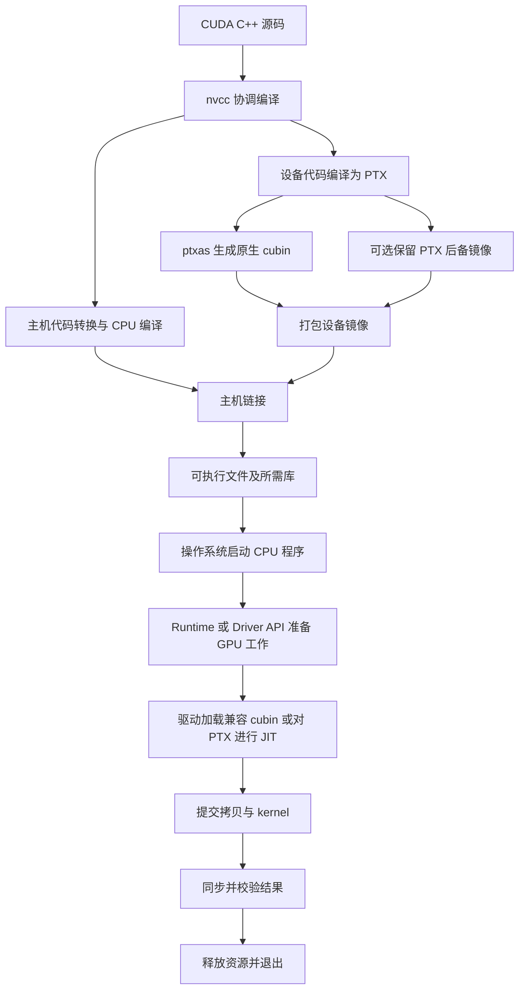

# CUDA Toolkit 导览：工具分工与程序生命周期

本文先建立一张地图：**写好的 CUDA 源码怎样变成文件，文件怎样被加载，GPU 怎样执行，以及遇到问题该找哪个工具。** 不要求先背命令，也不把“所有工具都运行一遍”当作学习目标。

前置知识只需：函数、数组、终端当前目录。这里的 **host（主机）**主要指 CPU 侧程序，**device（设备）**指 GPU；**kernel（核函数）**是由许多 GPU 线程执行的函数。编译是翻译代码，链接是把代码片段及其引用接起来，加载是为执行准备代码和资源；三者不是同一件事。

建议顺序：本文第 1–4 节建立概念 → 第 5 节跟一个小输入 → [编译专题](experiments/compile/README.md) → [二进制检查](experiments/binary/README.md) → 本文的 [nvdisasm 学习规划与落实](#61-nvdisasm-学习规划)。总体导览只解释工具关系和学习顺序；具体参数、日志和练习留在各单功能动作 README。

> 本次只修订本文，不新增编译、GPU 运行、采集记录或工具安装。下文明确区分“手算/预期”与已经存在的真实日志；已实现不等于所有输入均验证通过。部分总导航仍在更新，调用方式以本文核对过的实际脚本及相应动作记录为准，不沿用旧聚合入口。

## 1. Toolkit、驱动、库和样例不是一回事

可以把开发过程理解为：**Toolkit 提供制作与检查程序的工具，驱动让程序使用 GPU，库提供可复用的计算和管理功能。**

| 名称 | 是什么、解决什么问题 | 不要混淆 |
| --- | --- | --- |
| CUDA Toolkit | 开发工具集合，包括编译工具、头文件、运行库、数学库、检查工具等；安装内容随版本、平台和安装方式变化。 | 安装了 Toolkit 不等于驱动、GPU 和所有分析器都可用。 |
| NVIDIA 驱动 | 管理 GPU，并提供 CUDA 程序运行所需的驱动接口及 PTX JIT 能力。 | `nvcc` 编译器不是驱动。驱动版本与 Toolkit 版本不是同一编号。 |
| CUDA Runtime API / `cudart` | 程序调用的接口，例如分配显存、复制数据、启动 kernel；API 即应用程序可调用的函数接口。 | 它是库，不是终端中运行的一个分析工具。静态/动态链接方式影响部署依赖。 |
| CUDA Driver API / `libcuda` | 更显式地管理设备上下文、模块与函数；Linux 运行时的真实 `libcuda.so` 由驱动提供。 | Toolkit 的链接用 stub（占位库）不能替代运行时驱动。 |
| CUDA Libraries | 已实现的计算能力，例如 cuBLAS 做线性代数、cuFFT 做快速傅里叶变换、cuSPARSE 处理稀疏运算、cuRAND 生成随机数。 | 调库仍需要兼容的运行环境；这些库不是编译器或性能分析器。 |
| CUDA Samples | 展示 API 和算法的示例源码；本工作区的上游示例位于第三方仓库。 | 示例集合不是 Toolkit 本身；本目录名 `cuda-sdk-lab` 也不代表它是 NVIDIA 的 SDK 发行包。 |
| Nsight 工具 | 面向调试和性能分析的工具系列，具体组件可能随 Toolkit 提供或独立安装。 | 找到 `nvcc` 不代表同时安装了 `nsys`、`ncu` 或图形界面。 |

### 环境中至少有四个需要分别确认的量

1. **GPU 型号与 compute capability（计算能力）**：硬件支持哪些功能；例如 8.9 对应常见目标写法 `sm_89`。
2. **驱动版本**：能加载哪些程序、理解哪些 PTX 版本。
3. **实际调用的 Toolkit 工具版本**：终端可能找到另一套安装中的 `nvcc`。
4. **构建目标**：二进制到底为哪些 `sm_XX` / `compute_XX` 生成了代码。

`nvidia-smi` 来自驱动工具体系。其标题里的 `CUDA Version` 通常表示驱动支持的 CUDA 版本上限，不是在扫描本机安装的 Toolkit；`nvcc --version` 才描述当前调用的编译器版本。两者不同不自动意味着错误，也不自动保证兼容。次版本兼容性有条件，尤其不能由 cubin 可运行推出新 PTX 可 JIT。[参考：CUDA Compatibility](https://docs.nvidia.com/deploy/cuda-compatibility/)

**当前已有环境证据：** [设备记录](experiments/environment/log/gpu_info.log)为 RTX 4060 Laptop GPU、计算能力 8.9（`sm_89`）、驱动 596.21；[nvcc](experiments/environment/log/nvcc_version.log) 为 13.4.92，[ncu](experiments/environment/log/ncu_version.log) 为 2026.3.1.0，[nsys](experiments/environment/log/nsys_version.log) 为 2026.3.2。环境[状态表](experiments/environment/log/status.tsv)还记录了 `nvdisasm` 等工具的版本检查成功。这些不是工具缺失的环境，也不是未来每次运行的保证；PTX 加载的实际兼容性失败见第 4.2 节。

**理解检查：** 机器上没有 GPU，能否编译和反汇编？在工具与主机编译器可用、目标受支持时可以；但不能据此验证 GPU 执行。

## 2. 先认识文件，再认识工具

“同一个 CUDA 程序”在不同阶段可能是不同格式，扩展名只是线索，最终以文件内容和产生它的命令为准。

| 形态 | 内容及角色 | 谁生成、谁读取 |
| --- | --- | --- |
| `.cu` / `.cuh` | CUDA C++ 源码/头文件；一个 `.cu` 可以同时包含 CPU 与 GPU 代码。 | 人编写，`nvcc` 编译。 |
| `.ptx` | PTX（Parallel Thread Execution）虚拟指令文本；含入口、参数、虚拟寄存器和目标约束。 | 编译器生成；`ptxas` 或驱动 JIT 将其变成目标机器码。GPU 不直接执行 PTX 文本。 |
| `.cubin` | GPU 设备二进制，采用 ELF 格式；ELF 是组织代码、符号、重定位等信息的容器。 | `nvcc --cubin` 可显式生成；驱动加载，`cuobjdump` / `nvdisasm` 检查。 |
| SASS 文本 | 目标 GPU 机器指令的可读表示，常由反汇编产生。 | `cuobjdump --dump-sass` 或 `nvdisasm` 输出；不是另一种待加载的源码文件。 |
| `.fatbin` | 设备镜像容器，可装多种目标的 cubin 和/或 PTX。 | 编译链打包；`cuobjdump` 列举内容，运行时可从中选择适用镜像。不是“只有一种机器码”。 |
| `.o` / `.obj` | 尚未完成最终链接的目标文件；CUDA 主机目标文件还可能嵌入设备代码。 | 编译器产生，主机/设备链接阶段按各自职责处理。不能把主机 `.o` 直接当作独立 cubin。 |
| `.a` / `.lib`、`.so` / `.dll` | 分别为常见静态库和共享库形态；可包含主机代码及 CUDA 相关内容。 | 链接器或操作系统加载器处理；设备镜像仍需驱动处理。 |
| 可执行文件 | 含 CPU 入口、主机代码及可能嵌入的设备镜像；Linux 下可以没有扩展名。 | 主机链接器生成；操作系统启动 CPU 程序，而不是把整个文件交给 GPU。 |
| `.ltoir` | 设备链接时优化使用的中间表示；LTO 即 link-time optimization。 | 相应编译/链接工具处理，不是 PTX 文本，也不是可直接执行的程序。 |

本项目的具体对应见 [编译产物表](experiments/compile/README.md)：`probe.ptx`、`probe.cubin`、`probe.fatbin`、`probe.o` 与 `probe` 是不同停止点的输出，不是五份都能直接运行的程序。

**理解检查：** `cuobjdump --list-ptx` 没列出 PTX，能否判定没有 kernel？不能；还可能包含原生 cubin，应检查 `--list-elf`。

## 3. 工具地图：按问题选工具

下面是常见核心组件，不是某个 Toolkit 版本完整的安装清单。“已接入”仅指本项目存在入口，不表示本轮执行通过。

### 3.1 制作程序：编译、链接与打包

| 工具/组件 | 职责与输入输出 | 本项目如何学习 |
| --- | --- | --- |
| `nvcc` | CUDA 编译驱动：协调 CUDA 前端、设备工具及主机 C++ 编译器，从源码生成 PTX、cubin、目标文件或可执行文件。 | [compile](experiments/compile/README.md) 是导航；各 `compile-*` 动作分别生成一种产物或完成一个链接阶段。`--dryrun` 只看计划，不能当作实际编译成功。 |
| `cicc`、`cudafe++` | 常见编译链内部组件，参与设备编译、主机代码转换及启动桩生成；启动桩是帮助主机发起 GPU 调用的代码。 | 通过编译追踪认识，不把内部命令或临时文件名当稳定公共构建接口。 |
| `ptxas` | 将 PTX 编译/汇编为目标架构设备代码，也会做优化和寄存器分配；并非只做文本替换。 | 经 `nvcc` 调用；`-Xptxas=-v` 请求资源统计。离线编译不需要 GPU。 |
| `nvlink` | 设备链接器，解析不同编译单元间的设备符号引用；不是 CPU 的系统链接器。 | 已有 RDC（可重定位设备代码）及 LTO 对照；通常由 `nvcc` 协调。 |
| `fatbinary` | 打包设备镜像，供主机产物携带或单独保存。 | 在编译追踪中观察；通常使用 `nvcc --fatbin`，不手写内部打包流程。 |
| 主机 C++ 编译器/链接器 | 把 CPU 部分编成机器码，连接主机目标文件与库，例如 Linux 的 GCC 工具链、Windows 的 MSVC。 | 不是 CUDA 专属工具；必须符合所装 Toolkit 的支持条件。 |

编译路线已拆为 `compile-dryrun`、`compile-ptx`、`compile-cubin`、`compile-fatbin`、`compile-object`、`compile-host-link`；RDC 与 LTO 各有 `compile-rdc-*` / `compile-lto-*` 的 `compile`、`device-link`、`host-link` 三阶段，具体依赖见[编译导航](experiments/compile/README.md)。PTX/cubin/fatbin/object 是各自从源码开始的停止点，不是必须依次执行的流水线；主机链接才读取此前的目标文件。

**不保留大型内部中间产物。** 当前教学构建不执行 `--keep`、`-E`、`--cuda` 来持久化大量预处理 `.ii` 或转换后的主机文本，也不建立 `keep/`。编译器仍会正常使用并清理临时文件；学习阶段关系先看 dryrun，观察代码则显式生成所需 PTX/cubin。共享输出在 `build/<arch>/compile/artifacts/`，命令与状态在各动作自己的 `log/`。

### 3.2 读取文件：不运行 GPU 的静态工具

| 工具 | 主要问题 | 输入与边界 |
| --- | --- | --- |
| `cuobjdump` | “这个程序装了哪些设备镜像？有哪些 SASS/PTX 和静态资源？” | 可读取主机容器、fatbin、独立 cubin；[binary 导航](experiments/binary/README.md)下分 `binary-list`、`binary-ptx`、`binary-sass`、`binary-resources`、`binary-elf` 五个动作。 |
| `nvdisasm` | “这个 cubin 的指令、控制流、行号和寄存器活跃范围怎样组织？” | 本路线只用独立 cubin，不传主机程序或 PTX；SASS/行号、CFG、活跃区间三个动作均已实现并离线成功，见[第 6.1 节](#61-nvdisasm-学习规划)。 |
| `cu++filt` | “被编码的 C++ 符号名对应哪个可读函数签名？” | 对符号文本做 demangle（还原名字），不修改机器码；本项目未接入。 |
| `nvprune` | “发布的目标文件/静态库能否只保留指定目标的设备代码？” | 输入是可重定位主机目标文件或静态库，不是主机可执行文件；会生成裁剪后的新文件。裁剪可能丢失架构支持/PTX 后备路径，本项目未接入。 |
| `file`、`readelf`、`nm` | “是什么文件？有哪些节和符号？” | 常见系统工具，不属于 CUDA Toolkit；本项目用于查看 Linux 主机 ELF。只看主机符号不等于看过所有设备镜像。 |

官方 [CUDA Binary Utilities](https://docs.nvidia.com/cuda/cuda-binary-utilities/index.html) 统一介绍 `cuobjdump`、`nvdisasm`、`cu++filt`、`nvprune`。其中的架构指令表帮助查 SASS，但不是每条指令延迟或吞吐的测量报告。

### 3.3 观察正在运行的程序：正确性、调试与性能

| 工具 | 先问的问题 | 不能替代什么 |
| --- | --- | --- |
| `compute-sanitizer` | 是否出现工具能检测的内存/同步问题？`memcheck` 检查非法或未对齐访问等；`racecheck` 检查共享内存访问 hazard；`initcheck` 检查未初始化全局内存读取；`synccheck` 检查同步原语使用错误。 | 不证明所有输入都正确，也不是所有内存空间的数据竞争证明器。正常程序分 [validation：memcheck](experiments/validation/README.md) 和 [validation-racecheck](experiments/validation-racecheck/README.md)；[故障导航](experiments/sanitizer/README.md)下四种检查器各有独立 `sanitizer-*` 动作。 |
| `cuda-gdb` | 想停在某处，查看 CPU/GPU 线程、变量和调用位置。 | 交互式调试不等于性能测量；支持平台和调试构建要求查对应版本手册。本项目未接入。 |
| `nsys` / Nsight Systems | 整个应用时间花在哪里？CPU API、拷贝、kernel 是否重叠，GPU 是否长时间空闲？ | 时间线不直接说明某个 kernel 的全部硬件瓶颈；已有 [nsys](experiments/nsys/README.md)。 |
| `ncu` / Nsight Compute | 选定 kernel 的内存、指令、占用率等指标说明了什么？ | 可能为采集指标多次重放 kernel；采集耗时不当普通基线，且需要合适权限；已有 [ncu](experiments/ncu/README.md)。 |
| `nvidia-smi` | GPU/驱动是否可见？设备、进程、温度等状态如何？ | 驱动侧管理工具，不是逐 kernel 分析器；利用率不能替代 kernel 计时或硬件指标。 |

选择顺序通常是：**先结果校验 → 怀疑错误时用检查器/调试器 → 用普通运行建立基线 → 用 `nsys` 看整体 → 用 `ncu` 看值得优化的 kernel**。这不是要求每次都运行所有工具。

采集与读报告也是不同动作：`nsys/run.sh` 只采集，`nsys-stats/run.sh` 只读已有报告；`ncu/run.sh` 采集基础指标，`ncu-memory/run.sh` 单独采集内存指标，`ncu-report/run.sh` 只导入基础报告。这些路径均位于 `experiments/` 下，不再一次运行两种转置并自动导入报告。最终采集状态与指标由 [ncu](experiments/ncu/README.md)、[nsys](experiments/nsys/README.md)及各动作日志维护，本文不提前填写最终性能数字。

已有一个值得区分的失败：ncu [首次采集原始记录](experiments/ncu/log/report_suffix_attempt.log)显示采集成功、进行了 **8 passes（为收集指标重放）**，程序校验也成功；但随后错误查找 `.ncu-rep`，[状态表](experiments/ncu/log/report_suffix_attempt-status.tsv)因此是 `profile=0`、`input=1`。实际导出为 `.ncu-repz`，当前采集/导入脚本已按此后缀修正。这是报告后缀检查失败，不是工具缺失或采集失败，也不能拿分析器下的耗时当普通运行基线。

### 3.4 被程序调用的库：不要当作 shell 命令

| 库/接口 | 在生命周期中的位置 | 当前范围 |
| --- | --- | --- |
| Runtime API / Driver API | 管理内存、加载代码、提交执行、同步和回收资源。 | [module-loading](experiments/module-loading/README.md)提供路线导航，其脚本只运行 Runtime；Driver-cubin 与 Driver-PTX 各自独立，构建也分别进行。 |
| NVRTC | 运行时编译库：应用提交 CUDA C++ 源码字符串并取回编译结果，常用路径是 PTX；目标和版本满足条件时也有其他输出能力。它不自动运行 kernel，也不取代主机程序编译。 | 后续扩展，不是当前 `nvcc` 实验已验证内容。 |
| nvJitLink | 在应用运行期间进行设备代码链接；支持的输入格式及 LTO 能力依版本核对。链接结果还需要驱动加载和启动。 | 后续扩展，不与离线 `nvlink` 混为同一步。 |
| CUPTI / NVTX | CUPTI 提供性能/追踪数据接口，供工具开发使用；NVTX 让应用标注阶段和范围，便于在时间线中识别。 | 先认识用途；不为入门实验实现自制分析器。 |
| 数学库、Thrust / CUB | 提供现成运算或并行算法，减少重复实现 kernel 的工作。 | 本专题整理工具链，算子使用与优化留给对应课程。 |

## 4. 一次 CUDA 程序的生命周期

### 4.1 从 `.cu` 到可执行文件：离线阶段

下图是概念关系，不是保证每个 Toolkit 版本都出现完全相同的内部子命令；多文件设备链接另见下一段。



`nvcc` 不是把整份 `.cu` 都编给 GPU。以共享示例为例，`main` 和 `std::vector` 的管理在 CPU 侧，`vector_add` 的计算在 GPU 侧；`<<<...>>>` 启动语法被编译器转换成主机侧可发起调用的形式。

若一个 `.cu` 的设备函数要调用另一个 `.cu` 中的设备函数，需要适当的 **RDC** 构建及设备链接，连接双方设备符号；主机链接并不能代替这个阶段。**LTO** 可以让设备链接阶段利用更高层的中间表示优化跨文件调用，但不保证一定内联或更快。现有 compile 专题分别保留普通 RDC 和 LTO 产物以供对照。

### 4.2 从文件到 GPU 代码：加载与 JIT

**AOT**（ahead-of-time，提前编译）是在运行前生成目标机器码；**JIT**（just-in-time，即时编译）是在运行期间生成。常见路径有：

| 路径 | 已准备的输入 | 运行时仍要做什么 |
| --- | --- | --- |
| 原生 cubin | 目标架构机器码 | 驱动检查兼容性、加载并准备执行；“不需要 PTX JIT”不等于“完全没有加载开销”。 |
| PTX 后备路径 | 虚拟指令 | 驱动将支持的 PTX 编译为当前设备代码，再加载；也可能利用已有 JIT 缓存。 |
| NVRTC + Driver（扩展） | 程序运行时取得的 CUDA 源码字符串 | NVRTC 编译，必要时设备链接，然后 Driver 加载；不是直接把源码交给 GPU。 |

`compute_XX` 描述虚拟目标能力，`sm_XX` 描述原生设备代码目标。fatbin 可以同时包含多份镜像；能否使用取决于目标、驱动、PTX 版本及架构特性约束，不能理解为“随便一份 cubin/PTX 都能跑”。存在架构专属目标时更不能笼统套用向前兼容规则。

Runtime 通常借助编译器生成的注册代码管理嵌入镜像；Driver API 示例则显式调用 `cuModuleLoadDataEx` 加载、`cuModuleGetFunction` 查找函数、`cuLaunchKernel` 启动。两条路线最终都依赖驱动。具体加载可能受惰性加载等机制影响，不能断言所有代码一定在进程启动时或第一次 kernel 时加载。

本项目的[模块加载对照](experiments/module-loading/README.md)把 Runtime、Driver-cubin、Driver-PTX 分开运行；对应的 Runtime 主程序、Driver 主程序、cubin、PTX 也分别由 `module-build`、`module-driver-build`、`module-cubin-build`、`module-ptx-build` 显式生成。

**已有真实结果：** [Runtime](experiments/module-loading/log/runtime.log) 和 [Driver-cubin](experiments/module-driver-cubin/log/driver_cubin.log) 均输出 `correct=yes n=64`；[Driver-PTX 日志](experiments/module-driver-ptx/log/driver_ptx.log)在 `cuModuleLoadDataEx` 报 `CUDA_ERROR_UNSUPPORTED_PTX_VERSION (222)`，明确写出输入 `.version 9.4`，当前驱动 JIT 只支持到 `9.2`，[动作退出码为 1](experiments/module-driver-ptx/log/status.tsv)。失败发生在加载时，尚未启动 kernel；不是缺工具，也不是加一算法错误。不能由同一 Toolkit 的 cubin/Runtime 成功推断 PTX JIT 必然成功。

### 4.3 从提交到结果：执行阶段

以 [vector_transpose.cu](examples/vector_transpose.cu) 的 `vector` 路径为例，顺着 `main` 读：

1. **CPU 准备输入。** `std::vector` 保存主机数组；`cudaGetDeviceProperties` 查询设备。主机数组和显存数组在此例中是不同的分配。
2. **分配与复制。** `cudaMalloc` 得到设备内存，`cudaMemcpy` 将两个输入复制到 GPU。指针参数提供地址，不会让 kernel 自动复制主机数组。
3. **提交 kernel。** `vector_add<<<...>>>` 指定线程块数、每块线程数和参数。提交一般相对于 CPU 异步：调用返回不等于 GPU 已完成。
4. **区分启动错误与执行错误。** 本例用 `cudaGetLastError` 检查启动附近错误，再在预热后的 `cudaDeviceSynchronize` 等同步点等待并检查执行结果；只查启动错误不充分。
5. **预热后计时。** CUDA event 是在流中记录位置的事件；两个 event 包围重复启动，等待 stop event 完成后计算时间。stream（流）可理解为保持操作顺序的提交队列；本例使用默认流。
6. **取回并校验。** 复制 GPU 结果到 CPU，逐元素与 CPU 计算的期望值比较，而不是只看程序有没有崩溃。
7. **清理。** 销毁 event、释放设备分配；Driver 程序还按自身拥有的资源处理模块/上下文。上下文可理解为驱动管理设备资源和执行状态的环境。

本例的 `batch_us_per_launch` 是 event 包围整批启动的时间除以次数，可能包含启动间隙，**不是纯单条指令延迟，也不是包含分配、传输的端到端时间**。`effective_GBps` 根据算法读写字节数估算有效带宽，不是测得的 DRAM 流量。

### 4.4 错误发生在哪一层，就先看哪一层

| 现象 | 先检查 | 别直接跳到 |
| --- | --- | --- |
| 找不到头文件、语法错误 | `nvcc` 命令、include 路径、语言版本、编译日志 | GPU 性能指标 |
| 主机或设备符号未定义 | 区分主机链接与 `nvlink` 设备链接，核对输入目标文件/库 | 重装驱动 |
| 没有适用镜像、PTX 版本不支持 | `cuobjdump` 镜像列表、目标架构、驱动和工具版本、加载错误 | 修改 kernel 数学公式 |
| 非法访问、结果不对 | 输入边界、CUDA 错误、CPU 对照、相关 Sanitizer 检查 | 用更快的计时“证明没问题” |
| 正确但慢 | 明确计时范围、普通基线，再看 `nsys` / `ncu` | 只数 SASS 行数判断快慢 |

## 5. 用四个元素把地图走一遍

这里不新增源码，复用现有 `vector_add`。先预测 `n=4`：源码初始化 `a[i]=(i%97)*0.125`、`b[i]=(i%71)*0.25`，所以前四项应为：

| `i` | `a[i]` | `b[i]` | 预期 `out[i]` |
| --- | --- | --- | --- |
| 0 | 0 | 0 | 0 |
| 1 | 0.125 | 0.25 | 0.375 |
| 2 | 0.25 | 0.5 | 0.75 |
| 3 | 0.375 | 0.75 | 1.125 |

每块 256 个线程，`n=4` 时仍启动一块；只有 `i=0..3` 写回，其他线程被 `i < count` 挡住。程序会逐元素核对并打印摘要，而不是打印这张表。

以下均为 **Bash 命令**；先手动进入每步注明的目录，不从任意目录调用脚本。`sm_89` / `compute_89` 对应上面的已测设备，换机器时按环境一起替换。本次文档修订没有执行下面的命令，四元素输出仍是手算预期，不冒充新增运行记录。

### 第 1 步：只确认环境

当前目录：`cuda-sdk-lab/experiments/environment/`。

```bash
nvcc --version
nvidia-smi --query-gpu=name,compute_cap,driver_version --format=csv,noheader
```

`--query-gpu` 选择设备名称、计算能力、驱动版本字段；`--format=csv,noheader` 输出不带表头的逗号分隔文本。若命令失败，先查工具是否可调用、驱动/GPU 是否可见，不把历史环境记录当成本次结果。

理解后可用 `bash check.sh` 做现有环境检查并把记录写到此动作 `log/`；当前脚本也检查 `nvdisasm`、`nvlink`、Sanitizer、`ncu`、`nsys` 等版本。先读 `log/status.tsv` 再读对应输出；版本检查成功不等于 GPU 工作负载或性能采集成功。

### 第 2 步：只编译，不执行

当前目录：`cuda-sdk-lab/experiments/build/`。与当前脚本相同的核心构建命令是：

```bash
mkdir -p ../../build/sm_89
nvcc -std=c++17 -O3 -lineinfo -cudart=shared -Xptxas=-v \
  -gencode arch=compute_89,code=sm_89 \
  -gencode arch=compute_89,code=compute_89 \
  ../../examples/vector_transpose.cu -o ../../build/sm_89/vector_transpose
```

- `mkdir -p` 创建缺失的父目录；`-std=c++17` 选择语言版本，`-O3` 指定主机优化等级，设备阶段也有自身的默认优化行为。
- `-lineinfo` 保留设备源码行信息，不等于 `-G` 设备调试构建；后者可能改变优化结果，不宜混作性能基线。
- `-Xptxas=-v` 要求设备汇编阶段打印资源统计；`-o` 指定输出文件。
- `-cudart=shared` 动态链接 CUDA Runtime，避免把静态 Runtime 装进小例子；运行时必须能找到相应共享库。本次已测环境使用 `LD_LIBRARY_PATH=/opt/cuda/lib64`，不要加入 Driver stub 目录。
- 两条 `-gencode` 分别保留原生 cubin 和 PTX。只生成文件，不启动 GPU；其中 PTX 的存在不保证当前驱动能 JIT 它。

读懂后推荐**改用** `CUDA_ARCH=sm_89 bash run.sh`，无需重复执行两种构建方式。脚本将命令、输出和退出码写到本动作 `log/`，失败时清理本次输出。手工命令不会更新这些日志；任何编译失败都应先处理，不能继续拿旧文件当作成功产物。

### 第 3 步：只读二进制

当前目录：`cuda-sdk-lab/experiments/binary-sass/`，本步只读上一步成功构建的同一文件的机器指令：

```bash
cuobjdump --dump-sass ../../build/sm_89/vector_transpose
```

预期能找到 `vector_add` 等函数，但这既不证明驱动会选择哪份镜像，也不证明结果正确。不要把主机可执行文件直接传给 `nvdisasm`。若本次只想保存该动作日志，改用：

```bash
CUDA_ARCH=sm_89 bash run.sh ../../build/sm_89/vector_transpose
```

这里的唯一文件参数很重要：[脚本](experiments/binary-sass/run.sh)默认读的是小 `probe.cubin`，不是共享 `vector_transpose`。它不重编译，记录在 `binary-sass/log/`，重跑会覆盖该动作同名 probe 记录；需要保留对照时先明确另存。[static](experiments/static/README.md)只是导航，没有 `run.sh`。镜像列表、PTX、资源与 ELF 分别去 [binary 导航](experiments/binary/README.md)选择一个动作，不在本步批量执行。

### 第 4 步：只运行小输入并核对

当前目录：`cuda-sdk-lab/experiments/execution/`。

```bash
LD_LIBRARY_PATH=/opt/cuda/lib64 ../../build/sm_89/vector_transpose --case vector --n 4 --repeat 1
```

`--case vector` 选择向量加法，`--n 4` 是元素数，`--repeat 1` 是计时区间内启动一次；程序另有一次不计入该区间的预热启动。预期 `correct=yes`、`errors=0`、`checksum=2.250000`；这里不预测耗时，小输入也不用于评估峰值带宽。

若希望由现有动作保存日志，改用 `CUDA_ARCH=sm_89 LD_LIBRARY_PATH=/opt/cuda/lib64 N=4 REPEAT=1 bash run.sh`。当前 [execution/run.sh](experiments/execution/run.sh)**只运行 vector**，默认 `N=257`、`REPEAT=1`；不再使用 `VECTOR_N`、`MATRIX_N` 或连跑三个 case。日志为本动作的 `log/vector.log`，状态表还记录 `correctness` 校验。若运行前就报找不到 `libcudart.so`，先核对实际 Toolkit 库目录；若已进入程序，再看 CUDA 错误及结果摘要。

### 第 5 步：只改变输入长度

保持二进制和 `--repeat` 不变，将上一条手工运行命令的 `--n 4` 改为 `--n 257`。先预测：会启动两块共 512 个线程，只有 257 个有效元素；第二块仅第一个线程写回。

再解释三个问题：为何无需重新编译？为什么边界判断仍必需？运行长度变化是否会改变磁盘上的 SASS？完成后才逐项引入检查器、时间线或硬件计数器，不将它们塞入本步。

## 6. 规划落实与后续方向

| 顺序 | 目标 | 当前状态与边界 |
| --- | --- | --- |
| 1 | `nvdisasm` 的 SASS/源码行、CFG、寄存器活跃区间 | [第 6.1 节](#61-nvdisasm-学习规划)的三个动作已实现且离线成功；Graphviz 渲染未执行，静态输出不是动态分歧或性能证据。 |
| 2 | `cu++filt` 符号阅读与 `nvprune` 发布裁剪 | 尚未接入动作。以后用小目标文件/静态库对照，保留原文件并说明丢弃目标的兼容性后果。 |
| 3 | NVRTC → nvJitLink（按需）→ Driver 加载 | 尚未实现对照；先分清编译、链接、加载三个返回状态，再考虑计时。 |
| 4 | `cuda-gdb` 与 NVTX | 尚未接入动作；以后分别做最小断点调试/阶段标注，不建设统一万能入口。 |

现有实验是否可执行，以实际入口、依赖和当次记录为准。后续新增动作继续沿用独立脚本、就地日志、共享编译产物，不复制教学源码，不创建虚假日志。

### 6.1 nvdisasm 学习规划

保留此标题以兼容已有 `#61-nvdisasm-学习规划` 引用；**基础规划已经落实为三个单功能动作，并非“仅规划”**。`nvdisasm` 在程序生命周期中属于编译后的静态检查，不负责加载或运行 GPU 程序；本节保留整体路线，具体操作说明在各动作 README，不另建独立总论文档。

#### 与 cuobjdump 的分工及输入

`cuobjdump` 适合查看主机程序、目标文件或 fatbin 内装了哪些设备镜像，也能输出 SASS；`nvdisasm` 则对**独立 cubin** 提供更丰富的源码行、控制流和寄存器分析。这里不使用其原始机器码高级输入模式，不把主机可执行文件、PTX 或 fatbin 直接交给它。

当前输入是 [compile-cubin](experiments/compile-cubin/README.md) 显式生成的 `build/sm_89/compile/artifacts/probe.cubin`；该动作[状态表](experiments/compile-cubin/log/status.tsv)记录 `cubin=0`。无需提取主机容器，也没有用于这条路线的镜像提取动作；不是等待解除某个 `SKIPPED` 步骤。

以 [compiler_probe.cu](experiments/compile/compiler_probe.cu) 的 `saxpy_probe` 为例，学习目标是把 `i < n` 和 `y[i] = a * x[i] + y[i]` 对应到设备指令。先手算：若 `x[i]=1`、`y[i]=1`、`a=2`，更新后应为 3；然后再寻找下标计算、条件判断、读取、乘加、写回和退出。

#### 分步学习顺序

**第 1 步：确认工具和输入。** 先看环境动作中的版本记录；需要查本机选项时直接执行 `nvdisasm --help`。若 cubin 缺失或源码/编译选项已改，先读 [compile-cubin/run.sh](experiments/compile-cubin/run.sh)，在 `cuda-sdk-lab/experiments/compile-cubin/` 显式执行 `CUDA_ARCH=sm_89 bash run.sh`，再核对该动作 `log/cubin.log` 和 `log/status.tsv`。分析动作不会补编译，文件存在也不保证与新源码对应。离线操作不需要目标 GPU，但工具必须支持输入的架构和格式。

**第 2–4 步：保持同一个 cubin 不变，每次只回答一个问题。** 下表命令都在对应的 `cuda-sdk-lab/experiments/<动作>/` 目录执行。先理解底层命令，再选择同目录的 `CUDA_ARCH=sm_89 bash run.sh` 记录该动作；不在 `binary/` 导航目录调用脚本。

| 步骤与实际动作 | 核心底层命令 | 观察与理解检查 |
| --- | --- | --- |
| 2. [nvdisasm-sass](experiments/nvdisasm-sass/README.md) | `nvdisasm --print-code --print-line-info ../../build/sm_89/compile/artifacts/probe.cubin` | `--print-code` 只打印代码节；`--print-line-info`（`-g`）显示已有源码行信息，不是重新编译。找到 `saxpy_probe` 的索引、边界和乘加。缺行号先核对编译的 `-lineinfo`，不要直接换成 `-G` 调试构建。 |
| 3. [nvdisasm-cfg](experiments/nvdisasm-cfg/README.md) | `nvdisasm --output-control-flow-graph-with-basic-blocks ../../build/sm_89/compile/artifacts/probe.cubin` | 即 `-bbcfg`，只输出基本块粒度的控制流图。基本块是内部顺序执行的一段指令；沿一条边找出可能的下一步，而不是推断实际执行次数。 |
| 4. [nvdisasm-live-ranges](experiments/nvdisasm-live-ranges/README.md) | `nvdisasm --print-code --print-life-ranges ../../build/sm_89/compile/artifacts/probe.cubin` | `--print-life-ranges`（`-plr`）展示寄存器值仍需保留的区间；按图例追踪写入和后续读取。寄存器编号可复用，不对应固定 C++ 变量；该模式会忽略行号选项，所以另设动作。 |

三个脚本默认读同一 `probe.cubin`，都至多接受一个已有 cubin 文件参数；`CUDA_ARCH` 选择路径，不能转换文件架构。各自的 `log/` 保存工具版本、实际命令、输出与退出码，重跑覆盖本动作同名文件，不自动归档。

#### 重定位、DOT 与已核对的离线证据

CFG 数据流分析需要完整的 **relocation（重定位）信息**来解析地址引用。当前 [compile-cubin/run.sh](experiments/compile-cubin/run.sh)已经使用 `-lineinfo` 和 `-Xptxas=-v,--preserve-relocs`，不需要另造 `compile-relocs/` 路径或在分析时重新编译。若换输入后分析失败，先保留诊断并检查对应构建；不能用 `--no-dataflow`（`-ndf`，关闭数据流分析）绕过后宣称 CFG 或活跃区间成功。

| 已有证据 | 实际观察 | 不代表什么 |
| --- | --- | --- |
| [SASS/行号输出](experiments/nvdisasm-sass/log/sass_lineinfo.log)、[状态](experiments/nvdisasm-sass/log/status.tsv) | `sass_lineinfo=0`；有源码第 5–8 行映射，可见索引计算、边界判断、`FFMA`（浮点乘加）和写回。 | 源码行不是逐行执行轨迹，不能推导执行次数或耗时。 |
| [CFG DOT](experiments/nvdisasm-cfg/log/cfg.dot)、[诊断](experiments/nvdisasm-cfg/log/cfg.log)、[状态](experiments/nvdisasm-cfg/log/status.tsv) | `cfg=0`，诊断为空；DOT 有 `saxpy_probe`、`BB0` 两个块和一条前进边，首块有条件退出 `@P0 EXIT`。 | 不保证每个源码 `if` 都有两条图边，也不证明实际线程分歧或路径频率。 |
| [活跃区间输出](experiments/nvdisasm-live-ranges/log/live_ranges.log)、[状态](experiments/nvdisasm-live-ranges/log/status.tsv) | `live_ranges=0`，图例与区间实际存在；`FFMA` 的 `R7` 标记为 `x`，即读取旧值并重新赋值。 | 活跃区间不是纳秒寿命，最大活跃数不等于寄存器分配数或 occupancy（占用率）。占用率还受线程块、共享内存、分配粒度与硬件限制影响。 |

CFG 输出是 **DOT 图描述文本，不是图片**。当前脚本把 stdout（标准输出）单独保存为 `nvdisasm-cfg/log/cfg.dot`，stderr（诊断输出）保存为 `log/cfg.log`，真实退出码写入 `log/status.tsv`；不能把诊断合并进 DOT，也不能仅凭非空文件判断成功。

**Graphviz 的 `dot` 未安装/未找到，渲染未执行，DOT 也未经过 Graphviz 解析验证。** 这是可选渲染器的缺失，不是 `nvdisasm` 缺失或上述离线分析失败。当前没有自动渲染入口、SVG/PNG 报告或额外渲染目录；本轮不安装工具。以后如需图片，再单独安排读取已有 DOT 的渲染动作，不能把生成 CFG 与渲染串成隐式流程。

#### 后续未做项与理解检查

源码内联信息、hyperblock 粒度（`-cfg`）对照和 Graphviz 渲染尚未纳入当前三个动作，不把它们写成已完成实验。学习验收也不止于脚本退出零：

- 对照本次输入的构建命令和版本，解释一组源码到 SASS 的对应；不要预设其他版本使用相同指令或寄存器编号。
- 在已有 DOT 中选一条边，找到两端指令，说明为什么它只表示“可能到达”。
- 沿活跃区间图例追踪一个值，解释同一寄存器为何可以先后保存不同值。
- 固定 cubin，只去掉 SASS 命令的 `--print-line-info` 看终端输出，预测应主要改变注释而非机器码。再纸面比较 256 个线程下 `n=256` 与 `n=255`：后者的 `i=255` 不应写回，但静态图不能证明动态分歧。

上述练习供读者继续完成，不冒充本次新增验证。官方工具选项与 CFG 条件见下一节 CUDA Binary Utilities，编译选项见 NVCC 手册。

## 7. 官方参考与查阅方法

链接去掉跟踪参数，指向官方正文；在线默认版本可能比本机安装更新。复现实验时同时记录本机工具版本、目标架构与驱动版本，并在官方文档的 Archive/版本入口选匹配手册。**文档说明语义，静态产物说明生成了什么，本机运行记录说明实际发生了什么；三者不能互相冒充。**

| 官方来源 | 遇到什么问题时查 |
| --- | --- |
| [CUDA Toolkit Documentation](https://docs.nvidia.com/cuda/) | Toolkit 组件与各手册总入口。 |
| [CUDA Compiler Driver NVCC](https://docs.nvidia.com/cuda/cuda-compiler-driver-nvcc/index.html) | 编译阶段、输出格式、目标选择、主机编译器、RDC/LTO 和命令选项。 |
| [CUDA Binary Utilities](https://docs.nvidia.com/cuda/cuda-binary-utilities/index.html) | 四个二进制工具的输入、输出与选项；重点读 [cuobjdump 与 nvdisasm 的区别](https://docs.nvidia.com/cuda/cuda-binary-utilities/index.html#differences-between-cuobjdump-and-nvdisasm)及 [nvdisasm](https://docs.nvidia.com/cuda/cuda-binary-utilities/index.html#nvdisasm)。 |
| [PTX ISA](https://docs.nvidia.com/cuda/parallel-thread-execution/index.html) | PTX 的版本、指令与内存语义；不能拿它当 SASS 手册。 |
| [CUDA Programming Guide](https://docs.nvidia.com/cuda/cuda-programming-guide/index.html) | 主机/设备模型、线程、内存、异步执行等背景。 |
| [CUDA Runtime API](https://docs.nvidia.com/cuda/cuda-runtime-api/index.html) / [CUDA Driver API](https://docs.nvidia.com/cuda/cuda-driver-api/index.html) | 某个 API 的参数、错误、同步与资源管理契约。模块加载可从 [Module Management](https://docs.nvidia.com/cuda/cuda-driver-api/group__CUDA__MODULE.html) 开始。 |
| [CUDA Compatibility](https://docs.nvidia.com/deploy/cuda-compatibility/) | 驱动/Toolkit 兼容规则及限制，尤其 PTX JIT 条件。 |
| [NVIDIA System Management Interface](https://docs.nvidia.com/deploy/nvidia-smi/index.html) | `nvidia-smi` 字段与设备查询选项。 |
| [Compute Sanitizer](https://docs.nvidia.com/compute-sanitizer/ComputeSanitizer/index.html) | 四种检查器的覆盖范围、选项与限制。 |
| [CUDA-GDB](https://docs.nvidia.com/cuda/cuda-gdb/index.html) | 调试构建、平台支持、线程与断点操作。 |
| [Nsight Systems User Guide](https://docs.nvidia.com/nsight-systems/UserGuide/index.html) | 系统时间线、采集范围、报告解释。 |
| [Nsight Compute Profiling Guide](https://docs.nvidia.com/nsight-compute/ProfilingGuide/index.html) | 指标、重放、计时扰动和性能分析方法。 |
| [NVRTC](https://docs.nvidia.com/cuda/nvrtc/index.html) / [nvJitLink](https://docs.nvidia.com/cuda/nvjitlink/index.html) | 运行时编译/链接输入输出与版本要求。 |
| [CUPTI](https://docs.nvidia.com/cupti/) / [NVTX](https://nvidia.github.io/NVTX/) | 追踪与性能接口、应用阶段标注；属于后续进阶阅读。 |

回到 [项目入口](README.md) 或 [工具与证据索引](LEARNING_FRAMEWORK.md)。
