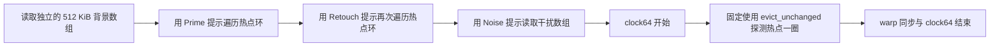

# 9.7.10.2. Cache Eviction Priority Hints

本实验分析五种 eviction priority hints，并回答两个问题：**在发生缓存竞争时，哪些数据更值得保留？一次后续访问是否应改变原有的驱逐优先级？**

代码实际执行全部五种提示的 load/store，分别覆盖显式 `.global` 和指向 global memory 的 generic 地址；性能实验采用同一 warp 内的“准备热点 → 再次访问 → 干扰访问 → 探测热点”。

本例聚焦 **L1 的 `.L1::...` 限定符**。这些是性能提示，不承诺数据永久驻留、不建立线程间同步，也不改变程序的内存一致性语义。定义依据是你提供的材料和 [PTX ISA §9.7.10.2](https://docs.nvidia.com/cuda/parallel-thread-execution/index.html#cache-eviction-priority-hints)。

若从 CUDA C++ 接口开始阅读，可先看 [Low-Level Load and Store Functions](../03_load_store_intrinsics/README.md)。其中 `__ldcs/__stcs` 表达 streaming 策略，但这组 API 没有直接设置 `evict_last/no_allocate` 的参数。

**当前动作索引：[commands/README.md](commands/README.md)。** 每个动作独立脚本、独立目录和同目录日志；先 compile，缺产物不会隐式构建。

## 1. 文件与运行

| 文件 | 用途 |
| --- | --- |
| [main.cu](main.cu) | 五种提示的内联 PTX、10 组拷贝校验、12 组热点探测 |
| [独立动作目录](commands/README.md) | 复用构建、运行、静态分析和 memcheck；记录命令、参数与日志 |
| [inspect.py](inspect.py) | 核对 20 种 PTX 写法及 SASS 计时区间中的实际加载循环 |
| [RESULTS.md](RESULTS.md) | 本机实测、指令映射、现象解释与限制 |

```bash
cd /home/mikasa/hpc/cuda/gpu-architecture-lab/02_memory/02_eviction_priority
bash commands/compile/run.sh  # 显式编译，后续动作只复用
bash commands/run/run.sh
NOISE_KIB=16 bash commands/run/run.sh
HOT_KIB=32 NOISE_KIB=512 SAMPLES=21 bash commands/run/run.sh
bash commands/static/run.sh
bash commands/sanitizer/run.sh
```

默认参数为 `SAMPLES=11 HOT_KIB=16 NOISE_KIB=256`。目标架构默认为本机 `sm_89`，可用 `CUDA_ARCH` 修改；需要支持本例语法的 CUDA Toolkit、C++17，静态分析还需要 `cuobjdump` 和 Python 3。

动作入口为 `commands/<action>/run.sh`；先显式执行 `commands/compile/run.sh`，其余执行/检查动作只复用 `build/<variant>/` 的已有产物，缺失即提示先编译，不隐式构建。修改源码、头文件、编译选项或工具链后必须主动重新编译；没有哈希缓存或自动失效判断。 工具路径可由 `NVCC/CUOBJDUMP/COMPUTE_SANITIZER` 覆盖。

日志位于脚本同目录 `commands/<action>/<variant>.log`，同动作同配置重跑覆盖（包括失败），其他动作日志不变。命令、实际参数、原始输出及退出码均记录；检查器的临时步骤文件在退出后清理。不生成自动快照、时间戳归档或 history。已有 `results/` 原始日志和历史报告保持原样，当前动作不写入。

这些 L1 eviction hints 自 PTX 7.4 引入，要求 `sm_70+`；实际可编译的架构仍受安装的 Toolkit 支持范围约束。运行程序也会检查 GPU compute capability。

`sanitizer` 默认使用 1 个样本、1 KiB 热点、8 KiB 干扰，降低检查耗时；其计时仅为工具输出，不能作为性能证据。退出码 0 表示完成且通过，1 表示失败，77 表示设备不可用或架构不受支持。

## 2. 五个提示分别表达什么

| 提示 | 含义与使用意图 | 容易混淆的地方 |
| --- | --- | --- |
| `evict_normal` | 普通驱逐优先级，作为默认基线 | 不是清空缓存或强制重置已有缓存行状态的命令 |
| `evict_first` | 出现替换需求时优先驱逐，适合临时流式数据 | 可以分配缓存行，不等于完全不缓存或立即失效 |
| `evict_last` | 尽量晚于 normal/first 数据驱逐，适合热点 | 不是锁定缓存行，也不能让超出容量的数据全部驻留 |
| `evict_unchanged` | 本次访问不改变已有驱逐优先级 | 不是设置成 normal；也不保证本次访问一定命中或不分配 |
| `no_allocate` | 本次访问不分配该层缓存行，适合不希望占用 L1 的数据 | 不等于清除已有缓存行，也不等于绕过 L2、每次访问 DRAM |

要区分两个问题：`evict_first` 表达“如果数据进入缓存，愿意让它较早被替换”；`no_allocate` 表达“不为本次访问在这个层级分配缓存行”。二者都可能减少流式数据对热点的影响，但行为并不相同。

`evict_unchanged` 适合“使用已有策略而不重新标记”的访问，例如已经提示为 last 的热点在后续读取时保持原有优先级。缓存未命中、其他访问修改状态和实际替换行为仍需另外考虑，不能仅凭 unchanged 推导一定保留。

## 3. L1、L2 与上一节 cache operators 的区别

```cpp
// p 指向对齐的 global uint32_t；在 __device__ 代码中执行
uint32_t value;
auto address = __cvta_generic_to_global(p);
asm volatile("ld.global.L1::evict_last.u32 %0, [%1];"
             : "=r"(value) : "l"(address) : "memory");
asm volatile("st.global.L1::evict_first.u32 [%0], %1;"
             : : "l"(address), "r"(value) : "memory");
```

使用 generic 地址时省略 `.global`，并传入原始 generic 指针，例如 `ld.L1::evict_last.u32`。本例 generic 测试中的指针始终来自 `cudaMalloc`；它不意味着同一代码可随意传入 shared/local 地址。

`.L1::...` 明确针对 L1。不要把这些例子的前缀直接换成 `.L2::` 并假设五个名字、标量指令和最低架构要求仍全部适用。L2 cache-policy 接口和直接 L2 限定形式有单独的指令、PTX 版本及架构限制，本例不测试它们，也不使用 CUDA Runtime 的 L2 persisting access-policy window。具体语法见 [PTX ld](https://docs.nvidia.com/cuda/parallel-thread-execution/index.html#data-movement-and-conversion-instructions-ld) 与 [PTX st](https://docs.nvidia.com/cuda/parallel-thread-execution/index.html#data-movement-and-conversion-instructions-st)。

上一节的 `.ca/.cg/.cs` 描述缓存访问策略；本节更直接表达驱逐优先级。它们不是可以任意拼接的字符串：本例使用 `ld.global.L1::evict_last.u32` 这一指令形式，不混拼 `.ca.L1::...`。

`asm volatile` 和 `"memory"` 是编译器接口的约束，不是 GPU acquire/release 或内存 fence。提示本身也不修复数据竞争；这部分可结合 [内存模型实验](../../04_sync/01_memory_model/README.md) 阅读。

## 4. 实验 A：每种提示都能正确读写吗

`copy_hint<Hint, Generic>` 对 10,037 个整数执行带提示的读取和写入，输出为 `input[i] ^ tag`。这个长度刻意不整除线程布局，以覆盖尾部处理。

5 种提示 × 2 种地址形式，共 10 组；每组同时包含 load 和 store，CPU 在 kernel 完成后逐元素验证输出，每组使用不同 tag。

这部分证明指令可编译、可运行且结果正确，不以小拷贝的耗时判断 store 的驱逐效果。后面的热点性能实验使用 load，**没有测量不同 store hint 对热点保留的影响**。

## 5. 实验 B：热点、再次访问、干扰与探测

性能测试固定为一个 block、32 个线程。每次 kernel 内的全部阶段都发生在同一个 SM，因而使用同一个 L1；不同样本可能由不同 SM 执行，日志记录 `%smid`。



热点默认 16 KiB。每个线程有一个 128 节点的闭环，节点存放下一节点索引：

```text
lane t：t → 32+t → 64+t → … → 4064+t → t
index = read_hint<Hint>(hot + index);
```

warp 中同一步的 32 个线程访问连续元素，保持合并访问；下一次地址依赖上次加载结果，避免固定地址重复读取被后端移出循环。每个阶段都有结果参与 checksum，最终索引也必须回到原来的 lane。

独立背景数组用 normal 提示读取，给各次试验提供相似的前置访问压力。**它不是具有架构保证的 cache flush**：不保证所有缓存行都失效，不保证相同的缓存组状态，也不保证清除此前的 last 状态。所有数字都属于该前置访问流程下的观察。

整个测试期间 GPU 只读这三个数组，每线程只写自己的结果，没有并发生产者/消费者数据竞争。

## 6. 12 组对照分别改变什么

所有组最后的 timed probe 都使用 unchanged，避免测量阶段采用不同策略。背景数组也都采用相同的 normal 策略。

| 配置名 | 热点 Prime | 热点 Retouch | 干扰 Noise | 目的 |
| --- | --- | --- | --- | --- |
| `no_noise` | normal | unchanged | 无 | 没有干扰阶段的参照 |
| `baseline` | normal | unchanged | normal | 普通竞争基线 |
| `hot_first` | first | unchanged | normal | 错把热点当成优先驱逐对象 |
| `hot_last_unchanged` | last | unchanged | normal | 提示保留热点，后续读取不改变优先级 |
| `hot_last_normal` | last | normal | normal | 与上一组比较再次普通访问的影响 |
| `hot_first_normal` | first | normal | normal | 与 hot_first 比较再次普通访问的影响 |
| `noise_first` | normal | unchanged | first | 降低干扰数据的保留优先级 |
| `noise_last` | normal | unchanged | last | 刻意优先保留干扰数据 |
| `noise_unchanged` | normal | unchanged | unchanged | 不由本次访问重新设定干扰优先级 |
| `noise_no_allocate` | normal | unchanged | no_allocate | 不为干扰访问分配 L1 缓存行 |
| `last_plus_noise_first` | last | unchanged | first | 同时提示保护热点与较早驱逐干扰 |
| `last_plus_noise_no_allocate` | last | unchanged | no_allocate | 保护热点并避免干扰分配 L1 |

除指定列之外，同一干扰规模下的数据、布局和访问次数一致；`no_noise` 刻意省略干扰阶段。测量的是之后的 probe，因此不将“少执行了一段干扰读取”的总耗时减少当作缓存保留收益。

## 7. 应怎样提出与验证假设

预期在确实发生缓存竞争时，baseline 的热点 probe 可能比 no_noise 更慢；hot_last、noise_first 和 noise_no_allocate 有可能让 probe 接近无干扰状态。但这些是需要验证的假设，不是程序断言。

可以设计将干扰从 256 KiB 缩小为 16 KiB 的实验：普通热点和普通干扰更有机会共存；如果 baseline 随之接近 no_noise，会支持“差异与竞争有关”的解释。这是实验设计，不是当前日志中的参数对照：同 action 最新调用会覆盖此前结果，当前仅保留 16 KiB run；已删除的 256 KiB 数值不再作为证据。

但工作集总字节数小于某个缓存容量，不足以保证零替换。缓存组映射、可用容量、优先级策略、背景访问都可能影响结果；尤其不能假设 `hot_first` 只要数据很小就一定安全。

对 `last → unchanged` 与 `last → normal`，要检验实际结果，不能预先把 normal 当作强制降级操作。本机恰好没有在这对配置中看到时间差异，详见 [RESULTS.md](RESULTS.md)。

## 8. 计时、校验与静态检查

每个配置预热一次，随后默认采样 11 次；每轮轮换起始配置，减轻固定顺序偏差。每个样本校验全部 32 个线程的 checksum、环终点、SM 编号一致性和非零计时，性能汇总使用 lane 0 的 probe cycles。

`clock64` 记录 SM 周期计数差。区间包含一次完整的依赖加载环，以及循环、地址计算和末尾 warp 同步等成本；不是单条加载的精确 latency，不是墙钟纳秒，也不是 L1 hit rate。不同配置的阶段代码、资源使用和缓存状态也可能影响测量，因此同时保留 min/median/max 与原始样本。

SASS 检查确认两个时钟读取之间确实存在带加载的回跳循环。检查脚本同时确认全部 20 种 PTX 组合（5 hints × load/store × global/generic），并报告对应机器指令。编译器可能省略它能证明多余的同步指令，实际区间应以生成代码为准。

`memcheck` 检查非法访存；本例没有通过它推断缓存状态。当前没有采集 L1/L2 硬件计数器，因此分析只报告计时、指令和功能结果，不把周期数换算成命中率。

## 9. 学习顺序

先运行默认实验并查看 `RESULT`，再缩小 `NOISE_KIB`；随后阅读 `hot_probe` 的三种模板提示和固定 probe 策略，最后用 `static` 核对时间区间。将 [上一节 Cache Operators](../01_cache_operators/README.md) 的缓存层级选择与本节的驱逐优先级分开理解，会更容易判断提示究竟影响了哪一部分。
