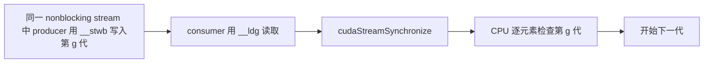

# 5.4.8.3. Low-Level Load and Store Functions

本专题把 CUDA C++ 的低层访存 intrinsic 与已有 [PTX Cache Operators](../01_cache_operators/README.md)、[Cache Eviction Priority Hints](../02_eviction_priority/README.md) 实验连接起来：从 C++ 重载、合法地址和数据生命周期出发，逐元素验证结果，再检查实际生成的 PTX/SASS。

源码见 [main.cu](main.cu)，公共封装见 [ops.cuh](ops.cuh)，本机证据见 [RESULTS.md](RESULTS.md)，定位过程与复现方法见 [DEBUGGING.md](DEBUGGING.md)。

**当前动作索引：[commands/README.md](commands/README.md)。** 每个动作独立脚本、独立目录和同目录日志；先 compile，缺产物不会隐式构建。

## 1. 这组 API 解决什么问题

普通 `*p` 由编译器选择访存形式。这组 intrinsic 让程序表达只读路径或缓存策略；调用返回一个 `T` 值或写入一个 `T`，不会创建异步任务，也不会让其他线程自动到达同步点。函数签名中的 `T` 是文档的概括，实际使用必须匹配编译环境提供的重载。[CUDA C++ §5.4.8.3](https://docs.nvidia.com/cuda/cuda-programming-guide/05-appendices/cpp-language-extensions.html#low-level-load-and-store-functions)

| CUDA C++ 调用 | 对应 PTX 形式（以 `unsigned` 为例） | 语义重点 |
| --- | --- | --- |
| `__ldg(p)` | `ld.global.nc.u32` | 非一致只读缓存路径；输入在该 kernel 执行期间保持只读 |
| `__ldca(p)` | `ld.global.ca.u32` | 所有适用缓存层；可重复使用数据 |
| `__ldcg(p)` | `ld.global.cg.u32` | 绕过 L1，使用 L2 及以下层级 |
| `__ldcs(p)` | `ld.global.cs.u32` | streaming，倾向优先驱逐 |
| `__ldlu(p)` | `ld.global.lu.u32` | last-use；对 global 地址具有 streaming 语义 |
| `__ldcv(p)` | `ld.global.cv.u32` | 对 global **系统内存**地址，丢弃匹配 L2 行并重新获取 |
| `__stwb(p,v)` | `st.global.wb.u32` | 一致缓存层的正常 write-back 策略 |
| `__stcg(p,v)` | `st.global.cg.u32` | global 层缓存写入，绕过 L1 |
| `__stcs(p,v)` | `st.global.cs.u32` | streaming 输出，倾向优先驱逐 |
| `__stwt(p,v)` | `st.global.wt.u32` | 对 global **系统内存**地址，写穿 L2 |

`.ca/.cg/.cs/.lu/.cv` 和 `.wb/.cg/.cs/.wt` 是性能提示，不改变内存一致性；`.cv/.wt` 的系统内存限定不能省略。`cudaMalloc` 分配的设备内存与 mapped host memory 要分别分析。[PTX Cache Operators](https://docs.nvidia.com/cuda/parallel-thread-execution/index.html#cache-operators)

`__ldg` 需要单独理解：它选择 `ld.global.nc`，并不是另一个普通缓存算子。PTX 的内存一致性模型不覆盖 texture 路径，包括 `ld.global.nc`；因此不能把普通跨线程发布协议中的读取随意替换成 `__ldg`。[PTX 内存模型适用范围](https://docs.nvidia.com/cuda/parallel-thread-execution/index.html#scope-and-applicability-of-the-model)

## 2. 编译与运行

本次验证环境为 CUDA Toolkit 13.4、RTX 4060 Laptop、`sm_89`。脚本采用 C++17、`-O3 -lineinfo`，可执行文件同时包含目标 cubin 和对应 PTX。使用 `cuda_fp16.h`、`cuda_bf16.h` 引入扩展浮点重载；应以安装的 Toolkit、目标架构和驱动共同确认支持条件，不能把历史 PTX cache operator 的 `sm_20` 门槛直接当作完整样例的编译门槛。

从本目录运行：

```bash
export CUDA_ARCH=sm_89                 # 按设备和 Toolkit 支持范围调整
bash commands/compile/run.sh                     # 只编译
bash commands/run/run.sh                       # 默认 n=4099，再运行 n=1 边界
bash commands/static/run.sh                    # 16 个命名 kernel 的 PTX/SASS 检查
bash commands/types/run.sh                     # 24 项独立编译探针，不执行 GPU 代码
bash commands/sanitizer/run.sh                 # n=257，Compute Sanitizer memcheck
```

可通过 `ELEMENTS=8195 bash commands/run/run.sh` 改变元素数；范围为 `1..1048576`。mapped 场景固定 1027 个 `unsigned`，与该参数独立。工具路径可以用 `NVCC`、`CUOBJDUMP`、`COMPUTE_SANITIZER` 覆盖。

动作入口为 `commands/<action>/run.sh`；先显式执行 `commands/compile/run.sh`，其余执行/检查动作只复用 `build/<variant>/` 的已有产物，缺失即提示先编译，不隐式构建。修改源码、头文件、编译选项或工具链后必须主动重新编译；没有哈希缓存或自动失效判断。 `types` 是独立的编译契约实验，每次重新编译全部正负探针并匹配诊断，工具故障不能当作 overload 拒绝。

日志位于脚本同目录 `commands/<action>/<variant>.log`，同动作同配置重跑覆盖（包括失败），其他动作日志不变。命令、实际参数、原始输出及退出码均记录；检查器的临时步骤文件在退出后清理。不生成自动快照、时间戳归档或 history。已有 `results/` 原始日志和历史报告保持原样，当前动作不写入。

不再创建日期目录或源码/脚本副本，编译及检查器直接使用专题源码；执行期间不要改源码或并发运行同一配置。历史合并范围与复现条件见 [results/README.md](results/README.md)。`run` 和 `sanitizer` 需要实际 GPU；`static`、`types` 不需要初始化 CUDA 设备。

## 3. 实验 A：34 种类型 × 12 个访存变体

[types.inc](types.inc) 是实际覆盖列表：

| 类别 | 覆盖类型 |
| --- | --- |
| 13 种基础数值类型 | `char`、`signed/unsigned char`、`short/unsigned short`、`int/unsigned int`、`long/unsigned long`、`long long/unsigned long long`、`float`、`double` |
| 17 种 CUDA vector 类型 | `char2/4`、`uchar2/4`、`short2/4`、`ushort2/4`、`int2/4`、`uint2/4`、`longlong2`、`ulonglong2`、`float2/4`、`double2` |
| 4 种扩展浮点类型 | `__half`、`__half2`、`__nv_bfloat16`、`__nv_bfloat162` |

每种类型独立执行 7 个读取版本（普通读取、`__ldg`、五种 cache load），结果用普通 store 写入；另执行 5 个写入版本（普通写入、四种 cache store），输入用普通 load 读取。合计 `34 × (7+5) = 408` 个变体检查。两组的普通 copy 基线重复计数；这不是 7×5 的组合穷举。

核心 kernel 可直接复用：

```cpp
template <Load L, Store S, class T>
__global__ void copy_values(const T* src, T* dst, size_t n) {
    for (size_t i = blockIdx.x * blockDim.x + threadIdx.x; i < n;
         i += static_cast<size_t>(blockDim.x) * gridDim.x)
        write_value<S>(dst + i, read_value<L>(src + i));
}
```

所有变体使用相同输入，`src` 与 `dst` 分别分配，输入在整个 kernel 期间保持不变。半精度和 bfloat16 数据采用可精确表示的小数，vector 的各分量使用不同值。实验只搬运数据，不做浮点归约，不把舍入误差混入访存比较。

输出先填充 `0xa5`，头尾各保留 4 个 `T` 作为 guard。有效区必须逐元素、逐字节匹配输入；guard 必须保持原样。最后还检查输入未被修改。当前覆盖类型没有需要忽略的 padding 字节，因此可以这样做逐字节比较；增加带 padding 的结构体时不能照搬这一验证方式。

默认 4099 个元素让最后一个 block 不满 128 线程，另测 `n=1`；两者检查尾部条件和小规模输入。每个变体都检查 launch 错误并同步，以便把异步错误定位到具体步骤。这个小数组实验用于验证搬运语义，**没有测量访存吞吐或缓存命中率**。

## 4. 实验 B：`__ldg` 的只读生命周期

同一块设备内存连续经历三代数据：



producer 和 consumer 分属两个 kernel，在同一个 stream 中顺序启动。producer 完成后才开始 consumer；consumer 执行期间没有任何写入其输入的线程。每代结果与 CPU 的无符号整数公式逐元素比较。三次检查说明：可以在有序 kernel 之间更新同一 allocation，“只读”并不意味着 allocation 永远不能改。

正确性来自两个条件共同成立：kernel 依赖关系提供执行顺序与可见性；`__ldg` 读取期间满足只读约束。`__stwb` 本身不建立依赖。NVIDIA 对只读缓存明确要求数据在整个 kernel 期间只读。[只读缓存约束](https://docs.nvidia.com/cuda/archive/11.8.0/kepler-tuning-guide/index.html#read-only-data-cache) 这里引用旧指南解释约束，不使用其 Kepler 缓存组织推断当前 Ada GPU。

以下思路不应写成“观察旧值概率”的有效实验：

```cpp
// 错误思路，未纳入可执行路径：
float old = __ldg(p);
*p = new_value;
// 即使这里添加 __syncthreads() 或 __threadfence()，也没有满足
// 此 kernel 对该输入的整个执行期间只读这一前提。
float again = __ldg(p);
```

`const T*` 只禁止通过该指针写入，其他别名、其他线程或并发 kernel 仍可能写入。`__restrict__` 是给编译器的不别名承诺，必须由调用者保证，不能靠它修复本来就重叠的输入输出。

`probe.cu` 对比普通 `const unsigned*`、`const unsigned* __restrict__` 和显式 `__ldg`。本机后两者生成相同只读加载。编译器自动选择只读路径的说明见 [CUDA `__restrict__`](https://docs.nvidia.com/cuda/cuda-programming-guide/05-appendices/cpp-language-extensions.html#restrict)。普通源码写法并不保证固定 PTX，判断时应检查实际编译结果。

## 5. 实验 C：mapped 系统内存上的 `__ldcv` / `__stwt`

程序在 context 初始化前请求 `cudaDeviceMapHost`，检查 `canMapHostMemory`，再用 `cudaHostAllocMapped` 和 `cudaHostGetDevicePointer` 建立可供 GPU 访问的 host allocation。不满足能力条件时明确输出 `SKIP`。

每代执行两次交接，共两代：

1. CPU 写 mapped 数组；kernel 用 `__ldcv` 读取到设备输出；同步完成后拷回检查。
2. CPU 准备另一份设备输入；kernel 用 `__stwt` 写 mapped 数组；`cudaDeviceSynchronize()` 返回后 CPU 才读取检查。

这样能够在真正的系统内存地址上执行这些 intrinsic，并检查值搬运正确。CPU 和 GPU 没有并发访问同一数组。四次检查的通过不能单独证明 L2 invalidation 次数或写穿产生的总线流量；这些指标没有采集。

两种常见误读需要避免：把 `__ldcv(cudaMalloc_pointer)` 解释为“每次必读显存”；把 `__stwt` 解释为“CPU 此刻已经同步看到写入”。本例中 CPU 访问的合法时机由 CUDA 同步 API 确定。

## 6. 类型、对齐和重载边界

文档概述称支持基础类型及非 x3 CUDA vector。对可运行代码，更可靠的做法是枚举实际类型并编译验证。当前 CUDA 13.4/Linux 环境中：

| 候选类型 | 普通 `*dst = *src` | `__ldg` / `__ldca` / `__stwb` |
| --- | --- | --- |
| `unsigned` | 成功 | 全部成功，正向控制 |
| `bool`、`long double` | 成功 | 缺少匹配重载 |
| `int1`、`float3` | 成功 | 缺少匹配重载 |
| `struct Pair { float x,y; }` | 成功 | 缺少匹配重载 |

这是 `type_probe.cu` 的 24 项独立编译结果，不是泛化到所有 CUDA 版本的支持清单。特别是 `bool/long double/int1` 说明不能把概述机械理解为任意 C++ 基础类型或任意非 x3 vector 都有可调用重载。探针只对表中三种 intrinsic 检查这些候选类型，其余失败重载不在本表的实测范围。

处理不支持的表示时，应选择显式存储布局。例如布尔数组可以设计成 `unsigned char` 的 0/1 数组；`float3` 可按成员分别访问：

```cpp
// src 是真正的 float3 数组，并且满足只读前提：
float3 v = make_float3(__ldg(&src[i].x),
                      __ldg(&src[i].y),
                      __ldg(&src[i].z));
```

不要把 `float3*` 强转成 `float4*`：12-byte 元素间距、16-byte 访问宽度和对齐要求不同，还可能读过分配末尾。类似地，两个相邻 `float` 不因形状相似就自动成为一个合法 `float2` 对象。

所有 intrinsic 的地址应指向正确类型、正确对齐的 global memory。`cudaMalloc` 提供充足基址对齐，本例只做按 `T` 元素偏移，保留 `alignof(T)`；日志逐类型打印 `sizeof/alignof`。不能任意加一个字节后再 cast 回 `T*`，也不能把 `__shared__` 地址传给这些 global 缓存访问函数。

`__half2` 和 `__nv_bfloat162` 各为 4 bytes，但“搬运 4 bytes”并不代表执行了浮点转换。本机 `__ldg(__half2*)` 使用 `.b32`，`__stcs(__nv_bfloat162*)` 也使用 `.b32`，位模式被原样搬运。

访问宽度如何影响合并访问，单独见 [Coalescing：指令、Lane 与 Sector](../04_coalescing/README.md)。该专题用 CPU 单元测试对照向量 load、同归属标量 load 与跨 lane 连续标量 load；不把本专题的类型验证或 Cache Operator 选择当作合并效率的证明。

## 7. 如何连接已有 cache 实验

| 层次 | 本专题与相邻专题的关系 |
| --- | --- |
| C++ 接口 | 本专题使用真实重载，省去手写寄存器约束和地址空间转换 |
| PTX cache operator | `__ldca` 等映射到已有 01 专题中的操作符；只读 `.nc` 另有前提 |
| eviction priority | 本组 API 没有 `evict_last/no_allocate` 参数；02 专题展示的是另一层显式提示 |
| 内存同步 | 请看 [CUDA C++ Memory Model](../../04_sync/01_memory_model/README.md)，缓存选择不代替 atomics、fence 或 stream 依赖 |

01 专题已有依赖地址环和 streaming 性能实验。若要比较 intrinsic 与手写 PTX 的性能，应在同一 workload 中替换加载封装，保持地址依赖、输入规模、launch、预热和计时区间一致，并重新检查循环内的 SASS。重复写 `__ldg(p)` 不保证每次都真的访存，编译器可以利用只读事实复用结果。

本专题的正确性、编译重载与静态映射结果不能直接当作性能排名。即使 SASS 相同，也只说明这些受控小 kernel 的指令选择相同；完整应用还受合并访问、寄存器压力、占用率、其他访存和数据复用影响。
