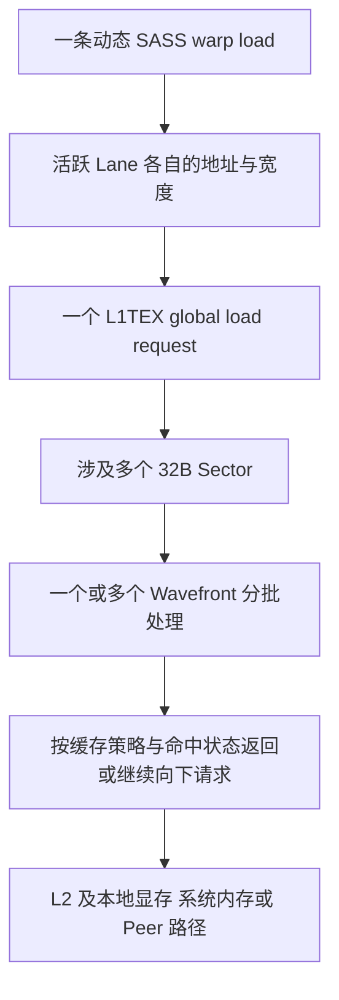

# 从 `ld.global.v4.u32` 理解指令、Lane 与访存合并

本节承接 [实验 A 的类型搬运与类型/对齐分析](../03_load_store_intrinsics/README.md)；主主题是 **Global Memory 的访问宽度与 Coalescing（合并访问）**，交叉涉及 SIMT 执行、PTX/SASS 映射及 L1TEX 请求。缓存提示见相邻 [Cache Operators](../01_cache_operators/README.md)，不要把访问宽度、缓存策略和同步混成同一个问题。

**证据范围：本文数字是明确假设下的地址集合推导，配套 Python 单元测试只验证该模型。未为本节编译 CUDA、执行 GPU、检查新 SASS 或采集性能指标；相邻专题既有 RESULTS 不是本节新对照的实测。** 本专题测试记录见 [RESULTS.md](RESULTS.md)，保留日志的独立动作见 [commands/README.md](commands/README.md)。

本专题独立于 Cache Operators：先固定缓存策略研究地址合并，再固定布局研究缓存行为，不把两类变量同时改变。它承接 Memory Explorer 中的 `coalescing` 规划，目前只有 CPU 模型，不代表完整 stride/GPU 性能扫描已实现。

## 1. 从一个线程的四个数开始

`uint4` 包含四个 32-bit 无符号整数，大小和自然对齐均为 16B。下面是相邻专题已有 [`main.cu::copy_values`](../03_load_store_intrinsics/main.cu) 在普通 load/store、`T=uint4` 时的教学简化，不是新增的独立 GPU 程序：

```cpp
__global__ void copy_kernel(const uint4* src, uint4* dst, size_t n) {
    size_t tid = static_cast<size_t>(blockIdx.x) * blockDim.x + threadIdx.x;
    if (tid < n) {
        uint4 value = src[tid];
        dst[tid] = value;
    }
}
```

`src[tid]` 的地址是 `src` 基址加 `16 * tid` 字节，而不是加 `tid` 字节。前提是输入输出分别指向足够大的合法 `uint4` 数组；输入在读取期间不被并发修改。这里只分析读取，写入是另一条指令及另一组请求，不能漏算后声称得到整个 copy 的流量。

只观察第一个 warp（32 个线程的执行分组），假设 32 个 lane 都通过 `tid < n`，基址为 32B 对齐的 `B`：

| Lane（warp 内线程编号） | 起始地址 | 读取区间，含两端 | 每 Lane 字节数 |
| --- | --- | --- | --- |
| 0 | B | B+0 … B+15 | 16 |
| 1 | B+16 | B+16 … B+31 | 16 |
| 2 | B+32 | B+32 … B+47 | 16 |
| 31 | B+496 | B+496 … B+511 | 16 |

一条可能的 PTX 是：

```ptx
ld.global.v4.u32 {%r0, %r1, %r2, %r3}, [%rd0];
```

`ld` 是加载，`.global` 指地址空间，`.v4` 表示**每线程四个分量**，`.u32` 表示每分量为 32-bit 无符号整数。每个线程都有自己的 `%rd0` 地址和目的寄存器；`.v4` 不是四个 lane，更不是整个 warp 只读四个整数。`global` 也不表示必定访问显存。

SIMT 是多个线程共享指令执行、各自保留状态的模型。PTX 是虚拟指令集，不直接等于硬件指令；编译器把它映射为 SASS（机器指令）。**若实际生成一条 128-bit global load**，可从 warp 指令视角理解为一条动态 load，活跃 lane 各取 16B，共 `32 × 16 = 512B`。这既不是依次发射 32 条独立 load，也不是一个硬件周期就完成 512B 传输；物理执行宽度、内部批次及重放等不能从 PTX 条数确定。

## 2. 按一条指令画地址，而不是按整个 kernel 算一次

Sector 在这里指 32B 的地址段。采用现代设备常用的 32B global 合并访问模型（CUDA Best Practices 对 compute capability 6.0+ 的说明），对一条指令列出全部活跃 lane 的地址区间，取其覆盖的 sector 编号集合：

```text
lane 区间 = [address, address + width - 1]
sector 编号 = byte_address // 32
S(instruction) = 所有 active lane 覆盖的 sector 编号的并集
```

这是**地址模型**，不是 DRAM 事务模拟器。合并访问处理的是同一条动态访存指令内的地址，不会把线程寄存器合并，也不把不同程序指令自动算作一个请求。

上例中 lane 0、1 共用 sector 0，lane 2、3 共用 sector 1，直到 lane 30、31 共用 sector 15；因此覆盖 16 个 sector。对比每 lane 只读 4B：

| 每条指令的地址模式 | Lane 读取量合计 | 不重复数据字节 | Sector 数 | Sector 覆盖字节 |
| --- | --- | --- | --- | --- |
| `4 * lane`，宽 4B | 128B | 128B | 4 | 128B |
| `32 * lane`，宽 4B | 128B | 128B | 32 | 1024B |
| 所有 lane 读地址 0，宽 4B | 128B | 4B | 1 | 32B |
| `16 * lane`，宽 16B | 512B | 512B | 16 | 512B |

第二行体现 stride（相邻线程起址间距）造成的浪费；第三行是重复读取，不能把 128/32 称作 400% 的物理字节利用率。部分活跃 warp 也应只统计真正执行的 lane：连续 3 个 lane 读 16B 覆盖 2 个 sector；只有偶数 lane 活跃则仍覆盖 16 个 sector，却只使用 256B。

## 3. 向量化与数据归属：三种布局的单变量对照

固定 512B 数据范围、32 个活跃 lane、32B 对齐基址。下列地址以字节表示，`k=0,1,2,3`。假设实际机器码保留相应的一条宽 load 或四条标量 load：

| 模式 | 第 k 条指令的 Lane 地址 | Warp load 数 | 各条 Sector 数 | Sector 次数之和 | 跨指令去重 Sector 数 |
| --- | --- | --- | --- | --- | --- |
| 向量，每 lane 连续四个数 | `16 * lane`，宽 16B | 1 | 16 | 16 | 16 |
| 标量，同样的数据归属 | `16 * lane + 4 * k`，宽 4B | 4 | 16、16、16、16 | 64 | 16 |
| 标量，跨 lane 连续 | `128 * k + 4 * lane`，宽 4B | 4 | 4、4、4、4 | 16 | 16 |

第二行可由 `p[4*lane+k]` 理解：第一条只读每组四个整数的第一个，但这些地址已经分布在 16 个 sector 中；后续三条再次访问相同 sector 集合。第三行是 `p[32*k+lane]`，每条指令连续读取 128B，代价是线程拥有的数据变了。例如 lane 0 在向量/同归属标量中拿到元素 0、1、2、3，在跨 lane 连续布局中拿到 0、32、64、96。算法若要求原归属，重新分配可能需要 shuffle 或 shared memory，不能忽略其成本。

`sum(len(S_i))` 与 `len(union(S_i))` 是两个不同问题。64 次 L1 sector 访问不等于 64 个不同 sector，更不等于四倍 HBM 流量：后续请求可能命中缓存，也可能与在途 miss 合并；具体行为需测量。即使去重后都是 16 个 sector，也不能推断三种实现同速。

源码中四次标量访问可能被编译器合并，宽类型也可能被拆分、裁剪或消除。因此这张表是**给定指令序列的模型对照**，不是仅凭 C++ 类型得出的编译结论。不要通过任意 `reinterpret_cast<uint4*>` 强行“优化”：必须同时保证对象/类型使用合法、16B 对齐和访问不越界。

## 4. 对齐分三层检查

PTX 向量 load 要求按总访问大小自然对齐：`ld.global.v4.u32` 每个 lane 的地址必须是 16 的倍数。不满足属于未定义行为，不能作为有效的“慢一点”实验。下面基址偏移均相对 128B 对齐地址，宽度/步长都为 16B：

| 起始偏移 | PTX 16B 对齐合法 | 512B 覆盖的 32B Sector | 覆盖的 128B 地址段 |
| --- | --- | --- | --- |
| 0 | 是 | 16 | 4 |
| 16 | 是 | 17 | 5 |
| 32 | 是 | 16 | 5 |
| 4 | 否 | 不作为有效向量访问对照 | 不作为有效向量访问对照 |

偏移 16 的有效字节/sector 覆盖是 `512 / (17*32) ≈ 94.1%`；这不是实测带宽。偏移 32 说明 sector 对齐不等于 128B 行对齐。128B 地址段在这里用于 Nsight Compute 的 L1 cache line 模型，**不能直接写成通用 L2 cache line 大小**。Nsight Compute 的 L2 模型采用 32B cache line/sector，并描述最多含四个 sector 的请求；请求聚合粒度不能等同于 cache line 大小。跨架构或工具版本分析时，应核对该版本对 line、sector、request 的定义。

## 5. Request、Wavefront 和下层传输不是同一计数

对 Nsight Compute 文档描述的 Turing 及更新架构的常规 global load 路径，在相应统计口径下可理解为：



Wavefront 是 L1TEX 内部处理请求的工作批次，不是另一个 warp，也不是 DRAM 数据包。一个 request 可以需要多个 wavefront；仅凭 16 个 sector 无法算出准确批次数。缓存策略也重要：例如 `.cg` 绕过 L1 数据缓存，不应套用“第一条必定填入 L1，后三条必定命中”的叙述。

“Memory Transaction”必须说明所在层级。教学中的 32B 合并事务模型、L1 sector 访问、L2 请求、DRAM 命令、NVLink packet 不是可互换的单位。L1 miss 不能直接推导 HBM 流量；`.global` 地址还可能映射系统内存或 peer memory。现有 mapped 实验 C 检查的是顺序交接和数据正确性，不是 P2P/NVLink 带宽实验。

## 6. 接回现有源码与性能分析

- [`main.cu::copy_values`](../03_load_store_intrinsics/main.cu) 经 [`ops.cuh::read_value/write_value`](../03_load_store_intrinsics/ops.cuh) 选择普通读取或 intrinsic；实验 A 已覆盖 `uint4/float4` 等类型，适合先理解元素索引、宽度和尾部活跃 lane。
- [`probe.cu::probe_float4_ca`](../03_load_store_intrinsics/probe.cu) 表达每线程四个 32-bit 浮点分量读取，与 `.v4.u32` 宽度相同、类型解释不同。它不按 lane 索引，**仅供静态编译观察，不应启动多个线程作为连续复制实验**，否则输出存在并发写入问题。
- [`check_static.py`](../03_load_store_intrinsics/check_static.py) 检查该探针的 PTX 含 `ld/global/ca/v4/f32`，并存在 SASS `LDG`；它打印 SASS，但没有强制验证 `.128`。静态 PASS 不能代替逐 kernel 核对实际宽度和条数，也不能证明动态请求数。

本轮只运行下一节单元测试，不执行现有 `compile/static/run` 或 profiler 动作。将来需要硬件验证时，应先按 [Intrinsics 动作索引](../03_load_store_intrinsics/commands/README.md) 显式编译目标架构，再检查该构建的 PTX/SASS；三种布局的 GPU 对照当前尚未实现，不能把现有 probe 当成它们的等价实现。性能比较还需固定输入、对齐、活跃线程、缓存策略、预热及计时范围，并分别检查读和写。

| 未来核对项 | 应回答的问题 | 不能据此断言 |
| --- | --- | --- |
| 目标 kernel 的 SASS 及动态指令统计 | 是否真是一条宽 load 对四条标量 load | PTX 一条就一定只发射一次 |
| L1 requests、sectors、sectors/request | 每个请求的地址合并是否符合布局 | 128-bit 的 16 sectors/request 比 32-bit 的 4 更差 |
| L1 wavefronts、命中情况 | 内部工作批次和缓存复用 | 一个 request 只占一个周期 |
| L2 sectors、miss、设备内存字节 | 有多少请求继续向下 | L1 sector 覆盖就是 HBM 字节 |
| Peer 指标和链路带宽（确有 P2P 时） | 是否实际进入 peer 路径、链路是否饱和 | L2 peer miss 数等于 NVLink packet 数 |

32 个活跃 lane 连续无重叠读取时，4/8/16B 宽度的理想 sector/request 分别是 4/8/16；部分活跃线程、重复地址和其他指令类别不应机械套这个标准。NCU 的 section 可从 `MemoryWorkloadAnalysis_Tables`、`InstructionStats` 入手，实际指标名和可用性须按安装版本查询。本轮未采集这些指标。

向量化可能减少指令发射、请求生成与地址计算，但仍需传输 512B，且宽 load 可能需要多个内部批次。两个版本最终都保留四个值时，目的数据量同为每 lane 128 bit；实际寄存器分配还受活跃区间、调度和其他变量影响，不能断言宽 load 必定增加或减少 occupancy。是否更快、快多少，必须通过正确性检查后的同条件计时验证，不能从 4→1 条指令推导四倍加速。

## 7. CPU 单元测试：预测、运行、解释

[coalescing_model.py](coalescing_model.py) 只把一次指令的活跃地址映射到 sector 集合；地址列表省略不活跃 lane。`covered_segments(..., segment_bytes=128)` 仅用于地址段对照，不模拟缓存。宽度限制为本教程的 4/8/16B，自然对齐错误直接拒绝，不在 GPU 上执行非法访问。

在工作区 `cuda/` 根目录运行（Python 3，无第三方依赖）：

```bash
python3 -B -m unittest discover -s gpu-architecture-lab/02_memory/04_coalescing -p test_coalescing_model.py -v
```

`-B` 禁止写入 Python 字节码缓存，`discover -s` 指定测试目录，`-p` 仅选择本节测试，`-v` 显示用例名。测试核对三种布局、4/8/16B 宽度、stride、重复地址、部分/空活跃集合、合法偏移与非法对齐。预期通过只表示集合算术符合预期，不表示 CUDA 编译、缓存行为或性能通过；若失败先检查地址单位是否为字节，以及是否错误地跨指令去重。

需要像其他专题一样保存原始输出与退出状态时，在工作区根目录执行：

```bash
bash gpu-architecture-lab/02_memory/04_coalescing/commands/test/run.sh
```

该脚本将同一组测试结果保存到 [commands/test/cpu.log](commands/test/cpu.log)。仅需 Python 的底层命令与需要 Bash/公共日志工具的动作脚本分开；不设置 `CUDA_ARCH`，也不隐式构建 GPU 程序。重跑覆盖与证据保留规则见 [动作说明](commands/README.md)。

先预测再看测试：

1. 只让 lane 0、2、4 … 30 读取 16B，sector 数是否减半？不会，每个 lane 占据不同 sector 的一半。
2. 起址偏移 16B 与 32B，为何都跨五个 128B 段，但只有前者多一个 sector？分别画出首尾边界。
3. 四条同归属标量 load 的总次数 64，去重数 16，为什么二者都不是 HBM 实测量？解释缓存命中与在途请求的影响。
4. 把宽度与步长同时改成 8B，满 warp 覆盖多少 sector？8 个；不要只改宽度却忘记地址布局。

## 参考定义

- [PTX ISA：ld](https://docs.nvidia.com/cuda/parallel-thread-execution/index.html#data-movement-and-conversion-instructions-ld) 与 [地址/对齐](https://docs.nvidia.com/cuda/parallel-thread-execution/index.html#addresses-as-operands)：向量形式及自然对齐约束。
- [CUDA Best Practices：Coalesced Access](https://docs.nvidia.com/cuda/cuda-c-best-practices-guide/index.html#coalesced-access-to-global-memory)：32B 模型与偏移/stride。
- [Nsight Compute Profiling Guide](https://docs.nvidia.com/nsight-compute/ProfilingGuide/index.html#memory-workload-analysis)：L1TEX/L2、request/sector/wavefront 的统计定义及适用架构。
- [CUDA Pro Tip: Increase Performance with Vectorized Memory Access](https://developer.nvidia.com/blog/cuda-pro-tip-increase-performance-with-vectorized-memory-access/)：向量化的指令数收益、对齐与资源代价；文章的硬件结果不是本工作区新实测。
