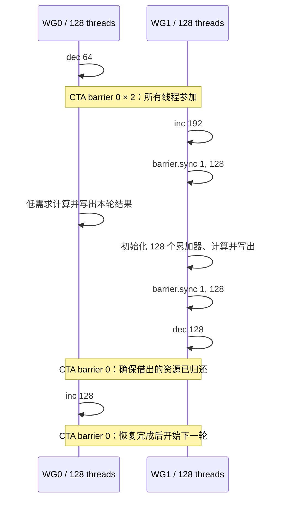

# 9.7.21.5. PTX `setmaxnreg`：warpgroup 寄存器重分配

这个实验回答三个问题：怎样合法地在一个 CTA 内交换寄存器配额；怎样让编译器把更多物理寄存器用于消费者分支；怎样区分编译成功、静态 spill 改善和真实运行效果。

实现见 [main.cu](main.cu)，入口见 [独立动作目录](commands/README.md)，本次数据见 [RESULTS.md](RESULTS.md)，实际遇到的问题、修正和复查步骤见 [DEBUGGING.md](DEBUGGING.md)。

**本次环境是 RTX 4060 Laptop、CC 8.9，不能执行 `setmaxnreg`。** 已提供可运行并经过校验的 `sm_89` 计算基线，以及可交叉编译的 `sm_90a` 动态版本。动态版本在不匹配的设备上返回 77；不会静默替换成空指令并报告通过。

**当前动作索引：[commands/README.md](commands/README.md)。** 每个动作独立脚本、独立目录和同目录日志；先 compile，缺产物不会隐式构建。

## 1. 语义：改变配额，不是修改变量

```ptx
setmaxnreg.dec.sync.aligned.u32 64;
setmaxnreg.inc.sync.aligned.u32 192;
```

这里的 `64`、`192` 是调整后的**每线程绝对配额**。例如从 128 执行 `dec 64`，每线程释放 64 个寄存器；从 128 执行 `inc 192`，每线程申请 64 个寄存器。它们不是减去 64、增加 192。

| 约束 | 对代码的要求 |
| --- | --- |
| 立即数为 24～256，且为 8 的倍数 | 用模板参数和内联 PTX 的 `"n"` 约束，在编译时确定 |
| `.dec` 的目标不能大于当前配额 | 明确每一阶段的进入状态 |
| `.inc` 的目标不能小于当前配额 | 多轮执行前恢复初始状态 |
| `.inc` 可能等待 CTA 池中的资源 | 先释放，再申请；不能依赖等待者之后才执行的释放 |
| 同一 warpgroup 的四个 warp 必须执行相同指令 | 按完整 warpgroup 划分角色，不按单个 warp 或 lane 划分 |
| 相邻的 `setmaxnreg` 之间需要显式 warpgroup 同步 | 使用覆盖参与者的 CTA 屏障或 128 线程屏障 |
| 调整发生在寄存器文件尾部 | 缩减前结束高寄存器值的生命周期；扩张后重新初始化 |
| 需要有效的编译期寄存器配置 | 核对编译参数、cubin 资源元数据和运行时函数属性 |

`.sync` 等待同一个 warp 内的线程，不能据此认为四个 warp 已完成一次集体同步。`.aligned` 是调用方必须满足的一致性约束，不负责把错误的分支自动变成一致执行。新申请的寄存器内容未定义，不能把“归还后再次申请”当作保存和恢复寄存器值。

以上来自用户提供的材料及 [PTX ISA `setmaxnreg`](https://docs.nvidia.com/cuda/parallel-thread-execution/index.html#miscellaneous-instructions-setmaxnreg)。本例不把这条指令当作数据发布、内存 fence 或线程间传值机制。

## 2. 支持条件与编译目标

指令在 PTX ISA 8.0 引入。按本次核对的官方条目：

| 类别 | 条目列出的目标 |
| --- | --- |
| 架构专用 | `sm_90a`、`sm_100a`、`sm_110a`、`sm_120a` |
| 旧名称 | `sm_101a` 自 PTX 9.0 改名为 `sm_110a` |
| 家族专用 | PTX 8.8 起的 `sm_100f`、`sm_101f`、`sm_120f` 及各自同家族的兼容目标；`sm_101f` 自 PTX 9.0 改名为 `sm_110f` |

“同家族更高版本”不能理解成所有数值更大的 SM。普通 `sm_90` 目标也不等同于 `sm_90a`。本实验实际验证了 `ptxas` 拒绝 `sm_89` 和普通 `sm_90` 的指令探针，证据见调试文档。

脚本默认交叉编译 `sm_90a`；另外允许显式选择 `sm_100a`、`sm_110a`、`sm_120a`，但它们**未在本次测试中验证**。为保持设备检查明确，脚本暂不开放 family-specific 构建。使用其他目标前要核对目标架构、工具链、驱动和实际设备，不能仅判断 `__CUDA_ARCH__ >= 900`。

脚本只嵌入所选目标的原生 cubin，未配置 PTX JIT fallback。`compile` 另外输出的 `.ptx` 供 `static` 检查。现有驱动成功运行原生 `sm_89` 基线，不能证明它能够 JIT CUDA 13.4 生成的 PTX。

## 3. 线程布局与寄存器预算

所有 kernel 固定以一维 `blockDim.x = 256` 启动：

| 角色 | 线程 | warp rank | 计算负载 |
| --- | --- | --- | --- |
| WG0 / donor | 0～127 | 0～3 | 每线程一个整数累加器 |
| WG1 / consumer | 128～255 | 4～7 | 每线程 128 个整数累加器 |

warpgroup 是首个 warp rank 为 4 的倍数的四个连续 warp，参见 [PTX warpgroup 定义](https://docs.nvidia.com/cuda/parallel-thread-execution/index.html#asynchronous-warpgroup-level-matrix-instructions-warpgroup)。这里用 `threadIdx.x < 128` 判断角色，恰好对每个 warpgroup 一致；二维或三维 block 需要按线性线程号重新推导。

编译命令包含 `--maxrregcount=128`。但这是编译约束，**不能只看到参数就假定 kernel 初始实际分配一定是 128**：静态检查核对 cubin 的 `REG:128`，运行前还核对两个动态 kernel 的 `cudaFuncAttributes::numRegs == 128`，不满足就拒绝启动。

在此进入条件下，CTA 的配额预算为：

```text
初始：256 × 128                 = 32768 个 32-bit 寄存器
释放：128 × (128 - 64)          =  8192 个
申请：128 × (192 - 128)         =  8192 个
计算：128 × 64 + 128 × 192      = 32768 个
恢复：128 × 128 + 128 × 128     = 32768 个
```

这是源程序的预算推导，不是从硬件读出的 CTA 空闲池计数。池在 CTA 内部；不能拿别的 block 或整个 SM 尚空闲的寄存器直接补上缺口。例如把消费者改成 200，会需要 `128×64 + 128×200 = 33792` 个，超过这个 CTA 的初始预算。仅保证 `200` 是合法立即数不够。

动态配额与 kernel 的静态资源元数据属于不同层面。编译器为消费者生成 `R128` 以上的访问，并不要求 `numRegs` 从 128 变成 192；`numRegs` 也不是逐阶段动态配额查询接口。释放到 CTA 池不能直接推导为提高 SM 上可驻留的 block 数。本次未测量 occupancy。

## 4. 三个对照 kernel

三个版本由同一个 `experiment<Mode>` 模板实例化，使用相同输入、线程布局、计算和屏障位置。

| 输出名 | 模式 | 寄存器操作 | 研究目的 |
| --- | --- | --- | --- |
| `fixed128` | 0 | 无 | 固定编译配额的计算基线 |
| `roundtrip` | 1 | 所有线程 `128→64→128`，然后计算 | 检查先释放再恢复的合法序列 |
| `redistribute` | 2 | WG0/WG1 `128/128→64/192→128/128` | 展示角色间配额交换和较大的消费者寄存器范围 |

`BUILD_MODE=baseline` 的编译入口仅编译模式 0，`baseline` 动作只运行它。动态构建同时包含三种模式，适合在同一支持设备上比较。这里没有 TMA、WGMMA 或实际生产者/消费者数据流水线；donor 与 consumer 只表示低寄存器需求和高寄存器需求角色。

模式 2 每轮的执行顺序如下。为与 `roundtrip` 保持相同屏障位置，释放后保留了两个全 CTA 屏障；后一个对模式 2 是冗余同步，不是最小开销实现。



消费者先执行 `inc 192`，在同一个分支内初始化和使用累加器，写出后执行 `dec 128`。如果先增配、随后与低配额分支汇合、再重新按角色分支计算，编译器可能保守地使用较小的寄存器范围。第一版确实观察到这种代码形态伴随大量 spill，修正过程见 [DEBUGGING.md](DEBUGGING.md)。

### 屏障为什么这样写

全 CTA 的 `__syncthreads()` 位于分支之外，256 个线程到达；内联的 `barrier.sync 1, 128` 只有消费者的 128 个线程到达。barrier 1 是本 kernel 专门给 WG1 保留的资源，不与全 CTA 的 barrier 0 混用，也没有其他线程加入它的计数。

这里刻意使用没有 `.aligned` 的 `barrier.sync`。`bar.sync` 等价于 `barrier.sync.aligned`，官方对后者规定 CTA 线程的一致参与条件，不能直接放进只有 WG1 执行的分支。依据见 [PTX `bar` / `barrier`](https://docs.nvidia.com/cuda/parallel-thread-execution/index.html#parallel-synchronization-and-communication-instructions-bar)。

每个 warpgroup 的两次 `setmaxnreg` 之间都有显式覆盖其四个 warp 的同步。消费者计算后的组内屏障完成后才缩减配额；其后的 CTA 屏障保证 donor 恢复配额时资源已经归还。`__syncwarp()` 只覆盖一个 warp，不能替代这个协议。

`asm volatile` 和 `"memory"` clobber 约束编译器处理内联汇编；实际线程同步由屏障完成。它们不能替代上述参与者、顺序和预算推导。

## 5. 校验与计时

累加器使用 `uint32_t`，CPU 与 GPU 都按模 `2^32` 运算。初值包含全局线程编号、累加器编号和轮次，随后迭代整数递推。消费者对所有累加器做加权 XOR，donor 写出单累加器结果。

每轮分别存储，地址为 `round × blocks × 256 + global_thread_index`，防止最后一轮正确掩盖先前错误。host 逐项与 CPU 参考比较，CUDA 调用与异步执行错误都检查。默认 `32 blocks × 256 threads × 3 rounds = 24576` 个输出。

该校验能发现计算、索引、未写输出等多种错误，但 checksum 有碰撞可能，有限输入通过不能证明所有调度下正确。配额协议还依赖第 3～4 节推导；sanitizer 不能替代 ISA 语义检查。

正确性通过后，先预热 3 次，再采集 5 组，每组默认连续启动 20 次，CUDA events 测量整批 GPU 时间并除以启动次数。计时包括 kernel 内的寄存器操作、屏障、计算、spill 和结果写出；不包含 CPU 参考、分配及 host/device 结果复制。连续启动可能出现提交间隙，所以字段叫 `batch_average_us`，不能解释为纯指令延迟或隔离的单 kernel 延迟。`roundtrip - fixed128` 也不是单条指令成本，因为寄存器分配和 spill 代码可能一起改变。

host 按固定顺序运行各 case；频率、温度、测试顺序均可能影响小差异。教学程序不自动输出加速比。进一步做优化评估时，需要在同一支持设备上重复、交替运行两版并分析波动。

## 6. 构建、运行与复现

要求 Bash、Python 3、支持 C++17 和目标架构的 NVIDIA CUDA Toolkit；静态分析需要 `cuobjdump`，动态检查需要 Compute Sanitizer。本次实际使用 CUDA 13.4.92。

从工作区根目录进入：

```bash
cd gpu-architecture-lab/03_instruction/01_setmaxnreg

# 无须支持 setmaxnreg 的 GPU，即可交叉编译和静态检查
bash commands/compile/run.sh
bash commands/static/run.sh
bash commands/debug/run.sh

# 本次 sm_89 设备上的独立基线
CUDA_ARCH=sm_89 BUILD_MODE=baseline bash commands/compile/run.sh
CUDA_ARCH=sm_89 bash commands/baseline/run.sh
CUDA_ARCH=sm_89 bash commands/baseline-sanitizer/run.sh

# 在与 sm_90a 相符、可访问的设备上验证动态版本
CUDA_ARCH=sm_90a bash commands/run/run.sh
CUDA_ARCH=sm_90a bash commands/sanitizer/run.sh

# 单 CTA、多轮恢复；0 表示只校验、不计时
BLOCKS=1 ROUNDS=7 STEPS=3 REPEATS=0 CUDA_ARCH=sm_90a bash commands/run/run.sh
```

每个动作直接运行自己的脚本，不再接受动作分派参数。可设置 `NVCC`、`PTXAS`、`CUOBJDUMP`、`COMPUTE_SANITIZER` 指定工具路径。选择 GPU 可使用 `CUDA_VISIBLE_DEVICES`，程序检查可见的 device 0。

| 参数 | 默认值（run / baseline） | 限制 |
| --- | --- | --- |
| `BLOCKS` | 32 | 1～4096；block 内线程数固定 256 |
| `ROUNDS` | 3 | 1～1024 |
| `STEPS` | 8 | 1～4096 |
| `REPEATS` | 20 | 0～10000；0 关闭计时 |

此外限制 `blocks×rounds ≤ 262144`、`blocks×rounds×steps ≤ 1048576`，避免教学实验意外生成极大的参考计算或输出缓冲区。sanitizer 先用 `1/1/1/0` 做预检，随后默认 `2/3/2/0`，不报告工具下的性能时间。

保留记录、参数和源码匹配边界见 [results/README.md](results/README.md)。旧 `run` 与当前源码不同，其证据已删除，**当前动态版本的 run 未验证**；不能用 sanitizer 的设备预检代替。以下路径相对本专题。

动态版使用 `build/<arch>-dynamic/`，固定基线使用 `build/<arch>-baseline/`；可执行文件与探针 cubin 放在各配置的 `bin/`。动作入口为 `commands/<action>/run.sh`；先显式执行 `commands/compile/run.sh`，其余执行/检查动作只复用 `build/<variant>/` 的已有产物，缺失即提示先编译，不隐式构建。修改源码、头文件、编译选项或工具链后必须主动重新编译；没有哈希缓存或自动失效判断。 `debug` 每次实际组装全部正负探针，不运行 GPU。

日志位于脚本同目录 `commands/<action>/<variant>.log`，同动作同配置重跑覆盖（包括失败），其他动作日志不变。命令、实际参数、原始输出及退出码均记录；检查器的临时步骤文件在退出后清理。不生成自动快照、时间戳归档或 history。已有 `results/` 原始日志和历史报告保持原样，当前动作不写入。

日志中步骤状态表的非零值必须结合动作解释：`debug` 的非法输入预期失败，其他编译或解析失败不能当作通过。设备查询失败也保留，是否能运行由程序再次检查。本次仅迁移记录和入口，未运行 GPU 或真实编译。

| 程序退出码 | 含义 |
| --- | --- |
| 0 | 本次编译启用的 case 已校验通过；baseline 仅涵盖固定版本 |
| 1 | CUDA 调用、资源前提或数值校验失败 |
| 2 | 参数错误 |
| 77 | 无可用设备或设备不匹配；未执行动态验证 |

静态 Python 检查失败会导致脚本非零退出。sanitizer 检出错误使用 86；预检返回 77 时脚本立即结束，不启动工具。

## 7. 静态结果怎样解释

`static` 检查三层证据：

1. PTX 中保留四种目标指令和非 aligned 的组内屏障。
2. 每个 kernel 的 SASS 中出现预期的 `USETMAXREG` 指令与立即数；基线没有该指令。
3. 动态版本资源元数据为 `REG:128`；消费者确实使用大于等于 `R128`、小于 `R192` 的寄存器编号。

本次 Hopper SASS 使用 `USETMAXREG.DEALLOC.CTAPOOL` 和 `USETMAXREG.TRY_ALLOC.CTAPOOL`。后者配合谓词及回跳实现申请重试。NVIDIA 的 [Binary Utilities 指令表](https://docs.nvidia.com/cuda/cuda-binary-utilities/index.html#instruction-set-ref)列出 `USETMAXREG`；具体展开和调度是本次编译器观察，不能假设所有工具链逐字相同。

最终编译中，重分配版无 spill 且使用到 `R164`；固定版有 spill。这支持“分支内较大配额改变了生成代码”的判断。**动态执行正确性、阻塞等待时间、实际加速比、DRAM 流量和 occupancy 均未测量**，原因及完整数字见 [RESULTS.md](RESULTS.md)。
