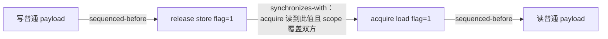

# 5.7. CUDA C++ Memory Model：作用域与消息发布

> 记录整理（2026-11-06）：历史证据按真实编译配置合并为 `results/<variant>.log`，各 action 仅保留最新一节；见 [记录索引](results/README.md)。无日期目录或源码/脚本副本。本次未编译、未运行 GPU。下文数值仅对应标有 `HISTORICAL IMPORT` 的原记录；链接进入配置日志后按 `ACTION` 与 `FILE` 标界查找。本轮迁移保留这些历史证据；新日志写入独立动作目录，旧结论不自动套到新日志。

本实验围绕你提供的第 5.7 节材料，研究一个问题：**消费者看到 `flag == 1` 后，什么时候可以安全地读取生产者写入的普通变量 `payload`？**

这里同时提供语义推导、可运行的对照实验、PTX/SASS 检查和原始日志。源代码见 [main.cu](main.cu)，自动化入口见 [独立动作目录](commands/README.md)。先读第 1～3 节，再运行实验，最后结合第 6～8 节解释结果。

**当前动作索引：[commands/README.md](commands/README.md)。** 每个动作独立脚本、独立目录和同目录日志；先 compile，缺产物不会隐式构建。

## 1. 先分清三个维度

| 维度 | 要回答的问题 | 本实验中的例子 |
| --- | --- | --- |
| 原子性 | 对同一对象的并发访问是否具有所要求的不可分割语义？ | `counter.fetch_add(1, relaxed)` 不丢计数 |
| 内存顺序 | 对 `flag` 的访问怎样约束前后的其他访问？ | release/acquire 发布普通 `payload` |
| 线程作用域 | 这个原子性或同步关系覆盖哪些参与线程？ | 跨 block 通信采用 device 或 system scope |

`relaxed` 保留原子操作自身的保证，但不会单独为其他对象建立发布关系。提高到 `seq_cst` 也不能修复过窄的 scope。变量位于 global memory，只说明存储位置，不自动赋予 device scope 或 system scope。

CUDA 将带线程作用域的同步设施放在 `cuda::` 中。对应的 `std::`、`cuda::std::` 类型具有 system scope 的语义；这不意味着任意宿主标准库实现都能直接在 GPU 上使用，也不意味着任意分配方式都支持 CPU/GPU 并发原子访问。

上述语义来自提供的材料及 [CUDA Programming Guide §5.7](https://docs.nvidia.com/cuda/cuda-programming-guide/05-appendices/cuda-cpp-memory-model.html)。

## 2. 作用域与实验布局

| scope | 覆盖关系 | 本实验 |
| --- | --- | --- |
| `thread_scope_thread` | 当前线程自身 | 不承担线程间通信，未设独立测试 |
| `thread_scope_block` | 同一 thread block 的线程 | 一个 block，thread 0 → thread 32 |
| `thread_scope_device` | 同一设备、同一 memory synchronization domain 内的 GPU 线程 | 两个 block，各自的 thread 0 通信 |
| `thread_scope_system` | 系统中的线程；仍需满足内存与硬件支持条件 | 两个 block、同一 GPU、`cudaMalloc` 分配 |

所有测试使用默认同步域，未配置多个 memory synchronization domain。system 组标记为 `system_gpu_only`：并发访问该分配的线程全部来自一块 GPU，CPU 在 kernel 完成后才复制结果。这符合你给出的 system 原子性条件，但**没有验证 CPU/GPU 或多 GPU 并发通信**。

同一 block 内的两名参与者分处不同 warp。跨 block 测试使用 cooperative launch，并检查 cooperative launch 能力与驻留容量；每轮使用 grid barrier 保护初始化和复用。普通 kernel 中任意 block 的忙等协议可能受 block 调度影响，本例不依赖这种调度假设。

## 3. 用 happens-before 推导正确性

生产者与消费者共享 `payload` 和原子标志 `flag`，初值均为 0。本轮唯一发布操作写入 `flag = 1`。

```cpp
// producer                         // consumer
payload = expected;                 // 等待下面的 load 读到 1
flag.store(1, release);              if (flag.load(acquire) == 1)
                                        value = payload;
```



沿这条链，`payload` 的写 happens-before 读，因此没有数据竞争，读值必须是本轮的 `expected`。acquire 读到初始值 0 时，链尚未建立，消费者不能读取普通 `payload`。

这个例子每轮只有一次发布，不涉及复杂的 release sequence。轮末 barrier 保证双方完成本轮访问之后才能清零、复用邮箱；否则即使一次消息发布正确，下一轮的覆盖写入仍可能发生竞争。

## 4. 实验矩阵与预期

首先运行独立的 relaxed 原子计数：`32 × 128` 个线程，每线程加 100 次，期望 `409600`。CPU 在 kernel 完成后检查结果。它验证计数自身的原子性，不证明其他数据被发布。

随后运行以下 6 种消息协议，每种覆盖 block、device、system_gpu_only 三种配置，共 18 组：

| 模式 | 生产者（写 payload 之后） | 消费者（读 payload 之前） | 语义预期 |
| --- | --- | --- | --- |
| `release_acquire` | release store flag | acquire load 读到 1 | 必须读到本轮 payload |
| `seq_cst` | seq_cst store flag | seq_cst load 读到 1 | 必须读到本轮 payload |
| `fence_atomic` | release fence → relaxed store flag | acquire load 读到 1 | 必须读到本轮 payload |
| `atomic_fence` | release store flag | relaxed load 读到 1 → acquire fence | 必须读到本轮 payload |
| `fence_fence` | release fence → relaxed store flag | relaxed load 读到 1 → acquire fence | 必须读到本轮 payload |
| `relaxed_atomic_payload` | relaxed store **原子 payload** → relaxed store flag | relaxed load flag 读到 1 → relaxed load **原子 payload** | 允许读到 0 或本轮值 |

前五组使用普通 `int payload`，最后一组通过 `cuda::atomic_ref` 使 payload 的并发访问也成为原子操作，因此弱序对照不含普通变量的数据竞争。

三个 fence 模式分别对应原材料中的 fence→atomic、atomic→fence、fence→fence 规则。关键不只是“双方都执行 fence”，还必须存在同一原子对象上的读值关系，而且 fence 和相关原子操作的 scope 都覆盖通信双方。源码显式传递 `Scope`，避免默认作用域掩盖问题。`seq_cst` 在这里只作为更强顺序的对照，没有通过第二个 litmus test 单独验证其总序性质。

可使用 [libcu++ 的 cuda::atomic 接口说明](https://nvidia.github.io/cccl/unstable/libcudacxx/extended_api/synchronization_primitives/atomic.html) 对照内存顺序和 scope 参数。

## 5. 构建与运行

从本目录执行，要求支持 C++17、`<cuda/atomic>` 和 Cooperative Groups 的 CUDA Toolkit。本实验框架要求 compute capability ≥ 7.0，默认目标是本机 `sm_89`；这不是说所有内存模型 API 都要求 7.0。

```bash
bash commands/compile/run.sh
bash commands/run/run.sh
ROUNDS=10000 bash commands/run/run.sh
ROUNDS=100 bash commands/sanitizer/run.sh
bash commands/static/run.sh
```

其他 GPU 显式设置目标架构，例如 `CUDA_ARCH=sm_80 bash commands/run/run.sh`。可通过 `NVCC`、`CUOBJDUMP`、`COMPUTE_SANITIZER` 指定工具路径。

动作入口为 `commands/<action>/run.sh`；先显式执行 `commands/compile/run.sh`，其余执行/检查动作只复用 `build/<variant>/` 的已有产物，缺失即提示先编译，不隐式构建。修改源码、头文件、编译选项或工具链后必须主动重新编译；没有哈希缓存或自动失效判断。 可执行文件为 `build/<arch>-release/bin/memory_model`。

日志位于脚本同目录 `commands/<action>/<variant>.log`，同动作同配置重跑覆盖（包括失败），其他动作日志不变。命令、实际参数、原始输出及退出码均记录；检查器的临时步骤文件在退出后清理。不生成自动快照、时间戳归档或 history。已有 `results/` 原始日志和历史报告保持原样，当前动作不写入。 程序仍输出设备型号、驱动、运行时及相关属性。

退出码：`0` 表示全部执行且通过；`1` 表示校验或 CUDA 调用失败；`77` 表示无 GPU、框架不支持该设备或部分 cooperative 测试跳过。每轮忙等由 `SPIN_LIMIT` 限制；超时计入 FAIL，表示本次实验未完成通信，不能据此推断内存模型违例。

## 6. 如何读结果

输出字段如下：

| 字段 | 含义 |
| --- | --- |
| `received` | 消费者读到 flag=1 的轮数 |
| `stale` | 读到初始化 payload=0 的轮数 |
| `unexpected` | 读到既非 0、也非本轮期望值的轮数 |
| `timeout` | 在轮询预算内未看到 flag=1 的轮数 |

前五种协议要求 `received == rounds`，其他计数全部为 0。弱序组允许 `stale > 0`，但不强求观察到旧值；`stale == 0` 只说明本次运行没有观察到这个允许的结果，不能把 relaxed 当作 release/acquire。弱序组的 PASS 表示观察值符合允许范围且通信完成。

本例没有计时，不能由这些 PASS 比较不同 scope 的成本。若后续研究同步开销，应固定线程布局、数据位置和竞争程度，单独建立性能实验。

## 7. 反例：为何 atomic 仍可能发生数据竞争

以下为语义分析片段，**不纳入可执行测试**。初始 `x = 0, f = 0`，两个线程位于不同 block：

```cpp
// block 0 的 thread 0 执行：
cuda::atomic_ref<int, cuda::thread_scope_block> producer_flag(f);
x = 42;
producer_flag.store(1, cuda::memory_order_release);

// 与之并发，block 1 的 thread 0 执行：
cuda::atomic_ref<int, cuda::thread_scope_device> consumer_flag(f);
while (consumer_flag.load(cuda::memory_order_acquire) != 1) {}
int observed = x;
```

生产者的 block scope 不覆盖另一个 block 的消费者。消费者使用 device scope 不能单方面扩大生产者操作的作用域；两个冲突的 flag 访问不能以所需作用域保证原子性，且没有所需的 happens-before，因此存在数据竞争，行为未定义。这里没有可枚举的可靠“错误结果集合”。修复方式是双方采用覆盖彼此的作用域，并保持正确的发布顺序。

其他常见误用：

- device scope 的 relaxed flag 配上普通 payload：flag 自身可以原子访问，payload 的读写仍缺少 happens-before，构成数据竞争。
- 把 flag 或 payload 声明为 `volatile`：它不建立线程间的 synchronizes-with 关系。
- 只在生产者调用 fence：没有消费者及 flag 读值关系配合，不能完成消息发布。
- 用更强的 order 补救错误 scope：`seq_cst` 仍受操作作用域限制。

## 8. System scope 的支持边界

你的材料按分配类型列出了 system-scope 原子性的条件。扩展到 CPU/GPU 或多 GPU 实验时，应逐项核对，而不是只改一个模板参数：

| 分配或访问场景 | 需要核对的条件 |
| --- | --- |
| system allocated memory | `pageableMemoryAccess == 1`；还需注意 host page table、文件映射和 hugetlbfs 的例外 |
| managed memory | `concurrentManagedAccess == 1` |
| mapped memory | 通用原子操作需核对 `hostNativeAtomicSupported`；满足条件的自然对齐 load/store 存在单独规则，不能推广到任意 RMW |
| GPU memory、多 GPU 访问 | 从每个访问设备到内存所在设备查询 `cudaDevP2PAttrNativeAtomicSupported`，并建立合法的 peer 访问 |
| GPU memory、仅同一 GPU 并发访问 | 本例 system_gpu_only 所用情形 |

此外，16 字节操作的系统支持和 system-scope tensor reduction 有独立约束。本例仅使用对齐的 `int`，不测试这些边界。跨 memory synchronization domain 通信也需要按对应规则重新选择同步 scope；本例没有验证该情形。

对齐通过 `atomic_ref::required_alignment` 和 `alignas` 显式保证。每轮引用销毁后再经 barrier 进入下一轮非原子初始化，避免在存在 atomic_ref 的访问阶段混用原子与非原子操作。

## 9. 静态分析与工具能证明什么

`static` 动作在 `build/<arch>-release/` 生成或复用 `memory_model.ptx`，生成 `memory_model.sass`。以下以显式选择 `sm_89` 为例，在对应 kernel 的消息发布代码附近检查：

```bash
rg -n 'ld\.acquire|st\.release|fence\.|ld\.relaxed|st\.relaxed' build/sm_89-release/memory_model.ptx
```

关注 `.cta`、`.gpu`、`.sys`，以及 release/acquire/relaxed 的编译形式。编译器可能使用更强的指令实现较弱语义，不能反过来扩大源码的保证。grid barrier 自身也生成同步指令，必须结合 kernel 名称、源码行信息和访问地址区分，不能把搜索命中全部当作 flag 操作。

`sanitizer` 动作运行 memcheck 和 synccheck，分别检查内存访问与同步使用问题。racecheck 主要检测 shared memory hazards，本例使用 global memory，因此不能靠它证明跨 block 的内存顺序或作用域正确；工具零错误也不替代 happens-before 推导。参见 [Compute Sanitizer 文档](https://docs.nvidia.com/compute-sanitizer/ComputeSanitizer/index.html)。

实验记录见 [RESULTS.md](RESULTS.md)。
