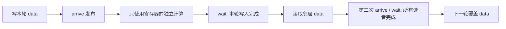

# 4.9. Asynchronous Barriers：到达、阶段与缓冲区所有权

> 记录整理（2026-11-06）：历史证据按真实编译配置合并为 `results/<variant>.log`，各 action 仅保留最新一节；见 [记录索引](results/README.md)。无日期目录或源码/脚本副本。本次未编译、未运行 GPU。下文数值仅对应标有 `HISTORICAL IMPORT` 的原记录；链接进入配置日志后按 `ACTION` 与 `FILE` 标界查找。本轮迁移保留这些历史证据；新日志写入独立动作目录，旧结论不自动套到新日志。

本专题对应附件的 §4.9，提供可执行 CUDA C++ 示例、逐元素 CPU 校验、PTX/SASS 检查与真实调试日志。当前在线指南已将同名章节编为 **4.10**，这里保留附件编号，避免学习笔记错位。参见 [NVIDIA Asynchronous Barriers](https://docs.nvidia.com/cuda/cuda-programming-guide/04-special-topics/async-barriers.html)。

核心问题是：**哪些访问必须在 arrive 之前完成，wait 等待哪个 phase，以及谁允许复用缓冲区？** 分离到达与等待提供了安排独立工作的空间，但不自动保证重叠或加速。

**当前动作索引：[commands/README.md](commands/README.md)。** 每个动作独立脚本、独立目录和同目录日志；先 compile，缺产物不会隐式构建。

## 1. 文件与运行

| 文件 | 内容 |
| --- | --- |
| [main.cu](main.cu) | 同步基线、split arrive/wait、显式 parity、drop、completion、异步拷贝、双缓冲 |
| [debug.cu](debug.cu) | 有界的缺失 arrival 诊断，以及故意把写入放在 arrive 后的竞态反例 |
| [tx90.cu](tx90.cu) | SM90 的 1024 字节真实事务拷贝与 `barrier_arrive_tx` |
| [common.cuh](common.cuh) | 设备信息、CUDA 错误检查、缓冲区管理 |
| [独立动作目录](commands/README.md)、[check_static.py](check_static.py) | 构建、运行、分析器与指令存在性检查 |
| [DEBUGGING.md](DEBUGGING.md) | 调试步骤、具体报告、分析与复现方式 |
| [RESULTS.md](RESULTS.md) | 本机结果、原始日志和未验证项 |

```bash
cd /home/mikasa/hpc/cuda/gpu-architecture-lab/04_sync/02_async_barriers
bash commands/compile/run.sh  # 显式编译，后续动作只复用
bash commands/run/run.sh        # 默认 17 轮，并自动验证 1、2 轮边界
bash commands/static/run.sh     # 读取已有 PTX、反汇编并检查实际指令
bash commands/sanitizer/run.sh  # memcheck / racecheck / synccheck，保留全部退出码
bash commands/debug/run.sh      # 缺失 arrival 的恢复 + 故意竞态的检测
bash commands/diagnose/run.sh   # 隔离 parity 和 completion 的 racecheck 报告
bash commands/isolate/run.sh    # 明确排除上述专题后检查其余 kernel；不代替完整检查
TARGET=tx90 bash commands/compile/run.sh
bash commands/tx90/run.sh       # 复用已编译的 SM90 程序；SM89 运行返回 SKIP / 77
```

默认目标 `sm_89`；其他支持的设备可指定 `CUDA_ARCH=sm_80` 或 `sm_90`。`ROUNDS=100 bash commands/run/run.sh` 改变主测试轮数（范围 1–1000）；drop 示例最多八轮，其余使用指定轮数。`NVCC`、`CUOBJDUMP`、`COMPUTE_SANITIZER` 可指定工具。示例使用 C++17 与近期 Toolkit 的 `<cuda/ptx>`、libcu++ 接口，本次在 CUDA 13.4 验证。

普通动作（包括 `debug`）使用 `build/<arch>-release/`；`tx90` 固定使用 `build/sm_90-release/`。`main.cu`、`debug.cu`、`tx90.cu` 保持独立源码/程序；diagnose 的 `LAB_API_PARITY` 版仍为单独的 `bin/api_parity`。先显式 compile，后续动作只读取对应产物；编译失败撤销成功标记，禁止继续运行旧程序。

日志位于脚本同目录 `commands/<action>/<variant>.log`，同动作同配置重跑覆盖（包括失败），其他动作日志不变。命令、实际参数、原始输出及退出码均记录；检查器的临时步骤文件在退出后清理。不生成自动快照、时间戳归档或 history。已有 `results/` 原始日志和历史报告保持原样，当前动作不写入。

旧 main 过时的 static/debug 证据已清理，**当前 static/debug 未验证**，详见 [记录索引](results/README.md)。`0` 表示该动作检查成功；`77` 表示设备不支持而跳过；`86` 为分析器发现问题；`124` 为外部超时。跳过与预期反例不能当作正常路径通过。

## 2. 架构与作用域

| 能力 | 本专题实现与边界 |
| --- | --- |
| 基本 `cuda::barrier` | API 可有软件实现；本实验整体要求 SM80+，不把此要求泛化为所有 barrier API 的最低门槛 |
| shared block barrier、`cp.async` | SM80+；本机 SM89 可运行 |
| `mbarrier.test_wait.parity` | SM80+；本机的原生 PTX 等待路径 |
| `mbarrier.try_wait.parity` | SM90+；源码按 `__CUDA_ARCH__` 选择 |
| 显式 transaction count、`memcpy_async_tx` | SM90+；独立文件编译，SM89 不启动该 kernel |

所有同步对象都位于 shared memory，scope 为 `cuda::thread_scope_block`。四个 block 的 exchange 实验各有自己的 barrier 和数据，没有跨 block 通信。不要把这个 shared barrier 用作 grid barrier。架构条件可对照 [PTX mbarrier 指令](https://docs.nvidia.com/cuda/parallel-thread-execution/#parallel-synchronization-and-communication-instructions-mbarrier) 及 Toolkit 对应的 libcu++ 头文件。

## 3. 初始化与 phase：计数的是到达义务

```cpp
__shared__ cuda::barrier<cuda::thread_scope_block> bar;
if (threadIdx.x == 0) init(&bar, blockDim.x);
__syncthreads();
```

`init` 不自行同步其他线程。初始化后的 block 同步解决“还没建立 barrier，怎样先同步初始化”的问题。源码对 shared 对象的动态初始化警告采用 NVIDIA 示例同样的局部诊断抑制；真正的初始化仍由 `init` 或 placement new 完成，不能把 pragma 当作初始化。

在本例的简单一线程一次 arrival 协议中，初始 expected count 为 128。每次 `arrive()` 减少当前 phase 的未到达数量；满足完成条件后执行 completion（如有）、推进 phase，并恢复下一 phase 的预期计数。绑定异步操作时，还必须满足对应异步完成条件。

expected count 的本义是 arrival 更新的总数，并不强制等于唯一线程数。`debug count` 用单线程承担两个到达义务展示这一点；实际多线程协议仍需逐条核对参与者。不能因为一个 warp 收敛，就将 32 次普通 `bar.arrive()` 的逻辑计数改成 1。

Token 代表到达时的 phase，不是任意重用的票据。wait 只允许使用当前或紧邻上一 phase 的 token，不能保存两轮后再用。`arrive()` 不等待其他参与者，但最后到达者可能执行 completion，因此也不是保证恒定、极短的调用。

## 4. Split arrive/wait：发布与复用是两个阶段

`exchange<0/1/2>` 比较三种同步表达，四个 block 各 128 线程。线程写自己的共享槽，等待后读取邻居槽，并把独立寄存器计算加入结果。CPU 用同样的无符号整数规则检查每个线程的完整累积值。

| Mode | 第一次等待 | 第二次等待 |
| --- | --- | --- |
| 0 | `__syncthreads()` | `__syncthreads()` |
| 1 | `arrive → independent → wait(token)` | `arrive_and_wait()` |
| 2 | PTX arrive → independent → parity wait | PTX arrive → parity wait |



第一条同步边建立“写 → 读”的顺序。第二条边建立“读 → 下一次覆盖写”的顺序。只留第一条边可能使快线程覆盖慢线程仍在读取的数据。

`arrive` 和 `wait` 之间的独立工作不能依赖尚未发布的数据，不能覆盖其他线程仍会读取的存储。本例使用纯寄存器整数变换，并将结果写入最终校验，避免把完全无用途的计算误当作有效工作。未做计时，不据此比较三种模式的性能。

## 5. 显式 parity：追踪 phase，而不是循环轮次

初始化 parity 为 0；每完成一次 phase，线程执行 `parity ^= 1`。每轮有发布、复用两个 phase，因此每轮翻转两次。漏掉第二次翻转会把“循环轮次”和“barrier 阶段”混淆。

wait 的 parity 参数表示**所等待完成的 phase**；成功意味着该 phase 已完成，不是“等待 barrier 当前 parity 变成参数值”。本协议每个线程都在当前 phase 到达并等待，下一阶段无法绕过未参与的慢线程，因此不会让等待者落后两个完整 phase。

默认使用 `cuda::device::barrier_native_handle` 和 `cuda::ptx`。`LAB_API_PARITY` 仅用于诊断对照，把等待循环换成 `bar.wait_parity(parity)`，到达、数据访问和 phase 数均不变。不要把分析器只看到部分指令的报告直接当作 API 语义的反例，具体证据见调试文档。

## 6. 提前退出：当前 phase 到达，下一 phase 减员

`early_exit` 将四个 warp 的参与轮数设为 2、4、6、8。默认八轮中，每轮开始时到达对应上限的 warp 调用一次 `arrive_and_drop()` 后退出。

| 逻辑轮次（从 0 开始） | 活跃线程 | 本轮退出者 |
| --- | ---: | --- |
| 0–1 | 128 | 无 |
| 2–3 | 96 | 第 2 轮 warp 0 退出 |
| 4–5 | 64 | 第 4 轮 warp 1 退出 |
| 6–7 | 32 | 第 6 轮 warp 2 退出 |

例如第 2 轮的发布 phase，32 个退出者的 drop 与 96 个继续者的 arrive 一起完成原先 128 个到达义务；随后的复用 phase 只期待 96 个参与者。每个继续者读取本轮仍活跃的槽，避免消费退出者留下的旧数据。

这里退出后没有全 block 的 `__syncthreads()`，剩余参与者只用已调整计数的 barrier。若直接 return 不 drop，其他线程可能永久等待；若仍对原 block 调用全员同步，也会破坏协议。最终整段协议结束时无须为了不存在的下一轮再 drop。

## 7. Completion function：每 phase 执行一次

`completion` 使用带三个 shared 指针的 `SumCompletion`，以正确对齐的原始 shared storage 和 placement new 构造 barrier。每个线程写一个元素，completion 累加 128 个槽并增加 phase 计数，wait 返回后所有线程读取累计和。最后全 block 同步，再由线程 0 调用析构函数。

第 r 轮结束（r 从 0 开始）应得到从 1 到 `128*(r+1)` 的整数和；CPU 用 64 位公式计算后转为 32 位无符号值，匹配设备模 2³² 运算。另检查 completion 执行次数等于轮数。

所有槽在 arrive 之前写完，completion 读取它们；completion 写出的 total 在 wait 返回后可见。下次 completion 必须等所有线程读完本轮 total、完成下次写入并 arrive 后才能开始，因此不会提前覆盖 total。这里不需要“读共享槽的第二个 phase”，因为槽只由 completion 读取，读取在释放 waiter 前已结束。

不要假设 completion 固定在线程 0 执行；不要在其中放全 block 同步。自定义 completion 可能使用软件原子协议，不能假设它与默认空 completion 一样映射为硬件 `mbarrier`。接口语义见 [libcu++ cuda::barrier](https://nvidia.github.io/cccl/unstable/libcudacxx/extended_api/synchronization_primitives/barrier.html)。

附件的 reduction 片段有两处不能照抄：链式 `a == b == c` 在 C++ 中不是数学意义的同时相等；其 `blockDim.x == ... == 1` 也与 128 线程设定冲突。逐线程读取 tile 应包含线程索引，不能让所有线程只读 `data[i]`。本例直接生成唯一的逐线程值，并提供 host 参考结果。

## 8. 异步内存操作：完成拷贝与允许覆盖分别管理

`tiled_copy<false>` 使用普通 global→shared 读写和 block 同步，`tiled_copy<true>` 使用全 block 协作的 `cuda::memcpy_async(..., bar)`。每轮拷贝 256 个 `unsigned`，即 1024 字节；在独立寄存器计算后 wait，再读取 shared tile。第二次 barrier 保证读者结束才复用 tile。

输入按完整 tile 补零分配；`n=1,255,256,257,4099` 覆盖单元素、tile 两侧边界和多次缓冲复用。输出只分配和写入 n 个元素，不能用补齐输入的大小去写输出。源码声明的 16 字节对齐由 cudaMalloc 基址、shared 对齐和 tile 步长共同满足；`aligned_size_t<16>` 是调用者作出的承诺，不会自动修正错误地址。

API 将异步拷贝完成绑定到 barrier，线程到齐本身并不足以允许读目的缓冲区。普通 `bar.arrive()` 也不能自动跟踪任意手写 PTX 异步操作，必须使用相应绑定机制。参见 [cuda::memcpy_async](https://nvidia.github.io/cccl/unstable/libcudacxx/extended_api/asynchronous_operations/memcpy_async.html)。静态检查确认本次是否生成 `cp.async`、`cp.async.mbarrier.arrive` 和 SASS `LDGSTS`；指令存在不等于测得计算/拷贝重叠。

### SM90 的显式 transaction count

[tx90.cu](tx90.cu) 做真实 global→shared 1024 字节拷贝。128 个线程参与 barrier；线程 0 发出 `memcpy_async_tx` 并调用 `barrier_arrive_tx(bar, 1, 1024)`，其他 127 个线程正常 arrive/wait。phase 需要同时满足到达义务与事务完成条件。

这里 1024 是字节数，不是元素数，也不是拷贝调用次数。附件的 `barrier_arrive_tx(bar,1,0)` 只更新 arrival，不验证异步事务追踪。参见 [barrier_arrive_tx 接口](https://nvidia.github.io/cccl/unstable/libcudacxx/extended_api/synchronization_primitives/barrier/barrier_arrive_tx.html)。本机不能运行 SM90 路径，编译/静态观察与 GPU 执行状态分别记录；未覆盖 cluster barrier、多维 TMA descriptor 和跨 block 分布式共享内存。

## 9. 双缓冲：四个 barrier 表达两种所有权交接

`producer_consumer` 将 warp 0 的 32 线程设为生产者，其余 96 线程为消费者。每个槽有 `ready[b]` 和 `filled[b]`，两个槽共四个 barrier，expected count 都是 **128**，因为两组均有 arrival 义务。

| 操作 | 生产者 32 线程 | 消费者 96 线程 |
| --- | --- | --- |
| ready | arrive 并等待可覆盖 | 初始或读完后 arrive，发出可写信号 |
| filled | 写完后 arrive，发出已填满信号 | arrive 并等待，然后读取 |

消费者先为实际使用的槽发出初始 ready。生产者等待 ready 才能写，消费者等待 filled 才能读。消费者完成读取后，只有在还有下一次相同槽使用时才发出 ready，避免尾部留下无用途的半完成 phase。

两条关键顺序链是：

1. producer 写 → filled arrival → consumer filled wait → consumer 读。
2. consumer 读 → ready arrival → producer ready wait → producer 下一次覆盖。

生产者发出 filled 后可以去填另一个槽；消费者发出 ready 后可以去读另一个槽。信号方无需立即 wait 自己的 token，但反向 barrier 保证它不能无限超前、重复到达错误 phase。这种“一侧等待”的协议不等于 barrier 只有一侧到达。

本例生产者用普通 load/store，专门演示空间分工与所有权；上一节另行演示异步拷贝。双缓冲有重叠机会，不保证更快，也不是 lock-free 算法。

## 10. Warp entanglement 与本实验的边界

附件中收敛 warp 更新一次、完全发散可更新 32 次的说法针对异步操作的 arrive-on/提交机制，不能用于重定义普通 C++ barrier 的 expected arrival count。使用相应异步机制时，在分歧后按合法参与 mask 重新收敛；不能在只有半个 warp 执行的分支里盲用全 mask `__syncwarp()`。

本例协作拷贝由完整 block 共同发出；生产者/消费者按完整 warp 分组，没有为了测 entanglement 引入 lane 发散。未单独测量 warp entanglement 的性能。对于只需要完整 block 或 warp 集合同步的场景，保留 `__syncthreads()` / `__syncwarp()` 通常更简单；本实验基线正是为此保留。

正常运行的数值 PASS、分析器报告和规范推导各回答不同问题。请继续阅读 [调试过程](DEBUGGING.md) 与 [本机验证记录](RESULTS.md)，特别是 parity/custom completion 的工具报告。
