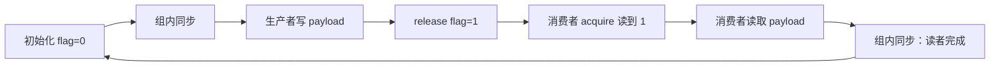

# 3.2.3–3.2.6：Thread Scopes 与高级同步

> 记录整理（2026-11-06）：历史证据按真实编译配置合并为 `results/<variant>.log`，各 action 仅保留最新一节；见 [记录索引](results/README.md)。无日期目录或源码/脚本副本。本次未编译、未运行 GPU。下文数值仅对应标有 `HISTORICAL IMPORT` 的原记录；链接进入配置日志后按 `ACTION` 与 `FILE` 标界查找。本轮迁移保留这些历史证据；新日志写入独立动作目录，旧结论不自动套到新日志。

本专题覆盖附件中的 Thread Scopes、Scoped Atomics、异步 barrier/pipeline、异步拷贝和 L1/shared 配置。主线是：**通信对象决定 scope，数据依赖决定 order，缓冲区复用决定同步阶段。** 三者不能互相替代。

已有 [内存模型实验](../01_memory_model/README.md) 详细研究 fence 与 release/acquire；[异步 barrier 实验](../02_async_barriers/README.md) 研究 phase、drop 与 completion。本专题补充票号校验、不同存储位置、builtin 接口、pipeline、拷贝单位及资源配置，不重复前两项的全部矩阵。

**当前动作索引：[commands/README.md](commands/README.md)。** 每个动作独立脚本、独立目录和同目录日志；先 compile，缺产物不会隐式构建。

## 1. 文件与运行

| 文件 | 内容 |
| --- | --- |
| [scopes.cu](scopes.cu) | thread/block/device/system GPU-only 原子票号、builtin 对照、block/device 消息发布 |
| [copies.cu](copies.cu) | 五种同等运算的拷贝路径、两阶段 pipeline、字节数错误反例 |
| [carveout.cu](carveout.cu) | 四种 shared-memory carveout 提示、动态 shared opt-in 与错误恢复 |
| [system.cu](system.cu) | 能力检查后的 CPU/GPU system-scope 双向握手 |
| [cluster90.cu](cluster90.cu) | SM90 上两个 cluster 内分别分配唯一票号 |
| [common.cuh](common.cuh) | 错误检查、设备信息、缓冲区与票号验证 |
| [独立动作目录](commands/README.md)、[check_static.py](check_static.py) | 可复现运行、指令检查和证据留存 |
| [DEBUGGING.md](DEBUGGING.md) / [RESULTS.md](RESULTS.md) | 调试过程 / 本次验证状态及日志 |

```bash
cd /home/mikasa/hpc/cuda/gpu-architecture-lab/04_sync/03_thread_scopes
bash commands/compile/run.sh  # 显式编译，后续动作只复用
bash commands/run/run.sh
bash commands/static/run.sh
bash commands/sanitizer/run.sh
bash commands/debug/run.sh
bash commands/system/run.sh
TARGET=cluster bash commands/compile/run.sh
bash commands/cluster/run.sh
```

要求支持 C++17、`__nv_atomic_*` 的 CUDA Toolkit（builtin 从 CUDA 12.8 引入；本次使用 13.4）。默认主程序目标 `sm_89`，可设置 `CUDA_ARCH=sm_80` 等受支持目标；整组实验要求 SM80+，并非所有原子 API 的最低要求。`TARGET=cluster` 的 compile 独立编译 SM90，`cluster` 动作只运行。工具可通过 `NVCC`、`CUOBJDUMP`、`COMPUTE_SANITIZER` 指定。

普通动作（包括 `debug`、`system`）使用 `build/<arch>-release/`；`cluster` 固定使用 `build/sm_90-release/`。scopes/copies/carveout/system/cluster90 保持真实独立源码和 `bin/` 可执行文件，不强拆或合并 CUDA 实现。先显式 compile，后续动作只读取对应产物；编译失败撤销成功标记，禁止继续运行旧程序。

日志位于脚本同目录 `commands/<action>/<variant>.log`，同动作同配置重跑覆盖（包括失败），其他动作日志不变。命令、实际参数、原始输出及退出码均记录；检查器的临时步骤文件在退出后清理。不生成自动快照、时间戳归档或 history。已有 `results/` 原始日志和历史报告保持原样，当前动作不写入。

正常成功返回 0；能力不足返回 77；分析器发现问题指定返回 86；外部超时返回 124。`system`、`cluster` 是独立动作，不用跳过状态冒充主程序通过。

## 2. 正确理解 scope：保证覆盖哪些参与者

| 作用域 | PTX 对应 | 本实验 |
| --- | --- | --- |
| thread | 不假设有独立 `.thread` 原子编码 | 每线程独占一个 global counter |
| block | `.cta` | 每 block 独立 global counter；每 block shared counter；跨 warp 消息 |
| cluster | `.cluster` | builtin `__NV_THREAD_SCOPE_CLUSTER`；SM90 独立文件 |
| device | `.gpu` | 多 block 共享一个 counter；cooperative launch 跨 block 消息 |
| system | `.sys` | 单 GPU 上执行 system 原子；另附能力门控的 CPU/GPU 握手 |

scope 不是地址可访问性的限制，也不是内存的私有化机制。block scope 的 global counter 仍位于 global memory；只是其原子/同步保证不能覆盖任意其他 block。同理，thread scope 不会把一块 global 地址自动变为线程私有；代码必须保证每个线程访问自己的槽。

device scope 还受 memory synchronization domain 约束；本例没有配置多个 domain。system scope 不能让 CPU 直接解引用普通 `cudaMalloc` 指针，也不会自动开启 peer access，必须核对分配类型与访问能力。规范关系见 [CUDA Memory Model](https://docs.nvidia.com/cuda/cuda-programming-guide/05-appendices/cuda-cpp-memory-model.html)。

附件中的 L1/L2/coherency 表可用于理解硬件层次，不能当作“选 block 就强制走 L1、选 system 就刷新全部 cache”的指令表。尤其不能从 block→L1 推出不同 SM 的 L1 对 global 数据一致。缓存提示也不代替原子同步。

## 3. 原子计数为什么还要检查票号

启动 8 个 block，每个 64 线程，每线程做 7 次 `fetch_add(1, relaxed)`；另用每线程一次作为边界。每次保存返回的 old value，CPU 在对应通信组内排序，检查是否恰好为 `0..K-1`。

| 配置 | 独立 counter 数 | 每 counter 最终值（7 次） | 票号校验组 |
| --- | ---: | ---: | --- |
| thread，各自 global 槽 | 512 | 7 | 每线程 |
| block，各自 global 槽 | 8 | 448 | 每 block |
| block，shared | 8 | 448 | 每 block |
| device，一个 global 槽 | 1 | 3584 | 全 grid |
| system，一个 global 槽，仅 GPU 参与 | 1 | 3584 | 全 grid |
| builtin device，一个 global 槽 | 1 | 3584 | 全 grid |

最终计数检查增量总数，票号检查每个返回值是否唯一且覆盖完整范围。这里没有额外 payload 发布需求，因此 relaxed 足够；CPU 在 kernel 完成后才检查。数值通过不证明各 scope 的性能相同或不同。

共享 counter 使用一个正确对齐的普通 `unsigned`，先由线程 0 初始化，再 `__syncthreads()`，参与阶段通过 `cuda::atomic_ref` 访问。结束所有引用的生命周期并同步后，才普通读取最终值。global backing storage 由 cudaMalloc 对齐，运行前清零。不要把未构造的 shared 原子对象或未初始化 flag 当作合法起点。

## 4. Scoped atomics：scope 与 order 分别解决什么

`publish_block` 的每个 block 都有一个独立 global mailbox。线程 0 是生产者，线程 32 是消费者，分属两个 warp，避免用同 warp 的偶然执行顺序解释成功。

```cpp
// producer
payload = expected;
flag.store(1, cuda::memory_order_release);

// consumer
while (flag.load(cuda::memory_order_acquire) != 1) { /* 有界等待 */ }
observed = payload;
```

生产者写 payload → release store → 消费者 acquire 读到该 store → 消费者读 payload，构成发布顺序；双方 scope 必须覆盖彼此。循环中每轮开始前初始化 `flag=0`，随后 block 同步；消费者读完后再次 block 同步，才能清零并复用 mailbox。等待达到预算时输出显式哨兵，让 host 校验失败，不会把超时当成合法旧值。

附件 producer-consumer 片段缺少 `ready=false` 及初始化后的同步，不能直接成为可靠实验。本例补齐了初始化、发布、消费、复用四个阶段。

`publish_device` 把同样的发布移到两个不同 block，使用 device scope。通过 cooperative launch 和 occupancy 检查保证这两个 block 具备协作驻留条件；每轮 grid sync 保护初始化和复用。没有在任意普通 launch 中假设两个 block 必定同时驻留。



以下只作为错误协议分析，不执行未定义行为：跨 block 使用 block-scope flag；把 ready 改为普通 volatile；用 relaxed flag 发布普通 payload；缺少读者完成确认就覆盖下一轮 payload。提高到 seq_cst 不能修复过窄 scope，system scope 也不能修复缺失的数据依赖顺序。

## 5. libcu++ 与 builtin 接口

本例分别使用 `cuda::atomic_ref<unsigned, Scope>` 与：

```cpp
__nv_atomic_fetch_add(ptr, 1u, __NV_ATOMIC_RELAXED, __NV_THREAD_SCOPE_DEVICE);
__nv_atomic_store_n(ptr, 1u, __NV_ATOMIC_RELEASE, __NV_THREAD_SCOPE_BLOCK);
__nv_atomic_load_n(ptr, __NV_ATOMIC_ACQUIRE, __NV_THREAD_SCOPE_BLOCK);
```

builtin 的 order/scope 显式传常量，不依赖默认 system scope。它们是 device 接口，不能用于 host 函数或 local memory 对象；本例所有 builtin 地址都在 global memory。当前 builtin thread scope 可以提升为 block 实现，不能从最终指令推回“thread scope 允许其他线程一起访问”。参见 [CUDA C++ atomic builtins](https://docs.nvidia.com/cuda/cuda-programming-guide/05-appendices/cpp-language-extensions.html)。

本次 libcu++ 对外 thread_scope 枚举没有与表中 `.cluster` 一一对应的公开枚举，因此 cluster 示例使用 builtin 常量；不虚构 `cuda::thread_scope_cluster`。`cluster90.cu` 以每两个 block 为一个 cluster，两个 cluster 各访问自己的 global counter；不访问远端 shared memory，也不涉及 remote barrier wait。

## 6. System scope 的两种实验不能混为一谈

`count_sys` 的所有访问来自同一 GPU，CPU 仅在 kernel 结束后复制结果。它验证 system-scope 指令在该访问组合下的行为，**不是 CPU/GPU 并发测试**。

`system.cu` 则使用 managed mailbox。只有 `managedMemory=1`、`concurrentManagedAccess=1` 且 host 原子无锁时才执行。CPU 写 payload，再 release request；GPU acquire request 后读取、计算 reply，再 release ack；CPU acquire ack 后读取 reply并开始下一轮。32 轮握手没有并发覆盖相同 payload；host 读取 done 在 device synchronize 后。host 有截止时间，GPU 有有限轮询和 stop 标志。

managed memory 的条件与 mapped host memory 的条件不同，不能因为 mapped 的 hostNativeAtomicSupported 为 0 就忽略本实验真正使用的分配类型，也不能因为 system scope 编译成功就忽略 concurrentManagedAccess。当前设备属性与是否执行见结果文档；本例未测试多 GPU。

## 7. 五种拷贝路径使用同样的计算

每个 tile 有 128 个 `unsigned`（512 字节），输入补齐至完整 tile，输出仅分配 n 个元素。计算为 `out[i] = tile[j] + 3*tile[(j+1)%128]`，必须读到其他线程负责搬运的槽，不能只靠本线程的 copy 完成来满足依赖。

| 路径 | 完成机制 | 防止覆盖 |
| --- | --- | --- |
| 同步 load/store | block sync | 读后 block sync |
| Cooperative Groups memcpy_async | `cg::wait(group)` | 读后 block sync |
| thread primitives | `__pipeline_wait_prior(0)` 后 block sync | 读后 block sync |
| barrier-bound memcpy_async | `bar.arrive_and_wait()` | 第二个 barrier phase |
| 两阶段 block pipeline | `consumer_wait()` | 全部消费者 `consumer_release()` |

`1/127/128/129/1027` 覆盖不足一个 tile、整 tile、两个 tile及九个 tile；两阶段路径经历预填、交替复用与尾部排空。补齐值为零，不越界读输入，也不按 padded 大小写输出。

Cooperative Groups 的 **四参数** `memcpy_async(group,dst,src,count)` 接收字节数。五参数的带源/目的 layout 形式有元素数量语义，不能混用。附件四参数调用直接传 `block.size()`，对 float/int 会少拷贝；本例使用 `sizeof(tile)`。本机实现可在 `cooperative_groups/details/async.h` 的 `_memcpy_async_bytes` 和 `_memcpy_async_datum` 两条路径核对。

`__pipeline_wait_prior(0)` 等待本线程已经提交的异步组；它不单独让所有线程的拷贝都完成。读取邻居槽前保留 block sync 很关键。线程级 primitive 的完成范围与 block pipeline 的协调范围不同，这正是 thread scope 在异步拷贝中的实际含义。

## 8. 两阶段 pipeline 的四步协议

```text
producer_acquire → 发出本阶段 copies → producer_commit
consumer_wait   → 使用最老阶段数据   → consumer_release
```

本例所有 64 线程同时担当生产者与消费者，使用 `pipeline_shared_state<thread_scope_block,2>` 与 `make_pipeline(group,&state)`。预先提交最多两个 tile；随后每消费并释放一个阶段，再补入一个新 tile，按 FIFO 处理。

acquire 控制空闲阶段的获取，不是等待当前 copy；commit 标记本阶段提交，不表示拷贝完成；wait 负责可读；release 负责可复用。手工做双缓冲时缺少任一角色都可能读未完成数据或覆盖仍被使用的槽。接口语义见 [cuda::pipeline](https://nvidia.github.io/cccl/unstable/libcudacxx/extended_api/synchronization_primitives/pipeline.html)。

本例的统一参与组在 commit 等位置保持完整 warp 收敛。未单独测量 warp entanglement；没有把分歧 warp 的提交行为当作普通 atomic/barrier 的计数规则。

这里是 kernel 内 global→shared 异步数据移动，与 host 的 `cudaMemcpyAsync` 和多 stream 调度不是同一层次。本例在 SM89 上检查 LDGSTS/cp.async；TMA 和 STAS 的 SM90 路径未另行实现。此前 [事务 barrier 示例](../02_async_barriers/tx90.cu) 提供了独立的 TMA bulk-copy 入门。

### Barrier 的 scope、位置和进展条件

附件还列出了更广的 barrier 能力，不能从 block 示例无条件推广：

| 参与范围与对象位置 | 关键限制 |
| --- | --- |
| block / 本地 shared | SM80+ 可硬件加速；本例的拷贝绑定采用此配置 |
| cluster / 本地 shared | SM90+ 的 cluster 协调机制；需使用相应 API 与合法 launch |
| cluster / 远端 shared | 可以到达远端 barrier，不能直接在远端对象上 wait |
| device / global | 软件同步；scope 并不保证所有 block 同时驻留 |
| system / 可共同访问的 global/unified | 软件同步；还需满足内存访问能力、原子性与进展条件 |

`cuda::barrier` 的 arrive/wait 分离后，只有 arrive 之前的相关写入参与本阶段发布；中间工作必须独立。不要将 API 的同步保证写成“必定生成一条 seq_cst fence”。完整 block 集合同步仍可直接用 `__syncthreads()`，不必为了使用新 API 而换成更复杂的协议。

本例跨 block 的消息测试使用 cooperative grid sync，未用 global device barrier 在普通超额 launch 中忙等。system 握手与 cluster 计数也不是 system/cluster barrier 的实机验证。

## 9. Carveout 是偏好，dynamic shared opt-in 是另一项设置

`carveout.cu` 分别请求 default(-1)、max L1(0)、50%、max shared(100)，每次打印：

- 请求值与 `preferredShmemCarveout` 属性；
- kernel 的静态 shared 字节数和最大动态 shared 属性；
- 本次 launch 的动态 shared 字节数；
- occupancy API 预测的 active blocks/SM；
- 实际 shared 数据处理的数值校验。

这些字段不是物理 L1/shared 分区的实测。驱动可以按 kernel 资源需求选择配置；即使请求 max L1，kernel 需要的 shared 仍必须得到满足。occupancy 预测也不是实际驻留率采样。

本例默认申请至多 64 KiB dynamic shared，先查询 opt-in 上限，再设置 `cudaFuncAttributeMaxDynamicSharedMemorySize`。设置 carveout 不等于授予超过默认 shared 上限的 launch 权限；large shared 需要 dynamic shared 与显式 opt-in。

附件将 `cudaFuncSetCacheConfig` 概括为 hard requirement，需结合 Runtime 文档理解：API 描述它为偏好，并指出不同配置切换可能插入设备侧同步，不能一概宣称强制固定物理分区。本例仅使用 `cudaFuncSetAttribute`，未测试切换开销。参见 [CUDA Runtime Execution Control](https://docs.nvidia.com/cuda/cuda-runtime-api/group__CUDART__EXECUTION.html)。

## 10. 如何读结果与性能建议

选择覆盖实际参与者的最小 scope、满足依赖的最弱 order，是合理的设计起点，但不能保证所有硬件上“block 总比 system 快”或“shared 原子总比 global 原子快”。地址位置、竞争程度、返回值是否被使用、编译器实现与资源限制都会影响性能。

本专题没有计时，也没有测量真实 copy/compute 重叠、带宽、缓存命中率或 carveout 加速。静态指令检查证明相关操作存在，数值验证证明所测输入结果符合预期；分析器零报告也不替代内存模型推导。具体证据与边界见 [RESULTS.md](RESULTS.md)，实际修正步骤见 [DEBUGGING.md](DEBUGGING.md)。
