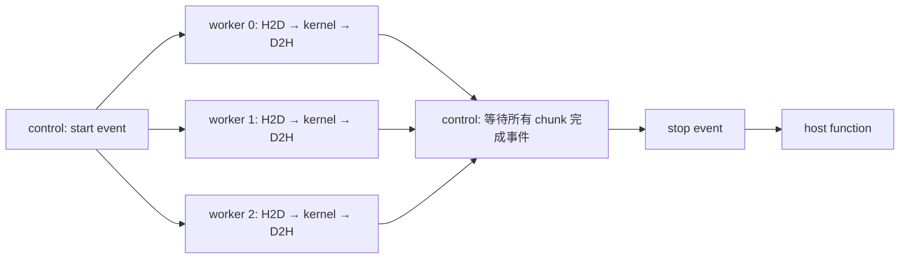

# 2.5. Asynchronous Execution：执行、依赖与调试

这组实验对应你提供的 §2.5 材料，覆盖 stream、异步拷贝、events、host function、默认流、优先级、Graph capture 和异步错误定位。

首先区分三个问题：**API 是否已经返回？操作是否已经完成？不同操作是否实际重叠？** 它们不是同一件事。代码用同步与数值校验回答完成和正确性问题，用计时与 Nsight Systems 时间线观察并发。

**当前动作索引：[commands/README.md](commands/README.md)。** 每个动作独立脚本、独立目录和同目录日志；先 compile，缺产物不会隐式构建。

## 1. 文件与运行入口

| 文件 | 实验 |
| --- | --- |
| [pipeline.cu](pipeline.cu) | pinned/pageable 内存、单流/三流流水线、event polling、CPU 工作、host function |
| [ordering.cu](ordering.cu) | legacy/PTDS 两种编译模式、blocking/nonblocking stream、优先级、销毁语义 |
| [events_graph.cu](events_graph.cu) | 跨流 event 依赖、事件完成与流完成的区别、线性 Graph capture/replay |
| [errors.cu](errors.cu) | 非法 launch 参数、执行期非法访存、错误查询与清除 |
| [common.cuh](common.cuh) | 错误检查、RAII 资源管理、确定性整数 kernel |
| [analyze_trace.py](analyze_trace.py) | 从 Nsight SQLite 的 NVTX 区间提取真实 copy/kernel 活动，计算重叠时长 |
| [DEBUGGING.md](DEBUGGING.md) | 实际故障、定位步骤、材料中的纠错说明 |
| [RESULTS.md](RESULTS.md) | 实测结果、时间线证据和分析限制 |

```bash
cd /home/mikasa/hpc/cuda/gpu-architecture-lab/07_async/01_async_execution
bash commands/compile/run.sh  # 显式编译，后续动作只复用
bash commands/run/run.sh
bash commands/sanitizer/run.sh
bash commands/debug/run.sh
bash commands/profile/run.sh
```

`run` 执行正常功能实验与可恢复的 launch 参数错误测试。`debug` 才会在独立进程中触发预期的非法地址写入；这些进程结束后不再复用故障 context。`sanitizer` 只检查正常路径。`profile` 使用 Nsight Systems 采集流水线的 CUDA/NVTX 时间线并导出 SQLite。

需要 CUDA C++17；默认目标 `sm_89`，可通过 `CUDA_ARCH` 修改。pipeline 默认 `SAMPLES=5 ELEMENTS=1048613`，例如 `SAMPLES=3 ELEMENTS=4194341 bash commands/run/run.sh`。其他小实验保持固定规模，方便对照。

动作入口为 `commands/<action>/run.sh`；先显式执行 `commands/compile/run.sh`，其余执行/检查动作只复用 `build/<variant>/` 的已有产物，缺失即提示先编译，不隐式构建。修改源码、头文件、编译选项或工具链后必须主动重新编译；没有哈希缓存或自动失效判断。 五个可执行文件共用 `bin/`；legacy/PTDS 保持各自编译命令与二进制。

日志位于脚本同目录 `commands/<action>/<variant>.log`，同动作同配置重跑覆盖（包括失败），其他动作日志不变。命令、实际参数、原始输出及退出码均记录；检查器的临时步骤文件在退出后清理。不生成自动快照、时间戳归档或 history。已有 `results/` 原始日志和历史报告保持原样，当前动作不写入。

`profile` 的新报告与脚本、日志就地存放：`commands/profile/<variant>-timeline.sqlite` 和 `commands/profile/<variant>-timeline.nsys-rep`（例如 `sm_89-release-timeline.sqlite`）。报告仅由 profile 内的分析步骤读取，无须放入共享 build。重跑覆盖同配置的报告和日志，不影响其他配置；采集失败会停止，不继续解析遗留报告。既有 build 中的 `timeline.*` 历史报告保持原样，若存在旧布局的 `current_timeline.*` 也不移动或覆盖。工具可通过 `NVCC`、`NSYS`、`COMPUTE_SANITIZER` 指定。

## 2. 实验 A：七个分块的异步流水线

每个元素执行确定性的 64 步整数变换，CPU 预先计算参考结果。数组分成七块，处理不整除的尾部；每块使用独立的输入、设备和输出区间，因此不同流不会写同一地址。

比较三种配置：

| 配置 | Host 内存 | 工作流数量 |
| --- | --- | ---: |
| pinned_one_stream | `cudaMallocHost` | 1 |
| pinned_three_streams | `cudaMallocHost` | 3 |
| pageable_three_streams | 普通 `new[]` | 3 |

每块在自己的流里依次执行 H2D → kernel → D2H。同一流的顺序为 kernel 提供输入已复制完成的保证，也使 D2H 发生在计算之后；不同流之间仅表达并发的可能性，不保证实际同时运行。



所有资源在提交工作前创建。control stream 与 worker streams 都使用 nonblocking 标志，避免无意依赖 legacy default stream。control 在 start 后等待每个 chunk 的 D2H 完成事件，最后记录 stop；因此计时终点覆盖所有 worker，而不是仅覆盖某一条流。

程序提交完工作后，用 `cudaEventQuery(stop)` 轮询，并在 NotReady 时做独立 CPU 计算。它没有提前读取 D2H 输出，也没有复用仍在传输的 host 输入区间。轮询有 30 秒超时，并且把真正的 CUDA 错误与 NotReady 分开处理。

### Pinned 与 pageable 的边界

Pinned host memory 是可靠表达异步主机传输和重叠意图的重要条件，但不能保证零 API 延迟或一定并发。pageable 内存可能需要 staging，可能导致 host 阻塞或 stream 同步；不能把一次观察推广为永远完全同步或完全异步。这里保留 pageable 对照，实际记录提交耗时与完成耗时。参见 [Runtime API synchronization behavior](https://docs.nvidia.com/cuda/cuda-runtime-api/api-sync-behavior.html)。

### Host function 为什么还要额外等待

`cudaLaunchHostFunc` 排在 stop 事件之后，函数只更新一个 `std::atomic<int>`，不调用 CUDA API、不抛异常、不等待 GPU。

因此 stop event 完成不代表该 host function 已执行完。代码随后调用 `cudaStreamSynchronize(control)`，再检查调用次数为 1。回调状态和所有缓冲区都保留到同步之后。

## 3. 同一实验中的三种时间

每个配置先预热一次，再记录多个样本，逐元素校验每次输出。

| 时间 | 测量范围 | 不能替代什么 |
| --- | --- | --- |
| `enqueue_ms` | CPU 从开始提交到所有 API 提交返回 | 不是 kernel 执行时间；可能包含 API 阻塞 |
| `gpu_span_ms` | control start 到所有 worker 完成后的 stop | 不包含之后 host function 的完成等待；也不是各 kernel 时间之和 |
| `wall_ms` | CPU 开始提交到回调及工作全部完成 | 包含 host 调度、轮询和回调等待，不是纯 GPU 时间 |

`INTERVAL` 行还保存每块 H2D/kernel/D2H 的 event 边界。它们适合检查 DAG 和相对进度，但 event 间隔可能包含调度空隙，不能单靠区间相交证明物理 copy engine 与 kernel 真正重叠；`profile` 提供另一个层面的时间线证据。

`profile` 会运行 `analyze_trace.py`：在每个配置的 NVTX 区间内，分别合并 CUPTI kernel 与 memcpy 的活动时间段，再求两个并集的交集，避免重复计算。汇总包含该配置的预热和两次测量运行；它不是仅针对一个采样的统计。`.nsys-rep` 可以在 Nsight Systems GUI 打开查看逐项时间线。

本机能力字段由程序打印。`asyncEngineCount` 和 `concurrentKernels` 表明设备能力，不保证本次负载一定利用这些能力。分块大小、kernel 占用、提交顺序、工具插桩和调度都可能影响重叠与加速。

## 4. 实验 B：event 完成不等于 stream 完成

`event_dependency()` 的生产者流：H2D → 第一次变换 → produced event → 独立的约 5 ms 尾部 kernel。消费者流先 `cudaStreamWaitEvent(produced)`，再执行第二次变换和 D2H。

尾部 kernel 只写自己的时间戳数组，不访问消费者正在使用的数据。消费者等待 copied event 后可验证输出，同时查询生产者流。此时生产者可能仍为 NotReady；即使已经完成也不算失败，因为异步调度不保证某次主机观察时刻一定落在尾部执行期间。

这演示了 event 只标记此前的工作，而 `cudaStreamSynchronize(producer)` 还会等待其后的尾部工作。event 完成也不意味着后面的 kernel 尚未开始，它可能未开始、正在执行或已经结束。

## 5. 实验 C：默认流两种编译模式

同一个 [ordering.cu](ordering.cu) 编译两次：

```text
--default-stream legacy     -DLAB_PER_THREAD=0
--default-stream per-thread -DLAB_PER_THREAD=1
```

每次按 host 提交顺序启动 A、B、C 三个独立 kernel，B 使用隐式 default stream 或显式 `cudaStreamLegacy`。每个 kernel 只访问自己的时间戳，不使用“缺失依赖导致的数据竞争”来判断顺序。

| 编译模式 | A/C 流 | B 流 | 是否要求 A → B → C |
| --- | --- | --- | --- |
| legacy | blocking | implicit default 或 explicit legacy | 是 |
| legacy | nonblocking | implicit default 或 explicit legacy | 否 |
| per-thread | blocking | implicit default | 否 |
| per-thread | blocking | explicit legacy | 是 |
| per-thread | nonblocking | 任一上述 B 流 | 否 |

“blocking stream” 指与 legacy stream 的隐式同步关系，不表示每次 host API 都阻塞。PTDS 是每个 host thread 的默认流，不等于显式使用 legacy handle 也会失去 legacy 语义。

代码对必须有顺序的组合做断言；其他组合只记录是否观察到重叠，不把“没有并发”当作错误。时间戳来自设备 `%globaltimer`，`pair_overlap_ns` 为三个 kernel 两两相交时长之和，有可能超过总墙钟跨度，不是总体并行时间。

### 优先级与销毁

同一程序查询优先级范围，创建高低优先级流并启动独立工作。只校验工作完成，不断言高优先级一定先运行，也不演示抢占已经运行的工作。

销毁测试先排队一个 kernel 和 done event，再直接调用 `cudaStreamDestroy`，随后检查 event。仍然 NotReady 是合法结果；代码保留数据和 event，等 done 完成后才释放资源。公共 RAII `Stream` 包装器则特意先 synchronize 再 destroy，防止正常路径的自动清理过早释放资源。参见 [CUDA Stream Management](https://docs.nvidia.com/cuda/cuda-runtime-api/group__CUDART__STREAM.html)。

## 6. 实验 D：Graph capture 与普通重复提交

捕获一条线性链：H2D → 8 个短 kernel → D2H，共 10 个节点。capture/instantiate 只做一次，设置成本单独记录；普通提交和 Graph 各预热一次，再轮换顺序测量 5 个样本，每样本重放 20 次。

普通路径与 Graph 路径使用同样的运算、数据、stream 和同步终点。每次链执行都重新 H2D 初始化，避免两组执行不同次数的累积变换。固定的 pinned host 指针和设备指针在所有 replay 期间保持有效，完成后再销毁 graph instance 和 graph。

Capture 收集工作而不执行它；Graph launch 仍是异步的，依然要同步后才能读取输出。Graph 可能降低重复提交开销，不会自动消除数据依赖，也不能保证大 kernel 或拷贝主导的负载一定加速。

本例是线性 capture 入门，没有覆盖跨流 capture、graph update、动态节点或多 GPU。

## 7. 调试顺序

先用 `run` 验证数值和必需的顺序，再用 `sanitizer` 检查正常路径。需要学习错误传播时才执行 `debug`：它包含显式错误预期，正常检测到非法写入时工具返回非零是正确的诊断结果。

具体定位步骤、原始错误与材料中的纠错见 [DEBUGGING.md](DEBUGGING.md)。完整观测结果见 [RESULTS.md](RESULTS.md)。
