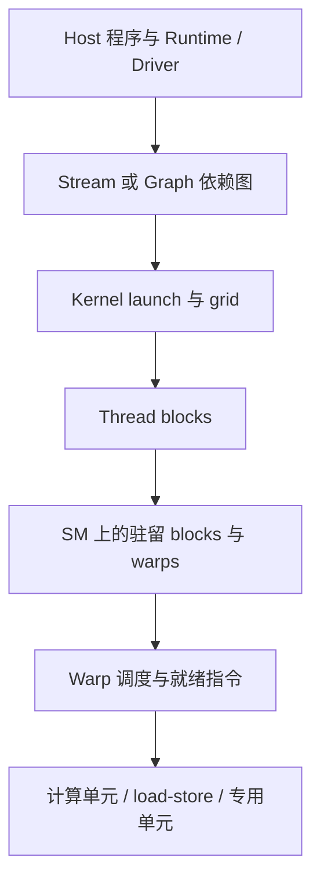
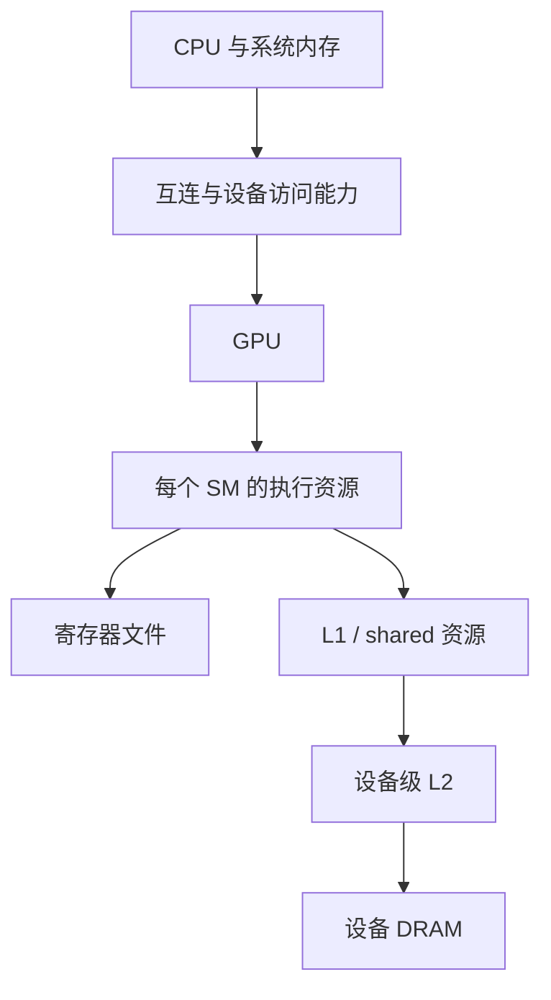

# CUDA 与 GPU 体系结构：从语义到可验证模型

这是一份教学模型，不是本机规格表或新的测量报告。具体设备属性从 [00_machine](00_machine/README.md) 采集，具体 API/指令条件从子专题与对应版本的官方文档核对；练习顺序见 [学习路径](LEARNING_PATH.md)。

## 1. 四层问题不要混成一层

| 层次 | 要回答的问题 | 证据与限制 |
| --- | --- | --- |
| 编程语义 | 谁能访问对象？何时可以读？哪些线程必须参加？ | CUDA C++ / PTX 规范与算法不变量；一次 PASS 不能取代规范 |
| 编译映射 | 源码生成什么指令，使用多少资源？ | 编译参数、PTX、SASS、资源报告；只对该工具链和目标成立 |
| 硬件模型 | 哪些资源共享，哪里可能成为瓶颈？ | 架构指南、设备属性、地址/依赖推导；模型不是实测 |
| 动态行为 | 本次运行的时间、流量、重叠和 stall 是什么？ | 正确性结果、逐次时间、profiler 原始报告；不能跨环境直接推广 |

例如 `__ldcg` 表达缓存访问策略；PTX/SASS 能确认生成形式；计时能说明这个负载花了多久；只有相应计数器才能支持实际缓存命中和 DRAM 流量的结论。四种证据相互补充，不互相替代。

## 2. 执行层次：工作如何到达 GPU



这是逻辑路径，不表示 stream 拥有专属 SM，也不表示每一层对应独立硬件队列。

- **Thread** 是标量程序实例，有自己的索引与状态；不是一颗永久绑定的 CUDA core。
- **Block / CTA** 是共享内存和 block 同步的合作单元。普通 block 在一个 SM 上执行，一个 SM 可以同时驻留多个 block。grid 中 block 数量通常超过同时驻留容量，不能假设不同 block 按编号启动或同时前进。
- **Warp** 是 CUDA 的线程执行分组。当前 CUDA warp 为 32 个线程，具体机器仍记录 `warpSize`。SM 调度器从可发射的 warp 指令中选择工作；驻留不等于就绪。数据依赖、barrier 和资源争用都可能让驻留 warp 暂时不可发射。
- **SIMT 与分歧**：同一 warp 的线程可以走不同路径，通常以不同活跃 lane 集合执行相应指令。源码中的 `if` 也可能被谓词化；必须查看生成代码。独立线程调度不意味着 warp 内可以省略必要同步，也不保证每个 lane 同时执行。
- **Cluster** 在支持设备上组织多个协作 block，提供相应的 cluster 同步和分布式共享内存能力。它不是“更大的普通 block”，也不是跨任意 SM 的免费全局 barrier。thread block cluster 要求 CC 9.0+，还需合法 launch、资源与工具链支持；已有 [cluster 条件示例](04_sync/03_thread_scopes/README.md) 仅覆盖其声明的计数场景。

### 索引与覆盖先于优化

一维工作常用 `i = blockIdx.x * blockDim.x + threadIdx.x`，用 `i < n` 保护尾部；grid-stride loop 再用 `blockDim.x * gridDim.x` 跨步。大输入应在乘法前选择足够宽的整数类型。多维 block 的线性线程号为：

```text
t = threadIdx.x + blockDim.x * (threadIdx.y + blockDim.y * threadIdx.z)
warp = t / warpSize
lane = t % warpSize
```

所以二维 block 的 lane 不能只看 `threadIdx.x`。输入尾部 mask、物理不完整 warp 与 shuffle 的源 lane 合法性是不同问题，见 [Warp Functions](04_sync/04_warp_functions/README.md)。

### Occupancy 是资源约束，不是性能目标

驻留 block 上限受线程数、warp 数、寄存器、shared memory、架构 block 上限及分配粒度共同限制。粗略预算可写为：

```text
resident_blocks ≤ min(thread_limit / threads_per_block,
                      register_limit / registers_per_block,
                      shared_limit / shared_bytes_per_block,
                      architectural_block_limit)
occupancy = resident_warps / maximum_resident_warps
```

实际须按分配粒度取整并使用对应设备的资源限制；编译资源与 occupancy API 预测不是动态采样。增加驻留 warp 可能隐藏延迟，也可能减少每线程寄存器、造成 spill 或降低复用。高 occupancy、很多 eligible warps、较高发射率分别描述不同现象，不能只优化一个百分比。

## 3. 存储层次：地址空间、物理位置与同步范围



这是层次模型，不是所有指令都必须逐级经过的物理连线。缓存旁路、只读路径、shared carveout、统一内存迁移与系统内存访问随架构和指令变化。

| 程序概念 | 主要用途与常见映射 | 不应作出的推断 |
| --- | --- | --- |
| 寄存器值 | 每线程的活跃标量；编译器分配到寄存器文件 | C++ 局部变量不保证全在寄存器；寄存器更多不保证更快 |
| local memory | 每线程私有地址空间，可承载栈、数组和 spill；由设备内存层次支持 | “local”不表示片上 shared，也不等于只会访问 DRAM |
| shared memory | block 内显式协作存储，容量受资源限制；cluster 有条件扩展访问 | 分配 shared 不会自动同步；不同 block 的同名变量通常不是同一对象 |
| global memory | GPU 可访问的地址空间，常见为设备分配，也可能对应系统内存 | global 地址不等于 system scope，也不保证实际每次访问显存 |
| constant / 只读路径 | 为满足约束的数据提供相应访问机制 | `const T*` 不保证其他别名不写；`__ldg` 有整个 kernel 期间只读前提 |
| managed / mapped / pinned | 分配、驻留或 host/device 访问方式 | 统一虚拟地址不等于统一物理存储、无迁移或任意 CPU/GPU 原子都可用 |

### 从地址表推导访存

1. 写出一个 warp 各 lane 的字节地址与访问宽度。
2. 检查对齐、有效 lane、跨段情况和重复地址。
3. 按目标架构的事务/sector 模型预测合并访问，再用计数器核对。

以现代常见的 32-byte sector 模型示意：32 个 lane 各读连续 4 bytes，且起点 32-byte 对齐，共覆盖 128 bytes、4 个 sector；起点偏移 4 bytes 时会覆盖 5 个 sector。**覆盖 sector 数不等于实际 DRAM 事务数**，还取决于缓存状态和实际指令。改变 stride 时若同时增大工作集，应把两个因素分开控制。

对 shared memory，在常见 32-bank、每 bank 对连续 32-bit word 映射的模型中，可先用 `bank = (byte_address / 4) % 32` 推导。二维 tile `[32][32]` 的按列访问常会落入同 bank，而 `[32][33]` 的 padding 改变映射。但访问宽度、广播/多播、指令拆分和架构都影响实际冲突，不能把这个公式无条件套到任意类型。详见 [Memory Explorer](02_memory/README.md)。

缓存提示只改变策略倾向；`.cg`、eviction hints、`volatile`、`asm volatile` 都不为生产者与消费者建立 happens-before。内存生命周期、顺序与可见性必须另行证明。

## 4. 性能模型一：Roofline 与算术强度

先指定计时范围和存储层级。对一个 kernel：

```text
F = 约定口径的浮点运算数（通常一次 FMA 计 2 FLOP）
Q = 所选存储层级实际传输字节数
I = F / Q                         [FLOP/byte]
P = F / time                      [FLOP/s]
P ≤ min(P_compute, B_memory × I)
I_ridge = P_compute / B_memory
```

`P_compute` 必须匹配数据类型、累加模式及执行单元，不能拿 Tensor Core 峰值作为普通 FP32 kernel 的计算上限；`B_memory` 要说明是规格峰值还是同环境可持续基线。DRAM、L2、shared 可分别建立模型，但各层的 Q 与带宽不能混用。无计数器时可先用算法必需字节估算 **算法算术强度**，明确它不是已测硬件流量。

- FP32 `C[i] = A[i] + B[i]`：理想有用工作为每元素 1 FLOP、2 次读加 1 次写共 12 bytes，算法强度约 `1/12 FLOP/byte`。实际 DRAM 字节还受缓存和事务影响。
- GEMM `C = A × B`：约 `2MNK FLOP`；若理想地每个 A/B 元素只从该层读取一次、C 只写一次，FP32 字节约 `4(MK + KN + MN)`。这是理想复用估计，不是朴素实现的实际访存量；若读取原 C，还需相应计入。blocking 通过复用提高某层的算术强度，但也增加 shared/寄存器需求。

Roofline 是容量/吞吐上界模型，不是运行时间预测器。小 kernel 可能被提交开销主导；依赖链、分歧、同步、spill 和不足的并行性都可能让点远低于 roofline。模型提示“可能受限的资源”，因果仍需控制变量与动态证据。

## 5. 性能模型二：Latency、Throughput 与并行性

**Latency** 是一项操作到依赖结果可用所需的时间；**throughput** 是单位时间能完成多少工作。流水线可以有较长延迟但较高稳态吞吐，两者不是倒数关系。

- 依赖链 `x = f(x)` 的下一项必须等待上一项，适合研究延迟相关行为，但循环、地址、时钟读取和调度开销都在测量中。
- 多个独立链 `a=f(a), b=f(b), ...` 提供 ILP；更多就绪 warp 提供 TLP。二者都可能帮助调度器在等待期间发射其他工作。
- 简化的 Little's law：`在途工作数 ≈ 吞吐率 × 平均延迟`。例如以假设的每周期 1 请求、延迟 200 周期建模，需要约 200 个独立在途请求才可能填满管线；这是教学数值，不是本机参数，也不是“200 个 warp”。请求粒度、合并访问、队列和每 warp 可并发请求数必须匹配。

增加 ILP 可能提高寄存器占用，降低 TLP；增加 stage 可能用掉 shared memory，减少驻留 block。应固定有效工作量，扫描依赖链数、block 大小、寄存器与 tile/stage 配置，并核对 spill 与生成指令。`clock64` 区间包含线程没有被发射时经过的周期，不能直接叫作某条指令固有延迟。已有 [setmaxnreg](03_instruction/01_setmaxnreg/README.md) 演示静态资源与动态配额的区别，不提供所有架构上的延迟/加速保证。

## 6. 正确性是性能分析的前提

并发协议至少回答以下问题：

1. **地址与生命周期**：分配范围、类型、对齐、初始化、释放时机是否正确？异步工作完成前不能复用或释放其缓冲区。
2. **参与集合**：哪些线程共同执行 collective/barrier？尾 warp、提前退出、分歧路径是否满足契约？shuffle 的寄存器交换不是 shared/global memory 的发布操作。
3. **原子性、order、scope**：三者分别解决不可分割访问、先后关系和覆盖哪些参与者。global memory 不自动选择 device scope，`seq_cst` 也不弥补过窄 scope。
4. **发布与复用**：生产者写 payload → release flag → 消费者 acquire 读到该发布 → 读 payload；还必须有读者完成 → 下一轮覆盖的反向交接。单次消息正确不证明循环复用正确。
5. **进展条件**：普通 launch 下忙等另一 block 可能阻止尚未驻留的生产者前进。scope 保证不等于调度/驻留保证；cooperative launch 等机制仍需容量与能力检查。
6. **数值标准**：整数溢出规则、浮点误差、归约次序、混合精度必须明确。更快但错误的结果不是优化。

从 [Memory Model](04_sync/01_memory_model/README.md) 学 happens-before，从 [Async Barriers](04_sync/02_async_barriers/README.md) 学 phase 与所有权，从 [Thread Scopes](04_sync/03_thread_scopes/README.md) 学参与范围与存储位置的区别。

CPU 参考与边界输入检查数值；Compute Sanitizer 查其支持范围内的访存、shared hazards、同步或初始化问题；静态检查确认指令。它们都不能单独证明所有调度下没有竞态。故意错误的例子必须隔离，不进入正常性能基线。

## 7. “异步”至少有五个层次

| 层次 | 它表达什么 | 完成/依赖机制与限制 | 入口 |
| --- | --- | --- | --- |
| Host API 提交 | host 可能在 GPU 操作完成前返回 | 返回不等于完成；pageable/pinned 与 API 具体规则影响阻塞 | [Async Execution](07_async/01_async_execution/README.md) |
| Stream / event | 操作的有向依赖关系 | 同流顺序与跨流 event；不同流只提供重叠机会 | 同上 |
| CUDA Graph | 将一组依赖图实例化并重复提交 | 不消除依赖，不自动降低设备运算量；设置成本与 replay 分开计时 | 同上，已有线性 capture 示例 |
| Kernel 内 copy / barrier / pipeline | global→shared 搬运、到达与等待分离、阶段所有权 | `commit` 不等于数据可读；wait 与允许覆盖是两条条件 | [Async Barriers](04_sync/02_async_barriers/README.md)、[Thread Scopes](04_sync/03_thread_scopes/README.md) |
| 专用数据移动与矩阵计算 | 架构相关 bulk/TMA、Tensor Core 等机制 | 指令、地址布局、完成机制、目标与 Toolkit 分别核对；不是任意 SM 通用接口 | [GEMM](06_gemm/README.md)、[异步主题](07_async/README.md) |

理想两阶段流水线在独立资源充分时，稳态每 tile 时间可由 `Tcopy + Tcompute` 接近 `max(Tcopy, Tcompute)`；预填、排空、等待、资源竞争与同步开销仍存在。double buffering 只是允许重叠的布局，不证明发生重叠。host/device 重叠先看 Nsight Systems 的真实活动时间线；kernel 内重叠需要相应指令、依赖与可用硬件指标，不能用 API 名称或 host 时间线代替。

## 8. 能力矩阵与证据纪律

- 常见 `cp.async` global→shared 硬件路径从 SM80 起；高级 API 可能有回退，而整个示例也可能因其他指令要求更高架构。不能将单条指令门槛泛化为整组代码门槛。
- cluster 与已有 SM90 transaction 示例要单独检查；Tensor Core 各代的数据类型、tile 布局和指令接口不同，`setmaxnreg` 还有 architecture/family-specific 目标约束。
- Toolkit 能编译不等于 GPU 能运行；原生 cubin 能运行不等于驱动能 JIT 同 Toolkit 生成的 PTX。`sm_90a` 与普通 `sm_90` 不可互换，特定架构后缀不能简单用数值大小判断兼容。
- 历史 `sm_89` 及旧记录中的工具缺失只说明当次环境。本页不宣布当前硬件、工具权限或全部功能可用。
- 每个结论标明“规范语义 / 模型推导 / 静态观察 / 本次实测 / 历史记录”。未测指标写未测量及原因；不把 `SKIPPED` 算作通过，不改写历史绝对路径。

记录模板见 [EXPERIMENT_PROTOCOL.md](EXPERIMENT_PROTOCOL.md)，迁移说明见 [MIGRATION.md](MIGRATION.md)。

## 参考与继续学习

- [CUDA Programming Guide](https://docs.nvidia.com/cuda/cuda-programming-guide/)：编程模型、语言扩展与能力条件。
- [CUDA Best Practices Guide](https://docs.nvidia.com/cuda/cuda-c-best-practices-guide/)：访存、性能和数值注意事项。
- [PTX ISA](https://docs.nvidia.com/cuda/parallel-thread-execution/)：指令语义、内存模型与 target 要求。
- [Nsight Compute Profiling Guide](https://docs.nvidia.com/nsight-compute/ProfilingGuide/)：指标、roofline、replay 与测量边界。

引用在线文档时记录所查版本；以实际 Toolkit 支持和专题源码为准，不把新版文档中存在的接口当作当前环境已验证。
