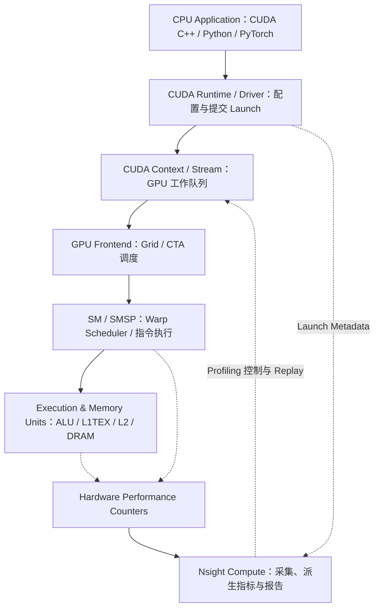
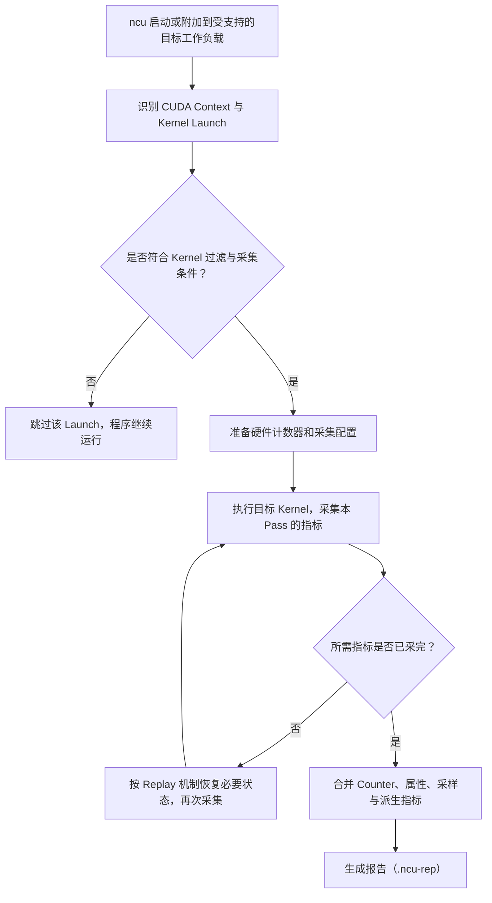
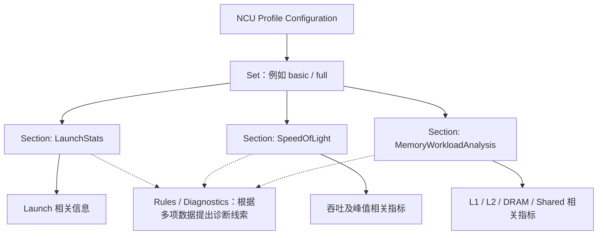
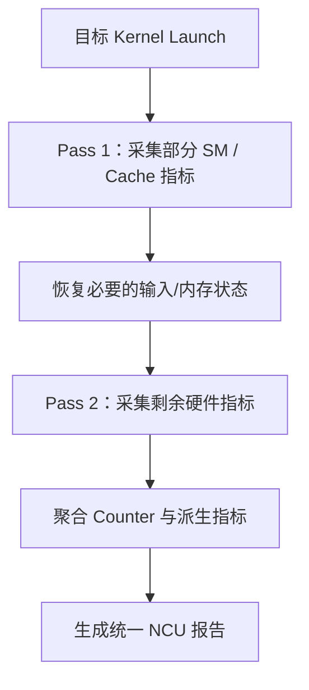
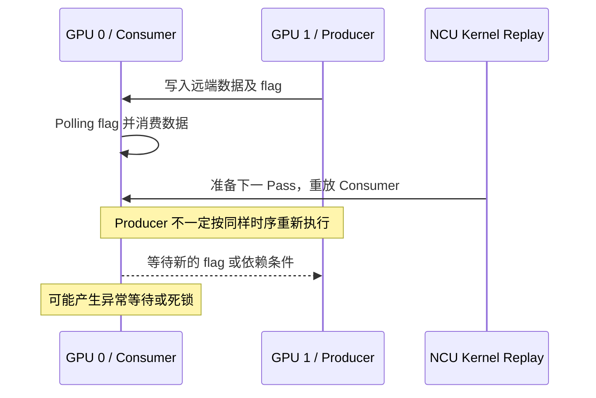
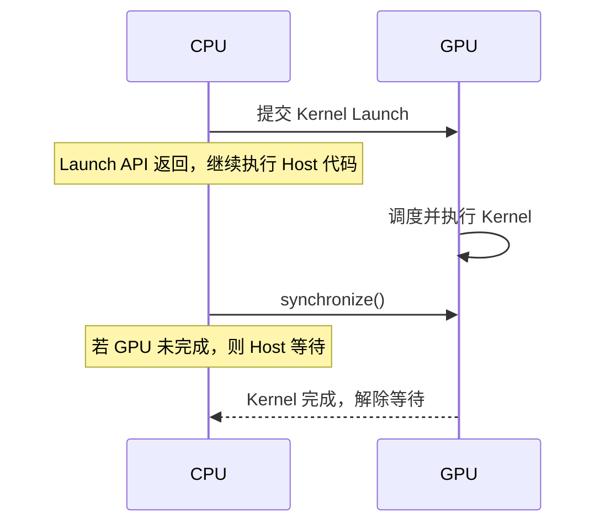
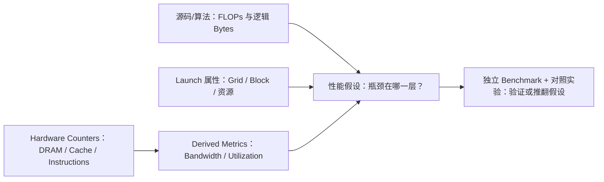
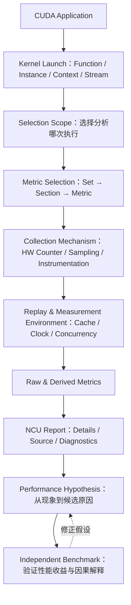

# Nsight Compute（NCU）系统学习 · 第一周：GPU Profiling 的基本原理

> 所属课程：[NCU 系统学习与 GPU Kernel 性能分析实验指南](../ncu_systematic_learning_guide.md)  
> 学习阶段：第 1 周 / 共 12 周（基础采集模型、Metric、Section、Kernel 选择）  
> 面向读者：掌握基本函数、数组和循环即可；不要求已有 CUDA、并发或性能分析经验。  
> 本文重点：**为什么 NCU 能测量硬件行为？报告中的数字是什么？采集过程如何影响结果？**  
> 文档形式：全部示意图由可编辑的 **Mermaid 代码**表示；不依赖任何外部图片。  
> 更新日期：2026-11-06
>
> 配套实操：[最小源码、分步命令与练习](lab01.md) · [历史实测与解读，不验证当前入口](RESULTS.md)

---

## 0. 学习目标与本周边界

本周首先建立 NCU 的测量模型，而不是尝试掌握数百个指标或立即优化复杂 CUDA Kernel。学完后，应能解释 CUDA Kernel 的一次 Launch 如何对应 GPU 上的执行活动，NCU 在哪个层次观测它，硬件事件计数器与派生指标的区别，Metric/Section/Set 如何组织，以及为什么多次 Replay、时钟、缓存和并发环境会改变 Profiling 结果。

本周聚焦 **测量对象 → 指标含义 → 指标组织 → 采集机制 → 解释边界**。第二周继续深入 Replay 模式、Cache/Clock Control、短 Kernel 的测量误差与可复现实验；第三周研究 GPU 硬件层次、静态资源预算与理论 Occupancy；Warp 调度与实际执行状态留到第四周。

| 本周主题 | 最终必须能够回答的问题 | 预计重点 |
|---|---|---|
| CUDA 执行与观测路径 | Host Launch 与 GPU 执行是什么关系？NCU 观测哪个层次？ | P0 |
| Kernel Function 与 Launch | `-k`、`-s`、`-c` 实际选择了哪一次执行？ | P0 |
| Metric | 计数器、派生值、采样和静态属性有什么不同？ | P0 |
| Metric 命名 | `smsp__inst_executed.sum`、`.per_cycle_active` 等如何解读？ | P0 |
| Section / Set / Rule | 如何从分析问题确定要采集什么？ | P0 |
| Replay 与扰动 | 为什么一个 Kernel 会被执行多次？为什么耗时会变？ | P0（入门） |
| Vector Add 案例 | 能否将理论 Bytes、硬件 DRAM Bytes 和有效带宽区分开？ | P0 |

表中的 P0 表示本课优先掌握的核心内容，不是工具参数或硬件等级。

---

## 1. NCU 究竟是什么：从 CUDA 执行过程理解 Profiling

**Profiling（性能剖析）**是记录程序运行中的耗时、事件和资源使用，帮助判断时间花在哪里；不是只检查答案是否正确。**Nsight Compute（NCU）**是 NVIDIA 提供的 GPU 函数性能分析器。例如，两种数组加法都算对了，NCU 可帮助比较它们读取了多少数据，但还需对照实验才能解释哪种更快以及原因。

### 1.1 一个简单的 CUDA Kernel

**Kernel（内核）**是交给 GPU 执行的函数，`__global__` 是 CUDA 中声明这种函数的标记。一次启动会让许多**线程（Thread）**执行这段函数；线程可理解为各自持有编号和局部数据的一份执行任务。下面不是一个线程循环处理整个数组，而是每个有效线程负责一个元素：若 `A=[1,2,3,4]`、`B=[10,20,30,40]`，四个有效线程分别得到 `C=[11,22,33,44]`。`const float* A` 保存输入数组地址，`float` 在这里占 4 字节，`const` 表示不通过该参数改写输入。

```cpp
__global__ void vector_add(
    const float* A,
    const float* B,
    float* C,
    int N
) {
    int idx = blockIdx.x * blockDim.x + threadIdx.x;
    if (idx < N) {
        C[idx] = A[idx] + B[idx];
    }
}
```

这些线程先组成 **Block（线程块）**，多个块组成一次启动的 **Grid（网格）**。一维例子中，`blockIdx.x` 是块号，`blockDim.x` 是每块线程数，`threadIdx.x` 是块内线程号，都从 0 开始编号；若每块 256 线程，块 1 的线程 3 对应 `idx=1*256+3=259`。`idx<N` 防止最后一块多出的线程越界。

**Host / Device** 在本课分别指 CPU 一侧与 GPU 一侧。Host 通过下面的 **Launch（启动提交）**请求运行 kernel；`<<<grid_size, block_size>>>` 指定块数和每块线程数，`A/B/C` 在本例须指向已准备好的 GPU 数组：

```cpp
vector_add<<<grid_size, block_size>>>(A, B, C, N);
```

CPU 提交通常是**异步**的：CPU 把任务交出去后可以继续运行，不必等 GPU 算完；要读取最终答案，必须等相关 GPU 工作完成，这种建立完成顺序或等待的操作叫**同步**。**并发**指多个任务的执行时间可能重叠，例如 GPU 算数组时 CPU 准备下一份输入；不意味着它们每一刻都在同一个硬件上同时执行。

提交路径中，**CUDA Runtime** 是程序调用的运行库，**Driver** 是管理 GPU 的驱动；**Context（上下文）**管理一次 GPU 使用所需的资源与状态，**Stream（流）**是排列 GPU 操作的有序队列。例如把上传 A、加法、下载 C 放在同一 Stream 中，会按这个顺序处理；不同 Stream 不自动拥有这个顺序关系。

GPU 的**前端**接收工作并分配线程块。**SM（Streaming Multiprocessor）**是承接块的计算单元，普通块也称 **CTA（Cooperative Thread Array）**，整块在一个 SM 上执行。块内线程每 32 个组成一个 **Warp（线程束）**；例如 256 线程有 8 个 Warp。**SIMT（单指令、多线程）**表示参与同一条组指令的线程各自处理自己的数据，而不是共用一个计算结果。**SMSP** 是 SM 的子分区；其中的 **Warp Scheduler（线程束调度器）**选择可执行的组指令送去处理，这个动作叫**发射（Issue）**。执行管线是处理算术或访存等指令的硬件路径；本课只需知道这些路径可分别被观测，不先学习调度细节。

为读懂下图，再认识几个路径标签：**ALU** 是做算术与逻辑运算的单元；**L1TEX** 是 SM 侧的一级缓存/纹理访问路径，**L2** 是服务多个 SM 的二级缓存，**DRAM** 是片外显存。图中的 Metadata 指函数名、块数等描述信息；Counter 是统计事件的硬件计数器，**派生指标**是用已有量算出的值，例如字节数除以时间。Sampling 是间歇记录状态，插桩是加入额外统计代码。后两种机制将在第 3 节展开。

### 图 1：CUDA Kernel 的执行与 NCU 观测路径



这张图表达三个关键点。第一，**CPU Kernel Launch 时间与 GPU Kernel 执行时间不是同一个量**；第二，CUDA Kernel 的性能取决于 GPU 微架构执行、调度及数据路径，而不是仅由源码指令数量决定；第三，NCU 可以读取 GPU 硬件性能监控数据，并结合 Launch 配置、设备属性、采样、软件插桩及其他信息生成性能报告，不需要逐线程地单步执行程序。

### 1.2 Debugging、Tracing、Profiling 的职责

**Debugging（调试）**找错误，**Tracing（跟踪）**按时间记录事件，**Profiling（剖析）**量化运行行为。表中的 **Occupancy（占用率）**是驻留 Warp 数相对硬件上限的比例；**驻留**指硬件已为它保留执行所需的状态且它尚未结束。若最多容纳 48 个 Warp、已驻留 24 个，比例就是 50%，但不表示算力用了 50%。**Warp Stall（线程束停顿）**指 Warp 暂不能推进，例如下一步加法要等前一次读取返回。这里先识别报告类别，第三、四课再分别研究容量与动态执行。

| 技术 | 主要回答 | 常见信息 | 典型工具 | 局限 |
|---|---|---|---|---|
| Debugging | 程序为什么算错或崩溃？ | 断点、变量、调用栈、异常 | `cuda-gdb` | 不专门用于定量微架构性能归因 |
| Tracing | 程序什么时候执行了什么？ | CPU/GPU 时间线、事件、同步和重叠关系 | `nsys` | 不提供 NCU 级别的指令/流水线细节 |
| Profiling | GPU 执行时哪些资源或事件影响性能？ | 指令、Cache、带宽、Occupancy、Warp Stall | `ncu` | 常会改变原始并发与缓存环境 |

**Benchmark（基准测试）**是用固定输入和计时范围比较性能的小程序或测试；独立表示不在 NCU 干预下运行。**NSYS** 是 Nsight Systems（命令 `nsys`）的简称，擅长展示 CPU/GPU 时间线。三者并不互斥。实际 GPU 优化通常先使用独立 Benchmark 或 NSYS 定位真实的时间问题，再用 NCU 分析 Kernel 内部行为，最后回到独立 Benchmark 验证修改是否有收益。

### 1.3 NCU 的基本采集过程

**Metric（指标）**是一个待观察的量，例如读字节数。硬件未必能一次收齐所有指标，因此 NCU 可能重复执行目标工作；这种工具安排的重复叫 **Replay（重放）**，每轮采集叫一个 **Pass**。例如应用只提交一次加法，工具却执行两轮，第一轮看指令、第二轮看流量；这不等于应用提交了两次。下图是这一机制的简图，内存恢复的原因见第 6 节。

**过滤**就是只选择符合条件的对象，例如只看名叫 `vector_add` 的启动。下图先做选择，再分轮采集，最后把计数、属性及由它们算出的派生指标合成报告。

### 图 2：典型 Kernel Replay 采集流程



该图是**典型 Kernel Replay 模型**，不代表其他重放单位都采用相同步骤。Application Replay 是重新运行整个应用，Range Replay 是重放指定的一段工作；CUDA Graph 是应用记录多项操作及依赖后再整体提交的机制，不是分析器的重放；多进程采集涉及多个独立运行的程序。这里只区分类别，第二课再分析它们的约束。现在先把 NCU 理解为三件事：**选择工作负载、选择观测指标、通过一种采集机制获得数据**。

---

## 2. NCU 最基本的分析对象：一次 Kernel Launch

### 2.1 Kernel Function、Launch 与具体执行实例

```cpp
for (int i = 0; i < 100; ++i) {
    vector_add<<<grid, block>>>(A, B, C, N);
}
```

| 概念 | 意义 | 对应例子 |
|---|---|---|
| Kernel Function | GPU 代码中的函数 | `vector_add` |
| Kernel Launch | 一次将该函数提交到 CUDA Stream 的操作 | 循环中的一次 `<<<...>>>` |
| Kernel Instance | 某个具体的实际执行工作负载 | 第 15 次 `vector_add` |

上面的程序拥有一个 Kernel Function，但提交了 100 次 Launch。不同 Launch 可以有不同的缓存冷热状态、时钟、输入数据、其他 GPU 竞争负载，因此不能认为每次执行时间一定相同。

```bash
# 采集符合名称条件的第一个 Launch
ncu -k 'regex:vector_add' -c 1 ./app

# 跳过前 10 个符合名称条件的 Launch，采集随后一个
ncu -k 'regex:vector_add' -s 10 -c 1 ./app
```

这里 `./app` 是示意名称，表示你已编译好的可执行程序，不是本课已有产物；实际入口见 lab01。`regex:` 表示按正则表达式（一种名称匹配规则）筛选，以上规则寻找含 `vector_add` 的函数名。其中 `-k` 是 Kernel 名称过滤器，`-s` 是 `--launch-skip`，`-c` 是 `--launch-count`。在以上场景下，跳过的是**满足筛选条件的 Launch**，不是整个程序中所有 CUDA Launch 的绝对前 10 次。

### 2.2 为什么 Python/PyTorch 更需要精确筛选

```python
import torch

x = torch.randn(4096, 4096, device="cuda")
y = torch.randn(4096, 4096, device="cuda")
z = x @ y
z = torch.relu(z)
```

代码中的 `x @ y` 是矩阵乘法，常简称 **GEMM**；`relu` 把负值改成 0、非负值保留。少量 Python 语句可能产生多个 GPU Kernel：随机数生成、GEMM、ReLU 等。直接运行 `ncu python test.py` 可以开始分析，但可能采集到初始化或非目标算子。后续应借助 Kernel Name、NVTX 范围以及 Profiler Start/Stop 缩小工作负载范围。**NVTX** 是给程序片段加名称标记的接口，例如把几次启动标为“本轮矩阵计算”；**Profiler Start/Stop** 是程序主动通知分析器何时开始、停止采集的接口。这些标记只选择观察范围，不会替程序建立同步或修复执行顺序。

分析前必须能回答：**哪个进程、哪个 GPU、哪个 CUDA Context/Stream、哪个 Kernel Function、哪一次 Launch，才是当前想解释的对象？**

---

## 3. NCU Metric 的本质：测量事件，而不直接输出根因

### 3.1 什么是 Hardware Performance Counter

把硬件计数器想象成 GPU 中针对特定事件的统计机制。例如某个理想化计算单元能够累计执行指令数和存储请求数：

```text
instruction_counter = 0
memory_request_counter = 0

每发生一次相关指令执行事件:
    instruction_counter += 1

每发生一次相关存储请求事件:
    memory_request_counter += 1
```

真实 NVIDIA GPU 的监控逻辑更复杂：SM、SMSP、L1TEX、L2 Slice（L2 的一个分片）、DRAM Partition（显存系统的一个分区）等硬件单元都有自己的统计范围；所谓“事件”可能是执行指令、Cache Sector、存储字节、活动周期或状态占用。

**Sector（扇区）**是缓存路径统计、处理数据的一小块单位；本课程涉及的 NVIDIA L1/L2 Sector 通常是 32 字节，仍须核对具体指标。它不是“一个线程的一次读取”：若 8 个线程各读一个相邻且恰好落在同一对齐 32 字节区域（起始地址是 32 的整数倍）内的 4 字节 float，它们的数据可以涉及同一个 Sector；若分散到 8 个不同区域，则可能涉及 8 个 Sector。因此 Sector 数、线程读取次数和字节数不能直接当成同一个量，缓存 Sector 也不等于一次 DRAM 传输。

**周期（Cycle）**是对应硬件时钟的一拍；“活动周期”仅统计满足该指标活动条件的周期，“状态占用”则描述某种状态被观察到多少次或多久。例如执行 100 拍、其中 40 拍活动，两个分母就不同。因此，**同一个数字只有明确硬件单元、事件语义和统计区间，才具有解释意义**。

典型指标名：

```text
smsp__inst_executed.sum
sm__throughput.avg.pct_of_peak_sustained_elapsed
dram__bytes_read.sum
gpu__time_duration.sum
```

注意：这些指标不一定都由同一种底层测量机制实现，不应把 NCU 报告中的所有数字统称为“原始硬件计数器”。

### 3.2 六类常见数据来源

表中的**归一化**指除以参照量，例如计数除以周期数；**二进制元信息**是编译产物附带的函数资源等描述。**派生值（Derived Metric）**是用其他量计算出的值，例如“传输字节数 ÷ 秒数”得到带宽（单位时间传多少数据）；**静态属性**描述配置或编译结果，不需要靠运行中累计事件得到。**PC（Program Counter，程序计数器）**指出当前指令位置，PC Sampling 就是隔一段时间记录位置/状态来找热点。**SASS** 是 GPU 最终执行的机器指令表示；**软件插桩（Software Instrumentation）**会给目标指令加入额外统计逻辑，例如每经过某段代码便累计一次，因而可能增加工作量。先分清这些来源，再读表中的名称。

| 数据类型 | 典型来源 | 示例 | 主要作用 |
|---|---|---|---|
| Hardware Counter | GPU 性能监控硬件 | 指令数、内存流量、硬件周期 | 观察动态硬件行为 |
| Derived Metric | Counter 或其他输入计算得到 | 平均吞吐（单位时间处理量）、带宽、比率、峰值百分比 | 对结果做量化归一化 |
| Launch Attribute | Kernel Launch 配置与二进制元信息 | Grid、Block、Registers | 解释资源和规模 |
| Device Attribute | GPU 静态/配置属性 | SM 数量、资源上限、计算能力 | 提供硬件边界 |
| Sampling Metric | GPU 状态的统计采样 | PC Sampling / Warp 状态采样 | 观察概率分布和热点 |
| Software Instrumentation | 对目标代码插桩等方式 | 部分源代码/SASS 关联指标 | 获取普通 Counter 无法直接表达的信息 |

例如从硬件 DRAM 流量计算**观测 DRAM 带宽**（每秒传输字节数）：

$$
B_{\mathrm{observed}}=\frac{\mathrm{DRAM\ Bytes}}{T}
$$

分子是所选启动在 DRAM 层的传输字节，需注明只含读、只含写还是读写总和；分母 $T$ 是同一工作负载、同一测量条件下的秒数。这里用读写总和；MB/GB 采用十进制，分别为 $10^6/10^9$ 字节，ms 为 $10^{-3}$ 秒。假设 1 ms 内真实发生了 800 MB 的 DRAM 传输，则：

$$
B_{\mathrm{observed}}=\frac{800\times 10^6}{10^{-3}}=800\ \mathrm{GB/s}
$$

这个数可以描述流量和时间的比值，但**并不能仅凭它证明 DRAM 带宽已达到瓶颈**；还要知道与当前架构、访问方向、频率和测量条件相符的峰值参照。

### 3.3 Counter 与 Sampling 不是一回事

Counter 通常针对某类事件在采集范围内累计计数；Sampling 则在若干时刻检查 GPU 状态，用样本分布近似描述热点。例如 100 个被记录的 Warp 状态样本中 60 个属于某种停顿，则该 Warp Stall Sample 占 60%；分母是这类样本总数，不是所有线程时间之和。这不意味着“整个 Kernel 有 60% 的实际时间浪费在这种 Stall 上”。样本可能存在采样偏差，同时某一个 Warp 的停顿时间也不是 GPU 总耗时的可直接相加分量。

这个原则是后续学习 WarpStateStats、SourceCounters 和 PC Sampling 的基础：**统计指标描述某种观测，不能直接等同于因果解释或耗时占比。**

---

## 4. Metric 命名、单位与聚合语义

### 4.1 先识别硬件单元

典型名称结构可以简化成下面四段：`unit` 是硬件/信息单元，`event-or-quantity` 是事件或量，`rollup` 是把多个相关硬件实例合成一个数的聚合方式，`normalization` 是除以周期数、峰值等参照量的方式。并非每个名称都有全部后缀。

```text
<unit>__<event-or-quantity>.<rollup>.<normalization>
```

实际命名体系还可能包含子单元、管线类型、接口和限定符。

| 前缀 | 硬件/信息层次 | 本周理解要求 |
|---|---|---|
| `gpu__` | GPU 设备级或工作负载相关量 | 先看时间、整体信息 |
| `sm__` | Streaming Multiprocessor | 整个 SM 层面的统计 |
| `smsp__` | SM Sub-Partition | SMSP 层面指令/调度等事件 |
| `l1tex__` | L1/Texture 访问路径 | 内存请求处理 |
| `lts__` | L2 Cache Slice | L2 侧事件与流量 |
| `dram__` | 显存子系统 | DRAM 侧统计 |
| `launch__` | Kernel Launch 相关信息 | 配置/元信息，不一定是动态硬件事件 |

例如：

```text
sm__throughput.avg.pct_of_peak_sustained_elapsed
```

**吞吐（Throughput）**是单位时间或周期处理的工作量；**归一化**是除以参照量，使不同规模的数据可比较。**持续峰值（Peak Sustained）**是工具为该硬件资源采用的持续处理能力参照，不是本次程序的有效工作量。`sm` 定位硬件层次，`throughput` 标识吞吐相关量，`avg` 指聚合形式，`pct_of_peak_sustained_elapsed` 表示以整个经过（Elapsed）区间对应的持续峰值作分母、观测处理量作分子得到百分比；具体综合方式仍由指标定义决定。应查阅具体 Metric 的定义，而不凭名字猜测“计算利用率”。

### 4.2 `.sum`、`.avg`、`.min`、`.max` 的含义

假设四个等价监控单元采集到相同事件的计数：100、80、60、0，常见聚合可以直观理解为：

| 单元 0 | 单元 1 | 单元 2 | 单元 3 |
|---:|---:|---:|---:|
| 100 | 80 | 60 | 0 |

| 聚合后缀 | 结果 | 解释 |
|---|---:|---|
| `.sum` | 240 | 对相关单元求和 |
| `.avg` | 60 | `(100+80+60+0)/4`，分母包括零计数单元 |
| `.max` | 100 | 最大单元统计 |
| `.min` | 0 | 最小单元统计 |

这是假设例子。真实 Metric 是否在单元之间做何种归约，要以该 Metric 的定义为准。尤其重要的是：**`.avg` 不意味着“每秒平均”，也不意味着“每条 CUDA Thread 平均”；`.sum` 也不是把所有 Replay Pass 的结果或时长相加。**

### 4.3 周期归一化需要看分母

常见后缀：

- `.per_cycle_elapsed`：以相关硬件单元经历的周期数作为归一化参照。
- `.per_cycle_active`：以相关硬件单元活跃周期数作为归一化参照。
- `.pct_of_peak_sustained_elapsed`：相对相应持续峰值，以经过时间/周期为归一化范围的百分比。

以单一单元为例：整个区间经历 100 周期，按该事件定义仅有 40 个活跃周期，处理 80 个事件，则为 `80/100=0.8` 事件/经过周期，或 `80/40=2` 事件/活跃周期；两个数字都不是事件/秒。**时钟域**指由某个时钟驱动的一组硬件，不同域的一拍可能长短不同。“活跃周期”和“经过周期”不是相同分母，`sm__` 与 `dram__` 的时钟域也不一定相同。比较来自不同硬件单元的 Cycle 时必须确认时钟域、计数范围及归一化定义。

### 4.4 Throughput 百分比不能自动解释为“有效算力”

假设看到：

```text
SM Throughput   = 85%
DRAM Throughput = 30%
```

**瓶颈**是当前最限制完成速度的因素；**Compute Bound（计算受限）**表示算术处理能力主要限制速度，**Memory Bound（访存受限）**表示数据访问能力主要限制速度。像“换更快的计算路径是否能缩短时间”这样的控制变量实验，才能检验前一种假设。不能立即判断“85% 算力利用率、30% 显存利用率，因此一定 Compute Bound”。NCU 中综合 Throughput 可能基于多个子单元及其持续峰值形成，真正接近上界的资源要查看组成指标。即使优化后某种利用率从 85% 降到 70%，只要相同工作量的真实完成时间显著下降，优化依然可能成功。

**Metric 是证据，不是自动根因。**

---

## 5. Metric、Section、Set 和 Rule 的组织关系

单卡能查询到的 Metric 很多，因此 NCU 不要求每次逐项指定所有指标，而是提供分层组织：**Section** 是围绕一个问题组织的指标组，例如访存分析；**Set** 是多个 Section 的预设集合，例如 `basic`；**Rule** 是根据这些数字产生诊断提示的规则。例如“先选基础套餐，再看访存分组，最后读其中的字节数”，对应 Set → Section → Metric。Rule 的提示只是待验证线索。

图中 **Shared Memory（共享内存）**是供同一线程块使用的片上工作区，例如块内线程把各自的中间值放入其中供同块伙伴读取；它不是普通缓存，也不是所有块可任意共用的空间。

### 图 3：Metric → Section → Set 的结构



- **Metric**：具体量，如执行指令数、读写字节数或某个派生百分比。
- **Section**：围绕一个性能问题组织 Metric、统计表格和可视化内容。
- **Set**：预定义的一组 Sections，用于简化采集配置。
- **Rule**：基于指标进行诊断与提示的分析逻辑；提示不等于已证明的根因。

| Section | 主要对象 | 它试图回答什么 |
|---|---|---|
| `LaunchStats` | Launch 配置与资源 | 启动配置/资源是什么？ |
| `SpeedOfLight` | 整体性能概览 | 哪些资源可能接近持续峰值？ |
| `Occupancy` | 活跃 Warp、资源限制 | 哪些因素限制 Warp 驻留？ |
| `SchedulerStats` | Warp Scheduler | 指令是否可以持续发射？ |
| `WarpStateStats` | Warp 状态 | Warp 为什么不能发射？ |
| `MemoryWorkloadAnalysis` | Cache、DRAM、Shared Memory | 请求与实际数据流量如何？ |
| `InstructionStats` | 机器指令相关统计 | 执行了哪些类型的指令？ |

第一周只需要记住：`SpeedOfLight` 是较高层次的入口，其他 Section 用于进一步细化。**更多指标不等于更准确**，很多指标可能使采集 Pass 增多，并进一步改变目标工作负载。

```bash
ncu --list-sets
ncu --list-sections
ncu --query-metrics

# 轻量采集
ncu --set basic -c 1 ./app

# 只收集一个指定 Section
ncu --section MemoryWorkloadAnalysis \
    -k 'regex:vector_add' -c 1 ./app
```

NCU 版本与 GPU 架构可能影响可用 Section、Metric 和采集支持，以上命令以实际安装版本为准。

---

## 6. Replay：为什么同一个 Kernel 需要被反复执行

### 6.1 一次执行未必能采集所有指标

硬件性能监控资源有限，不同指标可能竞争硬件采集资源，一些指标还依赖软件插桩。假设某个采集任务需要两轮 Pass 才能获得所有指标：

### 图 4：多 Pass 采集示意



这里的指标分组仅为概念示意，**并非声称真实硬件上这些具体指标必须分成两轮**。决定 Pass 数量的是实际指标组合、架构与采集机制。

### 6.2 为什么 Kernel Replay 需要恢复内存状态

如果 Kernel 会修改数据：

```cpp
C[idx] += A[idx];
```

第一次执行前 `C=10`、`A=2`，第一次执行后 `C=12`。如果下一 Pass 不恢复输入状态，第二次执行得到 `C=14`，工作负载就已经不是同一个输入条件了。典型 Kernel Replay 因此可能保存并恢复必要的内存区域，尽量令各 Pass 可比。

但是，**GPU 内存恢复不等于整个应用及外部世界恢复**。如果 Kernel 依赖 CPU、另一个 GPU、NIC（网络接口卡）或远端服务在特定时机生产数据，则只重放本地 Kernel 未必能重现原先的同步状态。**Polling（轮询）**是反复检查一个状态，例如不断读 `flag`，等它从 0 变为 1；**死锁**是参与方相互等待而无法继续。若负责写 1 的一方没有再次执行，重放的等待方就可能永远等不到。可能出现 Polling 时间异常、死锁或不真实的计数器结果。

NCU 还提供 Application Replay、Range Replay 等不同采集方案，它们的工作负载粒度、并发保留能力和指标归属不同；留到第二周系统比较。

### 6.3 通信 Kernel 的直觉例子

这里 **Producer（生产者）**产生数据并设置 flag（状态标志），**Consumer（消费者）**等标志满足后使用数据。下图只描述协作关系，不是可直接照写的同步代码；真实并发代码还需保证“看到标志时也能看到此前写入的数据”。**NCCL、DeepEP、NVSHMEM** 都是 GPU 通信/协作相关软件，**P2P（Peer-to-Peer）**指设备之间直接访问或传输数据。认识它们所属的问题类别即可，不需要先学这些库。

### 图 5：多 GPU 交互被单独 Replay 打断



这个示意尤其适用于理解 NCCL、DeepEP、NVSHMEM、P2P Polling 等工作负载的 Profiling 风险。不能因为 NCU 成功启动并生成报告，就认定它保持了原始通信的并发语义。

---

## 7. NCU 时间、CUDA Event 时间和真实应用时间为什么不同

### 7.1 四种不同的时间

**CUDA Event** 是插入 GPU Stream 中的时间标记，不是 CPU 发起调用那一刻的秒表读数。例如依次放“开始标记 → 加法 → 结束标记”，等待结束标记完成后取两者差值。**Wall Time（墙钟时间）**则是外部秒表量整次命令从开始到结束的经过时间，包含等待，不是所有线程执行时间的和。表中的 API 指程序调用工具库的接口。

| 时间类型 | 测量对象 | 可能包含的内容 |
|---|---|---|
| CPU Launch Time | Host 调用 CUDA Launch API | Runtime/Driver、提交成本 |
| CUDA Event Elapsed Time | 两个 GPU Event 记录位置之间的 GPU 时间 | 对应 Stream 顺序中的操作与相关等待 |
| NCU Kernel Duration | NCU 采集环境下受测 GPU 工作负载的持续时间 | 工具定义的硬件/前端时间戳范围 |
| Application Wall Time | 整个进程真实运行经过的时间 | CPU、初始化、GPU、同步及 Profiling 开销 |

### 图 6：Host 与 GPU 执行不在同一个时间轴含义上



假设 CUDA Event 得到 10 μs、NCU 得到 13 μs，不能立刻判定其中一个错误。时间戳边界、GPU Clock、Cache 状态、是否允许 Kernel 并发以及 Replay 环境都可能改变测量结果。NCU 报告中的 Kernel Duration 也不等于运行 `ncu` 命令的总 Wall Time。

### 7.2 四类典型采集扰动

**Clock Control** 是工具控制运行频率的策略；**Cache Flush** 是工具主动清缓存，**Cache Hit** 是所需数据在相应缓存层被找到；**Serialization（串行化）**是把原本可重叠的工作改为先后执行；**Profiling Overhead（采集开销）**是为了测量而增加的配置、重放、处理等成本。例如多采一轮会增加整条命令耗时，但不是原算法多算了一轮结果。

| 因素 | 机制 | 可能造成的结果 | 后续需要的实验 |
|---|---|---|---|
| Clock Control | NCU 可能控制 GPU 时钟，使运行环境更稳定 | 与生产环境频率分布不同 | 固定/不固定 Clock 对照 |
| Cache Control | 可能在 Replay Pass 前清理 GPU Cache | 热数据不再复用；Cache Hit 率改变 | Cache Flush 与 None 对照 |
| Serialization | 对目标 Kernel 的采集可能限制并发 | 原本重叠的 Kernel 被串行化 | NSYS 时间线比较 |
| Profiling Overhead | 计数器配置、内存恢复、数据处理或插桩 | 整体命令执行明显变慢 | 统计 Pass 与 Wall Time |

必须区分三个目标：**测准真实耗时、理解硬件行为、证明优化有效**。它们往往需要不同的工具和运行条件。NCU 对第二项极其重要，但最终收益通常仍要由独立 Benchmark 在接近真实生产的运行环境下确认。

$$
T_{\mathrm{NCU}}\not\equiv T_{\mathrm{production}}
$$

这里 $T_{\mathrm{NCU}}$ 指受测 GPU 工作在 NCU 条件下的时长，$T_{\mathrm{production}}$ 指同一工作在实际应用条件下的时长；$\not\equiv$ 表示两者不能当作天然等价，而非声称数值永远不同。这不是说 NCU 的结果不可信，而是说任何测量都需要注明条件和边界。

---

## 8. 综合案例：Vector Add 的理论流量与 NCU 指标

考虑：

```cpp
C[i] = A[i] + B[i];
```

**FP32** 是本例的 32 位单精度浮点格式，每个数占 4 字节；**FLOP** 是一次浮点算术操作，**FLOPs** 在这里表示操作总数，不是每秒操作数。数组长度：

$$
N=2^{26}=67{,}108{,}864
$$

每个元素做一次 FP32 加法，逻辑上读取 A、B 各 4 Bytes，写入 C 4 Bytes：

$$
\mathrm{FLOPs}=N
$$

$$
\mathrm{Bytes}_{\mathrm{logical}}=N\times(4+4+4)
=805{,}306{,}368\ \mathrm{Bytes}\approx805\ \mathrm{MB}
$$

其中 **805 MB 是基于算法的数据访问量推算值，而不是必然的 DRAM 传输量**。**缓存命中**表示需要的数据在所查缓存层找到了；**事务粒度**是硬件一次处理请求/传输的单位；**对齐**是地址落在该单位的边界上。比如只用到 4 字节，不代表这一层只传 4 字节，前述 Sector 就是例子。缓存命中、写入路径、事务粒度、访问对齐等因素会影响实际内存层次上的流量。

假设得到以下一组完全用于教学的 NCU 数据：

| 指标 | 假设值 | 应如何解释 |
|---|---:|---|
| Kernel Duration | 1.2 ms | 当前 NCU 采集环境下的持续时间 |
| Grid Size | 262,144 Blocks | `N / 256`，属于 Launch 配置 |
| Block Size | 256 Threads | Launch 配置 |
| DRAM Read | 536 MB | 实际 DRAM 侧读取统计 |
| DRAM Write | 268 MB | 实际 DRAM 侧写入统计 |
| DRAM Throughput | 约 670 GB/s | `(536+268) MB / 1.2 ms` |
| SM Throughput | 20% | NCU 定义的 SM 相关吞吐利用指标 |

总 DRAM 流量的简化计算：

$$
B\approx\frac{(536+268)\times10^6}{1.2\times10^{-3}}
\approx670\ \mathrm{GB/s}
$$

从这些数字可以得到哪些结论？首先，Block/Grid 是 Launch 属性；其次，DRAM Read/Write 是对应内存层次的动态统计；再次，带宽是流量与时间的派生量。但是，**仅凭 670 GB/s 不能断言 DRAM 已经饱和，仅凭 SM Throughput 20% 也不能判断计算单元存在可优化的闲置问题**。

**算术强度**是每传输一字节对应多少浮点操作，必须说明选用哪个层次的字节数。按本例逻辑口径为 $N/(12N)=1/12$ FLOP/Byte；每项计算少、读写多，因此说 Vector Add 的逻辑算术强度低，可能以访存代价为主。若用逻辑字节数除以同一耗时得到的是算法有效带宽；用实测 DRAM 字节数除以耗时才是该口径的观测 DRAM 带宽，二者不可替换。要证明这一点，还需要硬件峰值参照、MemoryWorkloadAnalysis、访问模式及不同输入规模的独立 Benchmark。后续 Memory、Roofline 模块将继续使用同一个例子。

### 图 7：从源码到性能归因的证据链



---

## 9. 第一周需要知道的常用 NCU 命令

这一周不追求命令大全，只理解每个选项负责哪一层：`-k/-s/-c` 负责 **分析谁**，`--set/--section/--metrics` 负责 **观察什么**，`--replay-mode` 负责 **如何采集**（深入用法在第二周）。

```bash
# 环境与能力探查
ncu --version
ncu --list-sets
ncu --list-sections
ncu --query-metrics

# 采集一个匹配的 Kernel，使用轻量 Set
ncu --set basic -c 1 ./app

# 先跳过前 10 个匹配的 Launch，再采集一个
ncu \
    --kernel-name-base function \
    -k 'regex:vector_add' \
    -s 10 \
    -c 1 \
    -o vector_add_basic \
    ./app

# 指定一个访存 Section
ncu \
    --section MemoryWorkloadAnalysis \
    -k 'regex:vector_add' \
    -c 1 \
    -o vector_add_memory \
    ./app

# Python / PyTorch 场景：ncu 参数放在解释器之前
ncu --set basic -c 1 python test.py
```

上面 `-o vector_add_basic` 通常会生成 `.ncu-rep` 报告，方便后续在 Nsight Compute GUI 中打开。使用 `-lineinfo` 编译 CUDA 源码会保留源码行号映射而不是开启设备调试，有助于后续在 Source（源码）视图中把源码行与机器指令关联，但本周不要求深入 SASS。

---

## 10. 本周自测：先独立回答，再看解析

### Q1：为什么 NCU 和 CUDA Event 的 Kernel 时间可能不同？

**参考答案：** CUDA Event 测量两个设备事件之间的时间，NCU 在受控 Profiling 条件下使用自身的时间戳机制，可能修改时钟、缓存与并发条件，两者测量边界和执行环境可能不同。NCU 不是日常端到端（从输入准备到输出完成）性能测量的无扰动替代品。

### Q2：为什么一次 Kernel Launch 可能被执行多遍？

**参考答案：** 所请求的指标可能不能一次同时采集，需要多个 Pass。典型 Kernel Replay 通过重新执行目标 Kernel，配合必要的内存状态保存/恢复，获得更多指标；但并不保证还原跨 GPU/CPU/NIC 的外部状态。

### Q3：Metric、Section、Set 的关系是什么？

**参考答案：** Metric 是具体的被测量或派生量；Section 是围绕某个分析问题组织的指标与视图；Set 是多个 Section 的预定义集合。Rule 可以基于指标生成诊断提示，但不等于已证实的根因。

### Q4：`smsp__inst_executed.sum` 的 `.sum` 说明了什么？

**参考答案：** 代表在相应硬件实例维度上的总计数聚合，不是每线程数，也不是每周期平均数；还要查该 Metric 的精确定义才能确定被计入的指令和事件语义。

### Q5：为什么不能仅凭一个吞吐利用率百分比判断 Compute Bound？

**参考答案：** 综合吞吐指标与具体硬件管线、峰值参照和归一化方式有关。数值高不代表有效工作多，数值低不证明资源限制不存在。应结合子指标、源代码、瓶颈模型及对照实验。

### Q6：为什么 DeepEP/NCCL 的 Polling Kernel 可能不适合直接 Kernel Replay？

**参考答案：** Polling 逻辑可能依赖远端 GPU、CPU 或 NIC 提供的新状态。重放消费者 Kernel 时，外部生产者不一定重放，导致等待时间失真或死锁。必须先证明采集机制保留了所需的协作语义。

---

## 11. 本周总结：一张图串联完整概念

### 图 8：NCU 测量模型全景图



第一周最重要的知识不是命令，而是以下六个区分：

1. **Launch 与执行**：Host 提交时间不等于 GPU 完成时间。
2. **函数与实例**：同一 Kernel Function 的不同 Launch 可以有不同性能。
3. **Counter 与指标**：报告不全是原始计数，还有属性、采样和派生值。
4. **测量与归因**：指标描述可观测现象，根因需要证据链证明。
5. **单次执行与 Replay**：为了采集更多指标，NCU 可能重放工作负载。
6. **NCU 时间与真实时间**：最终性能收益应使用独立 Benchmark 验证。

本周验收标准：看到一个 NCU Metric，先说明它属于哪个硬件层次、测量了什么、使用什么聚合/归一化，以及是否可能受 Replay 或采集条件影响，而不是立即将它翻译成“性能瓶颈”。

---

## 12. 下一周预告：Profiling 的正确性与可复现性

第二周继续研究：Kernel Replay、Application Replay、Range Replay 的语义差异；Cache Control (`all`/`none`)；GPU 时钟与功耗状态；Short Kernel 的时间测量；Multi-pass 与软件插桩的扰动；如何用 CUDA Event、NCU 和 NSYS 设计同一实验的对照组。届时将准备空 Kernel、Vector Add、具有输入状态依赖的 Kernel，以及可选的通信 Polling 实验，以实验数据检验本周理论。

## 13. 官方资料与建议阅读

1. [NVIDIA Nsight Compute — Profiling Guide](https://docs.nvidia.com/nsight-compute/ProfilingGuide/index.html)：Metrics、Sets and Sections、Replay、Performance Counter、Overhead、Reproducibility 等部分。
2. [NVIDIA Nsight Compute — CLI Guide](https://docs.nvidia.com/nsight-compute/NsightComputeCli/index.html)：Kernel Filtering、Metric Selection、输出报告与 Replay 相关选项。
3. [NVIDIA Nsight Compute — UI Guide](https://docs.nvidia.com/nsight-compute/NsightCompute/index.html)：Details、Source、Section 与诊断视图。
4. [NVIDIA CUDA C++ Programming Guide](https://docs.nvidia.com/cuda/cuda-c-programming-guide/index.html)：CUDA 执行模型、Kernel Launch、Stream、异步执行。
5. [NVIDIA CUDA C++ Best Practices Guide](https://docs.nvidia.com/cuda/cuda-c-best-practices-guide/index.html)：性能测量、有效带宽与资源瓶颈。

> **延伸阅读方法：** 遇到具体 Metric 时，先在官方 Metric 定义中核对事件单位、统计对象与归一化方式；遇到 Replay 或多进程问题时，优先查对应 NCU 版本的官方 CLI/Profiling 文档，而不是仅依据某个旧版本的教程。
