# Nsight Compute（NCU）系统学习 · 第二周：Replay、测量扰动与可复现性

> 配套实验：[lab02.md](lab02.md) · [入口源码](kernels/main.cu) · [脚本入口](commands/)（源码与实验设计已提供；历史默认入口仅有 compile-only 记录，不代表改后源码或新脚本，见[旧编译日志](log/legacy_commands/compile/source_check.log)，尚未运行验证，无性能实测；旧文内独立文件名 `ncu_week02_bench.cu`、`ncu_week02_run_experiments.sh` 是示例，尚未落地）。

> 所属课程：[NCU 系统学习与 GPU Kernel 性能分析实验指南](../ncu_systematic_learning_guide.md)  
> 前置课程：[第一周：GPU Profiling 的基本原理](../01_ncu_basics/lec01.md)  
> 学习阶段：第 2 周 / 共 12 周  
> 核心问题：**NCU 如何得到一份报告？它在采集期间改变了什么？怎样判断一个数字能否代表原始程序？**  
> 文档形式：全部示意图采用可编辑的 Mermaid 代码，不包含图片附件。  
> 更新日期：2026-11-06；命令与特性应以目标机器安装的 `ncu --version` 和对应版本文档为准。

---

## 0. 本周定位：从“会采指标”到“知道指标能不能相信”

先简短回顾第一课：**kernel** 是 GPU 函数，**launch** 是一次启动提交；**metric** 是单个指标（如读字节数），**section** 是围绕一个问题组织的指标组，**set** 是多个组的预设集合。NCU 先选启动，再选指标，最后生成报告。第二周深入 **观测扰动（Measurement Perturbation）**——测量本身改变了运行条件，例如清缓存后读取可能更慢；以及 **实验可复现性（Reproducibility）**——别人能按记录的程序、输入和条件重做比较，而不是要求每次得到完全相同的小数。这一周的知识非常基础，却会决定后面 Occupancy、Warp Stall、Cache、Roofline、SASS 甚至 P2P 通信的归因是否正确。要牢记两件不同的事：一是 NCU 能否准确采集某些硬件事件；二是 NCU 所观察到的**被干预执行**，是否仍然代表你真正想研究的生产工作负载。二者不能混为一谈。

建议本周理论学习和实验各占一半时间。若没有可用 GPU，可先完整理解理论、代码和预期现象；实验结果不应凭空填写。

| 学习主题 | 关键问题 | 学完后的判断能力 |
|---|---|---|
| Kernel Replay | 为什么重复执行，内存怎样恢复？ | 知道何时适合单 Kernel 重放 |
| Application Replay | 为什么整个程序需要多次运行？ | 理解可确定性与 Kernel 匹配 |
| Range / Application Range Replay | 为什么需要把多个 Kernel 作为整体测量？ | 知道如何处理依赖、并发与 CUDA Graph |
| Cache Control | Cold/Hot Cache 的区别？ | 判断缓存相关指标是否代表真实路径 |
| Clock Control | GPU 频率怎样影响耗时和吞吐？ | 区分标准化 Profiling 与自然运行 |
| Serialization / Software Patching | 工具为何影响并发和运行时？ | 解释 NCU 耗时与整程序时间差 |
| Short Kernel / Multi-pass | 为什么短 Kernel 的比率指标可能不稳定？ | 识别采样、时间戳与分子分母失配 |
| 可复现实验 | 怎样设计干净的 A/B 实验？ | 形成有证据的性能结论 |

**本周完成标准：** 能根据工作负载性质选择 Replay 模式，能解释 `--cache-control`、`--clock-control` 对结果的影响，能使用一份自包含 CUDA Benchmark 进行控制变量实验，并明确区分工具内观测、独立测量和真实性能结论。

---

## 1. 首先建立测量模型：我们到底测量了哪个系统？

### 1.1 原始程序与 Profiling 程序不是完全相同的实验系统

**Profiling** 是记录运行行为的性能剖析；**native（原生运行）**在本课指不启动 NCU 的运行。**工作负载（workload）**包括算法、输入和规模，例如“对 100 万项做逐元素乘法”。**并发（concurrency）**是多个任务的执行区间可能重叠，**串行化（serialization）**是改为一个完成后再让另一个执行；**system noise（系统噪声）**指后台任务等非目标因素带来的波动。缓存状态说明数据是否可能复用，clock 是硬件时钟频率，单位 Hz（每秒多少周期）。

设原始程序的真实执行时间为：

$$
T_{\mathrm{native}}=f(\text{workload},\text{GPU state},\text{cache state},\text{clock},\text{concurrency},\text{system noise})
$$

在 NCU 下采集时，同一个 Kernel 的执行条件可能被工具改变：

$$
T_{\mathrm{ncu}}=f(\text{workload},\text{cache policy}_{\mathrm{ncu}},\text{clock policy}_{\mathrm{ncu}},\text{serialization},\text{replay},\text{instrumentation})
$$

式中的 $f$ 表示“耗时受这些条件共同影响”，不是可直接代数求值的函数；$T$ 是同一目标工作的时长，可统一用秒或微秒表示。`cache/clock policy` 指工具对缓存/频率的控制策略，`replay` 指工具重复执行目标以分轮收集指标，`instrumentation`（插桩）指加入额外统计代码。这两个式子是概念模型，不是 NCU 的内部实现公式。它表达了一个基本事实：**硬件计数器可以对被观察的执行给出精确数据，但被观察的执行条件并不一定与没有 Profiling 时相同。**

下图中的 **CUDA Event** 是插入 GPU 有序工作队列的时间标记：把计算夹在两个标记之间，等结束标记完成后取时差；**NSYS（Nsight Systems）**用于看 CPU/GPU 时间线；**Benchmark** 是固定输入与计时范围的基准测试。**Duration** 是目标持续时间，**SASS** 是 GPU 机器指令表示，“微架构”指 GPU 内部计算与访存等具体硬件组织。端到端时间则覆盖所研究流程的起点到终点，例如从准备输入到取得最终输出，不能拿单个 kernel 时间替代。

### 图 1：性能测量中的两条路径

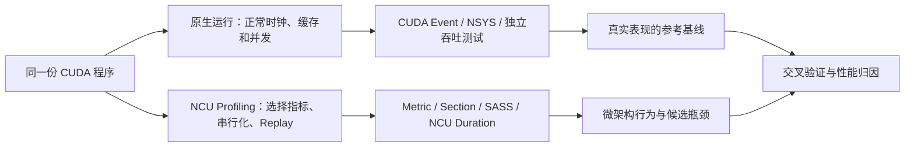

不要把两条路径的结果直接替换。例如 `ncu --set full ./app` 在终端运行了数分钟，不代表 Kernel 耗时是数分钟；同样，一个 NCU 报告中的 Kernel Duration 也未必能代替没有 Profiling 时的端到端时间。`--set full` 选择工具预设的较完整指标集合，不是“让原算法处理更多数据”。

### 1.2 需要区分的五种“重复执行”

先区分两层重复：应用自己重复启动以计算或计时，NCU 则可能为收集不同指标重复执行；工具每一轮采集叫一个 **Pass**。**Warmup（预热）**是应用在计时前先运行工作，例如先乘 10 次再开始计时，给初始化、缓存和频率状态变化留出机会；它不保证频率固定。**JIT（即时编译）**是在首次使用时生成代码，首次调用因而可能更慢。**CUDA Graph** 是应用把多项 GPU 操作及其依赖记录成图，再整体提交的机制；例如把“复制 → 计算”记录后重复提交。它的 Graph Replay 是应用行为，不是分析器为采指标安排的 Replay。

实际学习中经常把以下概念混在一起：

| 名称 | 谁触发 | 目的 | 是否是同一种执行？ |
|---|---|---|---|
| 应用循环迭代 | 用户代码 | 训练/推理/Benchmark | 不一定，数据与缓存可能变化 |
| Warmup | 用户代码 | JIT、初始化、时钟与缓存预热 | 常常改变之后的系统状态 |
| CUDA Graph Replay | 应用/API | 重复提交捕获的 GPU 工作 | 是应用自己的执行机制，不等于 NCU Replay |
| NCU Kernel Replay | Profiling 工具 | 分多 Pass 采集同一 Kernel 的指标 | 工具重放，通常伴随状态保存恢复 |
| NCU Application/Range Replay | Profiling 工具 | 重跑应用或指定范围以收集指标 | 重放单位和状态管理策略不同 |

例如 Python 中一次 forward（模型从输入生成输出的一次前向计算）执行 10 次，是应用级迭代；其中的 GEMM 是矩阵乘法。NCU 对其中一次 GEMM Kernel 进行了 8 个 Pass（采集轮次），是 Profiling 级重复执行。两种迭代不能通过一个 `launch-count` 混为一谈。

---

## 2. 为什么需要 Multi-pass：计数器是有限的，指标组合并非免费

**SM（Streaming Multiprocessor）**是 GPU 上承接线程块的计算单元；不同单元的事件可各有统计。**硬件计数器**是在事件发生时累计统计的机制，例如数读取的字节；承载这些统计的 Performance Monitor（性能监控）资源是有限的。GPU 中不同硬件单元具有有限的 Performance Monitor 资源，某些事件之间不能在一次采集中同时配置；部分 Source 层指标需要 Software Patching（为机器指令插入额外统计逻辑），不能与低扰动的硬件计数器统计简单混在同一 Pass 中。因此，NCU 可能将请求的指标拆为多个 Pass。

### 图 2：NCU 的多 Pass 指标采集

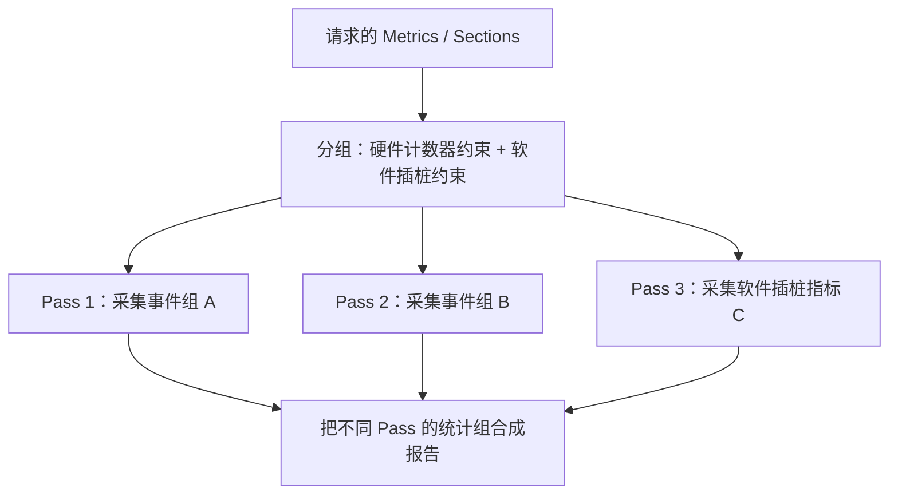

**关键区分：** 采集 Pass 越多，通常意味着更高的 Profiling 总耗时，但**并不是**“原始 Kernel 每多一个 Pass，NCU 的 Kernel Duration 就必然增加一个 Kernel 时间”。NCU 会在各 Pass 中按规则采集时长，并避免使用软件插桩 Pass 的运行时间作为普通 Kernel Duration。

如果所有请求指标均能在单个 Pass 中采完，Kernel Replay 不需要进行多 Pass 的设备内存保存/恢复。反过来，`--set full` 并不一定比只选择两三个 Section 更适合定位一个具体问题；“最大化指标数量”经常会降低实验可解释性。

### 2.1 启发性数值例子：跨 Pass 派生指标为何可能失真

**Cache Lookup** 是向某缓存层查询所需数据，**Cache Hit** 是该次查询在这层找到数据；**Hit Rate（命中率）**表示命中次数占查询次数的比例。例如同一统计范围内查询 10 次、命中 9 次，就是 90%。假设某指标按这两类事件定义为：

$$
\mathrm{HitRate}=\frac{N_{\mathrm{hit}}}{N_{\mathrm{lookup}}}
$$

分子 $N_{\mathrm{hit}}$ 是命中事件数，分母 $N_{\mathrm{lookup}}$ 是对应查询事件数，单位都是“次”，相除后无单位，乘 100% 写成百分比；真实指标可能以 Sector 等事件统计，必须核对两者口径。**L1/L2** 分别是靠近 SM 的一级缓存和服务多个 SM 的二级缓存；**Sector** 是缓存路径的数据统计/处理块，本课程相关 L1/L2 指标通常为 32 字节；一次线程读取不一定对应一个 Sector。例如 8 个线程各读一个相邻的 4 字节 float，数据恰在同一对齐 32 字节区域内（区域起始地址是 32 的整数倍），就可能只涉及一个 Sector。若指标按 Sector 计数，就不能把另一种“请求数”放进分母。

如果某类派生指标的两个分量来自不同 Pass，且目标 Kernel 的行为并不稳定：

- Pass A 观察到 900 次 Cache Hit；
- Pass B 观察到 1000 次 Cache Lookup；
- 报告组合成 90% Hit Rate。

如果两个 Pass 本来对应的是不同缓存状态，这个 90% 只代表跨 Pass 组合数值，并不一定对应任何一次真实执行的 Cache Hit Rate。更极端地，分子和分母变化可能使派生值超出正常逻辑范围。NCU 对此有明确说明，特别强调短 Kernel、Spin Loop 等动态性较高的工作负载可能产生这种问题。**Spin Loop（自旋循环）**反复检查条件而不退出，例如一直读取 `flag` 直到另一方把它改为 1；另一方响应早晚不同，会让各 Pass 的读取次数不同。

因此遇到异常比率时先问：**该指标的多个分量是否在同一 Pass 采集？每个 Pass 的输入、缓存和运行状态是否足够一致？** 而不是直接认定硬件出现了异常行为。

---

## 3. 四种 Replay 模式：最重要的理论主体

NCU CLI 通过 `--replay-mode` 选择不同的工作负载重放单位。当前官方文档列出 `kernel`、`application`、`range`、`app-range` 四类。它们不是同一个功能的四种写法，而是为不同依赖关系、并发模式与采集粒度设计的不同策略。

### 3.1 Kernel Replay：单独重放一个 Kernel

在典型 Kernel Replay 中，NCU 拦截一个符合过滤条件的 Kernel Launch。若需要多 Pass，它会保存该 Kernel 可访问的必要内存状态；在第一轮采集之后识别被 Kernel 写入的内存子集，并在后续 Pass 前恢复相关内容，以尽量确保多次重放获得相同的输入状态。

### 图 3：Kernel Replay 的执行与内存恢复

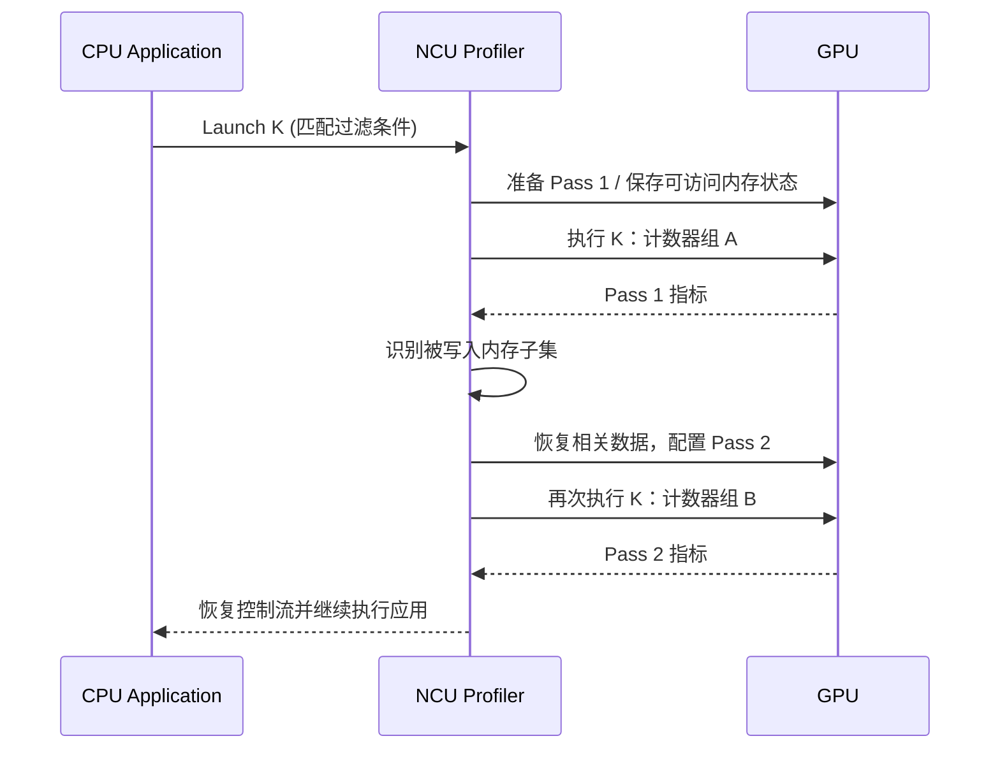

这张图仅用于理解多 Pass 的典型流程，实际保存策略、执行同步和单 Pass 优化以工具版本及实现为准。尤其要注意：并不意味着 NCU 会无条件拷贝整个显存；工具会结合被访问/被写入的内存范围与可用存储位置安排保存和恢复。

先回顾下面 CUDA 写法：线程是各有编号的一份执行任务，线程分组为 block，多块组成 grid；`blockIdx.x` 是块号，`blockDim.x` 是每块线程数，`threadIdx.x` 是块内线程号。若每块 256 线程，块 1 的线程 0 处理 i=256；`i<n` 防止尾块越界。`__global__` 声明 GPU 函数，指针参数指向已准备好的 GPU 数组。

一个适合 Kernel Replay 的例子：

```cpp
__global__ void vector_add(const float* a, const float* b, float* c, int n) {
    int i = blockIdx.x * blockDim.x + threadIdx.x;
    if (i < n) c[i] = a[i] + b[i];
}
```

当 `a`、`b` 在目标 Kernel 期间保持不变，输出 `c` 只由本次 Kernel 自己更新，且没有外部参与者需要同步配合时，工具较容易构建可重放的执行条件。

另一个需要恢复内存状态的例子：

```cpp
__global__ void accumulate(float* c, const float* a, int n) {
    int i = blockIdx.x * blockDim.x + threadIdx.x;
    if (i < n) c[i] += a[i];
}
```

若 `c[i]` 初始为 10、`a[i]` 为 2，正常执行一次得到 12；如果不恢复而执行两轮就会得到 14。Kernel Replay 的保存/恢复正是为了避免“为了采集更多 Metric 而改变程序最终输出”。这不等于工具能恢复外部网络、Host 线程、其他 GPU 的全部状态。

**Host / Device** 分别指 CPU 一侧与 GPU 一侧。**Flag** 是表示状态的标志值，**Polling** 是反复读它检查条件，**NIC** 是网络接口卡；生产者写数据并更新标志，消费者等待后使用数据。Kernel Replay 的主要限制是**外部交互与并发依赖**：当 Kernel 一边 Spin Polling，一边等待另一个 GPU、CPU 或 NIC 更新 Flag 时，只重放消费者 Kernel 可能失去生产者的响应，导致长时间等待、超时或死锁（协作方互等而无法继续）。

**适用场景：** 独立的 GEMM（矩阵乘法）、Vector Add（逐项加法）、Reduction（把多项合成一个结果，如求和）、Tiling（分小块处理）、Layout Transform（改变数据排列）、单 GPU Copy/Pack（复制/整理打包数据）等不依赖外部实时握手的 Kernel。适用的关键是依赖关系，不是算法名字本身。

### 3.2 Application Replay：把整个程序重新跑一遍

Application Replay 不在一个应用运行过程中单独反复执行某个 Kernel；NCU 会在多次应用运行中分别采集所需指标。每一轮应用执行通常正常经历初始化、Warmup、业务逻辑和退出，并由 NCU 将不同轮次匹配到的 Kernel 采集结果组合。

### 图 4：Application Replay 与 Kernel 匹配

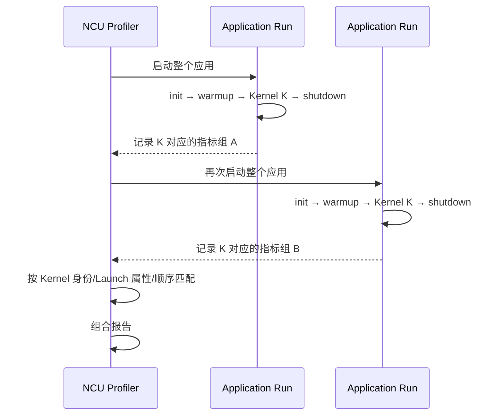

它的优点是整个应用自然重新执行，在每次运行中应用自己负责重新初始化与恢复工作负载，因此不需要像 Kernel Replay 一样由 NCU 对目标 Kernel 的内存写入进行跨 Pass 保存恢复。对需要 Host 响应的 Kernel，它通常更符合原始应用的交互方式。

但是 Application Replay 有一个严格条件：**不同轮次的 Kernel 活动必须具有足够的确定性（Determinism）**。例如某次运行根据输入选择了不同计算路径，或因异步数据依赖、随机分支而少启动一个 Kernel，那么 NCU 可能无法把不同轮次的目标 Kernel 正确匹配。

NCU 的 `--app-replay-match` 可以配置匹配策略（如 `name`、`grid`、`all`），`--app-replay-mode` 配置匹配严格程度（如 `strict`、`balanced`、`relaxed`）。这些选项控制**报告中如何匹配**，并不会自动把随机程序变成确定性程序。尤其在多进程场景中，进程与 GPU 的对应关系也应保持稳定。

**适用场景：** Host/GPU 互动、明确的应用 Warmup/Cache Priming（先访问目标数据以准备缓存）、可确定性重启的 PyTorch/CUDA 程序；不适合每次启动都发生不可控随机工作负载变化或带有难以重复的外部副作用的程序。

### 3.3 Range Replay：将一段 CUDA API + Kernel 作为整体重放

**API** 是程序调用运行库/驱动的接口，如分配内存或提交 kernel。**Range（范围）**是明确标记起止的一段工作，例如“复制输入 → kernel A → kernel B → 等它们完成”。`cudaProfilerStart/Stop` 通知工具开始/停止观察，**NVTX** 则给代码片段加带名称的范围标记；两者都不是计算本身，也不自动保证 GPU 工作已完成。

**Stream（流）**是 GPU 操作的有序队列，同一流按序处理，不同流的任务可能重叠。**依赖（Dependency）**表示某步需要前一步的结果，例如 B 读 A 的输出；可以让流 0 在 A 后记录 Event，让流 1 等这个 Event 再运行 B。这种 Event 除了可计时，还能表达完成顺序。下图的 Event/Wait 就是这种关系，不表示两个流天然同步。

Range Replay 的“重放单位”是一个由 Start/Stop Marker 或 NVTX 指定的 CUDA 工作负载范围，而不是每个 Kernel。NCU 捕获该范围内受支持的 CUDA Driver API 调用及 Kernel Launch，并在多个 Pass 中重放整个范围；报告中的指标归属于**整个 Range**，不再自动逐个 Kernel 归因。

### 图 5：Range Replay 保留范围内的依赖与重叠

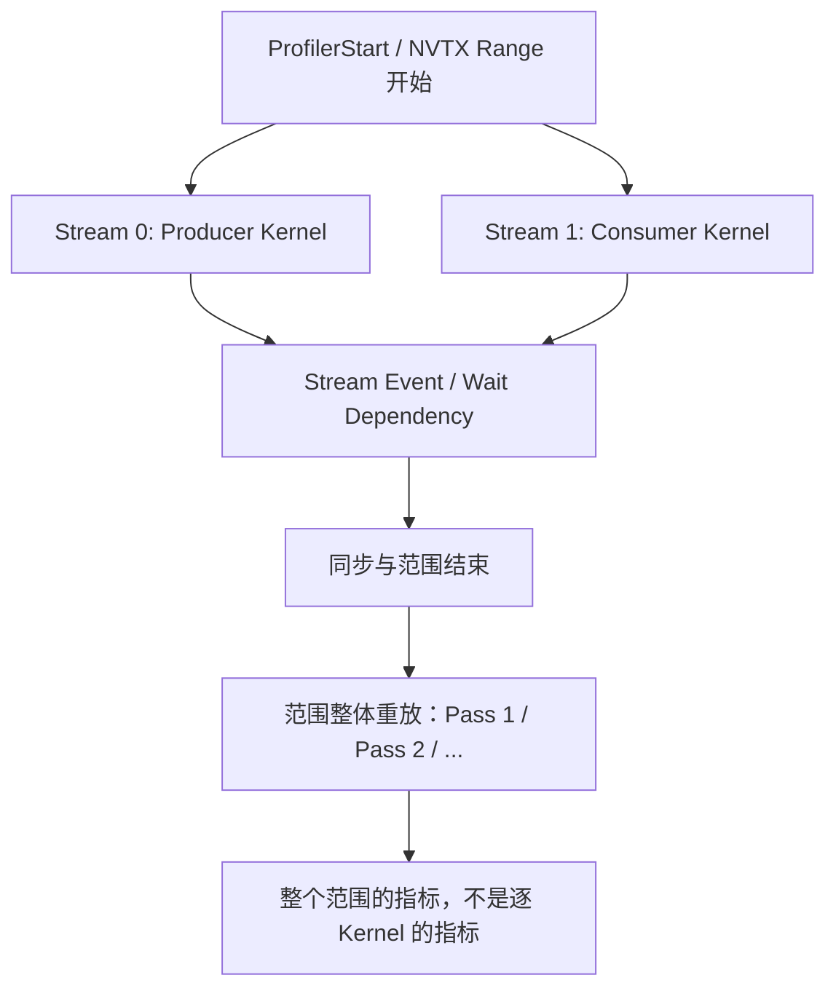

这种方式能够保留范围内某些必须并发执行才能正确或高效运行的 Kernel 行为。但它不是万能的“多 GPU 免死锁模式”：Range Replay **只支持特定的 CUDA API 捕获与重放**，并且对 Host/Device Memory、映射内存、生命周期和同步具有要求。例如映射内存允许 GPU 访问某些 CPU 内存，保存/恢复就不能只按普通 GPU 数组理解；生命周期指一块内存从分配到释放的有效区间，重放时地址与对象也必须仍符合工具要求。本讲义所依据的官方支持清单对若干 API 类别有不支持项：**VMM**（虚拟内存管理，分别控制地址与物理存储的映射）、**Stream Ordered Allocator**（按流顺序安排内存分配/释放）、**Graph Management**（创建或修改 CUDA Graph）、**Peer Context Memory Access**（访问其他设备上下文的内存）。这些是遇到错误时需核对的类别，不是入门实验的前置知识；也不能由类别名推断该类别所有 API 在所有版本中都不支持。对于大量使用 CUDA VMM、P2P、外部设备交互的通信应用，必须逐一核实对应工具版本的 API 支持清单，不能仅凭“Range 支持并发”就认定适用。

**适用场景：** 一个进程内、API 集合受支持、希望保留多个 Kernel/Stream 间关系的有界 CUDA 范围。

### 3.4 Application Range Replay：范围统计 + 整个应用重启

Application Range Replay（`app-range`）与 Range Replay 一样，按**整个 Range** 汇总指标；不同之处在于它不要求 NCU 捕获并自己重放范围中的所有 API，而是反复执行整个应用，由应用正常地生成该范围。这样能更好地保留应用对 Host、GPU、CUDA Graph 或复杂 API 的真实执行逻辑，但代价是需要重复运行完整应用，且各轮被采集的范围必须可重复、可对应。

### 图 6：四种 Replay 模式的根本区别

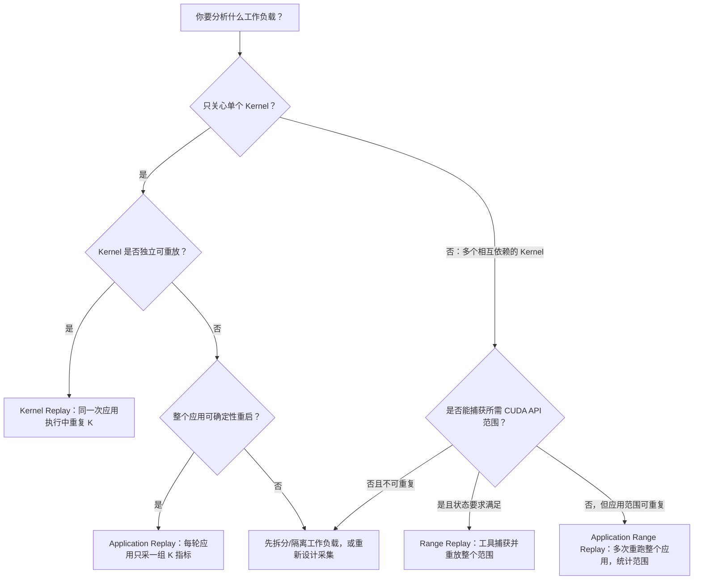

上图是选择策略，不是 API 兼容性保证。特殊平台、多进程跨 GPU 同步、非确定性数据来源还可能需要专门的采集协调机制：Lockstep 强调各参与方配合推进采集，Communicator 用于组织协作参与者；具体支持须查当前工具版本。这些不是图中四种模式之外可随意套用的开关，也不属于本课基础实验。

### 3.5 四种模式的完整对比

| 维度 | Kernel | Application | Range | App-range |
|---|---|---|---|---|
| CLI `--replay-mode` | `kernel` | `application` | `range` | `app-range` |
| 多 Pass 重放单位 | 单 Kernel | 完整应用 | 指定 CUDA 范围 | 完整应用中的指定范围 |
| 报告主要归属 | 单 Kernel | 单 Kernel | 整个范围 | 整个范围 |
| 内存状态保证方式 | 工具为 Kernel 做保存/恢复 | 应用重新初始化 | 工具为捕获范围保存/恢复 | 应用重新初始化 |
| 前置 Kernel 的缓存状态 | 容易被缓存清理干扰 | 可以由应用重建 | 可保留范围内部行为 | 可以由应用重建 |
| 内部 Kernel 并发 | 默认不适合有强依赖的并发 Kernel | 依赖重启应用正常运行 | 以范围为单位保留并发 | 以范围为单位保留并发 |
| 对应用的确定性要求 | 目标 K 重放状态足够稳定 | 高，需跨运行匹配 Kernel | 范围/API/状态须可捕获 | 高，需跨运行匹配 Range |
| 主要缺点 | 外部 Host/GPU/NIC 状态不可完全重放 | 重启昂贵、顺序变化难匹配 | API 与内存模型限制较多 | 重启昂贵、动态范围难匹配 |
| 入门推荐 | 最先掌握 | 第二优先 | 进阶实验 | 复杂应用的进阶选择 |

注意：不是所有指标都能在所有模式下取得完全相同的粒度。**Source** 指与源代码行关联的分析；**Sampling（采样）**指间隔记录状态来观察分布，例如 100 个样本有 60 个在等待，不等于整个 GPU 的 60% 时间在等待。部分 Source/SASS、Sampling 和 Graph 指标还有独立兼容性限制。必须以 NCU 的 Workload/Replay Compatibility 表为准。

---

## 4. Cache Control：为什么“清空缓存”可能提高可重复性，却降低代表性

### 4.1 Cold Cache 与 Warm Cache 的区别

**Cold / Warm Cache（冷/热缓存）**描述相对于目标数据的缓存历史：冷表示目标数据尚未被准备好供复用，热表示此前访问可能留下可复用数据，不指温度。例如第一次读数组 A 要从显存取回，紧接着再读 A 就可能命中缓存。**Tensor（张量）**在这里可先当作多维数组，Input Tensor 就是输入数组。考虑一个 Kernel 在短时间内反复读取相同的 Input Tensor。如果第一轮访问需要经过 DRAM，而后续访问的数据仍在 L2 Cache 中，那么第二轮的 Data Source、延迟与流量构成可能与第一轮不同。

### 图 7：连续访问与缓存清理的对照

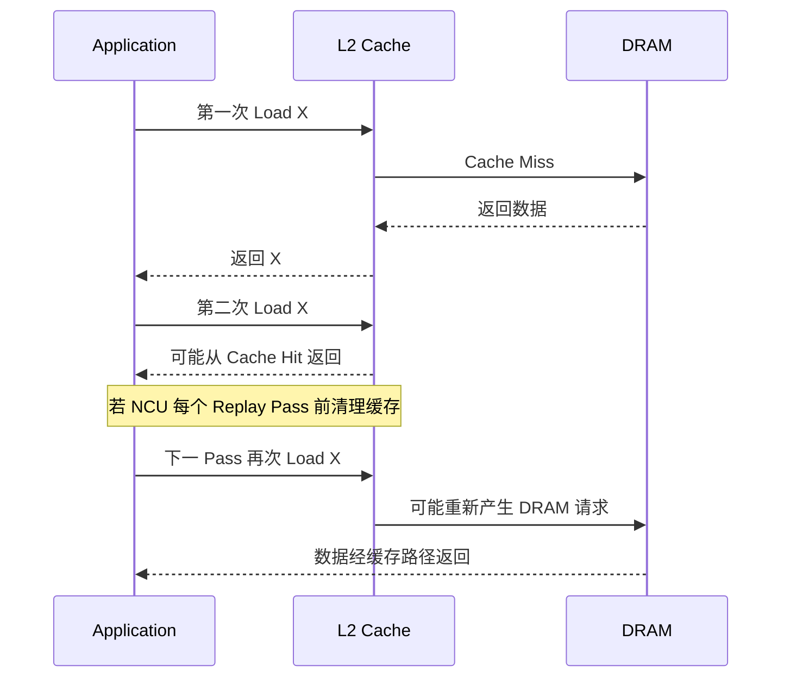

NCU 默认 `--cache-control all`：在 Kernel Replay Pass 前清理 GPU Cache，以降低历史访问对不同 Pass 的影响。`--cache-control none`：NCU 不主动清理这些 Cache，更接近某些真实程序的 Warm Cache 行为，但不同 Pass 及前序工作可能带来不一致。这里的选项控制的是 **Profiler 的 Cache Flush 行为**，不等于 CUDA Kernel 上的 `.ca`/`.cg` Cache Operator，也不是“关闭 GPU Cache”。这里 **Flush** 指工具主动清缓存；`.ca`/`.cg` 则是访存指令的缓存策略修饰，影响某条访问使用哪些缓存路径，与“测量前清缓存”是两件事。

```bash
# 默认：工具尝试在 Replay Pass 前清理 GPU Cache
ncu --cache-control all --set basic -k regex:copy_kernel -c 1 ./app

# 关闭 NCU 的主动 Cache Flush
ncu --cache-control none --set basic -k regex:copy_kernel -c 1 ./app
```

### 4.2 “Cold Cache”也不能理解成所有数据必定从 HBM 读取

**HBM** 是一种高带宽显存，并非所有 GPU 都使用它；有些设备使用 GDDR。本节说 HBM 时讨论的是显存侧访问问题，不要求你的设备一定有 HBM。

Cache Flush 是工具提供的控制方式，不保证所有存储层次、全部地址、异步外设流量、内存压缩或其他缓存状态都变成一个简单可证明的物理状态；把 `all` 等价成“每个 Load 一定访问 HBM”会造成错误推论。同样，关闭 Flush 不等于保证输入一定命中 L2，因容量、冲突替换、其他工作、写流量等因素仍可能发生 Cache Miss。

### 4.3 设计 Cache 实验时，要在不同 Working Set 下分别对照

**Working Set（工作集）**是本轮计算涉及的数据范围，不只是一个输入数组的大小。例如 Copy 有 4 MiB 输入和 4 MiB 输出，完整数组范围共 8 MiB，实际缓存占用还取决于读写路径。先固定工作集比较 all/none，再换规模重做一对；不能在同一对比较中同时改规模和清缓存策略。

建议准备两种数据规模：A 组可合理容纳在目标 GPU 的 L2 内，B 组明显大于 L2 容量。L2 容量可以从 NCU 的 Device Attributes 或设备规格确认，不要假定所有 NVIDIA GPU 都有相同 L2。对两个规模分别运行 `all` 与 `none`，观察 NCU 的 DRAM 流量和相关 Cache 指标，并与不使用 NCU 的重复执行时间对照。

| 情况 | 可预期的趋势 | 为什么不能直接保证 |
|---|---|---|
| 小 Working Set + 自然连续调用 | 后续调用可能更多 L2 Hit | Cache 竞争、写入与替换仍存在 |
| 小 Working Set + `all` | 更接近每 Pass 冷缓存条件 | Flush 不保证每个地址都按理想模型访问 DRAM |
| 小 Working Set + `none` | 可能更接近实际 Warm Cache | 各 Replay Pass 缓存状态可能不同 |
| 大 Working Set | DRAM Traffic 往往更显著 | Cache 重用、访问模式和硬件预取仍影响结果 |

**重要：** 如果真实生产代码的性能依赖“上一 Kernel 预热了 L2”，通常应考虑 Application Replay/Range Replay 与 `--cache-control none`，并核对它是否保留了你关心的前序操作；单纯把 Kernel Replay 的 `all` 改成 `none` 不总能重建完整的应用缓存历史。

---

## 5. Clock Control：为什么同一 Kernel 会因 GPU 时钟不同而产生不同耗时

### 5.1 GPU 不是以一个永远固定的频率运行

先回顾 **SM** 是 GPU 中承接线程块的计算单元；线程块是一组线程，整块映射到一个 SM。前面指标里的 SM 指的也是这个层次。**SM Clock** 是计算侧时钟，**Memory Clock** 是显存侧时钟，两者不必同频。频率越高，每秒周期数越多，但一项工作仍可能受数据等待限制。**功耗墙/温度墙**分别指达到功率/温度限制后设备不能继续提高频率；**Dynamic Boost** 是平台按功率预算动态调整性能的机制。SM Clock、Memory Clock 可能受这些因素与其他 GPU 工作负载影响。冷启动后的首个 Kernel 与完成 Warmup 后的 Kernel 即使机器指令完全一样，也可能有不同执行时间。

**吞吐**是单位时间处理的工作量，**计算吞吐受限**表示当前主要受计算处理能力限制。**IPC（Instructions Per Cycle）**是每周期处理的指令数，必须固定硬件范围，例如同一组 SM 的合计处理能力。对于粗略的计算吞吐受限模型，如果指令总量固定且 IPC 基本不变：

$$
T\approx\frac{\text{指令工作量}}{\text{每周期处理能力}\times f_{\mathrm{SM}}}
$$

分子按“指令”计，第一项分母按“指令/周期”计，$f_{\mathrm{SM}}$ 按“周期/秒”计，相除得到秒。例如固定处理 100 万条指令、每周期合计 2 条、频率 1 GHz（$10^9$ 周期/秒），模型给出 0.5 ms；这里只展示单位，不是设备预测。对于 DRAM 带宽限制的工作负载则还要考虑 Memory Clock、存储控制器与带宽上界。上述式子只用于理解方向，不是通用 GPU 时长公式。

本讲义记录的 NCU 版本以 `boost` 为默认时钟控制策略，尝试将 GPC/Memory Clocks 固定到工具定义的 Boost 频率，以减少各 Pass 间的变化；默认值不可直接推广到其他版本，应查本机 `ncu --help`。**GPC** 是架构中组织 SM 等资源的上层硬件分组，这里的 GPC Clock 属于计算侧时钟。`boost` 指工具定义的提升频率档，`base` 指基础频率控制，`none` 表示不由工具改时钟；还可能提供 `force-boost`、`reset` 等值。具体支持、回退和权限须看工具版本、GPU/驱动与实际提示，下面不是要求执行系统级锁频。

```bash
# NCU 负责尝试控制 GPU 时钟（当前文档默认策略）
ncu --clock-control boost -k regex:copy_kernel -c 1 ./app

# 不由 NCU 改动 GPU 时钟；更适合观察自然运行状态
ncu --clock-control none -k regex:copy_kernel -c 1 ./app
```

**注意：** `--clock-control none` 不等于“把 GPU 时钟锁定在自然运行的某一固定值”，而是让 NCU 不主动干预时钟。采集前后可能仍发生动态变频。温度限制或硬件/驱动强制降频也可能覆盖工具选项。

### 5.2 什么情况下需要外部固定时钟？

如果目标是把 NCU 和 NSYS 中的 Kernel Duration 尽量放在相近条件下比较，官方建议在权限允许时，使用 `nvidia-smi` 等外部工具固定时钟，并让 NCU 设置 `--clock-control none`；操作前必须确认设备共享情况和权限，并在实验后恢复时钟配置。**不要在共享生产服务器上擅自修改时钟或 Persistence Mode（持久化模式，用于保持驱动设备状态）**，否则会影响其他用户的 GPU 工作负载。

### 图 8：时钟对测量结果的影响

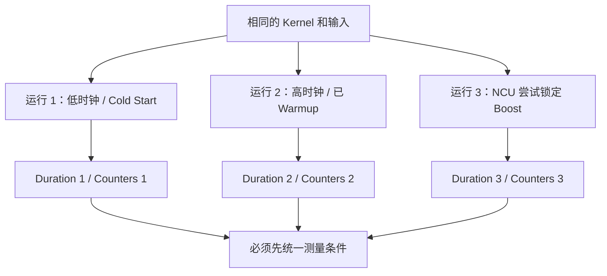

---

## 6. Serialization、Profiler Overhead 和时间戳边界

### 6.1 NCU 可能让本来并发的 Kernel 变成串行采集

在某些正常 CUDA 程序中，两个 Stream 的 Kernel 可以重叠运行：

```text
Native GPU timeline:
Stream A: [ Kernel A -------- ]
Stream B:     [ Kernel B -------- ]
```

但是，为了让硬件计数器正确归属于特定 Kernel，NCU 常规 Kernel Profiling 会在进程中序列化采集，并可能在同一 GPU 上跨进程进行互斥。

```text
典型 NCU Kernel Profiling:
Stream A: [ Kernel A -------- ]
Stream B:                         [ Kernel B -------- ]
```

这里的文本只用于说明可能存在的扰动，实际时间线不是每种 NCU 模式都必然如此。Range Replay、Application Range Replay，以及特定并发协调机制，就是为处理需要保留并发关系的工作负载而设计的。

### 6.2 三类需要严格区分的时间

| 时间 | 定义 | 应怎样使用 |
|---|---|---|
| Native CUDA Event Time | 没有 NCU 时两个 CUDA Event 之间的 GPU 时间 | 固定环境下的独立性能基线 |
| NCU `gpu__time_duration` | NCU 自己的 GPU 工作负载持续时间戳 | 与 NCU 采集指标对应的时长 |
| NCU 下的应用 Wall Time | 应用实际耗时 + Profiling 运行时开销 | 估算采集成本，不能用来代表 Kernel 运行时间 |

例如某个 Kernel 原生耗时 15 μs，NCU 报告 17 μs，而 `time ncu ...` 总共用时 8 秒：这三个数字可以同时成立，因为测量边界、时钟、缓存和额外 Pass 完全不同。示例数值用于说明概念，并非实测。

NCU 在典型采集中会在 GPU Frontend 插入并利用专门的时间戳同步方式，时间戳边界与 Nsight Systems 的 Trace 时间戳不完全一致。尤其对微秒级 Kernel，固定的前端边界成本在总时长中的相对占比会更大，因此不能指望不同工具的 Duration 完全一致。

### 图 9：Profiling 总成本与被报告的 Duration

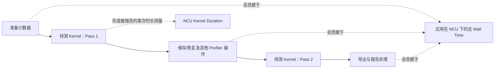

### 6.3 Software Patching 的特殊扰动

有些 Source/SASS 级分析需要向目标机器指令注入统计逻辑，这会改变指令流和运行时间。NCU 会尽量将这些受干扰的采集 Pass 与其他正常硬件计数 Pass 分开，因而不能把“含插桩的 Pass 耗时”当成普通 Kernel Duration 来评价性能。

这也解释为什么请求大量详细 Source Metrics 时采集耗时会激增，但这不意味着 Kernel 原本执行得慢。

---

## 7. 短 Kernel：测量精度、固定成本与非稳态执行

### 7.1 一个 2 μs Kernel 与一个 2 ms Kernel 的区别

从绝对值看，两个 Kernel 都能被计时；从测量意义看却非常不同。对于极短 Kernel，调度前端、时间戳边界、时钟状态、启动前上下文条件和其他 GPU Activity 的影响可能与 Kernel 本身同量级。持续时间较长的 Kernel 更容易让 GPU 进入相对稳定的执行状态，部分吞吐与比率指标也会更有代表性。

可以用一个说明“相对误差”的简单例子：

$$
\mathrm{RelativeError}=\frac{|T_{\mathrm{observed}}-T_{\mathrm{reference}}|}{T_{\mathrm{reference}}}
$$

式中的分子是观测时间与参考时间之差的绝对值，分母是正的参考时间，单位须一致；结果无单位，乘 100% 得相对误差百分比。μs 是百万分之一秒，ms 是千分之一秒；这里参考值是例题设定，不表示我们知道真实 kernel 时间。

如果固定影响约为 0.2 μs，它对 2 μs 是 10%，对 2 ms 则仅为 0.01%。这只是算术示意，不代表 NCU 真实具有固定的 0.2 μs 误差。

### 7.2 不要用“把 Kernel 循环 1000 次”替代单 Kernel 的所有分析

将 Kernel 重复启动 1000 次，再除以 1000，适合估计**重复调用的平均开销/稳态吞吐**，但不一定等于单次 Kernel 执行时长。如果 Kernel 在连续 Launch 之间复用缓存，则平均时间可能主要反映 Warm Cache 行为；如果数据不断变化，则可能接近其他状态。它回答的是另一个问题。

**寄存器**是线程保存中间值的快速小存储；同时要保留的值越多，所需资源可能越多，称寄存器压力。**指令依赖**是后一步需要前一步结果，例如连续更新 `x=x*a+b`。同样，把原来的 Kernel 内部循环次数从 1 增加到 1000，可以提升采集稳定性，但可能引入新的寄存器压力、指令依赖、编译器优化与缓存重用，因此**不能未经证明就把放大版的硬件指标直接外推到原始版**。

### 7.3 建议对短 Kernel 同时报告三个结果

1. 无 NCU 下，单次 Kernel 的 Event 或 Trace 观测（如果工具分辨率允许）；
2. 无 NCU 下，固定条件下多次独立重复测量的分布（Median、P10/P90、Min）；
3. NCU 下，与该工作负载对应的硬件指标和 Duration。

**Median（中位数）**是把独立测量值排序后的中间值；**P10/P90** 是排序后约 10%/90% 位置的分位数，需记录采用的计算方法；**Min** 是最小值。例如测得 8、9、30 μs，中位数为 9 μs，最小值为 8 μs，但不能只留下 8 而丢弃另外两次。这里“独立重复”指多次测量，不是把 NCU replay pass 当成独立样本。

三者若明显不一致，优先调查时钟、缓存、Profiling 选择范围、后台其他 GPU 活动、同步边界和是否使用多 Pass，不要直接开始改 Kernel。

---

## 8. 第一组独立教学示例：建立一个统一的 CUDA Benchmark

以下实验以 NVIDIA GPU、CUDA Toolkit、`nvcc`、`ncu` 可用为前提。**本文不声称已在你的机器上编译、运行或测得任何结果。** 本节保留完整代码供阅读和另行实现，**不是当前 `kernels/main.cu` 的功能**，第 9–10 节的 `./bench` 也不是现有构建产物。当前可跟做的 Multiply 实验以 [lab02](lab02.md) 为准。独立示例通过同一个可执行文件比较 Empty Kernel（不做数组计算）、Copy Kernel（逐项复制）与状态依赖 Kernel（读旧输出再累加）。代码故意使用传统 Runtime API（CUDA 运行库接口），避免引入 TMA（专门的张量数据搬运机制）、CUDA Graph 或多 GPU 通信，使变量尽可能单纯。

### 8.1 项目结构

下图保留独立示例的建议布局，不是当前工作区的目录清单；正式实验仍应按本工作区已有 compile/run/basic 动作分别编译、运行、采集，不要另建一套平行入口。

```text
ncu-lab/
└── experiments/
    └── 02_replay_reproducibility/
        ├── bench.cu
        ├── scripts/
        │   └── run_experiments.sh
        ├── reports/
        │   └── <run_id>/
        └── analysis.md
```

### 8.2 完整 `bench.cu`

先用 4 项看数据：Copy 把 `[1,1,1,1]` 从 src 写到 dst；Accumulate 从 dst=`[0,0,0,0]` 开始，一次加成 `[1,1,1,1]`，两次变成 `[2,2,2,2]`。两者都是有效线程各处理一项，区别是第二种读取上次的输出。Host 先分配数组、上传全为 1 的 src、把 dst 清零，再预热、计时，最后单独圈出一次目标启动；Accumulate 在圈范围前会把 dst 再清零，以便检查目标启动的一次 +1。

代码中的 `__global__` 声明 GPU 函数；`<<<grid,block>>>` 提交指定块数和每块线程数；`blockIdx.x*blockDim.x+threadIdx.x` 得到全局编号，`i<n` 防止尾块越界。`CHECK` 在 CUDA API 失败时打印错误并退出。`cudaMalloc/cudaFree` 分配/释放 GPU 存储，`cudaMemcpy` 拷贝两侧数据，`cudaMemset(...,0,...)` 按字节清零；`cudaSetDevice(0)` 选择编号 0 的 GPU。`cudaGetLastError` 检查启动等错误，`cudaDeviceSynchronize` 等待此前设备工作完成并暴露异步执行错误，二者不能互相替代。

`auto launch = [&](){...}` 是一个捕获当前变量的 C++ 匿名函数，调用一次就提交一次选定 kernel，不是 GPU 线程内循环。Event 的 Create/Record/Synchronize/ElapsedTime/Destroy 分别对应创建、入队标记、等标记完成、读时差、销毁；`size_t` 用于表达数组长度/索引，`sizeof(float)` 给出每项字节数。命令行参数 `--mode` 选三种计算，`--n` 选元素数，`--iters` 选 Event 区间内的应用启动次数，均不控制 NCU pass 数。

功能包含：CUDA Event 独立基线、Warmup、CUDA Profiler Start/Stop 范围、Kernel Replay 状态恢复测试，以及输入规模控制。`--mode empty|copy|accumulate`、`--n`、`--iters` 可调整实验参数。

```cpp
#include <cuda_runtime.h>
#include <cuda_profiler_api.h>
#include <cstdio>
#include <cstdlib>
#include <string>
#include <vector>

#define CHECK(call) do {                                            \
    cudaError_t err = (call);                                      \
    if (err != cudaSuccess) {                                      \
        std::fprintf(stderr, "%s:%d CUDA error: %s\n",              \
                     __FILE__, __LINE__, cudaGetErrorString(err)); \
        std::exit(EXIT_FAILURE);                                   \
    }                                                              \
} while (0)

__global__ void empty_kernel() {
    // 空 Kernel 主要用于观察极短执行时的时间测量边界。
}

__global__ void copy_kernel(float* dst, const float* src, size_t n) {
    size_t i = size_t(blockIdx.x) * blockDim.x + threadIdx.x;
    if (i < n) dst[i] = src[i];
}

__global__ void accumulate_kernel(float* dst, const float* src, size_t n) {
    size_t i = size_t(blockIdx.x) * blockDim.x + threadIdx.x;
    if (i < n) dst[i] += src[i];
}

int main(int argc, char** argv) {
    std::string mode = "copy";
    size_t n = 1u << 20;
    int iters = 100;
    for (int i = 1; i < argc; ++i) {
        std::string arg = argv[i];
        if (arg == "--mode" && i + 1 < argc) mode = argv[++i];
        else if (arg == "--n" && i + 1 < argc) n = std::stoull(argv[++i]);
        else if (arg == "--iters" && i + 1 < argc) iters = std::stoi(argv[++i]);
        else { std::fprintf(stderr, "Unknown argument: %s\n", argv[i]); return 1; }
    }
    if ((mode != "empty" && mode != "copy" && mode != "accumulate") ||
        n == 0 || iters <= 0) {
        std::fprintf(stderr, "Invalid --mode, --n or --iters\n");
        return 1;
    }
    std::printf("program start | mode=%s n=%zu iters=%d\n",
                mode.c_str(), n, iters);

    CHECK(cudaSetDevice(0));
    float *src = nullptr, *dst = nullptr;
    if (mode != "empty") {
        std::vector<float> host(n, 1.0f);
        CHECK(cudaMalloc(&src, n * sizeof(float)));
        CHECK(cudaMalloc(&dst, n * sizeof(float)));
        CHECK(cudaMemcpy(src, host.data(), n * sizeof(float), cudaMemcpyHostToDevice));
        CHECK(cudaMemset(dst, 0, n * sizeof(float)));
    }

    constexpr int block = 256;
    const int grid = int((n + block - 1) / block);
    auto launch = [&]() {
        if (mode == "empty") empty_kernel<<<1, 1>>>();
        else if (mode == "copy") copy_kernel<<<grid, block>>>(dst, src, n);
        else accumulate_kernel<<<grid, block>>>(dst, src, n);
    };

    // 初始化路径 / 编译缓存 / 稳定时钟与缓存状态的预热。
    for (int i = 0; i < 20; ++i) launch();
    CHECK(cudaGetLastError());
    CHECK(cudaDeviceSynchronize());

    // 独立 CUDA Event 基准；应优先在“完全不启动 NCU”的运行中使用。
    cudaEvent_t start, stop;
    CHECK(cudaEventCreate(&start));
    CHECK(cudaEventCreate(&stop));
    CHECK(cudaEventRecord(start));
    for (int i = 0; i < iters; ++i) launch();
    CHECK(cudaEventRecord(stop));
    CHECK(cudaEventSynchronize(stop));
    CHECK(cudaGetLastError());
    float elapsed_ms = 0.0f;
    CHECK(cudaEventElapsedTime(&elapsed_ms, start, stop));
    std::printf("event_batch_ms=%.6f avg_us=%.6f\n",
                elapsed_ms, double(elapsed_ms) * 1000.0 / iters);

    // 确保 accumulate 在目标采集区间内只有一次确定的 +1 效果。
    if (mode == "accumulate") {
        CHECK(cudaMemset(dst, 0, n * sizeof(float)));
        CHECK(cudaDeviceSynchronize());
    }

    // 默认要求 ncu --profile-from-start off：只捕获这里的目标 Launch。
    CHECK(cudaProfilerStart());
    launch();
    CHECK(cudaGetLastError());
    CHECK(cudaDeviceSynchronize());
    CHECK(cudaProfilerStop());

    if (mode != "empty") {
        float value = -1.0f;
        CHECK(cudaMemcpy(&value, dst, sizeof(float), cudaMemcpyDeviceToHost));
        std::printf("final_dst0=%.1f (expected 1.0)\n", value);
    }
    CHECK(cudaEventDestroy(start));
    CHECK(cudaEventDestroy(stop));
    if (src) CHECK(cudaFree(src));
    if (dst) CHECK(cudaFree(dst));
    return 0;
}
```

若另行实现这个示例，以下 Bash 命令应在你保存 `bench.cu` 的目录执行，先查询设备与工具版本并确定目标架构。`-O3` 启用优化，`-lineinfo` 保留源码行号映射而不是设备调试，`-std=c++17` 选择语言标准，`-o` 指定输出。下面 `sm_89` 仅示例计算能力 8.9，必须按实际设备与 Toolkit 支持替换；编译失败不继续运行旧产物。

```bash
nvcc -O3 -lineinfo -std=c++17 -arch=sm_89 bench.cu -o bench
```

先在没有 NCU 的环境下分别运行：

```bash
./bench --mode empty --iters 1000
./bench --mode copy --n 1048576 --iters 100
./bench --mode accumulate --n 1048576 --iters 100
```

**理解上述实验的边界：** `event_batch_ms / iters` 测量的是连续多个 Launch 在 GPU Stream 上形成的 Event 区间平均时间，不保证等于完全孤立的某一次 Kernel Duration；对于 `accumulate`，每次迭代持续改变输出数据，但计算工作量和数据范围是固定的。`cudaProfilerStart/Stop` 之后的 `final_dst0=1.0` 则用于验证目标区间在正常语义下仅累加一次。打印的 `avg_us=elapsed_ms*1000/iters`：分子把区间毫秒数换成微秒，分母是应用启动次数，单位 μs/次。`final_dst0` **只下载并打印第 0 项，未全量比较，也未因数值不符返回失败**；它是观察点，不是完整正确性测试，不能把退出码 0 当成全数组 PASS。当前 lab02 的 Multiply 入口才做全量核对。运行在 NCU 内部时，终端打印的 Event 测量会受到 Profiler 的执行开销或条件变化影响，**不应当用作 Native 基线**。

---

## 9. 第二组实验：五个核心对照任务

本节继续使用第 8 节的独立 `bench`。`--profile-from-start off` 让工具从程序的 Start 标记起才采集；`-c 1` 选一个匹配启动，不是一个 pass；`-k regex:名称` 按名称匹配；`--set` 选集合，`--section` 选指标组；`-o` 设置报告名，不强制覆盖。每次查看工具警告、退出状态和实际生成的报告。同名文件先明确另存，不能把旧报告误认为新采集。

### 实验 E1：Empty Kernel 的 Duration 与采集扰动

**目标：** 证明微秒级甚至更短的 Kernel 不应只凭单次 NCU Duration 得出精细优化结论。

```bash
# 无 NCU：建立重复 Launch 的 CUDA Event 时间
./bench --mode empty --iters 1000

# NCU：只分析程序末尾 profiler start/stop 范围内的目标 Kernel
ncu --profile-from-start off --set basic -c 1 \
    -o empty_basic ./bench --mode empty --iters 1000

# 比较更多 Metric 带来的采集开销（不用于 Native 时间比较）
ncu --profile-from-start off --set full -c 1 \
    -o empty_full ./bench --mode empty --iters 1000
```

**要记录：** Event 批量平均时间、NCU Duration、`==PROF==` 输出的 Pass 数、整个 NCU 命令的 Wall Time。预期 `full` 通常需要更多 Profiling 工作，但准确的 Pass 数依设备/版本而不同，不能提前填写。

**解释要点：** 如果同一空 Kernel 的 NCU Duration 与 Event 平均时间不同，不能仅凭差异判断某个工具存在错误；必须考虑时间戳边界、Cache/Clock 策略及连续 Launch 与孤立 Launch 本来测量的问题就不同。

### 实验 E2：Copy Kernel 的冷/热 Cache 对照

**目标：** 看到 `--cache-control all/none` 可能改变相同 Kernel 的 DRAM 流量和 Cache 命中状态。

```bash
# 1048576 个 FP32（4 字节浮点数）输入，4 MiB；输出另占 4 MiB
ncu --profile-from-start off --cache-control all \
    --section MemoryWorkloadAnalysis -c 1 \
    -o copy_cache_all ./bench --mode copy --n 1048576 --iters 100

ncu --profile-from-start off --cache-control none \
    --section MemoryWorkloadAnalysis -c 1 \
    -o copy_cache_none ./bench --mode copy --n 1048576 --iters 100

# 适度扩大 Working Set：此例约 256 MiB 输入，须确认设备显存充足
ncu --profile-from-start off --cache-control none \
    --section MemoryWorkloadAnalysis -c 1 \
    -o copy_large ./bench --mode copy --n 67108864 --iters 10
```

`1 MiB=2^20` 字节；大例输入 256 MiB、输出另占 256 MiB。要严格检查规模与清缓存两个因素，应为大规模也补做 `all`，不要把上述“小规模 all”与“大规模 none”直接当成单变量对照。

**要记录：** Input/Output 大小、设备 L2 容量、DRAM Bytes、L2 Hit Rate（如果目标架构和 Section 提供）、NCU Duration、Pass 数。`copy_kernel` 每次有读取和写入两部分，不能只根据 `n * sizeof(float)` 判断完整 DRAM 流量。

**分析问题：** 如果 `none` 比 `all` 快，是因为 L2 Hit 增多、时钟变化还是其他因素？你需要检查实际 Cache 相关指标，而不是只看 Duration 进行归因。

### 实验 E3：Kernel Replay 与 Application Replay 的状态恢复

**目标：** 理解 `dst += src` 这种有写状态的 Kernel，为什么在多 Pass 中仍应最终只体现一次目标逻辑；同时观察 Application Replay 的应用整体重复执行。

```bash
# 默认 Kernel Replay（这里显式写出）
ncu --replay-mode kernel --profile-from-start off \
    --set full -k regex:accumulate_kernel -c 1 \
    -o acc_kernel ./bench --mode accumulate --n 1048576 --iters 10

# Application Replay：多轮会重新启动完整 bench 程序
ncu --replay-mode application --profile-from-start off \
    --set full -k regex:accumulate_kernel -c 1 \
    -o acc_application ./bench --mode accumulate --n 1048576 --iters 10
```

**应当观察：** `program start` 出现的次数、每轮 `final_dst0` 的值、Pass 数、NCU 命令 Wall Time，以及生成的报告。若确认发生了多个 Pass 且最终保持 `final_dst0=1.0`，支持的是“所观察的第 0 项仍体现一次目标累加”，不能据此证明全数组、外部状态或所有 Replay 情况都正确；如果出现其他数值，应先排查环境与 Replay 行为，不要直接认定工具无法恢复状态。

注意：`--set full` 在不同 GPU 上是否产生多 Pass 不应硬编码假设；需要以 `==PROF==` 实际显示为准。`-k` 的匹配名称也可能因编译器生成的符号名不同而需要调整。

### 实验 E4：Clock Control 与测量条件

**目标：** 观察 NCU 是否尝试标准化时钟，以及不同策略下报告结果的变化。

```bash
ncu --profile-from-start off --clock-control boost \
    --set basic -c 1 -o clock_boost \
    ./bench --mode copy --n 16777216 --iters 50

ncu --profile-from-start off --clock-control none \
    --set basic -c 1 -o clock_none \
    ./bench --mode copy --n 16777216 --iters 50
```

**要记录：** GPU 型号、驱动、当前时钟与温度、每次报告的 Duration、吞吐、`==PROF==` 警告信息。不同策略可能得到相近结果，也可能差异明显；即使差异明显也不能直接全归因到“锁频”本身，必须检查 GPU 是否因温度/功率改变了工作点。

建议在独占 GPU 或无人使用的测试节点执行，避免为了实验在共享设备上修改系统级时钟配置。

### 实验 E5：Range Replay 与 App-range 的范围统计

**目标：** 观察“整个 Range 是一个性能对象”与“单 Kernel 是一个性能对象”的差别。

```bash
# bench 已使用 cudaProfilerStart/Stop 定义目标 Range
# 用 Range Replay 捕获这段 CUDA API 范围
ncu --replay-mode range --profile-from-start off \
    --section SpeedOfLight \
    -o copy_range ./bench --mode copy --n 1048576 --iters 20

# Application Range Replay：重复运行应用，按目标 Range 采集
ncu --replay-mode app-range --profile-from-start off \
    --section SpeedOfLight \
    -o copy_app_range ./bench --mode copy --n 1048576 --iters 20
```

**解释要点：** 这个示例的 Range 内只有一个 Kernel，所以两类范围报告可以作为入门练习；更有意义的下一步是把范围内改成两个有依赖的 Kernel，例如 `copy → reduce`，比较范围级指标。请注意 Range Replay 对 CUDA API 有显式支持列表，若遇到 Unsupported API 报错，应以当前文档核对并缩窄范围，而不是把所有 Unsupported 都当作安装问题。

---

## 10. 如何保存实验结果：一份能追责的测量记录

建议每次 Profiling 保留以下信息，尤其在比较不同芯片和不同 CUDA Toolkit 版本时：

| 记录项 | 示例或方法 | 作用 |
|---|---|---|
| GPU 型号、Compute Capability | `nvidia-smi -L`、`nvidia-smi -q` | 标明硬件对象 |
| CUDA 编译器版本 | `nvcc --version` | 标明工具链 |
| NCU 版本 | `ncu --version` | 固定指标可用性及 Replay 行为 |
| 驱动版本 | `nvidia-smi` | 排查功能支持差异 |
| Build 信息 | `-O3 -lineinfo`、Git Commit | 追溯编译版本；还须记录影响结果的未提交修改，不能仅凭 Commit 保证源码一致 |
| 数据配置 | Mode、N、Iters、Block、Grid | 固定工作负载 |
| Replay 设置 | `--replay-mode` | 标识采集单位 |
| Cache/Clock | `--cache-control`、`--clock-control` | 标识工具扰动 |
| 采集内容 | Section、Metric、Pass 数 | 标识报告成本与可比性 |
| 输出结果 | `.ncu-rep`、程序 stdout、stderr | 保留原始证据 |
| Native 基线 | Event 分布或 NSYS 时间 | 验证真实性能 |
| 实验结论 | 观察→假设→证据→限制 | 防止错误归因 |

表中 `nvidia-smi -L` 列出设备，`-q` 输出更详细的设备状态；stdout/stderr 分别是程序的正常输出与错误输出。日志中**自变量**是主动改变的一项，**控制变量**是保持不变的其他条件；例如只把清缓存 all 改为 none，就不能同时改输入规模。Run ID 是一次独立实验的标识，不是构建配置名。

一份最小实验日志可以采用：

```markdown
## 实验编号 E2-20261106-A

- 目的：判断 Copy Kernel 的重放 Cache 策略是否显著改变 DRAM 流量
- 假设：小 Working Set 在不 Flush 时更容易复用 L2；结果可能表现为 DRAM Bytes 下降
- 控制变量：相同源码、GPU、编译器、输入规模、采集 Section
- 自变量：`--cache-control all` / `none`
- 观察值：Kernel Duration、DRAM Bytes、L2 相关指标、Pass 数
- 观察事实：**待实验填写**
- 归因：**待指标验证，不提前预设成功**
- 局限性：多 Pass、后台 GPU 流量、时钟状态可能干扰
- 原始报告：`reports/<run_id>/*.ncu-rep`
```

建议为每次运行创建独立 Run ID，报告文件名包含实验代号、参数与采集模式。例如 `E2_copy_n1m_cache_all.ncu-rep`、`E2_copy_n1m_cache_none.ncu-rep`，避免覆盖。

### 10.1 NCU 导出与读取命令

```bash
# 导出报告；NCU 自动添加 .ncu-rep 扩展名
ncu --profile-from-start off --set basic -c 1 \
    -o results_E1 ./bench --mode empty --iters 1000

# 从报告打印 Raw Metrics
ncu --import results_E1.ncu-rep --page raw --csv > results_E1_metrics.csv

# 在支持的桌面环境打开报告；无 GUI 的服务器可将文件拷回本机
ncu-ui results_E1.ncu-rep
```

报告以绝对数值、Metric 原始定义及对应条件为准；Percent 只作为辅助判断。对于短 Kernel，必须附上独立 Benchmark 的统计分布和采集设置。

### 10.2 批量采集脚本的阅读示例（未落地）

以下保留原独立示例，用来阅读环境记录、重定向与逐次采集的关系，**不是本工作区已有或本次验证过的脚本，也没有可点击的下载文件**。其中 `ncu_week02_bench.cu` 是旧示例文件名，不是第 8 节已经存在的文件；片段把编译和采集混在一起、把二进制放进结果目录，也未显式指定架构，不能原样当作当前课程动作入口。实际操作优先按 lab02；若日后实现独立示例，应先统一源码名、按设备指定架构，编译到共享 build，再分别运行与采集。本次保留代码供理解，不创建或修改脚本。

阅读时关注：`set -euo pipefail` 让常见命令失败、未定义变量或管道失败及时暴露；`ROOT_DIR` 表示脚本所在目录，`RUN_ID` 是时间生成的运行标识，`OUT` 是输出目录；`> 文件 2>&1` 把正常输出与错误输出写入同一文件，同名文件会被覆盖。片段用时间目录区分运行，不代表工作区现有动作具备自动归档能力；正式保留证据仍须明确实验名和输出位置。

```bash
#!/usr/bin/env bash
set -euo pipefail

# 在与 bench.cu 同一目录运行；需要 NVIDIA GPU、nvcc、ncu。
ROOT_DIR="$(cd "$(dirname "${BASH_SOURCE[0]}")" && pwd)"
cd "$ROOT_DIR"
RUN_ID="$(date +%Y%m%d_%H%M%S)"
OUT="${1:-results/$RUN_ID}"
mkdir -p "$OUT"

{
  date -Is
  ncu --version
  nvcc --version
  nvidia-smi --query-gpu=name,driver_version,memory.total --format=csv
} > "$OUT/environment.txt" 2>&1

nvcc -O3 -lineinfo -std=c++17 ncu_week02_bench.cu -o "$OUT/bench"
"$OUT/bench" --mode empty --iters 1000 > "$OUT/native_empty.log" 2>&1
"$OUT/bench" --mode copy --n 1048576 --iters 100 > "$OUT/native_copy.log" 2>&1

# 每次执行保留 profiler stdout/stderr；不要用 ncu 下的 Event 时间作为 Native 基线。
ncu --profile-from-start off --set basic -c 1 \
    -o "$OUT/E1_empty" "$OUT/bench" --mode empty --iters 1000 \
    > "$OUT/E1_empty.log" 2>&1

ncu --profile-from-start off --cache-control all \
    --section MemoryWorkloadAnalysis -c 1 \
    -o "$OUT/E2_copy_cache_all" "$OUT/bench" --mode copy --n 1048576 --iters 100 \
    > "$OUT/E2_copy_cache_all.log" 2>&1

ncu --profile-from-start off --cache-control none \
    --section MemoryWorkloadAnalysis -c 1 \
    -o "$OUT/E2_copy_cache_none" "$OUT/bench" --mode copy --n 1048576 --iters 100 \
    > "$OUT/E2_copy_cache_none.log" 2>&1

printf 'Reports generated in: %s\n' "$OUT"
```

不要执行不存在的 `ncu_week02_run_experiments.sh`，也不要用“脚本整体结束”替代每个动作的退出状态与报告检查。未来若另行实现，须先检查 GPU 计数器权限和 CUDA 环境；不要在共享服务器上无授权地改时钟。

---

## 11. 常见异常及定位路径

| 现象 | 优先检查 | 不应直接下的结论 |
|---|---|---|
| `ncu --set full` 很慢 | Pass 数、Memory Save/Restore、软件插桩 | “Kernel 本身很慢” |
| NCU Duration 与 NSYS 不一致 | 时钟、缓存、时间戳边界、序列化 | “两个工具其中一个出错” |
| Cache Hit Rate 偶尔不合理 | Multi-pass 分子分母失配、非稳态工作负载 | “Cache 硬件异常” |
| 同一 Kernel 每次结果波动 | GPU 竞争、动态时钟、Cache、随机工作负载 | “优化没有效果” |
| Kernel Replay 卡死 | CPU/GPU/NIC 交互、跨 GPU Spin Polling | “Kernel 一定有死循环 Bug” |
| Application Replay 找不到对应 Kernel | Launch 次序、Grid、Stream、Context（管理设备资源和状态的上下文）的不确定性 | “指标不受支持” |
| Range Replay Unsupported API | Range 中的 CUDA API 类别、VMM、Graph、异步分配等 | “必须升级驱动才能解决” |
| `No kernels were profiled` | `--profile-from-start off` 与 Start/Stop 标记、Kernel 过滤 | “目标程序没有 GPU Kernel” |
| `ERR_NVGPUCTRPERM` | 性能计数器权限/系统策略 | “CUDA 编译出了错误代码” |

### 图 10：发现可疑指标后的诊断顺序

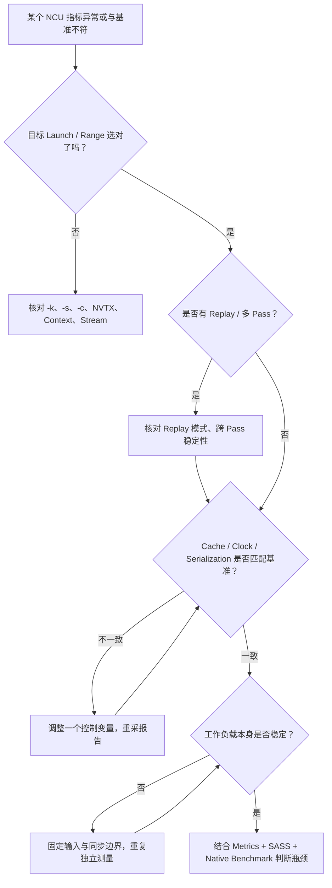

---

## 12. 面向 GPU 通信的专门提醒：NCU 看见的是哪一部分？

做 DeepEP/NCCL/NVSHMEM、P2P 或 GPU-initiated RDMA 性能分析时，本周内容要转化成具体判断。

先识别本节通信名词：**DeepEP/NCCL/NVSHMEM** 是 GPU 通信/协作软件；**P2P** 指设备间直接传输或访问，**NVLink** 是部分 NVIDIA 平台的 GPU 互联；**RDMA** 是远程直接内存访问，GPU-initiated 表示由 GPU 发起相关操作。**Rank** 是通信参与者编号，例如两个进程各控制一张卡时可叫 rank 0/1。**Copy Engine** 是执行部分数据拷贝的专用硬件，不必通过 SM 的算术指令完成。这里只用它们划定观测边界，不要求先掌握各库。

**Case A：单卡 Pack/Unpack/Reduction Kernel。** Pack/Unpack 是整理打包/解包数据，Reduction 是归约（如求和），Buffer 是保存数据的内存区域。如果它只处理本地 Buffer，不依赖远端并发进度，可以用 Kernel Replay 采集 Warp、L1/L2、DRAM 和 SASS 等指标，并使用 Native Benchmark 验证是否真的加速。

**Case B：Peer GPU 上的 Flag/Spin Polling。** 某 GPU Kernel 读取 Flag，等待另一 GPU 更新。这里消费者的执行时间取决于生产者何时执行；若 NCU 单独重放消费者而生产者不重放，等待时间失真甚至无法结束。应优先使用 NSYS 看多进程/多 GPU 时间线，或者构造不依赖外部实时生产者的局部微基准。Range 与 App-range 可以考虑，但仍需验证跨进程、跨设备和 API 兼容性。

**Case C：NVLink P2P Load/Store（读取/写入）。** 即使 NCU 能采集相关 SM、L2、Nvlink Section，也要确认该链路的指标定义、可用性与原始 P2P 模式一致；SM Load 指令数量不等于直接可推导的 NVLink 线速利用率。完整通信耗时要结合不同 Rank 的启动、同步与外部事件。

**Case D：NIC/RDMA、Copy Engine、异步数据搬运。** 部分传输工作不在 SM 指令流水线中完成，无法仅凭 SM 指令或 Warp Stall 还原完整路径。需要结合 NSYS、硬件链路计数器、NIC 统计以及端到端实验。

### 图 11：通信 Kernel 的观测边界

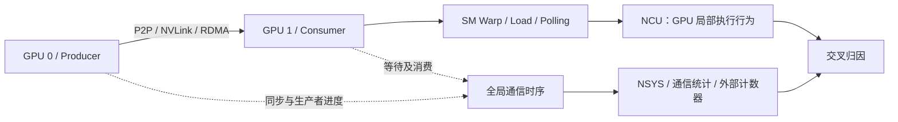

**Warp** 是 32 个线程组成的执行群组，**Stall** 是暂不能推进，**Scoreboard** 是跟踪指令结果是否可用的硬件机制；例如加法要用先前读取的值，就必须等该值就绪。这里只认识等待的含义，不展开第四课的状态诊断。这里尤其需要避免一个因果误判：`Stall Long Scoreboard`（等待某些长延迟结果的状态）变高，不自动证明 DRAM 带宽不足。它反映 Warp 等待某些长延迟依赖的状态，而在远端 GPU/通信等待场景中，产生依赖的原因需要结合程序和外部进度验证。

---

## 13. 本周自测（先回答，再展开理解）

### Q1. 为什么 `--set full` 会明显增加运行时间，但 Kernel Duration 不一定同比增加？

因为较多指标常常需要多个采集 Pass，以及 Memory Save/Restore、计数器配置和 Software Patching。NCU 的报告时长通常不是所有这些准备、重放及结果处理时间的累加；插桩 Pass 的时长也不用于正常 Kernel Duration 统计。

### Q2. `Kernel Replay` 和 `Application Replay` 最大的状态管理差异是什么？

Kernel Replay 在同一次应用运行过程中单独重放目标 Kernel，需要工具尽量保存/恢复目标 Kernel 的相关内存内容；Application Replay 重新启动整个应用，由应用在每轮运行中重新初始化数据、计算与交互条件。后者更依赖应用执行的可重复性和跨轮 Kernel 匹配。

### Q3. 为什么 `--cache-control none` 不意味着“没有缓存”？

它只是要求 NCU 不主动 Flush 硬件 Cache。Cache 仍按 GPU 架构和访问指令正常工作；缓存内容会受到前序访问、替换、其他工作及容量限制影响。

### Q4. 为什么 PyTorch/NCCL 的 Range Replay 可能遇到 Unsupported API？

因为 Range Replay 需要捕获并重放指定范围内的 CUDA API，官方仅支持部分 CUDA Driver API，VMM、Graph Management、Stream Ordered Allocator 等类别存在不支持项。应考虑缩窄范围或使用 Application Range Replay，但后者也有确定性与指标兼容性要求。

### Q5. 如果 `NCU Duration = 12 μs`、`CUDA Event = 9 μs`、`time ncu = 20 s`，是否矛盾？

不矛盾。Event 与 NCU 的时间戳边界、执行条件可能不同；整个 NCU 命令的 Wall Time 还包含 Profiling 启动、Counter 配置、多 Pass、保存恢复和报告处理。三者测量对象不同。

### Q6. 为什么短 Kernel 更容易得到与直觉不符的 Cache 比率？

短 Kernel 不容易达到稳定状态，多个 Pass 之间的流量、缓存和调度变化相对更明显；如果派生指标的分子分母跨 Pass 组合，就可能产生明显偏差，甚至超出正常逻辑范围。

### Q7. 哪个选项更适合“比较不同 Kernel 实现”的第一轮微架构分析？

对于独立、可重放的 Kernel，通常先使用默认 Kernel Replay、少量相关 Sections，并固定输入和采集条件；必要时使用 Cache/Clock 标准化。最终用无 NCU 的 Native Benchmark 验证优化收益。通信或强外部依赖 Kernel 不应机械沿用该答案。

### Q8. 如何证明性能变快是由于 L2 Hit Rate 提高，而不是 GPU 时钟变化？

应固定或记录时钟与功耗状态，在相同数据规模、Kernel 版本、Replay 模式、Cache Policy 下采集相关 L2/DRAM 指标，再用无 NCU 的独立 Benchmark 比较时长。若 L2 命中与 DRAM 流量变化方向符合预测，还需要检查是否存在其他同时变化的资源瓶颈，才能形成较强因果证据。

---

## 14. 第一、二周如何衔接第三周

前两周解决的是 **数据可相信到什么程度**：明确观测对象、Metric 类型、采集范围、Replay 模式、Cache/Clock/并发扰动和测量误差。接下来第三周研究 SM/SMSP 硬件层次、每块资源需求与理论 Occupancy，即静态计算“最多容纳多少块和 Warp”。第四周才研究实际驻留、Warp Scheduler（选择可执行指令的调度器）、Eligible（已满足发射条件）和 Issue（发射）等动态执行概念；不要用运行时状态替代第三周的资源预算。

在进入第三周之前，你至少应能独立完成一份两页实验报告，回答：目标 Kernel 是哪一个 Launch？是否发生 Multi-pass？输入状态、Cache 和 Clock 怎么控制？NCU Duration 与 Native Event 平均时间为何不同？某个指标改变是否具有可检验的因果解释？

---

## 15. 官方参考资料与推荐阅读顺序

以下资料均为 NVIDIA 官方文档；由于 NCU 版本更新较快，新的 Replay/Graph/多进程特性与指标支持须结合目标机器的 `ncu --version` 判断。

1. [Nsight Compute Profiling Guide — Replay](https://docs.nvidia.com/nsight-compute/ProfilingGuide/index.html#replay)：Kernel / Application / Range / Application Range Replay、采集机制及限制。
2. [Nsight Compute Profiling Guide — Overhead](https://docs.nvidia.com/nsight-compute/ProfilingGuide/index.html#overhead)：Metric 数量、Software Patching、Pass 与采集成本。
3. [Nsight Compute Profiling Guide — Reproducibility](https://docs.nvidia.com/nsight-compute/ProfilingGuide/index.html#reproducibility)：Serialization、Clock Control、Cache Control。
4. [Nsight Compute Profiling Guide — Range and Precision](https://docs.nvidia.com/nsight-compute/ProfilingGuide/index.html#range-and-precision)：Multi-pass 数据偏差、异步设备流量与工作负载时长。
5. [Nsight Compute CLI — Replay Mode / Cache / Clock / Profile From Start](https://docs.nvidia.com/nsight-compute/NsightComputeCli/index.html)：实际命令行参数、过滤与报告导出。
6. [Nsight Systems User Guide](https://docs.nvidia.com/nsight-systems/UserGuide/index.html)：时间线分析、CUDA API 与 GPU Kernel 的异步执行关系。
7. [CUDA C++ Programming Guide](https://docs.nvidia.com/cuda/cuda-c-programming-guide/index.html)：Stream、Event、Profiler API、CUDA Graph 等应用执行模型。

**学习顺序：** 先读 Replay 对应章节并画出四种模式执行图，再读 Cache/Clock Control 和 Duration Measurement，最后一边阅读 CLI 选项一边运行 E1–E5 的独立实验。不要把完整选项手册当作需要背诵的材料。

---

## 16. 本周的一页总结：从测量到归因

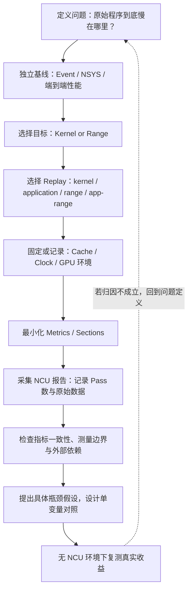

**本周的核心结论：** NCU 的性能计数器是在特定采集条件下对硬件执行行为的观测；理解这些采集条件并判断其与原始程序的差异，是用 NCU 做可靠性能分析的前提。优化的最终目标不是让某个指标更好看，而是让正确性不变的工作负载在真实执行条件下更快，并且能够拿出相互印证的证据解释原因。
