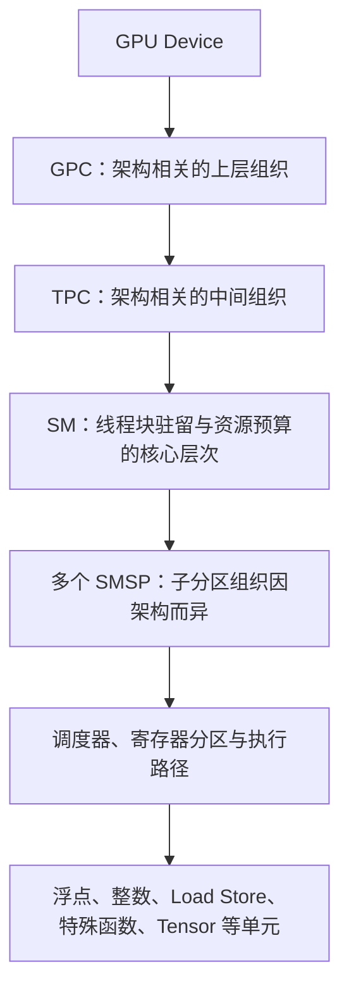
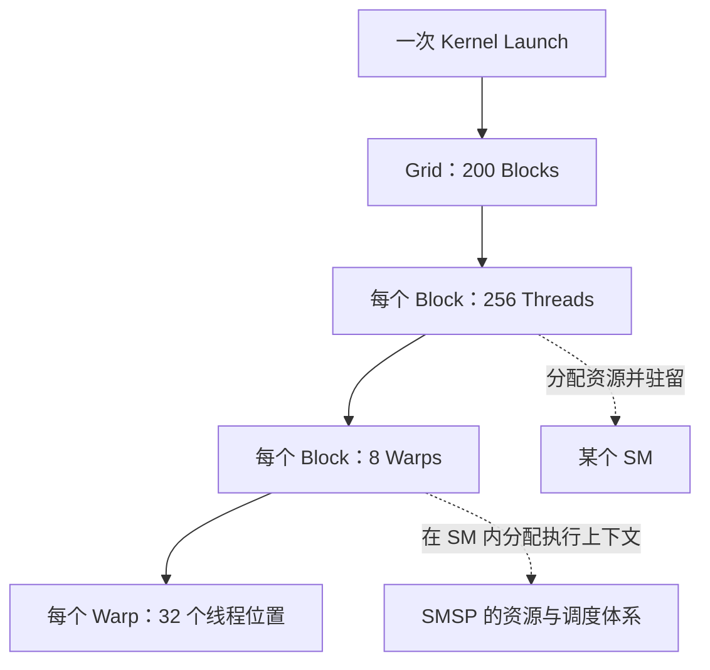

# Nsight Compute（NCU）系统学习 · 第三课：GPU 硬件层次、资源预算与理论 Occupancy

> 配套实验：[lab03.md](lab03.md) · [入口源码](kernels/main.cu) · [脚本入口](commands/)（源码与实验设计已提供；历史默认入口仅有 compile-only 记录，不代表改后源码或新脚本，见[旧编译日志](log/legacy_commands/compile/source_check.log)，尚未运行验证，无性能实测）。
>
> 所属系列：[NCU 系统学习与 GPU Kernel 性能分析实验指南](../ncu_systematic_learning_guide.md)  
> 前置课程：[第一课](../01_ncu_basics/lec01.md)、[第二课](../02_replay_and_measurement/lec02.md)  
> 学习形式：正文提供结构图、静态推导与练习；实际操作见配套实验。本文所有数值例题均为教学假设，不是设备实测。  
> 架构边界：资源容量、分区方式、分配粒度与工具支持以目标 GPU、编译目标及 Toolkit 版本为准。  
> 更新日期：2026-11-07。

## 0. 本课定位：先认识机器，再计算它能装下多少工作

CPU 程序中，一个变量占多少内存，会影响能保存多少数据。GPU 上也要做容量预算：例如“一个计算单元最多同时接纳几个工作组”，要看每组需要多少资源、单元总共有什么资源。后面将把工作组叫线程块（Block），计算单元叫 SM；接纳并保留资源叫驻留，不是“这一刻正在做运算”。**本课只回答静态问题：给定硬件、已编译 kernel 和启动参数，一个 SM 最多能同时容纳多少 Block、多少 Warp？**

必要前置知识：知道函数调用、数组与字节单位即可。寄存器、Warp、SM 和 Occupancy 都将在下面定义。KiB 表示 1024 字节；一个本课计数的 32-bit 寄存器保存 4 字节。

学习顺序：第 1 节画出硬件和软件两张层次图；第 2 节取得资源预算输入；第 3 节手算约束与分配台阶；第 4 节用工具核对；第 5 节总结与自测。完成后应能解释每个除法的分子、分母、单位和取整理由。

实际驻留为何低于理论、依赖等待、Eligible、Issue 和 Stall 全部留给[第四课](../04_warp_scheduling/lec04.md)。理论 Occupancy 是容量上界，不是速度评分。

## 1. GPU 执行层次：先分清硬件，再映射 CUDA 工作

### 1.1 硬件层次：GPU Device → GPC/TPC → SM → SMSP → 执行单元

先回顾前两课的提交模型：**kernel** 是 GPU 函数，**launch** 是 CPU 提交一次 GPU 执行请求；提交通常异步返回，返回时 GPU 未必已完成。一次提交包含许多线程（各自执行函数、有自己的编号和数据的任务），线程分组为 block，整次启动的块组成 grid。本课预算的是这些任务需要的资源，不测量提交耗时。

**Device** 是 CUDA 看到的一块 GPU 设备。设备内有多个 **SM（Streaming Multiprocessor，流式多处理器）**，每个 SM 都有运行线程块所需的执行与存储资源。许多产品的架构图还以 **GPC（Graphics Processing Cluster）** 和 **TPC（Texture Processing Cluster）** 组织 SM 及相关前端、纹理等资源；具体包含关系和数量必须查对应产品架构图，不能把某代图中的规格推广到所有 GPU。

**SMSP（SM Sub-Partition）**是 SM 内的子分区组织，资源可能分区而非全 SM 任意互借。图中的**调度器**是选择可执行指令送去处理的硬件，执行路径是处理某类指令的硬件通道；这里仅定位，不讨论选择规则。**浮点/整数单元**做相应数值运算，**Load/Store** 路径读/写数据，特殊函数单元处理部分专门数学运算，**Tensor** 路径处理特定矩阵等运算。它们的通道数不是驻留线程数。

许多架构在 SMSP 中组织 Warp Scheduler（线程束调度器）、寄存器资源和部分执行管线，也存在 SM 内共享的路径。**寄存器**是保存线程中间值的快速小存储，例如保留某次乘法的输入和结果；所有这类存储构成寄存器文件（Register File）。图中的执行单元不是每个 SMSP 都必然独占一套；数量、吞吐和共享方式以目标架构为准。

“CUDA Core”通常指某类算术执行通道，不是能够独立运行一个 CUDA 线程的 CPU 核。一个线程会使用不同类型的执行路径，不能用“CUDA Core 数 ÷ 线程数”计算 Occupancy。GPC/TPC 也不是 CUDA Grid/Block 的同义词。

### 1.2 软件层次：Kernel → Grid → CTA/Block → Warp → Thread/Lane

**Kernel** 是 GPU 上执行的函数。一次启动创建一个 **Grid**，Grid 包含多个 **Block**（硬件资料也称 CTA，Cooperative Thread Array）；Block 包含线程，线程按线性线程编号分成 **Warp**。**Warp（线程束）**是块内最多 32 个线程组成的执行群组，也是本课驻留容量的计数单位；一个 Warp 不跨 Block。CUDA 当前 Warp 大小为 32，程序与设备查询可通过 `warpSize` 核对。**Lane** 是线程在 Warp 中的位置，不是固定绑定的物理算术核。

例如 Grid 有 200 个 Block，每个 Block 有 256 个线程：每块 8 个 Warp，共有 1600 个逻辑 Warp。它们不必同时驻留。

**Shared Memory（共享内存）**是程序为同一块线程分配的片上工作区，例如各线程把自己的中间值写入以供块内伙伴使用；它不是所有块任意共用的缓存。**执行上下文**是保留线程编号、寄存器值等以继续执行所需的状态；**槽位**是硬件为这些状态预留的位置。例如有空间存下数组，并不意味着还有槽位接纳下一块。

普通线程块的线程在同一个 SM 上执行，因此可共享该块的 Shared Memory。一个 SM 可同时驻留多个块；一个块的不同 Warp 可以分配到不同 SMSP。资源不足时，后续块等待已有块释放资源。不要把这理解为所有 Block 同步分批执行，也不要假设 Warp 每周期可以自由迁移到任意 SMSP。线程块集群等高级启动机制另有约束，不在本课普通 Block 模型中展开。

### 1.3 内存层次与作用域：容量不是一池可任意互借的字节

表中 **Device Memory** 是设备显存，GDDR/HBM 是不同显存技术；**Global / Local Memory** 是程序看见的全局/线程私有地址空间，名字不直接等于某种片上物理存储。**Texture** 是纹理读取相关的访问路径，这里只用来识别架构图。**静态共享内存**在编译时确定容量，**动态共享内存**在每次启动时指定额外字节数，下面会给代码小例。

| 资源 | 物理组织与作用范围 | 在本课预算中的作用 |
|---|---|---|
| Device Memory | 设备外部显存，如 GDDR/HBM，经内存控制器访问；Global Memory 是编程地址空间概念 | 能放下整个输入，不代表能增加 SM 的寄存器或驻留槽位 |
| L2 Cache | 设备级缓存，通常由多个分区组成，服务多个 SM | 缓存数据，不按每个普通 Block 预留固定 L2 容量来算 Occupancy |
| Register File | SM 内、常按子分区组织；程序语义上每线程私有 | 编译后的每线程寄存器需求会限制驻留块数 |
| Shared Memory | SM 上的片上资源，普通用法中每个 Block 拥有自己的分配 | 每块静态与动态用量共同消耗 SM 预算 |
| L1 / Texture Cache | SM 侧缓存与访存路径；具体组织因架构而异 | 一些架构与 Shared Memory 共享物理容量，carveout 会影响可用共享内存 |

**Carveout** 是共享片上容量在 Shared Memory 与缓存等用途间的配置选择，不是给 kernel 新增物理内存。L1 的缓存作用也不能代替程序显式声明的 Shared Memory。

寄存器不够时，编译器可能把值 **Spill（溢出）** 到 Local Memory。Local 表示线程私有地址空间，不表示片上高速存储；它通常经过设备内存与缓存路径，不能当作额外寄存器容量。

### 1.4 Warp 的 SIMT 抽象与本课边界

**SIMT（Single Instruction, Multiple Threads）** 表示按线程编程、以线程组组织指令执行。一次 Warp 指令让参与的 Lane 对各自数据工作，不是先让 32 个 CPU 核分别发射再合并。例如一条加法组指令让参与线程分别执行 `c[i]=a[i]+b[i]`，每个线程有自己的 i 和结果，不是 32 个线程共算一个数。Volta 是 NVIDIA 的一代架构名称；它及更新架构支持 Independent Thread Scheduling（独立线程调度），维护更细的线程执行状态，但不等于每 Lane 独占一个调度器。此处只辨认术语，具体行为留到第四课。

本课只需要据此理解：Warp 是驻留容量的计数单位，而线程数、Warp 数与物理执行通道数不能互换。指令如何发射见第四课第 1–4 节。

## 2. 静态预算的输入：资源需求从哪里来

### 2.1 先固定硬件和编译配置

手算需要两张表：一张是目标 SM 的容量，一张是**最终编译版本**的每块需求。先记下设备型号、compute capability（计算能力，描述架构特征）、Toolkit 与目标架构，再记录 block 大小、动态共享内存参数和编译选项。不能拿另一设备的资源表或另一优化版本的寄存器数代入。

下表的 **API（应用编程接口）**是程序调用运行库查询信息的函数：`cudaGetDeviceProperties` 取设备属性，`cudaDeviceGetAttribute` 查单项属性，`cudaFuncGetAttributes` 查某个已加载 kernel 的属性。`numRegs` 是每线程寄存器数，`sharedSizeBytes` 是静态共享内存字节数，`maxThreadsPerBlock` 是该函数允许的每块线程上限；这些是属性，不是运行平均值。

| 要取得的输入 | 依据 | 容易混淆的点 |
|---|---|---|
| SM 数、Warp 大小、每 SM 线程/块/寄存器/共享内存上限 | `cudaGetDeviceProperties`、`cudaDeviceGetAttribute` 与目标架构文档 | 每 Block 上限不等于每 SM 总容量；属性字段与可用项依版本而异 |
| 每线程寄存器数、静态共享内存、Spill 信息 | `nvcc` 的 `-Xptxas=-v` 报告，结合最终目标代码 | 源码变量数不是寄存器数；PTX 虚拟寄存器数不是最终物理分配 |
| 已加载函数的资源属性 | `cudaFuncGetAttributes`，如 `numRegs`、`sharedSizeBytes`、`maxThreadsPerBlock` | 函数最大线程数可能比设备每块上限更严格 |
| 每 Block 线程数 | 启动中的 block 各维乘积 | 三维 Block 也要先计算线程总数 |
| 每 Block 动态 Shared Memory | 启动的动态共享内存字节数 | 编译器的静态报告不包含每次启动额外传入的全部动态用量 |

`nvcc` 是 CUDA 编译驱动；`-Xptxas=-v` 将详细报告选项传给生成目标机器码的汇编阶段。这里说明查询来源，不额外编译或运行；配套实验的实际编译命令与输出位置见 [lab03](lab03.md) 和 [compile 脚本](commands/compile.sh)。

### 2.2 为什么不能数源码变量

编译器可能删除不用的变量、把常量直接编码到指令中、让寿命不重叠的变量复用寄存器，也可能展开循环而同时保留更多中间值。64-bit 数据还可能占用多个 32-bit 寄存器。因此，`float a, b, c` 不意味着每线程只需 3 个寄存器。

Shared Memory 需求先分清 `__shared__` 声明的静态空间和 `extern __shared__` 对应的启动时动态空间。例如 `__shared__ float tile[256]` 声明 1024 字节静态空间；若另声明动态数组，并以 `K<<<grid, block, 2048>>>(...)` 启动，第三个参数再请求每块 2048 字节，源码请求合计 3072 字节。实际预算还要考虑架构和工具计入的保留量、对齐（按规定边界安排地址），不是只计动态数组。后面公式中的每块共享内存应是用于驻留计算的总分配量，而不是只看其中一项。

**理解检查：** 同一源码开启循环展开后，寄存器可能变化吗？会；所以修改编译选项后必须重新取得报告，旧数值不能继续当作当前版本的预算输入。

## 3. Occupancy：从整数资源约束推导理论上界

> 配套阅读：[3.1 Occupancy：占用率的定义与资源约束](3.1_occupancy.md)。以下第 3.2–3.4 节是本课核心。

### 3.1 定义：分母是最大驻留 Warp 数

理论占用率是当前 kernel 配置允许的最大驻留 Warp 数，相对架构每 SM 最大驻留 Warp 数的比例：

$$
O_{\mathrm{theoretical}}=\frac{B_{\mathrm{resident}}\,W_b}{W_{\max}}
$$

这里 $B_{\mathrm{resident}}$ 是资源允许的每 SM 驻留块数，$W_b$ 是每块 Warp 数，分子相乘得到每 SM 的 Warp 数；$W_{\max}$ 是硬件每 SM 最大驻留 Warp 数。分子分母同为 Warp/SM，相除无单位；如 4 块、每块 8 Warp、上限 64 Warp，比例是 $4\times8/64=0.5=50\%$。本节没有对时间或全设备做平均。100% 只表示容量上界可填满，不表示所有 Lane 或执行单元同时有用地工作。动态的 Achieved Occupancy 是另一种观测，定义与归一化见第四课第 1 节。

### 3.2 什么资源决定一个 SM 能驻留多少 Block

设每块线程数为 $T_b$，每线程需要 $R_t$ 个 32-bit 寄存器，每块共享内存用量为 $S_b$。先算：

$$
W_b=\left\lceil T_b/32\right\rceil
$$

符号 $\lceil x\rceil$ 是向上取整，$\lfloor x\rfloor$ 是向下取整；例如 $\lceil33/32\rceil=2$、$\lfloor33/32\rfloor=1$。每块线程数除以每 Warp 的 32 线程，得到所需 Warp 数，再向上取整，因为不足 32 个也要单独一个 Warp。例如 33 个线程需要 2 个 Warp；第二个 Warp 不满，不等于只占一个线程大小的 Warp 上下文。先检查启动是否合法：每维尺寸、每块线程数、函数资源要求与每块共享内存都必须在允许范围内。非法配置不能解释成“低 Occupancy”。

在忽略分配粒度、分区限制的教学模型中：

$$
B_{\mathrm{resident}}=\min\left(
B_{\max},
\left\lfloor T_{\max}/T_b\right\rfloor,
\left\lfloor W_{\max}/W_b\right\rfloor,
\left\lfloor R_{\mathrm{SM}}/(T_bR_t)\right\rfloor,
\left\lfloor S_{\mathrm{SM}}/S_b\right\rfloor
\right)
$$

式中 $\min$ 表示取所有候选上限的最小值。容量符号均针对**一个 SM**：$B_{\max}$、$T_{\max}$、$W_{\max}$ 分别是块、线程、Warp 上限；$R_{\mathrm{SM}}$ 是可用的 32 位寄存器个数，$S_{\mathrm{SM}}$ 是可用共享内存字节数。需求符号针对**一个块**：$T_b$ 为线程数，$T_bR_t$ 为寄存器个数，$S_b$ 为共享内存字节数。例如“65536 个寄存器/SM ÷ 16384 个寄存器/块”得到“4 块/SM”，不是 4 个线程。各项只有先统一单位才能比较。

| 项 | 为什么要计算它 |
|---|---|
| $B_{\max}$ | 即使块很小，块执行上下文的槽位数量仍有限 |
| $\lfloor T_{\max}/T_b\rfloor$ | 线程上下文不能超过每 SM 容量 |
| $\lfloor W_{\max}/W_b\rfloor$ | 不满的 Warp 也需要 Warp 槽位 |
| $\lfloor R_{\mathrm{SM}}/(T_bR_t)\rfloor$ | 寄存器不能超支；分母单位是寄存器/Block |
| $\lfloor S_{\mathrm{SM}}/S_b\rfloor$ | 每个块都需要自己的共享内存分配 |

向下取整是因为不能驻留“4.6 个完整 Block”。最后取最小值，因为每个块必须**同时满足所有约束**。若某项资源需求为零，该项不构成限制，不做除零计算。

严格计算应将寄存器、共享内存分母替换成实际分配量，并考虑 SMSP 局部分配、保留量、carveout 等。总量够用只是必要条件，不保证所有分区都能合法放置。例如假想两个分区各剩 6 份资源，一个不可拆分的分配要 8 份，总余量 12 虽够，却没有一个分区能放下；这是分区约束的直觉示意，不是某 GPU 的真实寄存器分配规则。

### 3.3 手算 50%、75%、100%：观察限制因素迁移

**假想教学设备**：65,536 个 32-bit 寄存器/SM、96 KiB 可用 Shared Memory/SM、64 Warp/SM、2,048 线程/SM、16 Block/SM。它不是某产品的完整规格，暂忽略分配粒度。每 Block 为 256 线程，即 8 Warp。

| 配置 | 寄存器/线程 | Shared/Block | 寄存器允许块数 | Shared 允许块数 | 线程/Warp 允许块数 | 取最小值后的块数 | 理论 Occupancy |
|---|---:|---:|---:|---:|---:|---:|---:|
| A | 64 | 16 KiB | 4 | 6 | 8 | 4 | 50% |
| B | 32 | 16 KiB | 8 | 6 | 8 | 6 | 75% |
| C | 32 | 8 KiB | 8 | 12 | 8 | 8 | 100% |

**第一步，配置 A：** 每块需要 $256\times64=16,384$ 个寄存器，所以只能放 $65,536/16,384=4$ 块。共享内存允许 $96/16=6$ 块，线程与 Warp 容量都允许 8 块，Block 槽位允许 16 块。最小值为 4，驻留 $4\times8=32$ 个 Warp，$32/64=50\%$。

**第二步，只减少寄存器，得到 B：** 每块变为 8,192 个寄存器，寄存器允许 8 块，但共享内存仍只允许 6 块。最终是 $6\times8/64=75\%$，不是简单翻倍。

**第三步，只减少共享内存，得到 C：** 共享内存允许 12 块，但寄存器、线程和 Warp 都只允许 8 块。最终 $8\times8/64=100\%$。继续减少共享内存不会超过 100%。

这叫**限制因素迁移**：寄存器 → 共享内存 → 线程/Warp 等容量。它是静态结论；尚不能据此判断哪个版本运行最快。减少 Shared Memory 也可能损害数据复用，压低寄存器可能引入 Spill，运行时权衡见第四课第 9 节。

### 3.4 Occupancy 是阶梯函数：整数块与资源分配粒度

先只看整数块。配置 A 的寄存器从 64 降到 60 时，每块需要 15,360 个，$\lfloor65,536/15,360\rfloor=4$，所以仍是 50%。要放 5 块，忽略粒度时必须满足：

$$
5\times256\times R_t\le65,536
\quad\Rightarrow\quad R_t\le51
$$

因此 52 个寄存器时仍只能放 4 块，51 个时寄存器总量才允许 5 块；共享内存等也必须允许，才能达到 $5\times8/64=62.5\%$。

再引入分配粒度。**另设一个纯教学规则**：寄存器按每 Warp 256 个为单位分配，则：

$$
R_{\mathrm{warp,alloc}}=256\left\lceil\frac{32R_t}{256}\right\rceil,
\qquad R_{\mathrm{block,alloc}}=W_bR_{\mathrm{warp,alloc}}
$$

这里 $32R_t$ 是每 Warp 原始需求（寄存器个数），除以 256 得到需要多少个分配单位，再向上取整、乘回 256；最后乘每块 Warp 数 $W_b$，得到每块实际分配个数。例如 257 个需求按 256 一份分配就要保留 512 个，未用部分也已占预算。

51 个寄存器/线程时，原始每 Warp 需求为 1,632，向上取整到 1,792；每块分配 $8\times1,792=14,336$，只能放 4 块。降到 48 时，每 Warp 恰为 1,536，每块 12,288，才允许 5 块。**原始总量模型预测的门槛与实际分配模型不同。** 这里的 256 粒度只是例题规则，不是全架构常量。

共享内存也可能按固定字节粒度向上取整。真实设备还可能按 Warp/Block、子分区等组织分配，因此不能仅在总量公式里统一添加一个通用取整值。应查目标架构和工具规则，再用 API 核对。

**单变量练习：** 固定配置 A 其他参数，把寄存器依次改为 64、60、52、51、48。分别按原始总量模型与上述教学粒度模型计算，指出哪一步才增加一个完整块。

## 4. 用静态工具核对，而不是用运行时数字代替预算

### 4.1 Occupancy API 的原理与边界

`cudaOccupancyMaxActiveBlocksPerMultiprocessor` 接收 kernel、每块线程数与每块动态 Shared Memory 字节数，结合已加载函数资源属性和目标设备规则，返回资源允许的每 SM 最大活跃块数。由此计算：

$$
O=\frac{\text{API 返回块数}\times\lceil T_b/\mathrm{warpSize}\rceil}
{\text{每 SM 最大线程数}/\mathrm{warpSize}}
$$

分子把 API 返回的块/SM 乘 Warp/块，分母把每 SM 线程上限除以每 Warp 线程数，两者都换成 Warp/SM；比例无单位。这里 `warpSize` 是设备查询到的 Warp 大小，当前 CUDA 为 32。

它是在做**约束与分配规则计算**，不是先运行 kernel 再测平均驻留。它不替你证明 Grid 足够大、负载均衡或执行速度最快。`cudaOccupancyMaxPotentialBlockSize` 可辅助选择具有较高潜在占用率的启动配置，但不是任意算法的性能最优搜索器。集群启动另有对应 API，不能直接套普通块公式。

### 4.2 推荐的核对顺序

1. 在 [lab03](lab03.md) 中确认实际 kernel、编译配置与 block 大小；读取编译报告，不用变量数猜寄存器数。
2. 记录设备上限与函数上限，列出第 3.2 节的每一项预算，先手算最小值。
3. 用对应架构的 Occupancy 工具/API 核对。若不同，优先检查动态共享内存、分配粒度、carveout、子分区约束以及是否读错了编译版本。
4. 需要实际采集时，`LaunchStats` 核对启动和资源需求，`Occupancy` 查看理论值及限制因素。指标名称以安装版本的查询与说明为准。

本次文档整理没有执行上述编译、API 查询或 NCU 采集；页首编译状态是保留的历史记录，不是本次验证结果。

## 5. 总结与自测：能否独立复算

本课的逻辑是：**硬件作用域 → 已编译资源需求 → 合法性 → 整数块预算 → 分配粒度 → 理论 Occupancy**。不要将它延伸成“理论越高必然越快”。

### Q1：320 个线程的 Block 有多少 Warp？

答：$\lceil320/32\rceil=10$。若假设每 SM 最多 64 Warp，仅 Warp 容量允许 6 块，即 60 Warp、93.75%；还需核对线程、块槽位、寄存器和 Shared Memory。

### Q2：33 个线程为什么不按 33/32 个 Warp 预算？

答：硬件需要 2 个 Warp 上下文，第二个 Warp 的部分 Lane 没有对应线程。Warp 槽位不是可按线程比例任意切分的资源。

### Q3：寄存器从 64 减到 32，Occupancy 会翻倍吗？

答：不一定。第 3.3 节 A → B 只从 50% 到 75%，因为共享内存先成为限制；还要核对第 3.4 节的分配粒度。

### Q4：设备还有很多空闲显存，为什么不能再驻留一个 Block？

答：显存不能借给 SM 充当寄存器、Shared Memory 或 Warp/Block 上下文槽位。必须分清资源作用域。

### Q5：API 算出每 SM 8 块，是否表示这次启动一定驻留 8 块？

答：不是。它是资源容量上界。是否有足够的待执行块、Warp 何时退出等是第四课的问题。

### Q6：手算和工具不同，应先改代码吗？

答：先核对预算输入与模型遗漏；不要为了匹配错误模型而修改 kernel。分别记录原始需求、实际分配量、工具结果以及采用的架构规则。

下一课从“容量允许多少”进入“实际驻留多少”，再研究已驻留 Warp 为什么仍不能发射。尾部效应的配套材料也随运行时主题在第四课引用。

## 参考资料

1. [CUDA Programming Guide](https://docs.nvidia.com/cuda/cuda-programming-guide/)：执行层次、设备能力、Shared Memory 与 Occupancy API。
2. [CUDA C++ Best Practices Guide](https://docs.nvidia.com/cuda/cuda-c-best-practices-guide/index.html)：寄存器分配、Occupancy 与配置权衡。
3. [Nsight Compute Profiling Guide](https://docs.nvidia.com/nsight-compute/ProfilingGuide/index.html)：SM/SMSP 模型、LaunchStats、Occupancy 与指标定义。
4. 用户提供的配套视频：[Occupancy Calculator](https://www.bilibili.com/video/BV1WNrHY5EeP/)。具体规格以目标产品架构文档为准。
