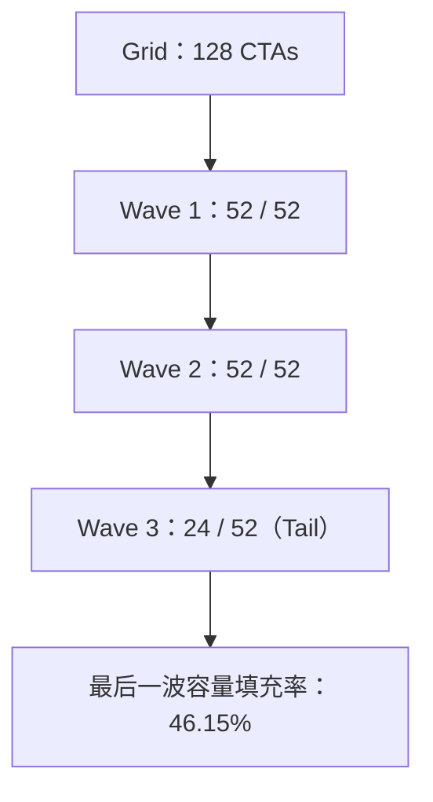
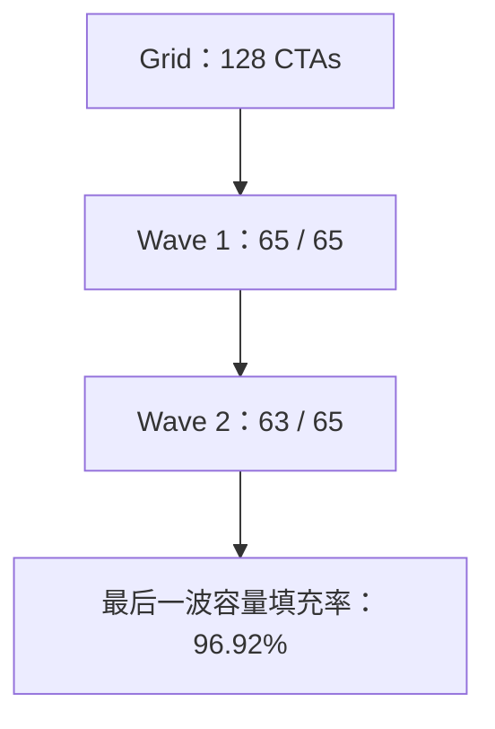
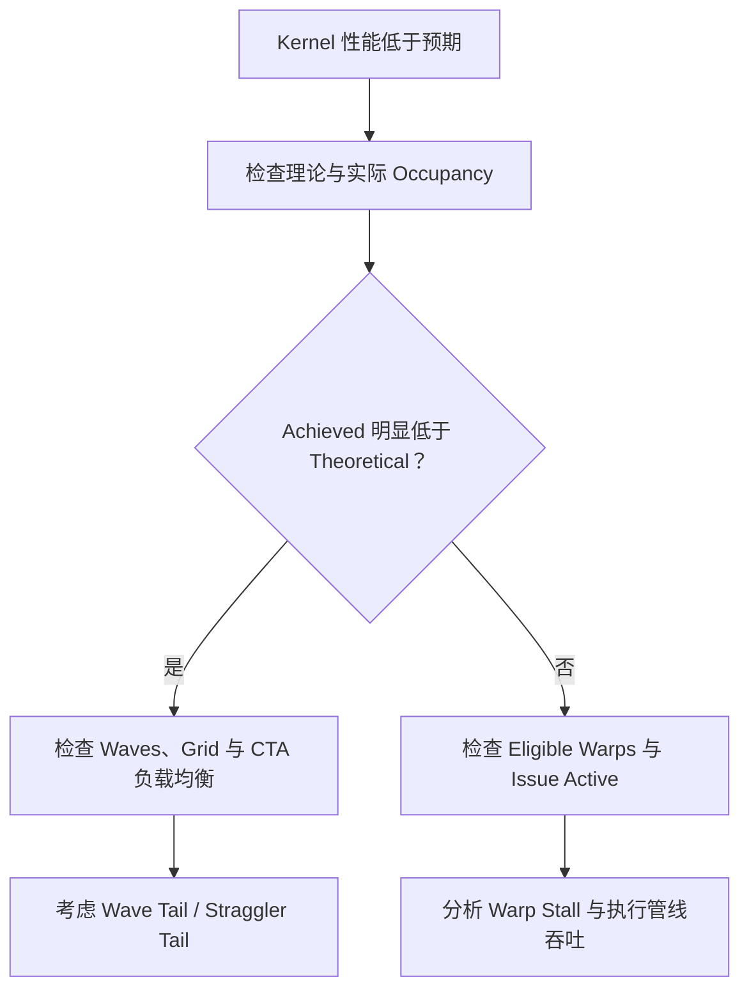

# 4.1 CUDA Kernel Tail Effect（尾部效应）：原理、数学模型与 NCU 分析

配套讲义：[第四课：实际驻留、Warp 调度、依赖与 Stall 分析](lec04.md)。本文承接[第三课的静态资源预算](../03_occupancy/lec03.md)，解释为什么有足够的理论容量，运行时却不一定填满；驻留之后能否发射指令，继续阅读 [4.2 Scheduler Statistics](4.2_scheduler.md)。

> 参考：[CUDA Pro Tip: Minimize the Tail Effect](https://developer.nvidia.com/blog/cuda-pro-tip-minimize-the-tail-effect/)，NVIDIA Technical Blog，Julien Demouth，2014-06-04。本文以原文 Tesla K20 实验为主线，并扩展至现代 Nsight Compute（NCU）的指标理解与实验方法。文中的 Mermaid 图可在支持 Mermaid 的 Markdown 编辑器中直接渲染、编辑。

## 1. 核心问题与结论

先用最小的执行图景理解问题：**Kernel** 是 GPU 上由许多线程执行的函数；若干线程组成一个 **Block（线程块，也叫 CTA）**，本次启动的全部块组成 **Grid**。GPU 有多个 **SM（执行这些块的硬件单元）**。块被安排到 SM、占有执行状态和资源后，称为**驻留**；块内线程每 32 个组成一个 **Warp**。例如 128 个块等待安排，而全 GPU 同时只能放下 52 个块，后面就必须等前面的块腾出位置。

**Tail Effect（尾部效应）**指执行末段剩余块太少，或少数块做得特别久，其他执行位置已经空闲，却仍须等最后的工作完成。这里把“全 GPU 同时能驻留的块容量”称为一个满载 **Wave**，第 2.1 节会手算它。Wave 不是线程组，也不是硬件强制同步的批次。

第三课研究的是**给定资源能放多少**的静态预算；本文研究**实际工作能否一直填满这些位置**的动态过程。某些 SM 空闲或 Warp 真正完成退出，可以减少总体驻留工作；但等待数据或同步的 Warp 通常仍是 Active（已驻留、尚未完成），不能把等待误算成退出。

NCU（Nsight Compute）是分析单个 kernel 的性能工具，下面把理论容量与实际报告分开。需要区分：**Theoretical Occupancy** 是资源配置允许的驻留 Warp 数占硬件上限的比例；**Achieved Occupancy** 是计数器按其活动周期和硬件实例聚合得到的实际驻留比例。Tail Effect 是两者出现差距的可能原因之一，但不是差值的唯一解释。特别是某些 SM 全程没有工作时，活动周期归一化不等于把它们按零值纳入统一墙钟窗口；容量填充率不能直接换算成 NCU Achieved。Occupancy 不等于计算单元利用率。**Issue（发射）**是调度器把就绪指令交给执行路径，**Issue Active** 关注有发射活动的周期比例；**吞吐率**是单位时间完成的工作，例如每秒完成多少个块。位置被占着，不保证每周期都有指令可发。

## 2. 原文实验：Tesla K20 上的 128 个 CTA

表中 Threads/CTA 是每块线程数，Warps/CTA 是每块 Warp 数，CTA/SM 是每个 SM 的块数；`/` 在这些表头中表示“每”。Duration 是执行时间，`ms` 是毫秒，`1 ms = 10⁻³ s`。下列数字来自参考文章的历史实验，不是当前工作区实测。

作者在 Tesla K20 上运行一个金融计算 Kernel，发现 Theoretical Occupancy 为 50%，Achieved Occupancy 却只有 41.52%。其主要配置如下。

| 参数 | 优化前 |
| --- | ---: |
| GPU | Tesla K20（Kepler） |
| SM 数量 | 13 |
| SM 最大驻留线程数 | 2048 |
| Grid CTA 数 | 128 |
| Threads / CTA | 256 |
| Warps / CTA | 8 |
| 可驻留 CTA / SM | 4 |
| Theoretical Occupancy | 50.00% |
| Achieved Occupancy | 41.52% |
| Kernel Duration | 4.535 ms |

因为每个 CTA 有 `256 / 32 = 8` 个 Warp，每个 SM 可驻留四个 CTA，所以理论上每个 SM 驻留 32 个 Warp，而 K20 每个 SM 最多 64 个 Warp：

\[
O_{\mathrm{theoretical}}=\frac{4\times8}{64}=50\%
\]

### 2.1 Wave 的定义

用于直观分析时，可以把 GPU 一次最大同时驻留的 CTA 数称为一个满载 Wave 的容量：

\[
C=S\times B=13\times4=52\text{ CTAs}
\]

这里 `S` 是 SM 数，`B` 是该 Kernel 每 SM 的可驻留 CTA 数。128 个 CTA 在理想的整波模型中分成 `52 + 52 + 24`，即两波满载、一波只含 24 个 CTA。



理想化尾波容量填充率：

\[
U_{\mathrm{tail,old}}=\frac{24}{52}\approx46.15\%
\]

这里的 46.15% **不是** NCU 实际测得的 GPU 利用率，而是最后一波 CTA 数与理论最大驻留容量之比。真实 GPU 不需要等整个 Wave 结束才发射下一波：只要有 SM 释放出足够资源，就可以继续安排 CTA。因此 Wave 是分析并行度的抽象，不是硬件保证的全局同步批次。

## 3. 原文优化：把每 SM 可驻留 CTA 从 4 提高到 5

**寄存器**是保存线程计算中间值的片上小存储，例如累加器 `acc`；同一 SM 的总数有限，每线程用得越多，可能同时放下的块越少。原文指出寄存器是主要 Occupancy 限制因素，作者使用 `__launch_bounds__` 约束编译器的寄存器预算，使可驻留 CTA 从 4 提高到 5。

代码中的 `__global__` 表示 GPU kernel，`__launch_bounds__` 是写在函数声明上的编译约束；这里的省略号只表示未展示的原程序，不是可直接编译的完整例子。

```cpp
__global__ __launch_bounds__(256, 5)
void kernel(/* ... */) {
    // 原 Kernel 计算
}
```

这两个参数表达“最大 256 Threads / Block”和“期望至少五个 Block / SM 的驻留能力”。它们是给编译器的约束和提示，并非运行时硬件一定能达到五个 Block 的保证；最终还受 Shared Memory（同一块线程共用的片上存储）、寄存器分配粒度和其他资源约束限制。分配粒度表示硬件按整组资源划拨，不能任意切成零碎份额。

新的 Wave 容量是 `13 × 5 = 65`，128 个 CTA 分成 `65 + 63`：



\[
U_{\mathrm{tail,new}}=\frac{63}{65}\approx96.92\%
\]

| 指标 | 优化前 | 优化后 |
| --- | ---: | ---: |
| CTA / SM | 4 | 5 |
| Warps / SM | 32 | 40 |
| Theoretical Occupancy | 50.00% | 62.50% |
| Achieved Occupancy | 41.52% | 61.31% |
| 满载 Wave 容量 | 52 | 65 |
| 理想整波数量 | 3 | 2 |
| 尾波容量填充率 | 46.15% | 96.92% |
| Kernel Duration | 4.535 ms | 3.825 ms |

实测加速比为 `4.535 / 3.825 ≈ 1.19×`，执行时间减少约 15.7%，对应吞吐速度提升约 18.6%。**不能把全部收益严格归因于尾波改善**：优化也同时提高了理论驻留能力，可能改善延迟隐藏，即一个 Warp 等待结果时，由另一个已就绪 Warp 继续提供指令；要隔离每个因素需要更多受控实验。

## 4. Tail Effect 的简化数学模型

设 `N` 为 Grid CTA 总数，`S` 为 SM 总数，`B` 为该 Kernel 每 SM 可驻留 CTA 数，则：

\[
C=S B,\qquad W=\frac{N}{SB}
\]

其中 `W` 是工作块数除以满载容量得到的理论 Wave 数量，允许非整数，没有时间单位。现代 NCU 提供 `launch__waves_per_multiprocessor` 指标，帮助识别不完整 Wave 的风险。

在**所有 CTA 运行时间近似相同、以整波执行**的理想模型下，整体驻留容量填充率近似为：

\[
U_{\mathrm{wave}}=\frac{N}{\lceil W\rceil SB}=\frac{W}{\lceil W\rceil}
\]

`⌈W⌉` 表示向上取整，例如 `⌈2.2⌉=3`；`U_wave` 是无单位的容量比例，不是 NCU 的 Occupancy 计数公式。

例子：

| Waves | 理想平均容量填充率 | 解释 |
| ---: | ---: | --- |
| 1.2 | 60.0% | 两波中第二波只使用 20% 容量 |
| 1.9 | 95.0% | 两波接近满载 |
| 2.2 | 73.3% | 需要第三波，但尾波只有 20% |
| 10.5 | 95.5% | 单个不完整尾波占总体运行时间的比例更小 |
| 100.5 | 99.5% | 单一部分尾波的相对影响通常非常小 |

这些是用于直觉分析的模型结果，**不是实际 GPU 利用率的预测公式**。真实 CTA 可以陆续完成和补位，运行时间、资源争用、SM 调度与频率变化都会影响观测值。也不能仅凭 `W` 越小断定速度越快，因为增加每 SM 驻留 CTA 可能让每个 CTA 变慢。

## 5. 两类 Tail Effect：Wave Tail 与 Straggler Tail

下面的 Reduce 是把多个数合成一个结果，例如求和；动态调度是运行时把待做任务继续分给空闲工作者。`μs` 是微秒，`1 μs = 10⁻⁶ s`。

| 类型 | 机制 | 典型例子 | 对应思路 |
| --- | --- | --- | --- |
| **Wave Tail** | Grid 剩余 CTA 少于 GPU 的并行驻留容量 | 128 个 CTA，满载容量 52 | 调整 Grid 规模、资源用量、Block 粒度 |
| **Straggler Tail** | 少数 CTA 工作量更大，其他 CTA 提前结束 | 稀疏任务、不均匀 Reduce、数据相关工作量 | 工作均衡、任务拆分、动态调度 |


例如 100 个 SM 上各有一个 CTA，其中 99 个 CTA 运行 10 μs，最后一个运行 100 μs。Block 数量看似恰好一波，但后面 90 μs 大部分 SM 已经空闲。原文主要针对 Wave Tail，不代表 `__launch_bounds__` 可以解决 Straggler Tail。

## 6. Tail Effect、Occupancy、Scheduler Statistics 的分工

**Warp Scheduler（Warp 调度器）**从自己管理的驻留 Warp 中选择指令。某 Warp 的下一条指令输入已齐、所需资源也允许参与发射时，称为 **Eligible（就绪）**；若输入未到或资源不允许而无法发射，称为 **Stall（等待/阻塞）**。例如 8 个 Warp 已驻留，7 个在等数据，只有 1 个就绪：Active 是 8，不是 1。NCU 的 Scheduler Statistics、Warp State Statistics 和 Source Counters 分别是调度统计、Warp 状态统计和关联到代码位置的指标组。

| 概念 | 回答的问题 | 典型诊断指标 |
| --- | --- | --- |
| Theoretical Occupancy | 每 SM 理论可以容纳多少驻留 Warp？ | Occupancy、资源限制指标 |
| Achieved Occupancy | 实际执行时平均驻留多少 Warp？ | Occupancy / Active Warps |
| Tail Effect | Grid 后期是否缺少足够的 CTA 并行工作？ | Waves Per SM、时间序列、CTA 负载分布 |
| Eligible Warps | 已驻留 Warp 中哪些已经准备好发射？ | Scheduler Statistics |
| Issue Active | Scheduler 有多少周期成功发射指令？ | Scheduler Statistics |
| Warp Stall | 已驻留 Warp 为何不能发射下一条指令？ | Warp State Statistics / Source Counters |

**Tail Effect 是 CTA / SM 层面的并行工作不足；Warp Stall 是已经驻留的 Warp 受到指令依赖或资源条件限制。** 全设备可用工作减少与报告中的活动周期平均仍须分开：空闲 SM、每个 SM 的非活动周期是否进入分母，由所选指标决定，不保证尾部对 Achieved 的影响按空闲比例体现。某个 Kernel 尾部即使仅剩几个 SM 在运行，这些 SM 上的 Warp 也可能持续高效发射指令；不能仅凭整体 GPU 利用率低就认定为访存延迟问题。

下面的 Mermaid 图把两种诊断分支分开：



该流程只是性能诊断的起点：Occupancy 差距不明显也不意味着不存在局部的尾部现象，Issue Active 高也不意味着执行管线已经达到最佳吞吐。

## 7. 使用 NCU 分析 Tail Effect

建议依次关注三个层面。

### 7.1 Launch Statistics：是否只有少量 Waves？

重点查看 `launch__waves_per_multiprocessor`、Grid CTA 数、Block Size。`W ≈ 1.2` 或 `W ≈ 2.2` 时值得关注不完整尾波；`W ≈ 100.5` 时单个尾波的相对影响通常有限，但无法据此排除 CTA 负载不均。

### 7.2 Occupancy：实际驻留是否低于理论？

查看 Theoretical Occupancy、Achieved Occupancy，以及 Registers Per Thread、Shared Memory Per CTA、Blocks Per SM 等限制因素。若理论 75%，实际 40%，应排查 Grid 并行度、CTA 执行时间差异与 Kernel 执行阶段变化。不要直接将差值归因于 Tail Effect。

### 7.3 时间维度：利用率是否在 Kernel 后期下降？

普通 NCU 报告中许多计数器是 Kernel 生命周期内的聚合值，无法直接展示何时进入尾部。可以在支持的 GPU / NCU 版本上使用 PM Sampling（按时间间隔采集性能计数器，形成随时间变化的序列）；也可结合其他时间线或受控实验观察尾部行为。支持的采样指标依赖 GPU、驱动与工具版本。

基础采集示例（未来实操使用 Bash，在自己的程序目录执行；`./your_program` 与 `your_kernel` 是须替换的占位名，不是本课已有入口）：

```bash
ncu --set full \
    --kernel-name regex:your_kernel \
    --launch-count 1 \
    -o tail_report \
    ./your_program
```

`--set full` 选择完整指标集，可能需要重放程序多次，初学时可改选所需指标组；`--kernel-name regex:...` 按正则表达式筛选 kernel，`--launch-count 1` 只采集一次匹配启动，`-o` 指定报告文件名前缀，`./` 表示当前目录。反斜杠 `\` 是 Bash 续行符。该命令只用于示意。实际使用时应确保 Kernel 选择表达式匹配目标、具备分析权限，并避免与其他负载互相干扰。

## 8. 为什么 `__launch_bounds__` 有收益，也可能带来反效果？

`bit` 是位，8 bit = 1 字节（B），所以一个 32-bit 寄存器可存 4B，例如一个 `float`。假设 SM 有 65536 个 32-bit 寄存器，CTA 含 256 线程，忽略分配粒度和其他限制：

\[
R_{\mathrm{thread}}\leq\frac{65536}{4\times256}=64
\]

若希望同一 SM 驻留 5 个 CTA，则理想上：

\[
R_{\mathrm{thread}}\leq\frac{65536}{5\times256}=51.2
\]

这里 `R_thread` 是每线程寄存器数量上限，51.2 只是除法结果，不表示能分配小数个寄存器。寄存器按硬件粒度分配，实际可用预算可能更严格。编译器压低寄存器需求时可能引入 **Spill（寄存器溢出）**：把原本存在寄存器的中间值暂存到线程私有的 Local Memory，之后再读回。Local 是私有地址空间，不保证位于片上，因此可能增加访存。**指令依赖链**是后一步必须等待前一步结果的序列，例如连续执行 `acc=acc+1`；压低预算也可能让这条链变长，因此更高 Occupancy 不一定意味着更快执行。最终仍要比较 **Kernel Duration** 与归一化吞吐量，同时检查 Register Spill、Local Memory 流量和 Scheduler Statistics。

## 9. 推荐配套实验：用一个最简单的 CTA 工作负载观察尾部

使用一个每个 CTA 执行相近固定计算量的简单 Kernel；不需要复杂的 GEMM（通用矩阵乘法）。分两组进行受控实验：

| 实验 | 修改项 | 固定项 | 重点观察 |
| --- | --- | --- | --- |
| A：Grid Size 扫描 | 使理论 Waves 接近 0.5、1、1.2、1.5、2、2.2、3、4、8、16 | CTA 内工作量、Block Size、代码 | Waves、Achieved Occupancy、Duration、归一化吞吐 |
| B：CTA 驻留能力扫描 | 通过资源需求或合理的 launch bounds 改变可驻留 CTA / SM | Grid 总工作量与计算逻辑 | Registers、Theoretical/Achieved Occupancy、Waves、Duration、Spill |

实验 A 修改 Grid Size 会同时改变总工作量，因此不能仅凭绝对 Duration 判断加速；应该结合总 CTA 数量与吞吐量，或设计总工作量相同而任务划分不同的对照实验。实验 B 修改资源预算可能同时影响每 CTA 执行时间，应检查是否产生寄存器溢出。建议在同一 GPU 上多次重复测量，并保留对应的源码、命令、NCU 报告与结论，以支持性能归因。

## 10. 核心记忆与延伸阅读

可以从三个层次理解一个 Kernel 的执行效率：**GPU 是否有足够多的 CTA 可以安排 → SM 是否能驻留足够多的 Warp → Warp Scheduler 是否有足够 Eligible Warp 持续发射指令**。Tail Effect 主要影响第一层，Occupancy 与第一、二层直接相关，Scheduler Statistics 则帮助诊断第三层。优化目标不是单纯最大化 Occupancy 或整数 Wave 数，而是降低真实 Kernel Duration。

官方参考：

- [CUDA Pro Tip: Minimize the Tail Effect](https://developer.nvidia.com/blog/cuda-pro-tip-minimize-the-tail-effect/)
- [Nsight Compute Profiling Guide](https://docs.nvidia.com/nsight-compute/ProfilingGuide/)（重点检索 `launch__waves_per_multiprocessor`、Occupancy、Scheduler Statistics）
- [CUDA Programming Guide](https://docs.nvidia.com/cuda/cuda-programming-guide/index.html)（`__launch_bounds__` 与硬件执行模型）
