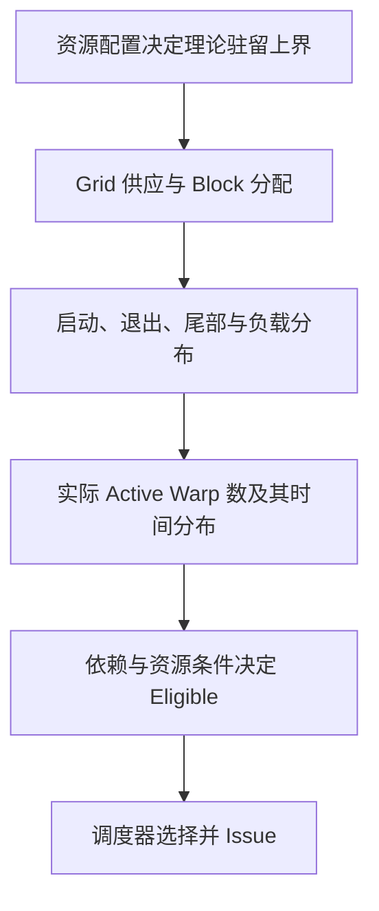
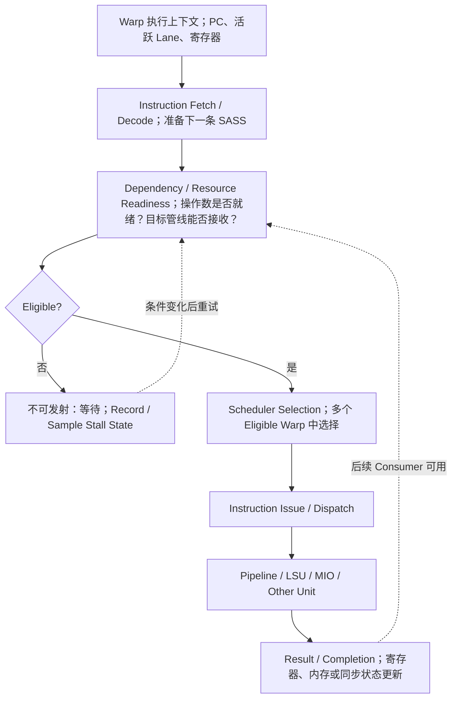
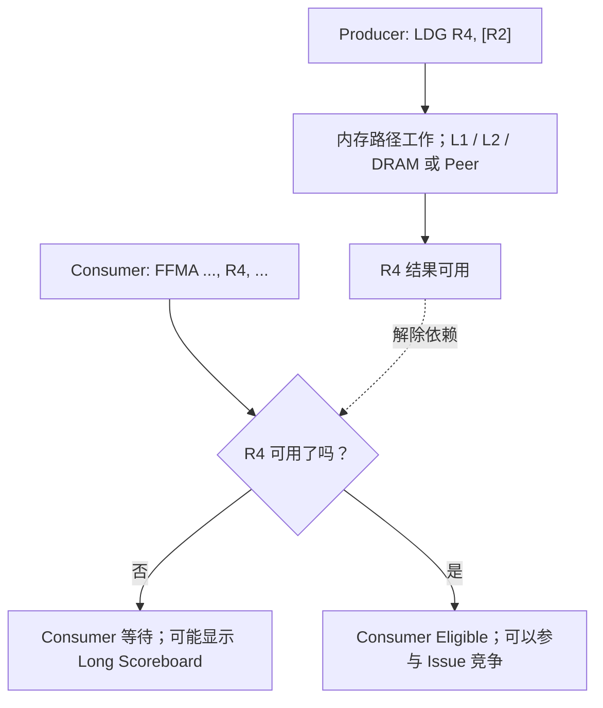
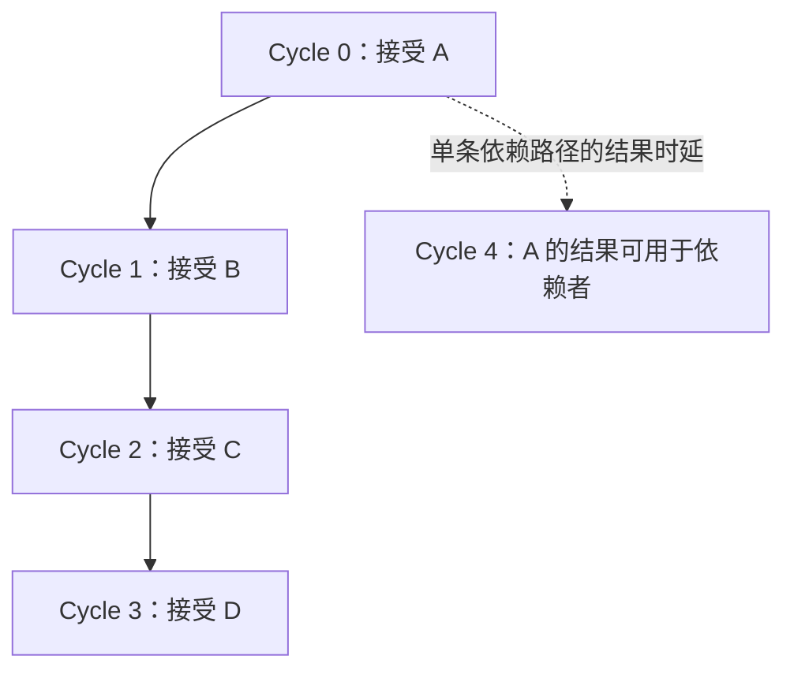
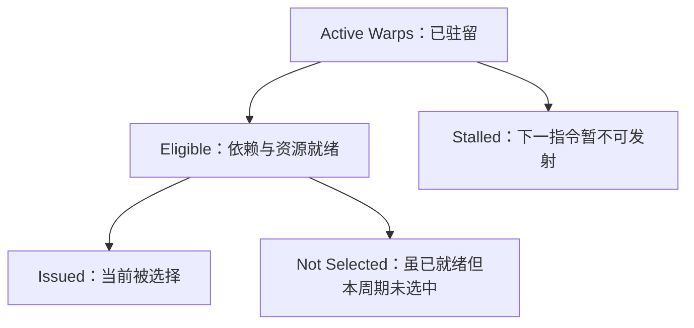
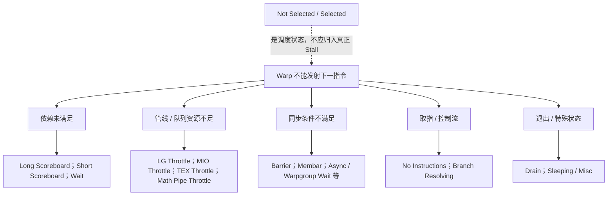
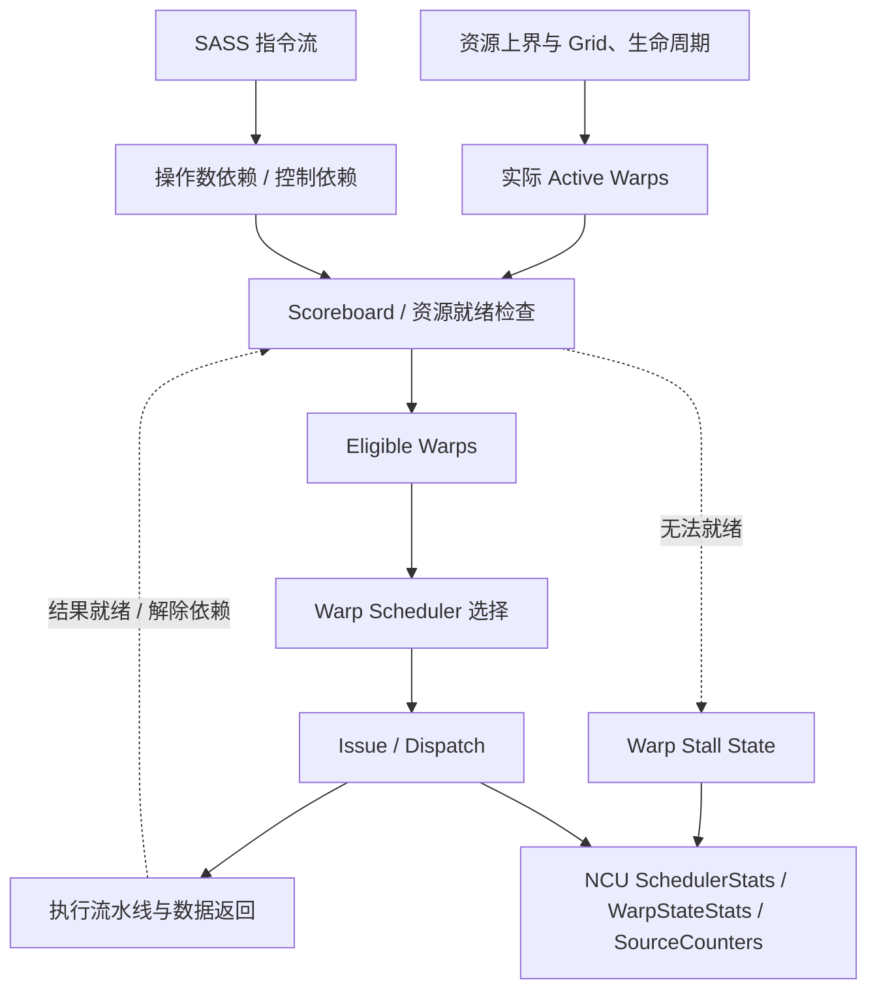
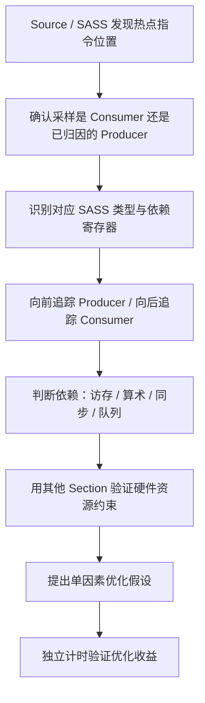
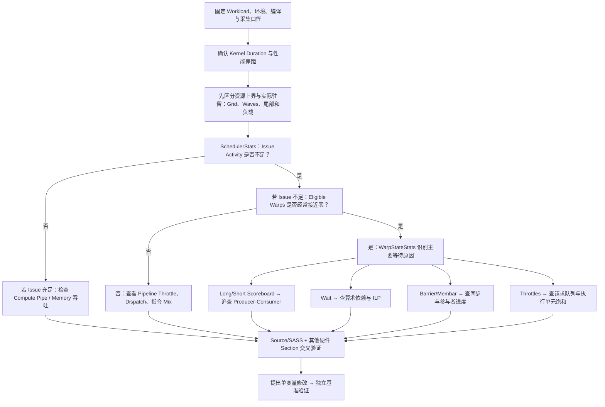
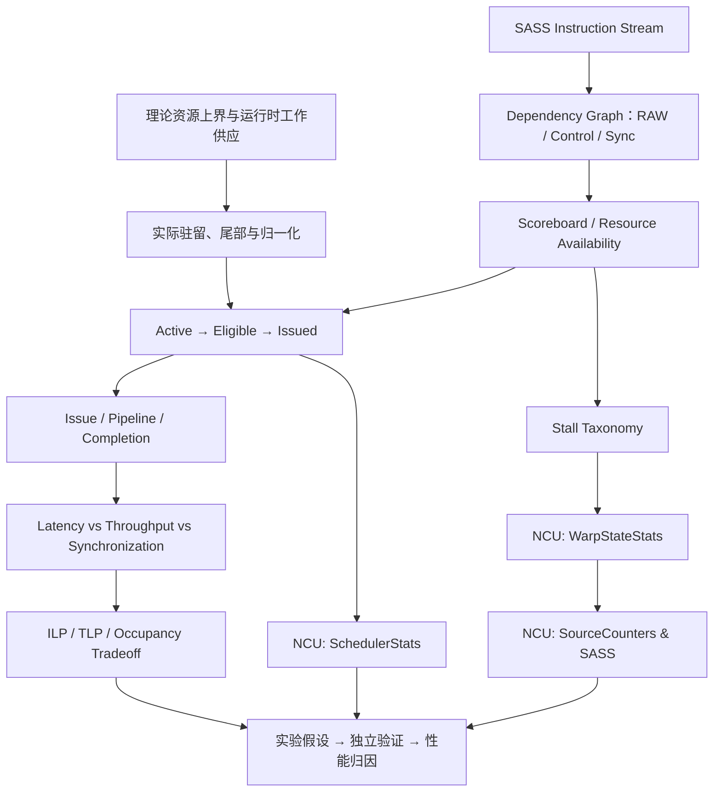

# Nsight Compute（NCU）系统学习 · 第四课：实际驻留、Warp 调度、依赖与 Stall 分析

> 配套实验：[lab04.md](lab04.md) · [入口源码](kernels/main.cu) · [脚本入口](commands/)（源码与实验设计已提供；历史默认入口仅有 compile-only 记录，不代表改后源码或新脚本，见[旧编译日志](log/legacy_commands/compile/source_check.log)，尚未运行验证，无性能实测）。

> 所属系列：[NCU 系统学习与 GPU Kernel 性能分析实验指南](../ncu_systematic_learning_guide.md)  
> 前置课程：[第一课：GPU Profiling 基本原理](../01_ncu_basics/lec01.md) · [第二课：Replay、测量扰动与可复现性](../02_replay_and_measurement/lec02.md) · [第三课：GPU 硬件层次、资源预算与理论 Occupancy](../03_occupancy/lec03.md)  
> 对应阶段：第 4 周；承接第 3 周的 GPU 执行与 Occupancy 主题。  
> 学习形式：理论、结构图、数值推演、假想性能报告、诊断示例和自测题；配套源码与独立动作入口见页首实验链接。  
> 架构边界：以 NVIDIA SIMT 模型及现代 CUDA GPU 为基础；具体管线数量、指令时序、Warp 资源、指标可用性和名称可能随 GPU 架构与 NCU 版本改变。图中时序均为教学简化模型，不应视为特定 GPU 的硬件规格。  
> 更新日期：2026-11-08（概念依赖与可读性修订）；所有数值推演与性能对照均为教学假设，不是本次实测。页首编译状态为保留的历史记录。

---

## 0. 课程定位：从「有多少 Warp」进入「为什么不能发射」

第三课区分了软件 Grid/Block/Warp/Thread 与硬件 Device/SM/SMSP，并根据寄存器、Shared Memory 和上下文槽位算出理论 Occupancy。本课依次回答两个不同问题：**资源允许驻留这么多，运行时为什么没有填满？已经驻留的 Warp，为什么下一条指令仍不能发射？**

前一个问题看有多少工作、每组线程何时进入和退出；后一个问题看下一步是否已有输入、所需硬件能否接收。等待不等于退出，所以不能把“等待多”直接解释成“实际驻留少”。阅读顺序是第 1 节实际驻留，第 2–4 节依赖与调度推演，第 5–8 节指标及指令归因，第 9–10 节综合对照与诊断。

必要前置知识是第三课的资源预算，以及“后一条指令要用前一条结果”的直觉；RAW、Scoreboard、ILP 等术语在首次使用处解释。

完整机制图放在第 6 节之后回看；这里先把问题按实际执行顺序展开。

**完成本课应掌握七项能力：**

1. 能够区分理论容量、实际驻留与指令就绪，解释 Grid 不足、启动退出、尾部和块内 Warp 寿命；能够区分指令被**发射（Issue）**、被执行（Execution）、完成并使结果可用（Completion/Writeback），理解它们并非同一个时刻。
2. 能够画出两条指令之间的 RAW（Read After Write）真实数据依赖，解释 Scoreboard 如何限制 Consumer 指令的就绪状态。
3. 能够区分指令延迟（Latency）、流水线吞吐（Throughput）、ILP、TLP 和 Occupancy，并通过手算解释延迟隐藏。
4. 能够解释 Long Scoreboard、Short Scoreboard、LG Throttle、MIO Throttle、Wait、Barrier、Membar、Math Pipe Throttle、Not Selected 等状态的含义。
5. 能够从 `SchedulerStats` → `WarpStateStats` → `SourceCounters`/SASS 的顺序读一份 NCU 报告。
6. 能够区分「等待内存数据造成延迟」和「内存子系统带宽或请求吞吐饱和」，不把 Long Scoreboard 直接等同于 DRAM 带宽瓶颈。
7. 能够说明上述指标对于独立 Kernel 与 NCCL/DeepEP 中 Polling、跨 GPU 同步等通信 Kernel 的适用边界。

---

## 1. 从理论容量到实际驻留，再到指令执行

### 1.0 为什么实际驻留没有填满理论容量

> 配套阅读：[4.1 Tail Effect（尾部效应）](4.1_tail.md) 与 [4.2 Scheduler Statistics](4.2_scheduler.md)。前者解释实际驻留的变化，后者展开驻留、就绪与发射的区别。静态资源公式见第三课第 3.2–3.4 节；这里不再重复计算寄存器预算。

先简短回顾第三课的执行对象：**kernel** 是 GPU 上由许多线程执行的函数。线程组成 **Block（块，也称 CTA）**，本次所有块组成 **Grid**；一个块交给 GPU 上的 **SM（执行块的硬件单元）**，块内线程每 32 个组成一个 **Warp**，其中的位置叫 **Lane**。SM 又可分为 **SMSP（SM 子分区）**，各自管理分配来的 Warp。**驻留（Active）**表示执行状态和资源已经分配、尚未完成，不保证正在计算。

第三课的**静态资源预算**看寄存器（保存线程中间值的片上小存储）、Shared Memory（同块线程共用的片上存储）和硬件位置上限，算能放多少。第四课的**动态问题**看实际工作何时来、何时走以及何时能推进。**Occupancy** 是驻留 Warp 数占硬件上限的比例，不是“计算器忙了多少时间”。

**Theoretical Occupancy** 是给定资源配置的驻留比例上界。**Achieved Occupancy** 是按硬件计数、活动周期和实例聚合得到的活跃 Warp 比例；例如 NCU 常见的 `sm__warps_active.avg.pct_of_peak_sustained_active`。它不是“总逻辑 Warp 数 ÷ 全 GPU Warp 槽位数”，也不是执行管线的忙碌比例。具体公式与窗口以安装版本的指标说明为准。

下表先用到的 **Wave** 是“Grid 块数/全 GPU 同时可驻留块容量”的工作量估计，不是固定同步批次。例如容量 320 块、工作 400 块，得到 `400/320=1.25 waves`。**退休**指 Warp 完成退出；**尾部**指待做工作耗尽后，只剩少量慢工作，空位已无新块补充。

先用可手算的容量例子区分原因。假设 GPU 有 80 个 SM，每 SM 资源允许 4 块，每块 8 Warp；再假设架构上限为 64 Warp/SM，则理论 Occupancy 为 50%，全 GPU 同时容纳 320 块。

| 运行时情况 | 会发生什么 | 应怎样解释 |
|---|---|---|
| Grid 只有 20 块 | 不足以给所有 SM 分配工作，也不足以填满理论块容量 | 总体并行工作不足；不能直接算成 NCU Achieved = 20/320 |
| Grid 为 400 块 | 容量意义上约 1.25 waves，末段不再有足够新块补充 | Waves 是工作量/容量估计，不是硬件强制整批同步运行 |
| 启动与退出阶段 | 块逐渐建立或结束，驻留量并非全程处于峰值 | 短 kernel 中这些阶段可能更显著 |
| Block 耗时不同 | 快块结束，慢块继续，待分配块耗尽后形成尾部 | 即使最初填满，末段仍可能只剩部分块或部分 SM |
| 同一块的 Warp 寿命不同 | 部分 Warp 已退休，其他 Warp 仍工作 | 活跃 Warp 数可下降，而部分块级资源仍可能保持分配至块结束 |
| SM/SMSP 工作分布不均 | 各实例观察到的驻留数与活跃窗口不同 | 平均数会隐藏分布，不能只看单个聚合百分比 |

**归一化要点：** 未工作的 SM、某 SM 的不活跃周期，如何进入分母取决于指标定义。活动周期归一化可能弱化或排除某些空闲窗口的影响；所以小 Grid 可以明显降低全 GPU 利用，却不一定按同比例降低报告中的 Achieved Occupancy。不要将 20/320 = 6.25% 当作 Achieved；也不要把 50% 理论值再乘这个比例当作精确计数结果。应联合查看 `LaunchStats` 的 Grid/Waves、活动与经过周期口径及实例分布。

这里的 LaunchStats 是 NCU（Nsight Compute，单 kernel 性能分析器）里描述启动配置的指标组。**聚合**指把多个硬件实例、多个周期的计数求和或平均；**归一化**指再除以选定的参考量。活动周期是某硬件被定义为活跃的周期，经过周期则还可能包含它不工作的时段，分母不同会改变平均值。

再区分**退休**和**等待**：**Barrier（会合屏障）**要求参与线程到齐后再继续；`__syncthreads()` 是同块线程的会合，也保证相应前后内存访问的可见性。例如 Block 有 8 个 Warp，7 个很快抵达 `__syncthreads()`，另一个处理很长的不规则任务。前 7 个 Warp 仍在等待而没有退出，通常仍是 Active；这能造成 Barrier 高、Eligible 少，却不直接意味着驻留数减少。若算法允许部分 Warp 提前完成并退休，才可能减少 Active Warp；两者的正确性条件也不同，不能随意在块级同步前提前退出。

**Warp Scheduler（调度器）**从它管理的驻留 Warp 中选择下一条指令；输入和资源条件已满足、可参与选择时叫 **Eligible（就绪）**，真正交给执行路径叫 **Issue（发射）**。例如 8 个 Warp 占着位置，7 个等数据、1 个已备齐输入，Active 是 8，Eligible 是 1；选中后才发生 Issue。**Stall** 是下一条指令因条件未满足而不能发射。下图到这里才把“放得下”和“发得出”连起来。



**理解检查：** 8 个 Warp 全在等 Load 返回时，Active 是否必为 0？不是。它们通常仍驻留，只是暂不可发射。接下来才研究这种等待如何产生、能否被别的工作覆盖。

### 1.1 先区分 Thread 指令、Warp 指令与 SASS

一段 CUDA C++ 代码最终经过编译与优化，生成 GPU 的原生机器指令 **SASS**。GPU 的 Warp Scheduler 通常以 Warp 为调度单位，从具有可发射指令的 Warp 中选择一个，再将相应指令交给对应的执行路径。一次 Warp 级的指令发射，可能让多个 Active Lane 执行各自的数据运算，并不代表先发射 32 条完全独立的 CPU 式指令。

**活跃 Lane**指参与当前这次指令的线程位置，不同于 Active Warp 的“仍驻留”；一个驻留 Warp 的当前指令可能只由部分 Lane 执行。**谓词（Predicate）**是控制某线程是否执行该指令的真假条件；Predicated-On Thread Instruction 只计条件为真的线程执行事件。

Volta 及之后的 Independent Thread Scheduling（独立线程调度，允许同 Warp 的线程具有更细的指令位置和执行状态） 为线程提供了更细粒度的执行状态，但不能据此推论每个 Lane 有独立的 Warp Scheduler 或独立 Issue Port。对 NCU 指标而言，**Warp Instruction、Thread Instruction、Predicated-On Thread Instruction 也不能混为同一种计数**。

比如一个 Warp 只有 16 个 Lane 处于 Active 状态，它执行一次加法机器指令，可能贡献一个 Warp 级指令事件，但真正参与该指令的数据运算的 Lane 只有 16 个。后面分析分支与谓词化时，需要分开检查这些量。

### 1.2 典型的指令执行路径

图中 **PC（程序计数器）**保存下一条指令的位置；Fetch/Decode 是把指令取来并辨认其操作和输入；**操作数**是指令要用的数据。**Scoreboard** 是跟踪未完成操作及依赖的机制，例如标记“R4 的新值尚未返回”，避免后面的计算读旧值。**Pipeline（流水线）**把处理分阶段，让不同操作重叠推进；Dispatch 表示把已发射工作分派到相应执行路径。

访存由 **LSU（Load/Store Unit，读写单元）**等处理；**MIO（Memory Input/Output）**是服务 shared 等部分操作的输入输出路径，也可能涉及特殊数学和控制指令，不是“显存”的别称。**Consumer（消费者）**是需要某个结果的后续指令，提供结果的是 Producer（生产者）。图中的 Sample 是间隔抽样 Warp 状态，Record 是记录事件；均不意味着无损记录所有 Warp 的每一拍。



此图是逻辑层次，不表示硬件一定顺序使用这些独立模块，也不提供精确的周期时序。实际微架构可能采用多级队列、独立管线和其他实现细节，开发者通常不能直接观察全部硬件内部状态。

需要严格区分四个时刻：

| 时刻 | 含义 | 容易误解的地方 |
|---|---|---|
| Instruction Ready | 下一条指令已准备，输入依赖与所需资源允许发射 | Ready 不等于已经被选中 |
| Issue | 调度器允许该 Warp 的下一条指令进入执行路径 | Issue 不代表计算结果当周期已返回 |
| Execution | 指令在对应单元进行实际操作 | 可能有多阶段流水线、排队和访存等待 |
| Result Available / Completion | 对依赖该结果的后续指令而言，所需状态已经满足 | 对 Load、Store、异步操作，不同完成语义需区分 |

`LDG` 是 Global Load（从全局地址空间读取数据）的示意机器指令名，`STG` 则表示全局写入。例如 `LDG` 的 Warp 指令可能已经成功 Issue，但是它产生的加载结果尚未返回。此后，如果 Warp 下一条需要使用加载到的寄存器，那么 Consumer 可能因为相关数据依赖而无法发射；**这个阶段产生的 Scoreboard 等待，不是前一条 `LDG` 没有发射。**

### 1.3 调度器为什么可以从另一个 Warp 继续工作

某一个 Warp 因数据未就绪而等待，不要求整个 SMSP 的执行资源都停下来。只要有其他 Eligible Warp，调度器就有可能继续发射指令，实现 **Thread-Level Parallelism（TLP，线程级并行）**上的**延迟隐藏**：W0 等待时让 W1 做独立工作，填补发射空档，但不把 W0 的结果变早。

必须注意两种层次不同的状态：**一个 Warp 没有发射**，和 **一个 Scheduler 在该周期没有发射**。当多个 Warp 都处于依赖等待时，前者可能很普遍；但只要始终有另一个 Warp 可发射，后者仍然可能不严重。NCU 官方指南也指出，应在 Issue Activity 不足时重点研究 Stall，而不是将所有 Warp 的 Stall 计数都视为直接损失的 Kernel 时间。

---

## 2. Scoreboard：GPU 如何知道下一条指令能否使用结果？

### 2.1 RAW 数据依赖：最核心的等待来源

本节从寄存器值逐步看这件事。`R2/R4/R8` 是保存数值或地址的寄存器名，`[R2]` 表示读取 R2 指向的内存；`FFMA` 是浮点融合乘加，例如 `R8=R4*R6+R8`，一次乘加只舍入一次。`I0/I1/I2` 是教学编号，分号后的文字是解释。

考虑以下抽象 SASS 片段（**仅示意，实际操作码、修饰符、寄存器命名及依赖机制因架构而异**）：

```text
I0: LDG    R4, [R2]         ; R4 <- global memory[R2]
I1: FFMA   R8, R4, R6, R8   ; 使用 R4
I2: FFMA   R9, R8, R7, R9   ; 使用 R8
```

这三条指令构成依赖链：


**RAW（Read After Write）** 是真实数据依赖：如果 I1 早于 I0 的结果准备好就读取 R4，运算将使用错误数据。因此调度器或相关硬件必须约束这条依赖。在概念模型中，Scoreboard 记录某些未完成操作及其依赖状态，使 Consumer 在可正确执行之前无法被发射。

不能据此认为所有 NVIDIA 指令的等待都由一种统一、可见的 Scoreboard 处理。固定时延算术指令、内存返回、异步指令、同步操作、管线压力与分支控制均有不同机制；在 NCU 中，它们可能表现为 `wait`、`long_scoreboard`、`short_scoreboard`、`membar`、`barrier`、`lg_throttle` 等不同状态。

### 2.2 Producer 和 Consumer 的区别

在依赖图中：

- **Producer**：产生数据或同步条件的指令，比如 `LDG` 加载到 R4。
- **Consumer**：要求使用该数据或等待该条件的指令，比如使用 R4 的 `FFMA`。

这里先给 Long Scoreboard 一个够用的机制定义：L1TEX 是服务 Global/Local 等访问的硬件路径；当消费者仍在等该路径操作的结果时，可能处于 Long Scoreboard。它按相关路径定义，不是“等待超过固定周期阈值”。Peer 指另一 GPU 的内存。采样是间隔抽取 Warp 状态，Source 页面把样本或计数关联到代码位置。

许多 Warp Stall Sampling 指标会归因到**正在等待的 Consumer 指令所处的程序位置**，而不是必然归因到产生依赖的 Producer 指令。这意味着：在 NCU Source 页面看到某行加法指令上出现 Long Scoreboard，并不说明加法本身访问 DRAM；更可能是它等待之前的加载结果。NCU 的 Source 相关视图中还提供 **Attributed Stalls / Scoreboard Dependencies** 等关联信息，用于帮助从 Consumer 回溯 Producer，具体显示能力依赖版本、架构和采集配置。



### 2.3 RAW、WAR、WAW 和控制依赖不是一回事

从计算机体系结构角度，依赖可以进一步分类。**控制依赖**是后续走哪条路径取决于前面的判断；**Memory Fence（内存栅栏）**约束前后内存操作的顺序，不是让所有线程到齐；**Async Wait** 是等待此前发起但未要求立即完成的异步操作。读表中英文时，After 表示“后一个动作发生在前一个之后”，不要反读 RAW/WAR：

| 依赖类型 | 示例 | 本质 | 与 NCU 关系 |
|---|---|---|---|
| RAW（写后读，Read After Write） | `I0: R4 = load; I1: y = R4+1` | 消费者必须等待生产者结果 | 典型的 Scoreboard 依赖 |
| WAR（读后写，Write After Read） | `I0: use R4; I1: overwrite R4` | 保证旧值先被正确消费 | 编译器寄存器分配、相关硬件机制负责维护 |
| WAW（写后写） | 两条指令都写 R4 | 保证最终寄存器值对应正确顺序 | 与依赖处理和指令执行语义相关 |
| Control Dependency | 根据比较结果决定下一条指令 | 必须知道程序控制流目标 | 可能与 Branch Resolving、No Instructions 等相关 |
| Synchronization Dependency | CTA Barrier / Memory Fence / Async Wait | 等待其他执行者或内存操作满足同步条件 | 可能表现为 Barrier、Membar 或特定异步等待状态 |

对于 CUDA Kernel 性能分析，最常见的切入点是**RAW 数据依赖 + 内存返回延迟**。但不能看到所有 Stall 就认为是 RAW 造成的：请求队列已满、管线冲突和同步等待属于不同情况。

---

## 3. Latency 与 Throughput：为什么高延迟不必然造成低吞吐

### 3.1 最重要的两个定义

**周期（Cycle）**是硬件时钟的一拍，频率不同，一拍对应的秒数也不同；不是所有 GPU 固定一周期等于某个纳秒数。**Latency（延迟）**：一项操作从某个规定的起点到结果可以被使用或操作完成所需的时间或周期数。对于依赖指令链，通常关心 Producer Issue 后，Consumer 最早何时能够发射。对于访存，还要考虑请求排队、Cache、DRAM、互连和返回路径。

**Throughput（吞吐）**：单位时间内能够接受或完成多少工作量，例如每周期能发射多少 Warp 指令、每周期完成多少浮点运算、每秒传输多少字节。吞吐的计量单位和参考硬件层次必须明确。

一个简化例子：某计算流水线处理单条依赖指令的结果需要 **4 周期延迟**，但流水线可以**每周期接受一条新指令**。这意味着它的单条指令延迟为 4 周期，稳态接收吞吐却可达到 1 条/周期；两者并不矛盾。



上图省略流水线内部阶段和结果返回时序，只表示**流水化后，不同操作可以重叠在途**。

### 3.2 TLP：使用多个 Warp 隐藏依赖延迟

设一个教学用 SMSP：每周期最多从一个 Warp 发射一条指令；每个 Warp 只有一条连续的依赖链；两次相关 FFMA 之间最少相隔 4 周期。假设 4 个 Warp 均已驻留，且没有其他限制：

| Cycle | 选中的 Warp | 发射操作 | 说明 |
|---:|---|---|---|
| 0 | W0 | W0-FMA0 | W0 的下一个 Consumer 尚不可用 |
| 1 | W1 | W1-FMA0 | 用其他 Warp 填补空档 |
| 2 | W2 | W2-FMA0 | 同上 |
| 3 | W3 | W3-FMA0 | 同上 |
| 4 | W0 | W0-FMA1 | W0 上一条结果已就绪 |
| 5 | W1 | W1-FMA1 | 持续发射 |
| 6 | W2 | W2-FMA1 | 持续发射 |
| 7 | W3 | W3-FMA1 | 持续发射 |

如果只有 W0，它只能在周期 0、4、8 等时刻继续这条依赖链，其他周期没有独立指令可发。表中的四个 Warp 则让发射端口连续工作，但没有缩短单条指令的 4 周期延迟。等待中的 Warp 仍是 Active。

这里的四个 Warp 通过 **TLP（Thread-Level Parallelism，线程级并行）** 填满了理论 Issue Slot。实际 GPU 可能有多发射能力、不同延迟、流水线限制等，不要把“4 个 Warp 就够了”当作真实架构结论。

### 3.3 ILP：同一个 Warp 内也可以准备多条独立工作

现在假设只有 W0 和 W1 两个 Warp，但每个 Warp 内同时维护两条互不依赖的 FMA 累加链：`acc0`、`acc1`。如果编译器将它们合理交错安排，每个 Warp 可以在等待一个累加器的结果时，继续发射另一个累加器的指令。

```text
链 A：A0 -> A1 -> A2 -> A3
链 B：B0 -> B1 -> B2 -> B3

A 和 B 两条链相互独立，可以交错执行。
```

理想化的调度可能是：

| Cycle | Warp | 指令 | 分析 |
|---:|---|---|---|
| 0 | W0 | A0 | W0-A 链开始等待 |
| 1 | W1 | A0 | W1-A 链开始等待 |
| 2 | W0 | B0 | W0-B 链与 A 链独立 |
| 3 | W1 | B0 | W1-B 链与 A 链独立 |
| 4 | W0 | A1 | W0-A 结果就绪 |
| 5 | W1 | A1 | W1-A 结果就绪 |
| 6 | W0 | B1 | W0-B 结果就绪 |
| 7 | W1 | B1 | W1-B 结果就绪 |

这就是 **ILP（Instruction-Level Parallelism）**：在单个 Warp 的指令流中，让多条互不依赖的指令在合理条件下交错执行，降低每条链的等待对调度器的影响。

表中的预取是提前发出稍后才会用到的读取；循环展开是把多轮循环体直接排在一起，减少循环控制并暴露独立操作；软件流水是让不同轮的搬运与计算交错。**Spill（寄存器溢出）**指寄存器装不下时，编译器将某些中间值暂存到线程私有 Local Memory，再读回，可能增加访存。工作集是某阶段会访问的数据集合。

TLP 与 ILP 的差异：

| 维度 | TLP | ILP |
|---|---|---|
| 并行性的来源 | 更多驻留 Warp | 单 Warp 内更多独立操作 |
| 典型手段 | 增加可调度 Warp、优化资源占用 | 多累加器、预取、循环展开、软件流水 |
| 主要代价 | Register、Shared Memory、Warp/CTA 槽位 | 更多活跃变量，可能增加寄存器压力 |
| 常见收益 | 隐藏一个 Warp 的等待 | 使单个 Warp 更少因依赖而停顿 |
| 常见副作用 | 缓存工作集变大、资源竞争 | Occupancy 下降、寄存器 Spill |

**最关键的权衡：提高 ILP 往往会增加寄存器使用，从而降低 Occupancy。** 因此低 Occupancy 并不必然意味着慢：有时单 Warp 内工作安排更加充分，即使驻留 Warp 减少，实际 Scheduler Issue Rate 反而更高。

### 3.4 Little's Law：理解为何需要足够的在途工作

**在途工作（in-flight）**指已发出但尚未完成的操作，例如 20 次读取已提交，其中 5 次已返回，就还剩 15 次在途。稳态是启动、退出影响较小、平均速率相对稳定的阶段。Little's Law 用“平均每单位时间进来多少 × 平均待多久”估计“系统里平均有多少”，可建立近似关系：

$$
N_{\mathrm{inflight}} \approx \lambda \times L
$$

其中 `N_inflight` 是维持稳态吞吐所需的平均在途工作数量，`λ` 是目标完成/接受速率，`L` 是相应操作的平均延迟。比如如果目标是 1 个独立操作/周期，相关操作需要平均 20 周期，则在教学模型中大致需要约 20 个互不阻塞的在途操作，才有机会持续提供工作。

下式的单位先统一：B 是字节，`GB/s=10⁹ B/s`，`ns=10⁻⁹ s`，`kB=10³ B`，因此速率乘时间得到字节。也可以用字节为单位推导：若同一条内存路径目标吞吐为 500 GB/s、平均响应延迟为 400 ns，则所需平均在途数据量约为 $500\times10^9\times400\times10^{-9}=200,000$ 字节，即 200 kB。吞吐、延迟和在途量必须对应同一观察范围；这不是要求每个 SM 都持有 200 kB 请求，也不是 L1 或 Shared Memory 容量要求。

这是理解并发深度的**容量模型**，不是直接把 DRAM 延迟除以 Warp 数量的精确 GPU 性能公式。一个 Warp 可以持有多条在途请求；请求大小、内存系统并发限制、缓存命中、队列和系统反馈都会影响能否接近吞吐上界。

---

## 4. Warp Scheduler 的「Active → Eligible → Issued」

### 4.1 理论容量与三个运行时概念必须分开

- **Theoretical Warps**：由资源与启动配置决定的候选池容量上界，不保证实际填满。
- **Active Warp**：已经驻留在 SMSP 的 Warp，持有执行状态与相关资源；等待依赖或 Barrier 时通常仍在这个集合中。
- **Eligible Warp**：下一条指令已被准备好，输入依赖满足，并且所需硬件条件允许它参与当前发射竞争。
- **Issued Warp**：当前周期由 Scheduler 实际选择并发射指令的 Warp。

它们之间有概念上的集合关系：Issued ⊆ Eligible ⊆ Active；由于硬件具体实现和指标聚合方式，不能把这个集合图简单变成任意 NCU 指标的数值代数恒等式。



`Not Selected` 是一个特别容易误解的术语：它表示某个 Warp **本来具备发射资格，但 Scheduler 选择了另一个 Warp**。如果已经有足够多 Eligible Warps，使 Scheduler 稳定发射，`Not Selected` 反而可能是健康的富余并行度。官方明确将 `selected` 和 `not_selected` 视为调度状态，而非真正意义上的硬件阻塞。

### 4.2 十个周期的调度器数值推演

**Issue Active** 在本节模型中是“发生过发射的周期数/观察周期数”。例如 10 个周期发射了 7 个周期就是 70%，不是 7 个 Warp 占多少槽位，也不是所有运算单元的忙碌率。

假设某个教学 Scheduler 在 10 个周期中，Active Warps 一直为 8，Eligible Warps 的数量变化如下；每周期最多从一个 Warp 发射一次。表中数字均为**人为设定，不是实测**。

| Cycle | Active Warps | Eligible Warps | 是否发生 Issue | No Eligible? |
|---:|---:|---:|---|---|
| 0 | 8 | 2 | 是 | 否 |
| 1 | 8 | 0 | 否 | 是 |
| 2 | 8 | 1 | 是 | 否 |
| 3 | 8 | 3 | 是 | 否 |
| 4 | 8 | 0 | 否 | 是 |
| 5 | 8 | 2 | 是 | 否 |
| 6 | 8 | 1 | 是 | 否 |
| 7 | 8 | 0 | 否 | 是 |
| 8 | 8 | 2 | 是 | 否 |
| 9 | 8 | 1 | 是 | 否 |

计算：

$$
\mathrm{Average\ Active}=8,
\qquad
\mathrm{Average\ Eligible}=\frac{12}{10}=1.2
$$

$$
\mathrm{IssueActiveFraction}=\frac{7}{10}=70\%
$$

在这个特定单发射简化模型中，有 3 个周期因为**没有任何 Eligible Warp** 而空发射。这不是说 Active Warp 少：一直有 8 个 Warp 驻留；问题是其中很多 Warp 正在等待某些依赖或资源条件。

若该教学 Scheduler 最大有 16 个 Warp 槽位，这段窗口的驻留比例为 8/16 = 50%，与 70% 的发射活跃周期比例可以同时成立；它们不是同一个分母。

平均 Eligible 也不能决定 Issue Active：序列 [2,0] 与 [1,1] 都平均为 1，但在本节单发射模型下，前者最多一半周期能发射，后者每周期都可能发射。时间分布被平均值隐藏了。

如果只增加 Active Warp，而这些新增 Warp 又被相同的同步条件阻塞，Issue Active 可能不变。真正有效的变化是让**更多 Warp 在需要时具备 Eligible 状态**，或者缩短总工作量、减少关键指令数。

### 4.3 Issue Active 不等于所有执行管线的利用率

对于一些计算很重的指令，一次 Warp Instruction Issue 可能启动很多算术运算，且计算单元需要多个周期完成。因此，即使每周期的指令发射率不高，特定计算管线也可能很忙。Tensor Core（专门进行矩阵乘加的硬件）、异步 MMA（Matrix Multiply-Accumulate，发起后不要求立即等完的矩阵乘加）及其它具有大量工作量或长执行过程的指令尤其需要注意。

**不要把 `smsp__issue_active` 当作 GPU 计算利用率，也不能据此断言 Tensor Core Kernel 一定存在调度瓶颈。** NCU Compute Triage 要求把 Issue Rate 与 Compute Pipeline Throughput 放在一起看。

---

## 5. NCU 里最重要的三类调度指标

### 5.1 SchedulerStats：判断是不是「没有 Warp 可以发射」

`SchedulerStats` 回答的是调度器宏观工作状态：已经驻留多少 Warp？有多少 Warp 能发射？实际发射活动如何？有没有因为没有 Eligible Warp 而跳过 Issue Slot？

metric 是具体指标，Section 是相关指标组，UI 是图形界面。下面后缀的 `avg` 表示硬件实例平均，`per_cycle_active` 按相应硬件的活动周期归一化，`pct_of_peak_sustained_active` 表示相对于活动窗口持续参考峰值的百分比；它不是 kernel 时间份额。Scheduler 是调度器，Issue Active 关注是否发生发射活动；在本课单发射模型中是有发射的周期比例，不能换成“已发射/就绪 Warp 数”。推荐优先认识以下指标（**在具体环境中通过 NCU 查询可用性，UI 标题和指标名可能随着版本不同而变化**）：

| Metric / UI 概念 | 主要意义 | 正确解读方式 |
|---|---|---|
| `smsp__warps_active.avg.per_cycle_active` | 平均每个活跃周期的 Active Warps | 反映驻留程度，不直接等于发射效率 |
| `smsp__warps_eligible.avg.per_cycle_active` | 平均每活跃周期 Eligible Warps | 越接近零，调度器越可能出现空发射 |
| `smsp__issue_active.avg.per_cycle_active` | 每活跃周期的平均 Issue 活动 | 具体是否等同于“发射周期占比”需结合架构最大 Issue 能力与同类百分比指标 |
| `smsp__issue_active.avg.pct_of_peak_sustained_active` | 相对于相应峰值的 Issue Activity | 与流水线利用率联合判断 |
| `smsp__warps_active.avg.pct_of_peak_sustained_active` | 与上限相关的 Active Warp 利用程度（若可用） | 不应直接代替 Theoretical Occupancy |

表中的含义反映官方指标的基本统计维度；它们通常经过多个 SMSP 和周期的聚合。对于架构支持多发射、指标归一化或有效周期窗口特殊的情况，应以该 Metric 的工具提示与官方定义为准。

先读口径，再比较数值。`sm__` 面向 SM，`smsp__` 面向子分区；例如假设一个 SM 有 4 个均衡 SMSP，每个 SMSP 活动周期平均 8 个 Active Warp，在窗口完全一致的教学条件下才可理解为 SM 约 32 个。实际指标有实例聚合与各自的活动周期，不能随意乘以 SMSP 或 SM 数重构全 GPU 精确 Warp 总量。

读报告示例：假设同口径的理论 Warp/Scheduler = 12、Active = 10.5、Eligible = 0.6，Issue Active = 28%，Long Scoreboard 为主要等待状态。先看 12 → 10.5：驻留已较接近资源上界；再看 10.5 → 0.6：多数已驻留 Warp 暂不可发射。最后结合 Issue 与内存路径追查依赖，而不是宣称“加 Block 就能解决”。这些数字只是教学示意，Issued Warp 数与 Issue Active 比例也不能在多发射架构上直接等同。

**诊断第一问：Issue 是否真的不足？** 如果 Scheduler 已经稳定发射，而你只是看到许多 Warp Stall Samples，优先不要把精力花在减少某个 Stall 比例上；你可能需要分析执行管线吞吐、指令数量、访存流量或算法有效工作量。

### 5.2 WarpStateStats：究竟在等待什么

`WarpStateStats` 将 Warp 的状态按原因组织，用来描述 Warp 在相邻指令发射之间的行为。这里的各种 `Cycles Per Issued Instruction` 与 `Warps Stalled Per Issue Active` 是按特定统计定义规范化的结果，**不是 Kernel 总时间的直接拆分，也不是某条具体指令的精确硬件延迟**。

`cycles / issued instruction` 表示累计状态周期数除以已发射的 Warp 指令数，不是“每条指令都精确等这么久”；Warps Stalled Per Issue Active 则用其定义的发射活动作分母，两者不要混用。例如一个图表中 `Long Scoreboard = 12 cycles / issued instruction`，并不意味着 Kernel 有 12 周期总时间花在等待 DRAM，也不能把所有 Stall 项求和后与 Kernel Duration 相减。多个 Warp 在同一时刻可能处于不同等待状态，而某个 Warp 等待期间另一个 Warp 仍然可以发射。

理解这个区别最好的办法是分开记住：

- **Warp-Cycles**：每个 Warp 的状态累积；多个驻留 Warp 可同时贡献状态。
- **Scheduler Issue Cycles / Issue Slots**：调度器在哪些周期发射指令。
- **Kernel Elapsed Cycles**：相应计时域内一次 Kernel 工作负载经历的周期。

这些统计的对象、分母和聚合范围不同，不能任意互换。

### 5.3 SourceCounters / Source Page：是哪一条机器指令在等

`SourceCounters` 与 Source/SASS 页面帮助把指令级信息关联到代码位置。关键有两种采集方式需要区分：

**插桩**是向待分析代码加入用于计数的额外指令；**Profiling Pass** 是为采集一批指标而执行的一遍，工具可能多遍重放，不代表同一时刻看到所有指标。

1. **Warp Stall Sampling / PC Sampling**：周期性采样一个 Warp 的 PC 和状态，提供统计分布；不是逐周期对所有 Warp 做无损记录。样本可能归因到等待的 Consumer 指令。
2. **SASS Patching 等软件插桩**：为了获得某些源代码级执行计数或详细指标，对机器指令作插桩；开销可能远高于纯计数器采集。

关键提醒：`Warp Stall Sampling (All Samples)` 与 `(Not-issued Samples)` 的采集条件不同，在某些配置下甚至可能来自不同的 Profiling Pass，因此不应直接用简单相减或同分母比例推断全部 Issue/非 Issue 周期的精确关系。

官方 `Source` 指标包含按指令/线程统计的指令数、采样 Stall、Scoreboard Dependencies 和 Attributed Stalls 等信息，但不同版本功能、架构和采集组合会影响可见字段。

---

## 6. Warp Stall 的系统分类：比记名字更重要的是理解阻塞层次

配套 [4.3 Warp Stall](4.3_stall.md) 用更短的读写例子复习这些机制。下面先将依赖、资源、同步、控制和退出等阻塞分层，并单列不是真正阻塞的调度状态，而不是把所有英文名当成同级问题。先逐类解释机制，分类总图放在第 6.9 节回看。

### 6.1 Long Scoreboard：等待 L1TEX 路径的数据依赖

先认识路径再解释状态：**L1TEX** 是 SM 附近处理 Global、Local、Texture/Surface 等访问的硬件单元，不仅是 L1 Cache 容量。Global 是设备全局地址空间，Local 是每线程私有地址空间；Texture/Surface 是带专门寻址/取样功能的访问形式。它们的结果可能经不同缓存或内存位置返回。

**官方含义：** Warp 因依赖 L1TEX 相关操作（包含 local/global/surface/texture 访问）的结果而不能发射下一条指令。常见情况是某条 Global Load 已经发出，但需要使用其结果的 Consumer 尚不能发射。

**典型指令链：** `LDG → FFMA`。即使 `FFMA` 本身只做数学运算，采样也可能把等待位置归因到 `FFMA`。

**不能推出的结论：** “Long Scoreboard 高，因此 DRAM 带宽满了。” 真正原因可能是 DRAM 访问延迟、Cache Miss、L2/互连路径、请求并发不足、Pointer Chasing（指针追逐：上次读回的值决定下次访问地址）、依赖链过长，甚至频繁访问的数据只是经 L1TEX 路径返回较慢。Scoreboard 反映消费者在等，硬件未必能知道具体在哪一级内存排队。

**应交叉检查：** Issue Active、Eligible Warps、MemoryWorkloadAnalysis 中的 L1/L2/DRAM 流量、Cache 命中、吞吐率、Global Load 指令数量和实际 SASS 的依赖链。如果内存带宽很低、但 Load Latency/Long Scoreboard 很高，优先怀疑**缺少足够独立的在途请求**，而不是带宽已饱和。

### 6.2 Short Scoreboard：等待 MIO 路径的数据依赖

**官方含义：** Warp 等待与 MIO（Memory Input/Output）路径相关的依赖，典型来源包括 Shared Memory 操作，也可能涉及特殊数学指令和动态分支等。

例如先从 Shared Memory 读出数据，紧接着执行依赖于该结果的计算；如果数据尚不可用，Consumer 可能产生 Short Scoreboard 状态。先用最小模型认识 **Bank Conflict**：shared 把连续 4B 字轮流分到 32 个可并行服务的 bank（存储分组）。若两个 Lane 要读同一 bank 的两个不同字，需分轮服务；读完全相同的字则可广播同一份数据，不是这种冲突。**Request** 是提交的一项访存工作，**Wavefront** 是内部一轮能处理的工作包；这个 shared 示例可能把一个请求分成多轮。Wavefront 不是 Grid 的 Wave，也不是 AMD 对线程执行组的命名，更不等于整次读取延迟。Shared Memory Bank Conflict 可能放大某些访存操作的成本，但**Short Scoreboard 高不等价于一定发生 Bank Conflict**，也不等于 Shared Memory 带宽已经饱和。

应交叉检查 Shared Memory 指令量、Wavefront、Bank Conflict、布局、Producer/Consumer 之间的独立指令，以及具体 SASS。

### 6.3 Wait：等待固定延迟的执行依赖

`Wait` 经常对应固定时延执行依赖，例如连续的算术依赖链。它不同于等待 Global Load 返回，也不同于同步 Barrier，更不表示 CPU 正在等待 GPU。

考虑循环累加 `acc = fma(a, b, acc)`。如果每次下一次迭代都依赖前一轮 acc，单 Warp 内可能形成长的串行链。加入多个独立累加器、合理展开循环、重排指令，可能增加 ILP。但要观察指令数和寄存器压力是否上升，以免优化收益被吞噬。

### 6.4 LG Throttle / MIO Throttle / TEX Throttle：请求入口承压

这三类与“结果尚未返回”的 Scoreboard 状态不同，强调**下一条相关指令的请求或资源入口难以继续接收工作**。

| 状态 | 典型含义 | 常见原因 | 首先看什么 |
|---|---|---|---|
| `LG Throttle` | Local/Global 内存指令对应入口队列压力 | 密集 LG 指令、Spill、太多窄 Load/Store | Global/Local 指令数、Spill、指令宽度 |
| `MIO Throttle` | MIO 操作入口队列压力 | Shared Memory 操作密集、特殊指令/动态分支 | Shared 指令吞吐、MIO 相关指令数 |
| `TEX Throttle` | 纹理/相关 L1TEX 入口压力 | Texture/Surface 等路径压力 | 访问类型与对应管线吞吐 |

注意 `LG Throttle` 不是 DRAM 已满的同义词；在极端情况下，程序会因为发射了大量小粒度的内存指令而卡在较前面的指令/请求队列，即使外部 DRAM 带宽还没达到峰值。

### 6.5 Math Pipe Throttle：执行管线资源竞争

如果很多驻留 Warp 都准备执行使用同一数学管线的指令，而该管线暂时不能接收更多操作，相关 Warp 就可能出现 `Math Pipe Throttle`，暂不满足完整发射条件；不能同时按前文严格定义称它们全部 Eligible。这时你需要判断是否真的达到该流水线吞吐上界；若是，增加 Warp 数可能并不能继续提高吞吐，反而应关注减少相关指令、使用更适合的数学指令或调整指令 Mix（不同种类指令的组成和比例）。

反过来，如果某条指令只是存在长固定延迟，但执行管线实际上并未达到高吞吐，则可以优先考虑 ILP/TLP，而不是盲目改用其它硬件单元。

### 6.6 Barrier 与 Membar：同步等待不是同一件事

`Barrier` 往往表示 Warp 正等待同一 CTA 的其他 Warp 抵达同步点。它可能来自工作量不均衡、分支路径差异、一些 Warp 还在执行较长的前置逻辑等；看到 Barrier 多，不应直接认定某个 `__syncthreads()` 指令本身执行代价大。

例如一个块的 7 个 Warp 只处理少量元素，第 8 个 Warp 处理大量不规则元素，前 7 个很快抵达 Barrier 并等待。采样热点在等待者，不等于负载不均发生在那里；应追查同步前的数据分配。若只是等 Barrier，它们仍是 Active；若尾部有 Warp 真正退休，才需另查驻留下降。先平衡工作或重划分阶段，不能删除正确性必需的同步。

`Membar` 则与内存屏障及相关 outstanding memory operations 的完成或有序性约束有关，可能出现在 `__threadfence*` 等语义下。**Barrier 是执行参与者的到达/协调问题，Fence/Membar 是内存操作顺序和可见性约束的问题**，虽然可能在同一算法中一起出现，但不能简单互相替代。

TMA 是 Tensor Memory Accelerator，用专用机制进行多维异步数据搬运；Warpgroup 是特定协作指令使用的多 Warp 参与组，均不是普通 Warp 下一条指令的简单别名。对于 Hopper/Blackwell 上的异步 MMA、TMA、Warpgroup 等，还存在特定的异步等待和同步状态；是否能采集对应 Stall 项取决于架构与 NCU 版本。不要把所有异步等待都粗暴地归类为 `Barrier` 或 `Membar`。

### 6.7 No Instructions / Branch Resolving / Drain

- `No Instructions`：取指/指令准备方面暂时没有可发射的下一条指令；某些短 Kernel、指令 Cache 行为和大跨度控制流可能出现较多采样。
- `Branch Resolving`：等待分支目标与 PC 更新等控制流处理，不能理解成一个恒定的“分支判断耗时”。
- `Drain`：Warp 已完成退出路径，但仍有相关未完成内存操作需要收尾，可能与 Kernel 末尾的 Store 流量、尾部排空行为有关。
- `Sleeping / Misc`：前者与主动休眠等特殊状态有关，后者是工具未归入其他具体项的状态类别；必须查当前架构和指标定义，不能把它们统一解释为某一级内存延迟。

### 6.8 Not Selected：绝对不要把它当成必须消除的坏 Stall

如果 W0、W1、W2 同时 Eligible，而 Scheduler 此周期只能选其中一个，那么其他 Ready Warp 就会处于 `Not Selected`。这不是“数据没准备好”，而是“已经准备好，但本周期没轮到”。

如果 Issue Active 接近架构与该工作负载可达到的有效上界，Not Selected 占比较高反而可能说明调度器拥有足够的备用并行度。减少 Active Warps 未必降低性能，有时还能腾出寄存器或改善局部性。反之，如果 Issue Active 低且 Eligible 经常为零，才需要认真研究导致无法发射的真正 Stall 原因。

### 6.9 速查表：从 Stall 名称到可验证假设

| Stall / State | 第一层机制 | **不能直接推断** | 后续证据 |
|---|---|---|---|
| Long Scoreboard | L1TEX 路径的消费依赖未满足 | DRAM 带宽必然饱和 | L1/L2/DRAM、Load 依赖、ILP |
| Short Scoreboard | MIO 路径的消费依赖未满足 | 一定存在 Bank Conflict | Shared 指令、Wavefront、SASS |
| Wait | 固定执行时延依赖 | 一定是 Memory Load | FMA/MMA 依赖链、ILP |
| LG Throttle | Local/Global 请求入口队列压力 | 必然是 DRAM 满载 | Load/Store 数量、Spill、向量化 |
| MIO Throttle | MIO 请求入口压力 | 一定是 Shared Memory Bank Conflict | 指令 Mix、Shared 流量 |
| Math Pipe Throttle | 数学执行管线资源压力 | 提高 Occupancy 一定有用 | Pipe SOL、指令数 |
| Barrier | 等待 CTA 同步参与者 | Barrier 指令本身一定很慢 | 参与者进度、负载均衡 |
| Membar | 等待内存屏障相关条件 | 与 CTA Barrier 等价 | 同步语义、未完成操作 |
| No Instructions | 下一指令未准备好 | 一定是数据 Cache Miss | I-Cache、分支、短 Kernel |
| Not Selected | Ready，但被其他 Warp 抢先 | 是需要优化的真实 Stall | Issue Active、Eligible Warps |

各名称已有机制后，回看分类图：



把前面的机制连起来，再回看完整逻辑链：



以上分类基于官方 NCU Warp Stall Reasons 的现行含义。`selected`/`not_selected` 属于调度状态；具体指标通常是采样分布或正规化计数，不能仅凭“百分比最大”判定它对 Kernel Duration 的贡献。

---

## 7. 三类关键瓶颈必须分开：延迟、吞吐与同步

### 7.1 情况 A：Latency-Bound（等待结果）

假想报告：

| 指标 | 观测值（人为示意） |
|---|---:|
| Active Warps / Scheduler | 10.0 |
| Eligible Warps / Scheduler | 0.6 |
| Issue Active | 28%（按适用口径理解） |
| Long Scoreboard | 主要 Stall 原因 |
| DRAM Throughput | 峰值的 25% |
| 主要 SASS 模式 | `LDG → dependent arithmetic` |

可以提出的**初步假设**是：驻留 Warp 足够多，但每个 Warp 都经常因加载结果未准备好而停止，并且没有足够独立访存/计算来隐藏延迟。低 DRAM Throughput 与较高 Long Scoreboard 共同支持“在途工作不足”的可能性，但仍应检查是否存在 Cache、低工作规模或 P2P 访问等因素。

潜在优化方向包括：增加独立 Load、提前预取、交错多个累加链、调整访问局部性、合理提高并发度；最终需要看真实时间是否下降，而不是仅看 Long Scoreboard 百分比是否降低。

### 7.2 情况 B：Throughput-Bound（管线已饱和）

假想报告：

| 指标 | 观测值（人为示意） |
|---|---:|
| Active Warps / Scheduler | 8.0 |
| Eligible Warps / Scheduler | 3.4 |
| Issue Activity | 持续较高 |
| Not Selected | 较多 |
| 某 FP32 或 Tensor Pipe 吞吐 | 接近该工作负载适用的吞吐上界 |
| Kernel Duration | 随相关操作数近似增长 |

此时减少个别 Warp 的 Stall 未必有用，因为系统已经能够持续供给执行管线。优先考虑减少指令数量、减少无效计算、改变算法或利用更高效的指令形式，而不是单纯增加 Occupancy。

**特别警惕大型 Tensor/MMA 指令**：低 Warp Issue Rate 可能和很高的 Tensor Pipeline 利用率同时存在，这并不是数学矛盾。一个 Issue 可以代表大量计算工作，应用目标应关注实际可用吞吐和总时间。

### 7.3 情况 C：Synchronization-/Polling-Bound（等待外部条件）

**Polling（轮询）**是反复读取一个标志、检查是否满足继续条件，Spin-Polling 则强调忙循环等待。例如 GPU1 尚未把数据写好，GPU0 反复读“ready 是否为 1”。远端 GPU 是另一块 GPU，NIC 是网卡；NCCL、DeepEP、NVSHMEM 是可能包含这类跨设备协作的通信软件。这里先研究观测边界，不要求掌握它们的实现。

假设一个 GPU Warp 轮询远端标志位：

```text
repeat:
    flag = load(remote_flag)
    if flag == 0:
        goto repeat
consume(remote_data)
```

这里的控制逻辑是示意，非可直接运行的 SASS 或 CUDA 源码。

如果 Producer GPU 或 NIC 很迟才写入标志位，那么 Consumer GPU 可能持续执行 Load、Branch，也可能因依赖或请求队列产生 Stall。但这类 Kernel 的主要端到端成本可能是**外部 Producer 到达时间**，而不是本地 GPU 计算没有达到峰值。

此时应区分：

1. 本地 Polling 循环的指令与访存开销；
2. 远端信号真正可见的时间；
3. GPU 之间协议的同步与内存可见性语义；
4. NCU Replay 是否改变了双方的相对进度。

仅凭一个 Consumer Kernel 的 NCU `Long Scoreboard` 或 `Issue Active`，不能解释整个通信算法的真实延迟；需要 NSYS（Nsight Systems，观察多个执行者时间线的工具）、跨 Rank（分布式参与进程编号）的时间线或独立通信 Benchmark（专门测通信工作负载的基准）补充。对 DeepEP、NVSHMEM、NCCL 中包含通信进度依赖的 Kernel，尤其要先验证采集方式是否保持原始并发语义。

---

## 8. 如何阅读 SASS：指令级归因的正确路径

### 8.1 不是“哪一行 Stall 高，就改哪一行”

下面 `IADD3` 是整数加法类指令，`0x10` 是十六进制数 16，`RZ` 表示零寄存器；它在例子里做与 R4 无关的地址计算。假设 Source 页面把 `Long Scoreboard` 大量归因到下面的 `FFMA`：

```text
地址 A：LDG    R4, [R2]          ; Producer，内存加载
地址 B：IADD3  R5, R5, 0x10, RZ  ; 与 R4 独立的地址运算
地址 C：FFMA   R8, R4, R6, R8    ; Consumer，依赖 R4
```

真正需要分析的不是 `FFMA` 是否计算很慢，而是 `LDG` 到 `FFMA` 之间存在多少独立指令、内存数据从哪里返回、有没有更多请求能够在途，以及编译器是否已经将独立计算前移/交错。

一个系统的 Source/SASS 分析顺序如下：



### 8.2 用依赖距离理解 ILP

考虑两种指令安排：

**版本 A：使用加载数据后立刻计算**

```text
LDG    R4, [R2]
FFMA   R8, R4, R6, R8   ; 紧接着消费 R4
```

**版本 B：提前发出其他独立加载和运算**

```text
LDG    R4, [R2]
LDG    R5, [R3]
IADD3  R10, R10, 1, RZ
FFMA   R11, R7, R8, R11  ; 与 R4/R5 无关
FFMA   R8, R4, R6, R8    ; 较晚消费 R4
```

版本 B 可能提高 ILP，但不能因为两条机器指令之间“隔了 3 条”就直接认为已经完全隐藏内存延迟。真正有意义的是这些独立指令是否成功被发射、在途请求是否充足、Compiler 是否保留该排序，以及是否产生了更多寄存器压力和 Load/Store 流量。

**指令级优化必须看最终 SASS，而不只是看 CUDA 源码或 PTX。** 编译器可能改变指令选择、循环展开和调度顺序；源代码中看似独立的计算也可能在最终 SASS 中形成新的串行依赖。

### 8.3 为什么要同时看 Instruction Count

下面 `μs=10⁻⁶ s`，`MB=10⁶ B`，时间、字节和事件次数不是同一单位。假设优化前后的结果是：

| 量 | 版本 A | 版本 B |
|---|---:|---:|
| Kernel Duration | 100 μs | 70 μs |
| Long Scoreboard（假设按等待状态周期/已发射 Warp 指令归一化） | 40 | 45 |
| Warp 指令总数 | 1.2 亿 | 0.8 亿 |
| DRAM 流量 | 800 MB | 800 MB |

这个例子可以说明：**即便某个 Stall 指标没有下降，Kernel 也可能因为减少指令总数而变快。** 不同归一化口径下的 Stall 数值也可能因分母变化而变化，不能将比例变化简单解释为绝对等待时间变化。

反过来，如果 Long Scoreboard 从 40 降到 20，但总执行指令增加、寄存器 Spill 增多，Kernel Duration 反而变长，就应重新评估该优化是否真正提高了关键资源利用率。

---

## 9. 从资源到性能：综合对照与五类诊断案例

### 9.1 Occupancy 与管线利用率：先分清两个维度

| 驻留程度 | 瓶颈管线利用率 | 首先验证的方向 |
|---|---|---|
| 低 | 低 | 区分资源容量低、Grid 供应不足、尾部，再查 Eligible 与依赖 |
| 高 | 低 | 已驻留但等待，检查 Scoreboard、同步与请求并发 |
| 低 | 高 | 少量 Warp 可能已喂满瓶颈管线，不盲目追求更多驻留 |
| 高 | 高 | 减少相关工作量、指令或流量，优化算法与复用 |

“高/低”没有跨架构通用阈值，也不能只看计算管线而遗漏内存路径。

### 9.2 两组单变量假想对照：提高 Occupancy 何时有用

所有表中数字都是教学设定。对照应固定输入、正确结果、硬件、计时范围和其他编译条件；真实实验先核对正确性，再预热、重复独立计时，分析器下耗时不能冒充普通运行基线。

| 观测 | A | B：减少一项限制性资源需求 |
|---|---:|---:|
| Theoretical Occupancy | 25% | 50% |
| Achieved Occupancy | 22% | 45% |
| Eligible Warps/Scheduler | 0.3 | 1.5 |
| Issue Active | 20% | 55% |
| DRAM Throughput | 18% | 49% |
| 独立计时 Duration | 100 μs | 65 μs |

若两版有效工作量相同，且没有额外算法变化，这组观测支持“更多驻留工作改善延迟覆盖”的假设；不能只凭吞吐百分比上升就判成功。22% 与 25% 的差距仍需按第 1 节解释，不能直接归因于 Stall。

再只改变寄存器限制，可能得到相反结果：

| 观测 | A | B：压低寄存器上限 |
|---|---:|---:|
| Registers/Thread | 64 | 32 |
| Theoretical Occupancy | 50% | 75% |
| Achieved Occupancy | 47% | 70% |
| Local Memory Traffic | 很低 | 显著上升 |
| 独立计时 Duration | 40 μs | 58 μs |

这时应从编译报告与 SASS 验证 Spill、重载和额外指令，不能仅凭寄存器数认定原因。同理，把四个独立累加器压成一条依赖链可能提高 Occupancy 却损失 ILP；增大 Shared Memory tile 可能降低 Occupancy 却减少 DRAM Bytes。优化目标是相同正确工作量的时间，不是占用率排名。

### 9.3 五类代码场景的诊断

### 案例一：寄存器依赖链很长，但 Occupancy 并不低

**场景：** 每个线程执行串行 FMA 累加：`acc = acc + a*b`，下一轮使用刚更新的 acc。报告显示 Active Warps 较多，但 Eligible Warps 少，`Wait` 占比较高，相关算术管线尚未达到饱和。

**原因假设：** 单 Warp 的累加串行依赖使下一条 FMA 需要等待前一条结果，额外驻留 Warp 尚不足以完全填满发射间隙。

**可比较的优化思路：** 改成 2、4 或更多独立累加器，最后再做归约，从而增加 ILP；观察 Eligible/Issue 的变化，同时检查寄存器数量、Occupancy 和最终总时间。额外累加器会增加寄存器压力，超过某个点后可能不再有收益。

### 案例二：Global Load 延迟高，DRAM 带宽却很低

**场景：** 随机 Pointer Chasing，下一次访问的地址依赖上一次读取的结果，例如 `p = next[p]`。报告表现为 Long Scoreboard 高、Issue Active 低、DRAM Throughput 不高。

**原因假设：** 访存请求存在严格的串行地址依赖，难以发出足够多的独立在途请求，使带宽远未饱和却已经被延迟限制。

**优化方向：** 如果算法允许，多个独立链并行推进、分批预取、改变数据结构或访问布局。单纯提高内存总线峰值带宽不一定能改善这类算法。

### 案例三：Shared Memory 与 MIO 压力

这里 **Transpose（转置）**是将矩阵行列交换，例如输入 `(1,2)` 搬到输出 `(2,1)`；Tiled 表示按小块 tile 处理。**Coalescing（合并访存）**是把同 Warp 一条访存指令的 Lane 地址整理成区段访问，连续地址通常覆盖更少的区段。Padding 是添加不存有效数据的填充空间以改变物理行距，例如一行由 32 个 float 变成 33 个；它改变 bank 映射，不改变矩阵逻辑元素。

**场景：** Tiled Transpose 中频繁使用 Shared Memory Load/Store，报告 Short Scoreboard 和 MIO Throttle 相对突出，Global Memory Coalescing 已较好。

**原因假设：** Shared Memory 数据依赖、布局相关 Wavefront/Bank Conflict 或 Shared 指令数量过多，使 MIO 路径无法高效提供数据。

**驻留权衡：** 若 tile 占用大量 Shared Memory，理论驻留可能受限，但数据复用也可能减少 Global Memory 流量。须同时检查第三课的容量预算和实际 DRAM Bytes，不能为提高 Occupancy 就盲目缩小 tile。

**验证方式：** 检查 Shared Memory 的 Bank Conflict、Wavefront、操作数量与 SASS；可以比较 Padding、数据布局重排、减少重复 Shared 访问的不同方案。不能只看 Short Scoreboard 就认定 Bank Conflict。

### 案例四：高 Not Selected，性能却已经接近吞吐上界

**场景：** 一个 FP32 密集 Kernel，Eligible Warps 一直很多，Issue Activity 高，FP32 Pipe 吞吐接近该工作负载的可达上界，Not Selected 采样占比较高。

**正确结论：** 这可能说明调度器有充足就绪工作，实际上并不缺 Warp。继续提高 Occupancy 或专门清除 Not Selected 不见得提高性能。更合理的方向是减少 FP32 指令数量、改善算法效率，或允许的话利用更合适的计算指令。

### 案例五：通信 Kernel 的 Wait 不代表纯粹的本地硬件缺陷

**场景：** DeepEP Combine Kernel 等待远端 GPU 将数据写入缓冲区并更新标志，期间有重复 Load、比较和 Branch。单 Kernel 报告显示很多内存依赖和调度等待。

**可能的根本约束：** 远端数据尚未到达、跨 GPU 协议推进、线程参与角色不均衡、缓存可见性和同步条件等。此时如果只优化本地循环的指令数，却没有改善远端到达时间，端到端通信延迟可能变化很小；如果破坏原有 Memory Ordering，还可能引入正确性问题。

**结论：** 对通信 Kernel，必须把 NCU 中的 SM 指标当作局部证据，结合通信拓扑、跨 Rank 时间线和真实 Benchmark。NCU Kernel Replay 可能改变跨 GPU 同步进度，需先确认采集语义。

---

## 10. NCU 调度瓶颈诊断决策树

以下流程把本课知识组织成可复用的性能归因逻辑。SpeedOfLight（SOL）是相对于硬件参考峰值的整体吞吐概览，ComputeWorkloadAnalysis 和 MemoryWorkloadAnalysis 分别细看计算与访存；Benchmark 是固定工作负载下的独立性能测量。Sector 是按 32B 对齐的数据区段，用于后续访存分析，例如连续读取 128B 覆盖 4 个 Sector。这里的内存 transaction（事务）只泛指某个硬件层次的一次处理/传输，使用时必须指明层次，不能拿它直接替代 Request、Sector 或 Wavefront：



尤其需要注意：**“Issue Activity 高”不保证性能已经最优**，因为仍可能存在指令冗余、低效数据布局、额外访存或算法选择不佳；“Issue Activity 低”也不自动意味着需要更多 Warp，因为 Tensor/MMA 等指令可能以较低的发射频率维持很高的有效算力。

### 从报告中读取信息的推荐顺序

| 顺序 | NCU Section / 页面 | 要回答的问题 | 观察后的下一步 |
|---:|---|---|---|
| 1 | `LaunchStats` / `Occupancy` | 是资源上界低，还是实际未填满？ | 先查 Registers / SMEM / CTA 上限，再查 Grid、Waves、生命周期与活动周期口径 |
| 2 | `SchedulerStats` | Active 与 Eligible 是否显著分离？Issue 是否不足？ | 选择依赖等待还是管线方向 |
| 3 | `WarpStateStats` | 哪些等待状态占主导？ | 检查对应硬件机制 |
| 4 | `SpeedOfLight` / `ComputeWorkloadAnalysis` | 哪类计算管线接近峰值？ | 排除或确认吞吐上界 |
| 5 | `MemoryWorkloadAnalysis` | L1/L2/DRAM/Shared 是否存在流量、吞吐或事务问题？ | 区分延迟与带宽 |
| 6 | Source/SASS | 具体 Producer/Consumer、请求/同步指令在哪里？ | 提出可验证的修改 |
| 7 | 独立 Benchmark | 改动是否真实减少时间？性能是否可重复？ | 记录性能归因与回归条件 |

---

## 11. 本课最容易犯的十个错误

| 错误表述 | 更准确的理解 |
|---|---|
| 1. Occupancy 高就代表计算资源忙 | Occupancy 是驻留状态，Issue 和执行管线吞吐仍可能很低 |
| 2. Active Warp 都可以立即发射，Stall 会让它不再 Active | 等待的 Warp 通常仍 Active；只有 Eligible Warp 已满足下一条指令条件 |
| 3. Warp Stall 百分比等于 Kernel 浪费时间百分比 | Stall 是 Warp 状态统计，多个 Warp 的等待可互相覆盖 |
| 4. Long Scoreboard 高代表 DRAM 带宽已满 | 它表示 L1TEX 相关数据依赖等待，必须再检查内存吞吐与并发 |
| 5. Short Scoreboard 高必然有 Bank Conflict | Short Scoreboard 来源不只 Shared Memory Bank Conflict |
| 6. LG Throttle 表示内存 Load 结果返回慢 | LG Throttle 更接近入口请求队列或相关资源压力 |
| 7. Not Selected 是必须消除的 Stall | 它通常说明有其他 Eligible Warp 已被发射，未必是坏事 |
| 8. 采样最多的 SASS 行就是造成延迟的 Producer | 采样可能归因到等待依赖的 Consumer；需反向追踪 |
| 9. 增加 Warp 数总能提高性能 | 可能受管线吞吐限制，也可能增加寄存器/Cache 压力 |
| 10. NCU 的每一个 Stall 都能反映真实通信延迟 | Polling/跨 GPU 协作会受到 Replay 和外部时序影响 |

---

## 12. 课程自测与参考解析

建议先独立回答，再看解析。这些题目故意侧重概念之间的关系，而不是背术语。

### Q1：一个 SMSP 平均有 12 个 Active Warp，但只有 0.4 个 Eligible Warp。应首先得出什么结论？

**参考解析：** Warp 驻留不一定是瓶颈；更直接的现象是大多数已驻留 Warp 没有做好发射准备。下一步检查 Issue Activity 是否不足，以及 WarpStateStats 的具体等待原因。不能立即认定内存带宽不够或寄存器太多。

### Q2：`LDG R4, [R2]` 之后的 `FFMA` 上有大量 Long Scoreboard Sample，为什么热点可能落在 FFMA 而不是 LDG？

**参考解析：** FFMA 是 Consumer，它需要等待 LDG 产生的 R4。采样反映阻塞发生在使用数据的指令位置；真正要解决的是 Producer 的访存延迟、消费者依赖位置以及其它在途工作的不足。可借助 Source 的依赖关联回溯 Producer。

### Q3：一个 Kernel Long Scoreboard 很高，DRAM Throughput 仅为峰值的 15%，这是「内存带宽瓶颈」吗？

**参考解析：** 不足以证明。更可能存在较长内存依赖链、缺少足够在途请求、Cache 行为或工作负载规模不足。需同时看 Issue/Eligible、Load SASS、Cache/访存路径，并设计 ILP/TLP 对照假设。

### Q4：为什么把单一累加器改成四个独立累加器，可能让 Occupancy 下降但 Kernel 反而更快？

**参考解析：** 更多独立累加链提高 ILP，减少单 Warp 因固定依赖延迟而无法发射的时间；代价是更多寄存器占用，可能降低驻留 Warp。只要新的 ILP 收益超过 TLP 损失，总性能仍可能改善。

### Q5：`Not Selected` 占比很高，是否应该继续增加 Occupancy？

**参考解析：** 通常不应直接这么做。Not Selected 说明相关 Warp 已 Eligible，只是本周期被另一 Warp 优先发射。如果 Issue Activity/管线吞吐已经足够高，提高 Occupancy 不一定有收益。应优先判断真正的资源上界。

### Q6：Long Scoreboard 与 LG Throttle 有什么本质区别？

**参考解析：** 前者主要是 Consumer 等待 L1TEX 路径返回的依赖数据；后者主要是新的 Local/Global 内存指令难以进入相应队列，因为入口资源承压。一个强调完成/结果依赖，一个强调发射请求入口压力。

### Q7：为什么 Warp Stall Statistics 不能简单相加成 Kernel Duration？

**参考解析：** 因为不同 Warp 可以在同一个周期分别处于等待、就绪或发射状态；统计量可能按 Warp-Cycles、Issued Instruction 或采样次数正规化，分母与 Kernel Elapsed Cycles 不同。很多等待本来就可以被其他 Warp 的执行隐藏。

### Q8：一份 NCU 报告显示 Issue Rate 不高，但 Tensor Pipeline Utilization 很高，应如何解释？

**参考解析：** 大型 MMA 指令每次 Issue 可代表大量矩阵运算，某些异步/协同执行模型还会让发射与计算解耦。Issue Rate 不是 FLOP/s 的直接代理；应结合指令种类、有效计算量、Tensor Pipe 指标和总执行时间。

### Q9：为什么 DeepEP 的 Spin-Polling Kernel 不应仅凭 NCU 上的 Stall 分布进行优化归因？

**参考解析：** 该 Kernel 的进度依赖其它 GPU 或 NIC 的写入与同步时序，NCU Replay 可能改变参与者间原有并发关系。Stall 只解释局部 Warp 的某些等待形式，不代表跨设备完整通信耗时，还需要端到端 Benchmark 和时间线。

### Q10：如何分辨「单条指令本身延迟高」和「GPU 无法维持高吞吐」？

**参考解析：** 先明确操作延迟与流水线容量，检查调度器有没有持续的可发射独立工作。若依赖等待很多、Issue 明显不足，可尝试 ILP/TLP；若 Pipe 接近峰值，即使某些指令延迟仍较高，也可能已经达到有效吞吐上界，应该减少总工作量或改变算法。

---

### Q11：80 个 SM 每 SM 可放 4 块，Grid 只有 20 块，Achieved 是否就是 20/320？

**参考解析：** 不是。该比例是全设备块容量的粗略填充比例，NCU Achieved 还涉及每块 Warp 数、架构 Warp 上限、活动周期归一化与实例聚合。它提示供应不足，但不能代替实际指标定义。

### Q12：块内 7 个 Warp 等待第 8 个到 Barrier，为什么不一定降低 Achieved？

**参考解析：** 等待者通常仍驻留而计为 Active，直接影响的是 Eligible 和 Issue。若 Warp 已完成并退休，或者块退出后没有新块补充，才是驻留数量下降的另一条机制。不能通过删去必要同步来消除这种等待。

## 13. 学完第四课之后的知识结构



**本课最终要求：** 给你启动配置和 NCU 报告，你能先区分理论容量不足、实际工作供应不足与已驻留 Warp 无法就绪，再判断是不是发射不足，再解释到底是什么依赖或硬件资源阻止了指令发射，最后顺着 Source/SASS 找到具有因果意义的候选代码位置；你不会因为某项 Stall 百分比高就直接认为它是瓶颈，也不会因为 Occupancy 较低就盲目增加 Warp 数。

第五课按总体路线进入 **Global Memory Coalescing、L1TEX、L2、DRAM、Memory Request/Sector 与 Cache 行为**。在那里，我们将把本课的 Long Scoreboard/LG Throttle 与真实内存路径相连接，建立从 `LDG/STG` 到 L1/L2/DRAM 请求、事务、流量和有效带宽的完整知识链。

---

## 14. 官方资料与延伸阅读

以下资料为本课定义和分析流程的权威参考。由于 NCU 的可用指标、采样方式与 UI 可能变化，查看报告时优先以**实际安装版本**的 Metric Tooltip、Metric Query 和官方文档为准。

1. [NVIDIA Nsight Compute — Profiling Guide](https://docs.nvidia.com/nsight-compute/ProfilingGuide/index.html)：SM 模型、Scheduler Statistics、Warp State Statistics、Warp Stall Reasons、Warp Sampling、指标结构。
2. [NVIDIA Nsight Compute — Compute Triage Guide](https://docs.nvidia.com/nsight-compute/ComputeTriage/)：自顶向下诊断，Issue Activity、Eligible Warps、计算/内存管线与 Source 归因。
3. [NVIDIA Nsight Compute — User Guide](https://docs.nvidia.com/nsight-compute/NsightCompute/index.html)：Source 页面、Scoreboard Dependencies、Attributed Stalls、指令级指标与 Baseline。
4. [NVIDIA Developer Blog — Analysis-Driven Optimization, Part 2](https://developer.nvidia.com/blog/analysis-driven-optimization-analyzing-and-improving-performance-with-nvidia-nsight-compute-part-2)：从 Scheduler 和 Warp Stall 分析到访存与代码改进的示例。
5. [NVIDIA Developer Forums — Long Scoreboard stall meanings](https://forums.developer.nvidia.com/t/long-scoreboard-stall-meanings/230738)：NVIDIA 工程师说明为什么 Long Scoreboard 不能直接区分具体内存层次瓶颈。
6. [CUDA C++ Programming Guide](https://docs.nvidia.com/cuda/cuda-c-programming-guide/)：CUDA 执行模型、SIMT、Warp 与同步。
7. 配套视频：[Warp Scheduler 讲解](https://www.bilibili.com/video/BV1EhrTYcEdf/)、[Warp 调度与 Transpose](https://www.bilibili.com/video/BV1Bzr1YuES1/)。视频中的具体规格须与目标架构文档核对。
8. [CUDA PTX ISA](https://docs.nvidia.com/cuda/parallel-thread-execution/)：依赖与同步指令的 ISA 语义；注意 PTX 不等于最终执行的 SASS。

**课程边界提醒：** 这一课聚焦经典 SM 内的 Warp Scheduler 和相关指标，不以 Hopper/Blackwell 的全部异步执行能力、TMA/WGMMA、Tensor Memory 或 CE 为完整专题。异步指令所涉及的 Issue/Completion 分离，在后续专门章节中需要结合架构与工具支持再做深入研究。
