# Nsight Compute（NCU）系统学习 · 第五课：Global Memory Coalescing、L1/L2 Cache、DRAM 与 Memory Workload Analysis

> 配套实验：[lab05.md](lab05.md) · [入口源码](kernels/main.cu) · [五种地址模式](kernels/vector_access.cuh) · [脚本入口](commands/)（五版已实现，仅完成静态检查，尚未 CUDA 编译、运行或采集；接口、命令与验证边界统一见 lab）。

> 所属系列：[NCU 系统学习与 GPU Kernel 性能分析实验指南](../ncu_systematic_learning_guide.md)  
> 前置课程：[第一课：GPU Profiling 基本原理](../01_ncu_basics/lec01.md) · [第二课：Replay、测量扰动与可复现性](../02_replay_and_measurement/lec02.md) · [第三课：SM/SMSP、资源预算与理论 Occupancy](../03_occupancy/lec03.md) · [第四课：Warp Scheduler、Scoreboard 与 Warp Stall](../04_warp_scheduling/lec04.md)  
> 对应阶段：第 5 周，Memory Hierarchy 的第一部分。下一课专门研究 Shared Memory、Bank Conflict 与数据布局。  
> 学习形式：**理论、Mermaid 结构图、地址与流量手算、假想 NCU 报告、性能归因案例和自测题。可执行源码见页首实验入口；命令按编译、普通运行、采集分开，独立入口为 `commands/compile.sh`、`commands/run.sh`、`commands/profile.sh`，日志位于本课 `log/`，使用说明见 lab。**  
> 硬件假设：以 NVIDIA Compute Capability 6.0+ 的常规 Global Memory 访问合并模型，以及 NCU 针对现代 GPU 的 L1TEX/L2 性能分析模型为基础。下文以 32 个 Lane、32B Sector、128B Cache Line 为主要教学示例；具体流水线、缓存策略、计数器可用性会随 GPU 架构、访问类型和 NCU 版本变化。  
> 更新日期：2026-11-08（概念依赖与可读性修订）；概念和计数口径对照 NVIDIA 官方文档。**所有标为「假想」的数据都不是 GPU 实测结果。**

---

## 0. 本课定位：从「Warp 为什么等数据」追踪到「数据经过哪些硬件」

先回顾执行对象：kernel 是 GPU 上由许多线程执行的函数；线程组成 Block（块），本次全部块组成 Grid。GPU 上的 SM 执行块，SM 的子分区叫 SMSP；块内每 32 个线程组成 Warp，其中的位置叫 Lane。Warp Scheduler（调度器）从驻留 Warp 中挑选下一条指令并发射；驻留意味着占有执行状态、尚未完成，不保证正在计算。

第四课研究这种运行时推进，不重复第三课“资源能容纳多少 Warp”的静态预算。**RAW 依赖**是后一步必须读取前一步新写出的值；Scoreboard 是跟踪某些未完成操作及依赖的机制，避免读到旧值。**Long Scoreboard** 是等待 L1TEX 相关操作结果，**LG Throttle** 则是 Local/Global 指令入口暂不能接收新工作。L1TEX 是 SM 附近处理这些访问及纹理等操作的单元/路径，不只是 L1 缓存容量的名字。一个 Warp 可能因为某条 `LDG` 的结果还未准备好而停止发射后续依赖指令。但是「Load 没有完成」不是最终根因：它可能受到地址访问模式、L1/L2 Cache 命中、DRAM 延迟、内存请求吞吐、数据返回路径或并发度不足等多种因素影响。

本课先逐步建立地址和请求单位，第 4 节再把它们连成完整路径图；不要求先从图中的英文名称猜机制。配套 lab 只用向量乘法的两读一写，对照连续、偏移、跨步读、跨步写和仅 b 广播，理解 **Request、Sector、Wavefront、Cache 与 DRAM 指标**，不以性能优化为主要目标；转置从第 6 课开始。

完成本课，需要具备七项能力：一是能够按 Lane 地址手算某条 Warp 访存指令触及的 32B Sector；二是能够区分 SASS Instruction、L1 Request、Sector、Wavefront 和 L2 Request；三是能够理解 L1/L2 命中率和各层流量不等于同一个数字；四是能够判断一次 Global Load 可能被延迟、吞吐还是请求生成能力限制；五是能够正确阅读 NCU Memory Workload Analysis 的层次化报告；六是能用多项证据解释 Long Scoreboard/LG Throttle；七是能说明这些指标在 NVLink/P2P 和通信 Kernel 上的观测边界。

---

## 1. 先把 CUDA Memory Space 和物理存储层次分开

CUDA 程序员最先接触的是 `global`、`shared`、`local`、`constant` 等**编程地址空间（Address Spaces）**；NCU 又显示 L1、L2、DRAM 等**物理或硬件存储层次（Memory Hierarchy）**。两者不能混为一谈。地址空间说明“谁能用这个地址、怎样寻址”，物理层次说明“数据当前由哪里保存和提供”。例如 `cudaMalloc` 在 GPU 分配缓冲区，指针 A 保存它的起始地址，`A[i]` 是其中第 i 个元素；某次读到的值仍可能来自缓存。

表中 **Spill（寄存器溢出）**是编译器将装不下的中间值暂存到线程私有 Local Memory，再读回；寄存器是线程中间值的片上小存储。普通 shared 属于单个 Block；Cluster 是支持的 GPU 上一组协作块，需专门接口和同步才可跨块访问 shared。LTS 是报告中的 L2 Slice（硬件分片）名称；HBM、GDDR 是设备显存技术。Peer 指另一 GPU，System 指 CPU 主机内存，P2P 指设备间直接访问。

| 概念 | 属于什么 | 典型例子 | 容易产生的误解 |
|---|---|---|---|
| Global Memory | CUDA 编程地址空间 | `A[i]`，`cudaMalloc` 分配的设备缓冲区 | Global Load 必然访问 DRAM |
| Local Memory | 每线程私有的编程地址空间 | 寄存器溢出 Spill、线程私有大数组 | 名字含 `local` 就一定在 SM 上 |
| Shared Memory | Block/Cluster 可共享的片上编程存储 | `__shared__` | 与硬件 L1 Cache 是同一个东西 |
| L1/TEX | SM 附近的缓存/访存处理单元 | L1 Cache、L1TEX Pipeline | L1 是所有 Load/Store 必经的数据缓存 |
| L2 Cache | GPU 共享的缓存层次 | L2 Cache Slice / LTS | L2 Miss 一定去本地 HBM |
| Device DRAM | 设备显存 | HBM、GDDR | 逻辑 Global Load 字节数等于 DRAM 读量 |
| Peer/System Memory | 另一 GPU 或主机内存 | P2P 显存、映射的 Host Memory | `dram__bytes_read` 包含全部跨设备通信流量 |

`local` 在这里尤其容易产生误解：CUDA 的 Local Memory 主要表示「线程私有寻址语义」，不保证数据物理上位于 SM；超出寄存器承载能力的线程局部数据可能位于设备显存中，并经过缓存体系。

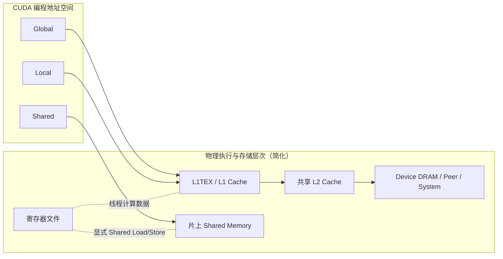

**第一条原则：Global 说的是地址空间，不是一定来自 DRAM 的物理位置。** 一条 Global Load 可以由 L1 或 L2 直接满足，也可以进一步前往本地显存、远端 GPU 显存或系统内存，取决于映射属性、缓存策略和实际命中情况。

Peer 连接常涉及 NVLink（GPU 间高速互连）或 PCIe（连接设备与主机等的总线）；地址落在另一 GPU 并不说明具体走哪条链路。

**第二条原则：命中 L1/L2 会减少下一级的流量，但不会减少该指令原本需要的有效数据字节数。** 分析时要把算法需要多少数据与硬件移动了多少数据分开计算。

---

## 2. 一条 Warp Global Load 到底在做什么

**Coalescing（合并访存）**是硬件把同一 Warp、同一条访存指令中参与 Lane 的地址整理成对若干数据区段的访问，不是修改数组，也不是把 32 条 CPU 式指令事后拼起来。Load 是读，Store 是写。先只研究一个数组的一次读，避免把不同指令、读写两端一起数。

考虑下列逻辑表达式（只是地址模式示例，不是完整 CUDA 程序）：

```cpp
float x = A[base + lane];  // lane = 0...31
```

`float`/FP32 是 32 位浮点数，占 4 字节（B），8 bit = 1B。`base`、`lane` 是元素下标，指针 A 是数组起始地址。**对齐 128B**指起始字节地址是 128 的整数倍，例如 4096；相邻 float 的字节地址便是 4096、4100、4104，而不是相差 1B。假设 `A` 为 FP32 数组，`base` 所对应的字节地址按照 128B 对齐，Warp 32 个 Lane 均活跃。令 `A₀` 为 `A[base]` 的字节地址（不一定是整个数组起点），对 Lane `k` 而言，地址为：

$$
\operatorname{addr}(k) = A_{0} + 4k,\quad k\in[0,31].
$$

先说明后面图表的计量对象：**Sector** 是按 32B 边界划分的数据区段，如 `[0,31]`、`[32,63]`；这 32 个 Lane 读 `[0,127]` 就覆盖 4 个 Sector。**Request** 是提交给某硬件单元的一项访存工作，可以含多个 Lane 的地址，不是“32B 数据”的别名。**Wavefront** 是 L1TEX 内部一轮能处理的工作包，请求过大或过分散便可能拆成多包；不是 Grid 的 Wave 容量，也不是 AMD 的线程执行组。这里尚不按它推算周期。

**SASS** 是 GPU 最终执行的原生机器指令；**SIMT** 表示同一 Warp 的线程用各自数据执行相应指令。**LSU（Load/Store Unit）**是读写单元。当前参与一条指令的 Active Lane 与“尚未退出的 Active Warp”不是同一个活跃概念。

从 CUDA C++ 角度看，每个线程执行了一次 4B 读取；从 SASS/SIMT 角度看，一个 Warp 可以执行一条 Warp 级的 Global Load 指令，其中每个 Active Lane 对应自己的 4B 地址。现代 NCU 的简化 L1TEX LSU 计数模型中，一条执行的 Warp 级 Global/Local SASS 访存指令通常对应一个 L1TEX Request，但这个 Request 可能覆盖多个 Sector，并需要一个或多个 Wavefront 处理。

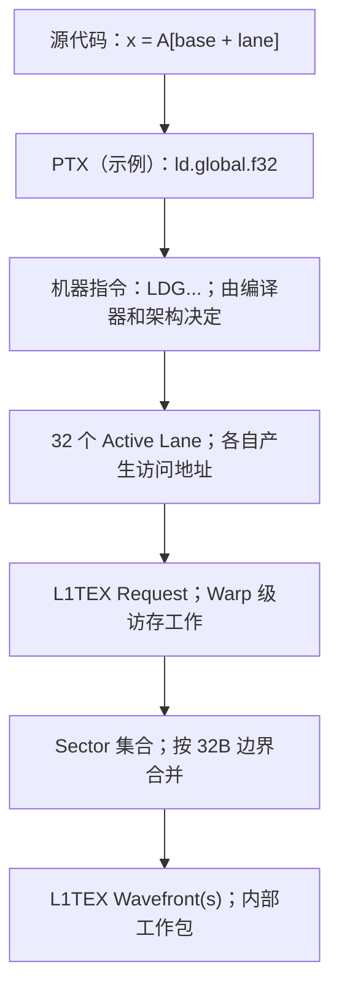

这里需要纠正两种常见说法。其一，不是「32 条完全独立的 GPU 指令执行完，最后被合并成一条 512B 指令」；其二，也不是「一条 Warp Load 指令就对应一次 128B DRAM 访问」。指令、Warp Request、Cache Sector、底层物理传输处于不同的观测层次。**Transaction（事务）**只泛指指定硬件层次的一次处理或传输；有的教材用它指 32B 合并访问，有的指更下层传输，必须注明上下文，不能直接把“一次事务”等同于“一条 Warp 指令/一个 Request”。

### 2.1 五个概念的精确定义

| 概念 | 含义 | 观察层次 | 是否可直接当成字节数 |
|---|---|---|---|
| Instruction | 实际执行的一条 SASS 指令，NCU 中通常按 Warp 执行统计 | 执行指令流 | 不可以 |
| Request | 向某个硬件处理单元提交的一项访存工作 | L1/L2 等单元 | 不可以 |
| Sector | 对齐的 32B 数据块 | Cache / Memory 访问粒度 | 该层可按 `Sectors × 32B` 计算请求流量 |
| Cache Line / Tag | 此 NCU 模型中 Line 含 4 个 Sector；Tag 是标识该 Line 对应哪段地址的元数据 | Cache 地址组织 | 不等于每次传输 128B |
| Wavefront | L1TEX 管线一轮能够处理的工作包，不是线程组 | 内存管线 | 不可以 |

NVIDIA NCU Profiling Guide 将一个 Sector 定义为 32B，对 L1/L2 而言一条 Cache Line 含 4 个 Sector；一个 Request 可以触及多个 Sector，一条 Request 也可能在内部产生多个 Wavefront。它们的数值不应该互相替代。

### 2.2 Sector 地址如何计算

给定 32B 对齐边界，一个字节地址 `a` 所属的 Sector 编号如下。`⌊x⌋` 表示向下取整，例如地址 35 所在编号为 `⌊35/32⌋=1`：

$$
\operatorname{sector}(a)=\left\lfloor \frac{a}{32}\right\rfloor.
$$

若某线程一次读取 `s` 字节，则需要考虑从 `a` 到 `a+s-1` 所触及的**所有** Sector。一个 Warp 的 Sector 集合是其全部 Active Lane 请求范围的并集（符号 `∪`：合在一起但重复编号只算一次）：

$$
\mathcal S=\bigcup_{k\in\mathrm{active}}\bigcup_{a\in[\mathrm{addr}(k),\,\mathrm{addr}(k)+s-1]}\left\{\left\lfloor\frac a{32}\right\rfloor\right\}.
$$

因此：

$$
N_{\mathrm{sector}}=|\mathcal S|,
\qquad B_{\mathrm{sector}}=32N_{\mathrm{sector}}.
$$

`|S|` 表示集合里有多少个不同编号，`N_sector` 单位是个，`B_sector` 单位是 B；式中的地址范围包括首尾字节。这是**对某次 Warp 访问的 Sector 覆盖量**的静态推算；它还不是实际经过 L2、DRAM、NVLink 等后续层次的全部物理流量。

---

## 3. Coalescing：从 Lane 地址精确推算 Sector

**配套实验导航：** [lab05](lab05.md) 的 contiguous 对应 3.1，offset 对应 3.2，strided_read 对应 3.3；strided_write 把同样的跨步地址推导应用于 c 的 Store。N=16/32/33 用于 3.4 的半 Warp、满 Warp 与尾部手算；broadcast 仅让 b 按 Warp 同址读取，对应 3.5。五版每次编译只选择一个，预测与未测观测分栏记录，不把下文假想案例当作实验结果。

### 3.1 情况 A：32 Lane 连续读取 FP32，基址对齐

假设 `A0` 对齐 128B，Lane `k` 读取 `A0+4k`，那么 32 个 Lane 一共读取 128B 连续数据，依次覆盖（下列编号和地址均以 A₀ 为零点，不是机器上的绝对地址）：

- Sector 0：Lane 0–7，地址 `[0,31]`；
- Sector 1：Lane 8–15，地址 `[32,63]`；
- Sector 2：Lane 16–23，地址 `[64,95]`；
- Sector 3：Lane 24–31，地址 `[96,127]`。

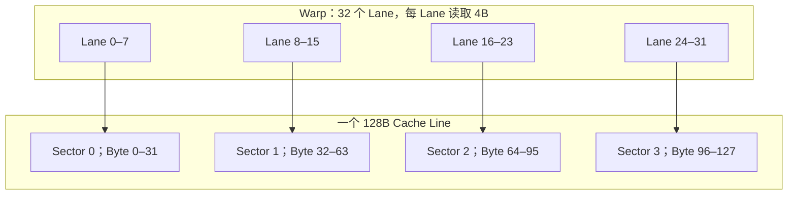

这条 Warp Load 的典型结果是：**1 条 Warp SASS Load → 1 个 L1TEX LSU Request → 4 个 L1 Sector**。是否只使用 1 个 Wavefront，需要检查目标架构和具体访问；对于标准对齐连续读取，它是典型的高效访问模式。这里的管线是能让不同操作分阶段重叠处理的硬件，不代表每个阶段都能接受任意大小的请求。

逻辑有效读取字节数为 `32 × 4 = 128B`，Sector 覆盖量为 `4 × 32 = 128B`，在这一层的简单覆盖效率是 100%。

### 3.2 情况 B：整体地址偏移 4B

现在 Lane `k` 读取 `A0+4+4k`。地址范围从 Byte 4 到 Byte 131，仍然有 128B 有效数据，但是跨过了原本的 128B Cache Line 边界，触及：

$$
\{\mathrm{Sector}\ 0,1,2,3,4\}.
$$

Sector 覆盖量成为 `5 × 32 = 160B`，仅从这次访问的 Sector 覆盖看，有效利用率为：

$$
\eta=128/160=80\%.
$$

`η`（eta）只是本次访问“不同有效字节/覆盖字节”的无单位比值。相较于四个 Sector 的对齐版本，多触及一个 Sector，并且跨越两个 Cache Line。**对齐问题是 32B Sector 边界问题，也是 Cache Line 跨界问题，但这两个概念不能混为同一件事。**

### 3.3 情况 C：Stride 逐渐增大

**Stride（步长）**是相邻 Lane 的元素下标差，例如 stride=2 读元素 0、2、4……，字节地址相差 8B。[配套实现](kernels/vector_access.cuh)的 strided_read 改变两输入的地址间隔，strided_write 则只改变输出的地址间隔；下述 Sector 推导应分别用于 Load 或 Store，不能混用。版本选择与编译期参数见 [lab05](lab05.md)；每次只选一个版本，修改后显式重编。编译期常量也可能影响地址计算及资源用量，当前未经编译，具体 SASS 形式尚未确认。

考虑 `A[base + stride*lane]`，每个 Lane 读取 4B，基址对齐 128B。随着步长变化，若各地址不重叠：

| `stride`（以 FP32 元素计） | 相邻 Lane 地址差 | 覆盖的 32B Sector | Sector 覆盖字节 | 128B 有效数据/覆盖字节 |
|---:|---:|---:|---:|---:|
| 1 | 4B | 4 | 128B | 100% |
| 2 | 8B | 8 | 256B | 50% |
| 4 | 16B | 16 | 512B | 25% |
| 8 | 32B | 32 | 1024B | 12.5% |
| 16 | 64B | 32 | 1024B | 12.5% |
| 32 | 128B | 32 | 1024B | 12.5% |

当相邻 Lane 至少隔 32B 时，每个 Lane 通常触及不同 Sector，单条指令最多会需要 32 个 Sector，而不是随着 Stride 无限增加。但更大的 Stride 会造成更分散的 Cache Line/Tag 访问，可能进一步影响 L1TEX Wavefront、Cache Locality（邻近或重复访问可复用已取数据）、地址翻译（把程序地址映射到物理位置）和内存分区（把地址分给不同硬件通道）的行为。因此**Sector 数相同不代表性能一定相同**。

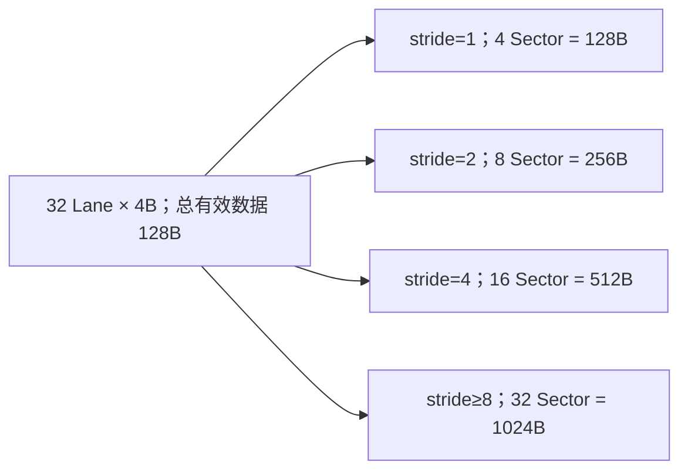

这里的「有效数据/覆盖字节」只是对单次访问的理论 Sector 覆盖效率，**不能直接把 12.5% 解释为 GPU 的最终有效带宽只有峰值的 12.5%**。后续访问可能复用已提取的 Sector 或 Cache Line，其他 Warp 也可能有空间局部性，真实吞吐还取决于硬件与执行调度。

### 3.4 情况 D：只有部分 Lane 活跃

参与当前指令的 Lane 集合也叫 **Active Mask（活跃掩码）**：用每个位置的真假值说明该 Lane 是否参与。`Sectors/Req` 中 Req 是 Request 的缩写；它用同一层统计的 Sector 总数除以 Request 总数，是“每请求平均触及多少区段”，不是命中率。如果只激活 Lane 0–15，并且它们连续读取 4B，那么有效数据量为 64B，触及 2 个 Sector，覆盖效率仍可达到 100%。因此，在评价 `Sectors/Req` 时必须同时考虑 Active Lane 数量和每 Lane 的访问大小。

这也解释了为什么**不能机械地认为 L1 `Sectors/Req` 越小越好**。完整 Warp 32 Lane 各读取一个对齐的 4B 值时，理想 L1 `Sectors/Req` 为 4；但半个 Warp 只有 16 Lane 读取时，理想值可以是 2，两者并不表示后一种执行效率一定更高。

### 3.5 情况 E：Warp 内重复读取相同地址

如果所有 32 个 Lane 都读取同一 FP32 地址，一条 Warp 请求可能只触及一个 Sector。此时「32 个 Lane 各读取 4B」的**逻辑使用量**为 128B，但唯一地址的数据仅为 4B，硬件覆盖的 Sector 为 32B。

这种情形不能沿用上一节的「所有 Lane 都请求不同有效字节」效率公式；广播访问中同一份数据被不同 Lane 复用，本身可能非常高效。正确的分析应把**每 Lane 消费字节数、唯一数据字节数、Sector 覆盖字节数**区分开来。

lab 的 broadcast 读取 `a[i]`、`b[(i/32)*32]` 并写 `c[i]`。在本课 block=256 时，只有 b 按 Warp 同址读取；这不是 Warp 通信或 Shared Memory。满 Warp、对齐标量 4B 的模型下，a/b/c 分别触及 4/1/4 个 Sector；两条 Load 各有一个 Request 时，aggregate load sectors/request 典型为 `(4+1)/2=2.5`，不是 1，也不能将两条 Load 合成一个 Request。完整预测与对照表见 [lab05](lab05.md)；它们是地址模型，不是实测。

### 3.6 情况 F：向量化 Global Load，例如每 Lane 读取 16B

**可选阅读，不扩本课代码：** 五版本 lab 均按每 Lane 标量 4B 建模，不实现 float4 等向量化变体；“向量乘法”与“向量化访存指令”不是同一概念。

**向量化访问**是一次指令让每个 Lane 读取多个相邻元素，例如一次取 4 个 float，而不是一次只取一个。假设每个 Lane 读取相邻、对齐的 16B，共计 `32 × 16 = 512B`，连续覆盖 16 个 Sector。逻辑上只需读取 512B，有可能对应一条 128-bit/线程的 Warp 级访存指令，具体取决于生成的 SASS。

**必须区分两种优化方向：** 连续 Vector Load 可能减少动态访存指令条数和地址计算指令，但并不自动降低所需 Sector 覆盖量。例如原本 4 条 4B Load 覆盖的数据与 1 条 16B Load 覆盖的数据完全相同，理论总有效字节数和最少 Sector 总数也可能完全相同。实际性能变化还取决于寄存器压力、Load/Store Pipeline、对齐约束和指令生成。

NCU 官方文档给出的典型满 Warp 对齐访问最优 L1 `Sectors/Req`：每 Lane 4B → 4；每 Lane 8B → 8；每 Lane 16B → 16。**不同指令数据宽度下，不能直接比较这个比值的绝对大小。**

---

## 4. Request、Sector、Wavefront 为什么是三个不同维度

前面确定了 Lane 地址集合与 Sector 的关系，但还没有解释 L1TEX 为什么有可能在相同 Sector 数下表现出不同的性能。这就需要引入 Wavefront。

### 4.1 Request 负责描述「一次访存工作」

一条执行的 Warp 级 Global/Local Load 指令在典型 LSU 路径中形成一个 L1TEX Request，它携带所有参与 Lane 的地址与访问长度信息。这里的 Request 是向 L1TEX 发出的一个硬件工作项，不应理解为「一定只取一个 32B Segment」或者「一定发送一次 DRAM Transaction」。

### 4.2 Sector 负责描述「需要覆盖的数据块」

Sector 表示访存请求触及的 32B 对齐区域。Coalescing 决定相同 Warp 访问可以合并到多少个 Sector 上。一条 4B/线程 Load 可能触及 4、5、8、16 或 32 个 Sector。

### 4.3 Wavefront 负责描述「L1TEX 一轮处理多少工作」

L1TEX 包含多级内部处理阶段。某个 Request 所需的 Cache Line、Sector、访问空间和其他工作量可能超过一个阶段单次能够处理的范围，此时会形成多个 Wavefront，按硬件管线能力处理。

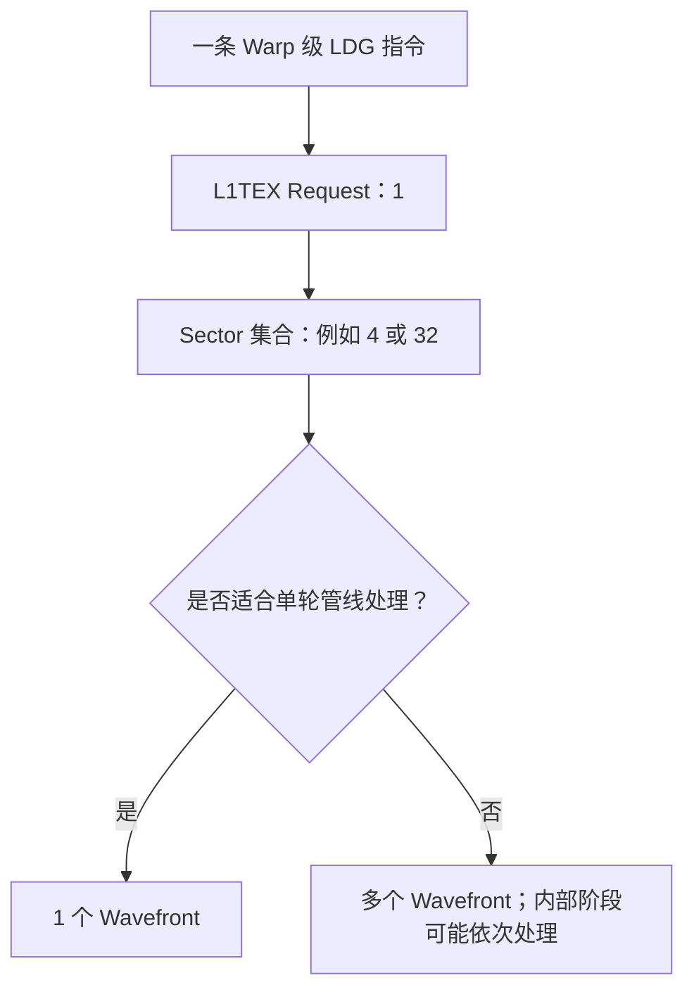

在简化模型中，一个 Wavefront 对应 L1TEX 某个内部处理阶段一个周期可处理的工作包。但要注意：**Wavefront 数量不能直接当作该条 Load 的总执行周期数，更不能直接当成 DRAM 延迟。** L1TEX 多级流水线、缓存命中、请求队列和跨级返回都会影响总延迟。

### 4.4 为什么 `Sectors/Req` 相同，性能仍可能不同

考虑两个访问模式（仅是假想）：

| 模式 | Requests | Sectors | Sectors/Req | Wavefronts | 说明 |
|---|---:|---:|---:|---:|---|
| A | 1 | 4 | 4 | 1 | 集中访问，管线可一次处理 |
| B | 1 | 4 | 4 | 2 | 相同数据覆盖，但内部处理需两轮 |

即使 Sector 总数一样，L1TEX 的处理压力也可能不同。因此读 NCU 时，应结合 `Instructions`、`Requests`、`Sectors`、`Wavefronts` 及其对应的 `% Peak`，而不是只看 Sector 比率。

**总结一句：Sector 衡量数据覆盖，Wavefront 更接近 L1TEX 内部工作/串行化程度，Request 是发给该单元的工作项。**

现在可以连成完整路径图。LDG 是全局读取的机器指令名；返回的数放入寄存器（线程保存中间值的片上存储），所需输入和资源就绪后 Warp 重新 Eligible（可参与发射）。Peer/System 已在第 1 节区分为另一 GPU/主机内存。

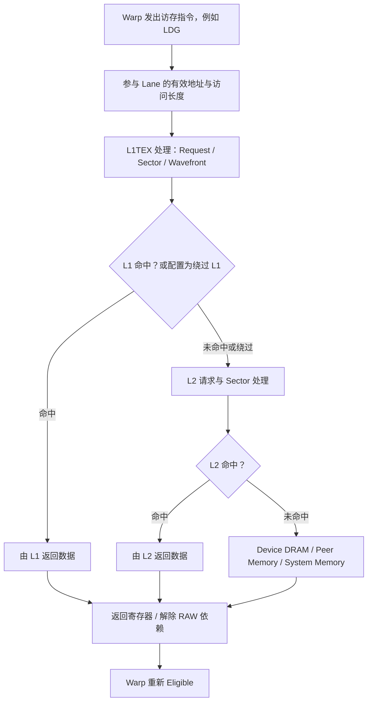

这是一条依赖 Load 的抽象路径，**不是每条 CUDA 内存指令都走完全相同的路径**。例如 Atomic（不可分割的读-改-写）要维护多线程更新同一值的正确性；TMA（Tensor Memory Accelerator，专用的多维异步搬运机制）和 Copy Engine（独立复制引擎）也不等同于普通线程执行 LDG/STG。

---

## 5. L1 Cache、L2 Cache、DRAM：同一个 Load 可以产生完全不同的流量

### 5.1 从 L1 开始：访问了 L1，不等于命中了 L1

NCU 的 L1TEX 表中，`Sectors` 往往表示该层被请求访问的 Sector 数量；`Sector Misses to L2` 反映未在 L1 满足、需要继续向 L2 请求的 Sector 数量。对于一类纯 Global Read 流量，可以先用一个简化模型理解：

$$
N_{\mathrm{L1\ to\ L2\ miss}} \approx N_{\mathrm{L1\ sectors}}\times(1-h_{\mathrm{L1}}).
$$

`h_L1` 是 0–1 之间的命中比例，例如 80% 在计算中写 0.8；`N` 表示 Sector 次数，不是去重后的全部地址数。这里限定同一访问类型和统计窗口，不能拿全缓存命中率去乘其中一类请求。

其中命中率是**Sector Hit Rate**，不是 Cache Line Tag Hit Rate。若 Tag 存在但所需 Sector 数据不存在，相关请求仍可能算作 Miss。

### 5.2 再看 L2：L2 Request 的含义不同于 L1 Request

L1TEX 的一个 Warp Request 可以覆盖多个 128B Cache Line；但在 NCU 的 L2 工作模型中，**一个 L2 Request 最多访问同一条 128B Cache Line 内的 4 个 Sector**。因此，一条 Warp Load 对应一个 L1 Request，并不表示它只产生一个 L2 Request。

这里的 Request 已换成 L2 工作项，分母不再是原来的 Warp 请求。例如，32 Lane 连续读取 128B，基址对齐且全部 L1 Miss，则逻辑上需要向 L2 请求一个 128B Line 内的四个 Sector；如果 32 个 Lane 各访问间隔 128B 的数据，可能需要向 L2 访问 32 个不同的 Cache Line。这两者虽然都对应一个 Warp 级 Global Load 指令，但 L2 的请求构成完全不同。

**不要将 L1 `Sectors/Req = 4` 的理想值直接套到 L2。** L2 的 `Sectors/Req` 使用另一层的 Request 作为分母，受 Cache Line 分布、L1 Miss 组织方式和 L2 请求来源影响，不是单纯的 Warp Coalescing 效率指标。

### 5.3 一个简化的分层流量数值例子

假设某个只读工作负载中，NCU 观察到：

- L1 Read Sectors：160；
- L1 Sector Hit Rate：80%；
- L2 接收到的相关 Read Sectors：32；
- L2 Sector Hit Rate：75%；
- 最终有 8 个 Sector 需要从设备显存读取。

那么可以手算：

$$
B_{\mathrm{requested\ at\ L1}} = 160\times32 = 5120\ \mathrm{B}
$$

$$
B_{\mathrm{requested\ at\ L2}} = 32\times32 = 1024\ \mathrm{B}
$$

$$
B_{\mathrm{read\ from\ device}} \approx 8\times32 = 256\ \mathrm{B}
$$

这个例子仅说明缓存命中如何让后续层次的请求数量减少。真实设备中还可能涉及预取、压缩、ECC、Store/Atomic、其他 Cache Client（共用缓存的硬件请求来源）、传输粒度、Peer/System 路径等因素，**不要将这些等式作为所有工作负载的无条件恒等式**。

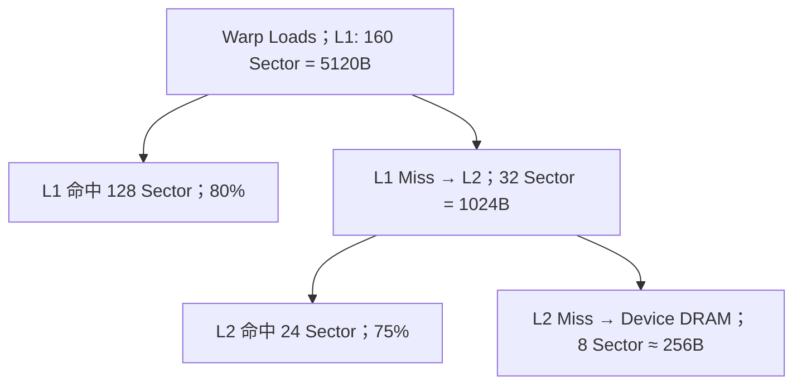

### 5.4 Cache Line、Sector 与数据传输不能混成一回事

在 NCU 教学模型中，L1 和 L2 Cache Line 是 128B，Sector 为 32B。但这并不等于「一旦 L2 Miss 就固定搬运 128B」，也不意味着「L1 Tag Hit 就必然拿到了所有四个 Sector 的数据」。必须分别理解 Line Tag、Sector Validity 与下一级实际请求/传输。

### 5.5 热缓存、冷缓存和 Working Set

**Working Set（工作集）**是某阶段实际会访问的数据集合。**热缓存**指所需数据已由此前访问建立在缓存里，**冷缓存**指相关数据尚未建立或已被清掉；不是 GPU 温度。设某 Kernel 多次重复读取同一段数据。若它的 Working Set 能够有效驻留 L2，则第二次执行可能出现较高 L2 Hit Rate 和较低 DRAM Read；如果数据规模远大于缓存容量，而且没有重用，则 DRAM Traffic 通常更接近这次访问所需的数据量。

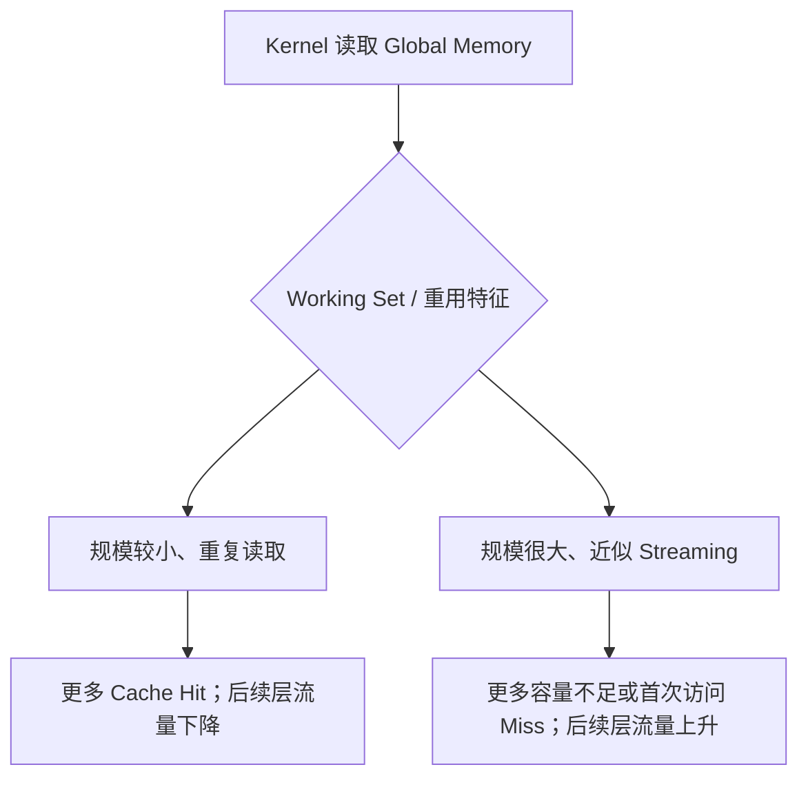

注意实际命中情况还受并发 Kernel、Cache Policy、地址分布、Cache Partition 和 NCU 自身的 Cache Control 影响。第二课讨论过 NCU 的 Replay 与 Cache Flush：若比较冷热缓存效应，必须保持配置一致，并明确热数据是从哪个阶段建立的。

---

## 6. Cache Policy：`.ca`、`.cg`、`.cs` 改变什么，不改变什么

**Cache Policy** 是对缓存层次或保留倾向的选择；驱逐是为新数据腾位置，写回是把修改过的数据送到下一级。PTX 提供 Cache Operator，例如 `ld.global.ca`、`ld.global.cg`、`ld.global.cs`。在 NVIDIA PTX 语义中，这些 Cache Operator 是**性能提示（Performance Hints）**，不会仅凭自身改变程序的内存一致性语义。

| Load Cache Operator | 主要含义 | 典型意图 | 不能直接推导的结论 |
|---|---|---|---|
| `.ca` | 缓存在所有适用层次，通常支持 L1/L2 | 可能重复访问的数据 | 必然命中 L1 |
| `.cg` | 缓存在 Global Level，绕过 L1 数据缓存 | 减少 L1 污染，依赖 L2 | 必然改善 DRAM 带宽 |
| `.cs` | Streaming Cache Hint，偏向较早驱逐 | 一次或少量使用的流式数据 | 不会进入任何缓存 |
| `.lu` | Last-use Hint | 某些最后使用/恢复局部数据的场景 | 必然省去所有 Writeback |
| `.cv` | 特殊的重新取数语义，主要涉及 System Memory 情形 | 特定缓存可见性场景 | 可以替代同步/一致性机制 |

Store 也有 `.wb`、`.cg`、`.cs` 等 Cache Operator，但**不能简单以 Load 的 L1 分配行为推导 Store 路径**。具体 Cache Policy 是否被编译器保留、最终生成哪条 SASS 指令，以及对该 GPU 的实际影响，都应以目标架构上的报告和反汇编为准。

一个典型的分析问题是：对一个大的流式输入，使用绕过或降低 L1 驻留倾向的访问策略后，L1 Cache Traffic 变化了，但 Kernel Duration 没有明显变化。这并不矛盾：如果主要瓶颈在 DRAM 带宽、请求队列、计算或 Launch 尾部效应，而不是 L1 占用，那么 Cache Policy 改变也不必然带来速度提升。

**Memory Fence（内存栅栏）**约束前后内存操作的顺序；Acquire/Release 是在匹配的读写交接中建立“先发布数据、再让接收者使用”的同步语义，需要对象、作用范围等条件配合。它们不是缓存保留策略，应另外研究，不能依赖 `.ca/.cg` 直接实现跨 GPU 同步。

---

## 7. 从理论路径映射到 NCU 的 Memory Workload Analysis

NCU 是 Nsight Compute 单 kernel 分析器；Memory Workload Analysis 是其分层访存报告，GUI 指图形界面。**Throughput（吞吐率）**是单位时间处理量，例如 B/s 或 Request/周期；**% Peak** 是该路径相对于参考持续峰值的比值，不是占 kernel 总时间多少。报告中的 Request、Sector 若按整个 kernel 累计，同一地址被多次访问可多次计数，不是全程地址并集的大小。

NCU Memory Workload Analysis 至少要分成四种观察层次：`Instructions/Requests`、L1TEX Pipeline、L2 Cache 和 Device Memory。建议打开 GUI 中的 Memory Workload Analysis Chart/Tables，而不是只看最上层的 Memory Throughput 一个百分比。

### 7.1 L1/TEX：观察 Warp 地址模式和请求处理压力

| 报告字段 | 物理含义 | 主要用途 | 注意事项 |
|---|---|---|---|
| Instructions | 某访问类型实际执行的 SASS Warp 级指令数 | 判断访存指令工作量 | 不等于线程总数 |
| Requests | 提交到 L1TEX 的访存工作项数 | 识别请求生成量 | 对 Global/Local LSU 常为每条执行指令一个 Request |
| Sectors | 此层被访问的 32B Sector 数 | 分析 Coalescing 与数据覆盖 | 不等于实际 DRAM 流量 |
| Sectors/Req | 每个 Request 的平均 Sector 数 | 同访问宽度、同 Active Mask 下评估访问分散度 | 满 Warp FP32 对齐连续理想值一般为 4，不是 1 |
| Wavefronts | L1TEX 内部处理工作包数 | 分析管线处理/串行化压力 | 不等于 DRAM 事务数 |
| Hit Rate | L1 Sector 命中率 | 分析数据复用 | 不是 Tag Hit Rate |
| Sector Misses to L2 | 向 L2 下发的未命中 Sector | 分析下一级流量来源 | 不一定全部到 DRAM |
| Returns to SM / % Peak | 返回到 SM 的数据路径压力 | 分析读返回带宽限制 | 高值可能与分散读取有关 |

NCU 官方文档列出了现代 GPU 满 Warp 4B、8B、16B Load 的理想 L1 `Sectors/Req` 分别为 4、8、16。这是一个非常重要的归因基准。

### 7.2 L2：观察命中、Miss 去向与 L2 处理量

| 报告字段 | 核心解释 | 主要疑问 |
|---|---|---|
| Requests / Sectors | L2 接收到的访问及其 32B Sector 覆盖 | L1 未命中的访问如何分解到 L2？ |
| Sectors/Req | L2 每个 Request 携带的 Sector 数 | 同一条 Cache Line 上聚合程度如何？ |
| Hit Rate | L2 Sector Hit Rate | 有多少数据能在 L2 满足？ |
| Bytes / Throughput | L2 层请求字节量与吞吐 | 是否受 L2 层性能限制？ |
| Sector Misses to Device | L2 Miss 进一步请求本地设备内存 | 本地 HBM/GDDR 读需求多少？ |
| Sector Misses to Peer | L2 Miss 进一步请求其他 GPU Memory | 是否存在 P2P 读路径？ |
| Sector Misses to System | L2 Miss 进一步请求系统内存 | 是否正在跨 PCIe/系统路径访问？ |

**Sector Misses to Peer 不等于 NVLink 端到端字节数，Sector Misses to System 不等于 PCIe 链路完整流量。** 需要结合地址映射、GPU 拓扑、NVLink/PCIe 硬件计数器和实际传输路径确认。

### 7.3 DRAM：观察真正的设备显存请求

| 报告字段 | 解释 | 应用 |
|---|---|---|
| Read/Write Bytes | L2 和本地 Device Memory 之间的读写流量 | 判断是否大量访问显存 |
| Throughput | 该层读写数据量相对时间的速率 | 与参考带宽上界比较 |
| % Peak | 该层相对持续峰值的利用程度 | 判断显存路径是否接近饱和 |
| Sectors | 该层请求的 Sector 数 | 估计访存量和传输分布 |

DRAM Throughput 低不必然表示「内存不重要」，因为 Memory Latency 和 Memory Throughput 是两个不同约束。少量串行依赖读取可能一直等待 DRAM，但总流量很低。

### 7.4 Throughput 高低必须结合 Layer 判断

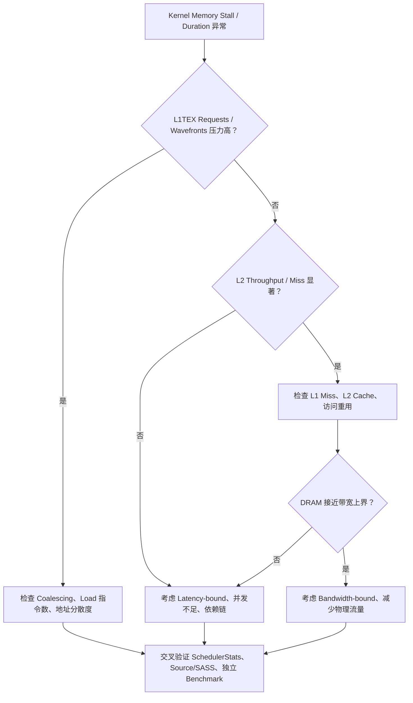

这只是诊断顺序，不是机械阈值分类器。不同层可以同时处于压力状态；例如不合并的 Global Load 既会提高 L1TEX 处理压力，也可能制造更多 L2/DRAM 请求。

---

## 8. 为什么 Memory Bottleneck 至少有四种截然不同的机制

### 8.1 访问效率低（Uncoalesced Access）

在相同有效字节数下，分散读取会触及更多 Sector 和 Cache Line，并可能制造更多 Wavefront 和下一级 Traffic。这是一种「为了取到真正有用的数据，硬件做了过多工作」的问题。

典型证据组合：相同访问宽度与 Active Mask 下，L1 `Sectors/Req` 高于理想值；实际 L1/L2 Sector 数超过算法最少需求；访存地址具有明显 Stride 或散布模式；布局优化后 Sector/Request 和执行时间同步改善。

### 8.2 存储带宽饱和（Bandwidth-bound）

**带宽**是以字节/时间计的吞吐，**饱和**指在给定访问模式和运行条件下已接近该路径能持续提供的速率。假设工作负载必须实际读取大量显存数据，DRAM Throughput 接近平台可持续带宽，而且工作规模增加时执行时间近似按数据量线性增长，这更接近真正的带宽限制。

单位采用十进制：`GB=10⁹ B`，`TB=10¹² B`，`ms=10⁻³ s`；`B/(B/s)=s`。如果算法需要读取 4 GB、写入 2 GB，而此运行条件下合理的持续带宽上界为 1 TB/s，则仅凭显存传输给出的理想时间下界为：

$$
T_{\min,\mathrm{DRAM}} \geq \frac{6\ \mathrm{GB}}{1000\ \mathrm{GB/s}} = 6\ \mathrm{ms}.
$$

这里没有包含计算、请求处理、启动、同步及其他路径开销；也需确认这 6 GB 是**实际需要经过 DRAM 的数据量**，不能直接拿逻辑字节替代。

### 8.3 访问延迟主导（Latency-bound）

Latency（延迟）是一次操作从指定起点到结果可用需等待多久，与每秒处理多少字节的带宽不同。例如读取只返回 4B，仍可能要等很久。

**Pointer Chasing（指针追逐）**是上一次读回的值决定下一次访问地址，例如 `p=next[p]`，在得到 p 前无法提前知道下一步去哪。一个只有少数 Warp 的 Pointer Chasing Kernel 可能每次都必须等待前一个 Global Load 的结果才能得到下一个地址：

```text
p0 -> load(p0) -> p1 -> load(p1) -> p2 -> ...
```

即使每次只加载 4B、总显存流量很低，也会因为串行依赖链和缺乏并行访存请求，使执行时间被每次访问的延迟累积主导。此时低 DRAM Throughput 与高 Long Scoreboard 可以同时出现，**但不能因此称为 DRAM 带宽饱和**。

### 8.4 请求/管线吞吐限制（Instruction or Pipeline Throughput-bound）

即使数据实际都命中 L1/L2，访存指令发射量、L1TEX 请求处理量、Wavefront 量或数据返回通路，也可能成为瓶颈。此时 DRAM 带宽可能很低，但 L1TEX/L2 某个环节已接近可持续吞吐限制。

**ILP** 是同一 Warp 指令流里可交错的独立操作，**TLP** 是其他 Warp 提供独立工作来填补等待；两者可增加在途请求（已发出、未完成），但不保证提高已饱和路径的带宽。SoA 是把不同字段分成独立数组，Tile 是一次处理的数据小块，均是按实际地址推导的布局选择，不是自动加速标记。

典型证据：L1TEX Wavefront `% Peak` 很高、LG Throttle 与相关队列压力增加；减少无必要的 Load 指令、提高每条指令有效访问字节或优化地址分布后，吞吐改善而 DRAM 流量几乎不变。

| 瓶颈类型 | 典型现象 | 更有判别力的交叉证据 | 常见优化方向 |
|---|---|---|---|
| Coalescing 效率低 | L1 Sectors/Req 偏高 | 同访问宽度下 Sector/Request 与地址模式一致 | 线程映射、SoA/Tile、布局 |
| DRAM Bandwidth | DRAM Throughput 接近合理峰值 | 实际 DRAM Bytes、规模线性关系 | 减少下层 Bytes、复用、压缩 |
| Memory Latency | Long Scoreboard 高，DRAM Throughput 不高 | 依赖链、低 Eligible Warp、少量并发 Miss | 增强 ILP/TLP、预取、并行请求 |
| L1TEX/L2 Pipeline | 请求或 Wavefront 单元接近饱和 | Wavefront/Req、吞吐分解、Throttle | 减少请求数、合理向量化、地址布局 |

---

## 9. 与第四课 Warp Stall 的关系：如何避免错判

第四课中研究了 Long Scoreboard 和 LG Throttle，但现在可以从存储层次上进一步解释它们。Producer 是产生结果的指令，Consumer 是用该结果的指令。下一条指令的输入与资源就绪时叫 Eligible；Stall 是条件未满足而不能发射。Barrier 是线程到齐的会合，Membar 关联内存顺序约束；图中把它们列为其他等待，不把所有原因都强归给数据读取。

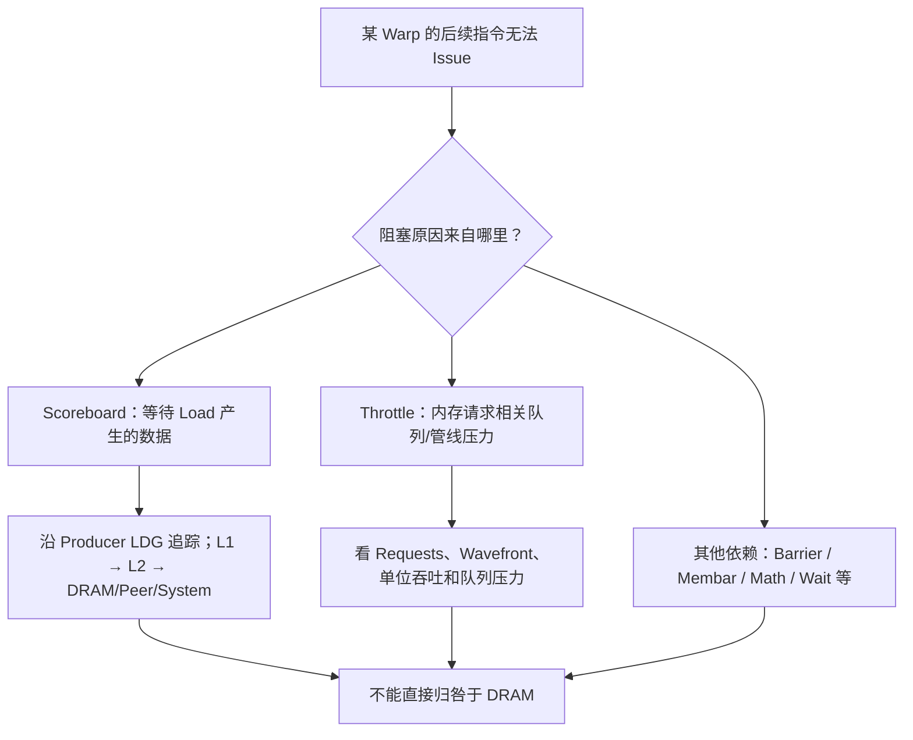

**Long Scoreboard** 的基本含义是 Warp 因 L1TEX 路径相关操作的结果尚未准备好而不能执行下一条依赖指令。典型 Producer 是某种 Global/Local/Texture Load，但等待的根因可以是 L1/L2/远端内存返回，也可以与运行环境、依赖链和并发度有关。它不能直接告诉你数据一定来自 DRAM。

**LG Throttle** 更强调 Global/Local Memory 访问相关队列没有足够容量或请求处理受限的情形，通常应和访存指令工作量、L1TEX 请求量、Wavefront/Req 以及管线压力一起调查；它不是某个百分比对应的「显存带宽上限」。

**Not Selected** 则表示某 Warp 已经 Eligible，但这一周期没有被 Scheduler 选中。它可能意味着存在足够的其他 Eligible Warps，这是合理的延迟隐藏过程，不应将它一律视为负面现象。

因此，正确的因果推理应是：先确认执行时间是否真的受限，再确定主要等待/吞吐问题来自哪个环节，随后用 Source/SASS 找到具体访存指令和地址模式，最后由对照实验验证。

---

## 10. 五个假想 NCU 案例：训练性能归因而不是看单一百分比

Baseline 是保留的对照版本；Duration 是执行时间，`MB=10⁶ B`，Sample 百分比表示该项占所选样本集合的比例，不是 kernel 时间份额。以下数字均为**教学用假想报告**，不对应真实 GPU 实测。

### 案例 A：Stride Load 造成 Sector 放大

| 指标 | Baseline | 改进布局后 |
|---|---:|---:|
| 每 Lane Load | 4B | 4B |
| L1 Sectors/Req | 32 | 4 |
| L1 Wavefronts/Req | 4 | 1 |
| DRAM Read Bytes | 1024 MB | 160 MB |
| Kernel Duration | 2.1 ms | 0.65 ms |

**可支持的结论：** 改进访问模式后，同一 Warp 请求的 Sector 覆盖明显下降，内部处理工作量及下层显存流量减少，执行时间同步缩短；这支持「原始分散访存引入额外硬件工作」的判断。

**仍需确认：** 是否保持相同有效数据量？是否引入缓存复用差异？`DRAM Read Bytes` 并不必然严格按 8 倍下降，因为跨 Warp 重用和缓存可能抵消部分放大。

### 案例 B：高 Long Scoreboard，但 DRAM 带宽并未饱和

| 指标 | 假想观测 |
|---|---:|
| Long Scoreboard Samples | 65% |
| DRAM Throughput | 12% Peak |
| Eligible Warps/Scheduler | 0.3 |
| L2 Hit Rate | 10% |
| 地址依赖 | 每次 Load 依赖前次结果 |

**较强的假设：** 内存延迟和串行依赖限制了并行度，而不是显存总吞吐带宽不足。可进一步分析 ILP/TLP、数据预取或重组算法以创造独立请求。

**不能得出的结论：** 「DRAM 只有 12%，所以内存不是瓶颈」或者「Long Scoreboard 占 65%，就把 DRAM 带宽提高 65%」。

### 案例 C：L2 Hit Rate 很高，但 Kernel 依然慢

| 指标 | 假想观测 |
|---|---:|
| L2 Hit Rate | 96% |
| DRAM Throughput | 8% Peak |
| L1TEX Wavefront % Peak | 92% |
| LG Throttle | 偏高 |
| Kernel Duration | 1.5 ms |

**可能原因：** 访问已由 L2 满足，主导限制变成 L1TEX 请求/处理能力、数据返回路径或指令数量，而不是 DRAM。下一步应分析 Global Load Instructions、Requests、Wavefronts/Req，以及 `Returns to SM` 等指标。

### 案例 D：DRAM Throughput 很高，但未必需要进一步合并访存

| 指标 | 假想观测 |
|---|---:|
| L1 Sectors/Req | 4（4B/线程、满 Warp） |
| L2 Hit Rate | 低（大工作集、一次性流式访问） |
| DRAM Throughput | 92% Peak |
| Kernel Duration | 接近根据实际 DRAM 字节量估计的传输下界 |

**可能结论：** 访存已较好合并，DRAM 接近可持续带宽上界，继续微调 Load 对齐可能收益有限。更有价值的方向是减少必须经过 DRAM 的字节数、引入跨 Kernel 复用、改变算法或压缩数据。

### 案例 E：跨 GPU P2P Load 的错判

| 指标 | 假想观测 |
|---|---:|
| L2 Sector Misses to Peer | 很高 |
| 本地 DRAM Throughput | 较低 |
| Long Scoreboard | 很高 |
| NVLink 链路真实利用率 | 未测量 |

**可以怀疑：** 数据主要从远端 GPU 显存返回，等待路径包含 P2P/互联及远端响应。

**不能认定：** 「NVLink 已经达到峰值」或「本地 DRAM 带宽低，所以没有通信带宽瓶颈」。必须继续结合拓扑（设备与链路如何连接）、Peer Memory Aperture（地址所映射的远端内存范围）、NVLink/PCIe 链路计数器、同步关系和 NSYS（Nsight Systems，观察系统级执行时间线的工具）时间线。

---

## 11. 一个完整的数值推演：同样的 Copy Kernel，为什么表现差异很大

本节换用二进制容量单位：`KiB=2¹⁰ B`，`MiB=2²⁰ B`，不要与 `MB=10⁶ B` 混用；`TB/s` 仍按十进制。假设一个仅执行 `C[i] = A[i]` 的 Kernel，输入和输出各为 256 MiB，且本次计算没有跨 Kernel 重用，要求最终写入结果。其**逻辑数据量**为：

$$
B_{\mathrm{logical}} = 256\ \mathrm{MiB\ read}+256\ \mathrm{MiB\ write}=512\ \mathrm{MiB}.
$$

如果访问是连续、对齐的、满 Warp FP32 Load/Store，理论上可以使用最少的 Sector 覆盖量。若输入工作集在 L2 中完全不命中，则本地 DRAM 读量可能接近输入字节数；写回 DRAM 的实际时序与总量还依赖 Store Cache Policy、写回路径和计数方式。

假设由独立带宽基准得到该平台在类似访问模式下的持续吞吐为 1.0 TB/s，而分析报告显示这次 Copy 的读写合计 Device Memory 流量约 512 MiB。仅以显存传输量估算：

$$
T_{\mathrm{DRAM\ lower\ bound}} \approx \frac{512\times2^{20}}{10^{12}}\ \mathrm s \approx 0.537\ \mathrm{ms}.
$$

如果未受 NCU 扰动的实际测量为 0.60 ms，那么它已经接近该模型的显存传输下界；如果实际为 3.0 ms，则至少要调查是否是 Coalescing、L1TEX/L2 瓶颈、DRAM 未达到持续峰值、Occupancy/ILP 过低或其他固定开销。

现在再考虑一个明显不合并的 Load：同样 `32 × 4B` 有效数据，在 Warp 级需要触及 32 个 Sector 而不是 4 个。理论单指令请求数据覆盖量可以从 128B 上升至 1024B；但**总 DRAM Bytes 未必精确增加 8 倍**，因为不同 Warp 之间可以复用数据、Cache 可能部分命中，Store 和数据排列也可能改变。正确做法是先用 Coalescing 模型给出预测，再用 L1/L2/DRAM 各层的指标验证究竟在哪一层产生了放大。

这种做法体现了性能建模的层次性：

$$
\text{算法必需字节} \ne \text{L1 请求字节} \ne \text{L2 请求字节} \ne \text{DRAM 实际字节}.
$$

以上四个量分别回答不同的问题，不能相互替代。

---

## 12. NCU Report 阅读顺序：从证据链而不是「最高百分比」出发

推荐按照如下顺序阅读一份访存型 Kernel 的报告。**Replay（重放）**是工具为采不同指标再次执行工作，可能改变缓存或协作者时序；SpeedOfLight 是整体参考峰值吞吐概览；SchedulerStats 看驻留/就绪/发射，WarpStateStats 看等待，Source 把计数或样本关联到源码/SASS。Benchmark 是分析器之外的独立性能测量。下例 `μs=10⁻⁶ s`。

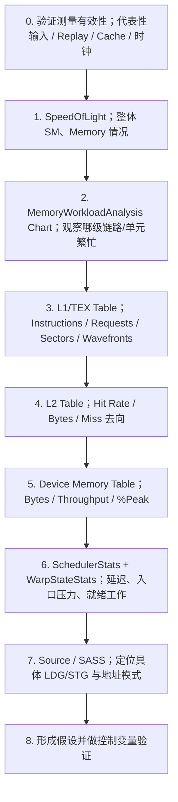

对于极短 Kernel 或系统级通信流程，第一步尤其重要：如果 Replay 改变了 Cache、并发执行或外部同步语义，那么即使 NCU 某些指标内部自洽，也未必对应原始应用的瓶颈。

### 如何阅读 Memory Chart 中的颜色和百分比

Memory Chart 展示数据流路径和各通道利用程度。颜色变深或者 `% Peak` 接近 100% 表示**该路径相对于其性能参考上界的利用程度较高**；它不是「这条路径承载了多少百分比的 Kernel 时间」，也不直接证明它是唯一瓶颈。

### 一个最小「诊断结论模板」

假设你最终观察到：

1. 有效数据规模和 Kernel 功能保持一致；
2. Baseline 的 L1 `Sectors/Req=16`，理想为 4；
3. 修改线程映射后变为 4；
4. L1 Wavefront 总数和 L2 Read Traffic 下降；
5. 独立 Benchmark 中 Kernel Duration 从 80 μs 下降到 48 μs。

那么可以写出较强的结论：**原始线程映射造成 Warp 地址分散，提升了 L1TEX Sector 覆盖和下层访存工作量；修改映射后访存合并改善，硬件请求和真实执行时间同步下降，支持该优化的因果归因。**

反过来，如果 Sector 下降但时间不变，应当明确写出「数据访问效率改善，但并未改善当前的主导性能限制」，而不是强行宣布优化成功。

---

## 13. 专门面向 GPU 通信 Kernel 的认识边界

对 NCCL、DeepEP、NVSHMEM 和 P2P 来说，本课内容首先用于分析**GPU SM 发起的内存指令**，例如 Packet/Token Pack、Gather/Scatter、Reduce、远端指针读取等。这里 Pack/Unpack 是打包/拆包，Gather/Scatter 是按索引收集/分发，Reduce 是把多个输入合成一个结果。通信库 NCCL、DeepEP、NVSHMEM 的局部数据处理可用上述模型，但不要求初学者已经会它们的接口。下列 NIC 是网卡，DMA 是由硬件直接搬运数据，RDMA 是通过网络直接访问远端内存；Polling 是反复检查标志等待外部进度。很多通信工作还涉及：

- 远端 GPU 写入数据的时序；
- NVLink/PCIe 的链路仲裁、协议开销和拓扑；
- NIC DMA、RDMA Read/Write、GPU-initiated Network；
- Polling、Fence、Acquire/Release 与设备可见性；
- TMA、Copy Engine 等不完全由普通 `LDG/STG` 指令表达的数据搬运路径。

因此不能只观察本地 `dram__bytes_read.sum` 就声称测到了 NVLink 的有效通信带宽，也不能通过某个远端读取的 Long Scoreboard 直接推出远端物理链路已经饱和。

**推荐使用两套互补的分析边界：**

1. **NCU 的 Kernel 局部边界**：分析 SASS Load/Store、L1TEX 处理、L2 Traffic、SM 指令与 Warp Stall。
2. **系统通信边界**：使用 NSYS 时间线、GPU/NVLink/PCIe 链路计数器、端到端吞吐和跨 Rank（分布式参与进程编号）同步信息补充真实互联行为。

尤其是跨 GPU Polling Kernel，必须先确认 NCU Replay 没有使外部生产者/消费者不同步，否则采集到的等待分布可能只是 Profiling 引入的现象。

---

## 14. 十个高频误判：读 Memory Metrics 时必须主动排除

| 误判 | 为什么错 | 更合理的说法 |
|---|---|---|
| 32 个线程各 Load 4B，所以一定产生 32 次 DRAM Transaction | 忽略 Warp Coalescing、Cache | 先推算一条 Warp 指令需要多少 Sector，再看各级命中 |
| 满 Warp FP32 Load 的 L1 Sectors/Req 理想值是 1 | 忽略 32B Sector 粒度 | 连续对齐 32×4B 的典型值是 4 |
| Sectors/Req 越低一定越好 | 忽略访问宽度、Active Mask、广播 | 相同参与线程和数据宽度下再比较 |
| Cache Line 是 128B，所以每次都传输 128B | 混淆 Tag/Line 与 Sector | 32B Sector 是重要的数据访问粒度 |
| Request、Sector 和 Wavefront 是一回事 | 它们衡量工作项、覆盖数据和管线工作 | 需要分别阅读与归因 |
| L2 Hit Rate 越高，Kernel 就一定越快 | 忽略工作集、指令与通路瓶颈 | Hit Rate 要结合真实时间和吞吐 |
| DRAM Throughput 低就不是 Memory-bound | 忽略延迟和其他内存管线 | 可能是 Latency-bound 或请求吞吐受限 |
| Long Scoreboard 很高等于 DRAM 带宽不足 | 它是依赖等待状态，不是带宽计数 | 检查 ILP/TLP、Cache 与物理 Traffic |
| `.cg` 一定比 `.ca` 快 | Cache Policy 是提示，场景敏感 | 比较具体重用、L1 压力和真实时间 |
| P2P 数据流量等于本地 `dram__bytes` | 可能来自 Peer/System 或异步 Engine | 分离 Local Device、Peer、System 和链路指标 |

---

## 15. 自测题：建议先独立推算，再读参考答案

### Q1. 32 Lane 每人读取对齐的一个 FP32，理论触及几个 Sector？

**答案：** 总共 128B 连续数据，触及 4 个 32B Sector。在典型 L1TEX LSU 模型中，一条 Warp 级 SASS Load 对应 1 个 L1 Request，理论 L1 `Sectors/Req=4`。

### Q2. 如果这 32 Lane 整体偏移 4B，Sector 个数是多少？

**答案：** 数据区间从 Byte 4 到 Byte 131，触及 Sector 0–4 共 5 个，覆盖 160B，有效读取 128B，对本次访问的 Sector 覆盖效率为 80%。

### Q3. 32 Lane 相邻地址相差 16B，且每 Lane 只读 4B，Sector 数是多少？

**答案：** 16 个 Sector，覆盖 512B，128B 不重叠有效数据，覆盖效率 25%。前提是按题设对齐、所有 Lane 活跃、没有跨边界的额外访问。

### Q4. `Sectors/Req=2` 为什么不一定优于 `Sectors/Req=4`？

**答案：** 前者可能只有 16 个 Lane 参与 4B 连续读取，或者存在重复地址；后者可能是完整 32 Lane 的理想 FP32 连续访问。没有访问宽度、Active Mask 和唯一数据量，不能跨场景评价。

### Q5. 一个 Warp Request 与一个 L2 Request 是一回事吗？

**答案：** 不是。一个 L1TEX Request 可以触及多个 Cache Line；L2 Request 在 NCU 的对应模型中通常针对一条 Cache Line，最多覆盖其中四个 Sector。所以一条 Warp Load 可能产生多个 L2 Request。

### Q6. 32 个 Sector 和 4 个 Wavefront 能否直接得出四个 DRAM 周期？

**答案：** 不能。Sector 是数据块数量，Wavefront 是 L1TEX 内部处理包；它们不能直接替代完整 Load 延迟或 DRAM 周期。

### Q7. L1 Hit Rate 高而 DRAM Bytes 低，为什么仍可能很慢？

**答案：** 因为瓶颈可能在访存指令生成、L1TEX Wavefront 吞吐、SM 返回数据通路、同步或依赖链。命中率不是最终执行时间。

### Q8. 为什么流式 Copy 可能出现很低的 L2 Hit Rate？

**答案：** 一次性读取、没有复用的大工作集本来就可能大量 L2 Miss；如果 DRAM 带宽已接近持续峰值，低命中率不必然意味着需要改善缓存。

### Q9. Long Scoreboard 高、DRAM Throughput 低，首先该区分什么？

**答案：** 需要区分内存访问延迟与吞吐饱和，并分析串行指针依赖、Eligible Warps、访存并发度、Cache Miss 和外部同步，而不是直接把低吞吐归因于带宽瓶颈。

### Q10. GPU0 直接读取 GPU1 的显存，GPU0 的本地 DRAM Throughput 能直接衡量 NVLink 带宽吗？

**答案：** 不能。要分析 Peer Memory 的下层路径、NVLink/PCIe 计数器、实际拓扑和端到端传输量。GPU0 的本地设备内存带宽与远端 P2P 流量不是同一指标。

### Q11. 一条 `ld.global.v4.u32` 比四条标量 Load 一定少四倍显存流量吗？

**答案：** 不一定。若访问了同一批数据，向量化主要可能减少指令数量和请求生成工作；理论必需数据量和 Sector 覆盖总量不一定下降。还要考虑对齐、SASS 指令、寄存器压力和缓存。

### Q12. 看到 Sector 改善了，却没有明显性能提升，应该怎么写结论？

**答案：** 「访问合并效率改善，但未确认其为当前主导性能限制」。后续要检查其他硬件层次、执行时间误差、不同输入规模和独立 Benchmark。

---

## 16. 本课验收标准与下一课衔接

完成第五课后，至少应达到以下标准：

1. 面对一个 Warp 的地址函数，能直接手算覆盖哪些 32B Sector，并解释 Cache Line 跨界、Partial Mask、Stride、重复地址的影响。
2. 能清楚区分 SASS Instruction、L1 Request、L1 Sector、L1 Wavefront、L2 Request、DRAM Byte，不把这些数值相互替代。
3. 能用独立的逻辑字节数、L1/L2 请求字节数与 DRAM 实际字节数分析访存效率。
4. 能区分 Coalescing 低效、Memory Latency、DRAM Bandwidth 和 L1TEX/L2 Pipeline Saturation 四种不同瓶颈。
5. 能结合 WarpStateStats、SchedulerStats 和 MemoryWorkloadAnalysis 解释 Long Scoreboard 与 LG Throttle 的可能来源。
6. 遇到 P2P/NVLink/通信 Kernel 时，能够识别本地 NCU 硬件计数器的观测边界，并提出跨层验证需求。

下一课将研究 **Shared Memory、Bank Conflict、Broadcast/Multicast、Vectorized Shared Memory Access、Padding 和 Transpose**。Global Memory 的核心问题是「Warp 的地址被合并到多少 Sector、最终走到了哪层缓存」；Shared Memory 的核心问题则是「多个 Lane 的访问如何映射到 Shared Memory Bank（可并行服务的存储分组），同组不同数据位置是否需分轮服务」。它们都由线程地址分布决定，但底层限制机制和 NCU 计数方式不同。

---

## 参考资料与阅读顺序

1. **NVIDIA Nsight Compute Profiling Guide**：先读 *Hardware Model / Quantities* 中的 `instruction/request/sector/wavefront`，再读 *Memory Chart* 和 *Memory Tables* 中的 `L1/TEX Cache`、`L2 Cache`、`Device Memory`。  
   <https://docs.nvidia.com/nsight-compute/ProfilingGuide/index.html>
2. **NVIDIA Nsight Compute Compute Triage Guide**：重点看 *Memory Workload Analysis*、*Memory Access Patterns and Transaction Efficiency*、*Timing and Collection Validity*。  
   <https://docs.nvidia.com/nsight-compute/ComputeTriage/>
3. **CUDA C++ Best Practices Guide**：重点看 *Coalesced Access to Global Memory*，官方直接用 32B Transaction 解释连续、未对齐和 Stride 访问。  
   <https://docs.nvidia.com/cuda/cuda-c-best-practices-guide/index.html>
4. **PTX ISA**：重点看 *Cache Operators* 中的 `.ca/.cg/.cs`，理解 Cache Hint 与 Memory Ordering 是两类不同的语义。  
   <https://docs.nvidia.com/cuda/parallel-thread-execution/>
5. 结合你提供的 B 站课程，本课建议复习：[合并访存](https://www.bilibili.com/video/BV1NYCtYTEFH/) → [缓存与访存流程](https://www.bilibili.com/video/BV1dM68YnEtH/)；[合并访存与 Transpose](https://www.bilibili.com/video/BV1fB6zYDEbg/)留到第 6 课。指标口径以 NVIDIA 官方文档为准。

**本课一句话总结：不要从「Global Load 很慢」直接跳到「显存带宽不够」；必须先看 Lane 地址，继而看 L1 Request/Sector/Wavefront，再看 L2 命中与 Miss 去向，最后判断 DRAM/互联与 Warp 依赖哪个环节真正限制了执行时间。**
