# Nsight Compute（NCU）系统学习 · 第六课：Shared Memory、Bank Conflict、Broadcast、Padding、Transpose 与性能归因

> 配套实验：[lab06.md](lab06.md) · [入口源码](kernels/main.cu) · [脚本入口](commands/)（源码与实验设计已提供；历史默认入口仅有 compile-only 记录，不代表改后源码或新脚本，见[旧编译日志](log/legacy_commands/compile/source_check.log)，尚未运行验证，无性能实测）。

> 所属系列：[NCU 系统学习与 GPU Kernel 性能分析实验指南](../ncu_systematic_learning_guide.md)  
> 前置课程：[第一课：Profiling 基本原理](../01_ncu_basics/lec01.md) · [第二课：Replay 与可复现性](../02_replay_and_measurement/lec02.md) · [第三课：SM/SMSP 与 Occupancy](../03_occupancy/lec03.md) · [第四课：Warp Scheduler 与 Scoreboard](../04_warp_scheduling/lec04.md) · [第五课：Global Memory、Coalescing 与 Cache](../05_global_memory/lec05.md)  
> 对应阶段：第 6 周，Memory Hierarchy 的第二部分；下一课进入 Compute Pipeline、Instruction Mix、Throughput 与 Roofline。  
> 学习形式：**硬件理论、Mermaid 原理图、地址与 Bank 映射手算、代码片段式示例、假想 NCU 报告、归因练习和自测题。可运行 CUDA 程序见页首实验入口；底层命令分步列在 lab 中，独立入口为 `commands/compile.sh`、`commands/run.sh`、`commands/profile.sh`，日志位于本课 `log/`。**  
> 架构边界：主要采用现代 NVIDIA GPU 的 **32 Banks、每 Bank 4B（32-bit Word）** 的教学模型；Warp 为 32 Lane。不同架构、不同指令、宽访问拆分、L1TEX 数据通道、异步复制及 TMA 的行为可能不同，不能把下文教学模型当成所有架构的逐周期实现。  
> 更新日期：2026-11-08（概念依赖与可读性修订）。文内「假想」计数和性能数据仅用于推导，不是实测结果。

---

## 0. 课程定位：Shared Memory 快，不代表任何访问都快

先回顾执行对象：kernel 是 GPU 上许多线程执行的函数；线程组成 Block（块，也叫 CTA），本次所有块组成 Grid。SM 是执行块的硬件单元，块内每 32 个线程组成 Warp，其中的位置叫 Lane。**Load/Store** 分别是读取/写入；第五课用“线程地址 → 硬件服务工作 → 各级实际流量”分析 Global Memory（全局地址空间），本课把同一推理方法用于片上共享数据。第六课切换到 SM 内部的另一个数据路径：**Shared Memory 并不是一种“自动帮你缓存 Global Memory”的硬件缓存，而是程序显式管理、供一个 Thread Block 内的线程协作使用的片上存储空间**。它通常比访问远端 L2/DRAM 的延迟低、带宽高，但需要程序负责放入数据、确保同步正确，并设计合适的访问布局。

本课要回答五个连续问题：

1. 一个 Warp 的 32 个 Lane 读取 Shared Memory 时，硬件为什么能并行服务这些请求？
2. 为什么“同一个 Bank”有时会冲突，有时又能 Broadcast？
3. 为什么 `[32][32]` 矩阵按列访问非常慢，而 `[32][33]` 的 Padding 能消除冲突？
4. NCU 中 `Instructions`、`Requests`、`Wavefronts`、`Bank Conflicts`、`Ideal/Excessive Wavefronts` 分别表示什么？
5. 即使 NCU 显示大量 Bank Conflict，为什么也不能直接宣布“消除 Conflict 就能让 Kernel 加速 32 倍”？

本课先从数据交换建立必要机制，第 4 节再回看完整服务路径图，不要求先从英文指标名猜原因。目标不是记住“多加一列”，而是解释它改变了哪些地址和服务工作，以及为什么局部改善不一定让总时间下降。

---

## 1. Shared Memory 到底位于什么位置？

### 1.1 CUDA 地址空间与物理执行层次不要混淆

从程序员视角，`__shared__` 是 CUDA C++ 中声明共享数组等变量的修饰符，声明的是一种**编程地址空间**，其存储由同一个 CTA/Block 中的线程共享。它在 SM 附近的片上存储中实现，通常不需要访问远端显存即可服务本 Block 的 Shared Load/Store。普通的 Shared Load/Store 通过 SM 的相应指令与内存数据路径执行；它不同于 Global Load 命中 L1 Cache 的行为。

图中的 **LDS/STS** 是 shared 读取/写入的机器指令名，**LDG/STG** 是 global 读取/写入。**SASS** 指 GPU 最终执行的原生机器指令。**LSU（Load/Store Unit）**是读写单元，**L1TEX** 是 SM 附近处理 global/local、纹理等请求的硬件单元/路径，不只是 L1 缓存容量。Peer 是另一 GPU 的内存，System 是主机内存。

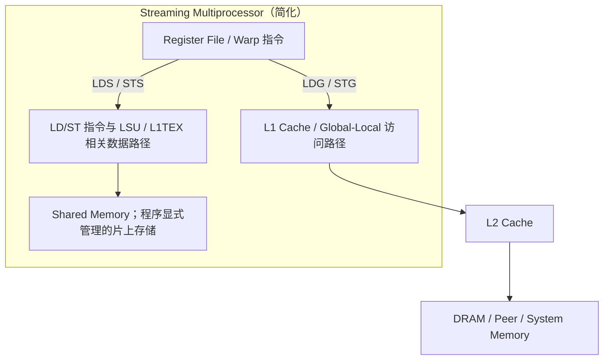

这幅图表达的是**逻辑数据路径**，不表示 Shared Memory 与 L1 Cache 的所有电路彼此独立。某些 NVIDIA 架构将 Shared Memory 和 L1 Cache 的容量组织在统一的片上资源中，并允许配置容量划分；但是 Shared Memory 并不会因为物理上靠近 L1 而自动具有 L1 的 Tag/Hit/Miss 机制。

比较表中，**Registers（寄存器）**保存线程自己的中间值；同时要保存的值太多叫寄存器压力，装不下时编译器可能 **Spill（溢出）**到线程私有 Local Memory，再读回。跨 Lane 的 **Shuffle** 则直接从同 Warp 另一个 Lane 的寄存器取值，例如 Lane 0 取得 Lane 1 的数，而不先写 shared。

表中 **Sector** 是按 32B 边界划分的数据区段，例如连续读 128B 覆盖 4 个；计量的是缓存路径的数据覆盖，不是 shared 的存储分组。**带宽**是单位时间传输的字节量。

Shared 内部会把连续的小数据字分到可并行服务的 **bank（存储分组）**；同组不同位置可能不能同轮读出，叫 bank conflict，下一节具体手算。**Wavefront** 是内部一轮服务的工作包，复杂请求可能要多个包；不是 Grid Wave，也不是 AMD 的线程执行组。下面先比较用途，第 2–4 节再计算服务量。

| 特性 | Registers | Shared Memory | L1/L2 Cache | DRAM |
|---|---|---|---|---|
| 程序视角 | 每线程私有变量通常映射此处 | Block 内共享的显式存储 | 硬件透明缓存层次 | Global Memory 的物理后备存储之一 |
| 管理方式 | 编译器/寄存器分配器 | 程序显式寻址、装载、同步 | 硬件缓存策略 | Runtime/Driver/内存系统 |
| 数据协作 | 跨 Lane 需要 Shuffle 或其他方式 | 同一 Block 内可以协作 | 可被很多访问自动复用 | 全 GPU 大容量存储 |
| 常见限制 | Register Pressure / Spill | 容量、Bank Conflict、同步 | Hit Rate、Sector、带宽 | 带宽、延迟与并发度 |
| NCU 关注 | `LaunchStats`、`Occupancy` | Shared Memory Table、Wavefronts、Conflicts | L1/L2 Memory Tables | DRAM 流量与吞吐 |

### 1.2 为什么需要 Shared Memory？

Shared Memory 不只是“比 Global Memory 快”，它还有至少三个独立用途：其一，**数据复用**，把一个 Tile（一次处理的数据小块，例如矩阵的 32×32 区域）读入后让多个线程重复使用，减少对 L2/DRAM 的重复请求；其二，**跨线程数据交换**，线程 A 可以生产数据，线程 B 在同步条件满足后读取；其三，**数据布局转换**，例如把 Global Memory 的行访问转换为 Shared Memory 中适合列访问的布局，再进行转置或矩阵计算。

然而，使用 Shared Memory 也有成本：Global→Shared 数据搬运、同步、地址计算、额外 Shared Load/Store，以及每个 Block 占用的 Shared Memory 容量。只要一个新布局减少了 Bank Conflict，却显著增加寄存器、同步或 Shared Memory 消耗，最终性能仍可能变差。

### 1.3 Static 与 Dynamic Shared Memory

**静态分配**指数组大小在编译时确定；**动态分配**指启动 kernel 时用启动配置指定每块需要的字节数，不是每个线程各自申请一份。两个示例仅用于理解分配语义，不是完整可运行 Kernel；`extern __shared__` 用来声明这块启动时配置的存储：

```cpp
// 静态分配：每个 Block 具有自己的 32×32 FP32 Tile
__shared__ float tile[32][32];

// 动态分配：字节数在 Kernel Launch 时配置
extern __shared__ float dynamic_tile[];
```

**驻留/Active** 是 Warp 已占有执行状态且尚未退出，即使在等结果也仍驻留；**Occupancy** 是驻留 Warp 数占硬件上限的比例。理论 Occupancy 是第三课的静态资源上界，Achieved 则由运行时活动周期和硬件实例聚合的计数得到，不是块容量填充率。

静态与动态分配都会影响每 Block 的 Shared Memory 资源预算，从而可能限制 SM 上同时驻留的 Blocks 和 Warps。`__shared__` 声明的是每 CTA 的资源，不是每线程各自拥有一份，更不是整个 Grid 的所有 CTA 共享同一块普通 Shared Memory。Hopper 起出现的 **Distributed Shared Memory（DSM，分布式共享内存）**可以在 Cluster（一组被安排协作的线程块）范围访问其他 CTA 的 Shared Memory，但那是另一套范围与同步语义，本课先聚焦普通 CTA-local Shared Memory。

---

## 2. Shared Memory 的 32 Banks：为什么地址可以并行服务

### 2.1 先理解 Bank 是什么

Shared Memory 被组织成多个可以并行服务访问的 Bank，像多个能同时取数的服务窗口；但同一窗口的不同位置不保证能同轮取出。现代 NVIDIA GPU 的常见教学模型为 32 个 Bank，每个 Bank 以 **32-bit（4B）Word** 作为基本寻址与带宽理解单位；bit 是位，8 bit = 1 字节（B），Word 在这里特指一个 4B 数据字，不是任意类型的一个元素；连续的 32-bit Word 轮流映射到 Bank 0、1、2、……、31，然后回到 Bank 0。

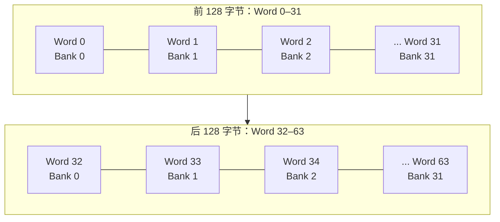

图中的 `Word 0` 是前 4B，`Word 32` 是字节 128–131；后者又落回 bank 0，但不是同一数据。图中左右排列仅表示 Bank 编号规律，不对应实际物理 SRAM Cell 的布线。不同 128B 区间里的相同 Bank 编号，通常表示**同一个 Bank 的不同 Word 地址**。

下面用 `%` 或 `mod` 表示除法余数，如 `65 mod 32=1`；`⌊x⌋` 表示向下取整。假设数组基址对应 bank 0（例如按 128B 对齐），并定义 `a` 为从该基址开始的**字节偏移**，则简化映射为：

$$
\boxed{\operatorname{word}(a)=\left\lfloor\frac{a}{4}\right\rfloor,\qquad
\operatorname{bank}(a)=\operatorname{word}(a)\bmod 32.}
$$

对于 `float` 数组，元素 `x[k]` 的字节偏移为 `4k`，所以其 Bank 编号为：

$$
\boxed{\operatorname{bank}(x[k])=k\bmod32.}
$$

例如 `x[0]`、`x[32]`、`x[64]` 均位于 Bank 0，但是对应三个不同的 4B Word。这是 Bank Conflict 的关键。

### 2.2 有冲突的不是“地址数”，而是“同 Bank 不同 Word 数”

设 32 个 Lane 同时执行一条普通的 Shared Load，每个 Lane 读取一个 4B Word。若 32 个 Lane 访问 32 个不同 Bank，硬件可以并行服务这些 Bank；若两个 Lane 访问**同一 Bank 的不同 Word**，该 Bank 无法在同一个基本服务轮次内提供两个不同 Word，因此请求需要分轮处理。

反过来，如果 32 个 Lane 都读取**完全同一个 4B Word**，它们共享相同数据，硬件可以使用 Broadcast（广播），将一份数据提供给多个请求者，此时不会因为 32 个 Lane 都指向同一 Bank 就产生 32-way Bank Conflict。

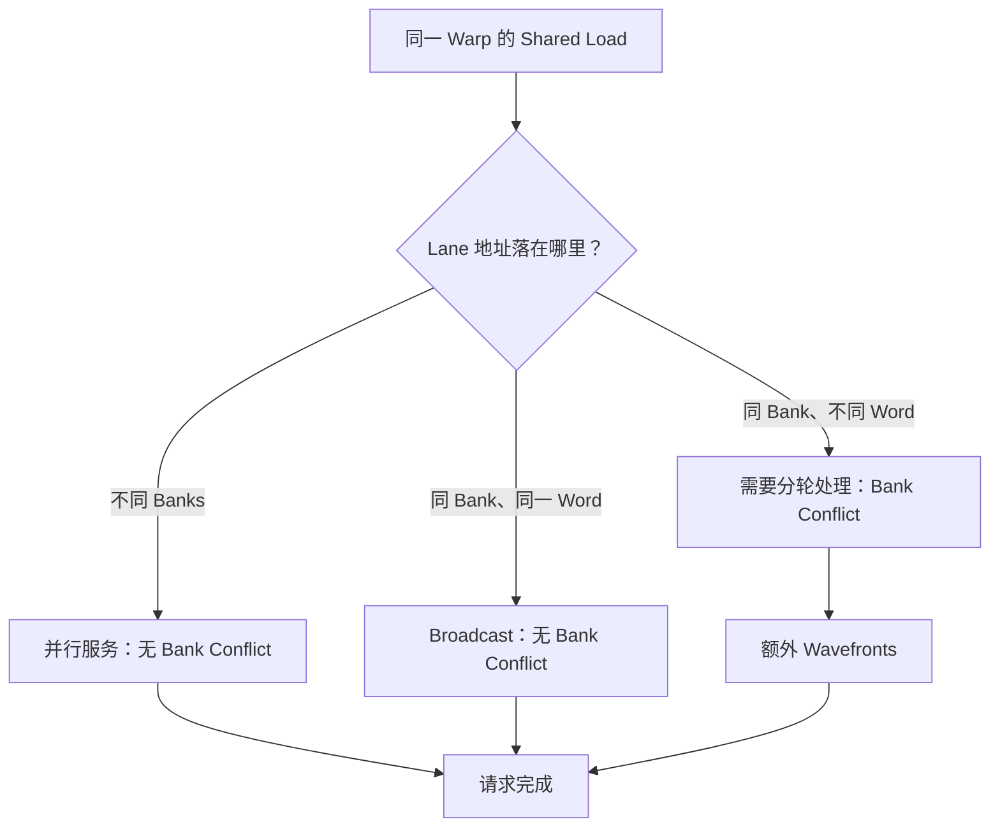

**需要区分 Load 与 Store。** 多个 Lane 读取同一地址通常可以 Broadcast；多个 Lane 在普通非原子 Store 中写同一地址，则不是“能 Broadcast，所以就有定义良好的合并写入”。如果多个线程无序地向同一地址写入不同值，结果存在未定义的获胜写入者或数据竞争问题；要实现确定的跨线程累积，必须使用具有正确语义的原子操作、同步或重构算法。**数据竞争**是多个线程对同一位置进行未正确排序的冲突访问、其中至少一个写入；“恰好这次看起来正确”不能保证下次。**原子操作**把读-改-写作为不可分割的更新，例如多个线程累加一个计数器，不让彼此更新丢失。Bank Conflict 的性能问题与数据竞争的正确性问题是两件事。

### 2.3 Bank Conflict、Global Memory Coalescing、Cache Miss 的区别

对照之前简短回顾 global：**Coalescing** 是把同一 Warp 一条访存指令的 Lane 地址整理为区段访问；**Sector** 是按 32B 对齐的数据区段，例如 32 Lane 连续各读 4B，覆盖 4 个 Sector，若每人相隔 32B，就覆盖 32 个。它计算数据覆盖，不是 shared 的 bank 轮次。**带宽**是单位时间传输多少字节，饱和指接近该路径可持续的速率上限，不是“等待很久”。

表中 Padding 是增加不放有效数据的填充位置，Swizzle 是重排逻辑下标到物理位置的映射；Vectorization 是每线程用一条较宽指令访问多个元素，Tiling 是分小块处理，SoA 是把结构体的不同字段分开存成数组。它们都要由具体地址来判断，不是任意场景通用的加速选项。

| 问题 | 发生位置 | 判断依据 | 常见优化 |
|---|---|---|---|
| Shared Memory Bank Conflict | Shared Memory Bank 服务阶段 | 一次 Warp Shared 访问中同 Bank 的不同 Word 争用 | Padding、Swizzle、改变索引或线程映射 |
| Global Memory Uncoalescing | Warp Global 请求与缓存访问路径 | Warp 地址跨越过多 Sector/Cache Lines | 连续访问、Vectorization、Tiling、SoA |
| L1/L2 Cache Miss | Cache 查询阶段 | 查询数据不在该级 Cache | 数据复用、Working Set、局部性 |
| DRAM Bandwidth Saturation | 设备内存与链路 | 读写流量接近硬件持续带宽上界 | 减少 Bytes、改变算法或数据布局 |

因此 **Shared Memory 没有“L1 Hit Rate”，Global Memory 的 `Sectors/Req` 也不能直接当成 Shared Memory Bank Conflict 的计数。** Shared Memory 的主要性能问题是 Bank 服务并行性、请求吞吐、同步与资源压力。

---

## 3. 用数学推导 Bank Conflict：Stride 与最大公约数

### 3.1 每 Lane 读取一个 FP32，Stride 为 `s` 个元素

**Stride（步长）**是相邻 Lane 访问元素的下标差。例如 `s=2` 时读 0、2、4……，FP32（`float`，每个 4B）字节地址差为 8B。活跃 Lane 是本条指令实际参与的线程位置，不等于 Active Warp 的驻留状态。考虑 32 个 Lane 全部活跃，Lane `k` 读取 `x[k*s]`：

```cpp
// 访存模式示意：lane = 0..31
float v = smem[lane * stride];
```

根据上一节公式：

$$
\operatorname{bank}(k)=\bigl(k\cdot s\bigr)\bmod32.
$$

`gcd(s,32)` 是 s 与 32 的最大公约数，即能同时整除两数的最大正整数，例如 `gcd(2,32)=2`、`gcd(3,32)=1`。下式数量都以“个”计，冲突度 D 表示最忙 bank 需要服务多少个不同字，不是秒数。

在**每个 Lane 读取互不相同的 4B Word、单个 32-bit Warp Load、32 Lane 全活跃**的假设下，访问到的不同 Bank 数量为：

$$
N_{\mathrm{banks}}=\frac{32}{\gcd(s,32)},
$$

每个被访问 Bank 上需要服务的不同 Word 数为：

$$
\boxed{D_{\mathrm{conflict}}=\gcd(s,32)}.
$$

这就是经典的 Shared Memory Stride 与 Bank Conflict 数学关系。它来自模 32 循环群中的周期性；这里“循环群”可先直观理解成编号到 31 后又回到 0 的一圈。例如步长 2 走 0、2、…、30，再到 0，16 步就重复，因此 32 个 Lane 对每个用到的 bank 各访问两次。当 `s` 与 32 互质时，`k*s mod 32` 遍历全部 32 个 Bank；当两者具有公因子时，32 个 Lane 只落在更少的 Bank 上。

**重要例外：`stride=0` 时所有 Lane 访问同一地址，可以 Broadcast，而不是按 `gcd(0,32)=32` 认定发生 32-way Conflict。** 此外，FP16（16 位浮点数）、FP64（64 位浮点数）、向量访问、Predication（由每个线程的真假条件决定是否执行）和宽指令拆分不满足这一简单公式的全部前提，需要单独分析。

### 3.2 典型 Stride 手算表

下表 Lane 地址关系一列是**元素/Word 下标**，不是字节地址；例如下标 32 的字节偏移为 128。`n-way` 表示同 bank 最多 n 个不同 Word 需要分轮服务，`1-way` 就是无这种冲突。

| Stride（FP32 元素） | Lane 地址关系 | 使用的 Bank 数 | 不同 Word/Bank | 理论 Conflict Degree |
|---:|---|---:|---:|---|
| 0 | 所有 Lane 读相同地址 | 1 | 1 | **无冲突：Broadcast** |
| 1 | 0、1、2、…、31 | 32 | 1 | 1-way，无冲突 |
| 2 | 0、2、4、…、62 | 16 | 2 | 2-way |
| 3 | 0、3、6、…、93 | 32 | 1 | 1-way，无冲突 |
| 4 | 0、4、8、…、124 | 8 | 4 | 4-way |
| 8 | 0、8、16、…、248 | 4 | 8 | 8-way |
| 16 | 0、16、32、…、496 | 2 | 16 | 16-way |
| 32 | 0、32、64、…、992 | 1 | 32 | 32-way |
| 33 | 0、33、66、…、1023 | 32 | 1 | 1-way，无冲突 |
| 64 | 0、64、128、… | 1 | 32 | 32-way |

这个表有三个值得记住的现象：**连续 FP32（Stride=1）无冲突；Stride=32 极其糟糕；Stride=33 反而无冲突。** 不是 Stride 越大就一定越冲突，决定 Bank Conflict 的是它相对于 32 个 Bank 的模运算关系。

### 3.3 逐 Lane 推导 Stride=2

当 Lane `k` 读取 `x[2k]` 时：

```text
Lane   Word   Bank
  0      0      0
  1      2      2
  2      4      4
 ...
 15     30     30
 16     32      0   ← 与 Lane 0 同 Bank，但不同 Word
 17     34      2   ← 与 Lane 1 同 Bank，但不同 Word
 ...
 31     62     30
```

Bank 0 需要分别提供 Word 0 和 Word 32；Bank 2 需要分别提供 Word 2 和 Word 34。16 个 Bank 各服务 2 个不同 Word，因此形成 2-way Conflict。这里每个 Lane 只读取一个 FP32，若以理想的 1 个服务轮次为基线，理论上需要 2 个服务轮次。

### 3.4 逐 Lane 推导 Stride=32

```text
Lane   Word   Bank
  0      0      0
  1     32      0
  2     64      0
 ...
 31    992      0
```

所有 Lane 的不同 Word 全部落到 Bank 0，需要 32 个服务轮次，这是经典的 32-way Conflict。注意它在性能指标上意味着**Shared Memory 请求存在严重的服务串行化**，并不等于“整个 Kernel 执行时间必然乘以 32”，因为其他指令、同步、Global Memory 和并发调度仍可能占据大量时间。

### 3.5 Stride=33 为什么恢复并行性？

```text
Lane   Word   Bank
  0      0      0
  1     33      1
  2     66      2
 ...
 31   1023     31
```

因为 `33 mod 32 = 1`，所以访问 Bank 的规律和 Stride=1 完全相同。**Padding 解决的不是元素间的真实数据依赖，而是地址在 Bank 上的映射冲突。**

---

## 4. 从 Warp Instruction 到 Request、Wavefront 与 Bank Conflicts

**Instruction** 在这里按一次 Warp 执行的 SASS 指令计，不把 32 个参与 Lane 记成 32 条独立机器指令。**Request** 是交给 shared 路径的一项访存工作，典型情况一条 Warp shared 指令产生一个请求。**Wavefront** 是内部一轮能处理的工作包，请求若含同 bank 不同字，可能拆成多轮；它不是整条指令的端到端延迟。**Transaction（事务）**只是对指定层次的一次处理/传输的泛称，不能把 shared 服务轮次当成 DRAM 事务。

第五课介绍的是 global 路径的同名计量层次，shared 必须用自己的实际/理想服务量比较。对于 Shared Memory，本课的重心是：**Warp 级 Shared Memory 指令经请求处理后，需要多少个 Wavefront 来服务它要求的数据**。

### 4.1 四个数是什么

| NCU 术语 | 针对 Shared Memory 的理解 | 常见误读 |
|---|---|---|
| `Instructions` | 执行的 Shared 访问 SASS 指令数，通常按 Warp 执行统计 | 把 32 Lane 当成 32 条独立指令 |
| `Requests` | Shared 指令对应的请求数；典型 Warp Shared 指令对应一个请求 | 把它当成每线程 Load 数 |
| `Wavefronts` | 完成 Shared 请求所需的硬件服务轮次数 | 认为每个 Wavefront 必定等于一个 DRAM 事务 |
| `Bank Conflicts` | 由于多个不同 Word 竞争相同 Bank 而增加的服务工作 | 把所有 `Wavefronts > Requests` 都认定为冲突 |

对**32 Lane 各读取一个不同 FP32 Word**的简化场景，若一个请求的最大 Bank 冲突度为 `D`，就可以把下面关系作为纸面推导模型：

$$
W_{\mathrm{theory}}=D,
\qquad
C_{\mathrm{theory}}=W_{\mathrm{theory}}-1.
$$

例如一个 4-way Conflict 的单 Warp Shared Load，理想只需 1 个 Wavefront，理论需要 4 个 Wavefront，额外 3 个；这时 Bank Conflict 可理解为 3 个额外服务轮次。对于复杂指令、多个 Client 同时使用共享数据通道、宽访存或不同架构，NCU 表中的实际 Bank Conflict 计数可能不能这么简单反推。

### 4.2 一个 Warp 的三种典型结果

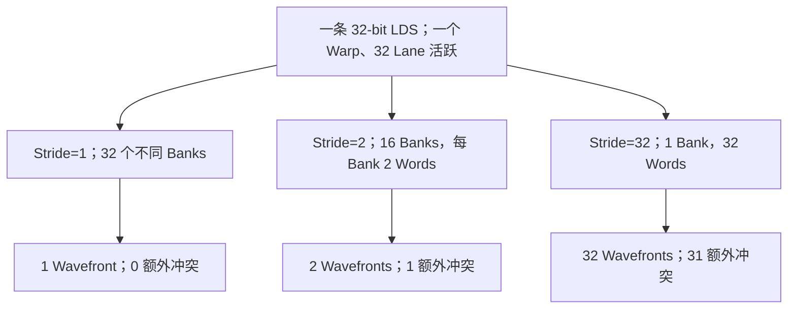

这里的 Wavefront 数是**服务当前请求所需的工作量**，而不是把每一条 LDS 指令的指令延迟固定成 1、2 或 32 个 GPU 周期。硬件管线具有启动、传播、排队及重叠执行成本，并且不同 Warp 或不同 Memory Client 可以有并行交叠。

### 4.3 用 N 个请求计算理想与额外 Wavefront

假设某 Kernel 里执行了 `N=100,000` 次同一种 4B Shared Load Request，全部处于 4-way Conflict（教学模型）：

$$
W_{\mathrm{ideal}}=100{,}000,\qquad
W_{\mathrm{actual}}=400{,}000,
$$

$$
W_{\mathrm{excess}}=300{,}000.
$$

这里的 `N` 是整个观察窗口累计的请求次数；同一地址反复读会反复计数，不是只数不同地址。`W_actual` 是实际服务工作量，`W_ideal` 是给定指令宽度和参与 Lane 时无额外冲突的必要工作量，两者之差为 `W_excess`。

若理想情形完全消除 Conflict，则 Shared Data Pipe 需要服务的 Wavefront 数可能降至原来的四分之一；但 Kernel Duration 的改善取决于该 Shared 路径在整体执行中是否占主导，以及是否存在并行执行和新的瓶颈。

---
机制汇总图放到这里再读。LDS/STS 是 shared 读写；Consumer 是使用此前结果的消费者，例如读取后紧接着把该值相加的指令；产生该值的读取指令是 Producer（生产者）。**Scoreboard** 跟踪未完成操作及依赖，避免消费者过早读值。**MIO（Memory Input/Output）**处理 shared 等部分操作以及某些特殊指令；**Short Scoreboard** 表示相关结果依赖尚未满足，不自动证明 bank conflict。NCU 是 Nsight Compute 单 kernel 分析器，Source 页面把计数或样本关联到代码位置，SchedulerStats 描述调度器的驻留、就绪和发射。

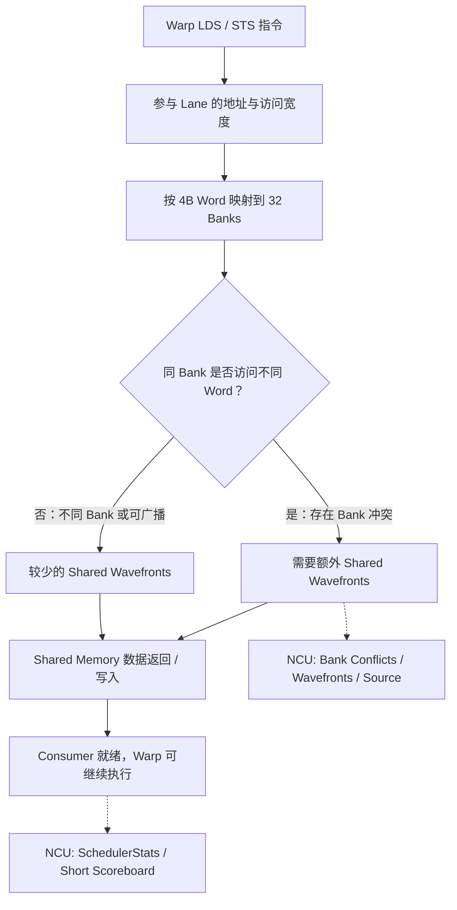

地址决定 bank 映射，服务工作量可能影响吞吐（单位时间处理多少工作）和依赖等待；只有它限制了最终完成时间，即处于关键路径时，改善才可能降低 Kernel Duration（执行时间）。

## 5. Broadcast、Multicast、窄元素和宽访存：为什么不能只看 Bank 编号

### 5.1 Broadcast：同一 Bank 不一定冲突

假设 32 个 Lane 都读取：

```cpp
float v = smem[7];   // 所有 Lane 读取完全相同的 4B Word
```

它们都映射到 Bank 7，但请求的**实际 Word 地址也相同**。硬件可以将一份数据广播给多个 Lane，因此不会形成普通的 Bank Conflict。

另外一种情况是 32 个 Lane 各自读取一个 Word，地址顺序经过任意**一一置换**，只要最终覆盖 32 个不同 Bank，同样可以无冲突；随机顺序本身不等于 Bank Conflict。相反，多个 Lane 即使访问的地址都不同，但只要它们落到同一个 Bank 的不同 Word，就可能发生冲突。

### 5.2 有重复地址的混合访问

**Multicast（多播）**可在这里理解为一次请求内向不同 Lane 子组分发它们各自需要的相同字；每组内重复读取同一 Word 可共享数据，但不同 Word 若争同 bank 仍需分轮，不能从“有广播”跳到“整个请求无冲突”。

考虑以下假想访问模式：前 16 个 Lane 都读 `smem[0]`，后 16 个 Lane 读 `smem[32]`。它们属于两个不同 Word，但都在 Bank 0。Broadcast 只能合并访问**相同 Word**的 Lane，因此这个请求仍需为 Bank 0 服务两个不同 Word，属于 2-way Conflict，而不是 32-way Conflict。

| 访问情况 | 唯一 Word 数 | 不同 Banks 数 | 理论服务轮次 | 解释 |
|---|---:|---:|---:|---|
| 32 Lane 均读 `smem[0]` | 1 | 1 | 1 | Broadcast |
| 16 Lane 读 `smem[0]`，16 Lane 读 `smem[32]` | 2 | 1 | 2 | 两个 Word 同 Bank |
| 32 Lane 分别读 `smem[0..31]` | 32 | 32 | 1 | 完全并行 |
| 32 Lane 分别读 `smem[0,32,...,992]` | 32 | 1 | 32 | 最坏冲突模式 |

### 5.3 FP16/BF16：两个半精度元素可能落在一个 4B Word 内

FP16 与 BF16 是两种 16 位浮点格式，通常各占 2B，数值表示范围与精度不同；这里先只关心它们的存储宽度。Bank 的映射以**4B Word**为理解单位，不是以任意 CUDA 数据类型的元素大小为单位。例如连续的两个 `half` 元素通常共占一个 4B Word，因此 `half` 索引与 Bank 编号之间不能照搬 FP32 的 `bank=index%32`。

对于 FP16 数组，字节偏移为 `2k`，可以先计算包含该元素的 4B Word：

$$
\operatorname{bank}(\mathrm{half}[k])
=\left\lfloor\frac{2k}{4}\right\rfloor\bmod32
=\left\lfloor\frac{k}{2}\right\rfloor\bmod32.
$$

于是 Lane 0、1 访问相邻两个 `half`，它们的地址落在同一个 4B Word；Lane 2、3 对应下一个 Bank。由于访问的子字数据属于同一 Word，不能机械地判成“两路 Bank Conflict”。实际处理还与指令访问宽度、写入掩码、编译器生成的 SASS 有关。

**诊断时必须先看 SASS。** 如果编译器将两个 `half` 打包成一个 32-bit 读取，访问服务和发射次数也会改变；如果是 16-bit Scalar Load，就应按照具体请求的真实地址和同 Word 规则分析。

### 5.4 FP64：`Wavefronts/Request > 1` 未必是 Conflict

一个 `double` 占 8B，即**两个 4B Word**。32 Lane 每个 Lane 连续读取一个 `double`（FP64，64 位浮点数），合计 256B 数据。对于“一个 Wavefront 理想服务一组 32 × 4B 银行读取”的模型，这种访问即使完全没有 Bank Conflict，也至少需要相当于 **2 个 Wavefront** 的数据服务工作。

```text
32 Lane × 4B  = 128B → 基础模型中 1 个 Wavefront
32 Lane × 8B  = 256B → 基础模型中至少 2 个 Wavefront
32 Lane × 16B = 512B → 基础模型中至少 4 个 Wavefront
```

上述数字用于教学理解**最小数据服务工作量**，并不是任何向量 SASS 指令在任何架构下都严格生成这些 Wavefront 的普适定律。实际硬件可能根据指令与对齐把一个 Warp 的宽访问分成多个部分处理。

因此：

$$
\boxed{W_{\mathrm{actual}}>R_{\mathrm{requests}}
\ \not\Rightarrow\ \text{一定存在 Bank Conflict}.}
$$

判断冲突必须参考**访问宽度所需的 Ideal Wavefronts**，而不是把一个请求固化成一个理想 Wavefront。

### 5.5 `float4` / Vectorized Shared Load：指令数减少不代表 Wavefront 数按比例减少

`float4` 把四个 float 组成一个 16B 数据类型。下面 `&smem[4*lane]` 是取得数组该元素的地址，`reinterpret_cast<const float4*>` 表示把该地址当作只读 float4 指针来使用，前面的 `*` 再读取这一组数据；这种写法要求实际地址、数据类型使用方式合法，并满足向量对齐，不能只靠强制转换就保证正确。

假设每 Lane 一次读取 `float4`，也就是 16B：

```cpp
// 仅为访问形态示例，需满足地址对齐并检查编译后指令
float4 v = *reinterpret_cast<const float4*>(&smem[4 * lane]);
```

32 Lane 的逻辑数据量是 `32×16=512B`。即使整个访问布局没有 Bank Conflict，这些 512B 也不能在一个“每 Bank 4B、32 Banks 总计 128B”的基本 Wavefront 中全部服务完。可能发生的情况是：**SASS 指令条数减少，但单条请求需要更多数据 Wavefront**。

对照两种实现：

| 方案 | 每 Lane 数据量 | 理想化 Warp SASS Load 次数 | 理想化 Shared Data 服务量 |
|---|---:|---:|---|
| 四条 Scalar FP32 Load | 共 16B | 4 | 4 个 128B 量级的服务轮次 |
| 一条 Vector FP32×4 Load | 共 16B | 1 | 仍需要约 512B 的总服务工作 |

Vectorization 可能降低指令发射和地址计算开销，但不意味着访存字节数降低，也不意味着 Bank Conflict 自动消失。如果向量访问每个 Lane 的起始地址或跨 Bank 方式不合适，实际请求还可能进一步产生串行化。

### 5.6 Shared Memory Atomics 的特殊性

Shared Memory Atomic 的行为也不能全部用普通 LDS/STS 的冲突公式解释。Atomic 还需要维护同一地址上的读-改-写原子性，可能发生热点地址争用；即使多个 Lane 访问同一个 Bank、同一个 Word，也不能把 Atomic 的执行成本当成普通 Broadcast Load。分析 Histogram（统计各类别数量的直方图）、Scatter-Add（按索引向多个目标位置累加）等算法时，应该区分**Bank Conflict、Atomic Contention 与跨线程正确性**。

---

## 6. Matrix Transpose：从 Global Coalescing 到 Shared Bank Conflict 的经典完整案例

Transpose 是理解 Shared Memory 的最佳例子之一：它同时包含第五课的 Global Coalescing 和本课的 Shared Bank Conflict。核心目标是：**尽可能让 Global Memory 的读取与写入都连续，同时避免在中间 Shared Memory 重排时引入严重的 Bank Conflict。**

### 6.1 为什么普通 Transpose 容易出现不合并访问

**转置（Transpose）**是把输入 `(r,c)` 的值原样放到输出 `(c,r)`，例如输入第 1 行第 2 列放到输出第 2 行第 1 列。**行优先**是一行存完再存下一行；前 r 行共 `r*N` 个元素，再加本行第 c 个得到 `rN+c`，行列编号从 0 开始。

考虑一张按行优先存储的 `N×N` FP32 矩阵，行主序地址为：

$$
\operatorname{addr}(A[r,c])=A_0+4(rN+c).
$$

输出为转置矩阵：

$$
B[c,r]=A[r,c].
$$

这里 A₀ 是输入起始字节地址，系数 4 来自 float 占 4B；`B[c,r]` 是矩阵坐标写法，不是要求 C++ 用逗号表达式索引二维数组。若 Warp 的 Lane `k` 按输入行访问 `A[r,c+k]`，那么输入读取是连续的、利于 Global Memory Coalescing；但对应的输出地址 `B[c+k,r]` 每跨一个 Lane 往往跳过 `N` 个元素，导致 Global Store 出现很大 Stride。若改成让 Store 连续，又可能使输入读取不合并。


直接转置的问题不是计算复杂，而是同一 Warp 的输入访问方向与输出访问方向冲突。

### 6.2 Shared Memory Tiling 的设计

跨线程接力必须建立先后顺序：**Barrier（会合屏障）**让规定的参与线程到齐后再继续，`__syncthreads()` 用于同块会合，并使相关前序写入对后序访问可见。等待者仍然驻留，不能把“等别人”算成“已经退出”。

引入一个 `32×32` Shared Tile，让线程分两阶段完成：首先以输入矩阵行方向连续读取 Global 数据并写入 Shared Tile；在 Block 内完成必要同步；随后按转置方向从 Shared Tile 读取，并沿输出矩阵行方向连续写 Global Memory。

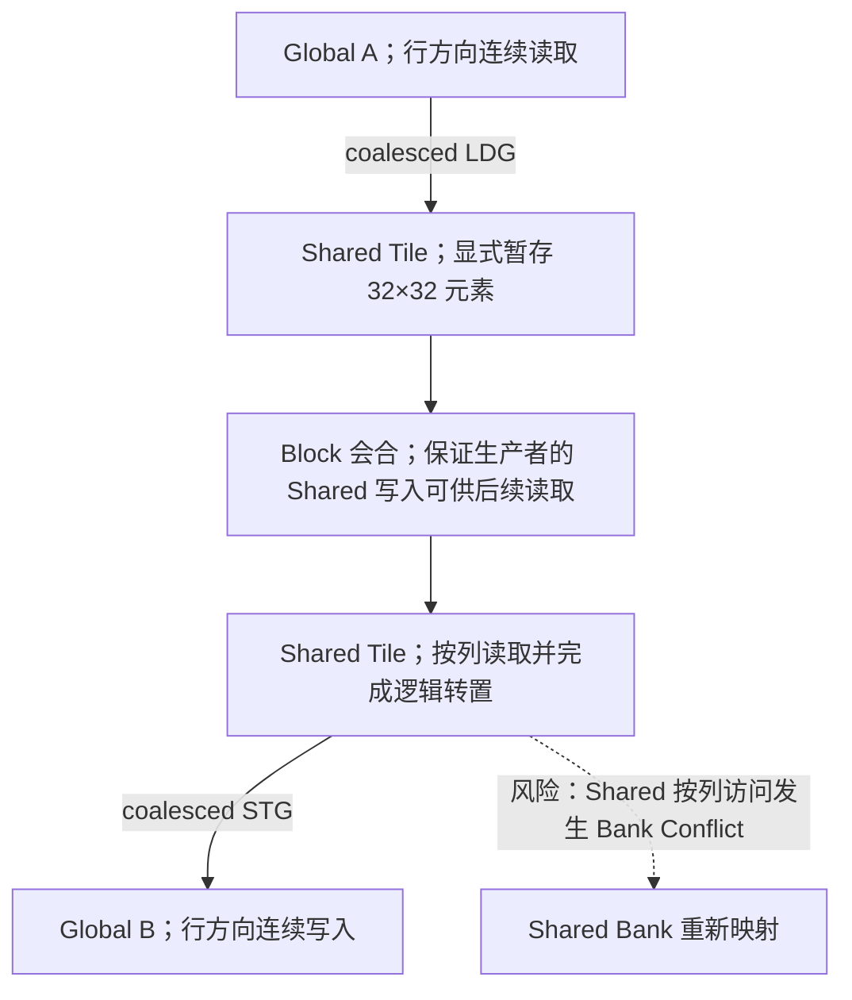

这个算法在两个 Global 方向上都更友好，但会把“不合并的 Global Store”问题转移成“Shared Memory Column Load”问题。**下一步必须检查 Shared Tile 的物理布局。**

### 6.3 为什么 `tile[32][32]` 按列读取会出现 32-way Conflict

假设 C/C++ 行主序：

```cpp
__shared__ float tile[32][32];
```

元素 `tile[row][col]` 的 FP32 Word 偏移：

$$
\operatorname{word}(row,col)=32\cdot row+col.
$$

因此 Bank 编号为：

$$
\operatorname{bank}(row,col)=\bigl(32\cdot row+col\bigr)\bmod32
=col.
$$

**按行读取：** 固定 `row`，让 Lane `k` 读取 `tile[row][k]`，则 Bank 为 `k`，所有 Lane 落在不同 Bank，无冲突。

**按列读取：** 固定 `col`，让 Lane `k` 读取 `tile[k][col]`，则 Bank 永远为 `col`，但 32 个 Lane 分别访问 32 个不同 Word，形成 32-way Conflict。

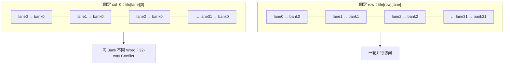

图中的按行示例取 `row=0`；若 row 为其他值，bank 同样随 lane 连续变化。这里不是 Shared Memory 容量不足，而是错误的 Layout 使每个 Bank 的并行性无法发挥。

### 6.4 为什么把第二维从 32 改成 33 就解决了？

采用 Padding：

```cpp
__shared__ float tile[32][33];
```

现在元素 `tile[row][col]` 的 Word 偏移为 `33*row+col`，Bank 编号为：

$$
\operatorname{bank}(row,col)
=\bigl(33\cdot row+col\bigr)\bmod32
=(row+col)\bmod32.
$$

对于**固定 `col` 的按列读取**：

$$
\operatorname{bank}(k,col)=(k+col)\bmod32.
$$

当 Lane `k=0..31` 时，正好遍历所有 32 个 Bank，因此按列读取也不再发生 Bank Conflict。

对于固定 `row` 的按行读取，Bank 编号同样连续变化，仍然无冲突。于是一个额外的 Padding 列同时兼容两种访问方向。

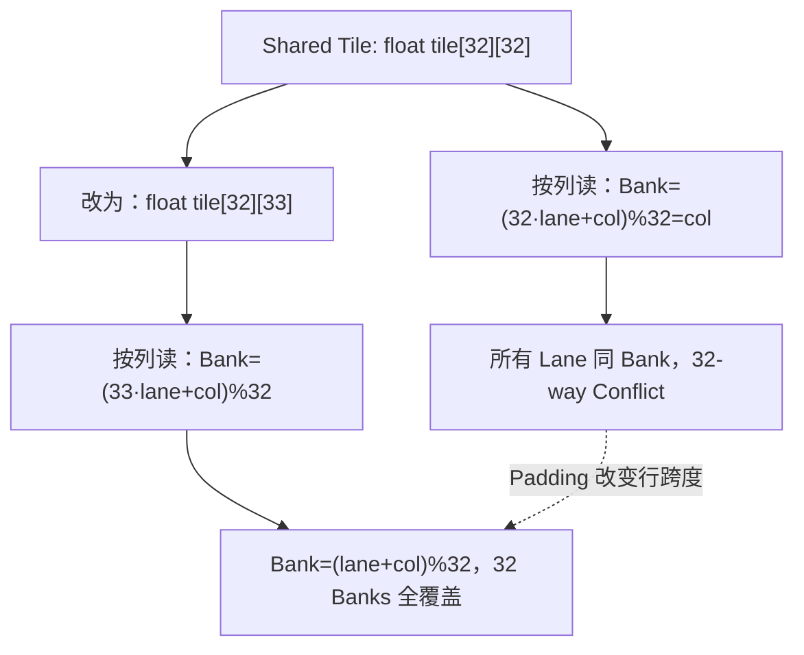

### 6.5 Padding 的空间代价

容量单位先统一：`KiB=2¹⁰ B=1024 B`，不同于十进制 `kB=1000 B`。`float tile[32][32]` 占用：

$$
32\times32\times4=4096\;\mathrm{Bytes}=4\;\mathrm{KiB}.
$$

`float tile[32][33]` 占用：

$$
32\times33\times4=4224\;\mathrm{Bytes}.
$$

增加 `128B`，相当于 3.125% 的静态 Shared Memory 空间开销。这个代价通常很小，但不能保证完全没有 Occupancy 影响：如果 Kernel 原本已经处于某个 Shared Memory 资源配置的临界点，增加容量可能导致每 SM 可驻留 Block 数下降。真实资源分配还涉及架构特定的分配粒度、Block 限制和编译配置。

### 6.6 Padding 为什么只是特定访问形态的一个解

下面两个进阶名称先知道用途即可：Warpgroup 是特定协作指令使用的多 Warp 参与组；TMA（Tensor Memory Accelerator）是多维异步数据搬运机制，发起后仍须等完成条件才能安全使用数据。它们对布局和参与者有额外约束，不应套用普通单 Warp 的访问模型。

`[32][33]` 的成功依赖明确前提：FP32、32 Banks、单 Warp 按行或列处理 32 个数据、行主序，以及对应的读写指令行为。如果换成 `half`、`double`、`float4`、8×8 子块、Warpgroup、TMA，或采用不同的线程到元素映射，按列 +1 Padding 可能不是最优方案。

**正确的思路是先推导每个 Lane 的实际地址，再确定 Bank 分布，而不是看到 Shared Memory 就无条件 Padding。**

### 6.7 一个真实工程中常见的错误优化顺序

假设优化前的 Kernel 存在大量未合并的 Global Store。工程师引入 Shared Memory Tile，Global Sector 数下降，但 Kernel 仍然很慢；此时如果只看 DRAM Throughput，就可能认为优化已经接近上界。实际上 Shared Tile 的按列读取可能造成 32-way Conflict，Shared 数据路径被严重串行化。

正确流程应是分层验证：

1. 与朴素版本比较 Global Load/Store 的 Sector 与总流量，确认 Global Coalescing 真正改善；
2. 在优化版中比较 Shared Read/Write 的 Requests、Wavefronts、Bank Conflicts；
3. 用 Padding 或其他 Layout 消除明显冲突，并观察 Short Scoreboard / Shared Pipe 利用率是否随之变化；
4. **最后以 Kernel Duration 及独立 Benchmark 验证总收益**，确认 Shared Memory、同步与资源压力没有抵消 Global 优化收益。

---

## 7. Padding 之外还有哪些 Layout 优化方式？

### 7.1 XOR Swizzle：改变 Bank 映射，但不必增加一整列

Padding 是在物理行宽中加入空洞，而 Swizzle 是改变**逻辑数据索引到 Shared 物理地址的映射**。考虑一个只用于说明思想的 `32×32` FP32 Tile，令逻辑元素 `logical[row][col]` 存放在物理地址：

$$
\operatorname{physical\_col}=col\oplus row,
$$

其中 `\oplus` 是按位 XOR（异或：两位不同得 1、相同得 0，例如二进制 `001 XOR 011 = 010`，即 `1 XOR 3=2`；C++ 写作 `^`），且 `row`、`col` 均在 0–31 范围内。物理位置是 `tile[row][col ^ row]`，于是 Bank 编号为：

$$
\operatorname{bank}(row,col)
=\bigl(32row+(col\oplus row)\bigr)\bmod32
=col\oplus row.
$$

若固定 `row`，让 `col` 覆盖 0–31，则 `col XOR row` 遍历全部 Banks；若固定 `col`，让 `row` 覆盖 0–31，也遍历全部 Banks。因此在**单 FP32 元素、按行/列整 Warp 访问**的模型下，两种方向都可以无冲突。

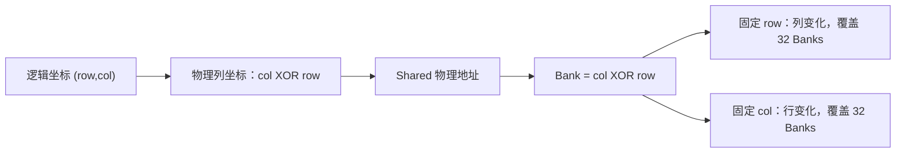

MMA 是矩阵乘加，Tensor Core 是专门执行此类计算的硬件；CUTLASS、CuTe 是用于组织这类计算和数据布局的软件库。Bank Group 是硬件 bank 的进一步组织分组，不能假定本文的简单 bank 编号已描述所有结构。

这是一个**教学映射**，不代表 TMA、CUTLASS、CuTe 或某一代 Tensor Core 使用的 Swizzle 一定是同一个公式。实际 Swizzle 需要考虑向量宽度、对齐、Tile Shape、Bank Group、异步拷贝方向及 MMA 指令要求。

### 7.2 Padding、Swizzle、改变线程映射三者有什么不同？

下面的 TMA 是 Tensor Memory Accelerator，面向多维数据的专用异步搬运机制，Tensor Map 是描述这类数据地址与布局的信息；SM90+ 表示计算能力 9.0 及以上相关架构条件，不保证所有版本接口完全相同。它与普通线程读写不同，此处只比较设计选择。

| 方法 | 主要改变对象 | 优势 | 代价与约束 |
|---|---|---|---|
| Padding | 物理行跨度（Stride） | 简单、易于证明，经典 Transpose 高效 | 空间开销，可能破坏对齐或改变 Occupancy |
| XOR/其他 Swizzle | 逻辑索引 → 物理地址映射 | 可同时兼容多种访问方向；可能不增加空间 | 索引计算、对齐、向量访存、生产者消费者映射复杂 |
| 改变线程到元素映射 | Warp 中 Lane 负责哪些元素 | 可能同时改善 Global 和 Shared 访问 | 影响负载均衡、寄存器、同步与计算布局 |
| Warp Shuffle | 在寄存器间交换 Lane 数据 | 可能减少 Shared Load/Store 和 Block Sync | 通常限定 Warp 内，适合特定数据交换 |
| TMA Layout / Swizzle | 异步复制与 Shared 数据布局 | 更适合特定 SM90+ Tensor 路径 | 版本、架构、Tensor Map、异步同步语义约束 |

### 7.3 Warp Shuffle 为什么能够避免某些 Shared Memory 访问

Shuffle 的 Mask（掩码）用每一位标识哪些 Lane 参与，掩码中的线程须满足对应指令的参与约束；它不自动替代跨 Warp 的会合。如果一组数据只需要在同一个 Warp 的 32 个 Lane 中交换，且数据已经保存在寄存器里，可以考虑 Warp Shuffle 指令（例如 `__shfl_sync`）而不必先写入 Shared Memory，再执行 Shared Load。这样可能减少 Shared Memory 流量和同步开销。但是 Shuffle 也消耗指令、交叉 Lane 数据路径，并有活动 Lane 与 Mask 的正确性约束；超过 Warp 范围的数据交换仍需要其他机制。

**避免 Bank Conflict 的最直接办法有时不是优化 Bank 映射，而是从算法上取消这次 Shared Memory 访问。**

### 7.4 TMA、`cp.async` 与现代异步搬运的边界

**异步搬运**是发起传输后先做其他工作，到真正使用数据前再等完成；它不是“数据发起后马上就能读”。`cp.async` 是将 global 数据复制到 shared 的一类 PTX 异步操作。Ampere+ 的 `cp.async` 类机制、Hopper+ 的 TMA 等能够改变 Global→Shared 数据装载方式，减少寄存器中转或支持更复杂的异步管线，但不能把它们简单视为“自动消除所有 Bank Conflict”。使用这些特性时必须将三个问题分开分析：**异步数据搬运是否完成、写入 Shared 后的布局是否适合消费者访问、Producer/Consumer 之间的 Barrier/Fence 是否正确。**

Warpgroup 是某些协作指令使用的多 Warp 参与组；MMA 是矩阵乘加，Tensor Core 是专门进行这类计算的硬件，WGMMA 是相应 Warpgroup 协作形式之一。`mbarrier` 是跟踪参与到达或异步完成条件的屏障对象，Proxy Fence 用于建立不同访问代理之间所需的顺序；不能用普通“加一次同步”的口诀替代各自的语义。

本课只建立概念：在后续高级章节，TMA Swizzle、`mbarrier`、异步 Proxy Fence 与 Tensor Core/WGMMA 的布局约束需要作为独立内容研究。

---
## 8. 同步、Scoreboard、Occupancy：Shared Memory 的三个其他代价

### 8.1 Shared Memory 数据交换需要正确同步

**同步**需要区分执行会合和内存顺序：Barrier 是让规定的参与者到齐；Fence 约束内存操作前后顺序，不负责把所有线程集合到同一点。普通 Shared Memory 可被同一 CTA 的多个 Warp 访问，但是“能访问同一片地址空间”并不意味着“线程 A 写完后，线程 B 就必然已经看到了”。例如一个 Block 中有四个 Warp，它们共同加载一个 Tile，之后每个 Warp 会读取其他 Warp 放入的元素。必须保证生产者写入完成，并在合适的内存可见性与执行同步条件满足后，消费者才能读取数据。

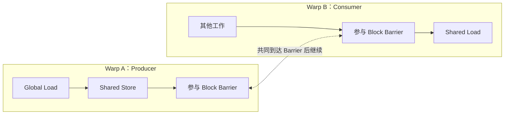

`__syncthreads()` 是一个常见的 CTA 级同步原语，它包含 CTA 线程的执行会合，并为相关内存访问提供必要的可见性保证。`__syncwarp()` 则适合满足其参与线程与掩码约束的 Warp 内同步，不能随意拿它替代跨多个 Warp 的 CTA Barrier。对于异步复制，完成条件与 Proxy Fence 等语义可能进一步复杂，不能只凭普通 `__syncthreads()` 的直觉设计。

### 8.2 Bank Conflict 与同步等待会在 NCU 上表现为不同现象

假设一个 Kernel 的 Shared Memory 访问完全没有 Bank Conflict，但仍有大量跨 Warp 的 `__syncthreads()`。它可能因为有的 Warp 先到达 Barrier，必须等待其他 Warp，而出现较高 `barrier` Stall。此时对 Shared Tile 进行 Padding 没有用，因为问题根本不是 Bank 冲突。

**MIO Throttle** 与结果等待不同：它表示相关输入队列或指令路径暂不能接收新操作；**Long Scoreboard** 则关联 L1TEX 路径结果的依赖。调度器把指令交给执行路径叫 Issue（发射），下一条指令输入及资源就绪才叫 Eligible。Issue Active 关注发生发射的周期比例；周期是硬件时钟的一拍，例如 10 拍中 7 拍发射就是 70%，不是所有计算单元的忙碌率。不要把一条指令已发射误读成结果已返回。

对比两个问题：

| 症状 | 可能对应的硬件机制 | 常见 NCU 线索 | 验证动作 |
|---|---|---|---|
| Shared Load 结果迟迟不能使用 | Shared 数据服务、Scoreboard 依赖 | Short Scoreboard、Shared Wavefront、Bank Conflicts | 比较访问布局与 Source |
| 生产者已经到达会合点，但消费者不能继续 | CTA/Warp Barrier 等待 | Barrier Stall、同步指令、Warp 进度不均衡 | 检查参与线程和工作分配 |
| 新 Shared 请求发射困难 | MIO 等请求路径拥塞 | MIO Throttle、Shared 数据路径占用 | 检查 Wavefront 压力及指令发射 |
| Shared 操作少但 Kernel 仍慢 | Global/Compute/Atomics 等其他瓶颈 | Long Scoreboard、SM Throughput、Atomic/Global Metrics | 拓展上下游分析 |

需要特别注意，NCU 中的 Stall 分类不是“独占的执行耗时切片”。例如 Short Scoreboard 较高可能来自 Shared Memory，也可能是特殊数学指令或其他 MIO 相关依赖。仅凭 Short Scoreboard 无法证明 Bank Conflict 是根因。

### 8.3 Shared Memory 占用可能降低 Occupancy

与第三课的 Occupancy 对应，假设某个**教学用 SM** 有 64 KiB 可供 CTA 分配的 Shared Memory，其他硬件资源暂时都不构成限制：

| 每 Block Shared Memory | Shared 资源允许的驻留 Block 上限 | 对 Warp 并发的潜在影响 |
|---:|---:|---|
| 8 KiB | 8 | 较多 Block 可驻留 |
| 16 KiB | 4 | 中等占用 |
| 17 KiB | 3 | 跨越资源阈值，少 1 个 Block |
| 32 KiB | 2 | 进一步减少并发 Block |

这些值只是在固定 64 KiB 容量下的算术上限，实际还受 Shared Memory 分配粒度、SM 最大驻留 CTA 数、Warps、Registers 与设备/函数配置影响。

想象一个原本每 Block 使用 16 KiB Shared Memory 的 Kernel，为了改善 Layout 增加到了 17 KiB。如果原先该 SM 可以同时驻留四个 Block，现在可能只能驻留三个。即使 Bank Conflict 下降，TLP（Thread-Level Parallelism，其他 Warp 提供独立工作来填补等待的线程级并行）也可能减少，无法再充分隐藏其他指令或访存延迟。

因此 Shared Memory 优化应该建立联合观察：

$$
\text{Layout 改善} \longrightarrow
\begin{cases}
\text{Shared Wavefronts 减少}\\
\text{每 CTA 的 Shared Bytes 可能增加}\\
\text{Occupancy 可能变化}\\
\text{Consumer 依赖等待可能变化}
\end{cases}
\longrightarrow\text{最终 Kernel Duration}.
$$

---

## 9. NCU 里到底看哪些 Shared Memory 指标？

### 9.1 首先找 `MemoryWorkloadAnalysis` 里的 Shared Memory Table

NCU 的 Memory Workload Analysis 会把 Shared Memory 分成 Load、Store、Atomic、异步复制相关路径等访问类型（具体行随版本和架构变化）。对于普通 LDS/STS，重点观察以下列：

| NCU UI 列 | 主要含义 | 如何解读 |
|---|---|---|
| `Instructions` | 被执行的相应 Shared SASS 指令数 | 看做了多少次指令级工作 |
| `Requests` | Shared Memory 请求数 | 用作访问频率的归一化分母 |
| `Wavefronts` | 实际需要服务的 Wavefront 总数 | 看 Shared 数据路径工作量 |
| `Bank Conflicts` | 由于 Bank 争用导致的额外服务工作 | 寻找严重布局冲突 |
| `% Peak` | 相关硬件通路的峰值归一化利用程度 | 高利用率不等于高效率 |

一个便于记忆的观测次序是：

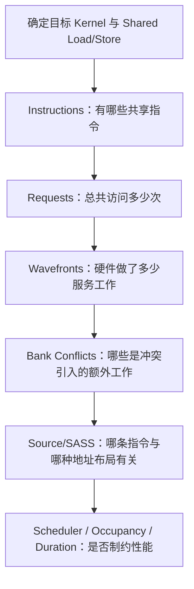

### 9.2 官方给出的常见原始 Metric 名称

metric 是具体指标，Section 是相关指标组。下表的 `.sum` 表示对相应硬件事件求和，`.avg` 是硬件实例平均，`pct_of_peak_sustained_elapsed` 则按经过周期相对持续参考峰值归一化，不能当成时间份额。`smsp` 是 SM 子分区；**PC Sampling** 是间隔抽取 Warp 的 PC（下一指令位置）和状态，所得样本并非每一拍每个 Warp 的完整记录。

以下是现代 NCU 中可用于理解 Shared 路径的常见指标名称，但并不是所有 GPU、所有 NCU 版本都保证全部可用；具体应以目标机器上的 `ncu --query-metrics` 和报告中显示的完整 Metric Name 为准。

| Metric（示例） | 指标类型 | 主要用途 |
|---|---|---|
| `l1tex__data_bank_conflicts_pipe_lsu_mem_shared_op_ld.sum` | Shared Load Bank Conflict 计数 | 检查读取冲突 |
| `l1tex__data_bank_conflicts_pipe_lsu_mem_shared_op_st.sum` | Shared Store Bank Conflict 计数 | 检查写入冲突 |
| `l1tex__data_pipe_lsu_wavefronts_mem_shared_op_ld.sum` | Shared Load Wavefront 总量 | 读取服务工作量 |
| `l1tex__data_pipe_lsu_wavefronts_mem_shared_op_st.sum` | Shared Store Wavefront 总量 | 写入服务工作量 |
| `l1tex__data_pipe_lsu_wavefronts_mem_shared.avg.pct_of_peak_sustained_elapsed` | Shared 数据路径吞吐归一化指标 | 判断该路径是否存在高占用压力 |
| `smsp__pcsamp_warps_issue_stalled_short_scoreboard` | PC Sampling Stall 指标 | 观察短依赖等待，可能关联 Shared Load |
| `smsp__pcsamp_warps_issue_stalled_mio_throttle` | PC Sampling Stall 指标 | 观察 MIO 路径的请求发射压力 |

**细节注意：** `l1tex__data_bank_conflicts_*` 是硬件级数据路径计数。某些架构与采集环境里，数据通道还存在不同 Client 的争用；因此这个计数不一定能完全归因于你眼前某一条 SASS 的“按地址推导出的纯 Bank 冲突”。NVIDIA Compute Triage Guide 提醒，Source 视图归属于单条指令的 Bank Conflict 与 Memory Table 的聚合计数有时不同，后者还可能含有不同 Client 之间对相关数据资源的争用。也不要把这几个原始指标简单相加后就宣称得到唯一的“共享内存效率百分比”。

### 9.3 Ideal 与 Excessive Wavefronts：为什么比简单 `Wavefronts/Req` 更有解释力

很多人看到 `Wavefronts / Requests > 1` 就认为存在 Bank Conflict，这在 FP64、`float4` 或向量化访问中常常错误。更稳妥的比较是：

$$
W_{\mathrm{actual}},\qquad
W_{\mathrm{ideal}},\qquad
W_{\mathrm{excess}}=W_{\mathrm{actual}}-W_{\mathrm{ideal}}.
$$

这里 `ideal` 必须是**该指标定义针对对应指令宽度与活动 Lane 的理想工作量**，而不是我们擅自设定为“每请求 1 个 Wavefront”。

例如下面是假想的**三个不同指令类型**：

| 访问模式 | Requests | Ideal Wavefronts | Actual Wavefronts | 初步结论 |
|---|---:|---:|---:|---|
| 每 Lane 4B，连续 FP32 | 10,000 | 10,000 | 10,000 | 没有多余服务工作 |
| 每 Lane 8B，连续 FP64 | 10,000 | 20,000 | 20,000 | 宽访问的必需服务工作，不是冲突证据 |
| 每 Lane 4B，Stride=4 | 10,000 | 10,000 | 40,000 | 存在明显额外服务工作，需核对 Bank 冲突 |

这些数值是理想化示例，具体 NCU Source Counters 中 `Ideal`、`Excessive` 的定义要以鼠标悬停时的 Metric 描述为准，不能把所有不同 Data Path 的派生指标放进同一个除法。

### 9.4 `Requests` 与 `Instructions` 是否总是一比一？

NVIDIA 的 Shared Memory Table 对常见 Shared Memory SASS 访问指出，一条执行的 Shared Memory 指令通常生成一个 Shared Request。但深入分析时应遵循以下原则：以**真实 SASS 指令和相应表格行**作为观察对象。编译器可能把源码中的多次访问合并为向量 Load，也可能把一次高层访问拆成多个指令；异步路径、Atomic、特殊指令、Predication 也可能具有不同的请求处理方式。

因此“源码中每线程读取四次 Shared Memory”不能直接推断“NCU 的 Requests 一定等于线程数×4”。先看编译器生成了什么，再看每条指令对应的数据路径。

### 9.5 典型命令如何选择，为什么不建议无脑 `--set full`

本课不提供自动化执行脚本，以下是未来实操的 Bash 命令示意，在你自己的程序目录执行。`./app` 与 `my_kernel` 是占位名，须替换为真实程序和函数；本课已有程序的具体命令见 lab，不要直接执行占位例子。先用 `ncu --list-sections` 和 `ncu --query-metrics` 确认本机支持。

`--section` 选择指标组；`-k regex:my_kernel` 用正则表达式匹配函数，`-c 1` 只采一次匹配启动，`./` 表示当前目录。第二条中 `|` 把查询输出交给 `grep` 筛选，`-E` 开启扩展正则，单引号内的 `|` 表示“或”。这里不执行这些命令：

```bash
# 采集包含 Shared Memory 统计的指标表
ncu --section MemoryWorkloadAnalysis_Tables -k regex:my_kernel -c 1 ./app

# 查询本机实际支持的 Shared 相关 Metric
ncu --query-metrics | grep -E 'mem_shared|bank_conflicts'
```

`--metrics` 可以直接选择具体指标，`group:memory__shared_table` 是工具定义的 shared 表指标组。NCU 官方 Profiling Guide 将 `--section MemoryWorkloadAnalysis_Tables` 或 `--metrics group:memory__shared_table` 列为采集 Shared Memory Table 指标的方法；不同版本的 Set 与 Section 组成可能略有差异。Source 页的详细指令归因可能需要额外采集 Source 相关指标或开启源码/SASS 映射，但没有必要每次都开启 Full Set。

---

## 10. 从 Memory Table 返回 Source/SASS：寻找实际产生冲突的指令

### 10.1 为什么只看 Kernel 级 Bank Conflict 总数不够

一个 Kernel 可能包含十几条 LDS/STS 指令，其中大多数连续访问共享内存，只有一条列方向读取触发 32-way Conflict。如果只看整个 Kernel 的 Bank Conflicts 总数，你不知道改哪里。应当在 Source 页把访问计数关联到 SASS（或编译器保留的源代码位置），再手算该指令的 Lane 地址分布。

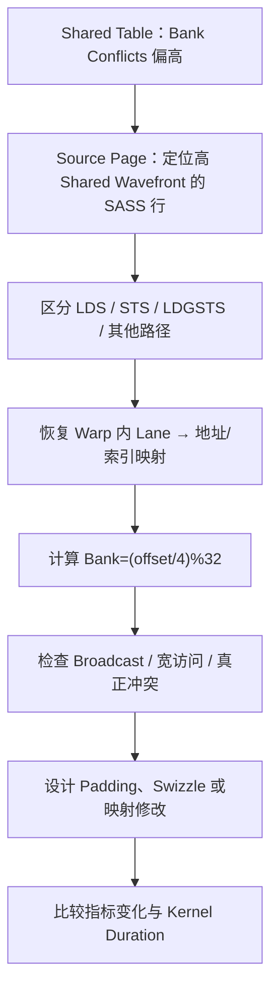

### 10.2 哪个指令与 Stall 有关？

假设某个 Warp 执行：

```text
LDS R4, [shared_addr]   ; Producer: 触发 Shared Load
FADD R5, R4, R6        ; Consumer: 需要 R4
```

`R4/R5/R6` 是寄存器名，`[shared_addr]` 表示 shared 中的内存地址，FADD 是浮点加法。RAW（Read After Write，写后读）表示后一步要读取前一步新写的结果。若 `LDS` 产生高 Bank Conflict，数据准备时间可能延长，后面的 `FADD` 会因为读不到 `R4` 而在 Scoreboard 上等待。NCU 的 PC Sampling 可能把等待归因显示在**等待发射的 Consumer 指令附近**，并不一定停留在原始 Producer `LDS` 那一行。

所以正确的诊断顺序是：先找到 Stall 高的 Consumer，再沿 RAW 依赖追踪上游 Producer，最后核对 Producer 是 Shared Memory 还是其他操作，并查看它所对应的请求与 Wavefront。第四课建立的 Scoreboard 知识在这里就能真正发挥作用。

### 10.3 `short_scoreboard` 高但 Bank Conflict 为 0，怎么办？

这仍然可能是 Shared Load 的数据依赖：Shared Memory 的访问即使没有 Conflict，也存在非零延迟。如果 Consumer 紧接着读取 Producer 的结果，而 Warp 没有其他独立工作，可以出现 Short Scoreboard；同时，一些特殊数学指令和控制流相关操作也可能出现 Short Scoreboard 等待。

要排除这些因素，需要比较 Source/SASS 上的依赖链长度、Shared 请求频率、实际 Wavefront 工作量、Scheduler Eligible Warps 等，而不是直接 Padding。

### 10.4 `mio_throttle` 高但 Bank Conflict 为 0，怎么办？

`mio_throttle` 更侧重某些 MIO 发射路径或队列压力，不要求前提是 Bank Conflict。即使 Shared 访问非常规则，如果 Kernel 每周期产生过多 Shared Load/Store、Shuffle/特殊功能或相关指令，仍可能在请求吞吐上遇到限制。优化方向可能是减少指令数量、提高每次访问的数据利用率、减少不必要 Shared 往返，而不是单纯重排地址。

---

## 11. 六个假想 NCU 案例：建立“症状 → 机制 → 验证”的完整思路

本节全部数值都是**假想对照数据**。在实际报告中，不同指标的采集条件、架构和聚合范围可能不同，因此以下表格旨在训练因果推理，而不是提供固定的报警阈值。Baseline 是保留的对照版本，`μs=10⁻⁶ s`，事件数中的 `1M=10⁶`。**ILP（指令级并行）**是同一 Warp 指令流里安排互不依赖的操作，例如 A 累加链等待时先算 B；TLP 是换其他 Warp 的独立工作填空档。二者能覆盖等待，但不把单次操作变成零延迟。

### 案例 A：标准 32-way Shared Bank Conflict

假设一个 Transpose Kernel 在 `[32][32]` Tile 中按列读取，每个 Warp 访问互不相同的 32 个 FP32 Word：

| 指标 | Baseline（假想） | Padding 后（假想） |
|---|---:|---:|
| Shared Load Requests | 100,000 | 100,000 |
| Shared Load Ideal Wavefronts | 100,000 | 100,000 |
| Shared Load Actual Wavefronts | 3,200,000 | 100,000 |
| Shared Load Extra Wavefronts | 3,100,000 | 0 |
| Kernel Duration | 105 μs | 40 μs |

**机制推断：** 原方案的 `bank(row,0)=(32row)%32=0`，所有 Lane 都访问 Bank 0 的不同 Word；Padding 后行跨度变为 33，Bank 遍历 0–31。Wavefront 工作量降至理论理想，假想 Duration 也明显降低。

**仍需验证：** 两版是否完成相同的 Transpose、Global 读写流量是否相同、Block Size/Occupancy 是否发生变化，以及 NCU Replay 和独立计时是否一致。不能单凭 Shared Wavefront 降低 32 倍，就声称 Kernel 必然加速 32 倍。

### 案例 B：`Wavefronts/Req=4`，但没有 Bank Conflict

| 指标 | 假想值 |
|---|---:|
| Shared Load Requests | 50,000 |
| Shared Load Ideal Wavefronts | 200,000 |
| Shared Load Actual Wavefronts | 200,000 |
| Shared Bank Conflicts（归因于访问布局） | 0 |
| 访问宽度 | 每 Lane 16B |

**机制推断：** 这可能是一条无冲突的宽向量 Shared Load。由于每 Lane 需要更多数据，理想服务量本身就是每 Request 多个 Wavefront。对它做 Padding 可能没有收益，甚至损害 16B 对齐和向量化。

### 案例 C：Short Scoreboard 很高，但 Shared Bank Conflict 近乎为 0

| 指标 | 假想结果 |
|---|---:|
| Shared Load Actual/Ideal | 1.0 |
| Shared Bank Conflicts | 0 |
| Short Scoreboard Sample | 偏高 |
| Eligible Warps / Scheduler | 偏少 |
| Warp 指令形态 | `LDS → 立即使用 LDS 返回值` |

**机制推断：** 可能是无冲突 Shared Load 的结果依赖延迟仍未被 ILP/TLP 隐藏，而不是 Bank 服务串行化。应该考虑把独立指令插到 Producer 和 Consumer 之间、调整算法依赖链或并发度。还必须排除其他产生 Short Scoreboard 的指令。

### 案例 D：Bank Conflict 下降，但最终 Kernel 反而慢了

| 指标 | 原版（假想） | 新版（假想） |
|---|---:|---:|
| Shared 额外 Wavefronts | 300,000 | 0 |
| Shared 每 Block 占用 | 16 KiB | 17 KiB |
| 理论驻留 Blocks/SM（仅 Shared 限制） | 4 | 3 |
| Achieved Occupancy | 62% | 47% |
| Kernel Duration | 52 μs | 58 μs |

**机制推断：** 新布局消除了 Shared 争用，但跨过 Shared Memory 分配阈值，减少并发 Block；Kernel 的其他延迟无法被充分隐藏。优化局部 Shared Memory 效率，并不等于优化整个 Kernel。后续应考虑减少 Tile Size、调整重用策略或改用更紧凑的 Swizzle，重新寻找整体最优点。

### 案例 E：Transpose 的 Global Sector 大幅下降，但 Shared 仍然成为瓶颈

| 指标 | 朴素 Global Transpose（假想） | 引入 Shared Tile（假想） |
|---|---:|---:|
| Global Store Sectors | 高 | 低 |
| DRAM 总流量 | 高 | 低 |
| Shared Load Wavefronts | 0 | 非常高 |
| Shared Bank Conflicts | 0 | 很高 |
| Kernel Duration | 125 μs | 100 μs |

**机制推断：** Shared Tile 改善了 Global Coalescing，但引入 Shared 按列冲突，使整体改善低于预期。第三版应保留 Shared Tiling，同时优化 Tile Layout，分离验证“Global 流量降低”和“Shared Bank Conflict 消除”这两个不同作用。

### 案例 F：Shared Bank Conflict 硬件总数偏高，但单条 SASS 难以解释

假设 NCU Memory Table 的 Bank Conflict 总数比 Source 页归因到 LDS/STS 的冲突大得多。此时不要强行把所有差异都归因于某个访问的 `stride=2`。先确认是否包含不同 Shared 访问操作、`LDGSTS` 或其他 Client，是否出现数据 Bank 同周期资源争用，并核对 Source Counters 的采集机制及可归属范围。必要时简化目标 Kernel，分别采集各类访问指令，并最终以整体 Duration 对照验证。

---
## 12. 为什么“消除 32-way Conflict”通常不等于“加速 32 倍”？

### 12.1 区分局部服务量与整体执行时间

假设某 Kernel 有两个串行部分：A 阶段执行 Global Memory 与计算，B 阶段主要花时间等待存在严重 Bank Conflict 的 Shared Load。初始状态下，A 占总时间的 60%，B 占 40%。假设我们通过 Padding 使 B 的实际时间理想化地降低到原来的 1/8，并且完全不改变 A 阶段与并发关系，则总体 Speedup（加速比，即原时间/新时间）的 Amdahl 模型为：

$$
S=\frac{1}{(1-f)+f/s},
$$

其中 `f=0.4` 是被优化部分在原始总时间中的占比，`s=8` 是该部分假设取得的局部加速：

$$
S=\frac{1}{0.6+0.4/8}=\frac{1}{0.65}\approx1.54.
$$

即使 B 局部加速 8 倍，总 Kernel 也只加速约 1.54 倍。如果这部分延迟原本就能被其他 Warp 或计算流水线重叠隐藏，那么实际获益可能比这个简单串行模型还低；反过来，如果消除冲突让队列压力解除、并发进度改善，可能出现复杂的间接收益。

### 12.2 为什么不能直接用 `Bank Conflicts` 计算耗时占比？

NCU 的 Bank Conflict、Wavefront 是特定硬件事件或数据路径服务工作量，通常不是精确的独立耗时表。大量 Wavefront 可以与其他 Warp 进度重叠，或者在已有硬件流水线中被部分隐藏。只有结合整体 Kernel Duration、Issue Active、Short Scoreboard、Shared Pipe 利用率、并发度等证据，才能判断 Bank Conflict 是否处于关键路径。

### 12.3 一个定量思考过程

假设两版 Kernel 的独立 Benchmark 结果：

- Baseline：50 μs，Shared Wavefronts = 4M，Bank Conflicts 很高；
- Optimized：42 μs，Shared Wavefronts = 1M，Bank Conflicts 接近零。

那么可以严谨地报告：“在相同输入与运行条件下，新布局将该 Shared Memory 路径的服务工作量减少约 75%，独立测量的 Kernel Duration 从 50 μs 降至 42 μs，提升约 19% 的执行吞吐（速度倍率约 1.19）。这些变化与减少 Shared Bank Conflict 的假设一致。”

不要写成：“由于 Bank Conflict 减少 4 倍，所以 Kernel 加速 4 倍。”即使硬件工作量差异真实，二者也不具备线性必然关系。

---

## 13. 完整的 NCU 性能归因决策树：先证据，后结论

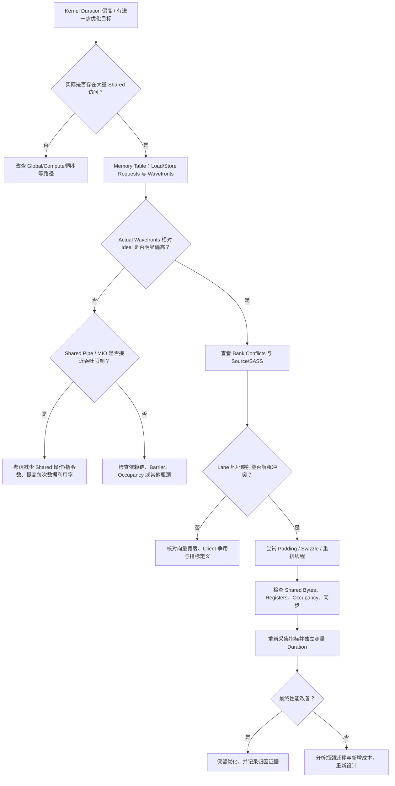

### 如何阅读性能指标之间的因果链

**第一层：算法与地址模式。** 源代码和 SASS 能否证明确实存在“同 Bank 不同 Word”的访问？如果不能，就不要先假定 Bank Conflict。对于 FP16/BF16、FP64、Vectorized Access，尤其要确认实际指令访问宽度。

**第二层：硬件工作量。** NCU 是否显示相应 Shared Load/Store 的 Actual Wavefronts 明显高于 Ideal，且 Bank Conflict 的变化方向与地址模型一致？如果 Wavefronts 较高却只是因为宽数据读写，那么不属于 Padding 优化问题。

**第三层：调度与关键路径。** Short Scoreboard、MIO Throttle、Scheduler Issue Activity、Occupancy 是否支持“Shared 数据服务正在限制 Warp 进度”？注意它们都不是绝对、独立的因果证明。

**第四层：整体性能。** 修改后实际 Kernel Duration 是否缩短，测量方法是否符合第一、二课的可复现性规范？是否同时降低了 Shared 波前数量而没有使 Global Store 变差？是否造成寄存器溢出、CTA 资源下降或同步开销增加？

到这一步，你才形成了**源码地址 → Bank 映射 → NCU 硬件指标 → Warp 调度 → Kernel 时间**的完整归因链。

---

## 14. 延伸到 GPU 通信、MoE 与异步 Copy：哪些结论可以直接迁移？

本节只是进阶应用的观测边界：MoE 是把输入分给多个专家计算分支的模型，Token/Hidden 指其数据项与特征维度；Pack/Unpack 是打包/拆包，Reduce/Combine 是求和等归约/合并，Dispatch 是分发。GPU P2P 是 GPU 间直接访问，NVLink 是 GPU 间互连，不能由本地 shared 计数代替链路流量。

虽然本课主要讨论独立的 Transpose/Tile Kernel，但数据布局和 Shared Bank 分析可以迁移到 GPU 通信侧的很多局部操作。

| 工作负载 | Shared Memory 的可能用途 | NCU 应重点检查什么 | 不应做什么推断 |
|---|---|---|---|
| Pack / Unpack | 对 Token/Hidden 数据重排 | Shared Load/Store、Bank Conflict、Global Coalescing | 不能只凭 Bank Conflict 推断端到端 Dispatch 性能 |
| Reduce / Combine | Block 内部分归约和线程间交换 | LDS/STS、Shared Atomic、Warp Shuffle、Barrier | 不能将 Atomic Contention 归为 Bank Conflict |
| GPU P2P 数据处理 | 本地数据分块、后处理与合并 | 局部 Shared 数据路径及 Warp Stall | 不能用 Shared Metrics 代表 NVLink 链路吞吐 |
| 通信与计算融合 | 在片上缓冲中重排并复用数据 | Shared 占用、Occupancy、Sync、计算流水线 | 不能假设 Shared 增多必然提高性能 |
| TMA / Async Copy | 异步装载 Tensor Tile 到 Shared | 对应 Copy/Shared Path、布局、Barrier | 不能把全部异步搬运直接归入普通 LDS/STS |

对通信 Kernel 还要特别记住第二课关于 Replay 的边界：如果内核需要与其他 GPU、CPU、NIC（网卡）发生实时同步或 Polling（反复读标志等待对方推进），NCU 的 Kernel Replay（为采不同指标重复执行 kernel） 可能改变这些外部交互关系。此时应先在独立可重放的局部算子上验证 Bank 映射优化，再在真实分布式环境中使用合适的工具验证端到端影响。

---

## 15. 十二个常见误区：读 Shared Memory 报告时主动排除

1. **“所有 Lane 访问同一个 Bank 就一定冲突。”** 错：若读的是同一个 Word，Broadcast 可以避免普通 Bank Conflict。
2. **“随机访问 Shared Memory 一定低效。”** 错：只要访问的不同 Word 分布在不同 Bank，也可以无冲突。
3. **“Stride 越大 Bank Conflict 越严重。”** 错：`stride=32` 是最坏模式，而 `stride=33` 在经典 FP32 模型下无冲突。
4. **“`gcd(stride,32)` 能直接用于所有类型和指令。”** 错：它依赖每 Lane 一个独立 4B Word、32 Lane 全活跃等前提。
5. **“两个 FP16 元素占用同 Bank 就是 2-way Conflict。”** 不一定：它们可能落在同一个 4B Word 内，需要按真实访问宽度判断。
6. **“`Wavefronts/Requests>1` 一定有 Bank Conflict。”** 错：FP64/Vectorized Shared 访问可能天然需要多个 Wavefront。
7. **“`Bank Conflicts=0` 就说明 Shared Memory 没有性能问题。”** 错：指令发射、依赖延迟、请求吞吐、Barrier 和 Occupancy 仍然可能限制性能。
8. **“Short Scoreboard 高就是 Shared Bank Conflict。”** 错：Short Scoreboard 的原因远比 Bank Conflict 广泛，需要 Source/SASS 和 Memory 数据共同确认。
9. **“消除 Bank Conflict 就能按冲突度线性加速整个 Kernel。”** 错：Wavefront 与总时间不是同一个量；可能受到 Amdahl 限制与硬件重叠影响。
10. **“给所有二维 Shared 数组都加一列 Padding。”** 错：要依据实际 Warp 地址映射，Padding 也可能影响内存占用、对齐或向量化。
11. **“NCU 总 Bank Conflict 计数必然等于 Source 每条 LDS/STS 冲突之和。”** 不一定：可能涉及不同硬件 Client、统计口径或指令类型差异。
12. **“Shared Memory Tiling 一定减少总访存时间。”** 错：必须评估加载、存储、同步、资源与所有其他路径的新增成本。

---

## 16. 自测题：先手算，再看参考答案

### Q1. 假设 32 Banks、4B/Bank Word，`float smem[]` 的元素 `smem[65]` 映射到哪个 Bank？

**参考答案：** `bank=65%32=1`。它与 `smem[1]` 位于同一个 Bank，但不是同一个 Word。

### Q2. 32 Lane 均读取 `smem[0]`，为什么不是 32-way Bank Conflict？

**参考答案：** 所有 Lane 请求的是同一 Word，可以 Broadcast，因此通常不产生普通读取 Bank Conflict。

### Q3. 32 Lane 的地址为 `smem[lane*8]`，理论冲突度是多少？

**参考答案：** `gcd(8,32)=8`，在每 Lane 一个不同 FP32 Word 的单指令模型下为 8-way Conflict；使用 4 个 Banks，每个 Bank 服务 8 个不同 Word。

### Q4. `smem[lane*17]` 是否存在经典 FP32 Bank Conflict？

**参考答案：** `gcd(17,32)=1`，32 个 Lane 映射到 32 个不同 Banks，理论无冲突。

### Q5. `float tile[32][32]` 中固定列 `c`，Lane `k` 访问 `tile[k][c]`，Bank 是多少？

**参考答案：** `(32k+c)%32=c`，全部落在 Bank `c`，不同 Lane 读不同 Word，产生 32-way Conflict。

### Q6. 改成 `float tile[32][33]` 后，同一列访问的 Bank 如何变化？

**参考答案：** `(33k+c)%32=(k+c)%32`，当 Lane 遍历 0–31 时覆盖全部 32 Banks，消除该经典模式下的冲突。

### Q7. `[32][32]` 到 `[32][33]` 增加了多少字节 Shared Memory？

**参考答案：** `32×(33−32)×4=128B`。从 4096B 变成 4224B，增加 3.125%。

### Q8. 某 FP64 Shared Load 有 10,000 Requests、20,000 Wavefronts，是否能直接断定 2-way Conflict？

**参考答案：** 不能。每 Lane 8B 本身可能需要至少两个 4B 银行服务轮次；如果 Ideal Wavefronts 也是 20,000，那么没有理由仅凭 2.0 的 Wavefronts/Req 推断冲突。

### Q9. 如果 Source 中消费 `LDS` 结果的 FADD 一直因 Short Scoreboard 无法发射，该从哪里开始查？

**参考答案：** 先沿 RAW 依赖追到产生结果的 LDS，再确认它对应的 Shared Memory 访问模式、Wavefronts 和 Bank Conflicts，并同时检查其他 Short Scoreboard 来源及 Eligible Warps，而不是直接修改 FADD。

### Q10. 为什么 Bank Conflict 消除后 Achieved Occupancy 下降也可能发生？

**参考答案：** 例如 Padding、双缓冲或新布局增加每 Block Shared Memory，导致每 SM 可驻留 Block 上限下降。寄存器、编译器布局也可能改变，因此需要同时检查 LaunchStats 与 Occupancy。

### Q11. 什么情况下 Warp Shuffle 比 Shared Memory 交换更合适？

**参考答案：** 当所需的数据交换完全位于同一 Warp 内、值已经在寄存器里，且 Shuffle 的指令与掩码成本低于 Shared Store + 同步 + Shared Load 时，Shuffle 可能更合适。不能不加分析地用于跨 Warp 通信。

### Q12. 两版 Kernel 的 Shared Bank Conflicts 从 1M 降到 0，但 Kernel Duration 不变，应该如何报告？

**参考答案：** 可以确认某种 Shared 数据路径工作量或硬件冲突指标改善，但不能称为 Kernel 性能优化成功。下一步应检查是否已被其他工作掩蔽、Shared Pipe 是否原本非瓶颈，以及是否产生了 Occupancy、指令或同步的新增成本；最后以独立 Benchmark 复测。

### Q13. 如果 32 个 Lane 中只有 8 个活跃，能否继续直接套用 `gcd(s,32)` 得到冲突度？

**参考答案：** 不能。公式假设 32 个 Lane 全活跃。应当先列出 8 个 Active Lane 的全部访问地址和 Word/Banks，再计算每 Bank 的不同 Word 数与广播关系。

### Q14. 为什么改善 Shared Memory Bank Conflict 不能作为 NVLink 通信性能提升的直接证据？

**参考答案：** Shared Bank Conflict 是 SM 本地片上访问的指标；NVLink 是 GPU 间链路，两者不属于同一硬件层次。局部数据重排改善可能影响端到端发送效率，但必须通过分布式通信基准与相应链路测量进行验证。

---

## 17. 本课验收标准、知识连接与下一课

本课完成后，应该能够独立做到以下事情：

| 能力 | 最低验收标准 |
|---|---|
| Bank 地址映射 | 给出任意简单 FP32 Shared 地址，计算其 Bank；解释同 Bank 不同 Word |
| 冲突数学推导 | 在明确前提下使用 `gcd(stride,32)` 推导 1、2、4、8、16、32-way Conflict |
| Broadcast 正确性 | 说明同一 Word 读取为什么不等于 Bank Conflict；区分普通 Store 数据竞争与 Atomic |
| 宽访问判断 | 解释 FP16、FP64、`float4` 为什么不能套用单 FP32 的全部结论 |
| Transpose 完整分析 | 从 Global Load/Store 的 Coalescing，推导 Shared Tile Column Load 的 Conflict 及 Padding 修复 |
| NCU 指标理解 | 区分 Shared Instructions、Requests、Ideal/Actual Wavefronts、Bank Conflicts |
| SASS 性能归因 | 从 Source 的 Consumer Stall 回溯产生依赖的 Shared Load，再验证地址布局 |
| 工程化判断 | 能同时考虑 Occupancy、同步与 Kernel Duration，而非只优化局部指标 |

### 与前五课的关系

第一、二课解决 **“测量是否可信”**；第三课解决 **“资源允许驻留多少 Warp”**，第四课解决 **“实际驻留为何变化、驻留 Warp 为什么等待”**；第五课解决 **“Global Memory 请求如何在缓存与显存路径中消耗资源”**；第六课进一步解决 **“同样是在 SM 内部的 Shared Memory，为什么地址布局也会决定硬件服务工作量”**。

如果把这六课连接成一条完整诊断链，它是：

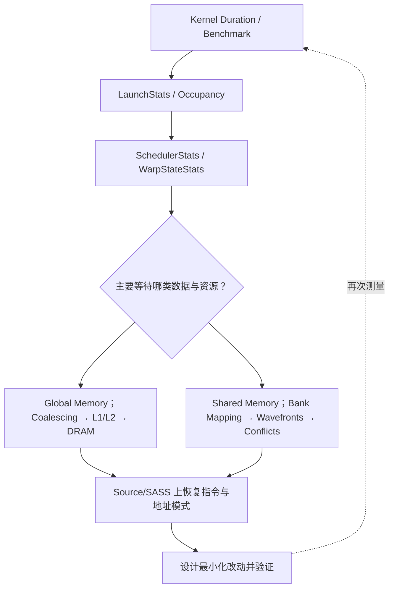

**本课的核心成果：** 对任何一次典型 Shared Memory 访问，不靠猜想而是列出 Warp 内地址、计算 Bank、区分 Broadcast 和冲突、推导理想与额外服务工作量，再将 NCU 的计数器、Short Scoreboard、Source/SASS 和真实时间连接起来。只有建立这种证据链，才算真正掌握 Shared Memory 优化。

下一课将进入 **计算流水线与性能上界**，重点研究 FP32/INT/SFU/Tensor 指令类型、Pipe Utilization、Latency vs Throughput、Instruction Mix、Roofline Model，并将过去两课的访存分析与计算吞吐模型结合起来。

---

## 参考资料与建议阅读顺序

1. [NVIDIA CUDA Programming Guide — Shared Memory Access Patterns](https://docs.nvidia.com/cuda/archive/13.4.2/cuda-programming-guide/02-basics/writing-cuda-kernels.html#shared-memory-access-patterns)：权威定义，包含 Bank、Broadcast、冲突、Transpose、Padding 的程序级解释。
2. [NVIDIA CUDA Best Practices Guide](https://docs.nvidia.com/cuda/cuda-c-best-practices-guide/)：Shared Memory、矩阵转置、Bank Conflict 优化与数据复用；适合与本课数学推导交叉阅读。
3. [NVIDIA Nsight Compute Profiling Guide](https://docs.nvidia.com/nsight-compute/ProfilingGuide/index.html)：`Memory Workload Analysis → Shared Memory` 的 Instructions、Requests、Wavefronts、Bank Conflicts 定义。
4. [NVIDIA Nsight Compute Compute Triage Guide](https://docs.nvidia.com/nsight-compute/ComputeTriage/)：Shared Bank Conflict 的诊断方法、宽访问 Ideal Wavefront 与 Short Scoreboard 的因果边界。
5. [NVIDIA Nsight Compute UI Guide](https://docs.nvidia.com/nsight-compute/NsightCompute/index.html)：Source 页面、理想/实际 Wavefront 相关分析与报告导航。
6. [NVIDIA Developer Blog — Using Shared Memory in CUDA C/C++](https://developer.nvidia.com/blog/using-shared-memory-cuda-cc/)：帮助形成直观 Bank 地址与 Block 内协作认识；历史架构的 Bank 设置细节不应直接套用现代 GPU。
7. [【CUDA 调优指南】Shared Memory 与 Bank Conflicts](https://www.bilibili.com/video/BV1AicNemE9m/)：配套观看，建议边看边验证本课 Stride 和 Transpose 推导。

> **阅读说明：** 教学示例使用 32 Banks、4B Word、单个 Warp 和 FP32 的经典模型。硬件实现、Metric 名称、Source 抽样与执行时序随 GPU 架构和 Nsight Compute 版本变化。对于实际机器，始终以本机支持的 Metric 定义、真实 SASS 和可复现 Benchmark 为准。
