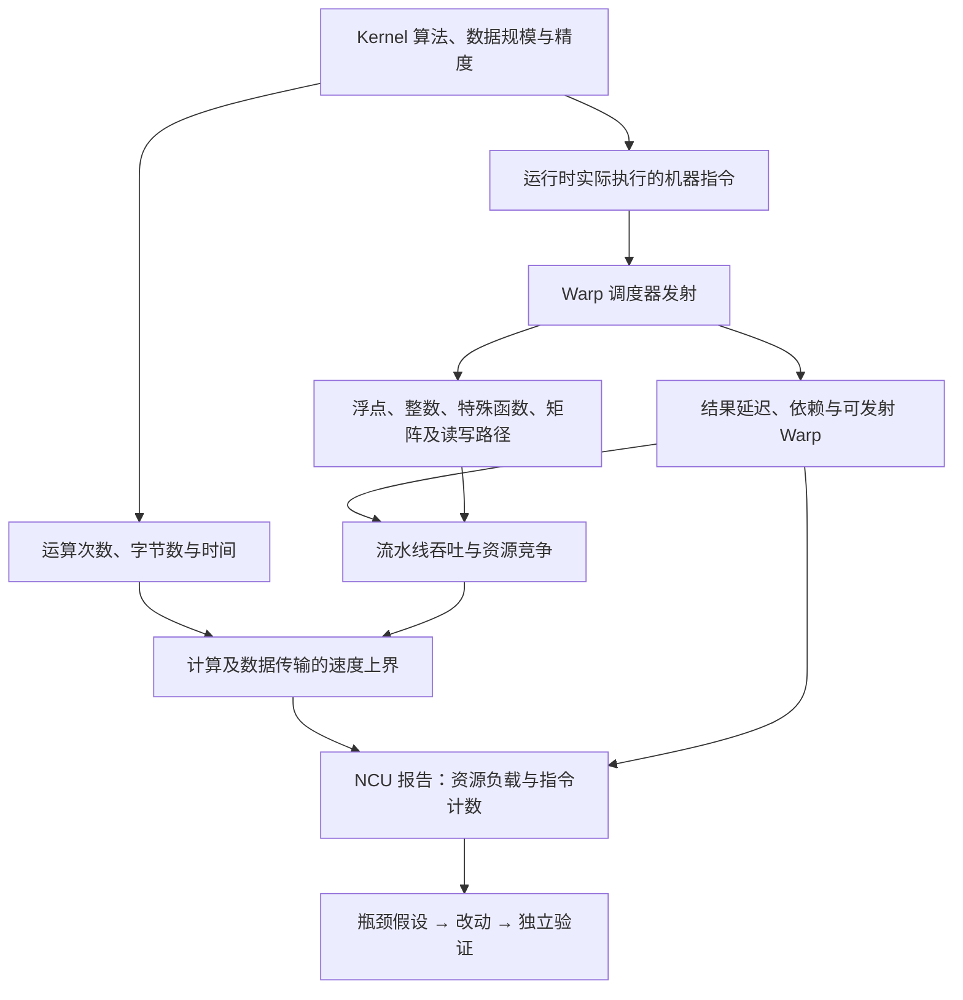
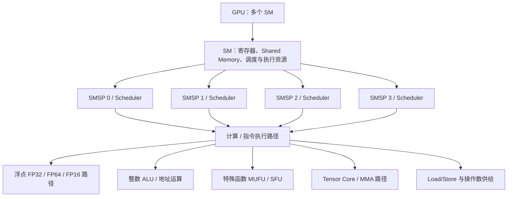
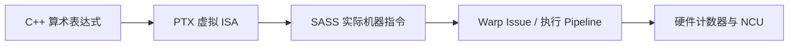
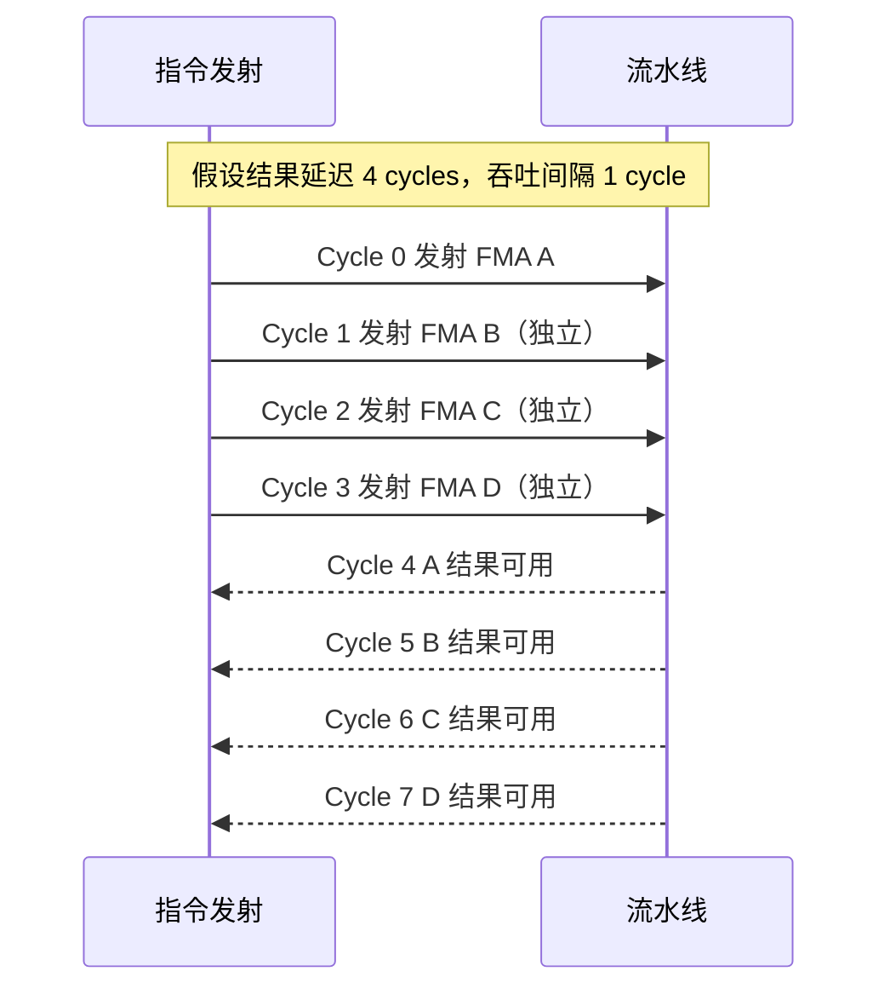
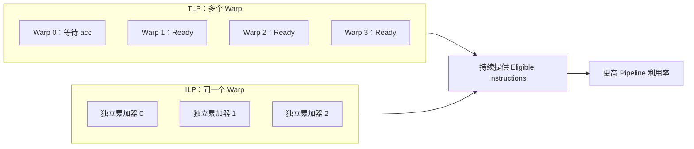
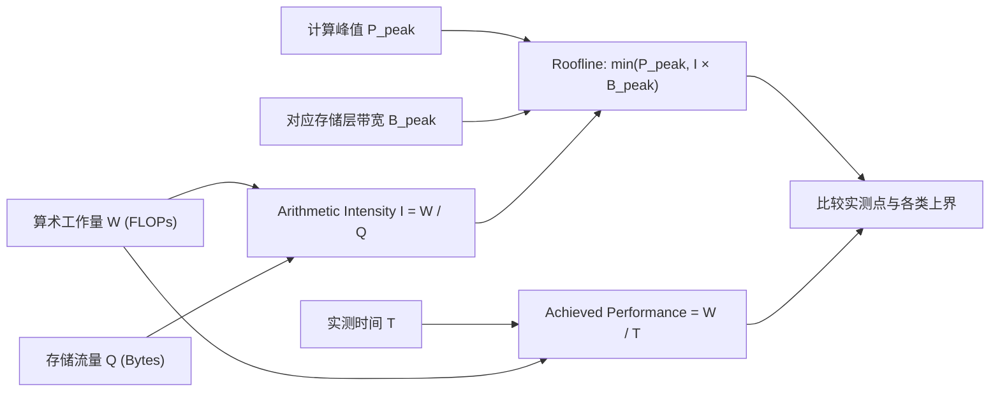
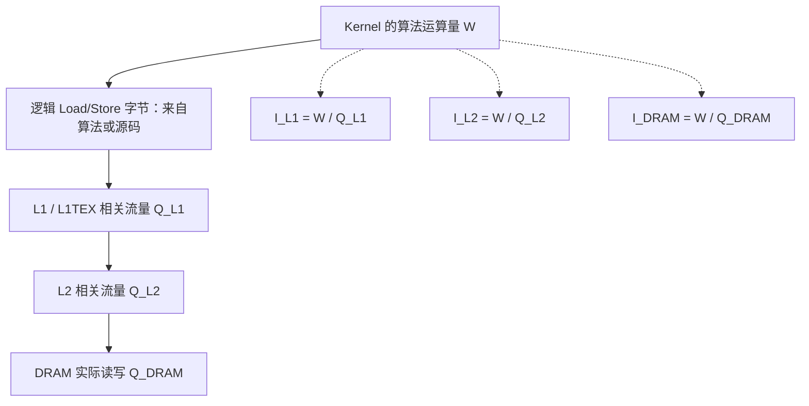
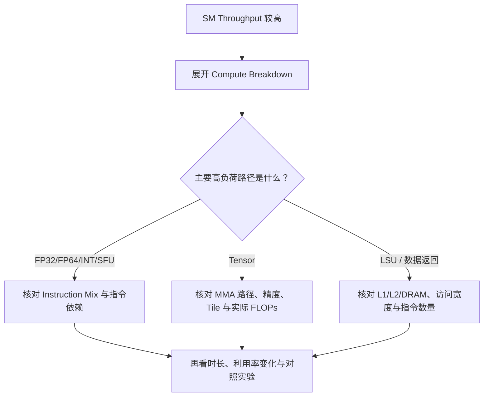
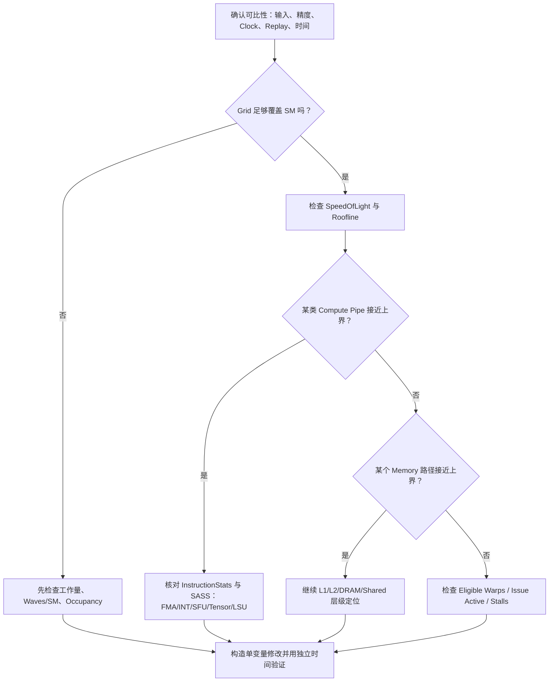

# NCU 系统学习 · 第七课：计算流水线、指令吞吐与 Roofline 性能上界

> 配套实验：[lab07.md](lab07.md) · [入口源码](kernels/main.cu) · [脚本入口](commands/)（源码与实验设计已提供；历史默认入口仅有 compile-only 记录，不代表改后源码或新脚本，见[旧编译日志](log/legacy_commands/compile/source_check.log)，尚未运行验证，无性能实测）。

> **课程定位**：从第 3、4 课的 SM/SMSP、Warp Scheduler 和 Scoreboard 出发，进一步理解 GPU 指令发射后由哪些执行资源处理、什么决定计算吞吐上限、为何理论 FLOPS 与实测 FLOPS 差距很大，以及如何通过 Nsight Compute（NCU）识别真正的 Compute-bound Kernel。
>
> **文档范围**：硬件执行原理、性能模型、NCU 观测与归因、完整数值案例；不提供独立实验程序、自动化脚本。本文中的数字均为**教学假设**，不是特定 GPU 的实测数据。硬件细节与指标名会随 GPU Compute Capability 和 NCU 版本变化，实际分析须查询目标设备。
>
> **前置课程**：第 1 课 NCU Metrics；第 2 课 Replay 与测量扰动；第 3 课 Occupancy；第 4 课 Warp Scheduling / Stall；第 5 课 Global Memory；第 6 课 Shared Memory。
>
> **学习时间建议**：一周 5–8 小时，其中理论 3–4 小时、案例推演 2–3 小时、复盘约 1 小时。

---

## 0. 本课的主问题与知识地图

先看一个具体任务：输入两个数组 `A=[1,2,3,4]`、`B=[10,20,30,40]`，输出逐项和 `C=[11,22,33,44]`。**Kernel（核函数）**是提交给 GPU 执行的函数；**线程**是执行该函数的一份工作实例。本例让编号 `i` 的线程读取 `A[i]`、`B[i]`，相加后写入 `C[i]`，不把四项再求总和。CPU 一侧称主机（Host），负责准备数组、分配 GPU 存储并启动 kernel；GPU 一侧称设备（Device）。启动多出的线程要先检查 `i<N`，避免访问数组外的位置。

GPU 把线程组成 **block（线程块）**，同块线程可以合作；全部 block 构成一次启动的 **grid（网格）**。执行时，线程按每组 32 个组成 **warp**，组内第 0～31 个位置叫 **lane**。小例只有四项有用工作，即使启动了 32 个线程，也只有四个 lane 应读写数组。**SM（Streaming Multiprocessor）**是 GPU 上容纳线程并完成指令的处理单元，GPU 通常有多个 SM；**Warp Scheduler（warp 调度器）**从已分配到本 SM 的 warp 中挑选下一条可执行指令。把指令交给执行资源叫**发射（issue）**，不是说结果此刻已经算完。**寄存器**是保存每个线程当前数值和地址的快速小存储；指令读取的输入值叫**操作数**。

**计算流水线（pipeline，亦简称 pipe 或管线）**把一条运算拆成若干处理步骤，让不同独立运算的不同步骤重叠，像多人接力加工。**延迟（latency）**问一条运算的结果要等多久，**吞吐（throughput）**问一段时间完成多少工作。例如每条运算要四拍，但独立运算每拍可送进一条；第 2 节再展开时序。若后一条必须使用前一条结果，就有**数据依赖**，不能随意重叠。

GPU 有不同的执行资源：**FP32/FP64** 分别指 32/64 位浮点数及其运算路径，FP32 在本课对应 C++ 的 `float`；**整数资源**处理 `i+1` 等索引运算；**特殊函数单元 SFU**处理部分特殊数学函数；**Tensor Core**则专门加速成组的矩阵乘加。因此，**“一个 kernel 写了很多算术”不等于“相应执行路径一直忙”**：它也可能在等待前一步结果、等待数据，或根本没提供足够多独立工作。

本课沿着四条关系学习：

1. **指令 → 流水线**：指令由 Warp Scheduler 发射后，在什么执行资源上运行？一条 Warp 指令与 FLOPs 是什么关系？
2. **延迟 → 并发 → 吞吐**：单条指令需要多个周期完成，为何硬件仍能近乎每周期接受新指令？ILP 与 TLP 分别解决什么问题？
3. **计算量 → 数据量 → 上界**：Roofline 如何把 FLOPs、Bytes、计算峰值和带宽峰值统一起来？
4. **指标 → 证据 → 归因**：NCU 的 SM Throughput、Pipeline Utilization、Issue Active、Instruction Mix 和 Roofline 如何交叉验证？

下面先用已说明的概念画出分析路线；**NCU（Nsight Compute）**是收集 GPU kernel 性能信息的工具，图中“上界”指即使理想执行也不能超过的速度，具体数法从第 1 节开始建立。



**结课目标**：在看到某个 Kernel 的低 FLOPS、高 SM Throughput 或 Tensor Pipe 忙碌后，不急于下结论，而是能解释其执行指令、运算精度、主要 Pipeline、吞吐上界和可操作的性能限制，并用恰当的 NCU 指标验证。

---

## 1. GPU 的计算吞吐到底来自哪里

### 1.1 不要把“CUDA Core 数量”直接等同于“所有指令的执行能力”

现代 NVIDIA GPU 可以从逻辑上分为 GPU → GPC → SM → SMSP → Warp Scheduler 与若干执行资源。GPC 是组织多个 SM 等资源的较大硬件分组，本课不靠它做计算；**SMSP 是 SM 的子分区**，用于进一步区分调度和执行资源。**驻留（resident）**指 warp 已获分配本 SM 的资源、尚未执行完，不表示它此刻就能发射。对本课最重要的是 SM/SMSP 层：**Warp Scheduler 负责选择准备就绪的 Warp 指令并发射，执行单元负责完成实际的算术或数据操作**。指令类型不同，落到的管线和资源约束也不同；一个 SM 不存在可以对所有指令类型通用的单一“算力数字”。

**CUDA Core** 是硬件浮点/算术执行资源的计数说法，不是一个 CUDA 软件线程，也不是完整的独立 CPU 核。**Shared Memory（共享内存）**是同一 block 中线程可共同使用的 SM 上小存储，例如线程先存部分和、再由同块线程取走。

先解释图表中操作：**Load/Store** 是读入/写出数据，**LSU** 是承担这类操作的读写执行资源；它忙不等于显存已满速。**FMA（融合乘加）**计算 `a*b+c`，乘加合在一起后只做一次最终舍入，具体计数见 1.3。**MMA（矩阵乘加）**计算一小块矩阵的乘法再加到结果中，而不是仅做一个数的乘加。**ALU** 是算术逻辑执行单元，**MUFU** 是部分特殊函数机器指令的名称。**Barrier（同步屏障）**让指定的一组线程到齐后再继续，避免读到其他线程尚未写好的结果；**Shuffle** 是 warp 内线程间交换数值的操作。表中的大写短名是机器指令的可读名称，不要求先背编码。



> 图示是*功能层次示意*，不是某个 GPU 的物理布线图；某些执行资源是共享的，部分指令可使用不同路径，架构间的 Pipeline 划分和指令吞吐差异很大。不能据此假设每个 SMSP 都拥有一组彼此完全独立的所有单元。

常见指令类别及其硬件含义：

| 计算/操作类别 | 常见任务 | 可观察的机器指令或指令族（示例） | 分析时常见误区 |
|---|---|---|---|
| FP32 浮点 | 加法、乘法、FMA | `FADD`、`FMUL`、`FFMA` | FP32 利用率不能代表 Tensor Core 利用率 |
| FP64 浮点 | 双精度运算 | `DADD`、`DMUL`、`DFMA` | 不同 GPU 的 FP64 峰值可能差别极大 |
| INT / ALU | 索引、地址和整数算术 | `IADD3`、`IMAD`、逻辑类指令 | 整数指令可能成为计算主路径的瓶颈 |
| SFU / MUFU | `sin`、`cos`、`exp2`、`log2` 等近似/特殊操作 | `MUFU.*` 等 | 数学函数未必只对应一条硬件指令 |
| Tensor Core | 矩阵乘加 | `HMMA`、`MMA`、`WGMMA` 等，依架构而定 | 一个 MMA 指令可包含大量 FLOPs |
| Load/Store / LSU | 读取操作数、结果写回 | `LDG`、`STG`、共享内存指令 | LSU 饱和不一定是 DRAM 带宽饱和 |
| 同步/控制 | 条件、Barrier、Warp 协作 | `BRA`、`BAR`、`SHFL` 等 | 不是 FLOPs，却能限制发射与延迟 |

### 1.2 CUDA C++、PTX、SASS、硬件 Pipeline 是四个不同层次

CUDA C++ 用数组、循环和线程编号表达算法；编译器先得到 PTX 虚拟指令，再为具体 GPU 生成机器码。**ISA（指令集）**是一套指令及其含义的约定，虚拟 ISA 不对应唯一硬件实现；**SASS** 是具体 GPU 机器指令的可读形式。例如源码 `a=b*c+d` 的算术部分可能变为一条 `FFMA`，也可能变成乘、加两条指令。机器指令最后由硬件流水线执行。**NCU（Nsight Compute）**收集运行信息；硬件计数器是芯片中累计某类事件或周期的计数设施，不是直接理解源码的“秒表”。



对 `a = a + b * c` 这样一行代码，编译器可能根据编译选项、数据类型和数值语义生成融合的 FMA，也可能生成分离的乘加。一个数学表达式也可能需要计算数组地址、读写数据、检查条件及转换数值类型。这里的**谓词（predicate）**是控制一条指令是否对某个线程生效的真假条件，例如 `i<N` 为假时屏蔽越界写入。

**FLOP** 是一次浮点运算的计数单位；`FLOPs` 表示次数总量，`FLOP/s` 才表示每秒多少次。算法中的一次浮点加法计 1 FLOP，整数地址计算不计浮点 FLOPs。还要认识 **tile（分块）**：把大矩阵拆成若干小矩形处理；**padding（填充）**则为凑齐块尺寸补位置，例如 3 列按 4 列块计算时多出一列。额外位置可能产生执行工作，却不增加任务本来需要的结果。因此应区分：

- **算法 FLOPs**：为完成数学问题，概念上需要执行的浮点工作量。
- **实际执行 FLOPs**：硬件实际完成的浮点操作量，可能包含 Padding、边界 Tile、重复计算、无效计算或额外数值转换相关工作。
- **SASS 指令数**：Warp 级机器指令的执行统计；与 FLOPs 没有固定一一对应关系。
- **指令发射数量**：调度器发射到执行资源的指令统计；并不直接代表完成的有用数学操作数。

### 1.3 FMA 计数：一条指令为何可能代表两个 FLOPs

一个 FP32 FMA 计算 `d = a * b + c`，通常按**一次乘法 + 一次加法 = 2 FLOPs**计算。这是后面用运算量建立速度上界时的计数惯例，尽管 FMA 具有融合舍入语义。

`FFMA` 是 FP32 融合乘加机器指令。**Warp 级计数**把整组的一次指令计为 1；**线程级计数**则逐个统计参与线程。活跃 lane 是当前执行路径中的线程位置；还需谓词为真才真正执行条件操作。设一条 Warp 级 `FFMA` 指令有 32 个活跃且参与运算的 Lane，则其数学工作量为：

$$
32\ \text{lane}\times 2\ \text{FLOP/lane}=64\ \text{FLOP}.
$$

如果某个 Kernel 实际执行 1,000,000 条满足上述条件的 Warp 级 `FFMA` 指令，则这部分约为 64,000,000 FLOPs。但如果存在谓词屏蔽、部分 Lane 不执行、与 FP32 无关的指令，或者采用 Tensor MMA 等不同执行路径，就不能简单套用这个换算。

**区分指令数与 FLOPs 是理解计算吞吐的第一把钥匙。**

---

## 2. 指令延迟（Latency）、指令吞吐（Throughput）与 Pipeline

### 2.1 Latency 不等于 Initiation Interval

**时钟周期（cycle）**是硬件节拍；频率 1 GHz 表示每秒 $10^9$ 个周期。**Producer（生产者）**是产生某个值的指令，**Consumer（消费者）**是使用它的指令，例如乘法产生 `v`，后面的加法使用 `v`。假设一个教学模型中的浮点流水线，单次 FMA 的结果需要 4 个周期才对后继依赖指令可用，但该流水线在资源允许时每个周期都能接收一条新的独立指令。这里“独立”指新指令不需要尚未返回的结果。

| 概念 | 假设值 | 物理含义 |
|---|---:|---|
| Latency | 4 cycles | 从发射到结果可被相关 Consumer 使用的延迟 |
| Initiation Interval | 1 cycle | 可连续接收新独立指令的最小间隔 |
| 理想接收率 | 1 instruction/cycle | 稳态吞吐能力，而非单条指令完成速度 |



这里的 Cycle 是抽象时序，不代表某代 GPU 实际的 FFMA 具体延迟。**高吞吐依赖持续向流水线提供足够多互不阻塞的工作，而非要求每条指令零延迟。**

### 2.2 串行依赖链：为什么算术很多仍然跑不满

**累加器（accumulator）**是保存逐步累积结果的变量，例如 `acc`；末尾把多个部分结果合成一个结果叫**归约（reduction）**，本例就是求和。考虑两个实数数学上可表达相同总和、但依赖结构不同的累加思路（仅示意；浮点加法改变顺序可能改变舍入结果）：

**方案 A：单个累加器串行依赖**

```text
acc = fma(x0, y0, acc)
acc = fma(x1, y1, acc)
acc = fma(x2, y2, acc)
acc = fma(x3, y3, acc)
```

后面的 FMA 必须等待前面的 `acc`。若结果延迟 4 cycles，单一 Warp 的这一条依赖链很难每周期继续发射下一次 FMA。

**方案 B：多个独立累加器**

```text
acc0 = fma(x0, y0, acc0)
acc1 = fma(x1, y1, acc1)
acc2 = fma(x2, y2, acc2)
acc3 = fma(x3, y3, acc3)
... 末尾再归约 acc0..acc3 ...
```

不同累加器产生独立指令链，调度器有更多可发射指令，称为**指令级并行（Instruction-Level Parallelism, ILP）**。代价是更多活跃寄存器、更复杂的尾部归约，以及可能不同的浮点舍入结果。

若本例 Latency 为 4 cycles、目标吞吐间隔为 1 cycle，那么在简化模型中至少需要约 4 条彼此独立且可轮换发射的工作链，才能持续向流水线供给新指令；真实 GPU 还受到 Warp 调度、操作数收集、寄存器访问、发射端口和执行资源的限制。

### 2.3 用多个 Warp 隐藏延迟：TLP

**Ready/Eligible（就绪/可发射）**表示 warp 的下一条指令已经满足输入及相关发射条件，不等于仅仅驻留。当 Warp A 等待指令结果时，Scheduler 可以切换到已经 Ready 的 Warp B、C、D。这种**线程/ Warp 级并行（Thread-Level Parallelism, TLP）**与 ILP 互补：



**Occupancy（占用率）**的分母是一个 SM 硬件最多可驻留的 warp 数，分子是驻留数；例如 32/64=50%，不是算术单元忙碌时间占一半。理论 occupancy 按资源上限估计，实测 occupancy 来自运行统计。

两种机制有不同的资源代价。增加 TLP 往往需要更多驻留 Warp，受每 SM 的寄存器、Shared Memory、Block 和 Warp 上限约束；增加 ILP 往往需要更多每线程寄存器，这**可能降低 Occupancy**。因此优化并不是无限增加 ILP 或 Occupancy，而是在具体架构上寻找可持续的指令供给。

### 2.4 Little's Law 的适用直觉

一个吞吐系统需要足够多的在途工作才能隐藏固定延迟：

$$
N_{\mathrm{in\ flight}}\approx \lambda L,
$$

这里采用 Little's Law 的稳态平均直觉：持续运行、平均行为较稳定时，$N_{\mathrm{in\ flight}}$ 是平均已发出而未完成的工作条数；$\lambda$ 是同一系统范围内的目标完成/接收率（条/周期），$L$ 是平均延迟（周期），相乘周期抵消后得到条数。假设希望维持 1 条指令/周期，而每条有 4 周期的可见延迟，那么从概念上需要约 4 条能够重叠进行的独立工作。

**限制**：这是帮助理解的队列论直觉，不是直接计算 GPU 最佳 Warp 数的万能公式。真实 GPU 的调度粒度、Pipeline、多发射能力、等待条件、执行端口和动态指令混合都比这个模型复杂。

---

## 3. Instruction Issue、IPC、Pipeline Utilization：三个经常混淆的量

### 3.1 Issue Active：Scheduler 是否发出了指令

NCU 将一组相关指标组织成 **Section（报告节区/指标组）**；**Metric** 是其中具体的一项数值。`SchedulerStats` 是观察调度器的指标组。**Issue Active（发射活跃度）**观察调度器发生发射的活跃情况，而不是结果已经完成的比例。它可以观察 Warp Scheduler 的发射活跃度及准备就绪的 Warp。例如 `smsp__issue_active.avg.pct_of_peak_sustained_active` 是一个常用参考指标。名字中 `smsp` 指统计 SM 子分区，`avg` 指相应实例平均，`pct_of_peak_sustained_active` 指按工具规定的活跃周期与持续峰值归一化成百分比；**峰值**是指定条件下的参考最大速率，不是任务已经完成的比例。具体 active 周期的定义需查该指标，不是直接拿主机秒数作分母。但指标名称与可用性需要以目标 GPU 查询结果为准。

理解它时必须记住：**一个 Scheduler 发生了指令发射，并不能说明发出的指令都是 FP32 乘加。** 它可能发射 `IADD3`、`LDG`、`STG`、分支、同步、MUFU 或 MMA 指令。

### 3.2 IPC：单位周期实际发射或执行的指令数

最常用的概念公式是：

$$
\mathrm{IPC}=\frac{\mathrm{Instructions}}{\mathrm{Cycles}}.
$$

这里的分子是指令次数，分母是同一对象的周期数，单位为 instruction/cycle；100 个周期统计到 80 次发射就是 0.8 条/周期。**issued** 数发射事件，**executed** 数执行事件，不能不查说明就互换。**active cycles** 只计该指标规定的活跃周期，**elapsed cycles** 计测量区间经过的周期，可能包括不活跃部分。因此在 NCU 中必须问清楚三个定义：第一，Instructions 是 **issued** 还是 **executed**？第二，Cycles 是 `active` 还是 `elapsed`？第三，统计对象是 GPU、SM 还是 SMSP？例如每 SMSP 每周期的指令数与每个 SM 汇总的指令数不是同一数值。

此外，同样的 IPC 也可能对应完全不同的 FLOP/s。一条 Warp FP32 FMA 与一条 MMA 指令的数学工作量差距可能非常大，所以**“Issue Rate 低 = Tensor Core 没跑满”是错误推论**。

### 3.3 Pipeline Utilization：哪个硬件路径最繁忙

**Pipeline Utilization（管线利用情况）**描述特定执行路径相对参考能力的活动或吞吐程度，必须看具体指标。忙碌周期占比和按峰值归一化的吞吐百分比不是同一个量：一条长指令可使管线连续忙多拍，却不代表每拍都有一次新发射。NCU `ComputeWorkloadAnalysis` 提供 SM 计算资源的详细分析，包括 IPC 和各个 Pipeline 的利用情况。你关心的不是所有 Pipeline 的利用率总和，而是**哪个 Pipeline 构成最强约束**。

不同架构上 `sm__pipe_*` 名称存在明显差别：例如部分 SM 7.x–8.x 使用 `sm__pipe_fma_*`，更高架构将 FMA 路径分为不同子类；Tensor 相关 Pipeline 也随架构变化。这里 SM 7.x–8.x 等数字是设备指令/资源能力版本（Compute Capability），不是 SM 个数。**Opcode** 指指令操作类型，例如 `FFMA`；**Instruction Mix** 指不同类型指令各有多少或占比多少；**Breakdown** 指展开汇总数的组成项。所以以下只是“指标族”的概念，不是应当在所有 GPU 上硬编码的完整指标清单：

- `sm__pipe_*_cycles_active...`：某计算 Pipeline 的忙碌周期相关统计。
- `sm__inst_executed_pipe_*...`：某类 Pipeline 的指令执行统计。
- `sm__inst_issued...`、`smsp__issue_active...`：指令发射侧吞吐/活跃度。
- `sass__inst_executed_per_opcode`：SASS Opcode 类别执行统计相关项，具体展示与可查询方式依 NCU 版本而定。

指标名中的 `avg` 通常表示跨实例平均，`sum` 表示相应范围求和；`pct_of_peak_sustained_active/elapsed` 表示按工具定义的持续峰值及 active/elapsed 周期口径归一化。分母不是“任务所需工作量”，百分比也不是通用效率分数。

官方 Compute Triage Guide 提醒：`SM Throughput` 等高层综合百分比可能由多个子指标取最大值而来；必须点开 Breakdown 查找真正接近饱和的子路径，不能把该数当作“全部 SM 计算单元平均利用率”。

### 3.4 一个对照：Issue 低不等于 Tensor 低

**标量 FP32**在这里指每线程对单个数的运算，与一次操作一块矩阵的 Tensor MMA 路径对照。表中 Duration 是 kernel 的执行时长；ms 是毫秒，$1\ \mathrm{ms}=10^{-3}$ 秒。M/G/T 分别表示 $10^6/10^9/10^{12}$，因此 3 GFLOPs / 1 ms = 3 TFLOP/s。假设两个 Kernel 的 NCU 观测如下（仅教学假设）：

| 指标 | Kernel A：标量 FP32 | Kernel B：Tensor MMA |
|---|---:|---:|
| Scheduler Issue Active | 85% | 25% |
| FP32 相关 Pipeline 利用 | 90% | 8% |
| Tensor 相关 Pipeline 利用 | 3% | 95% |
| 计算量 | 3 GFLOPs | 80 GFLOPs |
| Duration | 1 ms | 1 ms |
| 实际 FLOP/s | 3 TFLOP/s | 80 TFLOP/s |

不能把“总次数”和“每秒速率”混写。这里两个 Kernel 的 FLOP/s 相差很大，Kernel B 的 Scheduler Issue Active 反而较低。原因是 **MMA 指令单位发射可以带来更大的数学工作量**。因此，分析 Tensor Kernel 时应首先确认 Tensor Pipeline 的活动、对应 MMA 指令族、数据类型与真实 FLOPs，而不是一味提高通用指令发射频率。

---

## 4. 计算吞吐的理论上界：从单流水线推导到整个 GPU

### 4.1 简化的峰值吞吐公式

**峰值（peak）**是指定条件下某类资源的理想或参考最大速率，不是对任意 kernel 的速度保证。规格理论峰值来自资源数和频率；持续实测参考峰值来自匹配工作负载的测量，两者要注明来源。对于某个固定类型的运算路径，可以用概念公式：

$$
P_{\mathrm{peak}}\approx
N_{\mathrm{SM}}\times f_{\mathrm{SM}}\times
R_{\mathrm{op/SM/cycle}},
$$

其中 $N_{\mathrm{SM}}$ 是 SM 数，$f_{\mathrm{SM}}$ 是工作频率（cycle/s），$R$ 是每 SM 每周期可持续处理的**该类型浮点运算次数**（FLOP/(SM·cycle)）。三者相乘后 SM、cycle 抵消，结果为 FLOP/s。若从计算单元数量出发，还必须乘入每个周期执行能力及每条操作对应的 FLOPs；对 FMA 常采用 2 FLOPs/操作。

**教学示例**：假设有 100 个 SM、1.5 GHz 的固定频率、每 SM 对某一浮点路径的理想可持续吞吐为 128 FLOP/cycle，则

$$
P_{\mathrm{peak}}=100\times1.5\times10^9\times128
=19.2\ \mathrm{TFLOP/s}.
$$

下面比较的数据类型中，FP16/BF16 是两种 16 位浮点格式，FP8 是 8 位浮点格式；TF32 是 Tensor 路径使用的一种降低输入有效精度的计算格式，不等于把内存中的 FP32 数组元素改成另一个字节大小。**精度**关系到数能表示的范围和细致程度；**累加精度**专指保存部分和时用的格式。注意：这并非某张卡的规格参数，而且“100 SM × 128 FLOP/cycle”的假设只针对某种运算类型。FP32 标量、FP64、Tensor FP16/BF16、TF32、FP8 的峰值不能混在一张表里直接比较。

### 4.2 为什么理论峰值很难自动达到

表中的 `LaunchStats` 看启动规模与资源，`WarpStateStats` 看 warp 等待状态，`MemoryWorkloadAnalysis` 看分层读写，`Occupancy` 看驻留比例；Source 是把源码与指令/指标关联的代码页。读表前再补两个前课概念：**Scoreboard** 是跟踪指令结果是否就绪的硬件机制，避免 consumer 过早读值；**Stall** 是某个 warp 暂时不能推进的状态，不必然表示整个 SM 闲置。**Waves per SM（工作波次）**将 grid 中的 block 数与全设备可同时容纳的 block 数比较，粗看是否有足够工作，例如总容量 200 块而只启动 100 块约为半波。它不表示每个 SM 一定都收到工作。

至少有六类原因会使实测吞吐低于纸面峰值：

| 限制因素 | 硬件/算法机制 | 典型 NCU 线索 |
|---|---|---|
| 工作量不足 | Grid 小，SM 未充分填满 | LaunchStats / Waves per SM |
| 依赖链 | Producer 结果未完成，Consumer 不 Ready | WarpStateStats / Scoreboard |
| 指令混合 | 地址计算、同步和控制占据发射资源 | InstructionStats / Source |
| Pipeline 不匹配 | 主要算术落在较慢路径或不同精度管线 | ComputeWorkloadAnalysis |
| 数据供给不足 | 操作数由 L1/L2/DRAM 返回太慢 | MemoryWorkloadAnalysis / Stall |
| 资源约束 | Register/Shared Memory 导致可驻留 Warp 不足 | Occupancy / LaunchStats |

因此“计算上界”不仅有总 FLOPS Peak，还可能有**单一计算流水线吞吐上界、指令发射上界、延迟隐藏上界、工作量上界**等。

### 4.3 同一个数学问题，为什么数据类型改变会改变 Roofline

**Roofline（屋顶线）**是把“计算资源每秒最多算多少”与“数据传输每秒最多支持多少运算”比较的上界模型，第 5 节将用公式推导。两者一样紧的位置叫 **Ridge Point（拐点）**。例如 FP32 CUDA Core 路径与 BF16 Tensor Core 路径即便在数学上计算同一个矩阵乘法，其 `P_peak`、输入 Bytes、累加精度、实际 SASS 和 Padding 工作量都可能不同。必须明确 Roofline 采用的**精度与执行路径**，否则 Ridge Point 算出来也没有物理意义。将一个 BF16 Tensor Kernel 的实测 FLOP/s 放在 FP32 标量峰值 Roofline 下比较，属于不同模型之间的错配。

---

## 5. Roofline：把 FLOPs、Bytes 和性能上界放到同一个坐标系

### 5.1 三个定义

**工作量（Work）**：$W$，单位 FLOPs；**数据传输量（Traffic）**：$Q$，单位 Bytes；**执行时间**：$T$，单位 seconds。Byte（字节，简写 B）为 8 bit，FP32 占 4B。**带宽**是单位时间可传输的字节数，单位 Byte/s；本文 GB/TB 使用 $10^9/10^{12}$ 字节，不是二进制 GiB/TiB（分别为 $2^{30}/2^{40}$ 字节）。

**算术强度（Arithmetic Intensity，AI）**表示每搬运 1 字节对应多少浮点运算。例如搬 8B 做 16 FLOPs，强度就是 2 FLOP/Byte；它不含时间，不是速度。**Roofline（屋顶线）**比较两个理想速度限制：计算部件每秒最多做多少运算，以及内存每秒供应的字节最多能支持多少运算。下面 $P$ 是运算速率，$B_{\mathrm{peak}}$ 是带宽（符号 B 的下标形式在这里不是字节单位）。

$$
I=\frac{W}{Q}\quad(\mathrm{FLOP/Byte}),
\qquad
P_{\mathrm{achieved}}=\frac{W}{T}\quad(\mathrm{FLOP/s}).
$$

如果可用计算峰值为 $P_{\mathrm{peak}}$，对应内存层的带宽峰值为 $B_{\mathrm{peak}}$，则经典 Roofline 给出：

$$
\boxed{P_{\mathrm{roof}}(I)=\min(P_{\mathrm{peak}},\ I B_{\mathrm{peak}})}
$$

因为 $(\mathrm{FLOP/Byte})\times(\mathrm{Byte/s})=\mathrm{FLOP/s}$，$I B_{\mathrm{peak}}$ 才能和 $P_{\mathrm{peak}}$ 比较；`min` 取二者较小值。横轴画 $I$，纵轴画运算速率 $P$，斜线段是**带宽上界**，水平段是**计算上界**。实测点 $(W/Q,W/T)$ 必须用相同工作范围和统计口径；“屋顶”是不能超过的理想约束，不是必达目标。



### 5.2 Ridge Point（拐点）

两条上界相交：

$$
I_{\mathrm{ridge}}=\frac{P_{\mathrm{peak}}}{B_{\mathrm{peak}}}.
$$

**数值示例**：假设一张虚构 GPU 针对当前运算路径的计算峰值 $100\ \mathrm{TFLOP/s}$，DRAM 带宽峰值 $2\ \mathrm{TB/s}$，则

$$
I_{\mathrm{ridge}}=\frac{100\times10^{12}}{2\times10^{12}}=50\ \mathrm{FLOP/Byte}.
$$

- 如果 $I<50$，Roofline 的**较低理论上界**由 DRAM 带宽给出。
- 如果 $I>50$，Roofline 的**较低理论上界**由计算峰值给出。
- **重要限定**：落在带宽主导区域不代表当前已经实际饱和 DRAM；落在计算主导区域不代表实际计算 Pipeline 已跑满。真正的瓶颈仍取决于实测点是否接近上界以及其他资源限制。

### 5.3 用表格画出 Roofline（无需依赖图片）

在上面的虚构 GPU 中：

| 算术强度 I（FLOP/B） | 带宽上界 I × 2 TB/s | 计算峰值 | Roofline 上界 |
|---:|---:|---:|---:|
| 0.125 | 0.25 TFLOP/s | 100 TFLOP/s | **0.25 TFLOP/s** |
| 1 | 2 TFLOP/s | 100 TFLOP/s | **2 TFLOP/s** |
| 4 | 8 TFLOP/s | 100 TFLOP/s | **8 TFLOP/s** |
| 16 | 32 TFLOP/s | 100 TFLOP/s | **32 TFLOP/s** |
| 50 | 100 TFLOP/s | 100 TFLOP/s | **100 TFLOP/s** |
| 100 | 200 TFLOP/s | 100 TFLOP/s | **100 TFLOP/s** |

这张表就是 Roofline 的数值定义：在常用对数坐标中，前半段表现为上升的斜线，后半段是水平线。对数坐标按倍数而非差值排刻度，例如 1、10、100 间距相等，便于同时看很小和很大的数。若想用代码画出结构，可使用如下 Mermaid 概念图（不承担真实坐标精度）：


### 5.4 Roofline 是“边界模型”，不是“自动诊断器”

假设 $I=16\ \mathrm{FLOP/B}$，上表给出的 Roofline 上界为 32 TFLOP/s。但某 Kernel 实际只有 8 TFLOP/s，意味着它达到当前 Roofline 上界的 25%。这时不能直接宣布“DRAM 带宽是实测瓶颈”，因为其低效可能来自访问延迟、数据依赖、指令队列、寄存器约束或 Grid 太小。更准确的描述是：**以当前 I 与峰值构建的 Roofline，带宽约束比计算约束更紧，但 Kernel 尚未利用充分。**

同样，Roofline 位于计算主导区域也不意味着程序一定 Compute-bound：它可能因为算术内部的数据依赖，连一半计算吞吐都达不到。

---

## 6. 先手工计算 Arithmetic Intensity：四个关键案例

### 6.1 案例 A：Vector Add

Vector Add 是逐项向量加法：输入 A、B 各 N 个 FP32 数，输出 C 的 N 项，每线程 i 独立完成 $C[i]=A[i]+B[i]$；例如 2+10 写出 12，不跨线程求和。每元素通常按 1 FLOP 计，逻辑上读 A、B 各 4B，写 C 4B，因此：

$$
W=N,\quad Q_{\mathrm{logical}}=12N,\quad
I_{\mathrm{logical}}=\frac1{12}\approx0.0833\ \mathrm{FLOP/Byte}.
$$

以虚构 GPU 100 TFLOP/s、2 TB/s 的参数代入，理想 DRAM Roofline：

$$
P_{\mathrm{roof}}\approx0.0833\times2=0.1667\ \mathrm{TFLOP/s}.
$$

这说明 Vector Add 的算术强度极低，**在足够大、流量确实落到 DRAM 的问题规模下**很难靠增加 FP32 算力获得显著收益。注意 `Q_logical` 不是 NCU 观测的 DRAM Bytes，实际还受缓存、额外事务与测量范围影响。

### 6.2 案例 B：每元素 64 次 FMA，数据只读写一次

本例输入 x 有 N 个 FP32 元素，输出 y 也有 N 项；线程 i 读 `acc=x[i]`，反复更新 `acc=fma(acc,a,b)` 64 次，最后写 `y[i]=acc`。例如 x[i]=1、a=2、b=1 时前两轮是 3、7；仅作数据流说明。假设每个输出元素执行 64 次 FMA，总计约 128 FLOPs；输入只读取一个 FP32 值（4B），最终只写一个 FP32 输出（4B），额外系数均已在寄存器或其他不产生该层额外流量的路径中获得。则：

$$
I_{\mathrm{logical}}=\frac{128}{8}=16\ \mathrm{FLOP/Byte}.
$$

理论上界为 32 TFLOP/s，仍处在上述虚构 GPU 的 DRAM 带宽主导区域。然而只要 64 次 FMA 都串在同一累加器上，**依赖链可能使实测性能远低于 32 TFLOP/s**。即使数据层模型认为带宽上界更紧，真正需要优先优化的也可能是 ILP。

### 6.3 案例 C：FP32 GEMM，理想最小数据移动

**GEMM（通用矩阵乘法）**在这里指 $C=A\times B$：输入 A 有 M 行 K 列，B 有 K 行 N 列，输出 C 有 M 行 N 列。每个 `C[row,col]` 是 K 对输入相乘后求和，例如 `[1,2]` 与 `[3,4]` 得到 1×3+2×4=11。GPU 可把输出按 tile 分给线程合作；本式只数整个任务，不假定一个元素一定由一个线程完成。常按 K 次乘加约计 2K FLOPs/输出，故总量约 2MNK。设 $M=N=K=4096$，假设 A/B/C 均为 FP32，C 不需要读取旧值（一般形式可写 $C=AB+\beta C_{\mathrm{old}}$，这里旧结果系数 $\beta=0$），忽略中间层数据搬运并假设 A、B 每个元素只从相应外层内存读取一次，C 每个元素写回一次：

$$
W\approx2MNK=2\times4096^3\approx137.44\ \mathrm{GFLOP},
$$

$$
Q_{\mathrm{ideal}}=4(MK+KN+MN)
=201{,}326{,}592\ \mathrm{Bytes}\approx201.3\ \mathrm{MB},
$$

$$
I_{\mathrm{ideal}}\approx682.7\ \mathrm{FLOP/Byte}.
$$

该示例的理想算术强度远高于 Ridge Point 50 FLOP/B，因此从简单 Roofline 的理想外存流量视角看，**计算上界更紧**。但真实实现可能因为 Tile 选择、重读、边界 Padding、精度/路径和寄存器/共享内存开销使实际 DRAM 流量更高、执行 FLOPs 也不同，所以要用 NCU 验证，而不是把这个理论值当成测得值。

### 6.4 案例 D：Reduction，算术和内存不总能一一对应

**Reduction（归约）**把多个输入合成较少输出，本例将 N 个 FP32 数求成一个和，例如 `[1,2,3,4]` 输出 10。线程先算部分和，再相互交换并相加；这与逐项相加输出 N 项不同。求 N 个 FP32 元素的和，理论加法约 $N-1$ FLOPs，输入读入 $4N$ Bytes，输出写回忽略不计，初步算术强度接近：

$$
I\approx\frac{N-1}{4N}\to0.25\ \mathrm{FLOP/Byte}.
$$

从 Roofline 看它具有低算术强度，但实际性能也可能受到线程间归约、Shared Memory、Warp Shuffle、同步和较小 Grid 的影响；小 N 时可能是启动/同步/延迟受限，并不表现为 DRAM 带宽饱和。这就是 Roofline 与前四课知识必须结合的原因。

---

## 7. Roofline 的 Bytes 到底是哪个层次的 Bytes？

### 7.1 逻辑流量、L1 流量、L2 流量、DRAM 流量并不相同

回顾第 5 课所需的最小区别：**request（请求）**是读写指令提交的访问，**sector（扇区）**是相关缓存路径按固定大小服务/计数的数据片段，常见为 32B，须以指标定义为准。一条 warp Load 即使只需要少量有效数值，也可能触及多个 sector；连续地址更可能共享少量 sector，叫**合并访存（coalescing）**。L1 通常更靠近执行单元，L2 是设备范围共享的另一层缓存；**L1TEX** 是 NCU 中涉及 L1/纹理及部分读写处理的硬件路径名称，不能一概视作单纯 L1 容量。因而同一条 Load 经过 Cache 层次时，上层请求、Sector 数量和实际 DRAM 流量并不能直接等同。Roofline 的 Arithmetic Intensity **必须先选定分母所对应的存储层**。



同一个 Kernel 在 DRAM 层面的算术强度可能很高，但在 L1/L2 层面的算术强度较低；这意味着它从 DRAM 读取的数据被大量复用，内存瓶颈已经上移到片上资源。

### 7.2 一个简单的层次 Roofline 例子

假设一个 Kernel 总共完成 20 GFLOPs，测量的流量是：DRAM 1 GB、L2 4 GB、L1 16 GB，则：

| 存储层 | 流量 | 相应算术强度 |
|---|---:|---:|
| DRAM | 1 GB | 20 FLOP/B |
| L2 | 4 GB | 5 FLOP/B |
| L1 | 16 GB | 1.25 FLOP/B |

对应三层**分别的**带宽上界 $I_i B_i$，可能由完全不同的硬件资源限制。上表只是教学示例，实际 NCU 的某个层次 Traffic 定义还需结合 Section 的计数口径，不是把某条原始 `l1tex__` 数值直接视为“L1 Bytes”即可。

### 7.3 为什么 Cache 优化可能改变 Roofline 横坐标

假设优化前，某 Kernel 10 GFLOPs、DRAM 传输 2 GB，所以 $I_{\mathrm{DRAM}}=5$ FLOP/B。通过数据复用将 DRAM 流量降为 1 GB，而数学工作量相同，则其 DRAM 算术强度提升到 10 FLOP/B。Roofline 上的横坐标会向右移动。

但如果采用的 Roofline 是 L1 层，数据更多在 L1 内重复访问，L1 层 Traffic 并未同步下降，$I_{\mathrm{L1}}$ 未必变化。**“优化了缓存”不是一个单值结论，必须说清优化了哪一级的数据传输。**

---

## 8. 详细认识 NCU 三个关键 Section

### 8.1 SpeedOfLight：先判断整体表现，不直接诊断根因

NCU 的 `SpeedOfLight` 展示高层计算和内存资源相对于参考峰值的利用情况。这里必须谨慎理解：

- `SM Throughput` 是一种**综合吞吐指标**，并非“所有执行单元的平均忙碌百分比”；具体上限路径可通过 Breakdown 继续下钻。
- `Memory Throughput` 也可能是多种内存相关资源中较高的吞吐参考值，不应直接等同于“DRAM 物理带宽占比”。
- **比较优化效果始终要回到绝对 Duration、真实工作量和正确性**，因为工作减少可能使吞吐百分比降低，但时间明显缩短。

建议只把它用作第一层诊断：计算侧突出、访存侧突出、两者都低或两者都高。

### 8.2 ComputeWorkloadAnalysis：哪个 Pipeline 正在限制进度？

这个 Section 提供计算资源分析，尤其是 IPC、Pipeline Utilization 以及相关组成部分。典型的使用顺序是：先找最高的计算路径，再看它到底做了什么类型的指令；若主要是 LSU 相关负荷，还应联动访存 Section 排除内存侧供给或写回路径瓶颈。

一个简化推理链：



### 8.3 InstructionStats：为什么某条 Pipe 会那么忙

`InstructionStats` 显示 SASS 指令类型与动态统计，从“硬件哪个资源忙”进一步追踪到“具体发出了哪些机器指令”。例如：

- 标量算术 `FFMA` 多：考虑数学工作量是否必要、能否提高 ILP、是否接近 FP32 Pipe 上限。
- 整数 `IADD3/IMAD` 多：检查索引生成、地址计算和循环控制是否压过有效浮点运算。
- `MUFU` / 特殊函数路径多：判断是否因高代价数学操作限制吞吐。
- MMA 相关指令多：核对算术精度、Tensor Pipeline、Tile Size 和 Padding FLOPs。
- Load/Store 与同步指令多：回到访存或调度模型，不要因为代码写了 FMA 就断定 Compute-bound。

**注意**：同一指令类别在不同 GPU 上可归入不同 Pipe；SASS 动态计数也可能受谓词、重放或特定采集方式影响，因此应使用指标说明并与 Source 页面交叉验证。

### 8.4 与其他 Section 的分工

表中 `LaunchStats` 记录启动规模与资源，`WarpStateStats` 记录 warp 的调度状态，`SourceCounters` 收集代码位置相关信息，`MemoryWorkloadAnalysis` 分析存储读写；`SpeedOfLight_RooflineChart` 则展示相应屋顶线。它们是报告组名，不是新的硬件部件。

| 你想回答的问题 | 首选 Section | 辅助 Section |
|---|---|---|
| 是否存在高层资源接近峰值？ | `SpeedOfLight` | `LaunchStats` |
| 哪条计算 Pipe 最忙？ | `ComputeWorkloadAnalysis` | `InstructionStats` |
| 代码实际执行了哪些指令？ | `InstructionStats` | `SourceCounters` |
| 是否因依赖导致 Issue 不足？ | `SchedulerStats` | `WarpStateStats`、`SourceCounters` |
| 是否因为寄存器、Block 资源降低并发？ | `Occupancy` | `LaunchStats` |
| 操作数是否由 Cache/DRAM 路径限制？ | `MemoryWorkloadAnalysis` | `WarpStateStats` |
| Kernel 的 FLOPs/Bytes 靠近哪个上界？ | `SpeedOfLight_RooflineChart` 或适用的分精度 Roofline | `ComputeWorkloadAnalysis`、`MemoryWorkloadAnalysis` |

NCU 版本和架构不同，具体分精度/层次 Roofline Section 可能有所变化，应在目标环境使用 `ncu --list-sections`、`ncu --query-metrics` 查看可用内容。图表型 Section 不保证在纯 CLI 的默认摘要中显示完整图形，通常应将报告保存后使用 `ncu-ui` 查看；也可按 CLI 文档启用详细文本输出。

---

## 9. Compute-bound、Memory-bound、Latency-bound：如何严谨归因

### 9.1 三个词描述的是不同限制机制

| 分类 | 更严谨的含义 | 常见证据 | 常见错误 |
|---|---|---|---|
| Compute-throughput-bound | 对目标算术类型而言，特定执行 Pipeline 接近可持续吞吐限制 | 相应 Pipeline 长时间高利用；相关指令占主导；时长随计算量近似变化 | 仅凭 `SM Throughput > Memory` 判定 |
| Memory-bandwidth-bound | 某层内存/数据通路流量接近其带宽上界 | 对应层吞吐高；提高数据复用或压缩流量有效 | DRAM 吞吐低就说没有访存瓶颈 |
| Latency/issue-bound | 由于依赖、并发不足或小工作量，流水线得不到足够工作 | Issue Active 低、Eligible Warp 少、Stall 或 Waves/SM 问题 | 低 Issue Active 就无限增加 Block |
| Other-resource-bound | 受 LSU/指令前端/同步/寄存器供给等限制 | 对应 Pipe 或特定资源高压，其他资源不饱和 | 强迫归类为“算力或带宽二选一” |

### 9.2 一个可执行的诊断逻辑（理论流程）

图中 **Clock** 是硬件时钟条件；**Replay（重放）**指 NCU 为采不同指标重复执行工作，可能改变缓存与并发；独立普通运行的时间因此要另记。



**关键路径（critical path）**是必须先后完成、决定最早完成时刻的依赖链，例如“读入 v → 用 v 乘加 → 写结果”，不是所有指令延迟相加。这里的分支只是调查顺序：现实中同一个 Kernel 同时存在多个相近的资源限制，且每次优化后主瓶颈可能发生迁移。

### 9.3 常用时间下界模型

如果已知必要工作量 W（FLOP）、可达到的运算峰值 $P_{\max}$（FLOP/s）、必要数据传输量 Q（Byte）、可达到的带宽 $B_{\max}$（Byte/s），则 $W/P_{\max}$ 和 $Q/B_{\max}$ 的单位均是秒；`max` 取较大的最低服务时间。理想情况下：

$$
T\ge\max\!\left(\frac{W}{P_{\max}},\ \frac{Q}{B_{\max}}\right).
$$

但这个公式不包含所有开销。对于明显依赖链主导、Grid 过小、同步/通信等待、指令发射受限的 Kernel，实际时间可能远高于上述下界。还可能需要添加关键路径延迟、指令发行和同步等下界：

$$
T\ge \max\!\left(T_{\mathrm{compute}}, T_{\mathrm{memory}}, T_{\mathrm{critical\ path}}, T_{\mathrm{issue}},\ldots\right).
$$

不同下界可以相互重叠，因此这不是简单的“各阶段时间求和”模型，且每项的构建条件需要明确。

---

## 10. 五个完整的假想 NCU 诊断案例

> 下表均为教学假设，百分比和时长不对应真实设备。判断以“能得出什么、还缺少什么证据”为中心。

### 案例 1：FP32 Pipe 高利用，优化空间是否已耗尽？

| 观测 | 假设值 |
|---|---:|
| FP32 相关 Pipe 活跃程度 | 93% |
| SM Throughput | 94% |
| DRAM 相关吞吐 | 18% |
| Scheduler Issue Active | 84% |
| FP32 FMA 占算术指令主导 | 是 |
| Kernel Duration | 400 μs（微秒，$10^{-6}$ s） |

**初步结论**：该 FP32 路径很可能存在吞吐上限压力，且访存不是最显著的当前限制。但“93%”不意味着算法已经最优：无效 FMA、重复计算、可融合工作、精度不必要地偏高都可能造成高忙碌度。下一步需要确认完成算法所需的有效 FLOPs、实际执行 FLOPs 和数值要求；若能删去 30% 无效计算，耗时即使改善，Pipe 利用率也可能下降。

### 案例 2：SM Throughput 高但 FP32 低，真正是 INT Pipe

| 观测 | 假设值 |
|---|---:|
| SM Throughput | 89% |
| FP32 Pipe | 15% |
| INT/ALU Pipe | 90% |
| DRAM 相关吞吐 | 25% |
| Instruction Mix | 大量 `IADD3`、`IMAD` |

这里 **Gather/Scatter** 是按索引分散地读取/写入，例如从 `A[index[i]]` 读取、向 `C[index[i]]` 写入；MoE Token Routing 是把输入条目按所选模型分支分发的任务，会有许多索引操作。**初步结论**：该 Kernel 不是 FP32 算力瓶颈，更可能是整数地址计算或控制相关执行路径压力。对于复杂索引、Scatter/Gather、MoE Token Routing，程序虽然最终搬运的是 FP16/BF16 数据，却可能花大量 GPU 指令执行整数索引计算。应评估索引公式、重用地址计算结果、减少不必要的动态除法/取模或重新组织数据布局。

### 案例 3：SM/DRAM 利用率都低，Long Scoreboard 很高

**Long Scoreboard** 是等待 L1TEX 相关读写结果的数据依赖状态；名称中的 Long 不是“已经测出 DRAM 很慢”。例如 `v=A[i]; out[i]=v*2` 中，乘法可能在等读取返回，即使读取命中了缓存。**Eligible Warps / Scheduler** 是每个调度器平均有几个满足发射条件的 warp，0.2 是跨时间/实例平均，不是存在五分之一个 warp。**Stall 样本占比**的分母是所选状态样本总数，不是 kernel 的纳秒总数；采到一个 warp 等待时，另一个仍可能运行。

| 观测 | 假设值 |
|---|---:|
| SM Throughput | 12% |
| DRAM Throughput | 11% |
| Eligible Warps / Scheduler | 0.2 |
| Long Scoreboard 占 Stall 样本 | 高 |
| Occupancy | 25% |

**初步结论**：不能因为 DRAM Throughput 只有 11% 就排除访存限制。低 Occupancy 与长等待会导致可并发的内存请求不足，DRAM 带宽利用率自然很低。这更像**访存延迟 / 并发度受限**，应结合访问相关 SASS、Cache Miss、寄存器和 Block 配置去验证。盲目增加 FLOPS 峰值或优化 FP32 Pipe 没什么根据。

### 案例 4：Tensor Core Pipeline 很忙，Issue Active 却不高

| 观测 | 假设值 |
|---|---:|
| Tensor Pipeline | 96% |
| Scheduler Issue Active | 22% |
| FP32 标量 Pipeline | 8% |
| 算法 FLOPs | 100 GFLOPs |
| 实际执行 FLOPs（含 Padding） | 125 GFLOPs |

**初步结论**：不能只因为 Issue Active 低就判断 Warp Scheduler 在浪费周期。Tensor Core 指令单位发射覆盖大量乘加，Pipe 接近满载是更强的上限线索。同时 25% 的额外执行 FLOPs 说明边界 Tile、Padding 或矩阵形状可能存在优化空间。此时降低无效 MMA 工作量可能比继续提高 Tensor Pipe 百分比更有效。

### 案例 5：经典 Roofline 显示带宽区域，但实际带宽并不高

| 输入 | 数值 |
|---|---:|
| $P_{peak}$ | 100 TFLOP/s |
| $B_{peak}$ | 2 TB/s |
| $I$ | 16 FLOP/B |
| Roofline 上界 | 32 TFLOP/s |
| 实测 $P$ | 8 TFLOP/s |
| 实测 $B=P/I$ | 0.5 TB/s |

**初步结论**：它处在**理论带宽上界更紧的区域**，但距离 DRAM 峰值和 Roofline 均有明显空隙。需要找真实下界因素：依赖链、Memory-Level Parallelism（内存级并行，即多笔独立读写同时在途，而非等一笔返回才发下一笔）、缓存路径、Grid 覆盖或指令发射限制。这是对“处于 Roofline Memory-bound 区域就意味着 DRAM 带宽已跑满”的直接反例。

---

## 11. 高级专题：Tensor Core、Precision、Padding 与有用算力

### 11.1 MMA 的工作量如何计算

MMA 计算一个 tile 的 `D=A×B+C`：A 为 M×K，B 为 K×N，C/D 为 M×N；M、N 是输出行列数，K 是每项累积的配对数。把每次乘加计 2 FLOPs，数学工作量近似为

$$
W_{\mathrm{MMA}}\approx2MNK\quad\mathrm{FLOPs}.
$$

例如某 MMA 指令族在概念上操作 $16\times16\times16$ Tile，则该 Tile 的运算约为

$$
2\times16\times16\times16=8192\ \mathrm{FLOPs}.
$$

这里的尺寸仅用于讲解计算量，不意味着任意 NVIDIA 架构都支持该 Tile 的某条具体 MMA 指令；真正支持的 Shape、Datatype 与指令语义须根据目标架构的 PTX ISA / CUDA 文档查询。

### 11.2 Model FLOPs 与 Executed FLOPs 不同

假设需要计算一个非整齐尺寸的矩阵，算法只要求 100 GFLOPs，但 Tile 向上取整导致 GPU 实际完成 125 GFLOPs。若执行耗时 1 ms：

- **有用算法吞吐**：100 TFLOP/s（100 GFLOPs / 1 ms）。
- **实际执行吞吐**：125 TFLOP/s（125 GFLOPs / 1 ms）。
- **效率差异**：真实执行约 25% 的额外 FLOPs，不能将 125 TFLOP/s 直接宣称为算法有效吞吐。

优化时既要观察硬件 Pipe 是否跑满，也要观察**无效工作占比**。一些 Tensor Core Kernel 即使硬件利用率极高，仍然可能因为形状不匹配、Padding、大量空 Tile 或冗余数据转换而有很大优化空间。

### 11.3 Precision-specific Roofline

FP32 标量、FP64、FP16/BF16 Tensor、TF32、FP8 等并不存在一个适用于所有指令路径的单一计算上界。除运算峰值不同外，输入 Bytes、输出/累加数据精度、SASS 指令族以及硬件路径都可能不同。NCU 的 Roofline Section 必须与实际执行路径匹配；如果系统显示的 FLOPs 和手工预期严重不符，首先排查是否采用了错误的 Roofline 类型，而不是直接认为 NCU 计算错误。

---

## 12. 为什么 GPU 通信 Kernel 也需要这套计算流水线模型

DeepEP、NVSHMEM、NCCL 是 GPU 间数据交换相关的软件库；Dispatch/Combine 分别指把数据分发出去、把收到的部分结果合并。通信任务看的是数据到达和处理完的时间，不一定以浮点运算数衡量。

读下表时，**Pack/Unpack** 是按传输格式整理/还原数据，**P2P（peer-to-peer）**是设备之间直接访问或传送，**Polling（轮询）**是反复读取标志来等对方就绪，**NIC** 是网卡。例如 GPU 0 先写数据再通知 GPU 1，GPU 1 等标志后读取；等标志期间即使反复发指令，也不代表有大量有用数学计算。

在 DeepEP Dispatch/Combine、NVSHMEM、NCCL 等 Kernel 中，最终目标可能是端到端 Latency 或有效传输带宽，而非 FLOP/s，但**计算 Pipeline 分析仍然有用**。

| 通信阶段 | 可能主要执行的指令/资源 | 对应性能问题 |
|---|---|---|
| Token Routing / Pack | INT、Load/Store、谓词 | 索引计算与地址生成是否过多？ |
| P2P Polling | 重复 Load、比较、控制 | 是否在等待远端状态而非本地计算瓶颈？ |
| Combine / Reduce | FP32/FP16 FMA/ADD、Load/Store | 归约本身是否成为算术 Pipeline 瓶颈？ |
| 数据格式转换 | Convert / Pack / Unpack | 转换指令吞吐是否超出预期？ |
| Tensor/Compute-Comm Fusion | Tensor/FP 指令与通信访存交错 | 计算 Pipe 忙碌是否与数据搬运重叠？ |

**特别提醒**：对于 GPU 间同步或外部 NIC 协作的 Kernel，NCU Replay 可能破坏原始并发时序。此时任何 Pipeline 活跃度与 Stall 比例，都要首先确认采集过程仍代表真实工作负载；不能根据 Polling Kernel 的高指令计数就宣布它“计算密集”，也不能用经典 FLOP/Byte Roofline 完整描述通信瓶颈。

---

## 13. 高频误判：这一课必须避免的 12 个问题

| 错误说法 | 更准确的认识 |
|---|---|
| 1. FP32 CUDA Core 多，所有 Kernel 就会快 | 需看实际指令路径、工作规模、数据供给和瓶颈 |
| 2. 一条 SASS 指令等于一次浮点运算 | Warp 指令覆盖多个 Lane，FMA 按 2 FLOPs/Lane，MMA 工作量更大 |
| 3. Latency 为 4 cycles，就只能每 4 cycles 发射一条指令 | 可以流水化，独立指令往往能更密集发射 |
| 4. Occupancy 越高算力越满 | Occupancy 是驻留能力，不是 Pipeline 利用率 |
| 5. Issue Active 越高，FLOP/s 必定越高 | Issue 的指令可能是 Load、整数、同步或 MMA，工作量不同 |
| 6. SM Throughput = 全部 ALU 平均利用率 | 高层综合指标需展开 Pipeline Breakdown |
| 7. SM Throughput 高就一定是 FP32 计算瓶颈 | 可能是 INT、SFU、Tensor 或 LSU 路径 |
| 8. Roofline 左侧就说明 DRAM 已跑满 | 只说明带宽上界更紧，实测可能远低于上界 |
| 9. DRAM Throughput 低就不可能是访存瓶颈 | 可以是访存延迟、并发度或请求路径限制 |
| 10. FMA 多说明有效 FLOPs 多 | 可能包含 Padding、重复与无效计算 |
| 11. Tensor Kernel 的 Issue Active 低就一定调度不好 | 单条 MMA 指令可产生大量计算；应优先看 Tensor Pipe |
| 12. 优化后吞吐百分比下降就是退化 | 还要看绝对时间、有效工作量和正确性 |

---

## 14. 本课自测题（附参考解析）

### Q1. 结果延迟是 6 cycles、流水线每周期可以接收 1 条独立指令，至少需要几条独立工作链？

**参考**：在最简化的模型中约 6 条；但真实调度还受到 Issue、指令类型、资源共享和可驻留 Warp 等限制，所以“6 条链”不是最优性能保证。

### Q2. 100 万条 Warp 级 `FFMA`、32 个 Lane 均参与运算，估算 FLOPs？

**参考**：$10^6\times32\times2=64\times10^6$ FLOPs，即 64 MFLOPs。

### Q3. 某 Kernel `sm__throughput` 为 90%，是否说明 FP32 Core 达到 90%？

**参考**：不能。先展开 SM Throughput 的子指标，确定高占用来自 FP32、INT、Tensor、LSU 还是其他路径。

### Q4. 计算峰值 80 TFLOP/s，带宽峰值 4 TB/s，Roofline 拐点是多少？

**参考**：$I_{ridge}=80/4=20$ FLOP/Byte。

### Q5. 某 Kernel $I=4$ FLOP/Byte，使用 Q4 的硬件，Roofline 上界是多少？

**参考**：$\min(80,4\times4)=16$ TFLOP/s。

### Q6. Q5 的 Kernel 实测 2 TFLOP/s，能够证明它 DRAM 带宽饱和吗？

**参考**：不能。按其 I 算对应流量速率约 $2/4=0.5$ TB/s，与 4 TB/s 峰值差距很大。需要调查延迟、并发、数据路径和实际测量条件。

### Q7. FP32 Vector Add 的算术强度是多少？

**参考**：每元素 1 FLOP / (2×4B 读取 + 1×4B 写入) = 1/12 ≈ 0.0833 FLOP/B；这是理想**逻辑字节**比值，不是自动等同 NCU DRAM 算术强度。

### Q8. 为何四个独立累加器可能快于一个累加器？

**参考**：增加 ILP，减少单条依赖链对发射的限制。代价是寄存器压力和可能变化的浮点舍入顺序。

### Q9. 为什么高 Tensor Pipe 利用率和低 Issue Active 能同时出现？

**参考**：一条 MMA 指令承载的浮点操作数远多于一条标量 FMA，所以发射频率低也可能维持高 Tensor Pipeline 吞吐。

### Q10. Roofline 中的 Bytes 必须先回答什么问题？

**参考**：首先指定存储层及准确的流量口径：算法逻辑、L1、L2 还是 DRAM；不同层次带来不同 Arithmetic Intensity 和带宽上界。

### Q11. 高 `sm__throughput`、高 INT Pipe、低 FP32 Pipe，首要调查什么？

**参考**：动态整数指令、索引/地址计算以及非必要的整数操作，而不是盲目提高 FP32 ILP。

### Q12. 优化后 Kernel Duration 从 100 μs 降至 70 μs，SM Throughput 从 90% 降至 75%，算优化失败吗？

**参考**：不是。若工作量与正确性保持可比，耗时下降约 30% 是改善；更低的利用率可能源于减少了冗余指令或改变了瓶颈。

### Q13. 为什么 Tensor Core GEMM 的理论 FLOPs 和 NCU 执行 FLOPs 可能不同？

**参考**：Tile Padding、边界空算、内部实现路径、精度选择与操作统计口径都可能造成差别。需要核对实际指令与矩阵 Tile 形状。

### Q14. NCU 报告显示 DRAM 不忙，Warp 却大量 Long Scoreboard，应怀疑什么？

**参考**：首先考虑访存延迟与并发度不足、Cache/内存依赖，以及 Kernel Replay 是否扭曲行为；DRAM 吞吐没跑满不代表内存请求路径没有限制。

---

## 15. 第一轮掌握程度与验收标准

建议按四个能力等级检查自己的理解：

| 层级 | 要求 | 达标证据 |
|---|---|---|
| L1 概念理解 | 区分 FMA、MMA、Latency、Throughput、ILP、TLP、IPC | 能解释每个概念及相互关系 |
| L2 数值推导 | 会算基本 FLOPs、逻辑 Bytes、Arithmetic Intensity、Ridge Point | 能独立完成 Vector Add/GEMM 的算式 |
| L3 指标解释 | 能从 ComputeWorkloadAnalysis 追踪瓶颈 Pipe | 不混淆 SM Throughput、FP32 Pipe、Issue Active |
| L4 性能归因 | 能提出两种以上可验证的竞争性瓶颈假设 | 分析假想 NCU 报告时能指出证据与缺失证据 |

### 本课需要真正形成的四句话

1. **GPU 的峰值是数据类型、执行路径、频率和架构共同定义的，不是所有指令共享的单一“算力”。**
2. **Latency 描述单次依赖完成速度，Throughput 描述系统可持续接受/完成工作速度；ILP 与 TLP 用来隐藏延迟。**
3. **Roofline 给的是计算和存储带宽构成的理论上界，不是仅靠一个点就能完成的根因诊断。**
4. **NCU 的可靠性能归因应从高层指标下钻到具体 Pipeline、指令、依赖和内存行为，再用绝对时长验证。**

---

## 16. 官方阅读资料与延伸方向

**优先阅读（NVIDIA 官方）：**

1. [Nsight Compute — Profiling Guide](https://docs.nvidia.com/nsight-compute/ProfilingGuide/index.html)：重点 `ComputeWorkloadAnalysis`、`InstructionStats`、`SpeedOfLight`、Roofline、Metrics Structure。
2. [Nsight Compute — Compute Triage Guide](https://docs.nvidia.com/nsight-compute/ComputeTriage/)：重点 Decision 2/4、Compute Pipeline Throughput、Roofline 与 FLOP 计数不一致、Tensor Core 指标解释。
3. [Nsight Compute — UI Guide](https://docs.nvidia.com/nsight-compute/NsightCompute/index.html)：阅读 Roofline Chart、Details、Source、Baseline 的使用说明。
4. [Nsight Compute — CLI Guide](https://docs.nvidia.com/nsight-compute/NsightComputeCli/index.html)：确认本机 `--list-sections`、`--query-metrics`、`--section SpeedOfLight_RooflineChart` 等用法。
5. [NVIDIA Developer Blog：Accelerating HPC Applications with Nsight Compute Roofline Analysis](https://developer.nvidia.com/blog/accelerating-hpc-applications-with-nsight-compute-roofline-analysis/)：从实际 HPC 算法的 Loop Order、Arithmetic Intensity、Roofline 变化理解优化。
6. [NERSC — Roofline Performance Model](https://docs.nersc.gov/tools/performance/roofline/)：理解分层 Roofline 和不同存储层的 Arithmetic Intensity。

**下一课衔接（第八课）**：把经典 Roofline 扩展到 Compute/Memory 的综合分析，专门研究性能边界的实测建立、Compute Throughput 与 Memory Bandwidth 的协调、SASS / Operation Mix 校验，以及如何从“理论上界”推导出具体的优化优先级。随后进入第 9–10 课的 SASS/Source/PC Sampling 深入分析。

---

> **文档版本**：v1.0，2026-11-07。指标示例以 NVIDIA 当前公开 NCU 文档的概念为依据，具体 Metric 名称、节区可用性、流水线划分以及 FP/Tensor 计算口径应以目标 GPU 和安装的 Nsight Compute 版本为准。
