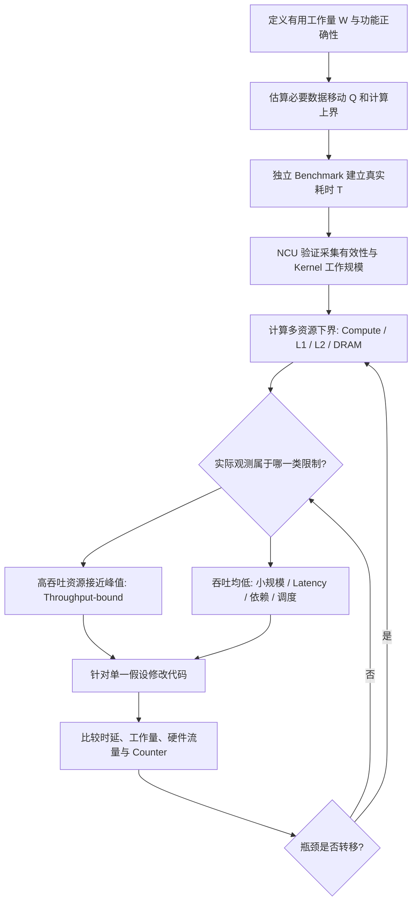
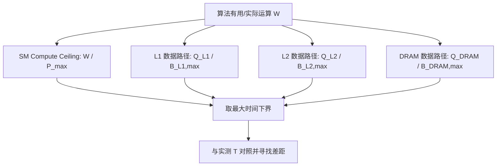
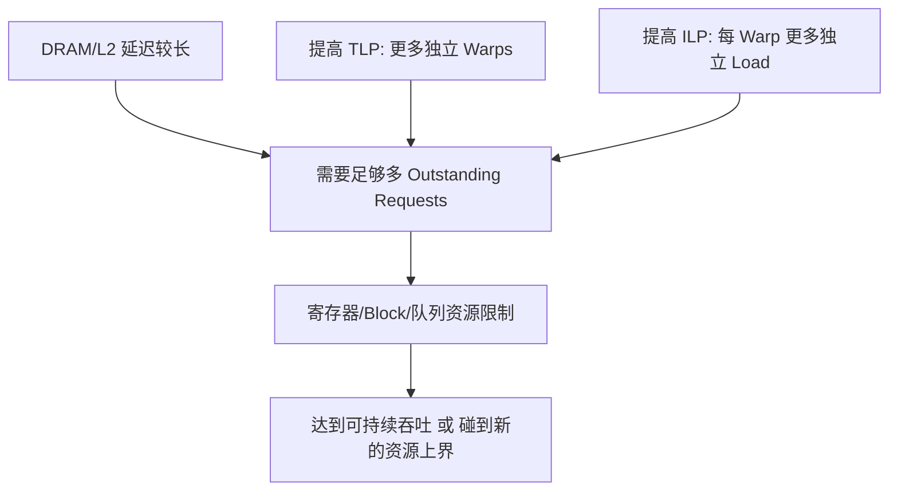
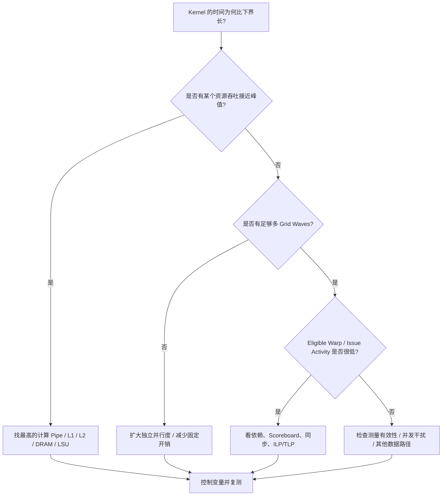
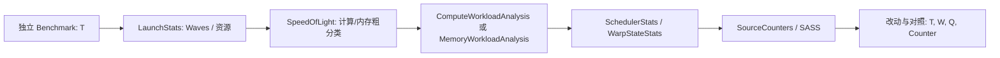
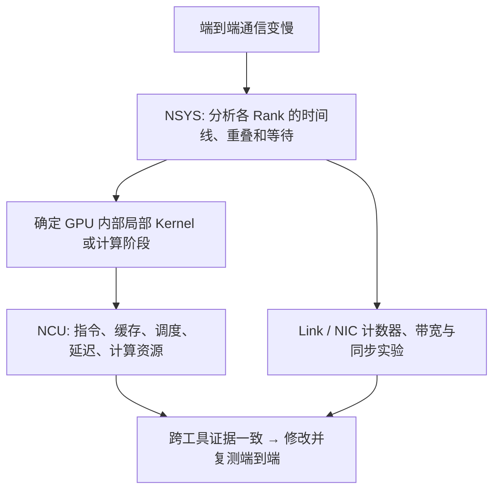
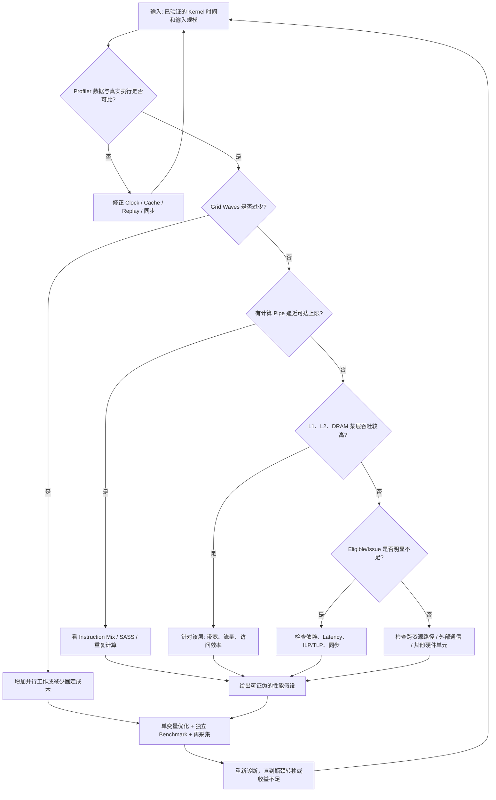

# NCU 系统学习 · 第八课：综合性能模型、分层 Roofline、性能上界与瓶颈转移

> 配套实验：[lab08.md](lab08.md) · [入口源码](kernels/main.cu) · [脚本入口](commands/)（源码与实验设计已提供；历史默认入口仅有 compile-only 记录，不代表改后源码或新脚本，见[旧编译日志](log/legacy_commands/compile/source_check.log)，尚未运行验证，无性能实测）。

> **课程定位**：承接第七课对计算流水线、指令吞吐和经典 Roofline 的学习，本课不再孤立地介绍 Roofline 定义，而是把 **算法工作量、实际硬件流量、计算/访存上界、延迟隐藏、Kernel 启动与多阶段执行** 统一起来，形成能够用 Nsight Compute（NCU）反复验证的性能归因方法。
>
>
> **前置课程**：第 1 课 Metrics 和 Section；第 2 课 Replay 与测量扰动；第 3 课 Occupancy；第 4 课 Warp Scheduling；第 5 课 Global Memory 与 Cache；第 6 课 Shared Memory；第 7 课 Compute Pipeline 与 Roofline。
>
> **本课形式**：完整理论、手工计算、假想 NCU 报告、Mermaid 原理图、自测题及解析；**不生成可运行 CUDA 工程、脚本或额外源文件**。
>
> **证据边界**：所有 GPU 峰值、带宽、时钟、指标结果和执行时间，若未明确注明出处，均为**教学假设**，不是 H20、H100、Blackwell 或其他具体 GPU 的实测值。NCU 指标名称、Section 和 Roofline 类型依 NCU 版本、架构和指标支持而异，以目标 GPU 的 `ncu --query-metrics`、`ncu --list-sections` 和对应版本文档为准。
>
> **推荐学习时间**：5–8 小时；理论理解 3 小时、数值推演 2–3 小时、案例归因及自测 1–2 小时。
>
> **更新日期**：2026-11-07。

---

## 0. 本课首先要解决什么问题

先从能手算的任务复习：输入 `A=[1,2,3,4]`、`B=[10,20,30,40]`，输出逐项和 `C=[11,22,33,44]`。**Kernel（核函数）**是 GPU 上执行的函数，线程是执行它的一份工作实例；本例线程 i 读 `A[i]`、`B[i]`，写 `C[i]`，彼此不交换结果。CPU（主机）负责准备并上传输入、启动 GPU、下载并检查输出；这部分时间是否计入，必须与“只测 kernel”区分。FP32 即本例 32 位 `float`，每项 4 字节；一次浮点加法计 1 **FLOP**，四项共 4 FLOPs，读写有效数据共 4×(4+4+4)=48B。**FLOP/s** 表示每秒完成多少次浮点运算，不能与总次数混写。

线程按 **block（线程块，亦称 CTA）**合作，所有块组成一次启动的 **grid（网格）**；硬件把线程按 32 个组成 **warp**，组内位置叫 lane。**SM** 是执行这些线程的 GPU 处理单元，一个设备有多个 SM。已经分配到 SM、尚未结束的 warp 叫**驻留 warp**；**调度器（Scheduler）**挑选输入及发射条件都满足的 **Eligible warp（可发射 warp）**，把下一条指令交给执行资源，称为 **issue（发射）**。已驻留但仍等数据的 warp 不一定可发射。**Occupancy（占用率）**是驻留 warp 数相对该 SM 硬件最大值的比例，例如 32/64=50%，不是算术部件忙碌比例。

第七课所需的另一段回顾是：**计算流水线（pipeline/pipe）**允许多个独立操作的不同步骤重叠；**延迟（latency）**是一条结果要等多久，**吞吐（throughput）**是每单位时间能处理多少工作。例如单次要四拍，但每拍可接收一条不等前次结果的新指令。**算术强度（AI）**是运算次数除以某一层传输字节数，例中逻辑 AI=4/48=1/12 FLOP/Byte，不含时间。**Roofline（屋顶线）**比较计算和数据传输两种理想速度上界；上界是不能超过的参考能力，不是保证程序达到的速度。下文会从时间公式重新推导，毋须先背上一课。

本课要回答：**给定一个真实 Kernel，哪些指标能证明“瓶颈就在这里”，又如何判断修改代码之后的收益是不是来自预期机制？**

换一个稍复杂的任务：**Gather/Scatter** 分别按索引读入/写出，例如读 `A[index[i]]` 或写 `C[index[i]]`；**Reduction（归约）**把许多输入合成较少输出，例如将四个数合成一个总和。Gather 后求和可能先由线程各读一项、算部分和，再合作相加。

**NCU（Nsight Compute）**是采集 kernel 性能信息的工具，Metric 是具体指标，Section 是一组相关指标。**DRAM Throughput** 反映显存相关资源相对参考能力的吞吐情况；**SM Throughput** 是计算/执行侧汇总指标，可能由某条最繁忙路径主导，而非所有计算部件平均。**Scoreboard** 跟踪指令结果是否就绪；`long_scoreboard` 表示等待 L1TEX 相关读写结果的数据依赖，L1TEX 是涉及 L1 缓存及部分读写处理的硬件路径，不能直接等同 DRAM。**Stall（停顿）**是某个 warp 暂不能推进，其他 warp 仍可能工作。

例如，对一个 Gather/Scatter + Reduction Kernel，NCU 显示 DRAM Throughput 为 35%，SM Throughput 为 25%，`long_scoreboard` 较高。有人会说：“DRAM 不忙，所以这不是 Memory-bound（内存相关服务受限）；应该提高计算吞吐。”另一个人会说：“Long Scoreboard 很高，证明 DRAM 带宽不足。”这两种判断都缺少证据。可能真正的问题是内存访问难以合并、并发请求太少、依赖链过长、工作量无法填满 SM，或者部分数据走 Peer/System Memory 而非本地 DRAM。**合并访存**是把同一 warp 中相邻地址的读写用较少数据片段服务；**并发请求**是多笔读取尚未返回就已同时在途；**依赖链**则是下一步必须等上一步结果。Peer/System Memory 分别指另一设备/主机系统的内存访问路径，例如 GPU 0 从 GPU 1 读取数据，未必经过 GPU 0 的本地 DRAM。

本课的总体推理顺序如下。**Memory-bound** 泛指内存相关服务成为限制，既可能是每秒传不动更多数据，也可能是串行等待读数，不能只按一个百分比分类。图中 **Benchmark** 是专门测量完成同一任务耗时的基准运行，独立 Benchmark 指不在 NCU 采集下测量；**Counter** 是某类事件或周期的计数；Throughput-bound 指完成速度主要受某资源每秒服务能力限制，而不是等某一步结果的延迟。

本课的验收目标不是“知道 Roofline 图有一条斜线”，而是能够：

1. 区分**性能上界、时间下界、理论可用资源、观测到的吞吐率**，不把它们混为一谈。
2. 将**算法有用工作量**和**硬件实际执行工作量**、**逻辑字节数**和**各缓存层的实际流量**分开统计。
3. 判断 Roofline 对当前 Kernel 是主要模型、辅助模型，还是暂时不适合直接用于归因。
4. 从 NCU 的 SpeedOfLight、MemoryWorkloadAnalysis、ComputeWorkloadAnalysis、SchedulerStats 等报告组成**证据链**。
5. 定量解释优化为什么起作用、为什么出现收益递减、为什么优化前后的性能瓶颈会发生转移。

---

## 1. 先从时间下界出发，而不是从利用率百分比出发

### 1.1 “时间下界”与“性能上界”是同一约束的两种写法

**峰值（peak/max）**是指定运算类型、频率和条件下的最大或参考速率：理论峰值由硬件规格推导，持续参考峰值则可由匹配任务测出，两者不能混写。**时间下界**是理想情况下也不能再短的时间，例如 100 份工作、每秒最多做 20 份，至少需要 5 秒。

假设 Kernel 需要完成 $W$ 个浮点运算（单位 FLOP），目标 GPU 对应的数据类型与执行路径可提供的理想计算能力为 $P_{\max}$（FLOP/s），那么单独从计算资源出发，所需时间至少为：

$$
T_{\mathrm{compute}} \ge \frac{W}{P_{\max}}.
$$

**带宽**是每秒传输多少字节，单位 Byte/s；Byte（B，字节）是 8 bit。如果 Kernel 必须从 DRAM 实际传输 $Q_{\mathrm{DRAM}}$ 字节，而可达到的 DRAM 峰值带宽为 $B_{\mathrm{DRAM,max}}$，那么：

$$
T_{\mathrm{DRAM}} \ge \frac{Q_{\mathrm{DRAM}}}{B_{\mathrm{DRAM,max}}}.
$$

**带宽**是单位时间传输的字节数，$B_{\mathrm{DRAM,max}}$ 单位 Byte/s，$Q$ 单位 Byte；因此 $Q/B$ 与 $W/P$ 都得到秒。这里 $T$ 表示整个所选工作范围的时间。L1 是更靠近执行单元的缓存，L2 是设备范围共享的另一层缓存；类似地，可以对 L2、L1TEX 或其他资源建立时间下界。假如计算与访存能够充分重叠，一个很基础的**乐观时间下界**为：

$$
\boxed{T \ge \max\left(\frac{W}{P_{\max}},\frac{Q_{\mathrm{DRAM}}}{B_{\mathrm{DRAM,max}}}\right).}
$$

将它变换成性能表达式，令 $I=W/Q_{\mathrm{DRAM}}$（FLOP/Byte）、$P=W/T$（FLOP/s），可得到经典 Roofline。`max` 取较大时间，`min` 取较小速度；$I B$ 的字节单位抵消后是 FLOP/s，所以能与计算峰值比较：

$$
\boxed{P\le\min\left(P_{\max},\ I B_{\mathrm{DRAM,max}}\right).}
$$

这两个公式是**约束**而不是对 Kernel 执行时间的精确预测。公式中的最大值表示两项工作可以重叠时，完成时间不可能小于任何一项各自的最短时间；并不保证 GPU 一定能够达到这个时间。真实代码还受指令依赖、调度、并发请求数、同步、Launch 等因素限制。

### 1.2 用一个数值例子理解时间下界

本课十进制前缀 M/G/T 分别是 $10^6/10^9/10^{12}$；GB/TB 指字节，GFLOP/TFLOP 指运算次数。ms、μs、ns 分别是 $10^{-3}/10^{-6}/10^{-9}$ 秒；GiB/KiB 则是 $2^{30}/2^{10}$ 字节。例如 2 TFLOP / 100 TFLOP/s = 0.02 s = 20 ms，不能直接把商写成毫秒。

假设一个 Kernel 的理想硬件参数与工作量为：

| 参数 | 教学假设值 | 含义 |
|---|---:|---|
| 有用计算量 $W$ | 2 TFLOP | 要完成的算法浮点工作量 |
| 计算峰值 $P_{\max}$ | 100 TFLOP/s | 当前精度、指令路径对应的计算上界 |
| DRAM 流量 $Q_D$ | 150 GB | 此次工作负载实际需要通过 DRAM 传输的流量 |
| DRAM 峰值 $B_D$ | 3 TB/s | 对应方向与读写模式下的峰值参考 |

则：

$$
T_{\mathrm{compute,min}}=\frac{2\times10^{12}}{100\times10^{12}}=20\ \mathrm{ms},
$$

$$
T_{\mathrm{DRAM,min}}=\frac{150\times10^9}{3\times10^{12}}=50\ \mathrm{ms}.
$$

两者中更严格的约束为 **50 ms**。此时把计算峰值从 100 TFLOP/s 翻倍到 200 TFLOP/s，计算下界变成 10 ms，但 DRAM 下界仍为 50 ms；如果执行始终受 DRAM 带宽约束，单纯增加计算资源不会带来收益。

反之，如果数据复用优化将 DRAM 流量由 150 GB 降为 75 GB，则 DRAM 下界变成 25 ms；此时必须重新检查 L2、计算、调度和同步等资源，不能继续假定“仍然完全受 DRAM 限制”。

### 1.3 为什么不能简单把所有下界相加？

有时会看到一个直观的式子：

$$
T\stackrel{?}{=}T_{\mathrm{compute}}+T_{\mathrm{memory}}+T_{\mathrm{launch}}.
$$

作为普遍公式，这个写法不对。SM 内的计算、L1/L2 传输以及 DRAM 访问具有不同程度的重叠，并非所有过程串行执行。**对整个可重叠工作负载，最大值是下界；对明确不可重叠的阶段，阶段时间可以相加。**

例如先完成数据打包、再执行不可重叠的跨卡传输、最后做归约，整体时间可近似表示为：

$$
T_{\mathrm{total}}=T_{\mathrm{pack}}+T_{\mathrm{transfer}}+T_{\mathrm{reduce}}+T_{\mathrm{gaps}},
$$

其中 $T_{\mathrm{gaps}}$ 表示阶段间显式等待、Launch Gap 和相关开销。**Launch** 是主机向 GPU 提交启动，Gap 是前后工作之间的空隙；**同步**是等待规定的参与者或操作完成，例如必须等打包完成后才传输。若把数据分成多批，让“第 2 批打包”和“第 1 批传输”同时进行，就是阶段间的 Pipeline（流水化）。此时不能把阶段总时间直接相加；第一批进入叫启动，最后一批退出叫排空，持续处理多批后的速度则受最慢阶段限制。

### 1.4 什么是“瓶颈”

当某资源 $r$ 的最低服务时间 $T_r$ 接近真实执行时间，同时其他资源约束更宽松，并且进一步降低 $r$ 的工作量或增加其有效服务能力能稳定缩短总时间，才有较强理由说它是当前的**限制资源（Limiting Resource）**。

更严谨的归因依赖两个证据：**资源接近限制的观测**与**控制变量后的响应**。没有第二项时，“瓶颈”往往仍是一个假设。

---

## 2. 四种必须拆开的量：Work、Bytes、Time、Rate

### 2.1 算法有用 FLOPs 与实际执行 FLOPs

设 $W_{\mathrm{useful}}$ 为完成数学任务所需的有用浮点工作量，$W_{\mathrm{executed}}$ 为硬件按选定统计口径实际完成的浮点操作量。两者通常不一定相同：

$$
W_{\mathrm{executed}} \ne W_{\mathrm{useful}}.
$$

**GEMM** 是通用矩阵乘法，本课先看 `C=A×B`：A 为 M×K，B 为 K×N，输出 C 为 M×N。每项 `C[row,col]` 将 K 对输入相乘求和，例如 `[1,2]·[3,4]=11`，按 K 次乘加约计 2K FLOPs，总量约 2MNK。**FMA（融合乘加）**计算 `a*b+c`、只做一次最终舍入，按乘与加合计 2 FLOPs，而非两条机器指令。**Tensor Core** 是加速小矩阵乘加的执行资源，其 **MMA** 指令一次覆盖许多这种乘加。

**Tile** 是从大矩阵切出的小块，Shape 是行列等维度尺寸；**Padding** 是补位置以凑齐块。例如实际只有 3 列却按 4 列处理，多算的一列没有增加有用输出。一个 Tensor Core GEMM 可能出于 Tile 对齐而计算部分 Padding 区域，也可能因为特殊 Shape 或分块策略执行更多操作。另一方面，矩阵乘法常用的 $2MNK$ FLOPs 公式仅是算法计算量估计，无法直接说明某种具体 Tensor 指令执行路径的计数结果。

因此需要同时计算：

$$
P_{\mathrm{useful}}=\frac{W_{\mathrm{useful}}}{T},\qquad
P_{\mathrm{executed}}=\frac{W_{\mathrm{executed}}}{T}.
$$

**优化目标通常是有用工作完成时间更短，而不是执行更多 FLOPs。** 一个算法版本可能取得很高的 $P_{\mathrm{executed}}$，却因为 Padding 和重复计算使 $P_{\mathrm{useful}}$ 较低。

### 2.2 逻辑字节、缓存层流量与 DRAM 字节

**逻辑字节**按选定算法读写的有效载荷数：若一个数按算法读取三次，三次都应计入，而不能无说明地仅数不同地址。某段另以唯一输入输出规模衡量时，也要明说。硬件则可能从缓存重用该数，或为少量有效值服务更大传输片段。**HBM** 是常见的高带宽显存技术，在本课仍属于 DRAM 层。

表中 Load/Store 是读取/写出数据，P2P（peer-to-peer）是设备间直接访问或传送；Peer/System Aperture 表示计数区分的访问目标类别，例如 GPU 0 从 GPU 1 读数据，而非读自己显存。

同一段 CUDA 代码可以对应多个不同的“Bytes”定义：

| 记号 | 定义 | 适用分析 |
|---|---|---|
| $Q_{\mathrm{logical}}$ | 由算法逻辑读写推导的有效载荷字节 | 算法通信量、有效带宽 |
| $Q_{\mathrm{L1}}$ | 所选 L1/L1TEX 统计路径上的实际流量 | Load/Store 请求密度、合并访存 |
| $Q_{\mathrm{L2}}$ | 所选 L2 统计路径上的流量 | 缓存复用、L2 吞吐上界 |
| $Q_{\mathrm{DRAM}}$ | 实际 DRAM 读写流量 | DRAM Roofline、HBM 利用 |
| $Q_{\mathrm{peer/system}}$ | 进入 Peer/System Aperture 的相关流量 | GPU P2P、系统内存访问 |

这些统计口径不一定能通过一个简单守恒关系连接起来。**Sector** 是相关缓存路径按固定大小服务/计数的片段，常见为 32B；**Cache Line** 是缓存保存数据的块，大小须查架构，不能自动与 sector 等同。**Write Allocation（写分配）**指某些写入会先为所写位置建立缓存内容，**预取**是使用前先读数据，**压缩**则用更少物理字节表示数据；这些机制连同缓存命中、访问方向及 Peer/System 路径，都可能改变各层流量。表中的 Aperture 指计数区分的访问目标类别，不是新的一层缓存。尤其是 $Q_{\mathrm{logical}}$ 不保证小于或大于某个特定缓存流量计数，必须先明确读写、路径、有效载荷和物理传输的具体口径。

### 2.3 三种容易混淆的带宽

$$
B_{\mathrm{useful}}=\frac{Q_{\mathrm{logical}}}{T},\quad
B_{\mathrm{L2}}=\frac{Q_{\mathrm{L2}}}{T},\quad
B_{\mathrm{DRAM}}=\frac{Q_{\mathrm{DRAM}}}{T}.
$$

它们均有 Byte/s 单位，但代表**不同层次上的不同物理量**。将有用负载字节与理论 HBM 带宽直接比较，有时有助于粗略评价算法效率；然而当存在 Cache 重用、重复访问、压缩、无效请求或者 P2P 流量时，这个比值不能直接当作硬件的 DRAM 饱和率。

### 2.4 单个完整例子：相同计算，不同的三类字节

本例明确用**唯一输入输出的有效数据规模** 1 GB 作为 $Q_{\mathrm{logical}}$，不将实现新增的重复读取算为有用载荷；这与逐次算法访问的另一种口径要分开。假设某些数据被实现重复读取，两个版本的数据如下。表中 Baseline 是修改前基线，Optimized 是修改后候选；独立 Benchmark 的时间是教学假设，不是本次实测：

| 量 | Baseline | Optimized | 解释 |
|---|---:|---:|---|
| $W_{\mathrm{useful}}$ | 100 GFLOP | 100 GFLOP | 数学任务不变 |
| $Q_{\mathrm{logical}}$ | 1 GB | 1 GB | 有效数据规模不变 |
| $Q_{\mathrm{L2}}$ | 6 GB | 3 GB | 改进访问布局减少 L2 流量 |
| $Q_{\mathrm{DRAM}}$ | 2 GB | 0.8 GB | 提高缓存复用并减少向 DRAM 请求 |
| $T$ | 2 ms | 1 ms | 独立 Benchmark 观测 |

可以得到：

$$
B_{\mathrm{useful}}: 500\to1000\ \mathrm{GB/s},
$$

$$
B_{\mathrm{DRAM}}: 1000\to800\ \mathrm{GB/s}.
$$

Kernel 变快了，**有效带宽翻倍而 DRAM 观测带宽反而下降**。这不是矛盾：一个表示有用数据完成速率，另一个表示物理 DRAM 流量速率。减少无效流量后，不必依靠更高的 DRAM 总流量就能完成相同任务。

从此以后，报告中不要单独写“带宽从 1 TB/s 提升到 1.5 TB/s”，应写明是逻辑有效带宽、L2 流量带宽、DRAM 带宽还是 Peer Link 带宽，并注明统计方法。

---

## 3. 经典 Roofline 的正确使用方式

### 3.1 Arithmetic Intensity 是一个带“流量口径”的比值

经典 DRAM Roofline 的横坐标为：

$$
I_{\mathrm{DRAM}}=\frac{W}{Q_{\mathrm{DRAM}}}\quad[\mathrm{FLOP/Byte}].
$$

注意分子究竟是算法 FLOPs 还是实际执行 FLOPs；不同分析体系可能选择不同定义，跨系统比较必须先统一。对 Tensor Core GEMM，也要使用与实际指令类型一致的 Roofline Section，而不是拿 FP32 标量 FMA 统计去解释 Tensor Pipe 的执行性能。

### 3.2 Ridge Point 的本质：两个资源下界交叉

在经典双上界模型中：

$$
P_{\mathrm{limit}}(I)=\min\left(P_{\max}, I B_{\max}\right),
$$

拐点位于：

$$
\boxed{I_{\mathrm{ridge}}=\frac{P_{\max}}{B_{\max}}.}
$$

以教学 GPU 的 $P_{\max}=100$ TFLOP/s、$B_{\max}=3$ TB/s 为例：

$$
I_{\mathrm{ridge}}=\frac{100}{3}\approx33.3\ \mathrm{FLOP/Byte}.
$$

这里 I 单位为 FLOP/Byte，峰值的 T 前缀在分子分母抵消，所以拐点单位仍是 FLOP/Byte。当 $I=4$ 时，DRAM 约束为 $4\times 3=12$ TFLOP/s；当 $I=40$ 时，DRAM 约束为 $40\times3=120$ TFLOP/s，受计算峰值约束而下降到 100 TFLOP/s。

在表与图中，AI 是算术强度，**Ceiling/Roof** 都指上界；**Achieved Point** 是实测点 $(W/Q,W/T)$。横轴是强度，纵轴是运算速率；NCU 的 GUI 指图形界面，XY 曲线指按这两个坐标绘图，不是另一套模型。

| AI（FLOP/B） | Memory Ceiling（TFLOP/s） | Compute Ceiling（TFLOP/s） | Roofline 上界（TFLOP/s） |
|---:|---:|---:|---:|
| 0.25 | 0.75 | 100 | 0.75 |
| 1 | 3 | 100 | 3 |
| 4 | 12 | 100 | 12 |
| 16 | 48 | 100 | 48 |
| 32 | 96 | 100 | 96 |
| 40 | 120 | 100 | 100 |
| 64 | 192 | 100 | 100 |

上图只是关系示意；Roofline 本身的 XY 曲线可以由上表直接绘制。真实 NCU GUI 会显示对应的 Roofline Chart 和 Achieved Point。

### 3.3 优化可能让 Roofline 点往四个方向移动

**Tiling（分块）**把工作拆成小块并尽量重用块内数据；**中间物化**是把中间结果真的写成数组，融合相邻操作则可能免去这次写出与再读取。设横坐标 $I=W/Q$，纵坐标 $P=W/T$：

| 变化方向 | 数学原因 | 可能对应的优化 |
|---|---|---|
| 向右 | $Q$ 下降，$W$ 不变 | Cache 复用、Tiling、合并访问、减少中间物化 |
| 向上 | $T$ 下降，$W$ 不变 | 更好的吞吐、指令发射、延迟隐藏 |
| 向右上 | $Q$ 下降且 $T$ 下降 | 有效访存优化 |
| 向左但更快 | $W$ 和 $Q$ 以不同幅度变化，$T$ 下降 | 算法更换、融合、避免多余计算 |

注意 Roofline 图上的横纵坐标不是简单一一对应：当你减少重复计算时，$W_{\mathrm{executed}}$ 也可能下降，纵坐标 $P_{\mathrm{executed}}$ 反而下降，而用户实际耗时却更短。因此对于优化前后不同算法工作量的比较，要同时提供 **绝对时间与有用工作量**。

### 3.4 经典 Roofline 不能单独判断“延迟受限”

如果一个点位于 Roofline 之下，它只说明**与理想吞吐上界存在差距**，并不自动说明差距来自计算、访存、Warp Stall、Launch 还是工作规模不足。

特别是一个很小的 Kernel，即使只触及少量 DRAM 数据，运行时间也可能主要受 Kernel 固定成本和数据依赖限制。此时理论 $W/P_{\max}$ 和 $Q/B_{\max}$ 都很小，但实际延迟不会接近零。后续必须引入规模与并发度模型。

---

## 4. 分层 Roofline：为什么 L1、L2、DRAM 需要三套算术强度

### 4.1 经典 Roofline 只能看到一个存储层

第七课已经介绍经典 Roofline。本课进一步把内存系统的不同传输层加入约束：

$$
\begin{aligned}
T_{\mathrm{comp,min}} &= \frac{W}{P_{\max}},\\
T_{\mathrm{L1,min}} &= \frac{Q_{\mathrm{L1}}}{B_{\mathrm{L1,max}}},\\
T_{\mathrm{L2,min}} &= \frac{Q_{\mathrm{L2}}}{B_{\mathrm{L2,max}}},\\
T_{\mathrm{DRAM,min}} &= \frac{Q_{\mathrm{DRAM}}}{B_{\mathrm{DRAM,max}}}.
\end{aligned}
$$

乐观下界为：

$$
\boxed{T_{\mathrm{actual}}\ge\max\big(T_{\mathrm{comp,min}},T_{\mathrm{L1,min}},T_{\mathrm{L2,min}},T_{\mathrm{DRAM,min}}\big).}
$$

右边是**根据这些资源约束得到的乐观时间下界**。如果定义 $T_{\min}=\max(\cdots)$，那么 $T_{\mathrm{actual}}\ge T_{\min}$，而不是 $T_{\mathrm{actual}}=T_{\min}$。这种区别有助于避免把理想下界当成真实执行预测。

与此同时，每个层级都有自己的 AI：

$$
I_{\mathrm{L1}}=\frac{W}{Q_{\mathrm{L1}}},\quad
I_{\mathrm{L2}}=\frac{W}{Q_{\mathrm{L2}}},\quad
I_{\mathrm{DRAM}}=\frac{W}{Q_{\mathrm{DRAM}}}.
$$

因此，“同一 Kernel 的 AI 是 10 FLOP/Byte”并不足够；必须说明使用了哪一层存储流量。

### 4.2 逐步算出四个资源上界

我们使用一个纯教学模型：

| 资源 | 峰值 | 该层流量 / 工作量 | 时间下界 |
|---|---:|---:|---:|
| Compute | 100 TFLOP/s | 2 TFLOP | 20 ms |
| L1 Data Path | 30 TB/s | 600 GB | 20 ms |
| L2 | 12 TB/s | 300 GB | 25 ms |
| DRAM | 3 TB/s | 150 GB | 50 ms |

四个时间下界分别为 20、20、25、50 ms，因此最严格的是 DRAM 50 ms。再计算算术强度：

$$
I_{\mathrm{L1}}=\frac{2\ \mathrm{TFLOP}}{600\ \mathrm{GB}}\approx3.33\ \mathrm{FLOP/Byte},
$$

$$
I_{\mathrm{L2}}=\frac{2}{300}\times1000\approx6.67\ \mathrm{FLOP/Byte},
$$

$$
I_{\mathrm{DRAM}}=\frac{2}{150}\times1000\approx13.33\ \mathrm{FLOP/Byte}.
$$

这些不同的 AI 与各自层级带宽相乘，得到不同的性能 Ceiling：L1 约 100 TFLOP/s、L2 约 80 TFLOP/s、DRAM 约 40 TFLOP/s、Compute 100 TFLOP/s，因而最终约为 40 TFLOP/s 的理论约束。

### 4.3 缓存优化为什么会导致瓶颈从 DRAM 转移到 L2

保持 $W=2$ TFLOP、$Q_{\mathrm{L1}}=600$ GB、$Q_{\mathrm{L2}}=300$ GB 不变，假设 Tiling 使 $Q_{\mathrm{DRAM}}$ 从 150 GB 降到 75 GB：

$$
T_{\mathrm{DRAM,min}}=\frac{75\ \mathrm{GB}}{3\ \mathrm{TB/s}}=25\ \mathrm{ms}.
$$

现在下界为：

$$
T_{\min}=\max(20,20,25,25)\ \mathrm{ms}=25\ \mathrm{ms}.
$$

这一时刻 **L2 与 DRAM 形成并列的最严格资源下界**。如果继续把 DRAM 流量从 75 GB 降到 40 GB，而 L2 流量不变，理论最低执行时间仍不能低于 25 ms。此时想继续提升性能，需要考虑降低 L2 流量、提高 L2 服务效率，或者修改更根本的算法组织方式。

这个例子说明：**提高缓存复用并不意味着“性能永远受 Cache 控制”；每消除一种限制，都必须重新对其他资源估算时间下界。**

### 4.4 分层模型的两个边界条件

首先，L1、L2 和 DRAM 的“峰值”可能是不同工作负载、不同访问方向、不同读写比例下获得的参考值，不能不加区分地使用纸面峰值。**Shared Memory（共享内存）**是同一 block 中线程共同使用的 SM 上小存储；它按 **bank（存储分组）**服务访问。多个不同地址争用同一 bank、需分批服务，叫 **bank conflict**，不等同缓存未命中。**Wavefront** 是某些读写路径把请求拆分成的服务工作单元；**Queue（队列）**保存等待服务的请求，例如一条请求可能需多个 wavefront 才完成。真实 Shared Memory 或 L1TEX 路径可能还有这些服务与写回限制，需要在指标层面细化。

**异步传输**指发起后不必原地等完成，但使用数据前仍要确认完成；**Barrier** 是等规定参与线程到齐的同步屏障，不是取消依赖。其次，某些异步传输、P2P/System Memory 或压缩路径不适合用本地 DRAM 的 Roofline 解释。必要时需要为这些资源另外建立 Link Ceiling、Data Transfer Ceiling 或同步延迟项，不能让它们被一个 DRAM 百分比“覆盖”。

---

## 5. Roofline 之外：延迟、并发和最小工作规模

### 5.1 高带宽需要足够的 In-flight Requests

现代 GPU 的峰值带宽并不是“只要发起一次大 Load 就会自动达到的速率”。DRAM、L2 及各种缓存层次都有访问延迟，必须同时存在足够多的未完成请求，才可能持续供应数据。

**In-flight / Outstanding Requests（在途/未完成请求）**是已经发出但尚未返回的读取等操作。**Little's Law** 是稳态（持续处理、平均行为相对稳定）下的平均关系：系统中平均工作量约等于平均处理速率乘平均停留时间。这里用字节作为工作量，Byte/s × s = Byte，得到：

$$
\boxed{\text{Bytes in flight}\approx\text{Bandwidth}\times\text{Latency}.}
$$

假设目标链路期望提供 3 TB/s，有效请求往返延迟为 400 ns，则为了维持这一吞吐量，系统层面大约需要：

$$
3\times10^{12}\times400\times10^{-9}=1.2\times10^6\ \mathrm{Bytes},
$$

即约 1.2 MB 的在途数据。这里的 400 ns、3 TB/s 都是模型参数，并不表示真实 HBM 控制器恰好需要 1.2 MB，也不能认为所有在途字节都必然计入某一个硬件队列。这个乘积用于说明**为什么高带宽必须依靠并发访问**。

### 5.2 ILP 与 TLP 怎样提供 In-flight Work

先用一组读数说明：`a=A[i]; b=B[i]` 的地址都已知，两次读取可以相互独立；`i=next[i]` 的下一次地址却必须等这次读取。前者允许同一线程提前发多笔读操作，称 **ILP（指令级并行）**。当前 warp 等数据时改运行另一 warp，称 **TLP（线程级并行）**。临时数据常放在每线程的**寄存器**中；同时保存的值越多，对有限寄存器的需求越大，称**寄存器压力**，可能挤掉其他可驻留 warp。

从硬件角度，主要有两类并发来源：

- **TLP（Thread-Level Parallelism）**：更多驻留 Warp 可以在其他 Warp 等待时发出新请求，但前提是 Scheduler 能找到 Eligible Warp，而且资源和工作规模允许。
- **ILP（Instruction-Level Parallelism）**：同一个 Warp 内提前发出多个相互独立的 Load，可以在后续使用数据前积累更多未完成的请求，但可能增加寄存器压力和源码复杂度。

如果 NCU 显示 `long_scoreboard` 较高而 DRAM 带宽较低，还需要区分两种情况：一是请求数量不足，不能填满 DRAM；二是请求粒度低效、访问目标或局部队列形成瓶颈。优化前者通常考虑 ILP/TLP 和工作规模，优化后者则考虑 Coalescing、数据布局、Cache 和 LSU 请求压力。

### 5.3 为什么 Roofline 可能严重高估短 Kernel 的可达到性能

假设一个只执行 4 μs 的 Kernel，理想计算时间 0.3 μs、DRAM 传输下界 0.4 μs。经典 Roofline 会认为它离资源上界非常远，但原因可能是固定工作成本、独立线程块太少或者依赖等待，**不意味着只要优化带宽就能得到 10 倍以上加速**。

**Dispatch** 是 GPU 把已提交工作安排到执行资源；**关键路径（critical path）**是必须先后完成并决定最早结束时刻的依赖链，例如“读 x → 用 x 乘加 → 写出”。**Unhidden** 是未被其他独立工作覆盖的等待。例如等 x 时没有其他可做的事，等待就直接拉长耗时。可以用一个定性模型表示：

$$
T_{\mathrm{observed}}\approx T_{\mathrm{fixed/dispatch}}+T_{\mathrm{service,critical}}+T_{\mathrm{unhidden}}.
$$

这只是用于定位的加法分解示意，不是严格独立的硬件时间分项；不同部分可能重叠。特别是 Host Launch Overhead（主机提交成本）、GPU Dispatch Delay（设备安排工作的延迟）和 Kernel 执行 Duration（持续时间）的测量边界不同，不能将它们未经校准地加总成 NCU 的 `gpu__time_duration.sum`。

### 5.4 Grid Waves：资源充足不意味着全设备被占用

**Grid Waves（工作波次）**把 grid 的块数与整个设备对该 kernel 的同时驻留块容量比较。例如总容量 200 块、启动 400 块，约为两波；不是硬件保证所有块整齐同时开始。设 GPU 有 $N_{SM}=100$ 个 SM，每个 SM 对当前 Kernel 因寄存器/Shared Memory 限制，最多可并发驻留 2 个 CTA，总并发 CTA 容量约为 200。若 Grid 仅启动 32 个 CTA，就不足以让所有 SM 至少分到一个 CTA；对这样的小 Grid，大量设备计算峰值无法有效使用。

由此得到：

- `launch__waves_per_multiprocessor` 是一个重要的规模指标，能够帮助识别 Grid 是否足够填满 GPU。
- Theoretical Occupancy 是**单 SM 资源限制下的潜在驻留率**，不代表一个小 Grid 真的让所有 SM 达到该驻留水平。
- 当 Waves per SM 很低时，应优先判断并行工作划分是否合理，而不是急于微调 FP32 Pipe 或 Cache Policy。

NCU Compute Triage Guide 在正式进入计算/访存诊断前，也要求先判断工作量是否过小、是否足以饱和 GPU。

---

## 6. 一个完整的性能模型：不是单一 Roof，而是多重约束

对一个独立、资源竞争相对稳定的 CUDA Kernel，可以先把分析框架写成：

$$
\boxed{
T_{\mathrm{actual}}\ge
\max\left(
\frac{W}{P_{\max}},
\frac{Q_{\mathrm{L1}}}{B_{\mathrm{L1,max}}},
\frac{Q_{\mathrm{L2}}}{B_{\mathrm{L2,max}}},
\frac{Q_{\mathrm{DRAM}}}{B_{\mathrm{DRAM,max}}},
\frac{N_{\mathrm{inst}}}{R_{\mathrm{issue,max}}}
\right).
}
$$

公式中 $N_{\mathrm{inst}}/R_{\mathrm{issue,max}}$ 只是一个简化的全设备指令发射吞吐下界，其中 $N_{\mathrm{inst}}$ 应是所选全设备范围的 warp 指令发射工作量（条），$R_{\mathrm{issue,max}}$ 是同范围每秒可发射的条数（条/s），相除才是秒。只有在指令统计口径、资源聚合范围和发射能力单位一致时才有意义；它并不覆盖依赖延迟，也不等于真实 Issue Pipeline 的测量模型。实际计算吞吐还可以按执行资源拆分：**INT/ALU** 处理整数算术逻辑与地址计算，**SFU** 处理部分特殊数学函数，Tensor Pipe 处理矩阵乘加，**LSU** 是读写执行路径。例如 `i*stride` 很多时，先查整数路径而非只查浮点乘加。

对无法被这些吞吐约束解释的额外耗时，再检查调度和延迟因素：

$$
\text{Latency / Dependency / Insufficient In-flight Work / Barriers / Small Grid / Dispatch}.
$$

但不要把这些英文标签再虚构成一组能够直接从 NCU 计数器精确相加的互斥时间；很多指标只支持**间接定位**。

---

## 7. NCU 应该怎么把证据组织起来

### 7.1 先进行数据可信度检查

**Profiling** 是工具采集性能信息；NCU 的 **Replay（重放）**是为收集不同指标重复执行工作，**Cache Control/Clock Control** 分别控制采集时缓存和时钟条件。它们可能改变原始运行。**NSYS（Nsight Systems）**是观察主机和 GPU 整体时间线的另一工具，与聚焦单 kernel 指标的 NCU 分工不同。

分析开始前，确保对比样本在 GPU 型号、工作规模、数据类型、Cache 策略、时钟、编译配置、输入分布、Profiling Section 与 Replay 模式上具有可比性。先通过独立 Benchmark 或 NSYS 判断原始时延，再验证 NCU 的 Kernel Duration 是否发生明显变化。

NCU 文档明确指出，Kernel Profiling 可能涉及 Replay、Cache Control、Clock Control 和应用并发变化；不能因为指标看起来“精确到小数点后两位”，就认为它反映了真实生产状态。

### 7.2 从四类问题选择 Section 组合

**采样（sampling）**是只在一些时刻观察某个 warp 的位置/状态，例如十次观察中六次在等数据；六次不是六个时钟周期，也不代表整个 GPU 60% 时间闲置。**动态计数**统计运行时次数，**静态指令**是编译产物中的指令，例如循环体一条 Load 可以动态执行千次。

读表前补齐几种显示名：**Active** 表示 warp 已在活动/驻留范围内，**Eligible** 才表示下一条可发射；**Issue Active** 反映发射活跃度，分母口径要查指标。**Short Scoreboard** 是等待另一类短延迟执行路径结果的依赖状态，不能只按名称断定 shared 冲突；**Barrier** 是等待规定参与者到齐的同步屏障。**SASS** 是具体 GPU 机器指令的可读形式，**PC（Program Counter）**是机器指令位置而非源码行号，SourceCounters 将代码位置与计数/采样关联。**Breakdown** 展开汇总数的组成，Resource Usage 是资源用量；这些不是独立硬件资源名。

| Section/页面 | 优先阅读内容 | 解决的问题 |
|---|---|---|
| `LaunchStats` | Grid、Block、Waves per SM、Resource Usage | 工作量是否足够？资源是否限制并发？ |
| `SpeedOfLight` | Compute/Memory Throughput、Breakdown、Duration | 哪类资源可能接近峰值？ |
| `MemoryWorkloadAnalysis` | L1/L2/DRAM、Requests、Sectors、Wavefronts、Cache | 访存流量集中在哪层？请求是否有效？ |
| `ComputeWorkloadAnalysis` | 计算 Pipe 活跃、指令类别、算术路径 | 哪条计算/指令执行路径压力最大？ |
| `SchedulerStats` | Active/Eligible、Issue Active | 是否属于发射不足、延迟暴露？ |
| `WarpStateStats` | Long/Short Scoreboard、Barrier 等 | 具体等待机理是什么？ |
| `SourceCounters` + SASS | 指令、PC、访问效率与 Stall 热点 | 代码中的哪条指令造成问题？ |
| `SpeedOfLight_RooflineChart` 等 | 指定精度和层级的 Roofline | 上界与 Achieved Point 的关系是什么？ |

注意 NCU `sm__throughput` 类汇总百分比不等于“SM 总算力使用率”。它可由多个子指标中的限制资源贡献形成，具体需要展开 Breakdown。另一方面，`dram__throughput` 高也不证明每条 Load 指令本身是完美 Coalescing 的，只说明某一统计口径下 DRAM 相关资源负载较高。

### 7.3 一组值得辨认的代表性指标

下表是理解指标的例子，并非要求原样复制到所有架构上；查询、详细语义和派生规则以当前设备为准。

读指标名时，`sum` 表示该统计范围内的和，`avg` 表示跨实例等范围的平均；`pct_of_peak_sustained_elapsed` 是相对工具持续峰值、按经过周期口径归一化的百分比，`active` 则按规定的活跃周期计。**每周期**的分母必须同属相同 SM/SMSP 范围；SMSP 是 SM 的子分区。例如同一平均计数，除以 50 个活跃周期或 100 个经过周期会得到不同结果。频率影响每周期与每秒的换算。Wall Time 是用户从开始到结束实际等到的总时长。

| 典型指标 | 主要含义 | 易误读点 |
|---|---|---|
| `gpu__time_duration.sum` | NCU 所测的 Kernel/GPU 工作负载持续时间 | 不等于 Host launch 时间或完整应用 Wall Time |
| `sm__throughput.avg.pct_of_peak_sustained_elapsed` | SM 相关吞吐的汇总性上界占比 | 不能直接当作 CUDA Core FLOPS 利用率 |
| `gpu__dram_throughput.avg.pct_of_peak_sustained_elapsed` | DRAM 相关吞吐峰值比例 | 无法替代 Peer/System Memory 流量判断 |
| `smsp__issue_active.avg.pct_of_peak_sustained_active` | Scheduler 发射活跃度 | 不直接说明是哪条 Pipe 限制吞吐 |
| `smsp__warps_eligible.avg.per_cycle_active` | 平均每活跃周期可发射 Warp 数 | Active 和 Eligible 是不同概念 |
| `launch__waves_per_multiprocessor` | Grid 相对 SM/Block 并发容量的波次 | 小于 1 表示不足一轮满容量，不必然有 SM 完全没工作 |
| `dram__bytes_read.sum` / `dram__bytes_write.sum` | DRAM 读写流量示例 | 与逻辑有效负载字节不等价 |
| `sm__pipe_*_cycles_active...` | 架构依赖的具体 Pipe 活跃信息 | 名称和划分随 Compute Capability 改变 |

### 7.4 按问题选择指标，不按菜单顺序读报告

这里 D 和 E 不必严格串行。如果 Step C 已显示所有吞吐低而 Eligible Warp 很少，就应直接进入调度/延迟路径；若 DRAM 已经接近可达到的上界，则优先排查实际流量、复用和合并效率。

---

## 8. 六个完整的假想 NCU 诊断案例

以下案例全部是假想教学数据，目的是练习“观察 → 解释 → 反证 → 优化决策”。

### 案例 A：Vector Add 接近 DRAM 带宽下界了吗？

Vector Add 以 A、B 两个数组为输入，输出逐项和 `C[i]=A[i]+B[i]`，不是求全数组总和。设三个长度相等的 FP32 数组，$N=2^{27}=134,217,728$。每线程负责一项，读 A/B 并写入 C 一次；不考虑额外访存与 Cache 压缩：

$$
W_{\mathrm{useful}}=N\approx0.134\ \mathrm{GFLOP},
$$

$$
Q_{\mathrm{logical}}=12N=1,610,612,736\ \mathrm{Bytes}\approx1.611\ \mathrm{GB}.
$$

假设 DRAM 峰值为 3 TB/s，至少需要：

$$
T_{\mathrm{DRAM,min}}\approx\frac{1.611\ \mathrm{GB}}{3\ \mathrm{TB/s}}=0.537\ \mathrm{ms}.
$$

如果独立 Benchmark 为 1.20 ms，则基于逻辑量的有效带宽约为 1.342 TB/s，相对假设峰值为 44.7%。如果 NCU DRAM 吞吐也约 45%，尚不能确定这是 Bandwidth-bound：需要查看是否存在请求不足、Coalescing 问题、部分访问来自 Cache，以及是否有其他资源限制。

**Sectors/Request** 的分子是所选请求涉及的 sector 数，分母是请求数，例如一次请求触及 4 个 sector 就是 4 sector/request；还要结合有效载荷判断是否低效。**Issue Active** 是调度器发射活跃度，不能当成完成的浮点运算比例。

**下一步应该检查**：L1TEX Sectors/Request、L2/DRAM 实际流量、Grid Waves、Issue Active、Long Scoreboard，并对不同 Block Size、访问布局或数据规模做独立控制变量实验。

**不能做的推论**：“45% 的 DRAM 峰值，所以一定还有接近 2.2 倍的可实现加速。”理论上界差距不是性能改进保证。

### 案例 B：缓存优化后 DRAM 吞吐更低，但 Kernel 更快

设算法输出与输入不变：

| 变量 | 版本 1 | 版本 2 |
|---|---:|---:|
| 耗时 | 2 ms | 1 ms |
| DRAM 字节 | 2 GB | 0.8 GB |
| L2 字节 | 6 GB | 3 GB |
| 有用逻辑字节 | 1 GB | 1 GB |
| 有用吞吐 | 500 GB/s | 1000 GB/s |
| DRAM 吞吐 | 1 TB/s | 0.8 TB/s |

这个案例再次强调：优化减少硬件需要服务的无效流量，可能比“提高硬件实际传了多少字节每秒”更重要。因此必须同时记录 $Q$ 与 $Q/T$，否则只看 DRAM Throughput 百分比容易误判。

如果目的是解释为什么 $Q_D$ 下降，应进一步检查 L2 Hit、Memory Sectors、重复 Load/Store、SASS 指令数；如果 $Q_{\mathrm{logical}}$ 相同而 $Q_D$ 下降，还可能是工作集尺寸、Replay 缓存状态或者数据压缩不同导致，必须排除这些混杂因素。

### 案例 C：DRAM/Compute 利用率都低，但 Long Scoreboard 很高

假想 NCU 数据：

| 指标 | 观测 |
|---|---:|
| SM Throughput | 23% |
| DRAM Throughput | 27% |
| Achieved Occupancy | 31% |
| Eligible Warps / Scheduler | 0.3 |
| Issue Active | 16% |
| Long Scoreboard / 所选状态样本总数 | 显著占比 |

0.3 个 Eligible warp 是跨周期（硬件时钟节拍）/调度器平均，不是存在一个分数线程组；样本占比的分母是样本数，不是执行时间。采样只在一些时刻观察某个 warp 的状态，不能把 57% 样本直接换成 57% 总耗时。

一种合理假设是：Kernel 存在较长的全局访存依赖链，并且缺少足够的驻留 Warp 或每 Warp 独立 Load，导致没有足够请求维持高 DRAM 吞吐。然而 Long Scoreboard 也可能涉及 L1TEX 路径上的其他负载，不能在没有 Source/SASS 和访存路径信息时直接写成“DRAM 慢”。

**可检验的优化假设**：增加访问独立性/适当展开，或降低每线程资源开销以增加可驻留 Warp 数。如果实验显示 Eligible Warps、内存并发度和执行时间均改善，而 DRAM Throughput 上升，那么“延迟隐藏不足”得到了进一步支持。

**关键区别**：Memory-latency-bound 与 Memory-bandwidth-bound 都涉及内存，但修复方法不同。

### 案例 D：某计算 Pipeline 已接近满载，为什么整体 SM Throughput 仍需拆开看

假设一个索引密集型 Kernel 中，每个有效 FP32 运算都伴随大量整数地址计算，NCU 显示：

| 指标 | 观测 |
|---|---:|
| SM Throughput | 88% |
| FP32 Pipeline Utilization | 33% |
| INT/ALU 相关 Pipe | 86% |
| DRAM Throughput | 30% |
| Issue Active | 78% |

**INT/ALU** 是整数算术逻辑路径，常处理 `i*stride` 等地址计算；**Instruction Mix** 是不同机器指令类型的数量或比例。此时问题可能不是 FP32 FLOPs 不够，也不是 HBM 不够，而是整数地址计算或相应 Pipe 接近上界。应查看 Instruction Mix 和 SASS，对重复索引运算、整数除模、边界判定、地址重算进行归因。将 Block Size 从 256 改到 512，不一定能改善已经繁忙的整数执行路径。

优化后如果 SM Throughput 从 88% 降到 76%，但实际耗时从 100 μs 降到 70 μs，仍然是有效优化：**工作量下降使限制资源不再那么忙，并不意味着性能倒退。**

### 案例 E：微秒级 Kernel 的 Roofline 上界看似巨大，但实际不可达

设一个 Kernel 需要 40,000 FLOPs，仅使用 64 KiB（65,536B）DRAM 数据。它的算法 AI 约为 0.61 FLOP/Byte。以假设的 100 TFLOP/s 和 3 TB/s 计算，理论计算下界约 0.0004 μs，DRAM 服务下界约 0.022 μs；假设实际 Kernel Duration 为 3.2 μs。

此时屋顶线与实际点可能相差上百倍，但没有足够证据说优化 HBM 带宽就能大幅缩短 Kernel。固定执行成本、单 CTA、依赖路径、调度波次、启动上下文等可能才是决定因素。应先用 NSYS/独立微基准辨别 Host Launch、GPU Dispatch 和真正 Kernel 工作的时间边界，再决定优化哪一层。

尤其是 **NCU Kernel Duration 不能简单等同于 CUDA Launch API 的开销**：两者测量的边界不同。

### 案例 F：Tensor Core GEMM 的执行 FLOPs 很高，有用效率却不高

设一个矩阵乘法的算法工作量为 $W_{\mathrm{useful}}=1$ TFLOP，但某个 Tile/Shape 实现实际执行了 $W_{\mathrm{executed}}=1.6$ TFLOP 的数学运算，运行时间为 20 ms：

$$
P_{\mathrm{useful}}=50\ \mathrm{TFLOP/s},\qquad
P_{\mathrm{executed}}=80\ \mathrm{TFLOP/s}.
$$

若对应 Tensor Core 参考峰值为 100 TFLOP/s，则硬件执行效率看起来达到 80%，但用户任务的有用效率只有 50%。如果通过更合适的分块减少 Padding 和无效计算，在不改变 $W_{\mathrm{useful}}$ 的前提下把时间降至 15 ms，即使硬件实际执行吞吐没有提高，算法效率也会提升。

这也是为什么 NCU 的 FP32 Roofline、Tensor Roofline 和指令计数不能混用：不同指令路径、数据精度和矩阵运算计数口径会让“理论 FLOPs”和“执行 FLOPs”的数值差异很大。

---

## 9. 性能瓶颈为什么会转移：三轮优化推演

### 9.1 构造一个资源下界序列

仍采用分层 Roofline 教学模型。V0–V2 假设实际执行计算量为 2 TFLOP，主要调整各层内存流量；V3 进一步减少无用计算，使实际执行 FLOPs 下降，但算法有用输出与计算结果保持不变。表中计算下界因此可以改变，而不是凭空提升了固定硬件峰值：

| 版本 | Compute 下界 | L1 下界 | L2 下界 | DRAM 下界 | 最严格约束 |
|---|---:|---:|---:|---:|---|
| V0 | 20 ms | 20 ms | 25 ms | 50 ms | DRAM |
| V1：提升缓存复用 | 20 ms | 20 ms | 25 ms | 25 ms | L2 与 DRAM 并列 |
| V2：减少 L2 访问 | 20 ms | 20 ms | 16 ms | 13 ms | Compute / L1 并列 |
| V3：减少无用计算 | 15 ms | 20 ms | 16 ms | 13 ms | L1 |

这些是**理论下界**，不意味着每个版本的实测时间恰好等于最严格约束。真正的 Benchmark 可能依次是 75、40、29、26 ms，因为延迟、指令调度、同步、Tile 划分等尚未完全建模。

### 9.2 从“继续优化同一指标”转向“重新测量所有资源”

当限制从 DRAM 转移到 L2 后，继续只盯着 DRAM 流量及上游缓存 Hit/Miss 通常价值会降低；当限制转移到计算 Pipe 后，继续增加缓存复用可能不会带来明显收益；当瓶颈转移到 Issue 或依赖链时，Roofline 的理想吞吐公式可能无法解释剩余差距。

因此，每次优化都应该重新运行 **“有效性 → 工作规模 → 吞吐 → 延迟 → 具体指令”** 的诊断流程，而不是沿用上一版本的瓶颈结论。

### 9.3 加速比的上界来自哪个阶段

**加速比**是同一任务修改前耗时除以修改后耗时，例如 100 μs / 50 μs = 2，表示速度是原来的两倍，而非“减少了两倍时间”。设真实基线时间为 $T_0$、优化后为 $T_1$，定义：

$$
S=\frac{T_0}{T_1}.
$$

如果一个 Kernel 中被优化的不可重叠阶段只占总时间的 30%，即使该阶段开销降低到零，整体最大加速比也不超过：

$$
S_{\max}=\frac{1}{1-0.3}\approx1.43.
$$

这是 Amdahl's Law 在**时间阶段严格可加**情况下的一个示意。对实际发生重叠的流水线，不可以直接将阶段独立耗时相加再套用该公式。要先确认被优化阶段处于端到端关键路径，并且修改不会增加其他阶段的执行成本。

### 9.4 优化证据表应该长什么样

| 字段 | Baseline | Optimized | 归因作用 |
|---|---|---|---|
| Kernel/端到端延迟 | 100 μs | 70 μs | 确认实际收益 |
| 算法有用 FLOPs | 不变 | 不变 | 排除任务不同 |
| 动态 SASS 指令数 | 10 M | 7 M | 支持指令开销下降 |
| L2 流量 | 800 MB | 600 MB | 支持缓存/地址路径改善 |
| DRAM 流量 | 200 MB | 200 MB | 排除 DRAM Bytes 变化 |
| SM Throughput | 84% | 72% | 资源压力可能下降 |
| Issue Active | 75% | 72% | 发射利用率变化不大 |
| Replay/Clock/Cache | 一致 | 一致 | 保障可比性 |

这些数据形成的合理解释是：“减少动态指令及 L2 流量之后执行时间下降，同时 DRAM 流量未发生变化，因而该性能改善更可能来自指令执行与 L2 路径开销下降。”但是更严谨的因果结论还需要定位到具体修改和指令，并通过独立重测验证。

---

## 10. 把综合模型用于 Tensor Core、Reduction 与 Gather/Scatter

### 10.1 GEMM：吞吐模型占主导，但要明确算法 FLOPs 与 Tile Work

对普通矩阵乘法 $C_{M\times N}=A_{M\times K}B_{K\times N}$：

$$
W_{\mathrm{useful}}\approx2MNK.
$$

假设 A/B 每元素从所选外层读一次、C 每元素写一次且不读取旧 C，理想最小逻辑读写量可以粗略写成 $s(MK+KN+MN)$ 字节，其中 $s$ 是元素字节数。这只是下界式估算，不是说真实 GPU 只读取每个元素一次；特别是 Tensor Core 分块、Shared Memory Pipeline、L2 回写、Split-K、Padding 均可能增加实际动态工作。**Split-K** 是把同一输出所需的 K 项累积拆给多组工作，再合并部分和，会引入中间结果与归并。Shared Memory Pipeline 则把下一块的搬运与当前块的运算交错。

应关注：Tensor Pipe 利用率、Tile Padding、Global/L2/Shared 流量、寄存器和 Shared Memory 的资源约束、Wait/Barrier 以及数据搬运与 MMA 的重叠。

### 10.2 Reduction：算术强度通常较低，但同步与阶段划分可能主导

**Warp Shuffle** 让 warp 内线程直接交换寄存器值，例如线程 0 获取线程 16 的部分和再相加；**Atomic（原子操作）**保证多个线程更新同一位置时，规定的读改写不可被其他更新穿插，例如并发累加不丢项。二阶段 Reduction 则先输出每块部分和、再启动下一阶段合并。

一个 FP32 Sum Reduction 的有用运算约为 $N-1$ 次浮点加法，至少需要读取 $4N$ 字节的输入。若只用这两项估算，算法 AI 接近 0.25 FLOP/Byte，但实现性能可能受 Warp Shuffle、CTA 同步、访存、Atomic、二阶段 Reduction 与较小 Grid 影响。

因此，即使 Roofline 横坐标落在“带宽区域”，最终仍要判断受限的是 DRAM 服务上界，还是跨线程归约和不足的并行工作量。

### 10.3 Gather/Scatter：看起来有大量 DRAM 访问，却可能是 Latency-bound

对不规则 Gather，32 Lane 的地址可能散布到许多 Sector，单次有效载荷很小。即使数据全部从 DRAM 返回，低效率访问可能使请求数和数据返回延迟成为关键，DRAM 总带宽却远低于峰值。

应该检查：每 Warp 的地址分布、Sector/Request、L1/L2 Hit、Long Scoreboard、Eligible Warps、Outstanding Work 的间接信号。若多次访存间存在串行指针追踪依赖，纯粹增加 Block Size 也可能不能充分隐藏延迟。

---

## 11. GPU 通信与 DeepEP：什么时候必须超出经典 Roofline

### 11.1 通信 Kernel 的最简模型

DeepEP 是 GPU 间分发与合并数据的软件库，Combine 是合并阶段。**Pack/Unpack** 指按传输格式整理/还原数据；**P2P** 指设备间直接访问/传送；**Polling（轮询）**反复读标志等对方就绪；**Fence（内存栅栏）**约束规定范围内内存操作的先后与可见性，不等同“所有线程到齐”。例如发送方要先让数据按协议可见，再发就绪通知，接收方才能使用它。

一个低延迟通信 Kernel 可能包含：打包、P2P Store/Load、Polling、Fence、同步、Reduce 和写回。端到端耗时可以概念化为：

$$
T_{\mathrm{comm}}\approx T_{\mathrm{setup}}+T_{\mathrm{transfer}}+T_{\mathrm{wait}}+T_{\mathrm{reduce}}+T_{\mathrm{finalize}}-T_{\mathrm{overlap}},
$$

这是**分析性分解**，其中重叠项不是单个 NCU 指标可以直接读取的量；每阶段可能相互耦合，无法用简单的相减得到准确结果。

对单条通信路径，可以把物理链路的理论传输约束写成：

$$
T_{\mathrm{link}}\ge \frac{Q_{\mathrm{link}}}{B_{\mathrm{link,max}}}.
$$

但短消息往往存在启动/握手/可见性/轮询延迟，达到峰值带宽需要足够的在途流量。仅对 $Q/B$ 进行计算通常严重低估小消息的真实时间。

### 11.2 NCU 能解释的与不能解释的

表中 **Rank** 是通信参与进程/设备的编号；**NVLink** 是 GPU 互连技术；**TMA** 是部分架构提供的张量数据异步搬运机制，**CE** 是复制引擎，**NIC** 是网卡，它们不必由 SM 逐条执行全部搬运。异步表示发起方不必原地等待操作完成，但使用数据前仍需遵守完成通知与同步。**RDMA** 是跨节点直接访问远端内存的通信机制，不等同本地显存读取。

| 分析对象 | NCU 常能帮助解释 | 不能单独得出的结论 |
|---|---|---|
| Pack/Unpack | SASS 指令、Cache/访存效率、Occupancy | 跨 GPU 端到端延迟组成 |
| Reduce | 计算 Pipe、Shared、同步、Warp Stall | 远端 Rank 的到达时序 |
| Polling | Load 及调度行为、局部依赖 | 外部参与者完整行为与真实等待因果 |
| P2P | 一些 SM/L1/L2 侧请求与相关可用流量指标 | 直接把本地 DRAM 带宽等同 NVLink 带宽 |
| TMA / CE / NIC | 相关 GPU 执行路径与同步观察（视硬件支持） | 假定 SM 指标覆盖异步引擎全部流量 |

### 11.3 为什么多 GPU 并发通信尤其要防止 Replay 失真

一个 DeepEP Combine Kernel 若需要等待远端 GPU 写完数据，NCU Kernel Replay 可能重复执行本地 Kernel，而对端并不以原始时序重放数据交互，从而产生异常等待、数据状态变化甚至死锁。此时请先用 NSYS 和独立通信 Benchmark 确认端到端性能，再选择适合并发工作负载的 NCU 采集范围或隔离计算/搬运阶段进行分析。

---

## 12. 性能报告中最容易出现的 15 类错误推论

| 错误表述 | 为什么不对 | 正确做法 |
|---|---|---|
| 1. “DRAM Throughput 低，所以不是 Memory-bound” | 可能是长延迟、请求不足、Sector 低效或 Peer/System 路径 | 先区分 Bandwidth-bound 与 Latency-bound |
| 2. “Long Scoreboard 高，所以 HBM 已经饱和” | Stall 说明依赖等待，不证明带宽峰值已达 | 联合 L1/L2/DRAM 与 Issue/Eligible 指标 |
| 3. “SM Throughput 90%，FP32 利用率就是 90%” | 汇总指标可能由其他 Pipe 驱动 | 展开 Throughput Breakdown |
| 4. “离 Roofline 还有 5 倍，优化就能快 5 倍” | Roofline 仅提供理想约束 | 检查规模、依赖、并发与固定成本 |
| 5. “减半 DRAM Bytes 一定让耗时减半” | 可能已经由 L2、Compute 或同步限制 | 重算所有资源时间下界 |
| 6. “缓存命中率升高就一定更快” | 命中率不说明额外指令、寄存器、同步和队列影响 | 用绝对时间与总 Bytes 验证 |
| 7. “实际有效带宽超过 DRAM 峰值，计数器坏了” | 逻辑有效带宽可因 Cache 重用与 DRAM 流量不同 | 区分有效带宽与物理 DRAM 流量 |
| 8. “NCU 的 FLOPs 就等于算法 FLOPs” | Padding、重复计算、Tensor 指令路径可能改变统计 | 分别计算 Useful/Executed FLOPs |
| 9. “Occupancy 越高越快” | 高 Occupancy 不保证 Eligible/Issue，且会挤压寄存器 | 同看吞吐与延迟隐藏 |
| 10. “优化后 SOL 下降，优化失败” | 减少工作量后资源压力可能下降 | 看真实 Kernel Duration |
| 11. “Kernel 总时间可以等于 Compute + DRAM 时间” | 这些资源常重叠 | 用最大下界与阶段关键路径区分 |
| 12. “Grid 大小不重要，单 SM 算力够强即可” | 小 Grid 无法覆盖全部 SM | 先看 Waves per SM |
| 13. “L2 与 DRAM 可以共用一个 AI” | 每层 Q 不同 | 分别计算每层 AI |
| 14. “Tensor Core GEMM 用 FP32 Roofline 判断即可” | 指令路径与计数口径可能不一致 | 使用相应 Tensor Roofline |
| 15. “NCU 本地 DRAM 计数能完整描述 NVLink/RDMA” | 数据可能来自 Peer/System/异步设备 | 辅以通信和链路监控工具 |

---

## 13. 一张可以反复使用的性能归因决策树

这张树用于组织分析顺序，不是一次运行就能自动确定唯一瓶颈的程序。当多个资源同时接近峰值时，需要结合理论时间下界、局部实验或反事实修改判断哪个更值得优化。

---

## 14. 理论练习：从假想 NCU 报告中做完整归因

### 练习 1：为什么吞吐率低不等于 Cache 效率差？

假设某 Kernel 的时间为 80 μs、L2 Hit Rate 为 95%、DRAM Throughput 为 15%、Issue Active 为 12%、Eligible Warps/Scheduler 为 0.2，而 Grid Waves 为 0.25；已知 GPU 有 100 个 SM、当前每 SM 最多驻留 2 块、grid 只有 50 块。请判断首先应该研究什么。

**参考思路**：本例仅 50 块，确实不足以覆盖 100 个 SM；只知道 Waves=0.25 而不知道容量和块数则不能断言这一点。工作规模不足，随后表现为低 Warp 并发与低 Issue。优先研究 Grid/Tile 划分与关键依赖，而不是因为 DRAM Throughput 低就直接修改 Cache Policy。

### 练习 2：为什么降低 DRAM 流量后不一定仍有加速？

某 Kernel 的资源时间下界分别是 Compute 20 ms、L2 25 ms、DRAM 40 ms。优化后 DRAM 降到 15 ms，其他不变。理论时间下界从多少变成多少？

**解析**：原始最大值为 40 ms，优化后最大值为 25 ms，瓶颈转移到 L2。继续降低 DRAM 下界不会打破 25 ms 的 L2 约束。

### 练习 3：算术强度变高是不是一定更 Compute-bound？

有两个实现，均产生 100 GFLOP 有用结果。V0 的 DRAM Bytes 为 20 GB、耗时 20 ms；V1 的 DRAM Bytes 为 10 GB、耗时 11 ms。比较其 DRAM AI 和有效计算性能。

**解析**：V0 的 $I_D=5$ FLOP/B、$P=5$ TFLOP/s；V1 的 $I_D=10$ FLOP/B、$P\approx9.09$ TFLOP/s。V1 变得更高 AI 且更快，但是否 Compute-bound，还需要看对应硬件的 $P_{\max}$、$B_{\max}$ 和其他资源约束。

### 练习 4：为什么逻辑有效带宽可以超过 HBM 峰值？

假设一个 Kernel 通过 Cache 反复读取同一数据，逻辑访存量为 12 GB、实际 DRAM 字节为 2 GB、耗时 2 ms。那么有效带宽是 6 TB/s，DRAM 带宽是 1 TB/s。两者不矛盾，因为它们统计不同的数据流量口径。

### 练习 5：短 Kernel 的 Roofline 距离能直接变成加速比吗？

一个 3 μs Kernel 的 Compute/DRAM 理想下界均低于 0.1 μs，但仅有一个 CTA。解释为什么此时应先关注 Grid Waves、关键依赖和设备执行边界。**参考答案**：大部分设备资源无法同时投入工作，Roofline 的全设备峰值模型并不适合直接推断这个小 Grid 的可实现加速比。

### 练习 6：多阶段 Kernel 如何使用 Roofline？

打包阶段占 30 μs、传输阶段占 50 μs、归约阶段占 20 μs，三段**完全串行**。如果打包阶段提高 2 倍，理论总时间变为多少？

**解析**：原来是 100 μs，优化后为 $15+50+20=85$ μs，整体加速约 $100/85=1.176$ 倍。若各段实际重叠，则不能使用这个串行加法。

---

## 15. 自测题（附参考解析）

### Q1. Roofline 用时间下界表达时，最核心的公式是什么？

$T\ge\max(W/P_{\max},Q/B_{\max})$。它是可重叠计算和访存的理想吞吐下界，不是对真实时延的精确预测。

### Q2. 为什么分层 Roofline 不能仅用一个 Arithmetic Intensity？

因为 $Q_{\mathrm{L1}},Q_{\mathrm{L2}},Q_{\mathrm{DRAM}}$ 分别描述不同层次的实际流量，每层对应的 AI 必须独立定义。

### Q3. 算法 FLOPs 与 NCU 观测到的执行 FLOPs 有什么区别？

算法 FLOPs 表示完成数学任务的有用工作量，而执行 FLOPs 依赖实际机器指令、活跃 Lane、Padding、重复计算和精度路径，可能与前者不同。

### Q4. 为什么 DRAM Throughput 低不能直接排除内存问题？

低带宽可能源自访存延迟暴露、请求并发不足、非合并访问、数据依赖或走向不同内存路径。需要结合 Cache/Sectors、Eligible、Issue 和工作规模判断。

### Q5. NCU 的 SM Throughput 高是否等于 FP32 FLOPs 高？

不是。SM 汇总吞吐可能由整数、特殊函数、Tensor、指令或其他相关子资源主导，必须看 Throughput Breakdown 与 Instruction Mix。

### Q6. 为什么减少 DRAM 访问可能导致 DRAM Throughput 的数值下降？

若 Kernel 时间下降比例小于 DRAM 流量下降比例，$Q_D/T$ 可能下降。这可以意味着减少了无效服务量，并不表示优化失败。

### Q7. Little's Law 与 GPU 内存性能有什么关系？

它提供 $\text{Outstanding Bytes}\approx B\times L$ 的并发直觉：更高带宽要求足够的在途数据。它不是可直接从单个 NCU Counter 得到的精确“Bytes in flight”实测值。

### Q8. Grid Waves 很低时，优先优化什么？

先检查任务划分、CTA 数量、独立并行度与固定成本，再决定是否进行微架构级优化。

### Q9. 什么情况下优化 Bank Conflict 或 Coalescing 对整体时间帮助有限？

当该访问路径不在关键路径，或者改善后的执行受计算、L2、同步、Launch 等其他资源支配时，局部指标改善不必然转化为端到端收益。

### Q10. 为什么不能对不同阶段直接套用一个统一的 Roofline 并结束分析？

不同阶段可能有不同数据路径、精度、资源、同步和关键路径约束；整体平均 FLOPs/Bytes 容易掩盖局部限制，需要分阶段建模并考虑重叠。

### Q11. 如何证明“当前限制资源是 L2”比“L2 Throughput 高”更有说服力？

结合 L2 资源时间下界、L2 实际流量/吞吐、其他资源余量及控制变量优化，确认降低 L2 请求或提高 L2 服务能力能够显著减少时间。

### Q12. Compute-bound 与 Latency-bound 的优化优先级有什么不同？

前者优先减少限制 Pipe 的指令、无效计算与资源压力；后者优先解决 Eligible Warp 不足、依赖链和请求并发，而不是一味减少 DRAM 字节。

### Q13. NCU 报告中的单 Kernel Duration 与完整应用耗时有何区别？

前者采用 NCU 采集条件和时间戳边界，后者可能包含 Host Launch、GPU Queue Gap、多 Kernel、同步和外部通信。要用 NSYS/独立 Benchmark 对齐性能目标。

### Q14. 为什么实际 Roofline 点在优化后可能向下移动，但用户仍然获得更快的执行？

如果实际执行 FLOPs 大幅减少，$P_{\mathrm{executed}}=W_{\mathrm{executed}}/T$ 的变化可能不与真实加速一致。应同时记录算法有用工作量与绝对耗时。

### Q15. 一个 GPU P2P Kernel 的本地 DRAM Throughput 很低，应如何解释？

首先确认其流量是否经过本地 DRAM。Peer/System Memory 和 GPU Link 流量可能不反映在本地 DRAM 统计中；需要其他可用的流量计数器以及链路/通信基准进行分析。

---

## 16. 本课学习成果与验收标准

学习本课后，应当能够在不启动 NCU 的情况下，用算法 FLOPs、数据规模和假设硬件峰值推导最基本的性能下界；进一步根据实际 NCU 报告判断哪一层流量或哪条流水线最可能成为当前限制；最后通过控制变量的优化对照，解释性能提升是来自减少工作量、提高资源服务能力、增加并发度，还是避免了同步与固定开销。

**建议用同一张归因表完成三类 Kernel 的理论推演**：Vector Add（主要用于流量上界）、小规模 Gather（主要用于访存延迟和并发不足）、矩阵乘法（主要用于计算吞吐和执行 FLOPs）。每类都要独立写出：

| 要求 | 需要提交的理论结果 |
|---|---|
| 工作量 | $W_{\mathrm{useful}}$、必要时 $W_{\mathrm{executed}}$ |
| 数据量 | $Q_{\mathrm{logical}}$、$Q_{\mathrm{L2}}$、$Q_{\mathrm{DRAM}}$ 的定义与估算范围 |
| 上界 | 各层时间下界与最大约束 |
| 观测 | NCU 所需 Section、Metric 和可能的采集失真 |
| 假设 | 一个可证伪的性能瓶颈判断 |
| 修改 | 预期改变的时间、工作量、流量或调度指标 |
| 验证 | 优化前后同一任务的绝对时延与归因证据 |

**结课四句话：**

1. **Roofline 给资源上界，不直接给真实 Kernel 的耗时或因果结论。**
2. **不同存储层级需要不同的流量口径与 Arithmetic Intensity。**
3. **低吞吐不等于资源不重要；Latency、ILP/TLP、Grid Waves 和固定开销会决定能否逼近峰值。**
4. **优化不是让某个利用率指标最大，而是让相同有用工作更快，并持续重新识别瓶颈。**

---

## 17. 官方参考资料与下一课

本课的术语定义、Roofline 模型、分层 Roofline、硬件指标及诊断步骤主要依据下列 NVIDIA 官方公开资料，具体数值例子则为本讲义设计的教学假设：

1. **[Nsight Compute Profiling Guide — Metrics Structure, Roofline Charts, Replay](https://docs.nvidia.com/nsight-compute/ProfilingGuide/index.html)**：Roofline、Metric 统计、Replay 与性能指标定义。重点阅读 *Roofline Charts* 和 *Metrics Overview*。
2. **[Nsight Compute Compute Triage Guide](https://docs.nvidia.com/nsight-compute/ComputeTriage/)**：从数据可信度、工作规模、计算/内存吞吐、调度等待到 Source/SASS 的完整排查步骤。尤其关注 *Decision 0–7* 与 *Roofline appears inconsistent with expected FLOPs*。
3. **[Nsight Compute GUI User Guide](https://docs.nvidia.com/nsight-compute/NsightCompute/index.html)**：Roofline、Hierarchical Roofline 和 Baseline 对照的呈现方式。
4. **[CUDA C++ Best Practices Guide](https://docs.nvidia.com/cuda/cuda-c-best-practices-guide/)**：Effective Bandwidth、Memory Optimization、Occupancy、Latency Hiding 的工程原则。
5. **[Nsight Compute CLI User Guide](https://docs.nvidia.com/nsight-compute/NsightComputeCli/index.html)**：Section/Set/Metric 查询、Kernel 过滤及报告生成，供后续实际操作时查阅。

**下一课（第九课）**：进入 **CUDA C++ → PTX → SASS 的源码级性能归因**，重点学习 Source Counters、PC Sampling、指令执行计数、寄存器压力与 Spill、Instruction Mix、SASS 和源码映射，以及如何从一条热点指令追踪到真正的性能限制原因。该课程将承接本课的“哪个资源受限”问题，进一步回答“到底是哪几条机器指令使该资源受限”。
