# NCU 系统学习 · 第九课：CUDA C++ → PTX → SASS、Source Counters、PC Sampling 与寄存器溢出归因

> 配套实验：[lab09.md](lab09.md) · [入口源码](kernels/main.cu) · [脚本入口](commands/)（源码与实验设计已提供；历史默认入口仅有 compile-only 记录，不代表改后源码或新脚本，见[旧编译日志](log/legacy_commands/compile/source_check.log)，尚未运行验证，无性能实测）。

> **课程定位**：承接前八课的执行模型、Warp Scheduling、存储层次、计算流水线与性能上界。本课把“**哪个硬件资源受限**”进一步推进到“**哪条机器指令以及它的依赖、访存和资源分配导致受限**”。通过源代码、PTX、SASS 与 NCU Source 页面建立可复现、可证伪的归因链条。
>
> **前置知识**：第 1 课 Metric/Section；第 2 课 Replay；第 3–4 课 Warp Scheduler 与 Scoreboard；第 5–6 课 Global/Shared Memory；第 7–8 课指令流水线、Roofline 与综合瓶颈。
>
> **本课内容**：理论解释、简短 CUDA/PTX/SASS 示意片段、公式及数值案例、Mermaid 原理图、NCU 指标解释、诊断案例、自测题。**不提供完整可运行程序、独立实验脚本或未经验证的测量结论。**
>
> **版本提示**：本文使用的指令片段是为讲原理而简化的**示意 SASS**，不是特定 GPU 运行得到的反汇编输出。指令助记符、寄存器编码、Section、细分 Metric 与可用功能随 GPU 架构、编译器和 Nsight Compute 版本变化。对真实项目应以目标机器的 `ncu --list-sections`、`ncu --query-metrics`、实际 cubin/SASS 和工具文档为准。
>
> **更新日期**：2026-11-07。建议学习时长：5–8 小时（理论 3–4 小时、推演和案例 2–3 小时、自测约 1 小时）。

---

## 0. 本课要建立什么能力

先从一个具体任务回顾执行模型：输入 `x=[1,2,3,4]`、系数 scale=2、bias=1，输出 `out=[3,5,7,9]`。**Kernel（核函数）**是 GPU 上执行的函数；线程是执行它的一份工作实例，本例线程 i 读取 `x[i]`、计算 `x[i]*2+1`、写 `out[i]`，不与其他线程交换数据。CPU（主机）准备并上传输入、提交启动、下载并检查结果；GPU 是设备。实际启动若多出线程，应先判断 `i<N` 再访问数组。

线程按 **block（线程块，亦称 CTA）**组织，同块可协作；全部 block 组成一次启动的 **grid**。硬件把线程按每 32 个组成 **warp**，warp 内位置叫 **lane**；只有当前执行路径包含的线程才是 active。**SM** 是容纳并执行这些工作的 GPU 处理单元，**SMSP** 是其子分区。**驻留 warp**已分配到 SM 且未结束；**Scheduler（调度器）**从中挑选满足输入和相关条件的 **Eligible warp（可发射 warp）**，交出下一条指令，称为 **issue（发射）**。已驻留不代表下一条可发射。

**寄存器**是保存每个线程当前数值和地址的快速小存储。**Producer（生产者指令）**生成一个值，**Consumer（消费者指令）**使用它，例如读取 `x[i]` 是 producer，使用该值的乘加是 consumer；后者必须等前者，就构成**数据依赖**。**Load/Store** 分别是读入/写出数据。**延迟**问单次结果多久可用，**吞吐**问每秒能完成多少工作，**峰值**则是指定条件下的理想或参考最大速率。计算流水线允许不同独立指令的处理步骤重叠，不能消除同一值的先后依赖。

**NCU（Nsight Compute）**采集 kernel 性能信息；Metric 是具体计数项，Section 是相关指标组。**Scoreboard** 跟踪指令结果就绪情况，`long_scoreboard` 表示等待 L1TEX 相关读写结果的数据依赖；L1TEX 是涉及 L1 缓存及部分读写处理的路径，不能直接等同 DRAM。**Stall** 表示一个 warp 暂时不能推进；工具只在一些时刻观察位置与状态叫**采样（sampling）**，不是连续录像。**Achieved Occupancy** 是运行中驻留 warp 数相对 SM 硬件最大数的统计比例，例如平均 32/64=50%，不是计算部件的忙碌程度。

假设报告显示 `long_scoreboard` 样本占比较高、Achieved Occupancy 不低、DRAM 吞吐远未达到峰值。一个合理假设是“可能受内存读取延迟和依赖链限制”，但还要追问：**究竟是哪一条 Load？它给哪条 consumer 供值？编译器是否增加了本来没打算执行的存储访问？该指令位于循环内还是仅执行一次？**

这正是源码级性能归因的价值：把宏观统计缩小到机器指令，再沿寄存器依赖和访存路径反向追踪。下图的 **SASS** 是具体 GPU 机器指令的可读形式，**Source Counters** 是与代码位置关联的计数/采样信息，**Codegen** 是编译器生成机器代码的结果；**Benchmark** 是测同一任务耗时的基准运行。先把流程读成“测时间 → 找位置 → 看依赖 → 对照验证”，编译细节随后逐个建立。

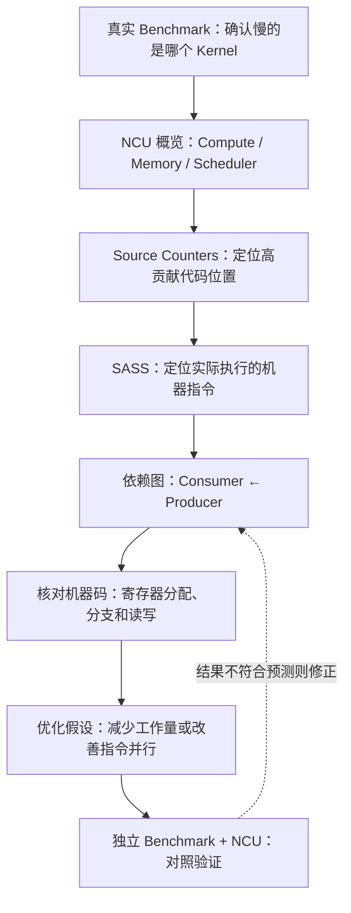

本课结课时应能做到以下六件事：

1. 解释 CUDA C++、PTX、cubin/SASS 之间的**编译阶段与职责差异**，避免把源码的一行等同于一条指令。
2. 在 NCU Source 页面正确解读 **Instructions Executed、Thread Instructions、Predicated-On Threads、Warp Stall Sampling** 等统计。
3. 根据某条 **Consumer** 指令上的 Stall，找到先前真正发起 Load 或计算的 **Producer** 指令。
4. 区分**寄存器使用量高、Local Memory 访问、Register Spilling**，避免将它们误当成同一问题。
5. 判断向量化、循环展开、分支谓词化、代码移动、内联等编译器变化是否真实改善了**SASS 和执行时间**。
6. 把“源代码推测 → SASS 事实 → NCU 现象 → 优化前后对照”写成有因果依据的诊断结论。

---

## 1. 从 CUDA 源代码到真实 GPU 指令

### 1.1 CUDA C++、PTX、SASS 是三个不同抽象层

CUDA C++ 是开发者用数组、循环、线程编号等表达算法的高级语言。PTX（Parallel Thread Execution）是虚拟指令表示；**ISA（指令集）**规定有哪些指令及其含义，虚拟 ISA 不绑定唯一物理实现。PTX 中的寄存器名字还不是最终硬件寄存器编号；**地址空间（address space）**规定数据由谁访问、用什么规则寻址，例如 global 是设备全局可访问，shared 是块内共享，local 是每线程私有，local 不代表物理上离线程近。**Shared Memory（共享内存）**则是 SM 上供同块线程交换数据的小存储，例如各线程先写部分和、同步到齐后再由同块线程读取相加；地址空间的可见范围与数据放在什么硬件中要分别理解。

SASS 是针对特定 GPU 架构生成、实际执行的机器指令形式。**cubin** 是保存目标 GPU 机器码等内容的二进制文件/代码对象，不是与 SASS 并列的另一种源语言。**前端**从 CUDA C++ 生成中间表示并优化，**后端**如 `ptxas` 再选机器指令、分配寄存器、安排指令顺序。提前生成机器码称 **AOT（ahead-of-time）**；运行时由驱动从 PTX 生成机器码称 **JIT（just-in-time）**。**反汇编**把二进制指令显示为 SASS，方便人阅读；不是重新运行 kernel。

图中内联是将函数体放到调用处，循环优化可能把多轮循环体复制进一段指令以减少循环判断；`-lineinfo` 让产物附带机器指令与源码行号的关联信息。先认识它的作用，1.3 再看具体选项。

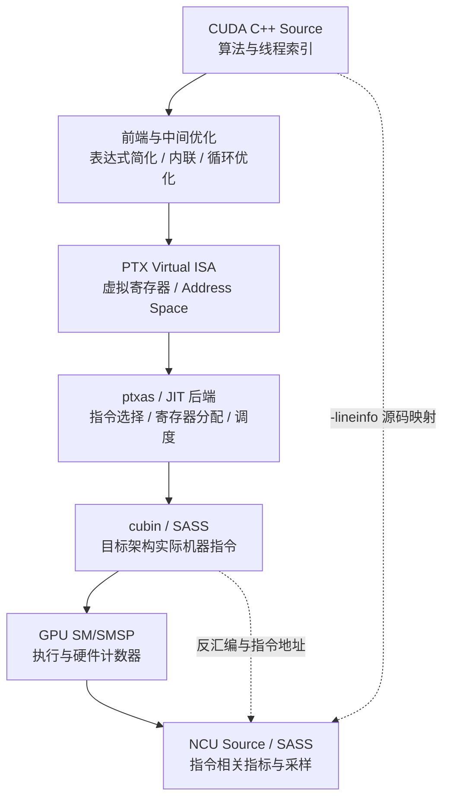

先认识即将在表中出现的读法：`ld.global/LDG` 是全局读取，`STG` 是全局写出，`bar.sync` 是让规定线程到齐的同步，`.local` 声明线程私有数据；`IADD3` 是整数加法，`SHF` 是移位类操作。**PC（Program Counter）**在这里表示机器指令的位置，例如地址 `0x130`；0x 表示十六进制，不是源码行号或线程编号。**静态**指检查编译后代码本身，**动态**指实际运行中发生了多少次，例如循环体静态一条加法，循环十次会动态执行十次。`fma/FFMA` 是融合乘加，即把一乘一加合成一条算术指令，数值细节紧接着用例子说明。

| 层级 | 关注对象 | 能回答什么 | 不能保证什么 |
|---|---|---|---|
| CUDA C++ | 数组、循环、模板、线程索引 | 程序希望做什么 | 不能断言机器指令条数和顺序 |
| PTX | `ld.global`、`fma`、`bar.sync`、`.local` 等虚拟 ISA | 经过前端优化后的大体指令语义 | 不保证与最终 SASS 一一对应 |
| SASS | `LDG`、`STG`、`FFMA`、`IADD3`、`SHF` 等机器指令 | 真实目标架构的指令形态与寄存器依赖 | 不能仅凭静态反汇编得出动态执行次数 |
| NCU 指令相关指标 | Source/SASS 行的计数与采样 | 哪些指令执行得多、在哪些 PC 上采到等待 | Stall 样本不是逐指令精确耗时 |

回到开头每线程读一个输入、写一个输出的例子，其算术可写成一行：

```cpp
float z = x[i] * scale + bias;
```

这里 x 是输入数组，i 是线程负责的位置，scale/bias 是系数，z 是本线程临时结果，最后还须用于输出。**FP32** 指 32 位浮点数，本例为 `float`；**FMA（融合乘加）**计算 `a*b+c`，乘加后只做一次最终舍入，FP32 的机器指令常见为 `FFMA`。按数学工作量，一乘一加计 2 **FLOPs**，不是两条机器指令；FLOP 是浮点运算次数单位，FLOP/s 才是每秒速率。

这行至少涉及地址生成、内存 Load、算术和后续使用；如果编译器将 `scale`、`bias` 保持在寄存器或常量路径中，并启用 FMA 合并，那么算术部分可能被合成为一条 `FFMA`。如果 `z` 从未参与最终结果，它甚至可能被整体删除。也可能因数据类型转换、指针别名和访问边界产生更多指令。**指针**保存数据地址；**别名**是两个指针可能指向同一存储位置，例如写 `out` 可能改变之后要从 `x` 读取的值，编译器就不能随意重排。

**关键原则：优化 CUDA 源码后，应当验证最终 SASS 是否真的发生了预期变化。** 静态 PTX 仅是中间证据，不是最终执行事实。

### 1.2 AOT 编译、PTX JIT 与不同 GPU 架构

**架构/Compute Capability** 是设备支持的指令和资源能力版本，`sm_89` 等编译目标与之对应；不能只看商品名或驱动显示的 CUDA 版本。**Driver** 是让程序使用 GPU 的驱动，**Toolkit** 是包含 `nvcc` 等开发工具的软件包，版本彼此不同。

一个 CUDA 二进制可以包含面向某些 `sm_xx` 目标的 cubin，也可以包含较通用的 `compute_xx` PTX。在目标架构有匹配 cubin 时可使用预编译机器码；某些情况下 Driver 会对 PTX 进行 JIT 编译。不同目标架构或编译器版本可能使用不同指令选择、调度和资源分配，因此相同源码并不一定生成相同 SASS。

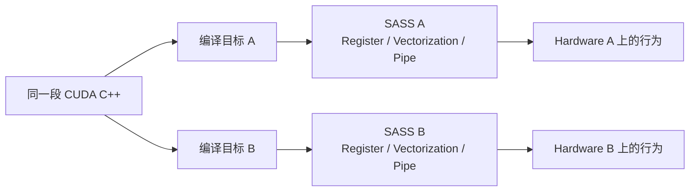

**工程含义：** 性能报告必须记录 GPU 型号、Compute Capability、CUDA Toolkit/nvcc、Driver、NCU 版本、编译选项以及最终二进制标识。否则某份“源码到 SASS”的解释可能在下次编译后不再成立。

### 1.3 `-lineinfo` 与 `-G` 的本质区别

对性能归因，最重要的构建原则是**保留优化并带上行号信息**。`nvcc -lineinfo`（亦写作 `--generate-line-info`）使编译产物包含可供工具使用的源码位置映射；`-G` 是 Device Debug 模式，默认会抑制大量设备代码优化，可能明显改变寄存器分配、SASS 与 Kernel 性能，因而不应成为默认 Profiling 配置。

```bash
# 只是示例编译选项，不是本课要求执行的实验脚本
nvcc -O3 -lineinfo -arch=sm_89 -c kernel.cu -o kernel.o

# 查看编译器的资源用量摘要
nvcc -O3 -lineinfo -Xptxas=-v -arch=sm_89 -c kernel.cu -o kernel.o
```

示例命令中的 `nvcc` 是 CUDA 编译器入口，`-O3` 开启优化，`-arch` 选择目标架构，`-c` 只编译为目标文件而不链接成可执行程序，`-o` 指定输出；`-Xptxas=-v` 将详细资源输出选项交给后端 `ptxas`。`kernel.cu`/`kernel.o` 是说明输入输出关系的示例名，不指本目录实际入口；配套 lab 使用实际路径。

这里的 `sm_89` 仅为示例目标，必须替换为真实 GPU 支持的目标架构。实际使用时，常见的辅助工具还有 `cuobjdump`（提取/反汇编已构建产物中的 GPU 代码）与 `nvdisasm`（查看 SASS、控制流和部分依赖信息）。是否包含完整源码视图，还取决于源码是否可读取、是否被报告导入、以及 JIT/模板编译后是否存在有效映射。

### 1.4 为什么源码和 SASS 的映射不是 1:1

读表前先补齐会影响分析的三个动作。**寄存器分配**决定各临时值占用哪些物理寄存器，放不下或分配策略受限时可能临时写到别处、以后再读回，叫 **Spill（寄存器溢出）**；不代表所有线程私有数据都是 spill。**谓词化（Predication）**给指令加一个每线程真假条件，例如 `@P0` 为真才让这条加法对该线程生效。**循环展开（Unrolling）**把多轮循环体复制到指令序列中，例如展开两轮后减少一次循环判断。这些变化后文保留详细案例，这里先知道“做了什么”。

| 编译器行为 | 代码层面现象 | SASS 层面可能的结果 |
|---|---|---|
| Dead Code Elimination | 计算结果未使用 | 对应计算指令消失 |
| Common Subexpression Elimination | 相同表达式重复出现 | 被合并为一次计算 |
| Constant Folding | 参与运算的量在编译期确定 | Load/算术被化简 |
| FMA Contraction | `a*b+c` | 变成一条 `FFMA`（受语义及选项约束） |
| Unrolling | 一个短循环 | 若干段近似重复 SASS |
| Scheduling | 源码按顺序 Load、计算 | 可能将 Load 提前以隐藏延迟 |
| Register Allocation | 多个临时变量 | 共用寄存器，或出现 Spill |
| Predication | 简单条件分支 | 可能转为谓词控制的指令 |
| Inlining | 调用小函数 | 函数指令进入调用点；可能增加代码量 |

一个源码行还可能对应多段不连续机器指令；多个源码行也可能归并到同一段机器指令。**Source 行热点只是导航入口，SASS 地址和真实依赖关系才是细粒度分析的核心。**

---

## 2. NCU Source 页面：它究竟呈现什么

### 2.1 Source 页面是一张“映射表”，不是 GPU 的录像

NCU 的 Source 页面能够在适用条件下将 CUDA/其他高级语言源码、PTX 与 SASS 并列呈现，并将**指令地址（PC）相关的指标**附在相应代码位置上。这一页的主要用途是定位：哪段代码最频繁执行，哪条机器指令对应访存请求，哪里聚集了 Stall 样本，或者哪个分支使有效线程比例下降。

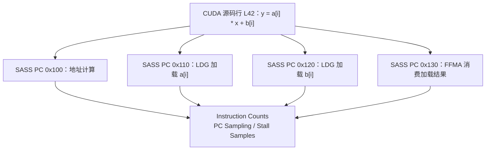

其中 `PC` 是 Program Counter，对应机器指令位置；它不是 CPU 调用栈，也不是某个 CUDA Thread 的唯一标识。取样时 GPU 会报告一个 Warp/调度状态所对应的指令位置。CUDA 从 Volta 开始支持更灵活的线程调度语义，但 NCU 的 Warp Sampling 仍应按文档描述的采样与聚合口径解释。

### 2.2 Source 页面常见的五类指标

**Memory Transaction（访存事务）**是硬件实际服务一次读写所需的数据传输/服务工作，不等于一条源码读取。**Excess Transactions（额外事务）**表示相对该指标定义的理想服务量多出的部分，例如分散地址使一次 warp 读数需要更多片段；它不直接等于新增 DRAM 字节。**Predicated-On** 指活跃线程中这条指令的条件为真者，例如 32 个线程中只有 8 个满足条件，就不能把一次 warp 指令算成 32 次有效加法。后面第 3 节用同一条指令展开三种计数。

| 指标类别 | 看什么 | 典型结论范围 | 常见误读 |
|---|---|---|---|
| Instructions Executed | Warp 级某 PC 被执行的次数 | 指令级动态工作量 | 误当成线程级次数 |
| Thread Instructions Executed | Active Thread 层面的执行计数 | 参与执行的线程总量 | 不区分谓词真假 |
| Predicated-On Thread Instructions | 谓词为真的线程执行量 | 条件成立时实际执行的参与程度，不保证全是算法有用工作 | 直接当作 FMA FLOPs |
| Warp Stall Samples | 采到某 PC 与某种状态的次数 | 定位等待高度集中的位置 | 当作逐条指令耗时 |
| Memory Access / Excess Transactions | 指令相关访问类型及浪费量 | 定位 Global/Shared 访问低效 | 与 DRAM 总流量混为一谈 |

具体列名和是否可用随设备、所选 Section、NCU 版本及编译产物而变化。Source 页面可能显示“高层源码视图”“SASS 视图”“Source + SASS 对照视图”及更多中间层；不应假设每次采集均有所有视图。

### 2.3 SourceCounters 并不等于所有 Source 页指标

**软件插桩（instrumentation）**是工具加入额外的记录操作，例如每次执行目标指令时增加计数；**SASS Patching** 是在机器指令层做这类修改。硬件计数器则是芯片内累计某类事件/周期的设施，二者不是同一来源。一次采集工作可能分多轮执行，每轮叫 **Pass**，为采不同指标重复执行叫 **Replay（重放）**，会扰动缓存与并发。

`SourceCounters` 是用于收集源代码相关指令执行、分支、Warp Stall Sampling 等信息的 Section；`InstructionStats` 主要展示指令统计；另外一些 SASS 指标可以通过软件插桩采集。Source 页面是统一呈现界面，而不是意味着上面的数值都来自同一个 Section、同一个硬件计数器或同一次 Profiling Pass。

一些源码级指令执行计数利用 **SASS Patching** 获取，这意味着工具可能在执行时修改或插桩目标机器指令。该过程可能带来明显扰动，需要尤其注意极短 Kernel 和通信同步逻辑。另一方面，PC Sampling 属于统计采样，不应拿与其不同 Pass 的计数器逐样本求精确对应关系。

---

## 3. 指令计数：Warp Executed、Thread Executed 与 Predication

### 3.1 同一条 SASS 指令的三种计数口径

**FADD** 是浮点加法。**Active Mask（活跃掩码）**标明当前路径包含哪些 lane；谓词则进一步决定其中哪些线程使这条条件指令生效。可以想成先点名一组到场学生，再检查每人是否符合做题条件，两个筛选不是一回事。

假设 Warp 中有 32 个 Active Threads，执行一条不带谓词的 `FADD` 指令一次。

- **Warp-level Instructions Executed**：此 Warp 级指令执行一次，因此为 1。
- **Thread Instructions Executed**：有 32 个活跃线程参与，因此为 32。
- **Predicated-On Thread Instructions**：所有线程谓词为真（无显式谓词），因此为 32。

如果同一条 SASS 指令带谓词，只有 8 个线程谓词为真，则可以形成：

| 计数类型 | 教学示例 |
|---|---:|
| Warp 级 Instructions Executed | 1 |
| Thread Instructions Executed（按 Active Threads） | 32 |
| Predicated-On Thread Instructions | 8 |
| Avg. Threads Executed | 32 |
| Avg. Predicated-On Threads Executed | 8 |

表中 Avg. 的平均分母是对应的 warp 指令执行次数，例如 80,000 次谓词为真的线程执行 / 10,000 次 warp 执行 = 平均 8 个线程/次，不是除以 GPU 总线程数。严格的具体定义取决于指标。NCU 的源代码指标 `derived__avg_thread_executed` 与 `derived__avg_thread_executed_true` 分别由线程级与 Warp 级指令执行统计推导。**Warp 指令数不能直接乘以 32 就当作每种指令的有效操作数**，因为存在 Predication、Active Mask 和特定指令语义。

### 3.2 何为分支分歧，何为谓词化

**分支分歧（Divergence）**指同一 warp 的线程需要走不同控制路径，例如部分执行 if、部分执行 else；不能把这两条不同指令路径当成所有 lane 同时执行同一指令。**Reconvergence（重新汇合）**是这些路径在后续位置重新合并。谓词化则可能不产生跳到不同路径的分支，而是让某些 lane 的操作不生效。**取指（instruction fetch）**是获取接下来要执行的机器指令，也有服务成本。

CUDA 中简单的：

```cpp
if (threadIdx.x % 4 == 0) {
    out[i] = a[i] + 1.0f;
}
```

这里假设已计算合法的全局编号 i、数组访问不越界；`threadIdx.x` 是线程在块内的编号，`%4==0` 选出每四个中的一个。编译器可能生成真正的条件控制流，也可能通过谓词控制类似 `@P0 FADD`、`@P0 STG` 的执行。两者含义不同。

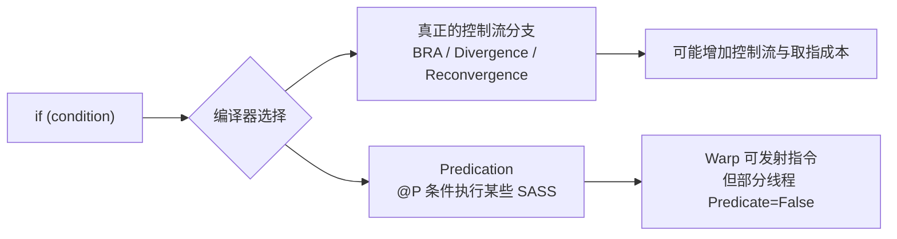

如果每个 Warp 中仅 8 个线程满足条件，那么约 25% 的 Lanes 实际做有用计算，但这种“活跃线程比例低”并不自动等于发生了真实的 Warp Control-Flow Divergence。`Branch Efficiency`、`Divergent Branches`、`Avg. Predicated-On Threads` 以及 SASS 中的分支形态要一起观察。

对于跨不同分支的完整路径，不能因为源码中有 `if` 就断言一定存在硬件分支；也不能仅凭低的 Predicated-On Threads 就断言性能必然被分支主导。若是 Memory 指令，还要结合是否生成真实的 Load/Store 事务分析。

### 3.3 动态指令量与性能的关系

两个 Kernel 完成相同算法：版本 A 每个 Warp 执行 500 条机器指令，版本 B 执行 420 条。B 的指令数更少，但不一定更快：它可能增加了长依赖链、寄存器压力、Global Memory Transactions 或慢速指令的比例。

一个简单的指令资源下界模型为：

$$
T_{\mathrm{issue,min}}\approx\frac{N_{\mathrm{warp-inst}}}{R_{\mathrm{issue,peak}}},
$$

分子 $N_{\mathrm{warp-inst}}$ 是所选范围内 warp 指令的发射工作量（条），分母 $R_{\mathrm{issue,peak}}$ 是同一范围相适应的理论发射能力（条/s），相除为秒。若统计全 GPU，不能拿单 SMSP 的条/s 直接作分母。这个模型只是**资源下界**，不包含依赖、流水线争用、同步和其他因素，更不能把任意 Opcode（指令操作类型，例如加法或读取）都视为相同代价。

---

## 4. PC Sampling：为什么“采样到这里”不是“时间花在这里”

### 4.1 采样原理：定时抽取活跃 Warp 的 PC 与状态

NCU 的 Warp Sampling 会周期性选择活跃 Warp，观察其 PC 和 Warp Scheduler 状态。下面这些名字先按含义读，不把它们当耗时分项：

- **selected**：该 warp 被选中发射；**not_selected**：具备条件但此次选了其他 warp，不必然是浪费。
- **long_scoreboard**：等待 L1TEX 相关结果的数据依赖；**short_scoreboard**：等待另一类较短路径结果的依赖，可能涉及 shared、特殊函数等，不能只凭名字认定来源。
- **barrier**：等规定参与者到齐；**wait**：等待相关执行依赖，例如某些固定延迟结果。具体分类依架构文档。
- **lg_throttle**：global/local 读写请求相关通道暂时不能再接收更多工作；并不等同显存带宽用完。

这些状态可以帮助找下一条指令为何不能发射，但一个 warp 等待不代表整个 SM 等待。采样的最小周期和可支持的 Metric 受到目标 GPU 的能力限制。

```mermaid
sequenceDiagram
    participant S as SM / Warp Scheduler
    participant W0 as Warp 0
    participant W1 as Warp 1
    participant P as PC Sampler
    Note over W0,W1: W0 等待 LDG 结果；W1 可能可以发射
    P->>S: 在采样周期读取某个活跃 Warp 状态
    S-->>P: PC = 0x130; State = Long Scoreboard
    W1->>S: 同一阶段仍可能正常发射 FFMA
    Note over P: 样本描述 W0 状态，不证明整个 SMSP 空闲
```

PC Sampling 主要是**统计分布**，并不直接提供每条指令完整时间线，也不能将 100 个 `long_scoreboard` 样本解释为连续 100 个周期等待；某些采样还可能在不同 Pass 中进行，样本总数未必严格对应。官方明确提示：取样到某个 Warp 处于 Stall 时，Scheduler 同一周期可能正在发射**另一个 Warp**。

### 4.2 Consumer Attribution：Stall 往往记在“等待结果”的指令上

回顾此处需要的 **ILP（指令级并行）**：同一线程/warp 内有可独立推进的指令，例如等 R8 读取时先做不依赖 R8 的索引加法。它不改变 R8 本身的返回延迟，而是让等待期间有事可做。

先学读这一小段 SASS：**Opcode（操作码/操作类型）**是 `LDG`、`FFMA` 这样的指令名，后面是操作数；本例第一个 `R` 是写出的目标寄存器，其后是读入值，`[R2]` 表示使用 R2 所表示的地址读取数据。`RZ` 是零寄存器；`IADD3` 在这里是与 R8 无关的整数加法。寄存器号是示意名字，不是 C++ 变量名，也不是线程编号。

考虑依赖：

```text
# 示意 SASS，寄存器和地址不代表特定架构的真实输出
LDG.E R8, [R2]           // Producer：请求加载全局内存
IADD3 R5, R5, 0x1, RZ   // Independent work：与 R8 无关
FFMA  R10, R8, R4, R10  // Consumer：需要刚刚 Load 得到的 R8
```

如果 Load 尚未完成，Warp 在准备执行 `FFMA` 时无法通过 Scoreboard 检查，采样的 PC 可能指向 **`FFMA` 这条 Consumer**，而不是 `LDG`。如果只看热点位置，很容易错误地认为 FMA 的计算延迟太高。

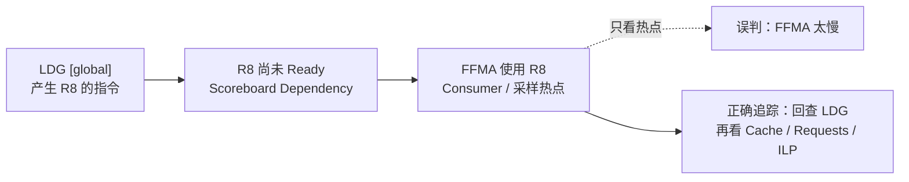

因此，归因步骤是：先定位 Stall 高的 PC，再检查对应 SASS 的所有输入寄存器，向上回溯哪些 Producer 定义了这些寄存器，最后验证 Producer 访问的 Memory Space、缓存、事务与就绪条件。

### 4.3 为什么 Long Scoreboard 不等于 DRAM 带宽瓶颈

这里 **Texture/Surface** 是 CUDA 中带专门访问语义的数据读写方式，本课只需知道它们也可能经过 L1TEX，不必先掌握图像处理。`long_scoreboard` 表示等待 L1TEX（Global、Local、Texture/Surface 等路径）相关操作的数据依赖。它强调的是**等待结果**，不是直接统计 DRAM 带宽。只有部分访问到达 DRAM；其他可能命中 Cache，Local Memory 还可能来自寄存器溢出。即使 DRAM 有大量可用带宽，串行地址依赖也会使 Load 无法并发，导致长时间等待。

**链表/指针追踪**在这里可用整数数组 next 表示：数组项给出下一个要读的位置。例如 next[0]=7、next[7]=3，要等读到 7 才知道去读下标 7；它不是一个可直接并行发出所有读取的连续数组扫描。假设某链表遍历：

```cpp
idx = next[idx];  // 下一次访问地址依赖上一次 Load 的结果
```

同一线程中 Load-Use 的依赖难以形成大量独立并发。即使总访问字节数很少、DRAM 吞吐很低，Kernel 也可能因每次 Load 的返回延迟而慢。

### 4.4 PC Sampling 的正确使用方式

表中 **MIO** 是部分架构的特殊操作/读写处理路径；**SFU** 是处理部分特殊函数的执行资源。**Bank** 是 shared memory 的存储分组，不同地址争同组而需分批服务叫 **Bank Conflict**；**Wavefront** 是相关路径一次服务的工作单元，请求可能拆成多个 wavefront。**RAW（Read After Write）**是先产生某值、随后读取该值的真实依赖，例如 LDG 写 R8 后 FFMA 读 R8；5.2 再与其他名字依赖对照。

| 发现 | 下一步验证 | 不应直接得出的结论 |
|---|---|---|
| Long Scoreboard 样本集中在某条 `FFMA` | 反查 Producer Load；看 L1/L2/DRAM 和依赖链 | “FFMA 计算慢” |
| Short Scoreboard 集中在 `FADD` | 反查 Shared/MIO/SFU Producer；看 Bank Conflict、Pipeline | “一定是 Shared Bank Conflict” |
| Wait 集中在连续 `FFMA` | 看 FFMA RAW 链、独立累加器与 Warp 并发 | “增加指令数一定改善” |
| Not Selected 很高 | 查看 Issue Active 与 Eligible Warps | “大量无效等待必须消除” |
| Barrier 集中在同步指令 | 找到较慢的 Producer 路径、CTA 内工作失衡 | “删除 Barrier 就能提速” |
| LG Throttle 高 | 看 Global/Local 请求密度、访存指令及 Spill | “显存带宽已满” |

---

## 5. 如何读一条 SASS 指令：从 Opcode 到依赖图

### 5.1 初学阶段必须识别的指令类别

**助记符**是机器操作的可读短名，读懂操作和输入输出比背编码更重要。表中的 **Fence（内存栅栏）**约束规定范围内内存操作的顺序/可见性，不等于让所有线程到齐；**Membar** 是相关内存屏障等待类别。**Tensor Core** 是成组矩阵乘加资源，**MMA** 一次操作一小块矩阵；例如 2×2 矩阵相乘，四个输出各累积两对乘积，而不是只算一次标量乘法。

**Sector** 是相关缓存路径按固定大小计数/服务的数据片段，常见为 32B。**Coalescing（合并访存）**让同一 warp 的相邻地址尽量用少量片段服务；例如 32 个线程各读相邻的 4B，共 128B 有效数据，理想对齐时覆盖四个 32B sector，分散地址则可能涉及更多片段。**向量化 Load** 是一条指令让每线程读多个值，例如一次读四个 float；不等于增加线程数。

SASS 具体编码与助记符会变化，以下是常见类别的教学归纳，不是完整 ISA 清单：

| 类别 | 常见助记符例子 | 主要功能 | 关联性能问题 |
|---|---|---|---|
| Global Memory | `LDG`、`STG` | 全局地址空间的 Load/Store | Coalescing、Cache、Memory Latency |
| Local Memory | `LDL`、`STL` | Thread-local 地址空间读写 | Local 数组、Spill、延迟 |
| Shared Memory | `LDS`、`STS` | Shared Memory 读写 | Bank Conflict、Wavefront |
| Float Arithmetic | `FADD`、`FMUL`、`FFMA` | 浮点运算 | FLOPs、流水线、RAW |
| Integer Arithmetic | `IADD3`、`IMAD` | 地址计算、整型算术 | 指针更新、索引计算 |
| Bit/Shift | `SHF`、`LOP3` | 位运算、位域和移位 | 布局、掩码、地址变换 |
| Compare/Predicate | `ISETP`、`FSETP` | 条件判断、谓词生成 | 分支或谓词执行 |
| Branch/Control | `BRA`、`EXIT` 等 | 控制流 | Divergence、Instruction Fetch |
| Warp Exchange | `SHFL` 等 | Warp 内数据交换 | Reduce、Gather、小范围通信 |
| Barrier/Fence | 各代架构对应同步/栅栏指令 | 线程协作与内存可见性 | Barrier、Membar、等待 |
| Tensor Operations | `HMMA`、`MMA`、`WGMMA` 等 | 矩阵计算（架构相关） | Pipe Utilization、Tensor Load/Wait |

**不要把 `LDG` 的出现次数等同于实际 DRAM 请求数。** 一条 Warp 级 Load 可能触及多个 32B Sector，并经过 L1/L2 命中或进一步访问显存，最终 DRAM Traffic 与 SASS Load 指令数不是简单关系。相反，一条向量化 Load 可能访问较多字节，却只是一条指令。

### 5.2 数据依赖：RAW、WAR、WAW 与真实性能等待

- **RAW (Read After Write)**：后继指令消费前序指令生成的寄存器值，是 Scoreboard 数据就绪检查最直观的来源。
- **WAR (Write After Read，先读后写)**：如第一条读旧 R5、第二条覆盖 R5，不能让覆盖抢在读取之前。
- **WAW (Write After Write，先写后写)**：两条都写 R5，不能因重排让最终留下错误的旧值。WAR/WAW 属于名字及先后约束；编译器可用不同寄存器名字保存不同值（寄存器重命名）、分配及调度处理相关约束。不能直接将源码里的每种名字依赖等同为最终 SASS 的硬件 Stall。
- **Memory Dependency**：涉及 Load/Store 与地址、数据、排序语义，部分依赖并非单一寄存器 RAW 所能概括。
- **Barrier/Fence Dependency**：执行路径可能需要等待其他线程、Warp、异步操作或规定的内存顺序约束。

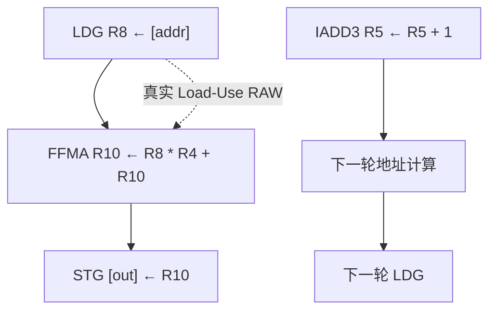

SASS 依赖图的核心不是“找到慢的 Opcode”，而是根据**输入操作数何时就绪、硬件 Pipeline 何时可接受指令、调度器是否有其他 Eligible Warp**判断关键路径。

### 5.3 静态 SASS 与动态执行次数要分开

设某循环体内静态只有 8 条 SASS 指令，但每 Warp 执行 100 次，动态指令量可能达到约 800 条/ Warp（还需考虑分支、谓词与代码变化）。另一个 Kernel 静态 SASS 有 200 条指令，但实际只有 1 个短路径被执行，就可能动态工作量更少。

所以需要：**SASS 解释“机器指令是什么”，Instructions Executed 解释“运行时执行了多少次”，PC Sampling 解释“哪里出现了较多调度状态样本”。** 三者必须联合使用。

---
## 6. 寄存器压力：为什么“多用寄存器”不一定快

### 6.1 寄存器是硬件资源，不是无限的 C++ 局部变量容器

GPU 的每个线程需要一定的寄存器保存地址、循环变量、计算中间值和累加器（逐步保存部分计算结果的值，例如 acc）。寄存器是 SM/SMSP 上速度非常快、数量却有限的资源；一个 Kernel 需要的每线程寄存器数量，会影响同一个 SM 可以同时驻留多少线程和 Warp。

先解释 **Live Range（值的活跃区间）**：一个值从产生到最后一次可能使用之间，都必须有地方保存；此后即使源码变量还在作用域内，这个值也可能不再需要。例如 `u=load A; v=load B; r=u+v`，u/v 在求 r 前同时活跃；求和后若不再用，原位置就能给新值使用。**Register Pressure（寄存器压力）**关心某处需要同时保留多少值及分配限制；**Registers/Thread** 则是最终每线程实际分配的寄存器数，两者不完全相等。

需要区分三个量：

| 概念 | 实质 | 典型观测方式 |
|---|---|---|
| 变量数量 | CUDA 源代码中出现的命名变量或数组元素 | 只反映编程表达，不代表真实寄存器数 |
| Register Pressure | 某程序位置附近需要同时保持的活跃值、后端分配约束 | Live Range、编译器输出、SASS 分析 |
| Registers Per Thread | 最终目标 Kernel 分配的每线程寄存器数量 | `launch__registers_per_thread`、LaunchStats |

假设源码中先用到 `a`、用完后再用到 `b`，编译器可能将二者映射到同一个物理寄存器；因此 100 个 C++ 变量不一定意味着需要 100 个物理寄存器。反过来，复杂地址计算、函数 ABI、向量类型、内联和指令要求也可能增加寄存器分配。**ABI** 是函数之间传参、返回值和保存状态的约定，可能需要额外临时位置；向量类型一次包含多个标量值。

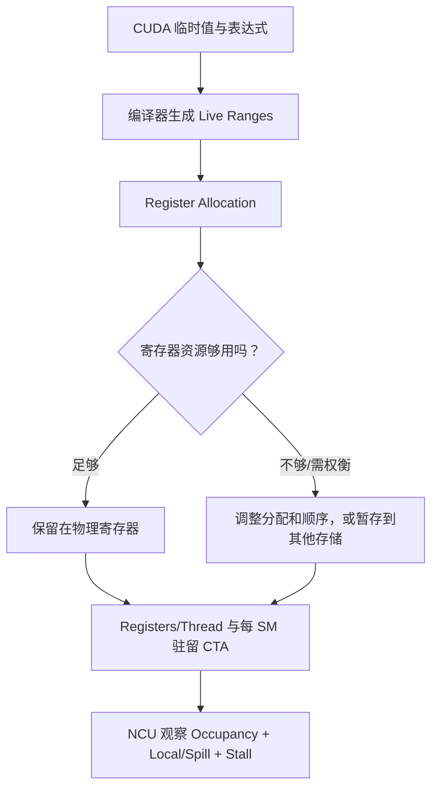

### 6.2 用数值理解寄存器与 Occupancy 的关系

**分配粒度**表示资源只能按一定份额分配，例如需要 33 份也可能按下一整份档位计入，不是任意连续数。这里的具体粒度依架构，暂不假定。假设一块教学 GPU：每个 SM 有 65,536 个可分配的 32-bit Registers，最大驻留 64 Warps，Kernel 的 Block Size 为 256 Threads（8 Warps）。暂时忽略寄存器分配粒度、其他硬件资源约束、Block 数上限和架构细节。

下式 $R_{\mathrm{thread}}$ 单位是寄存器/线程，乘 256 线程得到一个块需要的寄存器个数；一个 32-bit 寄存器是 4B，不能把个数直接写成字节。$\lfloor x\rfloor$ 表示向下取整，因为不能驻留半个完整 block。Occupancy 的分母用本例最大 64 warp，例如 3 块×8 warp/块÷64=37.5%。

一个 CTA 的寄存器预算约为：

$$
R_{\mathrm{CTA}}=256\times R_{\mathrm{thread}}.
$$

仅由寄存器决定的驻留 CTA 上限：

$$
N_{\mathrm{CTA,reg}}=\left\lfloor\frac{65536}{R_{\mathrm{CTA}}}\right\rfloor.
$$

| Registers/Thread | Registers/CTA | 寄存器允许的 CTAs/SM | Resident Warps | 教学 Occupancy |
|---:|---:|---:|---:|---:|
| 32 | 8,192 | 8 | 64 | 100% |
| 64 | 16,384 | 4 | 32 | 50% |
| 80 | 20,480 | 3 | 24 | 37.5% |
| 96 | 24,576 | 2 | 16 | 25% |

这张表**只展示寄存器单因素上限**，真实 GPU 还存在寄存器分配粒度、最大 Blocks/SM、Threads/SM、Shared Memory/CTA 等限制，因此不能把它当成任何一款 NVIDIA GPU 的绝对驻留结果。

### 6.3 Occupancy 降低为什么不必然导致降速

回顾 ILP 是在同一线程中安排互不依赖的工作，例如四个独立累加值轮换更新；**TLP（线程级并行）**则在某 warp 等待时运行其他 warp。更多寄存器可能增加前者，却减少能驻留的 warp、削弱后者。

假设优化前 Kernel 需要 32 Registers/Thread，Occupancy 理论上达到 100%；优化后将访问结果直接留在寄存器中，多条计算链能够并行执行，每线程寄存器增至 64，Occupancy 下降到 50%。如果后者显著增加 ILP、减少 Local/Global Load、提高指令流水线利用率，它反而可能更快。

这说明 Register 与 Occupancy 存在双向权衡：

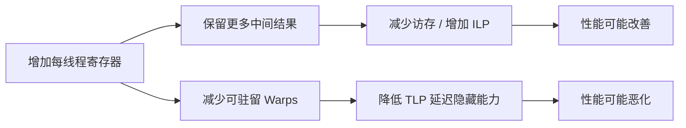

判断标准必须是相同输入下的实际执行时间、有效工作量与 NCU 归因证据，**不能简单追求最低 Registers/Thread 或最高 Occupancy**。

---

## 7. Local Memory 与 Register Spilling：必须区分的三个概念

### 7.1 Local Memory 的 Local 不是“物理上靠近 SM”

必须区分**源码局部变量**和 **local 地址空间**：写在函数里的 `float a` 是源码作用域概念，编译后可能放寄存器；local 则是一种机器寻址与可见范围。CUDA 内存空间中的 `local` 指的是线程私有地址空间（Thread-local Address Space），并不是与 Shared Memory 一样的 SM 片上存储体。传统 CUDA Local Memory 的数据位于 Device Memory 地址体系，访问可能经过 L1、L2 并最终到达 DRAM。实际读写是否访问到 DRAM 取决于缓存与硬件实现。

有些情况下编译器可能将线程局部数据安排在 Local Memory：

1. 局部数组需要动态索引，难以直接映射到定址寄存器访问。
2. 很大的线程局部结构体或数组难以全部保存于寄存器。
3. 编译器的寄存器分配需求超过或不适合可用资源，发生 Register Spilling。

**所以 Local Memory 访问不等于 Register Spill。** 即使每线程只有 16 个寄存器，一个动态索引的局部数组仍有可能使用 Local Memory。

### 7.2 Spilling 的本质：活跃值放不下寄存器

Register Spilling 是编译器为了管理寄存器分配而将某些本应频繁使用的值临时保存到其他存储位置，并在需要时重新读取的行为。通常情况下它表现为 Local Memory Load/Store；需要注意，较新的架构/编译工具链可能也支持某些 Shared Memory Spilling 方案，不能无条件假定所有 Spill 都必定是 DRAM 访问。

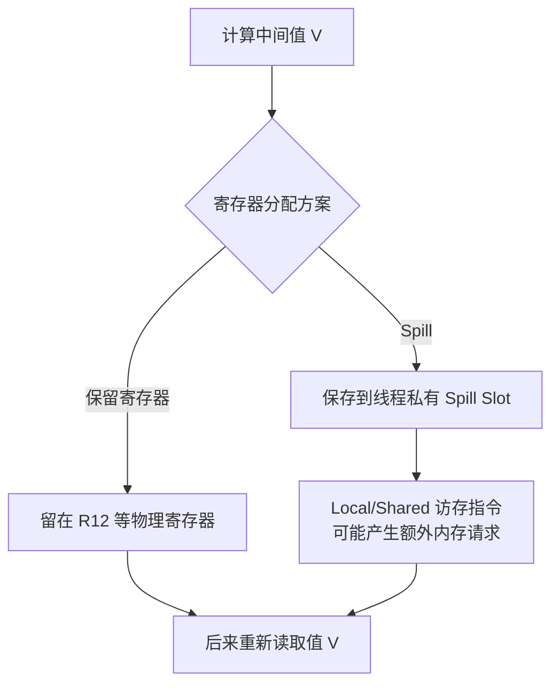

在传统 Local-Spill 情形，可使用教学 SASS 观察：

```text
# 仅为示意，具体目标架构的 Opcode 与偏移形式不同
STL [R_sp + 0x20], R17   // Spill Store
...
LDL R17, [R_sp + 0x20]   // Spill Reload
FFMA R10, R17, R9, R10
```

这里 `LDL`/`STL` 证明访问了 Local Memory，但仅根据 `LDL`/`STL` 未必能断定这些指令都是 Register Spill。需要结合编译器给出的 Spill 信息、具体局部数组与指令来源、工具可用的专门指标进行判断。

### 7.3 一个示例：局部数组如何变成 Local Memory

```cpp
__global__ void dynamic_index(const int* idx, float* out) {
    float tmp[64];
    // 假设其他语句对 tmp 的 64 个元素进行了有效写入
    int k = idx[threadIdx.x];
    out[threadIdx.x] = tmp[k & 63];
}
```

`__global__` 表明这是 kernel，`idx/out` 是输入整数索引数组/输出浮点数组的地址，tmp 是每线程各自一份的临时数组。`k&63` 取整数最低六位，将下标限定在 0～63，例如 k=65 得到 1；不是给 64 个线程分配一份共享数组。片段只按块内 `threadIdx.x` 索引，不作为多 block 通用编号示例。

这个代码只是说明动态索引的形态，并不是可直接运行的完整合法基准程序。由于 `k` 在运行时才确定，编译器很难像访问固定 `tmp[3]` 那样将其简化成一个确定的寄存器引用，因此 `tmp` 可能进入 Local Memory。若此时寄存器用量很低，也不应该草率断言是 Spill 导致。

### 7.4 Local Traffic、Spill 指令与 DRAM Traffic 的关系

**Reload** 是把先前暂存出去的值再次读回。32-bit 值为 4B；KB/MB 使用 $10^3/10^6$ 字节，KiB 使用 $2^{10}=1024$ 字节。假设某 Block 含 256 Threads，某内层循环执行 100 次，每线程每轮多了 2 条 32-bit Spill Reload。仅从逐线程读写层面估算新增逻辑读量：

$$
Q_{\mathrm{local,logical}}=256\times100\times2\times4=204800\ \mathrm{Bytes}=200\ \mathrm{KiB}.
$$

式中 256 线程×100 轮×2 次/(线程·轮)×4B/次得到字节，不是空间占用，更不是执行时间。

如果所有 Warp 都完整执行相应指令，8 个 Warps × 100 次循环 × 2 条 Reload，约新增 1,600 条**Warp 级 Local Load 指令**。但这不意味着 DRAM 一定新增 200 KiB 读流量：可能有 L1/L2 命中、额外对齐/事务开销，也可能存在不同执行路径。需要分别记录：

| 观察对象 | 对应意义 | 需要小心的区别 |
|---|---|---|
| Spill Loads / Stores（编译器） | 编译器的溢出操作情况 | 静态数量不等于动态执行数量 |
| Local Memory Bytes/Thread | 分配或需求规模 | 空间占用不等于访问流量 |
| SASS Local Load/Store 指令 | 实际执行的 Local 指令 | 其中不一定全是 Spill |
| L1TEX Local Sector Traffic | Local 请求在 L1TEX 的行为 | 不等于全部到 DRAM |
| DRAM Read/Write | 设备显存层实际流量 | 混合其他访问来源 |
| Long Scoreboard、LG Throttle | 等待 Local/Global 访问或请求通道 | 不能独立证明是 Spill 所致 |

### 7.5 NCU 中如何识别 Register Spill

有三条互补证据链：

**编译器证据：** 查看 `ptxas -v` 输出中的寄存器数、Spill Stores/Loads（若工具输出提供）和 Local Memory 统计。它们帮助判断后端是否明显增加了溢出需求，但还不足以说明动态性能成本。

**机器指令证据：** 查看 Source/SASS 中 `LDL`/`STL` 一类 Local Memory 指令及其热点，或使用目标版本支持的 `sass__inst_executed_register_spilling` 等专门 SASS 指标。较新版本也可能提供区分 Local/Shared Spilling 的细分指标；不能假设所有版本和 GPU 都支持这些指标。

**性能关联证据：** 查看 Local Memory 请求、L1/L2 流量、Warp Stall、Occupancy 和独立 Benchmark 的时间变化；只有对照优化后能形成一致变化，才可以归因“Spill 是主要性能问题”。

### 7.6 为什么强行设置 `-maxrregcount` 可能适得其反

`-maxrregcount=N` 给编译器每线程寄存器分配设置上限目标，**Launch Bounds** 则是在源码中向编译器描述线程块规模等启动约束，影响其资源选择；二者都不是直接命令硬件“更快”。它们能够影响编译器的寄存器分配目标，但减少寄存器可用量往往存在两种结果：

- 驻留 Warps 增加，能够提高 TLP，从而隐藏部分 Memory/Compute Latency。
- 编译器必须增加 Spill、Recompute（用到时重新计算原值以减少保存需求）、指令数或指令依赖，从而使每个 Warp 的执行成本变高。

因此优化结果并非单调。不能只看理论 Occupancy 从 25% 上升到 50% 就宣布成功；还要检查 Local Memory 与指令数是否大幅增加，以及 Kernel Duration 是否改善。

---

## 8. 源码级性能分析中最容易误判的四类编译优化

### 8.1 Loop Unrolling：减少分支开销，也可能增加寄存器和代码体积

下面是一个线程负责的一段求和：输入 x、w 各八个数，acc 保存部分和；例如 x 全是 1、w 全是 2、初始 acc=0，八轮后 acc=16。其他线程可处理各自片段，这里只展示单线程的循环形状，不是完整 kernel。

普通循环的基本形态：

```cpp
for (int j = 0; j < 8; ++j) {
    acc += x[j] * w[j];
}
```

例如展开因子（Unroll Factor）为 2，是把相邻两轮的运算放入一段再做循环判断，而非把算法工作量翻倍。**I-Cache（指令缓存）**保存待执行的机器指令；展开使静态代码变大，可能增加取指服务负担，与数据缓存流量不是同一量。

编译器可能展开循环，减少分支与循环计数操作；也可能引入更多同时存活的操作数、较长 SASS、较高寄存器压力，甚至造成 I-Cache 压力。正向与负向路径：

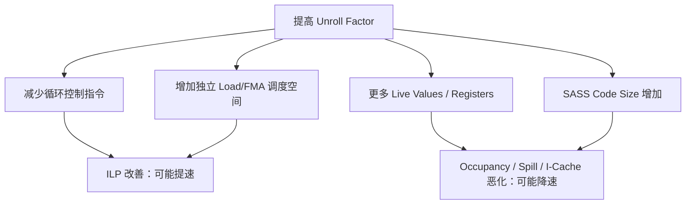

验证时，至少比较真实执行时间、Instructions Executed、Register/Thread、Local Load/Store、Eligible Warp 与 Issue Active。观察某个指标方向好转并不足以单独证明展开值得保留。

### 8.2 Vectorization：指令数减少不等于请求字节减少

假设每个线程需要读 4 个连续 FP32：

```cpp
float a0 = ptr[4 * tid + 0];
float a1 = ptr[4 * tid + 1];
float a2 = ptr[4 * tid + 2];
float a3 = ptr[4 * tid + 3];
```

这里 tid 是本线程负责的位置，四项是它要读取的输入。**对齐（alignment）**要求访问起始地址满足硬件规定的边界，例如某次 16B 宽访问要求起始地址为 16 的倍数；不能只因数组连续就无条件改成任意宽度读取。若对齐、别名和后端条件允许，编译器可能选用更宽的 Load，例如一条 128-bit 访问，而不是四条标量 Load。此时**每线程逻辑读字节数仍是 16B**；减少的是机器 Load 指令数量、Load/Store Pipeline 压力或某些地址计算成本，不意味着一定减少 DRAM 数据量。宽访问还可能提高寄存器需求，导致其他资源代价。

对于跨 Warp 的地址分布，需要使用第五课的 Sector/Request 模型继续分析。若地址不连续或者未按要求对齐，向量化不一定能在机器码中成立，也不一定形成更高效的内存请求。

### 8.3 FMA Fusion：浮点指令数量与 FLOPs 不可混淆

```cpp
float z = a * b + c;
```

**Fast Math** 是允许编译器使用某些更快近似或改变数值处理方式的选项/模式，可能影响结果精度；不能当作无代价的性能开关。这段表达式可能成为 `FFMA`，也可能因浮点精度、舍入语义、Fast Math 或编译器条件生成不同指令。一次 FMA 通常按 **2 FLOPs** 统计（一乘一加），但其 **SASS 指令数量为 1**。

因此，“SASS 浮点指令总数”不能无条件与“算法 FLOPs”划等号。Tensor Core 的 MMA 等指令更明显：一条指令可能代表大量矩阵乘加运算。

### 8.4 Code Motion：热点行号不一定是源码上的源头

**Code Motion（代码移动）**是在不改变要求的结果和可见行为前提下调整指令位置；**基本块**是一段内部没有控制流分叉的连续指令，例如循环的一段直线路径。编译器可能将内存 Load 提前、跨基本块调度计算，或者把多个高级语言语句重组到一个优化后的指令序列。一个源码行对应的 SASS 可能不在直观位置，并且采样到某个 Consumer 行时，产生等待的 Producer 可能映射到另一条源码行。

归因时优先相信：**机器指令 PC → 操作数 → Producer → Memory/Arithmetic 路径**，然后再把结论映射回源代码修改点。

---

## 9. 按问题组织 NCU Section 与指标，而不是记忆指标大全

| 问题 | 优先看什么 | 下一步关联 |
|---|---|---|
| 哪个 Kernel/源码行贡献最大？ | SourceCounters 的 PC 样本/执行计数、独立耗时 | Source + SASS、Kernel 粒度概览 |
| 是指令过多吗？ | InstructionStats、SASS Opcode Mix | 有用工作量、Pipeline Utilization |
| 是 Load-Use 依赖吗？ | PC Sampling 的 Long Scoreboard、SASS Producer/Consumer | L1/L2 Cache、Memory Requests、ILP |
| 是 Shared/MIO 等待吗？ | Short Scoreboard、SASS 中 Shared/SFU 等 Producer | Shared Wavefront、Bank Conflict、MIO Utilization |
| 是寄存器压力吗？ | LaunchStats、Occupancy、Register/Thread | Spill、Resident Warps、Issue Activity |
| 是 Register Spill 吗？ | `ptxas -v`、Local/Spill SASS 与可用专用计数器 | Local Sectors、Long Scoreboard、对照时延 |
| 是谓词/分支浪费吗？ | Thread Executed、Predicated-On、Branch/Divergence | SASS Predication/Branch、代码路径 |
| 是循环展开不合适吗？ | SASS Size、Instructions Executed、Registers/Thread | ILP、Occupancy、I-Cache、Benchmark |

### 9.1 不同指标的来源不能混为一谈

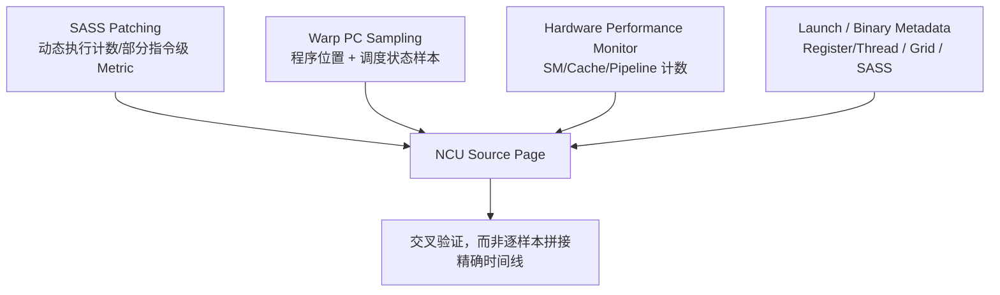

部分 SASS 指标来自 Software Patching，会引入额外指令或执行扰动；PC Sampling 是统计抽样；硬件性能计数器则通常测量某类事件或周期。它们的采集 Pass 和执行环境不一定完全一致，尤其要谨慎比较短 Kernel 或输入状态不稳定的 Kernel。

### 9.2 一组最小化采集示例

以下是用于帮助理解选项关系的**简短命令示例**，不是自动化脚本。`./app` 是待分析可执行程序的示例名、`target_kernel` 是应替换的函数名，不是本目录现成命令。`--section` 指定指标组；`-k 'regex:…'` 用正则表达式筛函数名（例如按名字模式选目标）；`-c 1` 只采一次匹配启动；`-o` 指输出报告前缀。`--import-source yes` 在可用时把高层源码导入报告；`--import` 读取已有报告，`--page source` 选代码页，`--print-source` 指要显示 sass 或 cuda,sass。下面是命令选项关系，不要求此时运行：

```bash
# 收集 Source 与指令相关 Section
ncu --section SourceCounters --section InstructionStats \
    -k 'regex:target_kernel' -c 1 -o source_report ./app

# 如果源码文件可访问，尝试导入高层源码以便离线查看
ncu --section SourceCounters --import-source yes \
    -k 'regex:target_kernel' -c 1 -o source_with_code ./app

# 对已有报告打印 SASS，或尝试 Source/SASS 对照
ncu --import source_report.ncu-rep --page source --print-source sass
ncu --import source_with_code.ncu-rep --page source --print-source cuda,sass
```

GUI 是图形界面，CLI 是命令行界面；`.ncu-rep` 是 NCU 报告文件。`--source-folders` 指定工具寻找源码的目录，`--help` 查询选项，`--list-sections/--query-metrics` 分别列可用指标组/指标。GUI 中可直接打开 `.ncu-rep`，在 Source 页面选择 `Source + SASS` 等适合的视图，并按 Stall Samples、Instructions Executed 或 Memory Excess 指标排序/导航。命令名称和支持能力应以当前版本 `ncu --help`、`ncu --list-sections` 为准。`-lineinfo` 提供关联信息，**并不保证源码文件已嵌入报告**；必要时使用 `--import-source yes` 或 `--source-folders`，并确认报告中所含源文件版本与二进制一致。

### 9.3 推荐的四层证据链

1. **Kernel 层**：当前问题是否确实影响真实时延？是否有足够大的绝对优化价值？
2. **资源层**：Scheduler、Compute Pipeline 或 Memory Hierarchy 哪个方向最可疑？
3. **指令层**：某个 PC 的动态执行量、Stall 采样与 Memory Transaction 发生了什么？
4. **因果层**：从 Consumer 返回 Producer，结合源码与版本对照解释优化机制，并用独立 Benchmark 验证收益。

特别注意：如果 Kernel 原本 3 μs，某种插桩可能引入明显扰动，此时从 Source 页面获得的统计可以用于理解指令行为，但不宜直接用该采集条件下的 Duration 作为最终性能收益证明。

---
## 10. 六个从 NCU 指标追溯 SASS 的完整诊断案例

以下所有数值均为**假想教学数据**。指标中“占比”表示示例归一化后的样本占比，不代表精确 GPU 耗时占比，更不是针对某一块实际 NVIDIA GPU 的测量结果。

### 案例 A：热点落在 FFMA，但真正的 Producer 是 LDG

**Gather** 是按索引从分散位置取值。此例输入是整数 index 数组、浮点 table、系数 alpha/beta，输出 out；线程 i 先读 `index[i]`，再用它读取 `table`，最后做乘加并写一项。例如 index[0]=3、table[3]=10、alpha=2、beta=1，则 out[0]=21；第二次读取地址依赖第一次读取的结果。

下面时延用 μs（微秒，$10^{-6}$ 秒），样本百分比的分母是所选状态样本总数，不是执行时间。假设 Gather 后紧跟一次 FMA：

```cpp
float v = table[index[i]];
out[i] = v * alpha + beta;
```

NCU 假设报告：

| 观测项 | 假设值 |
|---|---:|
| DRAM Throughput / 参考峰值 | 22% |
| Achieved Occupancy | 50% |
| Long Scoreboard / 全部 Warp 状态样本 | 57% |
| Source 热点 | `out[i] = v * alpha + beta;` 对应的 `FFMA` |
| 主要依赖 | `FFMA` 读取由前序 `LDG` 产生的寄存器 |

错误分析：“57% 的时间在 FFMA，因此浮点计算是瓶颈。”

正确分析：PC Sampling 很可能落在**等待 Load 结果的 FFMA Consumer**。下一步应检查该 `FFMA` 输入寄存器来源、索引加载及目标数据加载是否串行、地址是否分散、L1/L2 命中和 In-flight 请求并发度。若 DRAM 远未饱和、Eligible Warps 很少，合理假设是 **Memory Latency / Dependency Bound**。可以考虑增加独立工作、批量化 Gather、改善数据布局，而不是盲目优化 FFMA。

**可证伪条件：** 如果提高独立请求并发后 Long Scoreboard 明显降低、绝对时延改善，并且访存量没有异常增加，才更支持原判断；如果 DRAM 已饱和或索引流量暴涨，则必须修正模型。

### 案例 B：寄存器减少、Occupancy 升高，但 Kernel 变慢

假设同一 Kernel 两个编译版本：

| 指标 | 版本 A | 版本 B（限制寄存器） |
|---|---:|---:|
| Registers/Thread | 80 | 48 |
| Theoretical Occupancy | 37.5% | 62.5%（示意） |
| 动态 Local Load 指令 | 1,000 | 12,000 |
| Long Scoreboard 样本占比 | 18% | 42% |
| 独立 Benchmark 时延 | 28 μs | 36 μs |

该表说明了：控制寄存器数量可能使理论驻留能力上升，但编译器为此增加 Local Spill Reload，使每个 Warp 的有效工作量、依赖和访存成本显著增加。提高 Warp 数量未能抵消 Spill 开销。

优先确认本地访问是否确属 Spill：检查 `ptxas` 报告、对应 SASS Local Load/Store、可用 Spill Metrics，以及 Local Memory 请求。再比较自动寄存器分配与手工限制版本；必要时通过缩短值的活跃区间、分块计算或减少大临时结构降低真正的寄存器需求，而不是继续压低上限。

**注意**：表中的 Occupancy 数字刻意仅作示例，真实目标架构必须按分配粒度、Block/SM 上限等资源重新计算。

### 案例 C：一个 `LDG` 看起来很少，但 Memory Traffic 依旧很高

假设每个线程原本进行四次标量 Load（每次一个 4B float），优化后合成一次宽 Load（每次四个 float）。下表指令按 **warp 级动态次数**计，假设每次均有 32 个 lane 真正读取；所以标量版逻辑读量是 1,250,000×32×4B=160 MB，向量版为 312,500×32×16B=160 MB：

| 指标 | 标量版本 | 向量版本 |
|---|---:|---:|
| 动态 Global Load 指令（warp 级） | 1,250,000 | 312,500 |
| 逻辑读取的数据量 | 160 MB | 160 MB |
| L2/DRAM Traffic | 近似持平 | 近似持平 |
| LG Throttle 样本 | 较高 | 下降 |
| 实际时延 | 80 μs | 66 μs |

这里最可信的收益来源是访存指令发射和 Load/Store 请求通道压力下降，而不是显存数据字节数减少。如果 NCU 报告 DRAM Bytes 几乎不变，就应当明确说“减少的是 Load 指令开销/某些通道压力”，而非“减少了 75% 的显存带宽开销”。

进一步必须检查 `LDG` 的访问宽度、对齐要求以及目标 GPU 的事务组织；Scalar→Vector 并非所有模式都能成立。如果向量版本 Register/Thread 大幅增加并降低了 Occupancy，也可能出现其他输入规模上收益消失。

### 案例 D：Predicated-On Threads 很少，是不是 Warp Divergence？

假设：

```cpp
if ((threadIdx.x & 3) == 0) {
    out[i] = fast_op(in[i]);
}
```

NCU 某条条件执行的算术指令：

| 观测量 | 假想数值 |
|---|---:|
| Warp Instructions Executed | 10,000 |
| Thread Instructions Executed | 320,000 |
| Predicated-On Thread Instructions | 80,000 |
| Avg. Predicated-On Threads | 8 |

数据说明每次 Warp 级执行中平均有约 8 个线程谓词为真，但它**不证明一定生成了分歧分支**。需要查看 SASS：是谓词化 `@P` 指令，还是 `BRA` 分歧路径？再综合每条分支的执行量、Warp State、指令数和实际时延判断。

即使存在真实分歧，如果分支体很短、原始 Kernel 很快，也不一定值得修改。若要重排数据，使同 Warp 的线程处理更相近的条件，必须先验证增加的整理开销是否低于节省的分支成本。

### 案例 E：循环展开改善 ILP，却导致大规模 Code Size 与 Spill

以下时长单位 μs 是微秒（$10^{-6}$ 秒），与静态代码体积 KB、动态指令次数是三种不同量。假设循环展开因子从 2 提高到 8：

| 指标 | Unroll 2 | Unroll 8 |
|---|---:|---:|
| SASS 静态指令大小 | 4 KB | 13 KB |
| Registers/Thread | 48 | 96 |
| Dynamic Branch Instructions | 50,000 | 13,000 |
| 动态 Local Load/Store | 很少 | 明显增加 |
| Issue Active | 78% | 67% |
| 独立 Benchmark 时延 | 44 μs | 51 μs |

尽管减少了循环控制指令，但寄存器占用和 Spill 可能带来更大的开销；代码大小变化还可能影响取指。根据该数据，应首先验证 Local/Spill 的真实来源，再检查 Eligible Warps、Instruction Fetch 类状态和 SASS 依赖。建议寻找中等展开因子，而不是简单认定“展开越多越快”。

### 案例 F：通信 Polling Kernel 出现大量 SASS Stall，能否直接优化？

**Polling（轮询）**是反复读取状态直到对方就绪；peer 是另一通信参与者的编号。示意输入是对方更新的 flag 和 remote_data，后续 consume 使用收到的数据，等待本身不是数学工作。下面只展示逻辑形状，不是可直接使用的同步实现；普通 C++ 读取不足以保证跨 GPU 通信正确。

假设一个低延迟 GPU 通信 Kernel 的局部逻辑：

```cpp
while (flag[peer] == 0) {
    // poll
}
consume(remote_data);
```

某次 NCU 报告采样在读取 `flag` 的后续判断指令附近，Long Scoreboard 或控制流状态占比很高。这并不自动说明“访存低效，应该减少 Load”：

1. Polling 的目的就是等待外部 Producer，读得再快也不一定让远端数据更早就绪。
2. **Memory Ordering（内存顺序）**约束读写的先后，**可见性**问另一个参与者何时能看到更新。**Release/Acquire（发布/获取）**是建立这些关系的同步语义：发送方按协议先准备数据再发布通知，接收方按匹配方式获取通知后才使用数据，还必须匹配参与范围和访问路径。这里不展开完整协议，不能为了性能随意删除等待或更改缓存语义。
3. NCU 的 Kernel Replay 可能使远端 Producer 不随之重放，导致轮询时间异常或者死锁（参与者相互等候、谁也无法继续）。
4. 当前 GPU 的 Sample 分布未必能说明端到端消息延迟，需要 NSYS（Nsight Systems，观察主机/GPU 时间线的工具）、独立延迟测试和可支持的链路指标补充。

因而应先画出 GPU0 发数据、GPU1 接收、标志位更新和实际消费者的先后关系，确认整个 Kernel 的正常执行条件。如果 Profiling 改变了通信协作状态，需更换适当的采集策略，而不是对失真的 Stall 分布做优化归因。

---

## 11. 从单个 NCU 热点做出性能归因的标准决策树

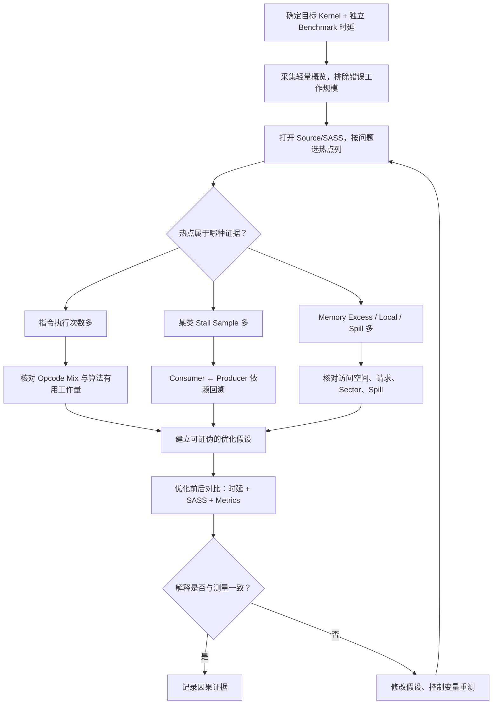

### 第一步：核对分析对象是否正确

这看起来简单，却是很多误判的根源。GPU Kernel 名称与源代码模板可能被 C++ 名字修饰；一次 Python/PyTorch 操作可能启动多个 Kernel；一个 Kernel 可能存在不同 Launch 参数或不同 CUDA Context。**名字修饰**是 C++ 将函数与模板类型编码进符号名，**demangled** 是将其还原成人可读形式；**CUDA Context** 是驱动管理某次设备使用所需资源和状态的上下文。先确定：这是不是要优化的那一次执行？Grid、Block、Device、Registers/Thread 是否与基线一致？

### 第二步：根据宏观问题选择 Source 热点列

如果宏观上是 Compute Pipeline 受限，优先看 Instructions Executed、Opcode Mix、动态计算量与具体流水线相关指令。如果是 Warp Eligibility 不足，优先看主导 Stall Reason、相关 PC 和 Producer 依赖。如果是 Memory Traffic 浪费，优先定位 Global/Shared/Local 访问指令及 Excess Transactions。**不同问题的“热点”定义不同。**

### 第三步：静态 SASS 依赖链和动态计数并行解释

找到热点 PC 的 SASS：识别目标寄存器、源寄存器、地址空间、谓词、控制流和循环位置；再查其动态执行次数、PC Samples 和必要的 Memory/Compute 指标。要注意，后端可能重排指令、使用隐式控制状态或异步操作；无法只靠一两条 SASS 确认根因时，保留不确定性。

### 第四步：对照测试必须记录三个结果

| 结果维度 | 核心记录 | 目的 |
|---|---|---|
| 真实用户性能 | 同一输入的独立 Kernel/端到端时间 | 验证优化有没有实际收益 |
| 指令与资源变化 | SASS、Registers、Local/Spill、动态执行量 | 确认预期代码生成改变确实发生 |
| NCU 观测变化 | 主导 Stall、Sector、Cache、Pipeline 等 | 解释性能变化的硬件机制 |

若编译后 SASS 没变但时延有变化，首先排除测量噪声和环境变化；若 SASS 变了而时间不变，说明修改可能没触及关键路径；若总时延改善但原目标指标恶化，可能是瓶颈转移或另一个更重要的资源成本下降。

---

## 12. 十五个常见误判与正确解释

| 常见说法 | 为什么可能错误 | 更严谨的说法 |
|---|---|---|
| 1. PTX 就是 GPU 真正执行的指令 | PTX 是虚拟 ISA，后端还会做指令选择和寄存器分配 | 以目标架构的 SASS 为机器指令证据 |
| 2. 一行 CUDA C++ 对应一条 SASS | 表达式可能展开、融合、消除、重排 | 使用 Source/SASS 映射确认实际指令 |
| 3. Source 页热点就是“最慢的指令” | 样本不是精确指令耗时 | 识别指标类型与采样口径 |
| 4. Long Scoreboard 在 FFMA 上说明 FFMA 慢 | Stall 归属 Consumer，不一定是 Producer | 反查发起 Load 的上游指令 |
| 5. 60% Stall Samples 等于 60% Kernel 时间 | PC Sampling 不具有精确时间分解语义 | 当成位置分布和调度状态线索 |
| 6. Long Scoreboard 高就是 DRAM 带宽满了 | 也可能是 Cache、Local、依赖链与低并发 | 检查数据路径和有效并发请求 |
| 7. `LDL` 一定说明 Register Spill | Local 数组也会使用 LDL | 结合编译器与 Spilling 指标验证 |
| 8. Registers/Thread 越低越好 | 过低可能造成 Spill 或较低 ILP | 综合 Occupancy、Spill、执行时间优化 |
| 9. Occupancy 越高 Kernel 越快 | Warp 数与有效指令/依赖并非一回事 | 检查 Eligible、Issue 与资源上界 |
| 10. 动态指令数减少必然提速 | 指令类型、Load/Use 路径和内存流量可能变差 | 同时检查关键路径与绝对时延 |
| 11. `FFMA` 是一条指令，所以算 1 FLOP | FMA 一般按 2 FLOPs | 区分指令数量与计算工作量 |
| 12. 4 个标量 Load → 1 个向量 Load，DRAM 减少 75% | 每线程访问的字节数可能完全相同 | 分清 Load 指令数与实际 Bytes |
| 13. `if` 一定产生硬件分歧分支 | 可能被 Predication 消除分支 | 查 SASS 的分支/谓词形态 |
| 14. `-G` 让 Source 映射更完整，所以适合调优 | `-G` 会改变优化后的机器代码 | 性能分析优先 `-lineinfo` |
| 15. 通信 Polling Kernel 的 Stall 一定是可优化的浪费 | 等待可能由远端生产者和同步协议决定 | 结合端到端时间线、正确性与 Replay 语义 |

---

## 13. 自测题：先独立分析，再阅读参考答案

### Q1. 为什么研究优化后的 Kernel 必须看 SASS，不能仅看 CUDA C++ 或 PTX？

**参考答案：** 后端编译器可以进行指令选择、融合、调度和寄存器分配。最终执行的机器指令才决定真实的 Load/Store、计算和依赖形态。PTX 适于理解语义和部分前端优化，但不能保证一条 PTX 对应一条 SASS。

### Q2. `-lineinfo` 与 `-G` 最大的差别是什么？

**参考答案：** `-lineinfo` 提供 Device Source 行号映射并保留常规优化；`-G` 面向设备代码调试，默认会禁用或抑制大量优化，从而改变寄存器、指令与性能。基于真实代码优化的 NCU 应优先使用 `-lineinfo`。

### Q3. 一条 Warp 级 SASS 指令执行 1 次，32 个 Active Threads 中只有 5 个谓词为真，三种计数如何理解？

**参考答案：** Warp Instructions Executed 约为 1；Thread Instructions Executed 约为 32；Predicated-On Thread Instructions 约为 5。具体计数应使用目标 NCU 指标定义确认。

### Q4. Source 页的 Long Scoreboard 样本集中在 FFMA，第一步该做什么？

**参考答案：** 查看 FFMA 的输入寄存器，向上追踪 Producer 指令，尤其是提供数据的 Global/Local Load；之后结合 Cache/Memory 访问与 ILP 判断是否存在长依赖链，而不是直接改写 FFMA。

### Q5. 为什么一个 Warp Stall Sample 不能解释成整个 SM 闲置一个周期？

**参考答案：** PC Sampling 选取某个活跃 Warp 的状态。该 Warp 正在等待时，Scheduler 同周期仍可能发射其他 Eligible Warp。采样也不提供完整时间分辨率，因此无法单独给出精确占用时间。

### Q6. 两段实现的动态 SASS 指令分别为 1 万与 8 千，后者是否必然更快？

**参考答案：** 不必然。后者可能使用更慢或更受限的指令、形成更长 RAW 链、提高寄存器压力或者产生更多 Memory Transactions。需要独立时延、流水线和依赖证据。

### Q7. Register Pressure 与 Registers/Thread、C++ 变量个数有何区别？

**参考答案：** C++ 变量数是源语言实体数；Register Pressure 受活跃值范围与分配约束决定；Registers/Thread 是最终代码分配的物理寄存器数。编译器可重用寄存器，也可能为 ABI 或机器指令要求额外分配。

### Q8. 为什么一个动态索引的局部数组可能在没有寄存器溢出的情况下产生 `LDL`？

**参考答案：** 编译器难以将动态数组索引映射为静态命名寄存器访问，可直接把该数组放在 Local Memory。`LDL` 的存在意味着 Local Memory 读，但不自动证明 Register Spill。

### Q9. 256 Threads 每线程额外产生 2 次 4B Reload、循环 100 次，逻辑读取量是多少？

**参考答案：** $256\times2\times4\times100=204800$ Bytes，即 200 KiB。它不等于 DRAM 精确新增流量，需要考虑 Cache、请求粒度与其他访问。

### Q10. 为什么使用 `-maxrregcount` 可能让 Occupancy 增加、时延却更长？

**参考答案：** 寄存器上限降低可能导致更多 Spill/Recompute 或更长指令路径。新增执行成本可能超过更多 Resident Warps 带来的隐藏延迟收益。

### Q11. 向量化 Load 使 Load SASS 指令数减少到原来的 1/4，但 DRAM Bytes 不变，这是否矛盾？

**参考答案：** 不矛盾。Load 指令数和数据字节量并不是同一单位。向量化可能用更少机器指令传输相同字节；收益可能来自更低的发射/地址生成/请求通道压力。

### Q12. FP32 `a*b+c` 生成一条 FFMA，计算工作量计为多少 FLOPs？

**参考答案：** 通常按 2 FLOPs 计算，不是 1 FLOP。应区分算术工作量、机器指令数与执行路径的数据精度。

### Q13. 为什么 Loop Unroll Factor 增加后，SASS Size 与 Registers/Thread 都可能增加？

**参考答案：** 多次迭代的代码展开增加静态指令体积，同时可能使多个迭代的输入和中间结果同时存活。它提高调度自由度，却可能降低 Occupancy、增加 Spill 或增加指令 Cache 压力。

### Q14. 观察到大量 Predicated-On Threads 不足，能否断言这是分支分歧导致的？

**参考答案：** 不能。可能存在谓词化指令，没有产生控制流分歧分支；还需结合 Active Threads、SASS 中 `@P` 和 `BRA`、Divergent Branches 及实际时延判断。

### Q15. 对 GPU 通信 Polling Kernel，为什么 Replay 下的 Stall 分布可能失去解释力？

**参考答案：** Kernel 的执行依赖 GPU/CPU/NIC 外部生产者的实时进度。Kernel Replay 不一定重放这些生产者的状态更新，因而等待时间与真实端到端通信不同，甚至可能出现死锁。应首先保证测量语义正确，并使用独立通信基准与合适的并发采集方式。

---

## 14. 本课的学习成果与验收标准

建议选择三个微型“理论诊断练习”，先不要求实际运行：

| 练习 | 输入材料 | 应交付的分析 |
|---|---|---|
| 依赖链归因 | 含 `LDG → FFMA → STG` 的 SASS 与 Long Scoreboard 样本 | 标注 Consumer/Producer，写出 Latency 与带宽两种备选解释及验证路径 |
| Register/Spill 权衡 | 两份 Registers/Thread、Local 指令、Occupancy、Duration 对照 | 解释为什么更高 Occupancy 可能没有更快，列出验证 Spill 的证据 |
| Codegen 与指令效率 | 展开/向量化两个版本的指令数、流量和时延 | 区分减少指令数量、减少数据字节、提高 ILP 与减少 Spill |

以后进入真实项目时，可把每次源码级诊断固定成如下结构：

> **待解释的事实**：固定输入、同一 GPU 上，Kernel 由 32 μs 变成 41 μs。
>
> **NCU 观察**：Register/Thread 从 64 增至 96，Local Load 指令增多，Long Scoreboard 样本增多；这些是相关证据，尚非完整因果证明。
>
> **机器指令机制**：新版 SASS 由于展开/寄存器分配多了 `LDL` 与依赖它的消费指令；进一步核对编译器 Spill 报告和源代码映射。
>
> **可证伪假设**：Local Spill Reload 造成额外 Load-Use 延迟和指令成本，使 Occupancy/ILP 收益被抵消。
>
> **验证方案**：缩小局部数组或值活跃区间，保持输入一致，观察 Spill、Local Traffic、Eligible Warps 与独立时延是否共同改善。

讲义要求区分：**实验事实、指令解释、性能假设、验证结论**。真正可信的归因不以“NCU 某列颜色很深”为终点，而以受控修改下时延与微架构行为发生预期变化为终点。

**本课可以用五句话结束：**

1. CUDA 源码、PTX 与最终 SASS 不存在通用的一对一映射；性能分析应以目标机器码与真实执行统计为基础。
2. Source Counters 和 PC Sampling 提供的统计口径不同；Stall 样本不是指令耗时，更不是整个 SM 的闲置时间。
3. Stall 经常出现在 Consumer，必须向上追溯寄存器与内存 Producer 才能找到根因。
4. Registers/Thread、Local Memory、Spill、Occupancy 不是同一个概念，需要分别测量并联合解释。
5. 所有源码级优化都应由**独立时延、SASS 变化、硬件指标变化**三类证据共同验证。

---

## 15. 官方阅读材料与术语核对

以下链接为 NVIDIA 官方文档，可作为后续分析具体 Metric、编译行为和工具差异的查阅入口：

1. [Nsight Compute Profiling Guide](https://docs.nvidia.com/nsight-compute/ProfilingGuide/) — 建议重点阅读 **Source Metrics**、**Warp Sampling**、**Warp Stall Reasons**、**Instructions Per Opcode Metrics**、**SASS Unit-Level Instructions Executed Metrics**，理解硬件计数器与 SW Patching 的差异。
2. [Nsight Compute GUI User Guide — Source Page](https://docs.nvidia.com/nsight-compute/NsightCompute/index.html) — 查看 Source/SASS 映射、Instruction Correlation、采样导航、Source 与 SASS 并列视图。
3. [Nsight Compute CLI Guide](https://docs.nvidia.com/nsight-compute/NsightComputeCli/index.html) — 参考 `--page source`、`--print-source`、`--import-source`、`--source-folders`、Sections 与 Metrics 查询。
4. [Nsight Compute Compute Triage Guide](https://docs.nvidia.com/nsight-compute/ComputeTriage/) — 特别阅读 **Which code lines are the top contributors?**，将热点发现纳入自顶向下的诊断流程。
5. [CUDA Compiler Driver / nvcc Documentation](https://docs.nvidia.com/cuda/cuda-compiler-driver-nvcc/index.html) — 参考 `--generate-line-info`、`--device-debug`、编译优化及 PTXAS 的构建选项。
6. [CUDA Programming Guide](https://docs.nvidia.com/cuda/cuda-programming-guide/) — 参考 **Registers**、**Local Memory**、**Branch Predication** 和寄存器资源约束。
7. [PTX ISA Documentation](https://docs.nvidia.com/cuda/parallel-thread-execution/) — 追溯虚拟 ISA 中地址空间、寄存器、指令与内存语义。

> **技术更新提醒**：NCU 的可用 Metric 及 Spill 统计在不同工具版本和 GPU 架构上可能变化。本文中凡涉及“某版本存在某类细分 Metric”的描述均应在目标设备上确认。源代码与 SASS 示例是理解指令行为的抽象材料，而非面向特定产品型号的官方反汇编输出。

**下一课（第十课）**：进入复杂工作负载的高级 Profiling，包括 NVTX、CUDA Graph、Range Replay、Application Replay、多进程/多 GPU 协调采集、Source 指标的扰动及报告比较；目标是把单条 Kernel 的指令级归因能力迁移到 PyTorch、Triton、DeepEP 和 NCCL 等实际应用中。
