# NCU 系统学习 · 第十课：高级 Profiling——NVTX、CUDA Graph、Replay 与 Python/多进程程序

> 配套实验：[lab10.md](lab10.md) · [入口源码](kernels/main.cu) · [脚本入口](commands/)（源码与实验设计已提供；历史默认入口仅有 compile-only 记录，不代表改后源码或新脚本，见[旧编译日志](log/legacy_commands/compile/source_check.log)，尚未运行验证，无性能实测）。

> 课程编号：10 / 12  
> 课程主题：从**单 Kernel 的微架构分析**过渡到**复杂应用的可信采集**  
> 学习形式：理论讲解、机制推导、短示例、案例分析；**不包含完整实验项目或脚本**  
> 文档日期：2026-11-07  
> 适用范围：NVIDIA CUDA / Nsight Compute CLI 与 GUI。部分功能与命令取决于所安装的 NCU、CUDA Driver、GPU 架构和工作负载；执行前以 `ncu --version` 与本机 `ncu --help` 为准。  
> 前置内容：第 1–2 课的 Metric 与 Replay、第 3–6 课的执行和内存模型、第 7–9 课的 Roofline 与 SASS 归因。

---

## 0. 本课定位：为什么前九课还不够

先从一件小事出发：CPU 要让 GPU 把两列数逐项相乘，会调用一段在 GPU 上执行的函数，这段函数叫 **CUDA kernel**。**CUDA** 是编写和运行这类 GPU 程序的平台；一次把函数及其参数交给 GPU 的动作叫 **launch（启动/提交）**。同一个乘法函数连续提交 30 次，就是同名函数的 30 次调用，而不是 30 个不同算法。

**Profiling（性能分析采集）**是观察程序执行时的时间和硬件活动。Nsight Compute（简称 **NCU**，命令为 `ncu`）主要分析 GPU 工作；一个 **metric（指标）**是一个有单位和统计口径的数，例如执行指令条数；**section** 是按问题组织的一组指标，例如 `LaunchStats` 查看启动形状，`MemoryWorkloadAnalysis` 查看内存活动。SASS 是 GPU 最终执行的机器指令表示，源码一行未必只对应一条 SASS。本课会按需要回顾前课，而不要求记住全部指标名。

如果程序又由 Python 调用计算库、在几张 GPU 上同时工作，仅知道函数名就不够了。例如模型一次 **forward（前向计算：由输入算出输出）**可能提交乘法、求和等多个 kernel；相同函数还可能在预热和正式计算各出现多次。预热是先执行、不计入正式样本的准备运行，例如先做 10 次再分析后 20 次；不能凭函数名区分这两段。本课的核心问题是：**报告究竟选中了哪一次工作？分析器有没有改变它原本的执行关系？**

第十课关注四个连续问题：

1. **识别（Identity）**：目标工作负载位于哪一层、属于哪个进程/GPU/Stream/Launch？
2. **选择（Selection）**：如何通过 Kernel Name、Invocation、NVTX、Profiler Start/Stop 与调用栈收窄采集范围？
3. **重放（Replay）**：应把单 Kernel 还是一个工作负载范围作为重放与计量单位？
4. **解释（Interpretation）**：NCU 报告里的数字属于单个 Kernel、整张 CUDA Graph 还是整段 Range？它能否代表生产环境下的真实性能？

在读图前，把“谁提交、提交到哪里”串起来：**进程（process）**是一次程序运行的独立实例，PID 是操作系统给它的编号；进程内可以有多个 **CPU 线程**，像几条可以分别前进的执行路线。**CUDA context（上下文）**是某进程在某设备上的 CUDA 状态与资源容器，不是另一张 GPU；其中的 **stream（流）**是一条提交工作用的有序队列，同一流的前后任务受队列顺序约束，不同流有机会重叠，但不保证同时执行。多进程协作时给参与者分配的编号叫 **rank**，不是 PID 或 GPU 编号。

工作也能成组组织：**range（范围）**是选定的一段工作，例如“这 20 次正式乘法”；**CUDA Graph（图）**把任务及“谁必须先完成”的依赖关系预先记录，**node（节点）**就是其中一项任务，例如一次乘法。图重复执行与分析器的 **replay（重放）**不同：前者是应用正常重用任务图，后者是分析器为收集不能一次读全的指标而重复执行。**NVTX** 是给范围起业务名字的标记接口；**API** 是程序可调用的接口函数，例如用 `cudaProfilerStart()` 通知分析器开始采集。下图先概括这些对象，后文逐个用实例分析。

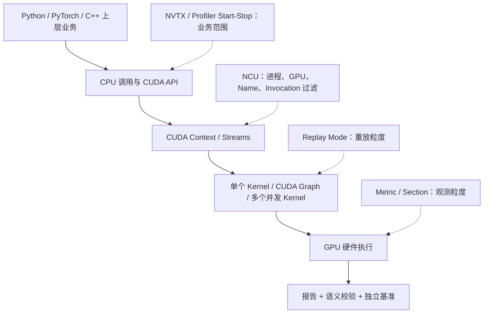

**与前九课的区别**：之前重点解释“硬件为什么产生这些指标”，这一次重点解释“你是不是测到了真正想分析的对象”。第十一课才会进一步研究通信库、跨 GPU 依赖与外部异步引擎；本课将多进程通信作为采集机制的案例，而非通信协议性能优化的完整专题。

### 本课完成后的能力

| 能力 | 可验证的具体要求 |
| --- | --- |
| 确定目标执行实例 | 区分 Python 业务操作、CUDA Kernel Function、一次 Launch、CUDA Graph Node 与一次 Graph Replay |
| 精确控制采集 | 组合进程、设备、Kernel、Invocation、NVTX 与 Metric 过滤条件 |
| 正确选择 Replay | 知道四种 Replay 的重放单位、指标归属、前提条件和局限 |
| 理解 CUDA Graph | 区分 Node-level 与 Graph-level 报告及其与并发性的关系 |
| 理解多进程 | 知道 `torchrun`、MPI 的子进程跟踪、GPU 编号、Rank 与报告边界 |
| 独立判断可信度 | 能找出“采集成功但结果不反映真实工作负载”的风险 |

---

## 1. 复杂程序中，究竟什么是一个“分析对象”？

### 1.1 五个不同的执行实体

下面几个术语不要混用。先认清启动形状：block（线程块）是一组共同执行、可协作的 GPU 线程，grid 是本次启动的全部线程块；例如 256 个线程一块、4 块组成 grid，就启动 1024 个线程。例子中的 GEMM 指矩阵乘法，Reduce/Reduction 指把多个值合成较少结果（如把 `[1,2,3]` 求和为 6），Activation 指逐元素变换（如把负数变成 0）。MoE 是让输入选择若干计算模块“专家”的模型，Combine 是把这些模块的输出合回原输入；此处只用于说明“一次业务任务会包含多个 kernel”，不需要先会实现模型。Dispatcher 是按输入选择实现的分发代码。

| 实体 | 定义 | 示例 | 常见误解 |
| --- | --- | --- | --- |
| 业务操作 | 从应用角度定义的逻辑任务 | 一次 `model.forward()`、一次 MoE Combine | 认为一个业务操作对应一个 Kernel |
| Kernel Function | GPU 可执行代码的函数身份 | `gemm_kernel`、`combine_kernel` | 认为同名 Kernel 性能永远一样 |
| Kernel Launch | 一次将 Kernel 提交到 GPU 的动作 | 第 20 次 `gemm_kernel<<<...>>>` | 忽略 Grid、参数、Stream 与缓存状态 |
| CUDA Graph Node | 图中的一个工作节点 | GEMM Node、Reduce Node | 将 Node 当成独立、无依赖的 Launch |
| Workload Range | 一个完整的被标记执行区间 | 一次 forward 内所有 CUDA API | 把范围指标直接归给某个特定 Kernel |

一个 PyTorch `forward` 可能由大量 Kernel 构成；一个 Graph Execution 可能又包含多个 Node。`ncu` 用 `-k` 匹配 Kernel Function 名称，只决定“哪些名字候选”，并不能唯一确定业务阶段或 Rank。

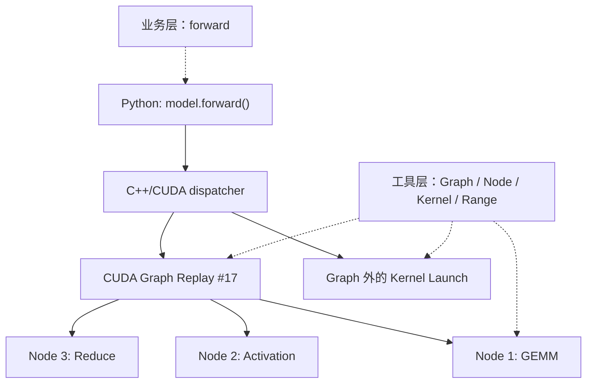

### 1.2 五维过滤：谁、在哪、何时、哪段代码、观察什么

**invocation** 就是一次具体调用；**调用栈（call stack）**是“哪个函数调用了哪个函数”的记录，例如 `train → forward → layer`，可用来找是谁提交了 GPU 工作。`decode` 指逐步生成后续输出，`dispatch` 指按目标分发数据；这些业务名字不是 CUDA 自动赋予的。

把采集条件拆为五维，比记忆命令参数更可靠：

| 维度 | 典型问题 | 对应工具与方法 |
| --- | --- | --- |
| Process / Rank | 是否属于目标 Worker？ | `--target-processes`、Process Filter、每 Rank 单独调用 NCU |
| Device / Context / Stream | 在哪张 GPU、哪个 CUDA Context、哪个 Stream？ | `--devices`、`--kernel-id`、GUI Report Metadata |
| Kernel / Invocation | 是哪个 Kernel、执行的第几次？ | `-k`、`--kernel-name-base`、`-s`、`-c`、`--kernel-id` |
| Business Range | 属于 forward、decode、dispatch 还是 combine？ | NVTX、Profiler Start/Stop、Python Call Stack |
| Measurement Scope | 测的是单 Kernel 还是整段并发工作？ | `--replay-mode`、`--graph-profiling`、`--section`、`--metrics` |


不应一开始就使用所有过滤条件。先确定目标的实际身份，再增加必要的约束；过滤过窄会导致 `No kernels were profiled`，过滤过宽会导致高开销和报告混杂。

---

## 2. 精确选择 Kernel：Name、Invocation、Context 和 Stream

### 2.1 `-k` 与 `--kernel-name-base`

以下讲义命令是 Linux/Bash 的语法示例，`bench.py`、`app` 等表示读者自己的目标程序，不是本课已提供的可执行入口；实际练习入口见配套 lab。`ncu` 后是分析器选项，最后是要启动的程序及其参数。`-k 'regex:gemm'` 用正则表达式（按字符模式匹配名字）筛选，`-c 1` 限制采集一次匹配启动，`-o`（后文使用）指定报告名前缀；单引号防止 shell 提前解释模式。

```bash
# 收集名字中含有 gemm 的 Kernel
ncu --kernel-name-base function -k 'regex:gemm' -c 1 python bench.py
```

C++ 模板可用同一份代码生成多个具体版本，例如分别处理不同大小小块（tile）的矩阵乘法；编译器还会把函数名编码以区分不同参数。**demangled** 是把编码名还原成人可读形式，**mangled** 是保留编码。因此，`--kernel-name-base function` 使用去掉函数参数与模板参数后的名称；`demangled` 采用完整解码名；`mangled` 使用编译器修饰名。默认基础名称通常最适合初步定位。对于模板化 CUDA Kernel，如不同 Tile Shape 的 GEMM，完整 Demangled Name 有助于区分实例，但不同库版本的名称可能发生变化。

### 2.2 `--launch-skip` 与 `--launch-count`

```text
程序 Kernel 顺序：
A0, B0, A1, B1, A2, B2, A3, B3 ...

-k regex:A -s 2 -c 1  →  选择 A2
```

`-s 2` 的含义是在匹配过滤条件的 Launch 集合中跳过前两次，**不是跳过程序全局最先执行的两个 Kernel**。`--filter-mode` 还能决定计数是跨 GPU 合并、分别计数还是按不同 Launch Config 计数；所以“第 10 次”必须同时说明过滤范围。注意 NCU 的 `-c` 表示 Profiling 的 Launch Count，不是 PyTorch 的训练 Step Count。

### 2.3 `--kernel-id` 的定位能力

当同名 Kernel 出现在多个 Context 或 Stream 时，可使用 Kernel ID：

```bash
# 官方支持的形式之一：匹配 foo 的第 2 次调用
ncu --kernel-id '::foo:2' ./app

# 一般格式
# context-id:stream-id:[name-operator:]kernel-name:invocation-nr
```

Context ID 与 Stream ID 是 NCU 所使用的身份信息，不要把它们误认为 MPI Rank 或 Linux PID。多进程应用中，即使两个进程都显示 Stream 0 或“第 2 次 foo”，也不表示它们是同一个执行实例。

### 2.4 GPU 编号不必等于物理卡编号

`torchrun` 是 PyTorch 的多进程启动器，worker 是它启动的工作进程；节点（node，在此不是 Graph node）指一台主机。Global Rank 在全部参与者中编号，Local Rank 只在本机编号。容器是带有隔离运行环境的程序集合，也可能只让程序看见部分设备。在 `torchrun` 或容器中，`CUDA_VISIBLE_DEVICES` 可能重映射设备编号。例如某 Worker 的 `CUDA_VISIBLE_DEVICES=5`，在该进程的 CUDA Runtime 中 `cuda:0` 可能对应物理 GPU 5。`LOCAL_RANK=0` 则表示进程在节点内的分布式 Rank 编号，不必与 `nvidia-smi` 的设备索引一致。

启动形状仍按前面的 grid/block 记录，不与设备编号混用。Hostname 是主机名，GPU UUID 是设备唯一标识，PCI Bus ID 是设备在总线上的位置标识。因此，多卡报告至少记录：Hostname、PID、Global Rank、Local Rank、`CUDA_VISIBLE_DEVICES`、CUDA Logical Device、GPU UUID/PCI Bus ID、Kernel Name、Grid/Block、Stream。如果缺少这些元信息，即使报告数值准确，也可能分析了错误的 GPU。

---

## 3. NVTX：把上层业务语义关联到 GPU Kernel

### 3.1 NVTX 解决的是“Kernel 属于哪个业务操作”

NVTX（NVIDIA Tools Extension）是一套应用标记接口，常用于添加 Range 和 Marker：Range 有开始和结束，像给“第 12 层计算”画一对括号；Marker 只标一个时刻，像写下“收到输入”。其主要价值不是改变 GPU 的执行行为，而是把 CPU 代码的语义标记传给 Profiling/Tracing 工具。

Normalization（归一化）是按一组数据的统计量调整其数值范围的计算。例如 PyTorch 的模型前向传播包含 GEMM、Normalization、Reduce；只靠名字 `gemm_kernel` 不能知道它属于第几层。给业务代码加入 `block_12_forward` 范围，就可以按业务阶段过滤。

下面的同步是“CPU 等待此前 GPU 工作完成”。**异步**则指提交者可以先继续执行，不必等工作结束；例如 CPU 先交出乘法任务，GPU 稍后才算完。`layer(x)` 是已有模型层的示意调用，不是独立可运行程序。

```python
import torch

torch.cuda.synchronize()  # 预热结束后确保前面的工作完成
torch.cuda.nvtx.range_push("block_12_forward")
y = layer(x)
torch.cuda.nvtx.range_pop()
torch.cuda.synchronize()
```

这是**短示例**：NVTX Range 在 CPU 调用链中包住 Kernel 的提交动作，并不意味着 CPU 端 Range 的开始/结束时间精确等于 GPU Kernel 的执行时间。因为 CUDA Launch 往往是异步的，最后一次同步可以发生在 Range 结束之后。NCU 的 NVTX 过滤主要是依据 Kernel Launch 的 NVTX 归属，而不是简单以 GPU Timestamp 落入区间作为判据。

### 3.2 Push/Pop Range 与 Start/End Range

栈可以想成一叠括号：push 放入最新的开始标记，pop 结束最近尚未结束的那个，因此内层必须先结束。start/end 则凭返回的 Range ID（范围编号）配对，不必遵循这种后进先出顺序。NVTX Domain 是标记的命名分组，例如把 `model` 与 `io` 的同名范围分开。

| 类型 | 使用模型 | 适合场景 | NCU 过滤表达式 |
| --- | --- | --- | --- |
| Push/Pop | 入栈、出栈，天然支持嵌套 | Python Function、模块级调用、循环阶段 | `--nvtx-include 'block_12_forward/'` |
| Start/End | 使用唯一 Range ID 开始与结束 | 非严格栈式的生命周期 | `--nvtx-include 'range_name'` |

Push/Pop 的末尾 `/` 很重要：NCU 用它标识 Push/Pop 语义。若存在嵌套，例如 `forward → transformer_block → attention`，可以匹配不同深度与路径。NCU 还支持 NVTX Domain、正则匹配和 Range 位置限定。

```bash
# 只关注 forward 标记范围内匹配 gemm 的 Kernel
ncu --nvtx --nvtx-include 'forward/' \
    -k 'regex:gemm' -c 1 python train.py
```

### 3.3 NVTX 的线程作用域与异步误判

Push/Pop Range 通常关联发起 CUDA API 的 CPU Thread。假设 A 线程执行 `range_push("forward")`，但实际 Kernel 由 B 线程发起，采用默认线程作用域的过滤可能无法覆盖 B 线程。NCU 支持 `--nvtx-push-pop-scope process` 这样的作用域配置，但是否适合还需要考虑并发线程之间的标记语义。

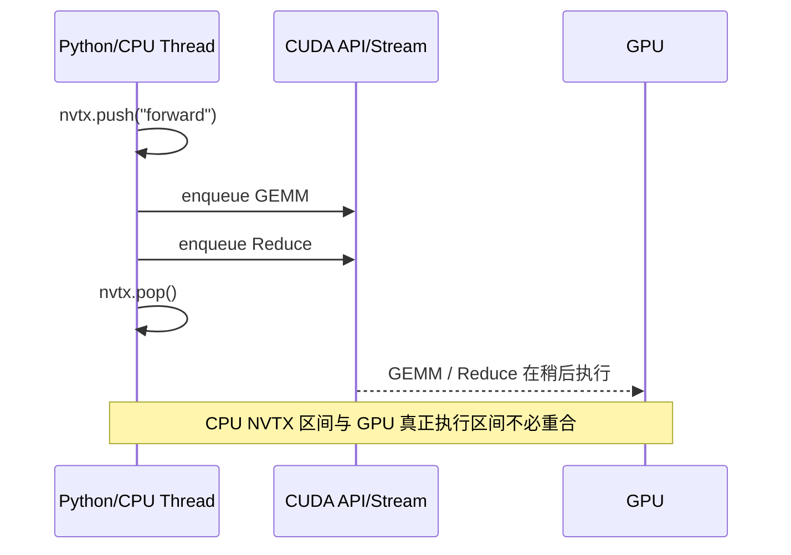

**CUDA Event（事件）**是在某条 GPU 流中记录的完成点；计时事件还可提供设备时间戳。例如按顺序放入 start、乘法、stop，再等待 stop，就能读取两个时间戳的间隔。不同流之间必须显式建立需要的先后关系，不能只凭事件名字推断覆盖全部 GPU。**NSYS（Nsight Systems）**记录 CPU/API/GPU 活动的时间线，用来查看谁先谁后、是否重叠；**微架构指标**则是执行单元、存储系统等 GPU 内部组件的活动计数。

这里最重要的原则是：**NVTX 解决“业务归属”，CUDA Event/NSYS 解决时间线，NCU 解决对应 GPU Kernel 的微架构指标**。三者互补，而不是彼此替代。

### 3.4 `--profile-from-start off` 与 NVTX 的区别

- `--profile-from-start off` 主要依靠应用中的 CUDA Profiler Start/Stop 来控制启停，可用于忽略初始化、Warmup 等阶段。
- `--nvtx --nvtx-include ...` 更适合按**命名业务范围**选择 Kernel，可以在同一进程中标记多个阶段。
- 在复杂 Replay 模式下，Profiler Start/Stop 与 NVTX 不只是过滤器，还可以作为**范围边界**；这会改变采集的工作负载单位。

Python 的 **context manager（上下文管理器）**用 `with` 语句组织进入和退出时的操作，与 CUDA context 不是一回事。不要把 `torch.profiler` 的 PyTorch 自身 Profiler Context Manager 与 `cudaProfilerStart/Stop` API 混为一谈。它们可能使用不同的底层机制与采集目标，不能假定打开 PyTorch Profiler 就等价于向 NCU 发送了 CUDA Profiler Start 信号。

---

## 4. Replay 模式：从“重放单个 Kernel”到“重放完整执行区间”

回顾重放的原因：硬件计数器一次能同时收集的指标有限，NCU 可能分几轮采集，每轮叫一个 **pass**，再合并为报告。问题是各轮是否仍在做同样的工作。例如第一轮测 16 个元素、第二轮测 32 个元素，就不能合成“同一次乘法”的指标。**采集粒度**是一次统计覆盖多少工作，**数据归属**是这个数能算在谁头上。本课重点检查这两点，以及重复时能否保留 CPU、GPU 和其他参与者的交互。

### 4.1 四种 Replay 对照表

| 模式 | `--replay-mode` | 重放单位 | 报告指标归属 | 主要适用条件 |
| --- | --- | --- | --- | --- |
| Kernel Replay | `kernel` | 单个 Kernel Launch | 单 Kernel | Kernel 可以被独立重放，外部依赖不影响正确性 |
| Application Replay | `application` | 整个程序多次运行 | 匹配的单 Kernel | 多次应用执行具有可匹配的 Kernel 活动与语义 |
| Range Replay | `range` | 捕获的 CUDA API/Kernel 范围 | 整个 Range | 所有范围内 API 可被支持的 Capture/Replay 机制处理 |
| Application Range Replay | `app-range` | 整个程序多次运行 | 整个 Range | 范围及应用可重复，程序自行恢复正确交互 |

注意：Range Replay 与 Application Range Replay 的硬件计数通常**聚合到整个范围**，而非某个内部 Kernel。这是与普通 Kernel Profiling 在分析方法上最根本的不同。

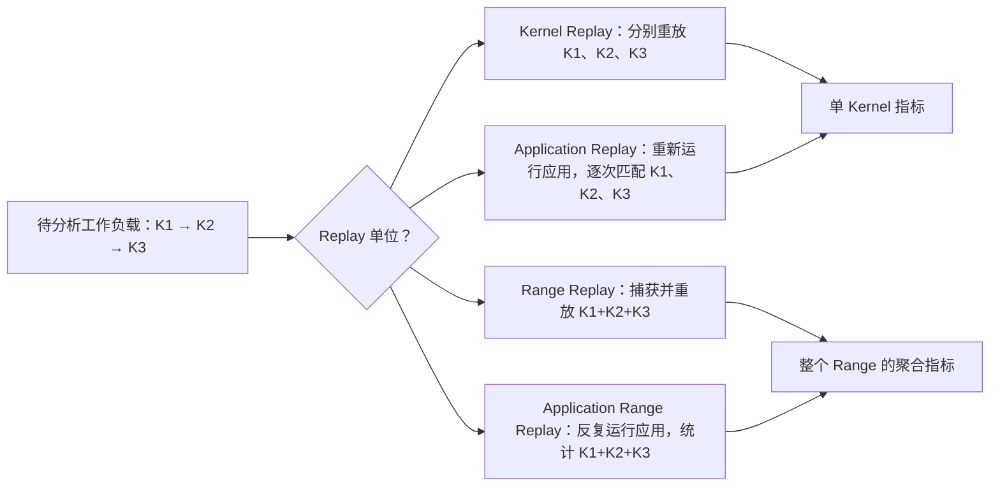

### 4.2 Kernel Replay：最细致，但不一定保留交互

以下伪代码中的 flag 是“是否就绪”的小标志，例如 0 表示还没好、1 表示数据可读；反复检查它叫 **polling/spin（轮询/忙等）**。producer 是产生数据的一方，consumer 是使用数据的一方；如果 consumer 必须等 producer，二者就是外部依赖。NIC 是网络接口卡，可能独立向 GPU 内存传入数据。

典型 Kernel Replay：NCU 按需要为同一次 Kernel Launch 配置多个 Pass，并尝试在 Pass 之间恢复相关的已修改内存。若所需指标一遍即可完成采集，就无需为多 Pass 进行内存保存/恢复。适合独立 GEMM、Transpose、Reduction 等。

一个具有外部依赖的伪代码例子：

```cpp
// 概念示例，不是完整 CUDA 程序
while (remote_flag == 0) { /* spin */ }
consume(remote_data);
```

原始执行时，其他 GPU/CPU/NIC 可能会更新 `remote_flag`；独立重放这个 Kernel 时，外部参与者未必重演相同的更新，导致等待时间失真甚至卡死。即使从逻辑上可重复执行，Kernel Replay 的 Cache Flush（清理缓存）与 Kernel Serialization（把原本可能同时执行的工作改为依次执行）也可能改变它的性能。

### 4.3 Application Replay：重新运行整个应用，但要求可匹配

Application Replay 在多个完整程序运行之间采集同一 Kernel 的不同性能指标；它不需要像 Kernel Replay 一样独立保存/恢复目标 Kernel 的相关内存。对于依赖 CPU 响应或依赖前置 Kernel 预热 Cache 的工作负载，通常更容易保持接近真实的执行顺序。

但是整个应用会重复执行，可能包括模型初始化、读取文件、Python 调度、通信建链、数据预处理等操作，因此开销会增加；并且**应用每次运行的 Kernel 活动必须可以正确匹配**。

NCU 提供 `--app-replay-match`，常见策略为 `name`、`grid`、`all`；并提供 `--app-replay-mode` 的 `strict`、`balanced`、`relaxed` 来控制匹配要求。匹配严格程度越低，不代表结果越可信，而是可能更容易容忍变化、甚至丢弃匹配不上的 Launch。

Batch Size 是一次处理的输入条数，Shape 是数组各维长度，dtype 是元素类型；JIT 是运行时才生成并编译代码；MoE Routing 是为输入选择专家的决策。例如随机路由两轮选择不同专家，即使名字相同，通信量也可能不同。假设第一轮为 `A, B, C`，第二轮为 `A, X, B, C`，如果只按执行序号错误匹配，同一报告就可能混入不同执行语义。对动态 Batch Size、动态 MoE Routing、JIT Kernel 或不稳定模型图尤其要留意。

### 4.4 Range Replay：把多个并发 Kernel 当作一个分析单位

**并发**是多个任务的执行区间有重叠，**并行**强调同一时刻确实执行多个任务；两个流只提供这种机会。**capture（捕获）**是记录范围中的提交动作和相关状态，以便稍后重放，不是复制整个外部世界。考虑两个 CUDA Stream 上必须并发执行的 Kernel：

```text
Stream 0: [ Producer Kernel ------ ]
Stream 1:       [ Consumer Kernel ------ ]
```

逐个 Kernel 采集可能改变二者的并发关系；Range Replay 则尝试捕获完整范围，并在 Replay Pass 中保留范围内的 Kernel 关系。对应命令为：

```bash
ncu --replay-mode range --nvtx \
    --nvtx-include 'concurrent_region/' \
    --set basic -o range_report ./app
```

Range Replay 并不是“给所有 Kernel 分别产生一份可比较的独立报告”。其主要价值是**整体统计并发工作负载**，通常不能直接把 Range 的 `sm__inst_executed.sum`、Duration 或 L2 Bytes 按 Kernel 名称准确拆分。

CUDA Runtime 是常见的高层运行接口，CUDA Driver API 是更低层的驱动接口。Host Memory 指 CPU 一侧的内存；其生命周期是从分配到释放的有效期间，例如重放仍要用的输入不可提前释放。并且 Range Replay 对可捕获 CUDA Driver API 有明确限制，要求范围起点的 CUDA Context 可同步；Host Memory 生命周期、跨线程 API 调用、Context 切换、动态分配等都会影响 Capture 的有效性。它不是一个“任何分布式程序都能直接使用”的万能选项。

### 4.5 Application Range Replay：让应用自己重新产生整段行为

Application Range Replay 不依赖对 Range 内全部 API 调用进行捕获重放，而是让整个应用重新执行，并对选定 Range 的硬件指标做跨运行采集。这对包含无法由 Range Replay 捕获的 API 或复杂 Host/GPU 交互的应用更灵活，前提是不同运行之间的选定范围具有可比性。

```bash
ncu --replay-mode app-range --nvtx \
    --nvtx-include 'forward/' \
    --set basic -o forward_app_range python model.py
```

但它不能让非确定性的网络通信、动态路由和异步外部系统天然变得可重放。特别是在动态 Batch、MoE Routing 或训练过程中，必须核对每一轮是否真正执行了相同的工作负载。

### 4.6 Replay 选择决策树

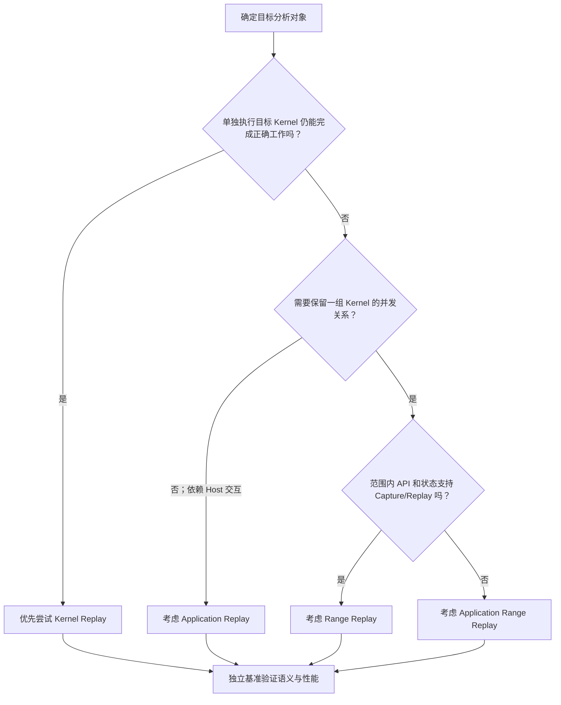

**注意**：决策树只是首轮选择原则，最终仍需检查当前 GPU/NCU 版本的 Metric 兼容性、CUDA Graph 支持、API 限制和分布式进程的协调机制。

---

## 5. CUDA Graph：为什么 Node-level 和 Graph-level 会得到不同的报告

### 5.1 CUDA Graph 改变了什么

把 Graph 想成“洗菜 → 炒菜 → 装盘”的任务单：节点写任务，边写先后依赖。CUDA Graph 的 kernel node 是计算任务，也可能有复制等其他类型节点；Graph launch 一次提交已建立的任务图，Graph execution/replay 是应用又执行了一遍图，不等于 NCU 为采集而重放。普通 PyTorch 路径往往由 CPU 发起大量独立 CUDA API。CUDA Graph 可先建立/捕获一组带依赖关系的 GPU 工作，在后续通过 Graph Launch 重复执行，减少 CPU Launch 开销并使调度行为更稳定。

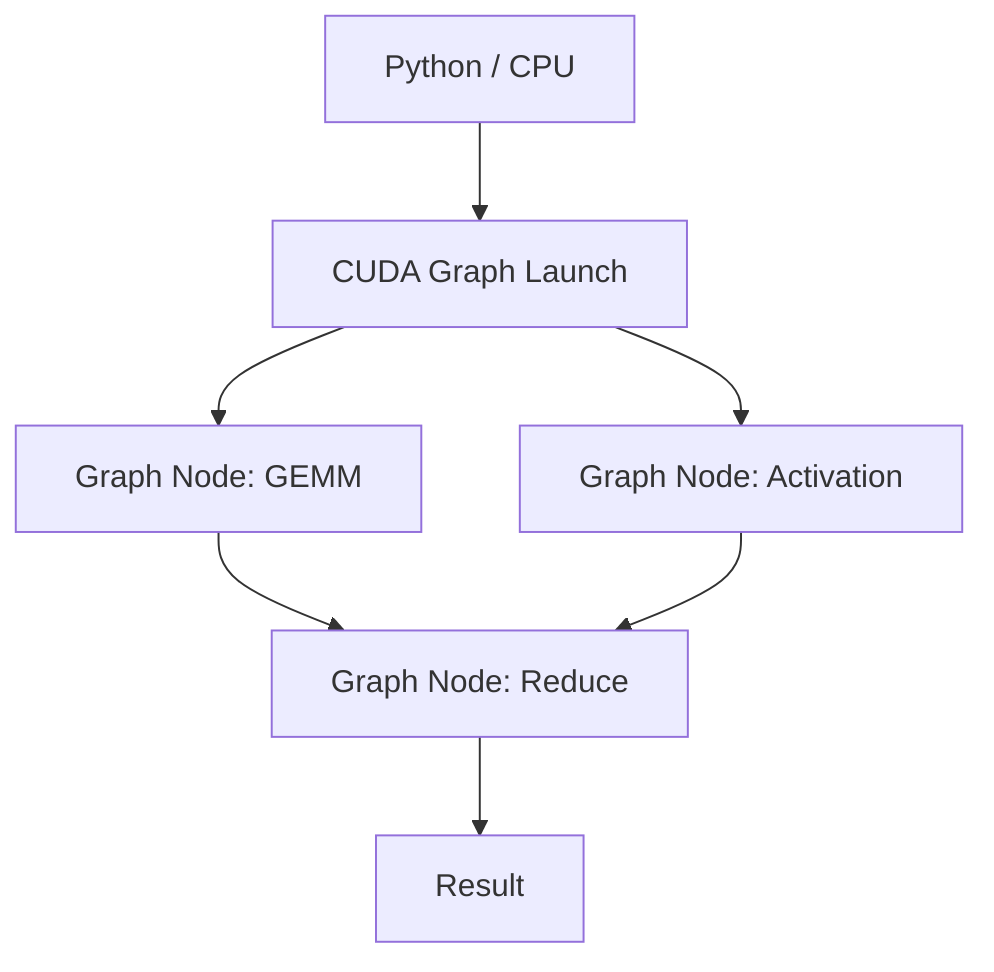

“图中多个 Node”不一定意味着它们都能并发；CUDA Graph 中的依赖边、资源使用和 GPU 调度决定哪些 Node 可以重叠执行。Graph 优化的是提交与执行组织方式，并不是新的一种算术执行单元。

### 5.2 两种 NCU Graph Profiling 粒度

| 模式 | 参数 | 报告对象 | 适用问题 |
| --- | --- | --- | --- |
| Node-level | `--graph-profiling node` | 图内各 Kernel Node | 哪个 Node 的访存或指令问题最突出？ |
| Graph-level | `--graph-profiling graph` | 整张 Graph 作为一项工作负载 | Graph 中的并发与缓存复用综合效果如何？ |

```bash
# 分别观察每个节点；默认通常为 node
ncu --graph-profiling node -k 'regex:gemm' -c 1 \
    -o graph_nodes python graph_app.py

# 将整个 Graph 作为分析对象
ncu --graph-profiling graph --set basic \
    -o graph_whole python graph_app.py
```

Graph-level 的主要优势是允许将整张 Graph 的执行行为作为一个测量对象，减少因逐节点分析而破坏的并发或节点间 Cache 效应。代价是通常缺失某些指令级 Source Metrics，因此不能要求一份 Graph-level 报告同时精确回答每个 Node 哪条 SASS 导致 Stall。

### 5.3 为什么两种模式的时间与吞吐不能简单比较

假设一个 Graph 由两个可以部分重叠的 Kernel 构成：K1 单独持续 10 μs，K2 单独持续 8 μs，在真实 Graph 中存在 6 μs 的执行重叠，则整体运行时间约为 12 μs，而不是 18 μs（忽略其他开销）。

```text
单位：μs；区间端点给出准确时间，横线只作示意
K1：[0,10]  持续 10
K2：[4,12]  持续 8
重叠：[4,10] 持续 6
整体：[0,12] 持续 12 = 10 + 8 - 6
```

逐节点 Profiling 后，如果 NCU 因重放、缓存清理或串行化改变了并发关系，测得时间不能直接相加来恢复真实 Graph Duration。正确方法是使用独立 CUDA Event/NSYS 得到 Graph 总耗时，必要时用 Graph-level NCU 研究硬件利用，再用 Node-level NCU 深入单个 Kernel 的瓶颈。

### 5.4 Graph 的额外限制

Host-launched 指 CPU 发起图，Device-launched 指 GPU 工作中发起图；Conditional Node 是按条件决定后续任务的节点，例如条件为真才执行下一段。设备侧启动的 Graph、Conditional Node、Graph 更新和动态执行路径在不同驱动/NCU 版本上的支持程度不同。Graph-level 的部分 Source 指标不可用；Node-level 分析某些设备侧 Graph 时也有驱动版本要求。每次开始分析前，应确认：Graph 是 Host-launched 还是 Device-launched、Node 类型、NCU 版本、Driver 版本、是否有动态修改与 Replay 的状态要求。

---

## 6. Python、PyTorch 和 Triton：从高层调用找到底层 Kernel

### 6.1 Python 程序不意味着 NCU 在分析 Python 字节码

对于：

```python
out = torch.matmul(a, b)
```

PyTorch 是张量计算框架，tensor（张量）在这里可理解为带有形状的多维数组。ATen 是其底层算子库，cuBLAS/cuBLASLt 提供矩阵等线性代数实现，cuDNN 提供神经网络计算实现；Triton 是编写并生成 GPU kernel 的语言与编译工具，Inductor 是 PyTorch 的代码生成编译后端。这些名字表示实现层，不是额外的 GPU。Python 是前端；底层可能经过 PyTorch Dispatcher、ATen/C++、cuBLAS/cuBLASLt 或其他实现，最终发起一个或多个 CUDA Kernel。NCU 的主要观测对象仍然是 GPU 工作负载，而不是 Python 运算本身的 CPU 执行效率。

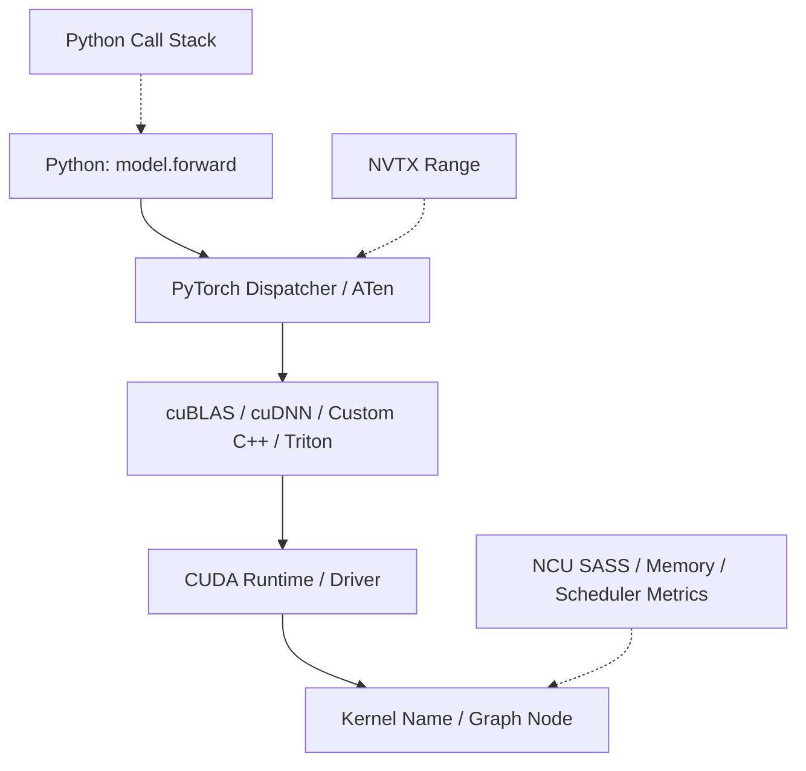

理解这条映射关系，是分析 PyTorch Operator 的前提：**同一个 Python API 在不同输入形状、dtype、GPU 架构或框架版本上，可能选择完全不同的 Kernel 实现**。因此不能仅凭 Python API 名称推断底层执行行为。

### 6.2 三级定位策略

第一层：使用 NSYS 或基础 NCU 识别目标 CUDA Kernel Name 与执行阶段。第二层：使用 NVTX 或 Python Call Stack 将 Kernel 关联回特定 Python 函数/层。第三层：通过 Kernel Name、Invocation 与 Metric/Section 过滤实现针对性 NCU 采集。

最新 NCU CLI 支持 Python CPU Call Stack 收集与过滤；Python 调用栈功能要求 CPython 3.9 及以上，且具体功能是否可用取决于 NCU 版本与运行环境。

```bash
# 从 Python 函数路径筛选目标 Kernel（示例）
ncu --call-stack-type python \
    --python-include 'model.py@forward' \
    -c 1 -o python_forward python model.py
```

`--python-include` 不是通过 Python 源码语法搜索 GPU Kernel 名称，而是利用采集到的 CPU 调用栈判断哪个函数路径发起了 Kernel。若 Kernel 由其他线程、C++ 异步 Worker 或 CUDA Graph Replay 发起，调用栈关联可能不如预期直观。

### 6.3 Triton/JIT 的独特问题

Triton、PyTorch Inductor 或自定义 JIT 算子的代码可能在程序运行过程中编译，Kernel 名称包含配置、模板特征或自动生成后缀。NVTX 仍可用于选择业务范围，但并非所有 Replay 模式都能提供相同的 JIT 指令级分析能力；例如官方明确说明，Application Range Replay 的 Instruction-level SASS Metrics 对范围中的 JIT Kernel 存在限制。

推荐的归因顺序是：先稳定输入形状和编译后的 Kernel 版本，区分编译时间与执行时间，再确认所采集的是期望的 JIT Kernel；需要指令级归因时优先选择支持相应 Source/SASS Metric 的模式。

### 6.4 Warmup 与动态行为

**Warmup（预热）**是先执行若干次但不算入目标稳态样本，例如先做 10 次乘法再测后 20 次；Autotune 是先试几种实现配置再选一种；稳态指这些一次性准备完成后的重复执行状态。PyTorch 首次执行可能包含 CUDA Context 初始化、Kernel JIT、Autotune、内存分配、库内部算法选择以及 Cache 尚未预热等行为。如果希望分析稳态计算，应通过 Warmup 和明确的 NVTX/Profiler Start-Stop 范围跳过初始化；但如果要研究首次请求延迟，则不能把这些启动阶段完全排除。

**端到端（end-to-end）**指从约定输入起点到最终结果可用的整个流程；**wall time（墙钟时间）**是现实中经过的时间，可能包含 CPU 等待、准备和 GPU 计算。例如上传 1 ms、计算 2 ms、下载 1 ms 的串行流程总计 4 ms，不是单个 kernel 的 2 ms。不要把“Warmup 后的单 Kernel NCU 指标”当成端到端推理延迟，也不要把“整个 Python Wall Time”与“一个 GEMM 的 GPU Duration”放到同一张表直接比较。

---

## 7. 多进程：`multiprocessing`、`torchrun`、MPI 与多 GPU

### 7.1 先区分进程树、Rank 和 CUDA Context

父进程创建子进程所形成的关系叫进程树，例如一个启动器创建三个 Python worker。`multiprocessing` 是 Python 的多进程模块；**MPI** 是多进程消息传递接口，`mpirun` 是常用启动器，可把参与进程放在同一或不同主机。图中 rank 0/1/2 是协作编号，GPU 0/1/2 是设备编号，二者只是此例恰好一一对应。

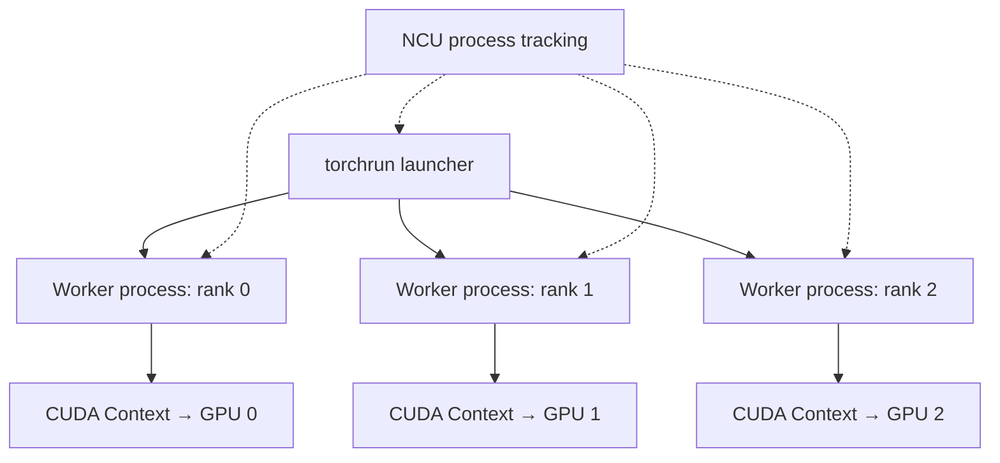

`torchrun` 本身是启动器，CUDA 工作通常由子进程 Worker 产生。NCU 的 `--target-processes all` 用于跟踪目标进程及其子进程；当前官方 CLI 文档给出的默认目标进程模式也是 `all`，但**显式写出仍有助于保证命令可读**。具体 MPI 运行环境可能将其他 Rank 放入不同进程树甚至远程主机，因此不能假设一个节点上的 NCU 自动采集跨节点的全部进程。

```bash
# 单节点：在同一进程树中跟踪所有子进程
ncu --target-processes all --set basic \
    -k 'regex:my_kernel' -c 1 \
    -o torchrun_report \
    torchrun --standalone --nproc_per_node=8 train.py
```

命令中的 `--set basic` 选择基础指标集合；`--standalone` 表示本机独立启动，`--nproc_per_node=8` 表示每主机 8 个 worker。GPU 数量、设备映射和程序必须与配置相符，并非写了 8 就自动拥有 8 张卡。

`--target-processes-filter` 只匹配进程可执行文件名称等特征；多个 Worker 都以 `python` 运行时，它**不能可靠地区分某一个 Global Rank**。若要精准分析 Rank 3，应让 Rank 3 的程序路径单独启动 NCU，或者使用其他与 Rank 相关的专用进程/业务标记机制，并严格记录进程映射。

### 7.2 多进程报告的“第 1 次 Launch”问题

假设 Rank 0 和 Rank 1 都启动同名 `combine_kernel` 10 次。如果通过一个 NCU 进程树统一采集，并简单使用 `-c 1`，它不意味着自动得到“每个 Rank 的第 1 次 combine”。默认过滤计数方式、采集模式与设备过滤会影响最终采集对象。

因此对多 Rank 诊断，优先明确以下四个问题：哪个 Rank、哪个 Device、哪个 Kernel、哪个 Invocation；之后再决定采用全树采集、分 Rank 采集还是协同采集。

### 7.3 MPI 的本地与跨节点差异

本地多 Rank 的进程树可能被一个 NCU 实例追踪：

```bash
ncu --target-processes all \
    -k 'regex:my_kernel' -c 1 -o mpi_local \
    mpirun -np 4 ./app
```

上例 `-np 4` 表示启动 4 个 MPI 参与进程。跨节点 MPI 通常需要在各 Rank 的所在节点运行 NCU，并给报告设置不冲突的文件名：

```bash
mpirun -np 4 \
    ncu -k 'regex:my_kernel' -c 1 \
    -o 'report_%q{OMPI_COMM_WORLD_RANK}' ./app
```

`%q{OMPI_COMM_WORLD_RANK}` 是 NCU CLI 支持的环境变量宏展开，用于将 MPI Rank 编号加入输出文件名。它适用于对应 MPI 环境变量确实存在的情况；其他 MPI/作业管理器可按其变量命名调整。

### 7.4 为什么通信 Kernel 可能让普通 NCU 挂住

假设 Rank 0 的 Kernel 必须等待 Rank 1 写入 Flag，而 NCU 在 Rank 0 上将 Kernel 单独暂停并重放：

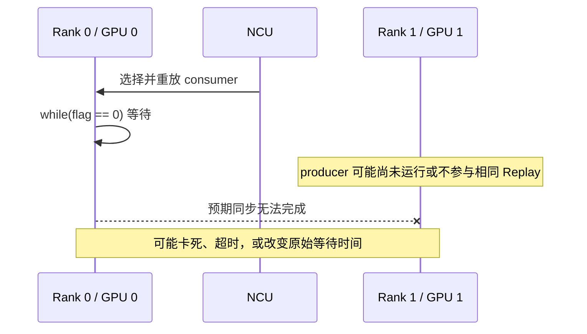

这个问题的本质不是 GPU 算力不足，而是**原本需要共同推进的多个执行参与者，被采集机制改变了调度与重放关系**。

### 7.5 NCU 的 Multiprocess Communicator：shmem 与 tcp

**Mandatory Concurrent Kernels** 指必须共同推进才能完成的 kernel，例如双方都要等对方发通知。**communicator（协调器）**在这里让几个采集参与者协调进度，不负责应用数据的传输；`shmem` 用本机进程间共享内存交换协调信息，`tcp` 用网络传输协调消息。Peer 是参与协调的一方，Lockstep 是按对应步骤一起推进。它与第十一课的 P2P 数据访问不是同一层概念。

当前官方 NCU CLI 已提供面向 Mandatory Concurrent Kernels 的多进程协调采集机制：

| 方式 | 典型拓扑 | 作用 | 需要注意 |
| --- | --- | --- | --- |
| `--communicator shmem` | 单节点、同一 NCU 进程树 | 通过共享内存协调参与进程 | 支持的 Replay/过滤选项有限；参与进程必须可协调 |
| `--communicator tcp` | 不同 NCU 实例，可能跨节点 | 通过 TCP 协调各实例 | 需设置 Peer 数量、跨节点 Host 地址；部分场景需要 Lockstep |

NCCL 是 GPU 集体通信库，例如 `all_reduce` 让多个参与者把各自数组逐项相加并各获一份结果。`regex:nccl.*` 只匹配含 `nccl` 前缀模式的名字（`.` 为任意字符、`*` 为重复），不是识别协议内容。下面 `--communicator-*-num-peers` 指预期协调参与者数量，必须与实际配置核对。

官方给出的单节点 `torchrun` 示例形态如下：

```bash
ncu --communicator shmem \
    --communicator-shmem-num-peers 2 \
    -k 'regex:nccl.*' \
    -o concurrent_report \
    torchrun --nnodes=1 --nproc_per_node=2 app.py
```

对不同进程树中必须协同推进的通信 Kernel，官方说明可使用 TCP Communicator，并通过 `--lockstep-kernel-launch` 协调 Kernel Launch 与 Replay。

```bash
mpirun -np 4 \
    ncu --communicator tcp \
    --communicator-tcp-num-peers 4 \
    --lockstep-kernel-launch \
    -k 'regex:nccl.*' \
    -o 'comm_%q{OMPI_COMM_WORLD_RANK}' ./app
```

这些选项的意义是**协调采集**，不是“让 NCU 自动理解 NCCL 协议”。仍应验证参与者数量、Kernel 匹配、范围选择及真实通信正确性。尤其在一个 Rank 先进入 `all_reduce`、另一个 Rank 先执行其它 Kernel 的情况下，如果采集过滤不一致，协同逻辑可能失效。当前版本的 `shmem` 机制只支持特定 Replay 模式和有限的过滤选项，不能将普通 NCU 命令的所有选项原样叠加使用。

---

## 8. 高级采集的统计学陷阱：并发与总量不等于逐项相加

### 8.1 聚合指标通常不能拆成每个 Kernel 的精准贡献

**聚合**就是把同一范围内相关活动汇总，例如两个 kernel 各执行 3 条和 5 条指令，总数是 8，但只看到 8 无法反推各自数目。对于重叠执行的 K1 与 K2，假设在一个 20 μs Range 中总共执行了 1,000,000 条相关指令：

```text
Range 指标：smsp__inst_executed.sum = 1,000,000
```

`smsp` 表示 SM 内部的执行分区，`inst_executed` 表示已执行指令，`.sum` 表示按指标定义求和；此例单位是条，不是每秒条数。μs 为微秒，1 μs = 10⁻⁶ s；GB 按十进制为 10⁹ 字节。

这不意味着从该值就能得知 K1 占 700,000、K2 占 300,000。除非额外的采集机制提供足够的归属信息，否则 Range 的总量通常只能回答整个范围在相关硬件上发生了多少事件。

同样，如果范围级 DRAM Read = 10 GB，不能直接推断某个 GEMM 读取了 10 GB；Graph-level 的 Throughput 也不能作为内部某个 Node 的吞吐。

### 8.2 逐 Kernel Duration 之和不等于总时间

若同一次执行只有两个可能重叠的区间，且其余开销不与它们重叠，则可记账为：

$$
T_{\mathrm{range}}=T_{K1}+T_{K2}-T_{\mathrm{overlap}}+T_{\mathrm{other}}.
$$

各项单位相同，例如 μs；`overlap` 是这两个实际区间的交集时长，`other` 是其余不重叠开销。**不能把不同采集运行的 K1/K2 时间代入**：共享资源争用会改变它们各自的时长。更多任务或交错空隙应看真实时间线，不能盲目套这个两区间公式。

### 8.3 采集成功不等于结果可信

GPU Clock 是硬件时钟频率；锁频是尽量固定频率的采集设置，不是所有运行默认状态。热缓存指前次执行留下的数据仍可复用。**关键路径**是依赖关系中决定最终完成时刻的路径，例如两个并行任务分别用 8 和 3 ms、两者都完成才返回，缩短 3 ms 那段未必改变结果可用时刻。

NCU 正常生成 `.ncu-rep` 只说明满足工具执行及采集条件，不证明观察的是原始应用等价的性能场景。最典型的偏差来自：

- 应用的 GPU Clock 与 NCU 的锁频行为不同。
- NCU 按所用配置清理 Cache，但真实程序高度依赖前一次 Graph 或 Kernel 留下的热数据。
- 被采集 Kernel 原本与其他工作并发，Profiling 令其序列化。
- Application Replay 两次运行的数据 Shape 或 Routing 不同，指标被错误匹配。
- 仅观察一个 Worker 的 Stall，却忽略其实际上在等待其他 Rank。
- Range/Graph 指标被误当作单 Kernel 指标。

在这里，第二课的 Cache Control、Replay 和 Clock Control 理论就与本课的复杂应用实际连接起来了。

---

## 9. 五个完整分析案例（教学假设数据，非实际 GPU 测量）

### 案例 A：PyTorch Forward 中的 GEMM 被初始化 Kernel 抢先采集

**现象**：执行 `ncu -c 1 python train.py`，采集到的不是想要的 GEMM，而是随机数生成或初始化 Kernel。

**原因**：`-c 1` 只限制匹配 Launch 的个数，若没有 Name 或 NVTX 过滤，最先触发的 CUDA Kernel 就可能被分析。

**改进**：对 Forward/Layer 标记 NVTX，按 Kernel Name 过滤，确认 Warmup 后的相应 Invocation，再指定必要的 Sections；独立测量稳态执行时间。

### 案例 B：同一 Graph 的 Node-level 时间之和比真实 Forward 长得多

| 观测对象 | 假设耗时 |
| --- | ---: |
| Node A 单独采集 | 20 μs |
| Node B 单独采集 | 18 μs |
| Graph 独立基准 | 25 μs |

**不能得出的结论**：Graph 报告必然错误，或者两个 Node 的硬件时间被“偷走”了。

**可能原因**：Graph 中存在部分重叠执行、Cache 复用和不同 Launch/Replay 边界；Node-level NCU 还可能改变原有时钟或并发。正确做法是以 Graph 级独立基准为性能事实，用 Node-level 对内部瓶颈做解释。

### 案例 C：Application Replay 两次运行的 Kernel 序列不一致

token 在此是一条输入记录及其数据向量；两轮分别合并 64 条和 96 条，工作量不同。括号里的 4096 是示意规模，实际报告必须核对各维 shape，而非仅这个数字。

```text
Pass 1: GEMM(4096), Reduce, Combine(64 tokens)
Pass 2: GEMM(4096), Reduce, Combine(96 tokens)
```

即使 `combine_kernel` 的函数名称完全相同，它们也可能处理不同数量的 Token、不同 Batch/Routing。若没有正确匹配，混合指标可能失去物理意义。正确流程是固定输入和动态决策，检查 Grid/Block、调用次序以及 Kernel 数据形状；必要时采用更严格匹配或放弃该工作负载的 Application Replay。

### 案例 D：torchrun 的多个 Worker 都叫 python，Process Filter 无法选中 Rank 3

**现象**：使用 `--target-processes-filter python` 仍采集到所有 Rank 的数据。

**原因**：过滤项匹配的是进程可执行文件名，并不等于 Global Rank。即使已开启子进程跟踪，NCU 也不会仅凭 `LOCAL_RANK=3` 就自动识别目标 Worker。

**改进**：让 Rank 3 的启动路径单独运行 NCU，其他 Rank 保持正常执行；同时记录 Rank/PID/GPU UUID/Kernel Invocation 的映射。如果目标 Kernel 必须并发执行，则还要考虑多进程协同采集而非单 Rank 的普通 Replay。

### 案例 E：通信 Combine Kernel 的 Long Scoreboard 很高

读此表需要回顾调度机制：warp 是通常由 32 个 GPU 线程组成的执行组；scheduler（调度器）挑选已就绪的 warp 发出下一条指令，称为 issue。Eligible Warps 是当前可发射的组数，不是全部已在 GPU 上的线程组。Scoreboard 跟踪指令结果是否就绪，L1TEX 是处理部分加载/存储请求的 GPU 硬件路径；Long Scoreboard 常指等待 L1TEX 相关操作结果的依赖，不能仅凭名字定位为 DRAM 等待。Stall 是暂时不能前进；Samples 是抽样次数，其百分比的分母是对应统计的样本总数，不是 kernel 总微秒数。`% peak` 是相对所用峰值定义的吞吐比例，下面的 0.3 是每调度器平均就绪 warp 数。

| 指标 | 假设值 |
| --- | ---: |
| Long Scoreboard Samples | 68% |
| DRAM Throughput | 18% peak |
| Eligible Warps per Scheduler | 0.3 |
| Kernel Duration | 40 μs |

**错误归因**：“68% Stall + DRAM 低 → 一定是访存合并差。”

**更合理的分析**：Combine 可能正在等待远端数据或 Flag，导致低 Eligible Warps 和长期依赖等待；NCU 对异步并发与 Replay 的修改还可能改变等待时间。需要先验证整个 Rank/Graph/Range 的执行语义，再结合 Source/SASS、远端生产者时间线与 NSYS 判断是本地访存瓶颈、通信延迟还是同步等待。

---

## 10. 选择采集方案的统一决策流程

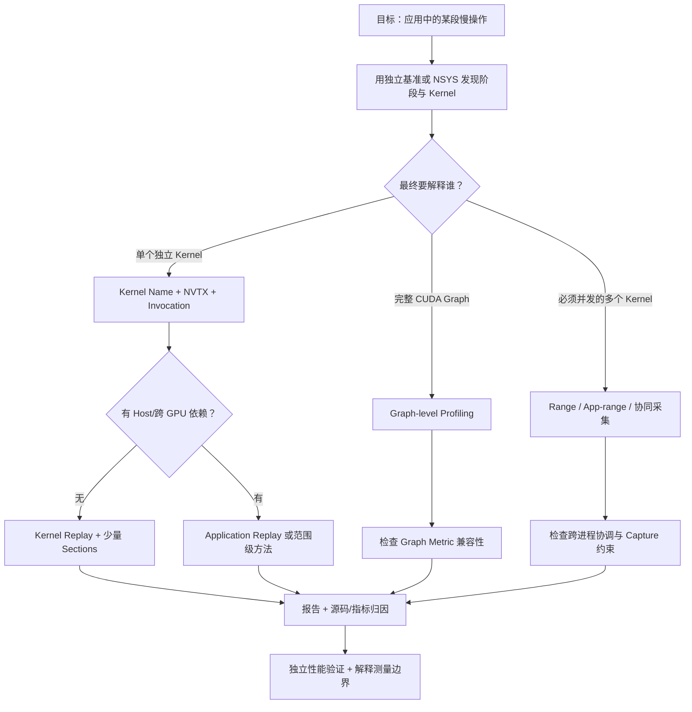

### 一个推荐的四阶段工作方法

**定位阶段**：不着急 `--set full`，先识别进程、GPU、Rank、目标业务范围和实际 Kernel 名称。必要时使用 NSYS 观察时间线、CPU/GPU 交互及 CUDA Graph 的位置。

**筛选阶段**：只对目标 Kernel、Graph 或 Range 采集。明确 `-c` 是在哪个过滤模式下生效；根据实际数据定义是否需要 Warmup。

**采集阶段**：优先低开销的 `basic` 或少数 Sections，验证可正确运行再追加 Memory/Scheduler/Source 指标；确保 Replay 模式与真实同步语义兼容。

**解释阶段**：标记报告测量对象是 Kernel、Node、Graph 还是 Range，确认 GPU 设备映射和数据形状，并通过独立 Benchmark/NSYS 验证结论。只有执行等价条件满足时，微架构统计才适合作为优化归因证据。

---

## 11. 典型命令速查（命令示例，不是实验脚本）

| 场景 | 命令 | 使用时的重点 |
| --- | --- | --- |
| 单个 Python 程序 | `ncu -k 'regex:my_kernel' -c 1 python app.py` | 确认采集的具体 Launch |
| Warmup 后指定业务阶段 | `ncu --nvtx --nvtx-include 'forward/' -c 1 python app.py` | 确认 NVTX Push/Pop Range 生效 |
| Python 调用栈过滤 | `ncu --call-stack-type python --python-include 'model.py@forward' python app.py` | CPython/NCU 版本和 CPU 调用路径 |
| CUDA Graph Node | `ncu --graph-profiling node python graph.py` | Node 内部指令与访存 |
| 整张 CUDA Graph | `ncu --graph-profiling graph python graph.py` | Graph 级聚合与 Source Metric 限制 |
| Application Replay | `ncu --replay-mode application -k 'regex:gemm' python app.py` | 多次运行确定性与 Kernel 匹配 |
| Range Replay | `ncu --replay-mode range --nvtx --nvtx-include 'target/' python app.py` | CUDA API Capture 支持与范围聚合 |
| Application Range Replay | `ncu --replay-mode app-range --nvtx --nvtx-include 'target/' python app.py` | 动态输入的可重复性 |
| torchrun 子进程 | `ncu --target-processes all -k 'regex:my_kernel' -c 1 torchrun --standalone --nproc_per_node=2 app.py` | Filter Scope、Rank/GPU 映射 |
| shmem 并发采集 | `ncu --communicator shmem --communicator-shmem-num-peers 2 -k 'regex:nccl.*' torchrun --standalone --nproc_per_node=2 app.py` | 支持版本、过滤限制、全部参与者 |
| 报告导出 | `ncu -o report python app.py` | 保存原始报告用于 GUI（图形界面）对比 |
| 报告查看 | `ncu --import report.ncu-rep --page details` | 根据实际 NCU 版本支持的 Page 名称调整；官方常见页面为 `details`、`raw`、`source` |

> 小提示：如果 `ncu --import report.ncu-rep --page details` 的语法在你的 NCU 版本里不接受，请以 `ncu --help` 展示的页面选项为准。报告文件扩展名随工具版本和导出方式可能存在差异，避免依赖硬编码文件后缀。

---

## 12. 错误用法与正确认识

| 常见误区 | 为什么不正确 | 正确方法 |
| --- | --- | --- |
| `ncu -c 1` 就是测第一层模型 | `-c` 只限制匹配后的 Launch 数量 | 先按 NVTX/Name/调用栈选择业务范围 |
| `CUDA_VISIBLE_DEVICES=3` 就代表 Worker 的设备编号是 3 | CUDA Logical ID 可被重映射 | 同时记录 Logical ID 与 GPU UUID |
| `torchrun` 父进程就是执行 Kernel 的进程 | 实际 CUDA 工作通常在 Worker 子进程 | 跟踪子进程或独立对目标 Rank 采集 |
| 所有 Worker 都叫 python，Process Filter 就能过滤 Rank | 进程可执行名不包含必然唯一的 Rank 语义 | 用 Rank-aware 启动/记录方案 |
| NVTX 的 CPU 时间宽度就是 GPU 执行时间 | CUDA Launch 通常异步 | CPU 标记用于语义归属，GPU 时间单独测量 |
| Graph 内每个 Node 的 Duration 可直接相加 | Node 可能并发，且 Profiling 环境不同 | 对 Graph 整体独立测量 |
| Range Report 的 Bytes 属于某个内部 Kernel | Range Metrics 是聚合统计 | 用 Node/Kernel 粒度分析具体贡献 |
| Application Replay 一定比 Kernel Replay 真实 | 输入、路由、执行顺序可能不确定 | 检查多轮匹配和执行等价性 |
| Range Replay 一定能处理 NCCL/RDMA | Capture API、跨进程外部状态存在限制 | 检查支持条件并使用协同采集 |
| NCU 一切正常就代表性能数据可信 | 时钟、Cache、并发、Replay 可改变执行状态 | 与独立基准和 NSYS 交叉验证 |
| `--set full` 能在复杂程序中自动准确归因 | 采集范围扩大，Replay 开销和扰动增加 | 先定位工作负载，再小范围逐步采集 |
| `-k regex:nccl` 能自动理解 NCCL 协议 | 名字过滤不等于通信阶段识别 | 结合调用路径、NVTX 与通信时间线 |

---

## 13. 本课自测题与参考答案

**Q1：为什么 `model.forward()` 不等于一个 CUDA Kernel？**  
**答：** 一个 Python 业务操作通常会通过 Dispatcher 调用多个 CUDA Kernel，还可能启动 CUDA Graph，因此需要先确定真正的 GPU 执行实体。

**Q2：`-k regex:foo -s 9 -c 1` 选中什么？**  
**答：** 在对应过滤模式下，先匹配 `foo`，跳过前 9 次匹配 Launch，再采集一个；不意味着整个程序的第 10 个 Kernel。

**Q3：NVTX 主要解决语义归属还是精确 GPU 时长？**  
**答：** 主要解决业务阶段与 Kernel Launch 的关联；GPU 执行时间应结合 CUDA Event、NSYS 或明确的 NCU 测量对象判断。

**Q4：NVTX Push/Pop 为何常需要表达式末尾 `/`？**  
**答：** NCU 用它区分 Push/Pop Range 与 Start/End Range 的匹配语法。

**Q5：为什么 Application Replay 需要执行可匹配？**  
**答：** 不同 Pass 来自不同程序运行；若无法确定它们在测量相同的 Kernel 及工作负载，就无法有意义地合并指标。

**Q6：Range Replay 的统计归属是什么？**  
**答：** 主要归属被采集的完整 Range，不等价于把所有内部 Kernel 分别测量并精确拆分。

**Q7：Application Range Replay 与 Range Replay 最关键的区别是什么？**  
**答：** 前者通过重复执行整个应用重新产生目标范围，后者捕获并重放范围内的 CUDA API/Kernel 行为；两者都以 Range 为指标归属单位。

**Q8：Graph-level NCU 为什么可能没有指令级 SASS 指标？**  
**答：** Graph-level 采集粒度是整个 Graph，部分指令级 Source/采样指标在该模式下不兼容。

**Q9：Node-level 的三个 Kernel Duration 相加能等于 Graph Duration 吗？**  
**答：** 不能保证；Node 之间可能并发与复用缓存，并且独立 Profiling 会改变执行环境。

**Q10：为什么 `--target-processes-filter python` 不能确定 Rank 3？**  
**答：** 它按进程可执行名匹配，不会自动解析 Rank 与程序参数的业务含义。

**Q11：`LOCAL_RANK=0` 是否一定是 `nvidia-smi` GPU 0？**  
**答：** 不一定；环境变量、容器设备可见性和逻辑设备重映射会改变对应关系。

**Q12：只在 Rank 0 上采集通信 Kernel 会有什么风险？**  
**答：** 它可能等待其他 Rank 同时执行，普通 Replay/Serialization 会破坏协同进度，导致超时、死锁或错误时长。

**Q13：何时考虑 `--communicator shmem`？**  
**答：** 单节点、同一 NCU 实例跟踪的进程树中，多个并发 Kernel 必须相互协同完成时；并需满足版本和选项限制。

**Q14：何时考虑 `--communicator tcp`？**  
**答：** 不同 NCU 实例之间、特别是跨进程树/跨节点需要协调 Profiling 时；必须配置参与实例及网络连接条件。

**Q15：NCU 正常生成报告，能否证明 Replay 没有改变性能？**  
**答：** 不能。需要从时钟、Cache、Serialization、工作负载等价性与独立时间线交叉验证。

**Q16：如果任务目标是“找出 End-to-End Forward 为什么慢”，应先用什么？**  
**答：** 先用 CUDA Event/NSYS 或其他应用基准识别阶段和关键路径，再用 NCU 精确分析疑似瓶颈 Kernel/Graph/Range。

---

## 14. 课程完成标准与下一课衔接

完成本课后，应当能够针对一个多 GPU PyTorch 程序，先解释进程树、Rank、GPU、CUDA Context、Stream 与 Graph 的关系，再选择合理的目标范围和 Replay 模式，并明确哪类指标属于 Kernel、哪类属于 Range/Graph。

自我验收可以使用一个完整的场景：**某 MoE 推理程序使用 `torchrun` 启动 8 个 Worker，目标是分析 decode 阶段第 30 次 Combine Kernel。** 你应能写出选择策略、说明怎样记录 Rank 与设备映射、如何通过 NVTX 与 `-k` 约束 Kernel、为什么不能只写 `-s 29 -c 1` 就认为选中了目标，以及在多 GPU 同步存在时应该怎样考虑 Replay 或并发协同采集。

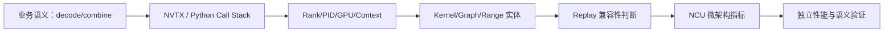

此验收场景中的 MoE 推理是用专家模块算输出，decode 是逐步产生新 token；SGLang 是推理服务框架。

**下一课（第十一课）** 将进入 GPU P2P / NVLink、NCCL、NVSHMEM、DeepEP、Polling、GPU-initiated Communication、TMA/Copy Engine 等通信和异步执行场景，重点研究：为什么某些延迟不由 SM 计算决定、NCU 的硬件计数器如何与 NSYS/链路指标组合、以及如何区分数据搬运、协议等待、同步与计算瓶颈。

---

## 15. 官方资料与延伸阅读

1. NVIDIA Nsight Compute CLI Guide：<https://docs.nvidia.com/nsight-compute/NsightComputeCli/index.html>，重点看 Kernel Filtering、NVTX Filtering、CPU Call Stack Filtering、MPI Support、Mandatory Concurrent Kernels、Replay 与 Graph Profiling 选项。
2. NVIDIA Nsight Compute Profiling Guide：<https://docs.nvidia.com/nsight-compute/ProfilingGuide/index.html>，重点看 Kernel/Application/Range/Application Range Replay、Graph Profiling、Compatibility 与 Overhead。
3. NVIDIA Nsight Compute GUI User Guide：<https://docs.nvidia.com/nsight-compute/NsightCompute/index.html>，重点看 Report、Graph Profiling、Source 与 Baseline Comparison。
4. NVIDIA CUDA Programming Guide：<https://docs.nvidia.com/cuda/cuda-programming-guide/>，进一步了解 CUDA Streams、Graph、异步执行模型。
5. PyTorch CUDA Semantics：<https://docs.pytorch.org/docs/stable/notes/cuda.html>，用于理解 PyTorch CUDA 执行与设备语义。

**阅读时特别注意版本差异**：多进程 Communicator、Python Call Stack、部分 CUDA Graph Node、指标兼容矩阵与 NCU 参数默认值都可能在不同版本中调整。以本机 `ncu --help`、安装版本 Release Notes 和对应官方文档为最终准绳。所有案例中的时间与指标数值都是教学假设，并非真实 GPU 测量。
