# NCU 系统学习 · 第十一课：多 GPU 通信、异步执行引擎与跨设备性能归因

> 配套实验：[lab11.md](lab11.md) · [入口源码](kernels/main.cu) · [脚本入口](commands/)（源码与实验设计已提供；历史默认入口仅有 compile-only 记录，不代表改后源码或新脚本，见[旧编译日志](log/legacy_commands/compile/source_check.log)，尚未运行验证，无性能实测）。

> 课程编号：11 / 12  
> 课程定位：由**单 Kernel 的 GPU 微架构分析**扩展到**跨 GPU、跨进程、GPU–NIC 与异步搬运的整体性能分析**  
> 文档日期：2026-11-07  
> 学习形式：理论、机制图、数学推导、短命令示例、模拟 NCU 报告、诊断练习。**不生成可执行实验脚本或完整工程**。  
> 适用范围：以 NVIDIA CUDA / Nsight Compute / Nsight Systems 为主；NCCL、NVSHMEM、DeepEP 用作分析场景，个别特性受工具、GPU 架构、驱动和通信库版本约束。  
> 前置知识：第 1–2 课 NCU 计量与 Replay，第 3–6 课 Warp/Memory，第 7–8 课性能上界，第 9 课 SASS，第 10 课高级采集与多进程。

---

## 0. 本课核心：通信性能不是“某个 GPU Kernel 的执行性能”

先回顾最小执行模型：**CUDA** 是编写和运行 GPU 程序的平台，**kernel** 是 GPU 上运行的函数，**launch** 是把一次函数调用提交给 GPU。CPU 上的程序部分叫 host，GPU 叫 device；launch 通常是**异步**的，即 CPU 提交后可先继续，不代表 GPU 已完成。GPU 线程按 **block/CTA（线程块）**分组，通常每 32 个线程组成一个 **warp**；执行这些线程的计算单元叫 **SM**。例如逐项复制 `[1,2,3]`，三个有效线程各读一项、各写一项，就能形成一个普通 copy kernel。

现在把输入放到另一张 GPU。线程可能负责搬数据，也可能只负责提交搬运请求，或者反复检查“数据准备好了没有”的标志（**polling，轮询**）。**load/store** 分别是读取/写入，**reduce（归约）**是把多个值合并，例如求和。这里的“通信”就是数据在参与设备之间传递，**分布式**指多个进程或设备协作完成工作。因此“线程很忙”可能只是一直在等，线程指令很少也可能是别的硬件正在搬数据。

**本课的核心思维转变：先问搬什么、谁发起、何时可用、谁在等待，再分析整个协作过程，而不是把通信缩成一个“通信 Kernel”的函数。**

先认清图中的硬件角色：**NVLink** 是受支持 GPU 间的高速互连，**NVSwitch** 是连接多条 NVLink 的交换设备，**PCIe** 是常见的设备连接总线；统称互连网络（fabric）时只表示连接系统，不指定每条数据的路线。**NIC** 是网络接口卡，用于主机间传输；**DMA** 指硬件按请求搬数据，而不让计算线程逐字节搬运。**RDMA（远程直接内存访问）**允许网卡按已建立的权限和地址信息访问远端内存，不代表任意地址都可读写。GPU 专用复制硬件叫 **Copy Engine（CE）**；**TMA（Tensor Memory Accelerator）**是特定架构支持的批量/多维异步搬运机制，常用于 GPU 内部全局内存与块内共享内存之间，不是通用的跨卡复制引擎。HBM 是某些 GPU 使用的高带宽显存，L2 是缓存层。

图中的 **P2P（peer-to-peer）**表示设备之间直接访问/传输的能力，不等于一定使用 NVLink；Pack 是将散落数据打包成发送布局，Issue 是发起请求，Poll 是检查完成，Receive/Reduce/Notify 分别为接收、合并、通知。例如 GPU0 打包 16 个数，发起传输，GPU1 等通知后读取它们。

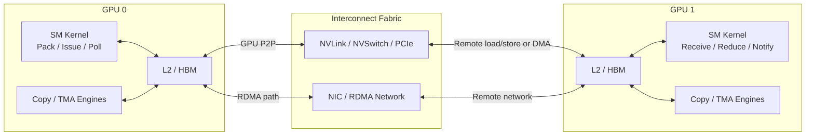

上图是逻辑组件和可能路径的概念图，不代表一条通信操作一定经过全部组件，也不代表所有 GPU 均支持图中的所有路径。尤其 **TMA、CUDA Copy Engine、NIC DMA 是不同机制**，不能因为它们都涉及数据搬运而视为同一个引擎。

### 本课完成标准

| 能力 | 最终能回答的问题 |
|---|---|
| 区分数据面与控制面 | Kernel 是在搬运数据、发起通信、等待数据，还是处理结果？ |
| 建立通信成本模型 | 为什么微秒级时延不能仅用 `Bytes / Bandwidth` 解释？ |
| 识别 NCU 观测边界 | 哪些指标属于 SM、哪些属于内存系统、哪些不适合给链路做归因？ |
| 解释 Replay 风险 | 跨 Rank 同步为何可能死锁？协同采集何时有帮助？ |
| 分析通信路径 | 如何区分 SM 驱动 P2P、DMA/CE、TMA、NIC/RDMA 等路径？ |
| 综合判断瓶颈 | 如何组合 NCU、NSYS、端到端测量、链路计数器、协议日志？ |

---

## 1. 多 GPU 通信的五层性能模型

用“寄包裹”理解分层：最上层决定寄什么，库把任务组织成协议，控制代码下单并等通知，搬运硬件执行，底层连接承载字节。**协议**就是双方约定的步骤，例如“先写数据、再发就绪通知、最后读取”。NCU（Nsight Compute）擅长观察 kernel 内部硬件活动；NSYS（Nsight Systems）记录 CPU、GPU 和复制活动的时间线；benchmark 是按固定条件反复计时的基准程序。任何性能数据先标注属于哪一层，再决定分析方法。

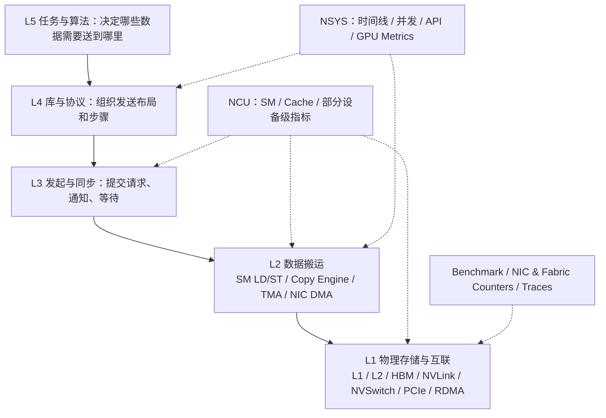

### 1.1 数据面（Data Plane）与控制面（Control Plane）

**API** 是程序可调用的接口函数。**buffer（缓冲区）**是一段暂存待发/已收数据的内存；网络内存注册是向传输系统建立其地址、权限等信息。**proxy** 是代为处理请求的代码/执行者，例如 CPU 线程替 GPU 向网卡下单；**doorbell** 像门铃，是“有新请求”的通知写入；**flag** 是可检查的状态值；**barrier（屏障）**要求约定参与者或操作达到指定条件才能继续。这里是同步用途，不是物理障碍。

数据面回答“数据是如何从源位置移动到目标位置的”，例如：SM 执行 P2P Global Store、Copy Engine 完成跨 GPU 复制、NIC 对已注册 GPU 缓冲区执行 DMA，或 TMA 执行符合架构要求的异步搬运。控制面回答“谁决定搬运什么、何时启动、何时完成”，例如：CPU 调用通信库、GPU 填写 NIC 队列、写 Doorbell、远端 Polling Flag、等待 Barrier。

下面用 B 表示字节，KiB=2¹⁰ B，GB=10⁹ B，GB/s 是每秒十亿字节。一个程序的总耗时可能被控制面主导，而数据面远未达到带宽上限。例如传送 4 KiB 的数据，即使物理链路具有数百 GB/s 的吞吐能力，纯传输时间也极短；真正主导的是启动、排队、同步与协议往返。**Roofline（屋顶线）**是用计算峰值和内存带宽估计理想性能上限的模型，例如 4096 字节除以可达字节/秒得到纯搬运时间；它不自动包含下单和等待。这类工作负载不应直接使用 Roofline 的 DRAM 带宽上界做唯一分析。

### 1.2 观察对象必须带上“作用域”

**进程**是一次程序运行的实例，**rank** 是通信参与进程的协作编号（不是 GPU 编号），**stage** 是任务阶段，**time_range** 是测量起止窗口；“作用域”说明这个数字覆盖谁和哪段工作。例如一次完整数据分发的时间、GPU 0 某个 Pack Kernel 的时间、GPU 3 Polling Kernel 的时间、整个 NVLink 方向的字节量、某张 NIC 的 RDMA 字节量，描述的是不同对象。建议每条测量结果都附带如下字段：

`Scope = (workload, rank, GPU, process, stage, time_range, traffic_definition, method)`

**Collective（集体通信）**是多个参与者按约定一起完成的操作。AllReduce 是各方数组逐项合并后各得一份结果；AllToAll 是每方向每方发送各自对应的数据块。例如三方每方向另外两方各发 4 字节，不能只看一方的缓存读取就得到所有连接的流量。否则就容易出现“使用 NCU 看到了 Rank 0 的 L2 读流量，便宣称整个 AllToAll 的 NVLink 有效带宽”这样的错误结论。

---

## 2. 建立通信延迟与带宽模型

### 2.1 起点：α–β 模型

对一次简单消息传送，最常见的近似模型是：

$$
T(m)\approx\alpha+\beta m
$$

其中 `T(m)` 是完成一条消息所需时间，`m` 是传输字节数（B），`α` 表示固定延迟（启动、协议、同步等的聚合成本，单位 s），`β` 表示每字节成本（s/B），其倒数是有效带宽（B/s）。例如 `α=5 μs`、`β=1/(400×10⁹) s/B`，4096 B 消息主要付固定成本。它适合用于认识小消息与大消息的差异，但不描述多跳、拥塞、归约计算和复杂的重叠。

**端到端**是从约定起点到最终可用结果的整个流程。下面 setup 是准备、pack 是打包、transfer 是传输、wait 是等待、reduce 是合并、unpack 是解包，overlap 是这些阶段重叠的时间；所有 T 使用相同时间单位。先用概念式记账：

$$
T_\mathrm{end-to-end}=T_\mathrm{setup}+T_\mathrm{pack}+T_\mathrm{transfer}+T_\mathrm{wait}+T_\mathrm{reduce}+T_\mathrm{unpack}-T_\mathrm{overlap}
$$

这只是**概念分解**。如果阶段并发或同一时间区间跨越多个阶段，不能把从工具中测得的重叠区间直接相加。**关键路径**是依赖关系中决定最终完成时刻的路径。例如计算用 8 μs、独立传输用 3 μs，两者同时开始且必须都结束，理想完成时间是 8 μs，缩短那 3 μs 未必有收益。若两个阶段能够完全并行执行，关键路径的下界更接近：

$$
T\ge \max(T_\mathrm{compute},T_\mathrm{transfer})
$$

而不是 `T_compute + T_transfer`。

### 2.2 小消息为何主要看延迟

单位先统一：B 是字节；KiB=2¹⁰ B，MiB=2²⁰ B；GB=10⁹ B；ms=10⁻³ s、μs=10⁻⁶ s、ns=10⁻⁹ s。带宽是单位时间处理多少字节，延迟是一次操作花多长时间，两者不同。假设链路在该负载下可以提供 400 GB/s 有效吞吐，传输 4 KiB 的纯传输时间为：

$$
T_\mathrm{data}=\frac{4096}{400\times10^9}\mathrm{s}\approx0.01024\ \mu\mathrm{s}
$$

即约 10 ns。假设总通信耗时为 5 μs，那么纯粹通过“增加链路吞吐”最多只能缩小非常小的一部分。真正值得关注的是发起路径、同步、轮询、跨 GPU 可见性以及调度延迟。反过来，传输 256 MiB 时，数据面吞吐很可能成为主要影响因素。

此处 400 GB/s 与 5 μs 都是**教学假设**，不是任何 GPU 的实测能力。

### 2.3 三种不同的 Bandwidth

| 名称 | 分子 | 分母 | 主要解释对象 |
|---|---|---|---|
| `Payload bandwidth` | 应用有效负载字节数 | 端到端通信时间 | 用户可见效率 |
| `Physical link bandwidth` | 链路实际传输的数据字节（可能包含协议开销） | 同一物理时间窗口 | 链路利用程度 |
| `Memory-system bandwidth` | L2/DRAM 等层次统计的传输字节 | 相应统计时间 | 缓存/显存子系统压力 |

这三个数字绝对不能混用。**Payload** 是应用真正要传的有效数据，metadata 是辅助索引/长度等信息；Gather 是从多处收集，Scatter 是向多处散发，Hop 是经过一段连接。例如 3 MiB 数值外还有索引，或数据经过中转节点，链路计数就不再等于单份数值大小。应用层的 3 MiB Payload 不一定对应 3 MiB 的 NVLink 流量，更不保证对应 3 MiB DRAM 流量。

### 2.4 多 Rank 通信不能只看平均值

假设四个 Rank 完成相同 Collective 的耗时分别为 6、7、8、16 μs。如果算法必须等待所有 Rank，则整体完成时间至少受最慢 Rank 限制，即尾部 Rank 的 16 μs 比均值 9.25 μs 更重要。需要结合发送矩阵、Rank 不均衡、拓扑路径和完成时刻分析。

建议为 AllToAll 类通信建立 `Bytes[src_rank][dst_rank]` 矩阵，而不是只记录一个全局平均带宽。矩阵的行是源 rank、列是目标 rank，例如 `Bytes[0][1]=4096 B` 表示 0 向 1 发送 4096 字节；不默认双向相等。对于跨机 RDMA，再引入 `NIC/port/rail` 维度：分别是哪张网卡、哪个端口、哪条并行网络通路。

---

## 3. 三类 GPU P2P 通信实现：SM、Copy Engine 与远端可见性

### 3.1 GPU SM 发起的 P2P Load/Store

指针是地址，不是数据本身，也不会自动搬数据。**地址映射**让执行设备能解析该地址，**peer access** 是允许访问另一设备内存的能力/权限，**拓扑**描述设备怎么连接。例如 GPU0 的线程写 GPU1 的数组，需要 GPU0→GPU1 方向可用，反向可用不能代替这个条件。在允许 peer access、地址映射与相应拓扑支持时，GPU 侧 Kernel 可以访问另一个 GPU 的内存地址。抽象示例：

代码中 `__global__` 声明由 GPU 线程执行的函数；`uint4` 是四个无符号整数组成的类型，此处一项为 16 B；`count` 数的是这种项而非字节。线程下标 `blockIdx.x*blockDim.x+threadIdx.x` 是“块号×每块线程数+块内线程号”，`i<count` 防止多启动的线程越界。`STG` 是全局存储指令的常见机器码助记符，表示 store；L1TEX 是处理部分访存请求的硬件路径，寄存器是线程保存临时值的快速存储。

```cpp
// 概念示意：dst_peer 必须是当前 GPU 可访问的合法远端映射地址
__global__ void p2p_copy(const uint4* src_local, uint4* dst_peer, int count) {
    int i = blockIdx.x * blockDim.x + threadIdx.x;
    if (i < count) dst_peer[i] = src_local[i];
}
```

逻辑路径是 `Warp STG → GPU Memory/Interconnect Fabric → 远端内存系统`。这类操作占用 SM 的指令执行资源，并可能涉及寄存器、地址生成、L1TEX、L2、互联、远端内存系统等多个约束。

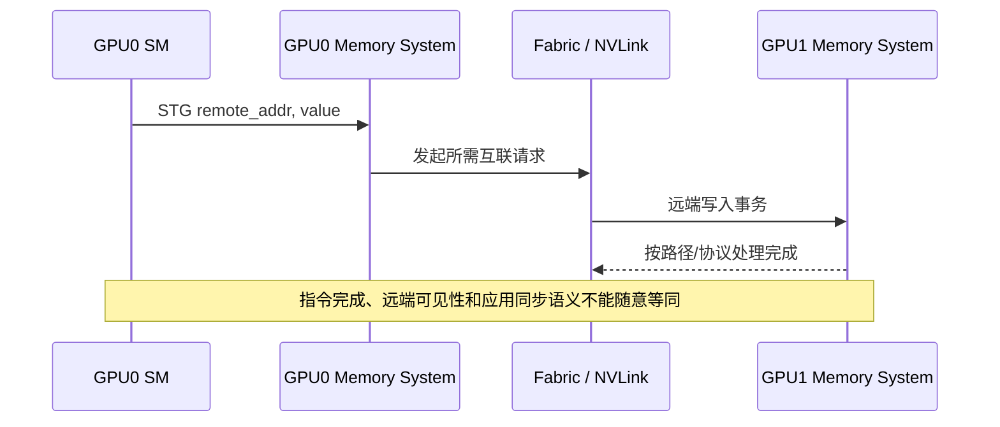

先区分同步的三个问题：**顺序（order）**规定读写先后，**作用范围（scope）**规定保证适用于同块、同 GPU 还是跨设备参与者，**可见性**说明消费者何时能读到约定的新值。**fence** 约束相关内存操作的顺序，不等于双方都到达某处；**release/acquire** 是发布与获取的配对同步，例如生产者先写数据再 release 发布“好了”，消费者以匹配 acquire 读到通知后才读数据。具体保证必须覆盖双方和所用存储/搬运机制；普通整数 flag 的随手读写并不会自动构成正确协议。

**注意：**“指令发射”“操作完成”“数据在远端对消费者可见”属于不同层次。正确性还取决于内存模型、适用的同步域、系统 scope Fence、Release/Acquire 或 API 的明确保证。把 `__threadfence_system()` 写在某个位置并不自动解决所有跨 GPU、异构代理或 NIC 的可见性问题。

### 3.2 Copy Engine（CE）搬运

Copy Engine 是可执行某些数据传输操作的独立硬件执行资源。在适用的平台和传输路径上，异步 Memory Copy 不需要每个字节都由 GPU SM 线程逐条发出 Load/Store。CUDA API 中典型的点对点复制接口是 `cudaMemcpyPeerAsync`，其数据路径与实际引擎使用方式取决于拓扑、能力和驱动实现。

**stream（流）**是 GPU 工作的有序提交队列；同一流内受提交顺序约束，不同流不自动等待对方。`cudaMemcpyPeerAsync` 的参数依次是目标指针、目标设备号、源指针、源设备号、字节数和提交到的流；例如从 GPU0 向 GPU1 复制 64 B，源设备为 0、目标为 1。Async 表示提交可先返回，使用结果前仍要等待约定的完成点。

```cpp
// 仅展示调用形态：实际代码需要分配设备缓冲区、创建 stream 和处理错误
cudaMemcpyPeerAsync(dst, dst_gpu, src, src_gpu, bytes, stream);
```

**不要据此推断它总是使用 CE，也不要把 `cudaMemcpyPeerAsync` 和任意两个 GPU Kernel 的远端 Load/Store 视为等价。** 可以先通过 NSYS 的 Memcpy 活动、API 时间线与 GPU Copy 活动识别相关工作，再看性能。

### 3.3 三个容易混淆的概念

| 概念 | 主要执行者 | 典型作用 | 能否直接由 NCU 的 SM Throughput 表征？ |
|---|---|---|---|
| SM LD/ST P2P | GPU SM + Memory Fabric | 远端地址读写，计算融合通信 | 可表征 SM 侧活动，但不能完整表征链路 |
| CUDA Copy Engine | GPU 专用复制引擎 | 支持的 DMA/内存复制路径 | 不能，仅 SM 指标通常不覆盖 CE 执行量 |
| TMA | 特定架构下的 Tensor Memory Accelerator | Bulk/多维异步搬运，常见于 Global↔Shared 等场景 | 可分析发起与等待侧，但不能以 SM 指令数重建所有异步执行工作 |

此外，NIC RDMA DMA 又是第四种机制；即使数据直接进入 GPU 内存，**数据传输的执行主体也可能是 NIC，而不是 SM 或 CUDA CE**。

---

## 4. NCU 对通信系统究竟能观测到什么？

### 4.1 先画出观测边界

回顾读指标必需的执行链：SM 内的调度器选择就绪 warp 发出指令（issue）；**scoreboard** 跟踪先前结果是否可用；**stall** 是暂时不能继续。SASS 是 GPU 机器指令的表示。NCU 的 **metric** 是一个具体计数/比率，**section** 是按问题组织的指标组；不是图中每条箭头都有一个可用计数器。图中的 LTS 是 L2 缓存相关硬件标记，Host 是 CPU 一侧。

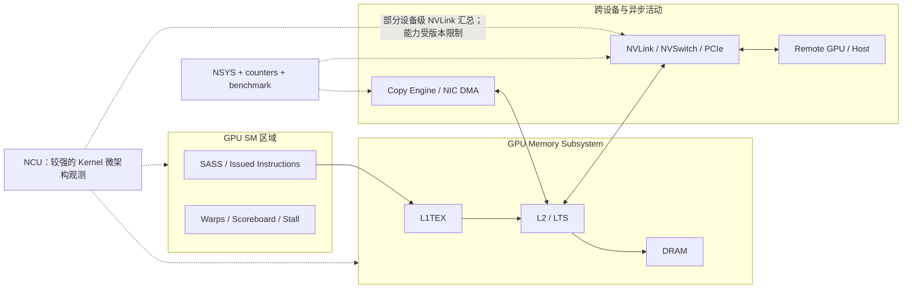

NCU 的强项仍然是 Kernel 的计算、指令与内存系统行为。官方 Profiling Guide 也包含 `Nvlink` 概览 Section 和 NVLink 相关拓扑属性；但**不能据此假设所有版本、GPU 或 NVSwitch 配置都能获得逐物理链路吞吐、可靠的逐链路拓扑或对某个 Kernel 精确归属的传输量**。当前 Release Notes 明确列出不支持 `per-NVLink metrics`、`Logical NVLink Throughput`，且 NVSwitch 配置下 `NVLink Topology` Section 有限制；必须以当前机器上的 `ncu --list-sections`、具体 Release Notes 和实际报告为准。

### 4.2 用什么 Section 回答什么问题

表中 FLOPs 是浮点加/乘等逻辑运算次数；Throughput 是单位时间处理量。**访存合并**是把同一 warp 相邻线程的地址请求合成较少事务，Request 是请求，Sector 是内存服务粒度（相关路径常以 32 B 统计），`Sectors/Request` 的分母是该路径的请求数，不是线程数或时间。Launch/资源、Memory、Scheduler、WarpState、Source 各类 Section 分别关注启动资源、访存、调度、等待和源码/机器指令关联，不必先背英文名字。

**归因**是把观测与具体机制对应并用对照检验，例如预测“连续写能减少请求”，再检查地址、请求数和普通计时是否一起按预测变化；仅看到某项高只能算线索。

| 问题 | NCU 首选分析 | 结论边界 |
|---|---|---|
| Pack/Unpack 为何慢？ | SpeedOfLight、MemoryWorkloadAnalysis、SchedulerStats | 可分析本地 SM/L1/L2/DRAM，但需确定输出规模 |
| Reduce 是否受计算吞吐限制？ | ComputeWorkloadAnalysis、InstructionStats、SASS | 需要与 FLOPs 和性能模型结合 |
| Polling 为什么长时间停顿？ | SchedulerStats、WarpStateStats、SourceCounters | Stall 未必是根因；常是等待远端 |
| Peer Store 是否访存合并低效？ | L1TEX Requests/Sectors、SASS、MemoryWorkloadAnalysis | 指令侧分布 ≠ 远端链路物理字节 |
| DRAM 是否被大量访问？ | dram、lts 的相关指标 | 设备级资源可能受其他引擎/进程污染 |
| NVLink 是否达到链路极限？ | NCU 可用的 Nvlink 汇总，配合外部链路计数器 | 需要确认拓扑、窗口和逐链路能力 |
| DMA/CE 真正执行了多久？ | NCU 通常不足以单独回答 | 优先 NSYS Copy 活动与独立端到端测量 |
| 跨 Rank 是否有长尾？ | NCU 只提供局部线索 | 需要 NSYS、Rank Trace、端到端时间与 Traffic Matrix |

### 4.3 为什么 `DRAM Bytes` 不是 `NVLink Bytes`

在本地 Kernel 中，Load 可能命中 L1/L2；在远端访问中，请求还可能涉及不同缓存/互联路径。DRAM 指标的语义是本设备相关 DRAM 子系统流量，不是物理 NVLink 计数器。另一方面，GPU 的某些设备级资源可被异步引擎访问，NCU 对单 Kernel 采集时也可能无法准确把共享资源活动完全归因于单个 SM Kernel。

官方特别提醒：Copy Engine 等异步 GPU 引擎能在 Profiling 时访问共享 L2、DRAM、PCIe、NVLink 资源，短 Kernel 的 DRAM 结果可能受到干扰。这是判断 NCU 通信指标可信度时不可跳过的一条限制。

### 4.4 具体指标在不同架构上并不保证相同

`smsp__...`（SM 内执行分区）、`l1tex__...`（L1TEX 路径）、`lts__...`（L2）、`dram__...`（显存子系统）是常见指标族，前缀首先标识统计的硬件资源，不是源/目标 rank。指标 qualifier 是进一步区分读写、来源等条件的限定项；但用于描述 P2P 的专门 qualifier、NVLink Metrics 和各种自定义 Section 可能随架构与 NCU 版本变化。不要照抄网上某个 `nvlrx__...`、`nvlink__...` 指标名就认定本机可用；正确的做法是先查对应的 Metric Reference 和运行时可用列表。

---

## 5. Polling Kernel、远端通知与时间线失配

### 5.1 一个典型通信协作场景

**Producer（生产者）**是产生数据的一方，**Consumer（消费者）**是使用它的一方。例如 GPU0 写数组，GPU1 对它求和；在数组未就绪前反复检查 flag 就是 polling，不是在求和。假设 GPU 0 先写数据，再通知 GPU 1；GPU 1 一直轮询 Flag，直到看到数据准备就绪，随后开始 Reduce。

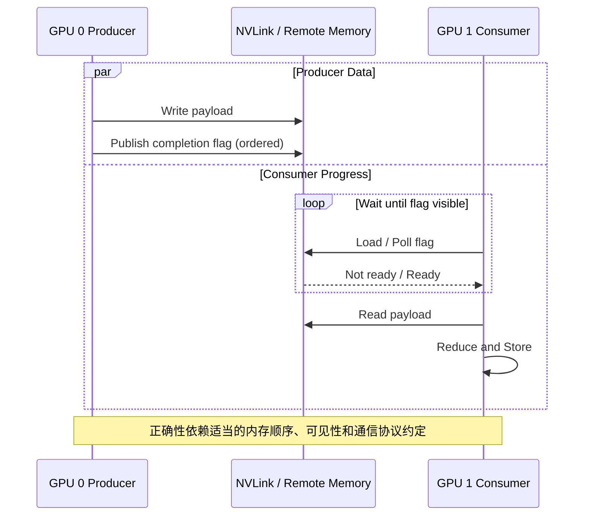

此时 GPU 1 的 Kernel 完整运行时间可以分为：

$$
T_\mathrm{consumer}\approx T_\mathrm{poll}+T_\mathrm{read}+T_\mathrm{reduce}+T_\mathrm{write}
$$

式中四项分别是轮询、读数据、求和、写结果的时间，使用同一单位，且这里只近似描述先等待再处理的顺序。**Long Scoreboard** 常指等待 L1TEX 相关操作结果的依赖，**Short Scoreboard** 常涉及其他短延迟操作结果的依赖（如某些共享内存操作）；必须结合当前设备的指标定义和指令，不能直接译成“显存慢/快”。

如果 `T_poll` 很长，NCU 可能观察到大量 Load、Long/Short Scoreboard、Warp Stall 或很低的有用吞吐。但真正的根因也许是 GPU 0 的 Pack 太慢、消息过晚发布、Rank 负载不均、链路拥塞，或者缓存/可见性协议错误。这不一定是 GPU 1 中某条 Load 指令可以单方面优化的问题。

### 5.2 Producer/Consumer：观察到的 Stall 可能只是症状

假想结果：

| 观测对象 | 数值（教学示例） |
|---|---:|
| GPU 1 Consumer Kernel 总时长 | 22 μs |
| GPU 1 完成等待后的计算 | 3 μs |
| GPU 1 的 Warp Stall | Long Scoreboard 占采样 65% |
| GPU 0 从业务开始到发布 Flag | 18 μs |

合理的第一假设应当是“远端数据发布较晚，Consumer 有较长等待”，而不是“GPU 1 DRAM 带宽不足”。要验证，需要把两个 Rank 的发布 Flag、观察 Flag、Reduce Start/End 对齐到同一时间线。单独一个 GPU 1 的 NCU 报告无法证明远端为什么晚。

**PC（程序计数器）**标识当前指令位置；PC Sampling 是周期性抽查 warp 所处位置/等待状态，而不是给每行源码配秒表。百分比的分母是对应统计中的样本总数，例如 100 个样本有 65 个属于某类等待，才是 65%。**还要注意：** PC Sampling 的 Stall 百分比是采样分布，不是直接的时间归因。上述 `65%` 不能未经验证就写成“22 μs 的 65% 都是 DRAM 访问”。

### 5.3 Fence、Acquire/Release 与完成语义

第 3 节的发布/获取还要问“谁在读写”。**proxy（内存模型中的代理）**指按一套访问/顺序规则执行内存操作的机制，例如普通线程访问与某些异步搬运；不是前文代为提交网络请求的 CPU proxy 线程。不同代理可能需要专门的顺序衔接。**生命周期**要求缓冲区和同步对象在最后一次访问完成前一直有效，例如传输未完就释放输入会破坏正确性。

通信分析不仅是性能问题，也有正确性边界：

- `fence` 是与内存顺序有关的语义，不是无条件“刷完所有缓存”的同义词。
- `release/acquire` 用于建立匹配同步关系下的可见性和顺序；其范围与代理语义必须适用于具体通信对象。
- CPU 可见、同 GPU SM 可见、另一个 GPU 可见、NIC 完成 DMA 并可见，可能属于不同语义域。
- 对于 TMA 等 Async Proxy，存在额外的 Proxy Fence、Barrier 或完成等待要求。

因此，Polling Loop 不能仅通过“加一个 Fence 试试”来优化和验证；首先要确认协议使用的同步变量、Scope、参与代理与完成条件是否严格成立。第十一课讨论性能边界，不将这些正确性问题简化为固定模板。

---

## 6. 多 Rank Replay：为什么采集本身会造成死锁？

### 6.1 独立 Kernel Replay 可能破坏通信协议

回顾第十课：**replay** 是分析器为分轮采集指标而重复执行；一轮叫 pass。Kernel Replay 重放单次启动，Application Replay 重启整个程序并匹配目标调用，Range Replay 捕获并重放一段工作，Application Range Replay 重启程序并统计目标范围。**range** 是选定的工作区间；**capture** 是记录支持的提交动作和状态，不会捕获整个网络世界。**死锁**是参与者互相等候且不能自行前进，不等同于只是运行慢。

假设两个 GPU 必须并发运行两个 Kernel：GPU 0 写入数据、GPU 1 等待；NCU 若只让 GPU 1 重放而 GPU 0 没有重新执行写入，重放中的 Polling 可能无法收到新的 Signal。

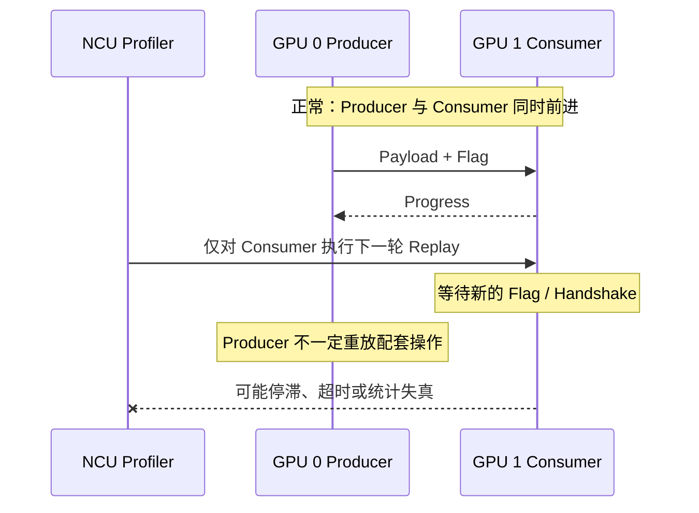

即使没有死锁，多个 Rank 不同步地执行多次也可能改变 Producer/Consumer 间的相对时间、缓存热度、流量竞争与等待行为。因此“Profiler 成功结束”不等于结果可以代表原始通信性能。

### 6.2 四种 Replay 模式在通信场景下的取舍

| 模式 | 采集粒度 | 可能的优势 | 典型风险 |
|---|---|---|---|
| Kernel Replay | 单个 Kernel Launch | 能拿到丰富的单 Kernel 指标 | 破坏跨 GPU/CPU 依赖，重放不出真实世界状态 |
| Application Replay | 跨多次应用执行匹配某个 Kernel | 应用自然重建依赖和输入，能应对部分 Host 交互 | 运行不确定导致实例匹配错误；仍需注意被测单 Kernel 的采集语义 |
| Range Replay | 同一次应用中捕获并重放一个 CUDA API 范围 | 可以保留范围内 Kernel 的并发关系 | 范围与 API 支持、状态捕获条件有限；统计通常归属整个 Range |
| Application Range Replay | 多次重启应用，每次测一个完整 Range | 可以保持应用自然发生的并发关系 | 要求 Range 语义稳定，多次运行环境一致；报告是范围级而非逐 Kernel |

严格的可用性取决于设备、工具版本、工作负载类型和所需 Metric；Range 不能被假定为适用于任意 NIC/RDMA 或跨机外部状态变化。官方明确说明 Range Replay 的 Metrics 关联的是整个范围，而非单个 Kernel。

### 6.3 单机 torchrun 的协同采集

进程树是父进程与它创建的子进程关系。`torchrun` 是多进程启动器，`--standalone` 指单机启动，`--nproc_per_node=8` 指本机 8 个 worker；worker 是工作进程，不是一个 GPU 线程。`ncu` 命令末尾是待运行程序，`-k` 是函数名筛选，`regex:nccl.*` 是正则名字模式，`-c 1` 限制匹配启动数，`-o` 指报告前缀。这里 `app.py` 是读者已有的分布式程序示意，不是本 lab 的入口。

在当前 NCU 文档支持的版本中，`--communicator shmem` 用于**同一节点、由同一个 NCU 实例跟踪的进程树**，并在需要并发的 Kernel 采集时协调进程。典型短命令形式：

```bash
ncu --communicator shmem \
    --communicator-shmem-num-peers 8 \
    -k 'regex:nccl.*' \
    -c 1 \
    -o comm_rank_group \
    torchrun --standalone --nproc_per_node=8 app.py
```

这只是模式展示，**不是对任意 NCCL/DeepEP 程序都安全的万能命令**。该模式有 Kernel/Range Replay 与过滤限制，并且匹配的 8 个 Peer 需要能在相应位置参与相同的协作执行；不是每个 Rank 都有相同目标 Kernel 时，过滤就可能导致错配。具体 CLI 参数应通过本机 `ncu --help` 验证。

### 6.4 不同进程树或跨节点：TCP Communicator

**MPI** 是多进程消息传递接口，MPI rank 是其参与进程编号；**TCP** 是网络传输协议，这里用于让分析器实例互相协调，不是应用数据的 RDMA 路径。Lockstep 指在对应启动/重放步骤上协调推进，Peer 是参与协调的一方。**NVTX** 是给一段工作加业务名字的应用标记接口，可帮助选择采集边界，但标记本身不等待 GPU。

如果每个 MPI Rank 独立启动 NCU，或进程运行在不同主机上，当前文档提供 TCP Communicator 与 Lockstep 协同采集机制。典型概念参数如下：

```bash
# 放在每个 MPI rank 的 ncu 启动语境中（需要 rank 独立报告名）
ncu --communicator tcp \
    --communicator-tcp-num-peers 8 \
    --lockstep-kernel-launch \
    -k 'regex:nccl.*' \
    -o report_%q{OMPI_COMM_WORLD_RANK} \
    ./app
```

`--communicator-tcp-num-peers 8` 是预期协调参与者数；`--lockstep-kernel-launch` 开启相应启动协调。`%q{OMPI_COMM_WORLD_RANK}` 是 NCU 展开环境变量的文件名宏，依赖该 Open MPI rank 变量确实存在，并非 shell 替换语法；其他启动环境要用实际变量，不能让所有 rank 写同一报告。以上为 Linux/Bash 命令示意，执行前查本机支持，不覆盖旧报告。

如果跨主机，通常还需要服务器地址相关配置。关键是**所有协作 Rank 进入采集的工作负载顺序与边界必须匹配**；不能把只给一个 Rank 挂 NCU 的办法简单迁移到必须并发同步的通信 Kernel。

### 6.5 最安全的诊断分层

先在正常环境用 Benchmark 与 NSYS 获取原始端到端时序；再在单 GPU 或独立微基准中分析 Pack、Reduce、Unpack 等可隔离的部分；最后才尝试协同 Replay 或 Range 级采集必要并发的通信部分。即使使用协同 Profiling，真实通信耗时仍建议回到非 NCU 环境验证。

---

## 7. TMA、异步数据搬运与 Copy Engine：同样是“异步”，语义并不相同

### 7.1 传统同步访存与异步搬运的区别

**shared memory（共享内存）**是同一线程块可共同使用的片上存储；global memory 是这里数组所在的全局地址空间。**流水化**是把工作拆成批次，让上一批计算与下一批搬运重叠，例如先装入小块 A，计算 A 时搬 B，使用 B 前再等其完成。普通的 Load/Store 指令与 Warp 执行状态紧密关联；某些异步复制机制则把“发起搬运”和“等待搬运完成”分开，允许计算与传输流水化。这里必须分清：**发起指令已执行，不等于整个数据搬运已经完成**。

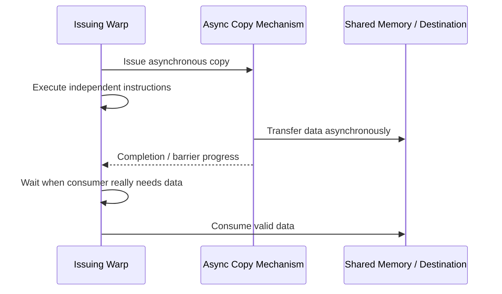

例如在适用的 Hopper 及后续架构上，TMA 可以执行某些 Global→Shared、Shared→Global 等 Bulk/多维异步数据传输；其具体可用地址空间、对齐、指令形式与方向必须按照目标架构和 PTX 规范判断。Ampere、Hopper 是 GPU 架构代际名称，不是两个软件开关。Ampere 的 `cp.async`（常对应 LDGSTS 路径，即 global 到 shared 的异步复制指令）与 Hopper 的 `cp.async.bulk`（TMA 批量异步路径）并非同一执行机制。Bulk 表示一次描述一批数据；多维描述符记录形状、步长等，例如指定矩阵中一个 32×32 小块，而不是逐元素下单。

### 7.2 Async Thread、Proxy 与 Barrier

现代 CUDA 异步编程模型用“异步线程（Async Thread）”描述由发起线程之外的执行逻辑进行的操作；它是模型角色，不是要求程序再创建一个普通 CUDA 线程。Generic Proxy 指普通线程内存访问所属的代理，Async Proxy 是某些异步操作所属的代理。`fence.proxy.async` 用来衔接相关代理间的内存顺序；`mbarrier` 是可跟踪参与到达及适用异步事务完成的同步对象，`expect_tx` 为适用事务登记预期完成字节数。例如预期搬入 4096 B，只有线程到齐而字节尚未搬完，不能当作目的数组已可用。某些异步操作使用 Generic Proxy，TMA 等 Bulk Async 操作涉及 Async Proxy，并因此出现 `fence.proxy.async`、`mbarrier`、`expect_tx`、异步组等待等配套概念。

要从正确性角度回答三个问题：

1. 数据由谁生产、放在哪里？生产者写入是否已经按目标 Async Proxy 的要求完成顺序约束？
2. 搬运什么时候可以开始？发起后何种同步对象表示操作已完成到足以安全消费数据？
3. 消费者如何得知数据可用？后续 Generic Proxy 的 Load/Store 是否满足正确的可见性和生命周期要求？

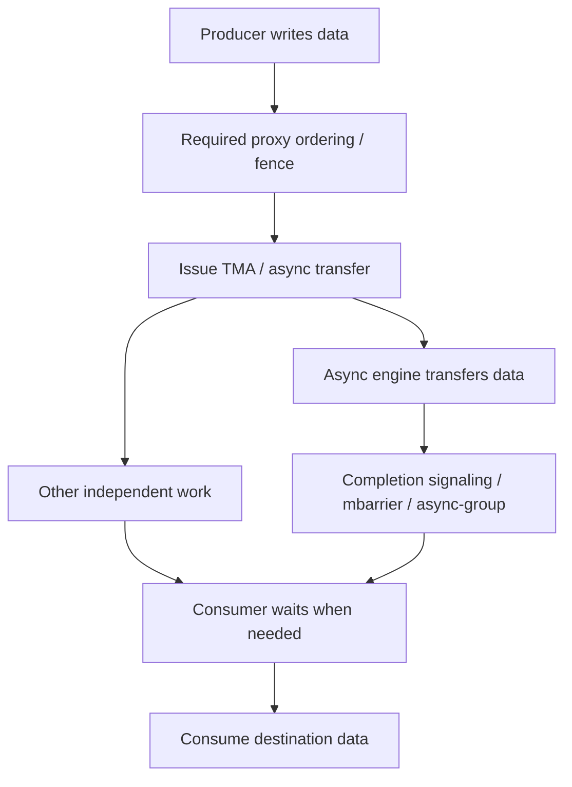

异步组把若干已发起操作分批管理，`commit_group` 提交一组，`wait_group` 按该指令规定等待此前组的完成；它们不是任意方向通用的“全部传输完成”函数。实际同步方案取决于指令方向与 API；例如 TMA 写回 Global 时的 `commit_group` / `wait_group` 与 Global→Shared 操作的 MBarrier Completion 语义不能相互替换。

### 7.3 如何利用 NCU 分析异步搬运

NCU 对这一类问题的价值往往集中在三个位置：

- **发起侧**：是否生成预期 SASS（如对应架构下的 Bulk Async 指令）？发起指令是否太多？地址计算、描述符准备与流水化组织是否耗费过多 Warp Issue？
- **等待侧**：Consumer 是否频繁因为尚未完成的异步操作而等待？同步指令附近是否出现大量相关 Stall Sampling？
- **计算侧**：数据搬运和计算是否形成流水线？是否因为寄存器、Shared Memory、Barrier 数量等资源限制降低了并行度？

**Occupancy** 是驻留 warp 数占硬件可容纳上限的比例，驻留只表示分配了执行资源，不保证随时有就绪指令。例如 shared 占用翻倍后，可驻留块数可能减少，从而减少可用来交错执行的 warp。

但不能用“NCU 显示 SM 上只执行了少量 TMA 发起指令”直接得出“搬运只消耗了很少资源”。真正的异步传输仍占用内存系统、硬件队列和相关引擎资源；对其进行端到端测量需要关注搬运字节、完成时间与有效重叠。

### 7.4 SM-P2P、TMA、CE、NIC 的对照表

为读懂 NIC 一列：**WQE（工作队列项）**像一张搬运订单，记录源/目标和长度；**QP（队列对）**是组织发送/接收请求的通信端点队列，**CQ（完成队列）**保存完成通知。例如 GPU 写好订单并按 doorbell，NIC 执行后按传输规定产生完成记录；订单写完不等于货物已送达。

| 维度 | SM P2P LD/ST | TMA / Bulk Async | CUDA CE 路径 | NIC RDMA |
|---|---|---|---|---|
| 谁发起 | GPU Warp 指令 | GPU 线程/warp 发起异步操作 | 一般经 CUDA API、驱动或相应接口调度 | CPU Proxy 或 GPU-initiated Queue/Doorbell |
| 主要执行 | SM + Memory Fabric | TMA 等架构支持的异步机制 | Copy Engine 等复制硬件 | NIC DMA / 网络传输单元 |
| 典型目的 | 访存与计算融合、细粒度通信 | 批量/多维片上数据调度 | 复制和部分高效 Collective | 跨节点 DMA 与网络通信 |
| NCU 强项 | 指令、Warp、Cache、局部 Stall | 发起指令、等待、资源与局部访存 | 观察相邻 Kernel 和部分共享资源间接信号 | GPU 侧控制/处理 Kernel 的局部行为 |
| NCU 不足 | 物理链路和远端延迟归因 | 引擎服务时间、全局重叠关系 | CE 活动全貌和精确归属 | NIC QP/WQE/CQ、网络链路完整细节 |

以上只是功能分类；某个 API 最终究竟选择哪种路径，以目标驱动、库版本、GPU 和拓扑支持为准。

---

## 8. NCCL：传统 SM 通信与 Zero-CTA / CE 路径如何比较

### 8.1 传统 GPU Kernel Collective 的成本

**NCCL** 是提供 GPU 集体通信的库。通信 CTA 就是执行通信工作的线程块；Warp Slots 是 SM 可容纳的 warp 位置，Register File 是寄存器存储资源。计算管线（pipeline）是执行某类指令的硬件通道；例如通信线程和矩阵乘法线程同时需要某些资源时会互相竞争。以某种基于 GPU Kernel 的集体通信实现为例，通信 CTA 可能负责读取本地数据、写入远端缓冲区、等待数据、执行 Reduce 或协调完成标志。为了达到较高吞吐，库可能配置多个 CTA 和 Warp 执行并行的数据搬运、计算与协议轮询。

这类实现的综合成本不仅是“耗时多少”，还包含它占用的 SM 资源：当 GPU 同时执行 GEMM（矩阵乘法）等计算时，通信 Kernel 与计算 Kernel 可能竞争 Warp Slots、Register File、Shared Memory、执行通道、L2 和内存带宽。

### 8.2 Zero-CTA 的动机

**Zero-CTA** 的字面意思是不用常规通信线程块执行该通信路径，不是通信“零成本”。User Buffer Registration 是向库登记用户缓冲区；Symmetric Window 是库要求的一种对称注册窗口，参与者按库约定建立可对应访问的内存资源，而不是随便分配相同长度就满足。MNNVL 指跨多个节点的 NVLink 互连环境；ReduceScatter 是逐项归约后把结果分片交给各方。CTA Policy 是库选择线程块使用策略的配置。

NCCL 官方的 User Buffer Registration 文档说明，Zero-CTA 的目标是避免使用通信 CTA，并改善通信计算重叠。**截至本课所引用的 NCCL 2.32.3 文档**，在符合条件的 NVLink/MNNVL 环境中，CE 支持部分 Collective；更新版本也包含跨网络的相应 Zero-CTA 变体，并要求对称注册缓冲区与 `NCCL_CTA_POLICY_ZERO` 等条件。支持的 Collective、CUDA/Driver 要求及实现方式随版本变化，不能假定所有 AllReduce、ReduceScatter 都有 CE Zero-CTA 路径。

官方给出的重要要求包括：符合相应版本要求的 CUDA Driver、NCCL Symmetric Window 中的 Buffer、设置正确的 CTA Policy，以及 Collective 和拓扑落入支持范围。将参数写成 Zero 并**不保证**一定选择到 Zero-CTA 实现。

### 8.3 为什么“SM 利用率变低”可能是好事

设某通信操作有两个实现：

| 实现 | 通信耗时 | 通信 CTA 占用 | 与计算重叠的潜力（教学示意） |
|---|---:|---:|---|
| A：SM 驱动 | 20 μs | 占用一定 SM 资源 | 计算可能受 CTA/执行资源竞争 |
| B：CE Zero-CTA | 24 μs | 通信本身不需要 SM CTA | 可能释放 SM，使整体流水线更快 |

若只测通信操作的独立延迟，A 更快；但假设同时有 40 μs 的计算，A 与计算竞争导致实际总体耗时 55 μs，而 B 在重叠足够充分时总体耗时 42 μs，那么 B 的系统吞吐反而更高。这些全是假设，**不是 NCCL 性能测量结果**。

因此需要区分：

$$
T_\mathrm{comm\ only},\qquad T_\mathrm{compute\ only},\qquad
T_\mathrm{co-run}
$$

三项分别是只运行通信、只运行计算、两者共同运行直至约定工作都完成的时间，必须使用同一任务规模和时间单位。若计算和通信完全串行，`T_co-run` 会接近两者之和；若能充分重叠，可能接近两者较大值，同时也可能出现共享内存带宽竞争而变慢。

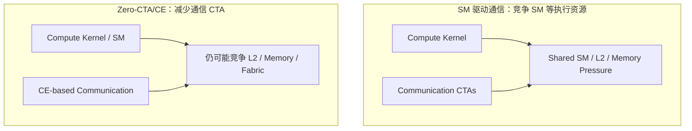

### 8.4 对 Zero-CTA 的正确 Profiling 方法

首先验证是否真的选择了目标 NCCL 传输路径；通过库版本文档、必要的日志和 Profiler Time Line 了解它是否启动了常规通信 Kernel、出现 Copy Activity，以及与计算的时间重叠。其次，不应只在 NCU 中找 `ncclKernel` 并认为“没有这个 Kernel 就没有通信”；Zero-CTA 可能意味着通信不再由传统通信 CTA 执行。最后，必须保留同样的有效负载、Collective、Topology、注册状态与同步边界，在独立通信、独立计算、共同运行三种模式中对比端到端结果。

建议追踪指标包括：Collective 的端到端 Latency、计算 Kernel Duration、计算 Kernel 的 SM 发射与 Stall、NCU 允许采集的共享资源流量、NSYS Memory/Copy Timeline，以及真实环境下的数据吞吐。单独的通信 SM Occupancy 在这一场景下并不是完整的效率指标。

---

## 9. NVSHMEM 与 GPU-initiated RDMA：为什么 NCU 看不到全部网络行为

### 9.1 两类典型控制路径

**NVSHMEM** 是支持 CPU/GPU 发起跨处理单元通信的库，提供按其规则访问对端数据和同步的接口；它不是“所有 GPU 自动共用一个普通数组”。**GPU-initiated RDMA** 指 GPU 提交网络搬运请求，NIC 搬数据。Transport 是库实际采用的传输后端；GDAKI 是其 GPUDirect Async Kernel-Initiated 路径名称，IBGDA 与 GPUNetIO 是具体实现名称。只需先理解它们改变谁下单，不等于改变谁逐字节搬运。

传统的 Proxy-based 网络传输可以由 GPU/应用提出请求，再经 CPU Proxy 组织网络传输；GPU-initiated 方案则让 GPU 直接进行部分 NIC 任务提交与控制操作。NVSHMEM 官方文档称其 GPUDirect Async Kernel-Initiated 通信路径为 GDAKI，提供如 IBGDA、GPUNetIO 等 Transport 实现。

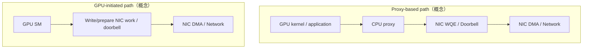

这一对比只说明控制面差别。它不意味着整个通信流程里绝对没有 CPU 参与：初始化、资源创建、队列配置、网络发现等环节仍可能需要 Host；同时“GPU-initiated”不等于“GPU SM 自己执行网络的数据搬运”，真正的网络传输仍由 NIC 等单元完成。

### 9.2 NCU 在 IBGDA 场景中的价值

**Atomic（原子操作）**按规定不可被拆开的方式更新某个值，例如多个线程同时递增同一计数器，不能简单用普通读改写代替。NVSHMEM 的 Fence 约束指定操作的顺序，Quiet 按库语义等待先前操作完成；不能与 CUDA 同名/类似概念混用而忽略具体保证。

对于某些 GPU 侧提交路径，NCU 可以帮助分析：GPU Warp 执行多少指令来准备 WQE、更新 Doorbell、轮询 Completion；使用多少寄存器与 CTA；是否出现大量 Atomic、Scoreboard 等局部瓶颈。但 NCU 无法仅靠一份 Kernel 报告完整解释 NIC 的队列资源、网络带宽利用率、QP 冲突、网络拓扑、拥塞或远端 DMA 完成时序。

NVSHMEM 官方性能指南也强调，GPU 发起可以提高多小消息并发提交能力，但单个 GPU Thread 填写 WQE 可能比 CPU Thread 慢，QP 的配置与映射会影响 Fence/Quiet 成本和吞吐，不能只看是否启用了 IBGDA。

### 9.3 三种“完成”不可混为一谈

| 事件 | 问题 | 仅靠 NCU 能否判断？ |
|---|---|---|
| WQE/请求已提交 | GPU/CPU 是否已经把请求通知给 NIC？ | 只能观察本地代码路径的一部分 |
| NIC/RDMA 完成 | 网络与目标端 DMA 是否完成到约定语义？ | 通常需要 NIC/CQ/Transport 层证据 |
| GPU 消费者看到数据 | 远端 GPU 使用数据时是否满足同步、缓存和内存顺序要求？ | 需要协议语义与端到端正确性验证 |

PD 分离指把模型先处理输入（prefill）与逐步生成（decode）分到不同执行方；KV Cache 是模型为复用历史计算而保存的键/值数组，不是硬件 cache。例如网卡把这些历史数组传到另一张卡，仍须确认后续 GPU 何时能读。尤其在基于 RDMA 的 PD/KV Cache 场景中，“NIC completion 成功”和“后续 GPU 读取的数据正确且可见”是不同层次的断言，必须结合已注册内存、生命周期、映射稳定性与同步规则分析。NCU 主要是性能工具，不能替代数据完整性验证。

---

## 10. DeepEP / MoE Expert Parallel：把一次 Dispatch/Combine 拆成可测量阶段

### 10.1 MoE EP 的一个典型视角

**MoE（混合专家）**模型为一条输入选择若干计算模块，模块叫 Expert（专家），不是真人。**token** 在此是一条输入记录及其数值向量，例如 4 个浮点数；Routing 是选择专家的决策，Top-K 是每条记录选 K 个专家。**EP（Expert Parallel，专家并行）**把专家分布到不同参与设备；TP 把一层张量计算拆给多设备，CP 把上下文序列拆给多设备，属于另外的拆分方式。**DeepEP** 是面向专家并行数据交换的通信库。

假设一个 Rank 上有若干 Token，每个 Token 经 Routing 选择 K 个 Expert，Expert 分布在不同 Rank。Dispatch 负责按目标 Rank/Expert 组织 Token 数据；Expert 计算完成后，Combine 负责将结果返回源 Token，并按 Routing Weight 合并。具体 DeepEP 版本及具体数据路径可能不同，这里只是可用于建模的抽象。

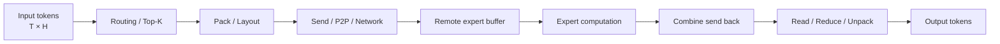

在完整模型中，Dispatch 和 Combine 往往夹着 Expert 计算。**要分析通信开销，必须明确测的是单独 Dispatch、单独 Combine，还是包含 Expert Compute 的整个前后处理链**。

### 10.2 逻辑通信字节量的推导

假设本 Rank 有 `T` 个 Token，每个 Token 宽度为 `H` 个元素，元素占 `s` 字节，Top-K 为 `K`，则一份最简单的“所有选择都复制完整向量”的逻辑 Dispatch Payload 上界模型为：

$$
B_\mathrm{logical}=T\cdot K\cdot H\cdot s
$$

这里 `T` 是 token 数，不是前面公式的时间；`H` 是每条向量的元素数，K 是无单位的选择次数，s 是 B/元素，乘积单位为 B。BF16 是一种每元素 16 位（2 B）的浮点格式；FP32 是 32 位（4 B）浮点格式。示例：`T=64`、`H=6144`、`K=4`、BF16（2 Bytes）。

$$
B_\mathrm{logical}=64\times4\times6144\times2
=3{,}145{,}728\ \mathrm{Bytes}\approx3\ \mathrm{MiB}
$$

**这个 3 MiB 不是该 Rank 的 NVLink 物理流量**：如果部分目标 Expert 就在本 Rank，跨 Rank Payload 需要减去本地部分；如果存在去重、聚合、压缩或其他 Layout，真实发送字节又可能变化；Combine 还会增加结果、索引与权重等附加信息。单 GPU 的显存访问量也可能因为 Pack、Scatter 和 Reduce 的读写而比逻辑 Payload 更大。

更合理的跨 Rank 计量方式：

$$
B_{r\to q}=N_{r\to q}\cdot H\cdot s+B^{\mathrm{metadata}}_{r\to q}
$$

其中 `N_{r→q}` 是源 Rank `r` 实际发送到目标 Rank `q` 的 Token–Expert 选择记录数；若实现存在同 Rank 专家去重、分块或压缩，应根据真实格式修订。metadata 项单位也是 B，例如记录原 token 下标和目标专家编号的字节。Traffic Matrix 就是第 2 节的源—目标字节矩阵。整体网络负载应从 `B[r][q]` Traffic Matrix 推导，而不是只用 `T×K×H×s` 乘一个 Rank 数量。

### 10.3 低延迟 Kernel：为什么主导因素经常不是带宽

以 `T` 很小的 MoE 通信为例，消息可能只占几 KiB～几十 KiB。模型：

$$
T_\mathrm{combine}\approx T_\mathrm{notify}+T_\mathrm{wait}+T_\mathrm{copy}+T_\mathrm{reduce}
$$

若 NCU 里 Reduce 的计算指令非常少，访存吞吐也不高，仍不能证明 Kernel 已经“没有优化空间”；小消息通信通常还受 CTA 启动、同步、数据到达时序、Poll Interval、远端 Flag 发布等因素限制。此时真正优化问题可能是减少协议往返、合并通知、简化 Layout、计算通信融合，或者减少 Consumer 等待而不是增加 GPU 指令吞吐。

### 10.4 Combine 的 Reduce 归因

例如两个专家给同一 token 返回向量 `[2,4]`、`[6,8]`，权重为 0.25、0.75，Combine 逐项得到 `[5,7]`。**Warp Shuffle** 是让同一 warp 的线程交换寄存器值的指令；**IPC** 是每周期执行指令数，分母是相关时钟周期而非通信秒数。假如 Combine 需要将同一个 Token 的多个 Expert 输出执行加权归约，性能分析应区分：

- `Load`：从本地或远端地址读取 Expert 输出；可能受 L1/L2/DRAM/P2P 访问模式影响。
- `Reduce`：FP32 累加、BF16 转换、Warp Shuffle、Shared Memory 临时缓冲；可能受计算与寄存器资源影响。
- `Store`：按原 Token 布局写回；可能存在 Scatter、不规则访问和 Coalescing 效率问题。
- `Synchronization`：等待所有相关 Expert 输出准备就绪；可能占据绝大部分低 Token 的执行时间。

建议先用完全准备好的本地数据构造 `local-reduce-only` 的局部参考基线（不是无条件的理论上界），隔离归约的纯计算/访存开销；再对比跨 GPU 的完整 Combine，以避免把同步等待错误归因于 Reduce 核心循环。这里描述的是**分析方法**，不是要求在本课实现实验脚本。

### 10.5 DeepEP 诊断表

| 现象 | 第一假设 | NCU 应看什么 | 仍需要验证什么 |
|---|---|---|---|
| Pack 时长高、L1TEX Sectors 多 | 访问布局分散 | SASS/Requests/Sectors | 输入 Token 布局、独立 Pack 性能 |
| Combine 长、Long Scoreboard 高 | Load 依赖或 Polling | Source PC、WarpState、Memory | 远端发布时间、是否为等待时间 |
| Reduce IPC 低、Register 高 | 依赖链或资源压力 | Source、Register、Scheduler | 减寄存器是否真能降时延 |
| 大消息吞吐低 | 链路/消息分布/流量不均 | NCU Memory、可用 NVLink 汇总 | 链路计数器、Traffic Matrix |
| 多 Rank 总耗时明显长尾 | Rank/Expert 负载不均 | 每 Rank 局部关键 Kernel | Routing 分布、最慢 Rank 与通信时序 |
| NCU 采集死锁 | 跨 Rank 依赖被 Replay 改变 | Replay 模式和过滤对象 | 无 NCU 执行、协同采集、范围选择 |

---

## 11. 工具分工：NCU、NSYS、链路计数器和协议日志

### 11.1 工具不是替代关系，而是互补关系

| 需要回答的问题 | 最优先的证据 | 补充证据 |
|---|---|---|
| 端到端 Dispatch/Combine 多久？ | CUDA Event / 专用 Benchmark | NVTX 标记与 NSYS Timeline |
| 哪个 Rank 慢？ | 每 Rank 同步边界时间与分布 | NSYS 多进程 Trace、Traffic Matrix |
| 某条 Warp 为什么没有发射？ | NCU Scheduler/WarpState/Source | SASS 与依赖链模型 |
| Pack 的 Global Store 是否合并？ | NCU MemoryWorkloadAnalysis | 地址布局与 SASS |
| Copy Engine 在何时执行？ | NSYS CUDA Memcpy/Copy Timeline | 端到端完成事件、可用设备指标 |
| 通信是否与计算重叠？ | NSYS 并发时间线 | Co-run/Standalone Benchmark |
| 物理链路是否拥塞？ | 链路、NIC、NVSwitch 计数器（按平台） | NSYS GPU Metrics 与吞吐扫描 |
| 是否真实使用 IBGDA？ | NVSHMEM 配置、初始化日志、Transport 路径 | GPU 控制端 NCU 与 NIC 计数器 |
| RDMA 请求是否成功完成？ | NIC CQ / RDMA Transport 状态 | 数据正确性校验与应用协议日志 |
| TMA 是否有效隐藏访存延迟？ | NCU 发起与等待、NSYS/Benchmark 的总时长 | 局部流水线对照、资源占用 |

**工具选择原则：** 想知道“**在哪里耗时**”，先用端到端时间线；想知道“**SM 为什么这样执行**”，用 NCU；想知道“**物理数据到底在哪条链路上走了多少**”，用相应 Fabric/NIC/设备计数器；想知道“**协议是否满足正确性**”，看同步、队列、内存注册和完成语义。

### 11.2 建议的最小采集顺序

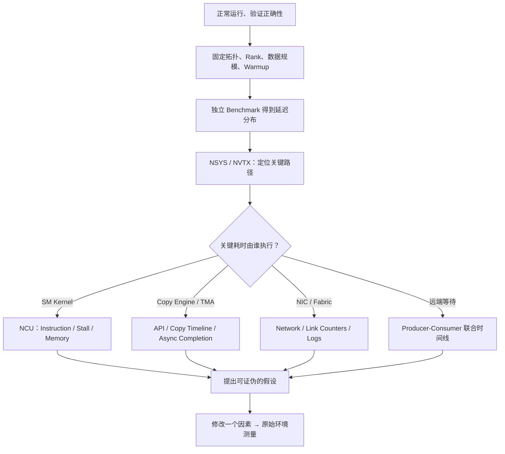

### 11.3 只用于说明采集范围的短命令

```bash
# 查看本机真实可用的 NCU Sections 和 Metrics
ncu --version
ncu --list-sections
ncu --query-metrics

# 一个独立可重放的 Pack Kernel：先收基础与访存信息
ncu --section SpeedOfLight \
    --section MemoryWorkloadAnalysis \
    -k 'regex:pack' -c 1 -o pack_profile \
    python bench.py

# 检查当前平台是否有可用 NVLink 概览 Section
# （有无、能力与数值解释均受版本/拓扑限制）
ncu --section Nvlink -k 'regex:my_kernel' -c 1 ./app

# NSYS：采集 CUDA/NVTX 的时间线示例
nsys profile --trace=cuda,nvtx --output=comm_timeline \
    python bench.py

# GPU 物理拓扑
nvidia-smi topo -m
```

`--version` 查版本，`--list-sections` 列指标组，`--query-metrics` 列当前可用指标；重复 `--section` 添加所需组。`nsys profile` 启动时间线采集，`--trace=cuda,nvtx` 选 CUDA 活动和业务标记，`--output` 指输出前缀；`nvidia-smi topo -m` 查看设备连接矩阵，不证明某次传输实际经过哪条连接。执行时为输出取独立名字，不覆盖已有证据。

这些是**语法和定位思路示例**，并非针对特定 GPU 保证可运行的配置。尤其不要直接把 `--section Nvlink` 在某个 GPU 上能打印出的 Summary 理解为所有物理 Link 的单独计数。其他厂商硬件的工具、计数器语义也不能直接用 NVIDIA 的 Metric 名称代替。

### 11.4 采集时间窗口与计数器归属

假设一段 100 μs 的通信中，SM Kernel 实际只运行 15 μs，而 Copy Engine 在整个区间搬运数据，同时 NIC 也进行 DMA。如果只 Profile 15 μs 的 Kernel，NCU 设备级计数器可能包含同期其他引擎的部分活动；如果使用 100 μs 范围采集，又可能无法把全部流量精确分配到该 15 μs Kernel。因此不能使用：

$$
\frac{\mathrm{All\ Device\ Bytes\ In\ Range}}{T_\mathrm{single\ kernel}}
$$

当作该 Kernel 的“真实带宽”。分子、分母必须来自同一统计边界，且物理意义保持一致。

---

## 12. 六个完整诊断案例（全部为教学假设）

这些案例的数值完全用于推演逻辑，不代表真实 NVIDIA GPU 或相关通信库在特定版本的实测。

### 案例 A：SM P2P Kernel 看起来“很忙”，但有效吞吐低

假设：Kernel 传送有效 Payload 64 MiB，耗时 300 μs，SM Throughput 中某些资源较高，L1TEX Sectors/Request 也高。

应用有效带宽：

$$
B_\mathrm{payload}=\frac{64\cdot2^{20}}{300\cdot10^{-6}}
\approx223.7\ \mathrm{GB/s}
$$

第一假设：远端 Store 的访问模式分散，扩大了内存请求粒度和指令执行开销。应查看 SASS Store 粒度、每 Warp 的地址分布和 L1TEX 相关 Requests/Sectors。注意 223.7 GB/s 是 Payload Bandwidth，不自动等于 NVLink 链路吞吐。随后对比连续 Store/对齐 Store 与原实现，并且通过外部链路指标判断物理流量变化。

**不能得出的结论**：`SM Throughput` 高就说明链路满；或 `DRAM Throughput` 低就说明 P2P 不慢。

### 案例 B：Combine Long Scoreboard 高，但根因是 Producer 过晚

假设：Consumer Kernel 用时 25 μs，其中大量时间在轮询 Flag；Producer 的 Pack 需要 15 μs，发送与发布再花 6 μs。即使 Consumer Polling 使用更高效的 Load 指令，它仍需要等远端约 21 μs 才能完成。

观察：NCU 的 Stall 采样可能大量集中在 Flag Load 附近。正确行动是先构建双方 Timeline 并计算 `Flag Publish → Flag Observed` 的区间，随后才能判断该优化 Producer、协议轮次、缓存策略还是 Consumer Polling。

**不能得出的结论**：Long Scoreboard 高就表明 Consumer 的 DRAM 带宽饱和。

### 案例 C：CE 让通信单独更慢，却让 GEMM + 通信更快

假设数据：

| 工作负载 | SM 通信实现 | CE 通信实现 |
|---|---:|---:|
| 独立通信时间 | 18 μs | 22 μs |
| 独立 GEMM 时间 | 40 μs | 40 μs |
| GEMM 与通信并发完成 | 53 μs | 43 μs |

如果目标是整个流水线吞吐，CE 实现显著更优。NCU 的普通通信 Kernel 指标不足以解释结果；需要 NSYS 看到 CE/计算重叠、计算 Kernel 的 SM 行为与共享 L2/DRAM 干扰。

**不能得出的结论**：最短的单独通信延迟方案一定具有最高系统吞吐。

### 案例 D：TMA 指令更少，但 Kernel 总耗时不降

假设改用 TMA 后，SM 的 Load/Store 指令数量明显下降；然而等待 Barrier 的时间增加，Shared Memory 使用量升高，导致理论驻留 CTA 从 4 降到 2，最终 Kernel Duration 反而增加。

分析步骤：比较发起与等待代码的 SASS、SM 指令统计、Shared Memory 占用、Occupancy、异步完成与总 Kernel 时间；判断是否因为缺少可重叠的计算、传输粒度太小或资源占用压缩并行度。**减少指令是局部变化，减少关键路径时间才是性能收益。**

### 案例 E：多 Rank AllToAll 平均流量不大，但总延迟高

假设一个 8 Rank 的 AllToAll 里，大部分 Rank 很快完成，但其中一个 Expert Rank 承接了 40% 的数据选择记录，导致该 Rank 的处理和发送阶段显著延后。此时整体延迟更可能被最慢 Rank 限制，而非“所有 GPU 平均 NVLink 利用率只有 30%”能解释。

需要观察 `B[src][dst]`、每 Rank Pack/Send/Receive/Combine 时间与尾部 Rank。只查看一个 Rank 的 NCU Memory Workload，可能误判该 Rank 的访存优化为全局最重要问题。

### 案例 F：跨节点 IBGDA 高并发消息数增加，但吞吐没有提升

假设启用某 GPU-initiated Transport 后，小消息发起延迟降低或消息发送数提高，但 1 MiB 以上消息的有效带宽没有显著提升。可能因为 QP/Queue、NIC DMA、PCIe/网络带宽、远端接收和消息组合已经成为约束。正确工作是分别测量小消息消息率、不同 Payload 的 Bandwidth、NIC 计数器与 GPU 侧提交开销，而不是仅分析 GPU 的 Doorbell Store 指令。

**不能得出的结论**：GPU 提交 WQE 越快，网络端到端带宽必然越高。

---

## 13. 形成可迁移的多 GPU 通信性能归因流程

### 13.1 首先构建证据表

| 证据类别 | 应记录的字段 | 为什么重要 |
|---|---|---|
| 工作负载 | 业务阶段、Tensor Shape、dtype、tokens、topk、Rank/Node 数量 | 确保对比语义相同 |
| 拓扑 | GPU IDs、Device↔NIC 映射、NVLink/NVSwitch/PCIe、跨节点连接 | 解释远端路径与不均衡 |
| 算法 | Collective、Transport、Protocol、CE/SM/TMA 路径 | 不同实现成本模型不同 |
| 数据量 | 逻辑 Payload、Traffic Matrix、Meta、链路计数器 | 防止混淆有效数据与物理流量 |
| 时间 | 各 Rank 的 Launch/Publish/Wait/Finish 与总时间 | 发现同步和尾部瓶颈 |
| NCU | Section、Kernel Identity、Replay、Cache/Clock、Source | 明确指标条件与可解释性 |
| NSYS | NVTX、Kernel/Copy 活动、重叠、时间线 | 连接算法阶段与设备执行 |
| 正确性 | Output 校验、Fence/Barrier/Memory lifetime | 防止以错误行为换性能 |
| 复现性 | Commit、驱动/工具版本、GPU 负载与配置 | 避免不受控变量 |

### 13.2 按诊断对象分叉，不要默认全部用 NCU

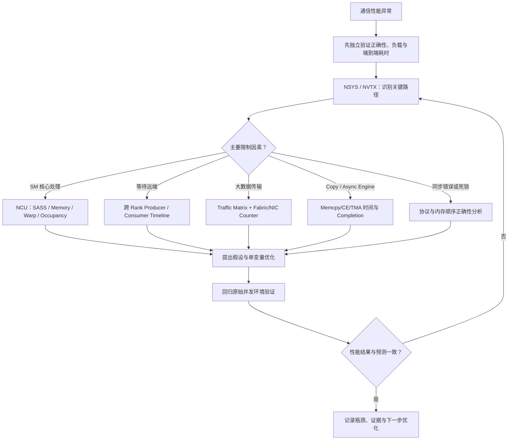

### 13.3 统一实验口径：Latency、Bandwidth、SM Cost、Overlap

延迟样本排序后，中位数/P50 表示一半样本不超过它，P99 表示 99% 样本不超过它；分位数用来描述分布，长尾是其中较慢的样本，不能从一次调用推出。针对同一个通信方案，建议至少输出四类观测而不是一个带宽数字：

- **Latency**：端到端分位数、最小/中位数、长尾和 Rank 最大值；注意正确的同步边界。
- **Bandwidth**：有效 Payload/总时间，以及如可用的逐链路实测流量；解释单位与数据口径。
- **SM Cost**：通信需占用的 CTA、Warp Slots、SM 指令、寄存器和是否挤占计算；Zero-CTA 应独立注明。
- **Overlap**：`T_compute_only`、`T_comm_only`、`T_concurrent` 三组测量，联合时间线判断真实重叠，避免仅以两段时间相减得出精确硬件占用。

一个可参考的系统级重叠效率描述是：

$$
\eta_\mathrm{overlap} = \frac{T_\mathrm{compute\ only}+T_\mathrm{comm\ only}-T_\mathrm{concurrent}}
{\min(T_\mathrm{compute\ only}, T_\mathrm{comm\ only})}
$$

三个时间均取相同单位且独立任务必须相同，分母用较短任务的时间作为“理想可隐藏量”，要求它大于 0。例如计算 40 μs、通信 20 μs，共同运行 45 μs，则 `(40+20-45)/20=0.75`；这是无单位的比较值。纯串行理想值为 0，完全重叠且互不干扰时为 1。这些时间与分位数都需要足够重复样本，不能从一次运行推出稳定收益。

但该式**只是用于相近条件下的经验比较量**。当计算和通信共享 L2/DRAM 而互相拖慢、存在启动开销或三次运行的频率不同，所得值可能超出直觉范围，不能将其当成独立的硬件计数器或“有多少数据真实重叠”的严格测量。使用前应先固定数据规模、时钟、缓存条件和语义。

### 13.4 不要把 Profiling “成功采集”视为“性能结论成立”

复杂通信中的每一项结论最好满足三个条件：

1. **观测支持**：工具指标显示预期方向，并能解释其统计范围与机制。
2. **结构支持**：源码、SASS、通信协议或数据布局能够解释该现象的因果机制。
3. **对照支持**：针对该机制做最小变量修改，回到真实工作负载中，端到端结果按预测变化。

仅有 NCU 截图、仅有理论带宽值、仅有某个 Rank 的时延数字，都不足以支撑完整的性能归因。

---

## 14. 十二个高频误区与纠正

| 错误判断 | 正确理解 |
|---|---|
| 1. `ncu` 中 Kernel 很快，说明完整通信很快 | 还需计入等待、CPU/Proxy、异步搬运与全 Rank 同步 |
| 2. Long Scoreboard 高，就是 DRAM 访存差 | 可能是远端数据/Flag 尚未准备好或长延迟依赖 |
| 3. DRAM Throughput 高，就是 NVLink 饱和 | DRAM 和 NVLink 是不同统计对象 |
| 4. NCU 不支持任何 NVLink 指标 | 存在 NVLink 汇总等能力，但逐链路、拓扑和支持条件受限制 |
| 5. 看到 `cudaMemcpyPeerAsync` 就证明 Copy Engine 一定被使用 | 真实实现路径取决于设备、驱动、拓扑和条件 |
| 6. TMA、Copy Engine、NIC DMA 都是一回事 | 它们是不同发起/执行机制，适用路径不同 |
| 7. Zero-CTA 意味着通信不占任何 GPU 资源 | 它可减少通信 CTA，但仍竞争内存与 Fabric 等共享资源 |
| 8. GPU-initiated RDMA 是 GPU SM 负责在网络上传送每个字节 | GPU 可负责控制和提交，NIC 执行实际网络 DMA |
| 9. Replay 产生的等待时间就等于生产环境等待时间 | Replay 可改变 Producer/Consumer 并发与远端状态 |
| 10. 高带宽就意味着低延迟 | 小消息和协议/同步主导场景可能不满足 |
| 11. 一个 Rank 的 Cache Traffic 等于 Collective 的总通信量 | 必须区分 Rank、物理链路与应用 Payload |
| 12. 只要优化本地 Kernel IPC，全局 AllToAll 就会变快 | 全局性能可能被最慢 Rank、链路拥塞或同步限制 |

---

## 15. 自测题：先独立推断，再检查参考答案

### Q1：为什么通信的 Payload Bandwidth 和 DRAM Throughput 可以差很多？

**参考解析：**前者使用应用有效负载/端到端时间，后者使用特定设备 DRAM 系统计数/采集时间。缓存、重复加载、Metadata、远端访问、异步引擎和不同计量范围都会使两个值不同。

### Q2：一个 Polling Kernel 的 Long Scoreboard 占 Warp Stall 采样的 70%，可以直接推断有 70% 总耗时花在 DRAM 上吗？

**参考解析：**不可以。Stall 指标可能是抽样分布，不是精确的 Kernel 时间分解。更重要的是 Polling 的等待可能由远端迟迟未发布完成条件引起。

### Q3：为什么不能将 `gpu0` 的 `dram__bytes_read` 当作 GPU0→GPU1 的 NVLink Read Bytes？

**参考解析：**计数器覆盖的资源和语义不同。本机 DRAM 流量不会直接等于某条物理互联的流量，且远端地址访问和缓存路径更加复杂。

### Q4：什么时候 Zero-CTA/CE 的性能优势更明显？

**参考解析：**当应用需要通信与计算同时进行，并且通信 CTA 原先会明显争夺 SM 资源时，释放 SM 可能提高整体效率。是否获益取决于数据量、支持的路径、CE 带宽、内存系统共享资源与重叠能力。

### Q5：为什么 TMA 发起指令减少并不代表搬运一定加快？

**参考解析：**启动、Barrier 等待、描述符准备、Shared Memory 占用、数据规模以及异步搬运与计算是否真正重叠，均可能限制总时延。

### Q6：用 `--communicator shmem` Profile 一个 8-Rank torchrun，为什么有时仍会卡住？

**参考解析：**并不是所有 Worker 必然以相同顺序进入符合 `-k` 过滤条件的并发任务；Peer 数量、过滤、Workload 顺序和特定 Replay 限制都可能影响协作。还应检查工作负载是否含外部未被协同管理的依赖。

### Q7：Range Replay 与 Kernel Replay 在数据归属上有什么核心区别？

**参考解析：**Kernel Replay 将指标与特定 Kernel Launch 关联；Range Replay 采集一段 CUDA API/Kernel 范围，通常将指标关联到整个范围，以支持必要并发关系。

### Q8：为什么 IBGDA 下 GPU 提交路径 IPC 增大不一定提高网络带宽？

**参考解析：**GPU 侧提交只是控制路径，网络传输仍受 NIC、PCIe、QP、消息大小、网络拥塞与远端处理等限制。

### Q9：在 EP Dispatch 中 `T×K×H×s` 有什么意义、有什么局限？

**参考解析：**它是“每个 Token 的 K 个 Expert 选择都携带完整向量”的逻辑 Payload 模型，不代表跨 Rank 真实字节数；需要扣除本地选择、考虑去重/压缩和 Metadata，再构建 Rank-to-Rank Traffic Matrix。

### Q10：一个 Collective 的平均 Rank 耗时是 7 μs，最慢 Rank 耗时 18 μs，应该关注哪个？

**参考解析：**如果完成语义需要等待所有 Rank，尾部 Rank 更接近整体性能的限制因素，平均值容易掩盖不均衡。但还要核实时间边界和 Collective 的真正完成条件。

### Q11：NCU 报告有 NVLink Section，就能研究 NVSwitch 下每条物理链路的吞吐吗？

**参考解析：**不能保证。必须查询具体版本和架构能力；当前 NCU Release Notes 对 per-NVLink Metrics、Logical Throughput 与 NVSwitch 拓扑展示有明确限制。

### Q12：如何判断某个性能改善来自通信计算重叠，而非仅通信本身变快？

**参考解析：**至少需要 `compute_only`、`comm_only` 与 `co-run` 三类独立测量，并配合 NSYS 时间线观察实际重叠与共享资源干扰。

### Q13：在最小消息延迟测量中，为什么不能只扫描 DRAM Throughput？

**参考解析：**小消息的纯数据传输时间可能远小于启动、协议轮次、同步/轮询成本；吞吐指标低不一定说明设计错误，也可能是消息太小无法达到带宽上界。

### Q14：GPU 端执行 `st.global` 写入远端地址后，为什么仍需研究同步和可见性？

**参考解析：**指令发射、远端操作完成、Consumer 读取时的内存可见性是不同层次，取决于通信代理与内存模型。必须确认实现使用的 Memory Scope、Release/Acquire、Fence 或 API 保证。

### Q15：完整通信系统优化时，最可信的性能收益验证是什么？

**参考解析：**在语义和数据正确性一致、拓扑/规模/环境可比的前提下，使用非 NCU 环境的端到端 Benchmark 与 Rank 统计，配合 NCU 和 NSYS 的机制性证据解释变化，并记录新的瓶颈。

---

## 16. 本课知识关系与下一课衔接

第十一课完成后，应当把前十课的单 Kernel 微架构分析整合到一个更大的通信分析系统：

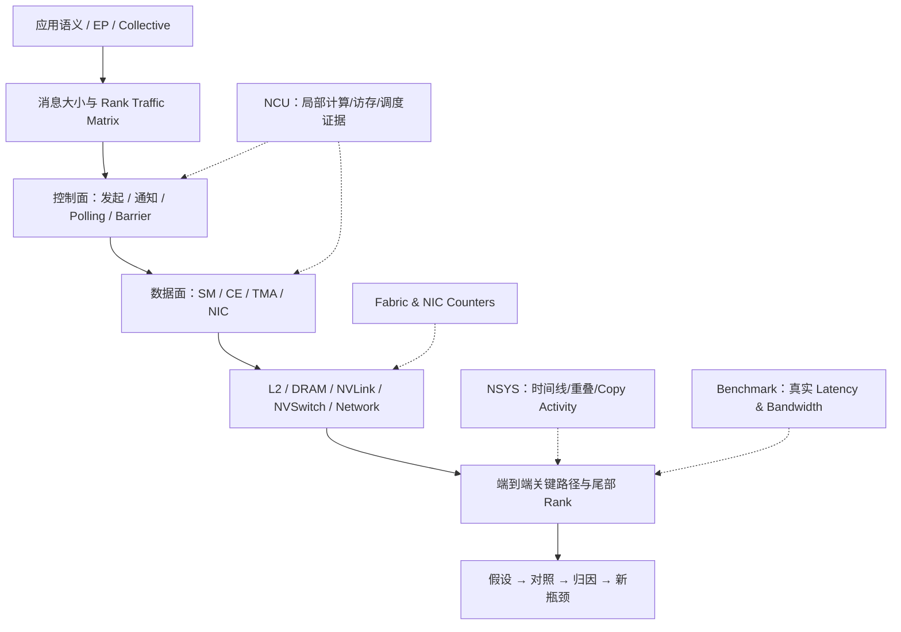

本课的目标不是将 NCCL、NVSHMEM、DeepEP 或 RDMA 每个技术栈讲完，而是形成一种工具选择与因果归因能力：**给定一个复杂 GPU 通信工作负载，你能够知道需要观察哪个阶段、哪个 Rank、哪种硬件资源、哪类计数器，并主动识别 NCU 无法单独回答的问题。**

**第十二课（最后一课）**将把第 1–11 课整合成完整性能优化实战方法：算法成本建模 → 基准测量 → NCU/NSYS → SASS 归因 → 控制变量优化 → 性能回归 → 中文证据报告。它会跨越 Coalescing、Occupancy、Register/Spill、Compute、Latency、Async Copy 和多 GPU 等多个场景，重点训练在指标相互矛盾时如何做出可验证的判断。

---

## 17. 官方参考文档与阅读顺序

> 以下为本课编写时核对的官方资料入口；产品文档会随版本更新。尤其是工具支持矩阵、NCCL Zero-CTA 条件、NVSHMEM Transport 选项和异步指令，使用时需对照本机实际版本。

| 阅读顺序 | 资料 | 重点 |
|---|---|---|
| P0 | [Nsight Compute Profiling Guide](https://docs.nvidia.com/nsight-compute/ProfilingGuide/) | Replay、Range、Serialization、NVLink Sections、共享资源误差 |
| P0 | [Nsight Compute CLI](https://docs.nvidia.com/nsight-compute/NsightComputeCli/) | Mandatory Concurrent Kernels、shmem/tcp Communicator、Lockstep |
| P0 | [Nsight Compute Release Notes](https://docs.nvidia.com/nsight-compute/ReleaseNotes/) | per-NVLink、NVSwitch、MPS、Graph 和当前支持限制 |
| P0 | [Nsight Systems User Guide](https://docs.nvidia.com/nsight-systems/UserGuide/) | CUDA/NVTX Timeline、Copy Activity、GPU Metrics |
| P0 | [CUDA Programming Guide · Asynchronous Execution](https://docs.nvidia.com/cuda/cuda-programming-guide/02-basics/asynchronous-execution.html) | Streams、异步复制、完成与并发 |
| P0 | [CUDA Programming Guide · Advanced Kernel Programming](https://docs.nvidia.com/cuda/cuda-programming-guide/03-advanced/advanced-kernel-programming.html) | LDGSTS/TMA、Async Proxy、Barrier 与完成语义 |
| P0 | [NCCL 2.32.3 · User Buffer Registration](https://docs.nvidia.com/deeplearning/nccl/user-guide/docs/usage/bufferreg.html) | Zero-CTA、CE、Symmetric Window、支持范围 |
| P1 | [NVSHMEM Performance](https://docs.nvidia.com/nvshmem/release-notes-install-guide/best-practice-guide/performance.html) | IBGDA/GPUNetIO、TMA、QP Mapping、NVTX |
| P1 | [NVSHMEM · Using GPUDirect Async Kernel-Initiated Communication](https://docs.nvidia.com/nvshmem/api/latest/using.html) | GPU-initiated Transport、控制/数据路径 |
| P1 | [CUDA Driver API · Memory Management](https://docs.nvidia.com/cuda/cuda-driver-api/cuda_driver_api/group__CUDA__MEM.html) | `cuMemcpyPeerAsync` 等设备间搬运 API |

### 建议的精读顺序

首先结合 NCU Profiling Guide 与 Release Notes 分清“可以看到”和“不能归因”的数据；其次阅读 CUDA Asynchronous Execution，建立 SM、Copy Engine、TMA、NIC 之间的区别；然后根据工作负载选择 NCCL Zero-CTA 或 NVSHMEM GPUDirect Async 文档；最后再把 DeepEP Dispatch/Combine 的逻辑数据量、Rank Traffic Matrix 和通信时间线纳入自己的分析模型。

---

## 18. 本课完成标准（可作为知识检查表）

- [ ] 不混淆 SM 指令、GPU 内存子系统流量、NVLink 物理流量与应用 Payload。
- [ ] 能把一次通信分解为控制面、数据面、等待、同步、计算和完成过程。
- [ ] 能解释 Polling 的 Long Scoreboard 为什么不能单独证明 DRAM 带宽受限。
- [ ] 能比较 SM 驱动 P2P、CUDA CE、TMA、NIC RDMA 的执行与观测边界。
- [ ] 能说明 Zero-CTA 的 SM 资源收益及为什么需要 co-run Benchmark。
- [ ] 能解释普通 Kernel Replay 为什么可能破坏跨 Rank 依赖。
- [ ] 知道 shmem/tcp Communicator 与 Range Replay 的适用前提和限制。
- [ ] 能从 MoE `T、H、K、dtype` 建立逻辑 Payload 模型，并指出其不等于物理流量。
- [ ] 能为通信性能问题选出正确的 NCU、NSYS、Fabric/Network Counter 和 Benchmark 证据。
- [ ] 能为一个跨 GPU 通信问题写出可验证的归因假设，而不是只截图高 Stall 指标。

**最终原则：真实生产环境的端到端表现是优化目标；NCU 提供局部微架构证据；NSYS 提供执行时间结构；链路/协议计数器提供外部数据面证据。三者与正确性校验结合，才能给出可信的多 GPU 通信性能归因。**
