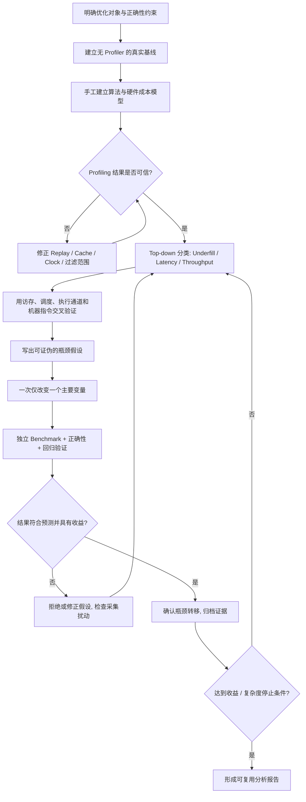
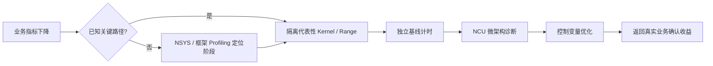
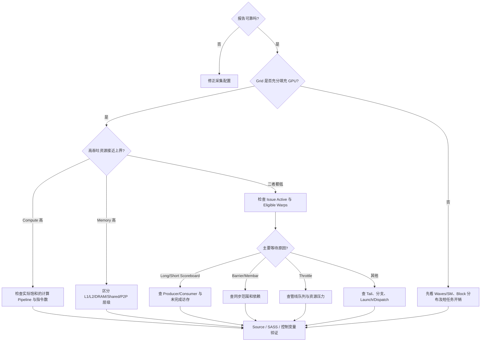
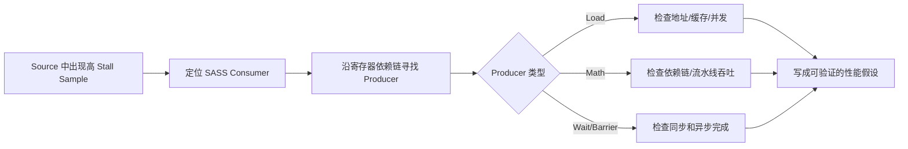
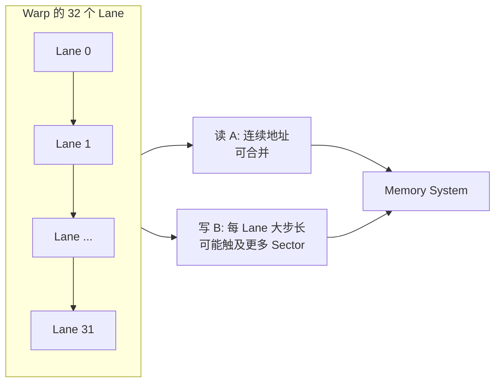
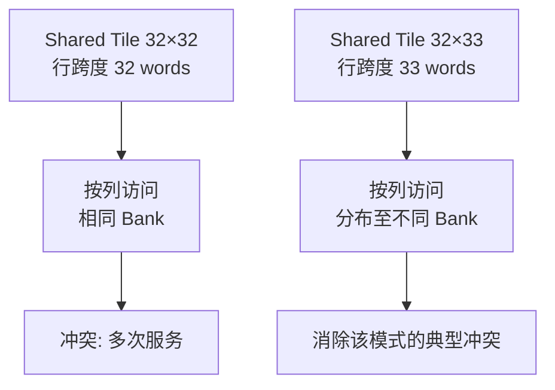
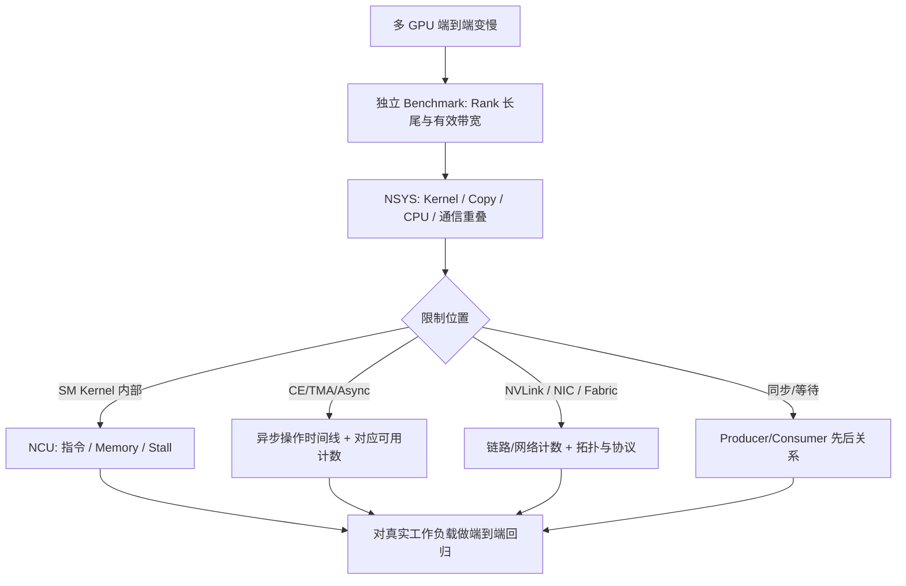
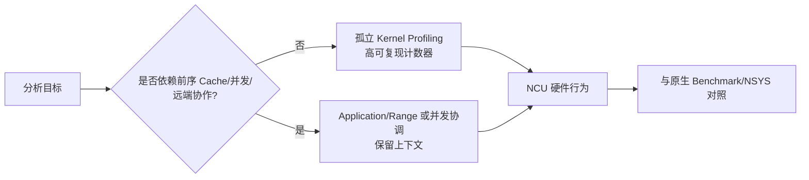

# NCU 系统学习 · 第十二课：从真实性能测量到可验证的 GPU Kernel 性能归因

> 配套实验：[lab12.md](lab12.md) · [入口源码](kernels/main.cu) · [脚本入口](commands/)（源码与实验设计已提供；历史默认入口仅有 compile-only 记录，不代表改后源码或新脚本，见[旧编译日志](log/legacy_commands/compile/source_check.log)，尚未运行验证，无性能实测）。

> **课程定位**：12 课 NCU 系统课程的收官课。重点不是再罗列硬件指标，而是把前十一课整合为一个从业务目标、性能模型、Profiler 采集到控制变量验证的闭环。  
> **学习方式**：理论、短 CUDA/NCU 示例、手工计算、假想诊断报告与 Mermaid 图；**不提供独立实验脚本或完整工程**。  
> **案例数据说明**：所有标注为“教学假想”的时长、流量、指标与带宽均为自洽的教学数据，**不代表任何特定 GPU 实测值**。  
> **官方资料**：[Nsight Compute Compute Triage Guide](https://docs.nvidia.com/nsight-compute/ComputeTriage/) · [Profiling Guide](https://docs.nvidia.com/nsight-compute/ProfilingGuide/) · [Nsight Compute CLI](https://docs.nvidia.com/nsight-compute/NsightComputeCli/index.html) · [CUDA Best Practices Guide](https://docs.nvidia.com/cuda/cuda-c-best-practices-guide/)

---

## 0. 本课在 12 课中的位置

先用一个可以手算的问题开始：一项任务串行经历准备 1 ms、GPU 计算 2 ms、收尾 1 ms，总共 4 ms。即使 GPU 计算快一倍，总时间也只是 3 ms。**端到端**指从约定输入起点到最终结果可用的完整流程；**性能归因**是解释“为什么快/慢”，不只是报告一个数。**证据**必须能复查，例如相同输入下的原始计时、实际地址排列、最终机器指令；“某百分比高”本身不证明原因。**可证伪假设**则必须说出什么结果会推翻它，例如“若减少请求却没有缩短时间，则请求量不是唯一限制”。

回顾最小 CUDA 模型：CUDA 是 GPU 编程与运行平台，CPU 部分叫 host，GPU 函数叫 **kernel**，一次提交叫 **launch**；**API** 是程序调用接口。提交通常是**异步**的：CPU 返回不等于 GPU 已完成。GPU 线程以 **block/CTA（线程块）**组织，一次启动的全部块构成 **grid**；块通常拆成 32 线程一组的 **warp**。执行线程的计算单元是 **SM**，SM 内还有执行分区 **SMSP**。后面用到的前课机制会就地回顾，不要求背熟缩写才能读本课。

| 阶段 | 前面课程回答的问题 | 本课要完成的升级 |
|---|---|---|
| 硬件与指标（1–6） | 某种硬件行为是什么、如何测？ | 判断这些行为是否限制目标性能 |
| 性能模型与 SASS（7–9） | 理论峰值在哪里、哪条指令出现异常？ | 从时间下界到实际根因，建立因果证据 |
| 复杂应用与通信（10–11） | 如何准确采集 Python、Graph、多进程、P2P？ | 将微架构结论与端到端业务收益对应 |
| **综合闭环（12）** | — | **问题定义 → 模型 → 可靠测量 → 候选瓶颈 → 受控变更 → 验证与复盘** |

**关键路径**是依赖关系中决定最终完成时刻的那条路径。例如两项独立工作同时开始，分别用 8 ms、3 ms，等两者都结束才能返回，理想总时间为 8 ms；把 3 ms 缩短到 1 ms 不会改变完成时刻。**基线（baseline）**是用来对照的原始配置；**Profiler** 是性能采集工具，NCU（Nsight Compute）查看 GPU 内部活动，NSYS（Nsight Systems）查看 CPU/API/GPU 时间线。Replay 是分析器为分轮采指标而重复执行，一轮叫 pass；它可能改变缓存或把原先重叠的工作变为串行。因此独立 benchmark（不挂分析器的固定条件基准计时）不可省略。

下图是方法路线，不是要求先背一张术语表：Top-down 是先查整体再查局部，Underfill 是工作太少未铺满 GPU，Latency 是等一个结果的延迟，Throughput 是单位时间完成的量；后文会给各自的可检查证据。本课的总原则：**优先优化真实关键路径，而不是优先优化最容易收集到异常指标的 Kernel；以正确性和独立计时结果作为最终门槛，而不是把单个 NCU 百分比当成性能成绩。**



## 1. 第一步不是打开 NCU，而是定义“快”是什么

### 1.1 分析对象的四个粒度

**stream（流）**是 GPU 工作的有序提交队列，不同流不自动互相等待，也不保证并行。**CUDA Graph（图）**是预先组织任务及依赖的任务图，node 是一项任务；**range** 是选中的工作区间。例如“上传→乘法→下载”可以是一段范围，乘法只是其中一个 kernel。MoE 是为输入选择不同“专家”计算模块的模型，Combine 是把这些模块结果合回原输入，reduce 是合并数值（如求和）。

优化目标至少分成四个层次：**Kernel、CUDA Graph/Range、一次模型操作、端到端应用**。例如在 MoE 的 Combine 阶段，`reduce_kernel` 本身减少 4 μs，并不等于 Combine 流程减少 4 μs；如果它与其他 Stream 工作重叠，端到端收益可能更小。反过来，一个低吞吐但短时长的 Kernel，如果能消除后续同步等待，其系统收益也可能大于 NCU 看到的局部收益。

**CUDA Event** 是放在 GPU 流中的完成点，计时事件可记录设备时间戳；在目标前后记录、等待结束事件，再读间隔，才得到对应队列区间的时间。**rank** 是多进程协作编号，进程是一次程序运行的实例。Step 是应用的一轮工作，Latency 是这一轮或请求的耗时，Throughput 是每秒完成多少轮/请求，SLO 是服务要达到的指标目标（如 99% 请求在 20 ms 内返回）。P50 是一半样本不超过的值，P99 是 99% 样本不超过的值，后者用于看慢请求尾部；并非某一个 kernel 的时间比例。

| 粒度 | 常用计时 | 常见误判 | 判断标准 |
|---|---|---|---|
| 单个 Kernel | CUDA Event、NCU duration | 把 NCU 重放耗时视作生产耗时 | 相同输入/正确性下的独立延迟 |
| CUDA Graph / Range | Events、NSYS、NCU Range | 把各 Kernel Duration 简单相加 | 真实范围壁钟时间及重叠关系 |
| 通信操作 | 端到端通信 Benchmark、各 Rank 时间 | 用一个 Rank 的 Kernel Time 代表通信完成 | 跨 Rank 完成时间、有效带宽及长尾 |
| 模型训练/推理 | Step Latency、Throughput、SLO | 局部加速自动等于模型加速 | 吞吐、P50/P99、延迟目标与成本 |

### 1.2 建立明确的实验契约

实验契约是本次比较必须固定的条件，包括：算法语义、输入规模与数据类型、数值容差、Grid/Block（除非它就是本轮变量）、GPU 与拓扑、二进制和编译选项、同步语义、缓存预热策略、时钟/功耗条件、并发竞争、运行次数和统计方法。**如果改变了多个条件，就不能把全部收益归于某一个代码改动。**

**容差**是允许的数值误差，例如参考值为 1 时允许相差 `1e-6`；浮点（FP）计算可能有舍入误差。**竞争条件**指多个执行者的读写先后未得到约束、结果取决于偶然顺序；**同步语义**必须说明谁等谁、何时完成、谁能读到新值。例如先上传输入并等待完成，再启动读取它的工作，不能用“指针有效”代替“内容已就绪”。

正确性至少包括三种：输出值正确（FP 浮点误差阈值要统一）；边界/越界/竞争条件正确；跨设备同步和读写可见性正确。优化前后均应通过同一套检查，性能指标不能代替正确性验证。

### 1.3 先有端到端瓶颈排序，再决定精读哪一个 Kernel

在真实应用中，先通过 NSYS、框架事件统计或可靠 Benchmark 找出高占比或关键路径上的阶段；只有当重点已经明确，才深入 NCU。假设一个 Step 用时 20 ms，其中 A Kernel 100 次共耗时 6 ms，B Kernel 单次耗时 0.4 ms。即使 B 的单次耗时远高于 A 的单次耗时，A 的**累计贡献**也可能更值得优化。还需要考虑重叠、关键路径和与其他阶段的依赖，而不是只看排序的绝对时间。



## 2. 第二步：建立可信的基线与误差模型

### 2.1 三套互补的时间

- **CPU Wall Time（墙钟/壁钟时间）**：现实中从起点到终点经过的时间，适合 Step、服务请求及完整流程；需处理异步 CUDA API 可能提前返回的问题。
- **CUDA Event 时间**：量度相同设备时间轴上记录事件的间隔；适合独立/局部 GPU 工作，但要正确安排 Stream 和同步。
- **NCU 的 `gpu__time_duration`**：NCU 采集环境中的工作负载持续时间，适合配合硬件指标归因；可能受 Replay、时钟、缓存、序列化等条件影响。

CUDA Event 通常应包住目标 GPU 工作，并在读取结果前进行必要的事件同步；CPU 端“Launch API 返回”不代表 Kernel 已完成。**运行 NCU 时重新测得的 host-side 时间或 Event 时间，通常会包含 Profiler 引入的额外过程，不能直接与无 Profiler 的 Benchmark 相比。**

### 2.2 什么时候不信任 NCU

下面表格会把 metric（具体计数或比率）按 section（面向某问题的指标组）组织；例如 `Occupancy` 组分析资源限制，`SpeedOfLight` 组提供相对峰值的概览，不是新的 GPU 硬件。

NVIDIA Compute Triage 的第一关就是采集有效性。尤其留意以下信号：同一对象的 NCU 与 NSYS 时间差异很大；指标显著超过合理范围或互相矛盾；目标 Kernel 选择错误；编译是调试构建；多 Pass 使数据和缓存状态改变；需要并发才能运行的通信 Kernel 被序列化；Graph / Range 的统计范围与业务基线不一致。

读下面表格先认清调度量：**Occupancy** 是驻留 warp 数占硬件可容纳上限的比例，驻留只说明已分配执行资源；**Eligible Warp** 是下一条指令已满足发射条件的 warp；**Issue Active** 是相关统计周期中调度器有发射活动的比例。**scoreboard** 跟踪前序指令结果是否就绪，**stall** 是暂时不能前进。资源的 **pipeline/pipe（管线）**是执行某类指令的通道。SOL（Speed Of Light）在报告中概括相对相应峰值的吞吐比例，不是“GPU 有百分之几时间在做有效工作”；具体分母以原始指标定义为准。

| 假象 | 可能来源 | 纠正措施 |
|---|---|---|
| NCU Duration 大幅高于独立 Benchmark | Clock、Cache Flush、序列化、采样粒度不同 | 调整采集配置，确保比较同一工作负载 |
| DRAM Traffic 与预期差距巨大 | Cache 热度、地址模式、重放、数据布局 | 将逻辑 Bytes、L1/L2、DRAM Bytes 分开核对 |
| Stall 很高但实际性能不差 | 有其他 Eligible Warps 隐藏延迟 | 同时看 Issue Active、Pipe Throughput、Duration |
| 单卡正常、多卡 NCU 卡住 | 必须并发的 Kernel 在 Replay 中等待远端 | 改用恰当的多进程协调、Range/Application 方案 |
| 优化后 SOL% 下降 | 工作量减少、执行更快、分母变化 | 独立 Duration 与逻辑工作量优先 |

### 2.3 统计分布，而不是只保留最快一次

假设优化前 10 次延迟（单位 μs）为 `102,100,101,100,99,100,101,102,100,99`；优化后为 `95,94,94,96,95,95,93,95,94,96`，两组差异大于常见抖动，可认为值得进一步测试。但是是否显著仍取决于样本独立性、环境波动和重复批次。**Median** 是中位数（排好序后居中的值，偶数个常取中间两值平均），P10/P90 是 10%/90% 分位值；**IQR** 是 P75−P25，描述中间一半样本的跨度；Min/Max 是最小/最大值。例如第一组中位数为 100 μs，第二组为 95 μs。完整工作流宜至少记录：**样本数量 n、Median、P10/P90 或 IQR、Min/Max、环境信息**。性能提升率的常用定义（T 为相同任务、相同统计方法的时间，单位一致）：

$$
\operatorname{Speedup} = \frac{T_{\mathrm{baseline}}}{T_{\mathrm{optimized}}},\qquad
\operatorname{Reduction} = 1-\frac{T_{\mathrm{optimized}}}{T_{\mathrm{baseline}}}.
$$

从 100 μs 到 80 μs 是 1.25× 加速，耗时降低 20%，不是“性能提高 20%”的无歧义表述。统计方法统一后，还应对不同输入规模、对齐条件和 GPU 负载重复验证。

## 3. 第三步：先算模型，后看报告

### 3.1 至少计算四个数量

**FLOP** 是一次浮点运算，FLOPs 是运算次数（FLOP/s 才是速率）；例如每元素一次加法，N 元素就是 N FLOPs。**FMA** 把乘和加融合，通常按 2 FLOPs 计，但只在最终结果处舍入。FP32 是每元素 32 位即 4 B 的浮点格式。**Tensor Core** 是执行矩阵乘加的专门计算单元，**MMA** 是相应矩阵乘加操作，不能把一条 MMA 当作一个标量 FLOP。寄存器是线程保存临时值的快速存储，shared memory 是同一线程块共同使用的片上存储；二者容量可能限制能同时驻留的块数。

1. **算法逻辑工作量**：FLOPs、整数/特殊指令量、逻辑读取和写入字节数；不把逻辑字节数自动当作 DRAM 实际流量。
2. **资源上界**：FP32/Tensor Core 吞吐、各层带宽、可并行 Block 数与资源约束；纸面峰值只是上界。
3. **理论时间下界**：$T_{\mathrm{compute}}$、$T_{\mathrm{L1}}$、$T_{\mathrm{L2}}$、$T_{\mathrm{DRAM}}$ 等。
4. **固定开销与同步依赖**：短 Kernel 的 Launch/Dispatch、Barrier、远端等待和复制引擎路径。

**Roofline（屋顶线）**用计算吞吐与搬运带宽约束理想性能：算得再快也得等数据，搬得再快也得完成运算。令 F 为 FLOPs，P_max 为 FLOP/s；Q_DRAM 为同一任务在 DRAM 层实际需要服务的字节（B），B_DRAM,max 为该层可达 B/s，则两项相除都是秒。比如需 10⁹ FLOPs、可达 10¹² FLOP/s，纯计算至少约 1 ms；同时需 10⁸ B、可达 10¹¹ B/s，纯搬运也约 1 ms。在理想重叠条件下取两者较大值，不是相加，更不是保证实测等于它。

在假定计算和访存可以充分重叠且使用一致工作量定义的简化 Roofline 模型下：

$$
T\;\gtrsim\;\max\left(\frac{F}{P_{\max}},\frac{Q_{\mathrm{DRAM}}}{B_{\mathrm{DRAM,max}}}\right)
$$

分层形式中 Q_L1、Q_L2 分别是对应缓存层需服务的字节，B_L1,max、B_L2,max 是各自可达字节/秒，不能用同一个逻辑 Q 盲目代替各层实际流量：

$$
T\;\gtrsim\;\max\left(
\frac{F}{P_{\max}},
\frac{Q_{\mathrm{L1}}}{B_{\mathrm{L1,max}}},
\frac{Q_{\mathrm{L2}}}{B_{\mathrm{L2,max}}},
\frac{Q_{\mathrm{DRAM}}}{B_{\mathrm{DRAM,max}}}
\right).
$$

它们是**理想化的资源下界，不是完整的延迟预测模型**。对于工作量太小、访问不规则、存在深依赖、跨设备同步或异步引擎参与的情况，还必须补充固定开销、并发与关键路径模型。不要把多个可以重叠的阶段简单相加，也不要把不能重叠的同步工作强行塞进 `max()`。

### 3.2 逻辑带宽与硬件带宽必须双轨记账

$$
B_{\mathrm{logical}}=\frac{Q_{\mathrm{logical}}}{T_{\mathrm{benchmark}}},\qquad
B_{\mathrm{DRAM,observed}}=\frac{Q_{\mathrm{DRAM,measured}}}{T_{\mathrm{NCU}}}.
$$

Q_logical 是算法要求读写的字节，T_benchmark 是普通基准的时间；Q_DRAM,measured 是采集时该设备 DRAM 统计的字节，T_NCU 是相应采集区间的时间，统一用秒可得 B/s。两者分子、时间边界和意义均可能不同。若二者分母不是同一次、同一种条件的执行，不能用其差值当作某一级 Cache 的精确贡献。Global Memory 指数组所在的全局内存空间，不意味着每次访问都落到 DRAM。**Sector** 是相关路径的一份服务粒度，常见计数按 32 B；**L1TEX** 是处理部分访存请求的硬件路径。分析 Global Memory 时，先用地址分布预测 Sector，再验证 L1TEX/L2/DRAM 流量，最后讨论效率。

### 3.3 Roofline 什么时候会失效或不充分

算术强度是 F/Q（FLOPs/B），表示每搬一个字节做多少运算；F/Q 中的 Q 必须说清是哪层流量。**Waves/SM** 近似描述所有线程块需要多少轮才能由 SM 按该配置的驻留容量服务，不是精确调度时间；**ILP** 是同一线程可供交错执行的独立指令，**TLP** 是多个线程/warp 提供的并行机会。Gather 是按索引从多处取值；**barrier** 是约定参与者到齐/操作完成后才能继续的同步点；Polling 是反复检查就绪标志。P2P 是设备直接访问能力，CE 是复制硬件，NIC 是网卡，RDMA 是网卡按权限访问远端内存的传输方式；α–β 模型以“固定成本＋每字节成本”估计通信时间。这些路径不能套用本地 DRAM 模型就结束分析。

| 现象 | 经典 Roofline 的局限 | 补充模型 |
|---|---|---|
| 小 Grid | 无法达到峰值计算和带宽 | Waves/SM、CTA 分布、Launch 开销 |
| 深数据依赖 | 理论计算量很小但执行很慢 | 指令延迟、ILP、Eligible Warps |
| 不规则 Gather | DRAM 峰值远未达到仍严重变慢 | 内存并发、Sector 放大、随机访问延迟 |
| Barrier/Polling | 等待时间不属于有用 FLOPs/Bytes | 同步等待、Producer/Consumer 时间线 |
| Tensor Core GEMM | 理论峰值依赖精度、shape 与布局 | 实际 MMA 指令、资源利用、数据供应 |
| P2P / RDMA / CE | GPU DRAM 流量不等于链路流量 | α–β、传输重叠、Fabric / NIC 计数 |

## 4. 第四步：从高层指标到根因的 Top-down 决策树

参考 NVIDIA Compute Triage 的层次，但以“观察 → 可竞争的解释 → 进一步验证”方式使用，而不是机械套阈值。**低于某个阈值只能提示进一步调查，不构成性能定性证据。**

决策树中的 Long Scoreboard 常是等待 L1TEX 相关操作结果的依赖，Short Scoreboard 常涉及其他短延迟操作结果的依赖（如某些 shared 操作）；两者都不是数据存储位置的直接判决。Membar 指内存顺序相关等待，Throttle 指相关队列/通道因压力而限制继续发起；Tail 是执行末尾只剩少量工作，Dispatch 是向执行资源分派工作。**Outstanding/in-flight request** 是已发起尚未完成的请求：只有一个请求时，即使它很慢，也未必能把带宽用满。



### 4.1 四类主限制与证据组合

| 候选限制 | 高层表现 | 需要的支持证据 | 常见反证 |
|---|---|---|---|
| Compute-throughput | Compute SOL 高 | 某类计算 Pipeline 利用接近极限、SASS 指令密集 | 只是某子单元高、实际大量等待 |
| Memory-throughput | 某层 Memory 带宽高 | 该层实际流量、Sector、持续带宽、输入规模扫描 | DRAM 低但 `long_scoreboard` 高 |
| Latency / Dependency | Issue Active 低、Eligible 低 | Scoreboard、依赖链、Outstanding Requests 不足 | Pipeline 已饱和，增加 Warp 无助 |
| Resource / Underfill | Waves/SM 少或 Occupancy 受限 | LaunchStats、Registers、Shared、CTA slots | 已有足够并行度使瓶颈资源饱和 |

### 4.2 学习“指标组合”，而不是死记异常指标

**Not Selected** 是 warp 已就绪但本次没被调度器选中，例如同时有 4 个就绪组却只能选其中一个。**高 Long Scoreboard + 低 DRAM 带宽**常表示数据依赖或不够多的 in-flight 访存，而不直接证明“DRAM 慢”。**高 Not Selected**可能意味着 Scheduler 拥有大量 Eligible Warp，反而是延迟隐藏较健康的情况。**高 Occupancy**并不能排除低 Issue Activity。**高 Cache Hit Rate**也不意味着整个访问路径免费，仍可能被请求速率、依赖或其他缓存层次约束。

NCU 推荐先看 `LaunchStats`、`SpeedOfLight`，再定向使用 `Occupancy`、`SchedulerStats`、`WarpStateStats`、`MemoryWorkloadAnalysis`、`ComputeWorkloadAnalysis` 和 `SourceCounters`。指标可用性、Section 名称及适用硬件以当前安装版本 `ncu --list-sections` / `--query-metrics` 为准。

### 4.3 Source/SASS 的正确归因顺序

SASS 是 GPU 最终机器指令的表示；Source 页面把源码与这些指令关联，但一行源码可能生成多条指令。**Producer** 是产生某个值的指令，**Consumer** 是读取该值的指令；例如先 load 到寄存器 r，再 `r+1`，加法要等 load。**RAW（写后读依赖，read-after-write）**在此指先前写入结果就绪后，后续读取才能执行。**PC Sampling** 是按指令地址周期性抽查 warp 状态，Stall Sample 的比例以相应样本数为分母，不是把源码行的执行微秒直接分账。



**PC（程序计数器）**标识指令位置，SourceCounters 是关联源码/指令位置的计数与采样指标组。**PC Sampling 的 Stall 是统计抽样，不是源代码某行所消耗时间的精确拆分。** 采样落在等待依赖的 Consumer 上时，真正造成依赖延迟的 Producer 可能出现在此前若干条指令；因此需要结合 SASS Register Dependency 和执行上下文，而不是凭 Source 行号直接修改代码。

---
## 5. 贯穿案例：Matrix Transpose 的三轮优化与瓶颈转移

**行主序**是先连续存完一行再存下一行；转置只交换坐标，不改变数值，例如 `[[1,2],[3,4]]` 变为 `[[1,3],[2,4]]`。下面从头推导一个最适合作为 NCU 综合学习考核的例子：对一个行主序的 FP32 方阵做转置，输入输出不重叠。**所有耗时及计数都是教学假想数据**，其目的是练习推理方法，不是证明某个 GPU 上的优化收益。

### 5.1 算法语义与工作量

这一讲义把 N 定义为**总元素数**，下一段代码另外用边长变量；配套 lab 的 N 则是边长，切勿混用。B 是字节单位时用直立字体，矩阵 B 是输出数组；1 MB=10⁶ B，1 GB=10⁹ B，1 TB=10¹² B，1 MiB=2²⁰ B，μs=10⁻⁶ s。

设输入 $A$ 为 $4096\times4096$ 的 FP32 方阵，输出 $B$ 满足 $B[j,i]=A[i,j]$。一次转置至少需要读取每个元素一次并写回每个元素一次；不包含数值 FLOPs，核心工作是数据重排。

$$
N=4096^2=16,777,216\ \text{elements}
$$

$$
Q_{\mathrm{read}}=4N=67,108,864\ \text{B},\quad
Q_{\mathrm{write}}=4N=67,108,864\ \text{B}
$$

$$
Q_{\mathrm{logical}}=8N=134,217,728\ \text{B}\approx134.22\ \text{MB}=128\ \text{MiB}
$$

假设测试平台上经过独立验证、适用于该访问模式的持续有效 DRAM 读写合计带宽上界约为 $1{,}000\ \mathrm{GB/s}$（**虚构假设**），并假设该冷数据任务的逻辑最低读写量确实要由 DRAM 服务，则：

$$
T_{\mathrm{ideal,DRAM}}\gtrsim\frac{134.22\ \mathrm{MB}}{1000\ \mathrm{GB/s}}\approx134.2\ \mu s
$$

这是基于**逻辑最小读写量**的极度理想下界；若真实硬件访问产生额外 Sector、写回或中间存储流量，则实际需要的资源时间更长。还必须保证待测数据规模、Cache 状态与持续带宽模型相符。

### 5.2 实现 A：Naive Transpose

先明确下标：`blockIdx` 是块号，`blockDim` 是每块的线程维度，`threadIdx` 是块内线程号；x/y 是该线程负责的列/行坐标。用 W 表示边长 4096，避免与前面的总元素数 N 混淆：

```cpp
// 概念示例：每线程处理一个输出元素；省略边界与 launch 代码
int x = blockIdx.x * blockDim.x + threadIdx.x;
int y = blockIdx.y * blockDim.y + threadIdx.y;
B[x * W + y] = A[y * W + x];
```

**Lane** 是 warp 内线程的位置编号 0–31；Stride 是相邻地址的步长。若 Warp 的 32 个线程对应连续的 `x`，那么读 `A[y*W + x]` 是连续访问，写 `B[x*W + y]` 却相隔 `W*4=16384` 字节。按常见的 32B Sector 模型，如果每个 Lane 写 4B，连续写至少覆盖 4 个 Sector，而这种大 Stride 写可能覆盖约 32 个不同 Sector；具体结果还受是否所有 Lane 活跃、访问路径以及实际请求拆分影响。



**合并访存（coalescing）**就是把同一 warp 的相邻地址访问组织为较少硬件请求。表中的 Request 是该路径的请求数，`Sectors/Request` 是总 sector 数除以请求数，不是每线程字节数；不能不看指令宽度、活跃线程数就套阈值。下面用独立计时判断是否更快，用采集指标判断机制，二者不混用分母。

**教学假想报告 A**：

| 观测项 | 假设值 | 可支持的解释 |
|---|---:|---|
| 独立 Benchmark Median | 420 μs | 性能基线 |
| 逻辑有效带宽 | $134.22\text{ MB}/420\mu s\approx319.6\text{ GB/s}$ | 距理想下界较远 |
| Global Store 侧 Sectors/Request | 约 28–32 | 大步长访问导致流量放大候选 |
| DRAM/L2 写相关流量 | 明显超出理想逻辑写量 | 支持事务效率不足，但仍需核对指标定义 |
| DRAM Throughput 利用 | 中高 | 说明内存相关资源可能承压 |
| Source/SASS | Store 指令对应较大的内存请求量 | 指向写地址模式，而不是算术指令 |

**当前假设 H1**：主要性能限制来自 Global Store 的非合并访问，而非 Occupancy 不足；将存储重排为合并写应减少请求/Sector 放大，并缩短运行时间。

**可证伪预测 P1**：改成 Shared Memory Tile 后，Global Store Sectors/Request 显著下降，独立 Kernel Duration 下降。如果 Sectors/Request 降了，但 Duration 几乎不变，则说明新的限制被暴露，或者先前归因不充分。

### 5.3 实现 B：Shared Memory Tiling

**Tile** 是协作处理的小块，例如矩阵的 32×32 区域；tiling 是分小块处理。`__shared__ float tile[32][32]` 为每块分配一份共享数组；`__syncthreads()` 要求块内参与线程到齐，并提供相应块内内存可见性，使后来读取的线程能用其他线程写好的值。不能让本应参加的边界线程提前返回。

经典方案是每个 CTA 将一块 Tile 从 Global Memory 读取到 Shared Memory，再以转置后的线程映射写回 Global Memory，目标是让读和写都尽量连续。

```cpp
// 仅展示关键思想，不是完整可编译内核
__shared__ float tile[32][32];
// Phase 1: 连续地从 A 读取 tile[row][col]
// __syncthreads()
// Phase 2: 从 tile[col][row] 读取，并连续写入 B
```

**Bank** 是共享内存可并行服务地址的分组；不同线程访问同一 bank 的不同地址可能要分批，叫 bank conflict（冲突），而同一地址广播是另一种情况。**Word** 在以下 FP32 模型中是 4 B 的字；公式 addr 是相对按 bank 周期对齐基址的字节地址，除 4 取整得到字号，`mod 32` 取余得到 bank 编号 0–31。

这时全局内存访问效率可能显著改善，但新问题出现：当 Warp 以固定列从 `[32][32]` 的 Shared Memory Tile 读取时，Row Stride = 32 个 4B Word，银行映射满足：

$$
\operatorname{bank}(\mathrm{addr})=\left\lfloor\frac{\mathrm{addr}}{4}\right\rfloor\bmod32.
$$

因此不同线程访问不同 Word，却落在同一个 Bank，可能引发严重 Shared Memory Bank Conflict。


**Wavefront** 在这里是服务共享内存请求的批次，不是 warp 的别名。`Wavefronts/Request` 是批次数/请求数；宽访问本来就可能需要多个理想批次，只有额外批次配合地址冲突证据才支持冲突解释。

**教学假想报告 B**：

| 观测项 | 实现 A | 实现 B | 解释 |
|---|---:|---:|---|
| 独立 Median | 420 μs | 220 μs | 加速 $420/220=1.91\times$ |
| 逻辑有效带宽 | 319.6 GB/s | 610.1 GB/s | 合并访存收益明显 |
| Global Store Sectors/Request | ~32 | ~4 | Global Store 访问明显改善 |
| Shared 读 Wavefronts/Request | 近理想/未使用 | 很高 | 新引入 Bank Conflict 候选 |
| Shared Memory Pipeline 压力 | 很低 | 高 | 瓶颈可能转移至 Shared 路径 |

注意不能因为 `Shared Wavefronts/Request` 较高就立即断言有 Bank Conflict：**宽访问、正常拆分和冲突导致的额外 Wavefront 必须区分**。这里之所以判断冲突，还因为已知访问地址映射集中在同一 Bank，而且有基准版本与对照版本。

### 5.4 实现 C：Padding 把 `[32][32]` 变成 `[32][33]`

```cpp
__shared__ float tile[32][33];
```

**Padding（填充）**是增加不属于逻辑输出的存储槽：每行只用 32 项，却为它留 33 项，从而改变下一行的起始地址。下面 k 是 lane 编号（0–31），baseWord 是固定列首项的字号。Padding 将相邻两行的地址间距由 32 Word 变成 33 Word。对于按列访问的 Warp，不同 Lane 对应：

$$
\mathrm{bank}(k)=\left(\mathrm{baseWord}+33k\right)\bmod32
=\left(\mathrm{baseWord}+k\right)\bmod32,
$$

于是 32 个 Lane 依次访问 32 个不同 Bank，不再出现前述典型的按列 32-way Bank Conflict。**这并不自动意味着全部 Shared Memory 访存都只有 1 个 Wavefront**，需要结合每线程访问宽度、指令拆分与地址模式判断。



**教学假想报告 C**：

| 观测项 | 实现 A | 实现 B | 实现 C |
|---|---:|---:|---:|
| Median Duration | 420 μs | 220 μs | **150 μs** |
| 逻辑有效带宽 | 319.6 GB/s | 610.1 GB/s | **894.8 GB/s** |
| Global Store 合并访问 | 差 | 好 | 好 |
| Shared 按列访问冲突 | 无共享 Tile | 典型严重冲突 | 显著减少 |
| 与假定 1 TB/s 有效带宽上界的比值 | 32.0% | 61.0% | **89.5%** |

数值计算：

$$
S_{A\to C}=\frac{420}{150}=2.8\times,\quad
\Delta T=270\ \mu s,\quad
\mathrm{Time\ Reduction}=64.3\%.
$$

在假定本平台持续有效带宽上界 1 TB/s、测试条件可比的前提下，逻辑有效带宽达到约 895 GB/s，此时继续追求“100% Occupancy”未必有意义。相反，更多寄存器或 Shared 使用可能使性能变差。下一步应检查剩余的请求流量、CTA 边界、同步开销及实际带宽极限，判断增量收益是否值得复杂度。

### 5.5 三轮优化的性能模型如何变化


关键结论不是“Tiled 与 Padding 永远快”，而是**每次优化后必须重新判断当前的限制资源**。同一 Kernel 的主瓶颈可以从 Global Store 请求放大转移到 Shared Memory Bank Conflict，再转移到更接近 DRAM 或 L2 的吞吐上界。不同架构、Tile Size、数据规模、Block 形状与编译器版本可能改变主次关系。

### 5.6 最终归因怎么写才严谨

不合格表述：

> NCU 显示 Memory 指标高，因此转置慢。加 Shared Memory 后变快，再 Padding 变快，所以 Shared Memory 更好。

合格表述：

> 在固定 4096² FP32、同一 GPU、同一测量配置和正确性条件下，Naive 版本为 420 μs。地址分析显示 Store 线程间步长为 4096×4B，预期造成 Sector 放大，NCU 的 Store 请求统计与此一致。采用 Shared Memory Tiling 后，Store Sector 放大显著减小，独立延迟降为 220 μs；与此同时，按列读取 `[32][32]` Tile 映射到同一 Bank，Shared Wavefront 出现额外放大。把行跨度改为 33 Word 后，相应冲突指标下降，独立延迟进一步降到 150 μs。所有版本使用相同正确性检查。结论支持“先优化全局写事务，再处理共享内存冲突”的因果链；带宽上界仍需用本机独立基准确认。

---

## 6. 五类典型问题的完整诊断思路

### 案例 1：DRAM 带宽低，但 Long Scoreboard 高

**现象（教学假想）**：某 Gather Kernel 40 μs，DRAM Throughput 仅为峰值 20%，Long Scoreboard 占比较高，L1TEX 的访问合并没有严重问题，Eligible Warps 很少。

**错误推断**：显存带宽只有 20%，所以需要把 Load 换成 `ld.global.v4`，就一定会变快。

`ld.global.v4` 是一次加载四个分量的 PTX 指令形式，不保证最终只是一条机器指令；向量化加载的宽度不同于“有更多独立请求”。**Pointer Chasing（指针/索引追逐）**是下一次地址依赖上一次读出的值，例如 `p=ptr[p]`。**Spill（溢出）**是某些临时值未能全部保存在寄存器而转存线程私有的 local memory；local 是地址空间名称，通常由设备内存承载，不等于 shared。Register Pressure 是同时需要保留的值太多造成的寄存器资源压力。

**候选机制**：访问高度不规则，Load 的结果马上作为下一次 Load 的地址（Pointer Chasing），每条链存在深 RAW 依赖；并发可用 Warp 不能为内存系统提供足够多的 Outstanding Requests。这是一种**延迟/内存并发不足**问题，不是“显存带宽峰值低”的问题。

```text
p = ptr[p];  // 下一次访存地址依赖上一次加载结果
p = ptr[p];
p = ptr[p];
```

**验证方法**：保持相同访问数量与数据分布，增加彼此独立的指针链、增加独立 Warp 或重排算法；预期 Eligible Warps 与内存并发改善，Duration 下降。若只有增加 Block 数就改善，说明原版本可能 Underfill。如果改动使 Register Pressure 激增而产生 Spill，还要核对新的限制。

### 案例 2：高 Occupancy，但 Issue Active 很低

**现象（教学假想）**：Achieved Occupancy 80%，Issue Active 很低，Eligible Warps/ Scheduler 很低，Long Scoreboard 占比较高。

**机制候选**：足够多的 Warp 已经驻留，仍然由于相似的依赖链同时等待，所以不能形成可发射指令。Occupancy 只能说明潜在 TLP，不代表实际 Issue 机会。应追踪 SASS Producer/Consumer 与访存重排，而不是盲目增加 Block Size。

**反证测试**：减少每线程依赖链的串行深度，增加独立 Load/FMA 链，比较 Issue Active 与 Duration；如果 Pipeline 已饱和而 Duration 仍无收益，说明限制并不单纯来自 Issue Starvation。

### 案例 3：循环展开后寄存器增多，局部性能反而下降

**循环展开**是把若干轮循环体直接排开，减少跳转/计数操作（Loop Control），例如把两次 `acc+=x` 写成两个操作。**Live Range（活跃区间）**是一个值从产生到最后使用期间；同时保留的值越多，越占寄存器。表中 Registers/Thread 是每线程分配寄存器数，Theoretical Occupancy 是资源限制下的驻留比例上界，Achieved Occupancy 是执行中观察的驻留比例，两者都不保证 warp 随时可发射。

**教学假想对照**：

| 指标 | 版本 A | 展开版 B |
|---|---:|---:|
| Registers/Thread | 48 | 96 |
| Theoretical Occupancy | 75% | 37.5% |
| SASS Loop Control 指令 | 多 | 少 |
| Spill Load/Store | 0 | 可能非零，需要实测 |
| Median Duration | 60 μs | 68 μs |

可能机制：展开降低 Loop Control，却延长 Live Range、增加寄存器压力，减少驻留 Warp 或触发 Spill，导致延迟隐藏能力下降。**不能只看 Instruction Count 减少就宣称优化成功**；还需要看 Reg Allocation、Local Memory、Occupancy、Issue Activity 和实际时长。若 B 没有 Spill，可能仍然因为可并行 Warp 减少而变慢。

**可证伪预测**：降低展开深度或拆分 Live Range，可以缓解资源压力；若恢复并行度同时不显著增加指令开销，Duration 应下降。

### 案例 4：FP32/Tensor Core Compute Throughput 高，但 kernel 时间仍然超预期

**现象**：相关计算管线接近高利用率，DRAM Throughput 不高，Roofline 的 FLOPs/Byte 显示足够高算术强度。

FP16/BF16 是各占 16 位但数值表示规则不同的浮点格式，TF32 是特定矩阵计算所用的精度模式；不能因都叫浮点就共用峰值。**Operand** 是指令输入值；稀疏计算会利用某些零值或特定结构省略运算，计数必须说明按实际执行还是等价稠密任务计算。

**分析步骤**：首先核对精度模式（FP32/TF32/FP16/BF16）、理论 FLOPs 是否按 MMA/FMA 语义计算、稀疏/结构化计算的实际 FLOPs，以及执行的 SASS/MMA 指令数量；再检查寄存器、Shared Memory、Operand 搬运与同步是否影响计算管线持续供数。如果最忙的计算管线本来已经饱和，单纯增加 Occupancy 未必改善性能，减少有效指令数或提高每条指令有用工作量可能更有效。

**重要限制**：SM 总体 Throughput 高，不等于 Tensor Core 一定满载，必须找到具体限制计算管线和可比的峰值定义。

### 案例 5：多 GPU 通信 Kernel NCU 看起来很慢，业务吞吐却正常

此处 Pack/Unpack 是按传输布局打包/解包；fabric 是设备互连网络，NVLink 是受支持设备间的高速互连。CE 是 GPU 复制硬件；TMA 是特定架构的批量异步搬运机制，常用于 global 与 shared 之间；RDMA 由网卡按注册和权限规则搬运远端数据。三者的执行者与同步要求不同，SM 指令数都不能代表它们的完整工作量。

**教学假想**：单个 Rank 的通信 Kernel 在 NCU 中显示 150 μs，原生 8 卡通信操作为 45 μs；长时间 Polling，DRAM Bandwidth 低，部分 Warp Stall 高。

**第一判断**：这首先是测量有效性问题，不能据此断言 GPU 访存优化能减少 105 μs。尤其当通信 Kernel 必须与其他 Rank 并发执行时，默认 Kernel Replay/Serialization 可能改变 Producer/Consumer 进度甚至导致停滞。

**工具分工**：原生 Benchmark 测量通信完成时间；NSYS 验证跨 Rank 并发与重叠；NCU 分析可隔离的 Pack/Unpack/Reduce 或经正确协调采集的 GPU 侧操作；Fabric/NIC/链路计数器验证数据真的走了哪条通道。Copy Engine/TMA/RDMA 等不由传统 SM 指令直接完成的传输，不能仅靠 SM Occupancy 判断效率。



---
## 7. 从局部 Kernel 加速，到整个系统收益

### 7.1 Amdahl's Law：时间占比决定加速上限

Amdahl 定律回答“局部再快，整体最多能快多少”：把原总时间归一化为 1，没优化的部分仍用 `1-p`，优化部分从 p 变成 `p/s`。p 是原始总串行时间占比（0–1、无单位），s 是该部分的加速倍数且大于 0；分母是新时间/旧时间，因此整体倍数是它的倒数。例如本节的剩余 7 ms 不会随目标 3 ms 自动缩短。

如果一个程序中某个可优化部分占总时间的比例为 $p$，该部分加速 $s$ 倍，那么在**无重叠且工作分解稳定**的简化假设下，整体加速为：

$$
S_{\mathrm{total}}=\frac{1}{(1-p)+p/s}.
$$

假设一次推理 Step 为 10 ms，目标 Kernel 总耗时为 3 ms（占 30%）。你把这部分优化成原来的 50%：

$$
S_{\mathrm{total}}=\frac{1}{0.7+0.3/2}\approx1.176,\qquad
T_{\mathrm{new}}=8.5\ \mathrm{ms}.
$$

即目标 Kernel 加速 2×，总程序只加速约 1.176×、耗时降低 15%。如果 3 ms 中的大部分原本与其他 GPU 工作重叠，或优化改变了同步关系，简单 Amdahl 估算就不能直接使用，必须看关键路径上的实际变化。

### 7.2 把“成功”分成四个门槛

1. **语义成功**：结果正确，边界/并发/内存同步安全。
2. **微观成功**：与假设对应的硬件现象按预测变化，比如减少无效 Sector、Spill 或依赖深度。
3. **局部成功**：独立 Benchmark 的 Kernel/Range 绝对耗时显著改善，并且各规模可重复。
4. **系统成功**：真实训练/推理/通信操作的关键指标改善，且没有引入 P99、资源成本或维护性方面的不可接受退化。

四道门槛不可跳级：一个算法可能减少 DRAM Bytes 却增加 Shared Barrier，最终更慢；一个 Kernel 可以明显变快但对关键路径无贡献；一个性能微调可能违反数值语义或同步安全。

### 7.3 优化停止条件

当下列条件之一满足时，可以考虑停止：真实系统收益已达到要求；主要硬件资源接近可达极限；剩余理论收益很小；优化增加的代码复杂度、资源消耗或回归风险超过收益；或者进一步优化的测量差异低于环境噪声。停止不是“没有瓶颈”，而是**下一步收益不足以支付成本**。

## 8. 标准化分析操作流程：12 个步骤

以下流程适用于单 GPU Kernel，也能扩展到复杂 CUDA Range；跨 GPU 通信要结合第十一课的方法调整测量手段。

| 步骤 | 行动 | 必须留下的证据 |
|---|---|---|
| 01 | 确定性能目标与业务约束 | 目标指标、输入分布、正确性基准 |
| 02 | 定位关键路径上的目标 | 原生时间线、调用频率、累计耗时 |
| 03 | 固定设备和软件环境 | GPU/Driver/Toolkit/NCU/编译参数/拓扑 |
| 04 | 选择代表性输入与预热方法 | 规模、数据布局、Cache 策略、Warmup 条件 |
| 05 | 独立 Benchmark 多次采样 | 原始时间分布、Median/P90、噪声说明 |
| 06 | 手工计算逻辑 Bytes/FLOPs/并行度 | 成本模型、理论时间下界、假设边界 |
| 07 | 用最少必要的 NCU Sections 采集 | 命令、过滤条件、Report、采集 Pass 信息 |
| 08 | 检查采集有效性 | NCU 与原生测量偏差、Clock/Cache/Replay |
| 09 | 按 Underfill/Latency/Throughput 分类 | 多指标交叉证据，Source/SASS 位置 |
| 10 | 写明“假设—预测—改动” | 可证伪预测、一轮一个主要变量 |
| 11 | 独立重测与回归 | 正确性、时长分布、指标变化、其他规模 |
| 12 | 总结原因与瓶颈转移 | 结论强度、剩余疑点、停止条件 |

### 8.1 渐进式采集比 `--set full` 更适合诊断

命令仅用于说明典型使用方式，**不是需要生成或执行的实验脚本**。先用基础 Section 确认对象和大方向，再针对性深入。

```bash
# 轻量级采集：必须先确认匹配的是目标 launch
ncu --set basic -k 'regex:target_kernel' -c 1 -o step01_basic ./app

# 观察资源、调度与 Warp 状态
ncu --section LaunchStats --section Occupancy \
    --section SchedulerStats --section WarpStateStats \
    -k 'regex:target_kernel' -c 1 -o step02_warp ./app

# 定向观察 Global / Shared / L1 / L2 / DRAM 的相关行为
ncu --section MemoryWorkloadAnalysis \
    -k 'regex:target_kernel' -c 1 -o step03_memory ./app

# 报告的原始指标导出
ncu --import step03_memory.ncu-rep --page raw --csv
```

`--set basic` 选基础指标集合，`--section` 指定一个指标组，`-k 'regex:target_kernel'` 按正则匹配函数名，`-c 1` 限采一次匹配启动，`-o` 是报告前缀；`--import` 读取已有报告，`--page raw --csv` 将原始指标页以逗号分隔表格输出到终端。`./app` 是读者已有的可执行程序，不是本课 lab 的真实文件名；以上为 Linux/Bash 示例。给新采集取新名字，不覆盖旧对照；过滤后仍要核对实际调用身份。

对于编译后端映射，使用优化构建并保留行号信息（例如完整编译命令中的 `nvcc -O3 -lineinfo`，`-O3` 开启优化，`-lineinfo` 保留源码行映射；这段片段没有输入和输出，不能独立执行），根据需要采集 `SourceCounters`，在 GUI（图形界面）的 Source 页面关联 SASS 和源码。Section 是按问题组织的指标组，Metric 是具体计数/比率；`--set` 选预设的多组集合，SourceCounters 不是另一种计算算法。不同 NCU 版本支持的 Section/Metric 不完全相同，先查询 `ncu --list-sets`、`ncu --list-sections` 和 `ncu --query-metrics`。

### 8.2 为何同一个 Kernel 需要两种采集策略

回顾重放边界：Kernel Replay 是单次 kernel 启动的重复；Application Replay 是重复整个程序并匹配目标 kernel；Range Replay 是捕获并重放支持的一段提交动作，Application Range Replay 是让程序重跑以重新产生范围。范围级计数通常汇总给整个范围，不能自动拆给内部每个 kernel；多进程互等还可能需要协调采集。

**策略 A：孤立微架构诊断。** 通过 Kernel Replay、稳定时钟、受控 Cache 状态尽量让计数器跨 Pass 一致，适合分析固定输入上的指令数、访存行为和管线限制。它强调数据可解释性，但可能不代表热缓存和并发生产环境。

**策略 B：系统代表性诊断。** 当上游 Kernel 预热缓存、Graph 并发或跨设备交互是语义的一部分，选择合适的 Application/Range Replay、缓存控制及并发协调，并用原始 NSYS/Benchmark 校验边界。它强调保持上下文语义，但重复应用或复杂 Range 可能有不同代价和度量粒度。



这里没有一种 Replay 设置适合所有工作负载。选择依据是**需要保留哪些执行语义、要测量哪一个对象、指标支持什么模式**，而不是“Application Replay 总是比 Kernel Replay 准确”。

## 9. “现象—假设—证据—反证”的四段式归因方法

### 9.1 不要把相关性写成因果性

NCU 是一套性能观测系统，而不是可以自动判定根因的逻辑证明器。比如在一次对照中，Long Scoreboard 降低、Duration 也降低，两个现象相关，但不一定是唯一原因；这次改动可能同时改变 Coalescing、Registers、Occupancy、指令数量。需要控制变量或额外对照来区分。

每个结论至少写明四部分：

| 部分 | 示例（非实测） | 说明 |
|---|---|---|
| 现象 Observation | Naive Store Sectors/Request 高，Duration 420 μs | 直接观测或可检验事实 |
| 假设 Hypothesis | Store 地址跨大步长造成事务放大 | 解释机制，仍可能有替代原因 |
| 预测 Prediction | 合并写可显著减少 Sector，并缩短耗时 | 事先给出可被否证的预期 |
| 验证 Test | Tiling 后 Sectors 下降、Duration 220 μs | 支持但不必然证明唯一因果 |

### 9.2 证据强度分级

- **L0 现象描述**：只知道 Kernel 很慢、某个百分比很高。
- **L1 相关性**：多个 NCU 指标与某个性能假设一致。
- **L2 机制证据**：地址映射、SASS 指令或资源预算解释了计数器结果。
- **L3 干预验证**：控制主要变量，预测的指标和时长都按方向变化。
- **L4 系统复核**：真实业务关键路径、多个规模和重复批次确认收益，同时排除正确性与回归问题。

这里的等级是本课程提出的**教学证据框架**，不是 NVIDIA 官方定义。目的在于写报告时准确表达“可能”“支持”“确认”的不同力度。

### 9.3 指标变化与性能收益可能背离

| 指标变化 | 是否必然更快？ | 解释 |
|---|---|---|
| Occupancy 上升 | 否 | 可能占据更多资源却未改善 Issue |
| Long Scoreboard 降低 | 否 | 可能增加其他开销，或只是统计分母变化 |
| DRAM Bytes 降低 | 否 | 可能引入额外 Shared/同步/计算 |
| 指令数减少 | 否 | 剩余指令可更慢，或 Pipeline/依赖更不利 |
| SM Throughput% 降低 | 不一定更慢 | 工作量减少后更快结束可能导致占比下降 |
| Kernel Duration 降低 | 局部层面是 | 仍需检查业务关键路径、并发和正确性 |

## 10. 工程归档：让每个结论可追溯、可复现

### 10.1 单次实验的最小证据集

这里归档是保存证据与来源，不是自动复制整份源码。Commit SHA 是 Git 提交标识；它不能代表未提交修改，要同时保留影响结果的差异。GPU SKU 是具体设备型号；MIG 是把支持的 GPU 划成隔离实例的机制，Green Context 是 CUDA 资源划分上下文，若未使用就记“不适用”，不用为做实验去改系统配置。

对每个版本和每次采集保留：精确 Commit SHA/编译产物标识；源代码或差异；编译器/Driver/CUDA/NCU 版本；GPU SKU、SM 数、时钟/功率、MIG/Green Context 信息（如适用）；拓扑与输入数据；执行命令及 NCU 过滤条件；原生 Benchmark 分布；`.ncu-rep`、原始日志与必要的 NSYS 报告；最终结论、替代解释和未解决问题。

下面目录树只是说明“配置、原始证据、结论要有对应关系”，**不是要求搬迁本工作区**。本工作区的 12 课只在 `commands/` 保留 compile/run/profile 三个独立脚本，动作产物存本课 `log/`，旧 commands 证据原样保存在 `log/legacy_commands/<原相对路径>`，共享 `build/lessonNN` 保存构建；不新建顶层 results 或复制计算源码。Run ID 是人工选取的有意义运行名，例如 `padded_n2048_trial02`，用于区分需保留的独立对照。

外部项目的抽象组织示例：

```text
ncu-lab/
├── docs/
│   └── week12_end_to_end_performance_attribution.md
├── experiments/
│   └── transpose/
│       ├── README.md
│       ├── src/                  # 不同实现版本
│       ├── configs/              # 编译与输入条件
│       └── analysis/             # 中文归因文档
└── results/
    └── transpose/
        ├── run_baseline_<id>/
        │   ├── environment.txt
        │   ├── command.txt
        │   ├── benchmark.csv
        │   ├── profile.ncu-rep
        │   ├── profile.log
        │   └── analysis.md
        ├── run_tiled_<id>/
        └── run_padded_<id>/
```

注意这是**仓库结构示例，而非新生成的实验代码**。推荐脚本与日志按 Run ID 一一对应，不应把几轮不同条件的报告混在一起。文档可使用中文，但保留 `long_scoreboard`、`Sectors/Request`、`Issue Active` 等原始 Metric 名称与对应口径。

### 10.2 标准性能归因报告模板

以下是可直接复制到项目分析文档的模板：

```markdown
# [Kernel 名称] 性能分析报告

## 1. 背景与目标
- 业务场景及关键路径：
- 目标 GPU/架构/拓扑：
- 输入尺寸、dtype、布局、数据分布：
- 正确性标准及数值容差：
- 主要优化目标（Median/P99/Bandwidth/Step Time）：

## 2. 固定条件与数据来源
- Git Commit / Build：
- CUDA / Driver / NCU 版本：
- CPU/GPU 时钟、功率、其他负载：
- Warmup、重复次数、统计量：
- Benchmark 原始结果：
- NCU 命令、目标 Kernel、Replay/Clock/Cache：
- NSYS 或跨 Rank 验证（若适用）：

## 3. 性能模型
- 理论 FLOPs：
- 逻辑 Read/Write Bytes：
- L1/L2/DRAM/P2P 预期流量：
- 资源/吞吐/延迟上界：
- 关键假设和不适用条件：

## 4. Profiling 事实
| 指标 | Baseline | Variant | 来源/口径 | 解释 |
|---|---:|---:|---|---|
| Median Duration | | | CUDA Event / Benchmark | |
| DRAM Read/Write | | | NCU / 相同采集条件 | |
| Sectors/Request | | | NCU / 指定内存路径 | |
| Issue Active | | | NCU | |
| Registers/Thread | | | NCU / 编译输出 | |

## 5. 候选根因与验证
- Observation：
- Hypothesis：
- Prediction（优化后预期指标变化）：
- Intervention（本轮唯一主要修改）：
- Evidence（指标、SASS、时长、正确性）：
- Alternative Explanations（未排除的替代原因）：

## 6. 最终结论
- 归因强度（L0–L4）：
- 加速比 / 绝对节约时间 / 端到端收益：
- 是否出现瓶颈转移：
- 回归风险和停止条件：
- 对应 Run ID / Report / Commit：
```

### 10.3 两种特别值得禁止的报告写法

**只引用百分比**：例如“SM 利用率从 30% 到 70%，所以性能提高 2 倍”。这忽略指标定义、分母变化与真实时长。必须附相同条件下的绝对时间与工作量。

**只保留成功实验**：例如只展示某组 Shape 提升 30%，不记录其他 Shape 退化、P99 抖动、数值误差或同步问题。对于生产 Kernel，应保存输入规模扫描、失败报告和回滚依据；否则结论无法推广。

## 11. 系列结课实操能力清单（无需生成代码）

学习完成后，可以用任意陌生 Kernel 做以下口头或书面验收：

验收中的 **Raw** 是原始计数，**Derived** 是由计数换算的比率（如字节/秒），**Sampled** 是抽样统计（如等待状态样本占比）；它们的分母和精度不同，不能混为“耗时百分比”。Vectorized Load 是一次描述多个相邻分量的宽加载，优化的是指令/访问组织，不保证请求更少或依赖更短。

| 能力 | 达标要求 |
|---|---|
| 工作量模型 | 能手工算 Bytes/FLOPs、Cache 复用假设与性能下界 |
| NCU 采集 | 能定位目标 Launch，选择最少 Sections，并说明 Replay 风险 |
| 指标解释 | 能区分 Raw/Derived/Sampled 指标和各自分母 |
| 调度分析 | 能解释 Active、Eligible、Issue、Scoreboard 之间关系 |
| 访存分析 | 能由 Lane 地址推算 Sector/Bank，并与观测核对 |
| 指令归因 | 能从 Stall Consumer 追踪 SASS Producer |
| 控制变量 | 能写出假设、预测、实验变更和可能的反证 |
| 系统验证 | 能解释局部 Speedup 与真实 Step/通信收益的差异 |
| 工程归档 | 任何结论都能追溯到 Commit、Run ID、日志和报告 |

### 11.1 16 道结课自测题（附简答）

**Q1. 为什么“该 Kernel 的 NCU Duration”不应直接作为生产延迟？**  
A. NCU 的 Replay、Cache/Clock Control、序列化与时间边界可能改变执行条件。独立 Benchmark 是生产延迟的主要依据。

**Q2. 为什么需要分别记录逻辑 Bytes 和 DRAM Bytes？**  
A. 前者由算法语义与布局推导，后者受 Cache、Sector、回写等机制影响；二者是不同层次的流量。

**Q3. 计算 Roofline 下界为 50 μs、实测 180 μs，能否断定 DRAM 带宽效率只有 28%？**  
A. 不能。需要确认该下界对应的硬件层、真实流量、并发可达性、延迟与固定开销。

**Q4. 高 Occupancy、低 Issue Active 时先看什么？**  
A. Eligible Warps、主要 Stall 原因、Producer/Consumer 依赖与可并发独立指令数。

**Q5. Long Scoreboard 高而 DRAM Throughput 低代表什么？**  
A. 可能存在访存延迟或并发 Outstanding Request 不足，不能直接定义为 DRAM 带宽饱和。

**Q6. 哪种 Shared Memory Wavefront 增加不一定是 Bank Conflict？**  
A. 宽数据访问等天然需要多次服务的情况；须区分 Ideal 和 Actual Wavefront，以及多线程地址映射。

**Q7. Tiling 后 DRAM Traffic 减少，Latency 却不变，可能是什么原因？**  
A. 可能出现 Shared Memory、同步、寄存器压力或指令依赖新瓶颈，也可能此前测量条件不一致。

**Q8. Vectorized Load 减少指令数为什么不一定变快？**  
A. 可能增加寄存器与依赖压力、改变对齐/请求形态，或指令数量本来不是限制因素。

**Q9. 一个 Warp 的 Stall 样本落在哪条指令上？**  
A. 往往是等待就绪的 Consumer；引起延迟的 Producer 可能在此前。

**Q10. 假设某 Kernel 占总串行时间 20%，自身 4× 加速，系统最多加速多少？**  
A. $1/(0.8+0.2/4)=1/0.85\approx1.176\times$，假定工作占比不变且无重叠。

**Q11. 加速前后 SOL% 降低是否一定退化？**  
A. 不一定。若工作量或时间减少，SOL% 下降仍可能是真实优化成功。

**Q12. 何时应该优先用 NSYS 而不是 NCU？**  
A. 尚不清楚关键路径、需要分析 CPU/GPU 重叠、Launch Gap、跨设备执行顺序或 Copy/Comm 协作时。

**Q13. 多卡 Polling Kernel 在 Kernel Replay 下超时，首先如何排查？**  
A. 优先怀疑 Replay/序列化破坏跨 Rank 进度，先用原生 Benchmark/NSYS 验证，再考虑协调 Profiling 或隔离子路径。

**Q14. 一个正确的性能假设必须具备什么？**  
A. 可测量的现象、明确机制、事先的预测和可以拒绝假设的实验结果。

**Q15. 什么时候应停止优化？**  
A. 达到业务指标、已接近可达上界，或预期收益小于复杂度、维护成本、正确性风险及测量噪声。

**Q16. 如何让一份报告能够被他人独立复核？**  
A. 保存环境、Commit、输入、命令、NCU/NSYS 报告、Benchmark 分布、正确性验证、指标口径和结论的证据等级。

## 12. 课程总结：将 NCU 从“指标查看器”变为“因果分析工具”

完整的 NCU 学习路线最终应使你具备三种相互独立、又相互支持的能力：**硬件机制解释能力**（知道硬件为什么发生某种行为）、**科学测量能力**（知道数据在何种条件下可靠）、**优化归因能力**（知道哪一次代码修改真正解决了限制性能的原因）。其中最难也最重要的是第三种，因为它需要把算法、微架构、编译器、软件并发、统计与业务指标放进同一个证据链中。

一条始终有用的工作准则是：

> **先看真实时间和工作量，再用 NCU 提出假设；先验证机制，再认可优化；每次性能变快后，重新寻找当前瓶颈。**

### 官方参考资料及延伸阅读

1. [NVIDIA Nsight Compute — Compute Triage Guide](https://docs.nvidia.com/nsight-compute/ComputeTriage/)：自顶向下诊断、采集有效性检查、瓶颈优先级与迭代优化建议。
2. [NVIDIA Nsight Compute — Profiling Guide](https://docs.nvidia.com/nsight-compute/ProfilingGuide/)：Metrics、Replay、Clock/Cache、Serialization、Source 与 Profiling Overhead。
3. [NVIDIA Nsight Compute — CLI Guide](https://docs.nvidia.com/nsight-compute/NsightComputeCli/index.html)：Kernel Filtering、Sections、Report、NVTX、多进程 Profiling。
4. [CUDA C++ Best Practices Guide](https://docs.nvidia.com/cuda/cuda-c-best-practices-guide/)：CUDA Event 与 CPU Timing、理论/有效带宽、优化方法和验证。
5. [NVIDIA Nsight Compute — UI Guide](https://docs.nvidia.com/nsight-compute/NsightCompute/index.html)：Details、Source、Baseline Comparison 等图形界面分析。
6. [NVIDIA Nsight Compute — Python Report Interface](https://docs.nvidia.com/nsight-compute/PythonReportInterface/index.html)：程序化读取报告，适合后续构建自动化性能回归分析。

> **适用性说明**：不同 GPU 架构、驱动、NCU 版本的指标名称、支持的 Profiling 模式和采集限制可能不同；生产分析应以目标环境中安装版本的帮助和官方归档文档为准。本文数值全部为教学推演，不能作为具体设备的性能基准。
