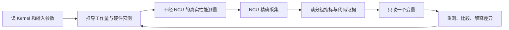

# NCU 系统学习：12 课配套实验总纲（方案 A）

> 定位：与各课目录下 `lec01.md` ～ `lec12.md` 理论讲义配套的**实验课程设计**，不是另一本 NCU 原理教材。前 9 课完成基础闭环；第 10～12 课在同一批 Kernel 上扩展应用采集、系统观测与综合归因。面向具有基本函数、数组与线程知识的大一学生；不要求先读完 12 课再看本总纲，目标中可先提出问题，实际推导所需概念在相关步骤就地解释。
>
> 核心原则：**4 个核心算法、少量受控变体、反复分析同一份基线代码、保留真实 NCU 报告；不为每节课新造一个工程。** 本文所有指标方向均为待检验假设，不表示某张 GPU 的实测结果。

## 1. 学习目标与边界

最终能力不是记住 `ncu --set full`，而是形成一条可复现的证据链：



**覆盖目标：** 前 9 课重点掌握 Launch、Profiler Replay、Occupancy、Scheduler、Warp Stall、Global/Shared Memory、Cache、Compute Pipeline、Roofline、Source/SASS 与指标归因；第 10～12 课复用已有示例学习 NVTX/Python/多进程、通信观测边界以及完整工程报告。

**有意识不覆盖或仅作为扩展：** Tensor Core/MMA 峰值吞吐（需要 GEMM 或 MMA 微基准）、实际 NVLink/IB RDMA/CE/TMA（需要对应设备和更复杂工作负载）、所有架构特定的数千个 NCU 指标。学习“NCU 的各类内容和解读方法”并不等于采遍所有硬件计数器。

## 2. 只维护四个基础 Kernel

**Kernel** 是 GPU 上由许多线程执行的函数；一次 **Launch** 提交创建一个 **Grid（网格）**，由多个 **Block（线程块）**组成。普通 Block 的线程在同一个 **SM（流式多处理器）**上执行；块内每 32 个线程位置组成一个 **Warp（线程束）**，位置编号叫 **Lane**。例如每块 128 线程就是 4 Warp；Grid、Block 是任务组织，不是物理计算核心。

四例都先弄清输入输出，再考虑性能。**FP32** 是占 4B 的单精度浮点数；**FMA（融合乘加）**计算 `x*a+b`，可能是一条机器指令，按浮点工作量通常计 2 次操作。**寄存器**保存线程中间值，**Shared Memory（共享内存）**是同块线程显式共用的片上工作区。例如转置可以先把一个小矩阵块放进去，再换一种线程对应关系写回。

| ID | 算法 / 核心表达式 | 最小受控变体 | 主攻理论 | 主要出现课程 |
|---|---|---|---|---|
| **A** | Vector Multiply（逐元素乘）：`C[i]=A[i]*B[i]` | 连续 `contiguous`、跨步 `stride`，Block 维度、工作集大小 | 基本报告、测量条件、资源预算、访问合并 | 01、02、03、05、08、09、10 |
| **B** | Matrix Transpose（矩阵转置）：`B[j,i]=A[i,j]` | 直接 `naive` → 分块 `tiled` → 填充 `padded` | 全局访存、共享内存访问冲突、瓶颈转移 | 06、08、09、12 |
| **C** | Reduction（归约，多个值汇总）：`sum(x[i])` | Warp 内交换、Block 共享内存协作 | 数据交换、同步等待、代码与指令的对应 | 04、09、12 |
| **D** | FMA 微基准：重复 `fmaf(x,a,b)` | 单串行依赖链、多个独立累加器、控制寄存器压力 | 输入依赖、独立操作、执行路径与资源取舍 | 03、04、07、08、09 |

**为什么不把 GEMM（通用矩阵乘法）加进必修？** **依赖**指后一条操作要用前一条结果，例如不断更新同一个 `x`；**吞吐**是单位时间完成多少工作，而**延迟**是一次操作等到结果的时间。D 比 GEMM 更容易隔离二者的限制；A 和 B 更容易推导各 Lane 的访问地址；C 更容易解释 Warp 级数据交换和同步。对于前 9 课的主线，它们构成更好的最小实验集。完成第 9 课后，可选增加 **E：GEMM（naive/tiled/cuBLAS）** 作为 Tensor Core 和真实数据复用的综合专题，但不改变当前主线。

### 2.1 受控微变体，不算新的算法项目

为了覆盖少数现象，仅允许在四个 Kernel 中增加**非常小、可开关的变体**：

- **A：** 连续/跨步读取；大于 L2 与小于 L2 的工作集。**工作集**是本次访问的数据集合，**足迹**是其覆盖的地址范围：取 100 个元素、每隔 8 个取一个，仍算 100 个，但足迹变大、相邻数据复用条件也变了。必要时加入 Lane 条件分支；**Predication（谓词执行）**用条件控制线程是否执行某条指令，**Divergence（分歧）**指同 Warp 线程选择不同路径。它们只作为第 9 课的微变体，不与 stride 同时改变。
- **B：** Naive 直接访问；**Tiling（分块）**先暂存一小块再重排写回；**Padding（填充）**让 `tile[32][32]` 变为 `tile[32][33]`，每行多一个不作输出的字，改变共享内存的地址映射。**Bank** 是共享内存可并行服务的存储分组，**Bank Conflict（冲突）**是同次服务中同 Bank 不同字需分次处理，第 6 课再手算。保证三版本输出一致，不把布局或边界错误误当优化效果。
- **C：** **Warp Shuffle** 让同 Warp 的线程直接交换寄存器值；Block 归约则可借 Shared Memory 和 `__syncthreads()` 协作。后者是 **Barrier（会合屏障）**：参与线程到齐再继续，并保证相应内存可见性。多 Block 汇总要固定结果语义；可先比较各块生成局部和的 Partial Reduction（部分归约）同等阶段，再做最终归约，不把局部和与完整结果混比。
- **D：** 单累加器依赖链与 4/8 个独立累加器；同时存活指后续仍要用到这些值，通常需更多寄存器。**Spill（寄存器溢出）**是编译器把部分值移到线程私有的 **Local Memory（局部内存，通常由显存承载）**。局部内存还可能来自数组等原因，不能预设一定 Spill。**SASS** 是具体 GPU 的机器指令；用设备汇编器的 `ptxas -v` 资源报告、Local Memory 指标与实际读写指令交叉确认，而不是仅从累加器数量猜测。

补充说明：**Pointer Chasing（指针追逐）**用上次读回的值决定下次读哪里，必须等前一次读取完成，适合隔离不规则内存依赖。它不是前 9 课必需的新项目；若 A/B/D 未清楚暴露等待加载结果的现象，再考虑极小的间接寻址变体。具体 Scoreboard 状态在第 4 课步骤中解释。

## 3. 与 12 篇理论讲义逐课一一配套

### 第 1 课｜NCU 测量对象、Metric、Section、Set

**对应理论：** [lec01.md](01_ncu_basics/lec01.md)；**实验入口：** [lab01.md](01_ncu_basics/lab01.md)。

NCU 是观察 GPU 硬件行为的性能分析器。**Metric** 是带单位与统计口径的指标；硬件计数器记录事件，派生指标再计算比例或速率。**Section** 是相关指标组，**Set** 是多组 Section 的集合。比如 `LaunchStats` 描述启动配置，`SpeedOfLight` 概览资源相对上限的繁忙程度，Raw 页面显示指标原始名字和值。`.ncu-rep` 是工具保存的报告格式，CSV 是用逗号分隔字段的表格文本。某资源的忙碌比例不等于整个 GPU 的有效工作比例。

- **主例 A / contiguous：** 固定数据量、Block Size、编译选项和 GPU；只采集 1 次目标 Launch。
- **先预测：** `N` 个输出、`N` 次乘法、逻辑读写量约 `12N` Bytes（FP32，读 A/B、写 C）；Grid、Block 和 Launch 属性应怎样显示。
- **在 NCU 中依次读：** Kernel 标识、Grid/Block、Duration、Registers/Thread、`LaunchStats` → `SpeedOfLight` → `Raw` 中指标名字、单位、汇总口径。
- **交付：** 一份原始 `.ncu-rep`，一份 Raw CSV，一个指标字典（至少 10 个：名字、硬件单元、单位、聚合、含义），一页自己的解释。
- **验收：** 能说清“一次 Kernel Launch”“硬件计数器”“派生 Metric”“Section”之间的区别；不把 GPU Throughput 百分比当作程序正确性或必然瓶颈。

### 第 2 课｜Replay、Clock、Cache 与测量可信度

**对应理论：** [lec02.md](02_replay_and_measurement/lec02.md)；**实验入口：** [lab02.md](02_replay_and_measurement/lab02.md)。

一次 **Pass** 是采一组可同时观测指标的轮次；**Replay（重放）**为补采而重复执行 Kernel 或应用，例如报告需要多组互不兼容的计数器，就可能多轮执行。**Cache Flush** 主动刷新缓存，`--cache-control none` 表示不由工具主动刷新，不保证天然热缓存；**Clock Control** 尝试控制运行频率，须确认支持与实际状态。**CUDA Event** 是插入 GPU 队列的时间标记，两标记间隔可用于不经 NCU 的 Benchmark（固定输入的重复计时）。**Duration** 是报告对象的耗时，**wall time** 是整个采集命令从开始到结束的墙钟时间，两者覆盖范围不同。

- **继续使用 A / contiguous：** 先运行独立 CUDA Event Benchmark，再采集 NCU Basic、少量 Sections、更多 Sections；保持代码和输入一致。
- **控制变量：** 在受控前提下比较 Cache Flush 默认行为与 `--cache-control none`；明确 Clock Control 配置；必要时对比 Kernel Replay（重复目标 Kernel）与 Application Replay（重新运行应用并匹配目标，要求输入、启动顺序等可重复）。
- **读取：** Duration、总采集时间、Pass 数（若工具提供）、L2/DRAM 相关读数、各次运行变异；区分 `.ncu-rep` 测量时间与整个 Profiler 的 wall time。
- **交付：** 三组或四组 NCU 报告 + Event 时间分布 + 差异原因表。
- **验收：** 能解释“ncu 比普通运行慢”不意味着 GPU 内核本身慢同等倍数；知道为何不可随意混用 Cache/Clock/Replay 条件进行性能对比。

### 第 3 课｜GPU 硬件分层、资源预算与理论 Occupancy

**对应理论：** [lec03.md](03_occupancy/lec03.md)；**实验入口：** [lab03.md](03_occupancy/lab03.md)。

**Occupancy（占用率）**以驻留 Warp 数除以硬件 Warp 上限；**驻留**是资源与执行状态已分配、尚未完成，不等于此刻正在计算。本课只做静态预算：假设每 SM 最多 64 Warp，资源只允许 4 块、每块 8 Warp，则理论值是 `4×8/64=50%`。资源按固定粒度分配，不能只算连续除法而不核对取整；运行中为何没填满以及是否能发射留到第 4 课。

- **主例 A：** 仅改变 `block_size=128/256/512`，保持总元素数和计算不变。
- **补例 D：** 对比少量与较多独立累加器，用于展示寄存器用量增加后可能造成的资源上限变化。
- **读取：** 以 `LaunchStats`（Registers、Shared Memory、Block）和 `Occupancy` 的理论上限、资源限制为主，先按硬件预算手算。现有 lab 中的 Achieved 和 Active/Eligible 观察作为第 4 课的衔接，不在本课展开运行时归因。
- **交付：** 资源预算手算表与 NCU 对照表；如果 A 没有出现显著占用变化，不强行声称实验失败，改用 D 解释资源变化。
- **验收：** 能证明理论 Occupancy 是资源约束结果，不能从 Block Size 或 Occupancy 单独推断性能大小。

### 第 4 课｜实际驻留、Warp Scheduler、Scoreboard 与 Issue/Stall

**对应理论：** [lec04.md](04_warp_scheduling/lec04.md)；**实验入口：** [lab04.md](04_warp_scheduling/lab04.md)。

**Achieved Occupancy** 是运行中的活跃 Warp 计数按指定周期、硬件实例聚合并归一化后的比例，不是总逻辑 Warp 数除以全 GPU 槽位。**Wave** 是 Grid 块数与全 GPU 同时可驻留块容量之比，例如 `400/320=1.25 waves`，不是强制同步批次；**尾部（Tail）**是工作耗尽后只剩少量慢块/Warp 的阶段。小 Grid、进入退出和负载不均可能让实际驻留偏离静态上限；活动周期与全部经过周期的分母、未工作的 SM 如何参与平均，都要查指标说明。

**Scheduler（调度器）**在驻留 Warp 中选下一条指令。**Active** 是已驻留，**Eligible** 是输入和资源条件已满足，**Issue** 是实际提交给执行路径，不是结果已经完成。例如 8 个 Active 中 7 个等数据、1 个就绪，则 Eligible 为 1。**Scoreboard** 跟踪未完成结果的依赖，**Stall** 是下一条指令暂时不能发射：`x=load(a)` 是 Producer（生产者），用 `x` 的加法是 Consumer（消费者）。Long Scoreboard 常指等待 L1TEX（一级缓存、纹理及相关访存路径）结果，Short Scoreboard 涉及其他路径如 Shared Memory；二者不是延迟大小的排名。Not Selected 则表示已就绪但选了其他 Warp。**Issue Slot** 是发射机会，**Issue Active** 通常是有发射的周期比例；它们都不直接表示完成了多少有效浮点工作。

- **主例 D：** 串行 FMA 依赖链 vs 4 条独立 FMA 链；固定执行工作量的比较和“每线程更多工作量”的比较应分开做。
- **补例 C：** Warp Shuffle vs Block Shared Reduction，突出 Barrier/同步与数据交换的不同。
- **读取：** 先对照理论与实际 Occupancy，检查 Grid、启动退出、尾部与负载分布，再读 `SchedulerStats`（Active、Eligible、Issued/Issue Activity）、`WarpStateStats`（Scoreboard、Not Selected、Barrier 等），必要时读 `SourceCounters`（关联源码和指令的指标组）。等待中的 Warp 通常仍算 Active；不能用 Stall 高直接解释驻留不足。
- **交付：** 一张“Producer → Consumer → 等待 → Eligible → Issued”的指令级解释图；两份对照报告。
- **验收：** 解释为什么 `Long Scoreboard` 高不是 DRAM 带宽饱和的充分证据，`Not Selected` 高也未必意味着性能差；优先关心 Issue Slot 是否空转。

### 第 5 课｜Global Memory、Coalescing、L1/L2/DRAM

**对应理论：** [lec05.md](05_global_memory/lec05.md)；**实验入口：** [lab05.md](05_global_memory/lab05.md)。

**Load/Store** 是读/写指令，**Coalescing** 是将各 Lane 的相邻访问合并处理。**Sector** 是相关流量指标常用的固定数据单元，这里按 32B；**Request** 是某层硬件收到的一次访问工作。**Stride** 在本实验指相邻 Lane 相隔多少个元素：`stride=8` 对 FP32 就是相隔 32B。先算地址覆盖，再比同层同类请求；不能把它直接当作 DRAM 传输次数。

- **仅用 A：** 对照 contiguous、offset、strided_read、strided_write、broadcast（仅 b 广播），保持两读一写及 N 个逻辑输出的数值一致。理解访存指标，不以性能优化为主；转置仍从第 6 课开始。
- **当前实现：** [vector_access.cuh](05_global_memory/kernels/vector_access.cuh) 提供本课轻量 host 与地址模式，复用共享 kernel、计时和 RAII；每次编译只选一个版本，不自动扫描。五版及 profile 过滤器均已实现，仅完成静态检查，尚未 CUDA 编译、运行或采集。
- **先预测、再对照：** 手算 N=16/32/33 的 Lane→Address→Sector；扩大规模用 N=262144。接口、容量公式、完整过滤命令和待测表统一见 [lab05](05_global_memory/lab05.md)，静态地址模型不作为运行正确性测试。
- **读取与验收：** 分开 L1TEX Load/Store Request/Sector/Wavefront、L1/L2 与 DRAM 流量；区分 Lane 逻辑字节、唯一输入和分配足迹。广播需分别计算两条 Load，跨步写需看 Store，offset 覆盖不能直接换算 DRAM 倍率。未测观测不填实测数字。

### 第 6 课｜Shared Memory、Bank Conflict 与 Padding

**对应理论：** [lec06.md](06_shared_memory_and_transpose/lec06.md)；**实验入口：** [lab06.md](06_shared_memory_and_transpose/lab06.md)。

常见 Bank 模型将连续 4B 字循环映射到 32 个 Bank，例如地址 0 和 128 都在 Bank 0。多个 Lane 读同一字可广播，不因同 Bank 自动冲突；读不同字才需检查冲突。**Wavefront** 是 L1TEX 内部的服务工作包，不是第 4 课的线程块 Wave。宽访问无冲突也可能需要多个理想 Wavefront，所以应比较实际份数与理想份数，而不是将全部份数都算成冲突。

- **主例 B：** `naive` → `tiled` → `padded`；其中 `tiled` 与 `padded` 除 Shared Memory 行步长外尽量保持相同。
- **先手算：** 32 Bank、常见 4B Bank 映射下，列方向访问 `tile[32][32]` 会造成严重 Bank Conflict，而 `tile[32][33]` 通过改变行步长消除经典 32-way conflict。
- **读取：** `MemoryWorkloadAnalysis` 的 Shared Load/Store Request、Wavefront、Bank Conflict，辅以 Global Memory Sectors 和 Occupancy。
- **交付：** 三版报告、Shared 地址到 Bank 的映射推导、耗时对照表。
- **验收：** 能解释 Global Coalescing 与 Shared Bank Conflict 是不同的限制；Padding 的收益必须与新的 Shared Memory 资源消耗共同分析。

### 第 7 课｜Compute Pipeline、FMA、ILP/TLP

**对应理论：** [lec07.md](07_compute_pipeline/lec07.md)；**实验入口：** [lab07.md](07_compute_pipeline/lab07.md)。

**Pipeline（流水线）**将指令分阶段处理，让多条操作重叠推进。**ILP（指令级并行）**来自同线程的独立操作，例如 `x=fma(x,a,b)` 与不依赖 `x` 的 `y=fma(y,a,b)`；**TLP（线程级并行）**来自其他线程/Warp 可替补工作。两者用于隐藏等待，但受寄存器和驻留等资源限制。**FLOP** 是一次浮点运算，FLOPs 是总工作量，FLOP/s 才是速率；FMA 通常计 2 FLOPs，不能把它等同于 2 条指令。**IPC** 是指定范围指令数除以周期数，需核对 Warp/线程、SM/SMSP 与活动/经过周期；SMSP 是 SM 内组织调度和部分执行资源的子分区。

- **主例 D：** 单链 FMA vs 多链 FMA，设置充足的 Block 数，使运行时间足以稳定测量；避免编译器优化掉循环或将执行工作量改得不可比。
- **先手算：** 每个真正执行的线程 FMA 计 2 FLOPs；换算 Warp 级指令数时，还要计入每条指令实际参与的线程数和每线程 2 FLOPs 的权重；推导串行依赖的完成间隔与多个独立累加器带来的发射机会（具体吞吐因 GPU 架构而异）。
- **读取：** `ComputeWorkloadAnalysis`（FP32 Pipeline、IPC）、`InstructionStats`（SASS 指令种类和数量）、`SchedulerStats`。
- **交付：** 两版对照报告 + 机器指令截图/导出 + 对吞吐变化的解释。
- **验收：** 能区分 FMA 指令数、FLOPs、Issue Active、Pipeline Utilization 与 Kernel Speedup；不把高 SM Throughput 自动等同于有效业务吞吐。

### 第 8 课｜综合性能模型与分层 Roofline

**对应理论：** [lec08.md](08_roofline_and_performance_models/lec08.md)；**实验入口：** [lab08.md](08_roofline_and_performance_models/lab08.md)。

**Roofline（屋顶线）**用计算与访存两个吞吐上限约束性能。**算术强度 AI** 是 `FLOPs/Bytes`，表示每搬运 1B 做多少浮点工作；必须说明 Bytes 是逻辑量还是 L1/L2/DRAM 某层实测流量。若工作量为 F FLOPs、流量为 Q Bytes，匹配的峰值为 P FLOP/s 和 B Byte/s，则计算耗时下界 `T_compute_lower=F/P`、内存耗时下界 `T_memory_lower=Q/B`，单位都是秒。理想重叠下两种限制都要满足，耗时至少取二者较大值，不是相加；等价的性能上界是 `min(P, AI×B)`。例如 A 的逻辑量每输出 1 FLOP、12B，但用 DRAM 峰值时须重新确认对应 DRAM 字节口径。

- **主例 A 与 D：** A 作为低算术强度、相对访存导向参考；D 作为低数据搬运、高重复计算的计算导向参考。
- **补例 B：** 使用 Naive/Tiled/Padded 观察改变访存效率而逻辑算法不变时，模型点如何移动。
- **先手算：** A 的算术强度（按理论读写）约 `1/12 FLOP/Byte`；D 要分开计算**算法理论 FLOPs、SASS 实际执行指令与真正硬件流量**。分别计算 `T_compute_lower` 与 `T_memory_lower`，不要把各下界简单相加。
- **读取：** `SpeedOfLight`、`ComputeWorkloadAnalysis`、`MemoryWorkloadAnalysis`，并对照实际时间。
- **交付：** 计算/内存下界比较表、三组结果及瓶颈假设。可绘制简单 Roofline 曲线，但需明确数据来自哪一层 Bytes、何种峰值假设。
- **验收：** 能说清 Roofline 是上界、不是根因证明；当延迟、Launch Overhead 或有限并发主导时，Roofline 不足以独立归因。

### 第 9 课｜Source、SASS、PC Sampling、Register Spill

**对应理论：** [lec09.md](09_ptx_sass_and_source/lec09.md)；**实验入口：** [lab09.md](09_ptx_sass_and_source/lab09.md)。

**Source** 页面将源码与 PTX、SASS 关联；编译优化会合并、展开、重排，源码行与机器指令并非一一对应。**PC（程序计数器）**指示指令地址，**PC Sampling** 定期记录 Warp 所处位置与状态，用于寻找候选等待点，不是精确测每条指令耗时。例如一条加法等加载结果，样本可能落在加法而非加载处。`SourceCounters` 是相关指标组；Spill 的定义与证据要求见本页第 2.1 节，不以采样热点代替溢出证据。

- **主例 D：** 对比单链/多链 FMA 的 SASS Producer/Consumer 依赖；可增大活跃寄存器以观察资源变化，但 Spill 只在实际出现时讨论。
- **补例 B/C：** B 观察 Load/Store、Shared Memory 和 Barrier 指令；C 观察 `SHFL` 与同步相关指令。
- **读取：** `Source`（CUDA/PTX/SASS 映射）、`SourceCounters`（采样/指令相关信息）、`InstructionStats`、`LaunchStats`（Registers/Local Memory 资源）。
- **交付：** 每种 Kernel 选择 5～10 条重点 SASS 指令，标注作用、依赖、相关 Metric 与 Source 行；若没有 Spill，明确记录“未观察到”而不是虚构。
- **验收：** 能沿 Consumer 追到 Producer；知道 Source 行与 SASS 不是 1:1，PC Sampling 不是逐指令精确耗时，也不等于发生了 Register Spill。

### 第 10 课｜高级采集（前 9 课原样复用）

**对应理论：** [lec10.md](10_advanced_profiling/lec10.md)；**实验入口：** [lab10.md](10_advanced_profiling/lab10.md)。

**Warmup（预热）**先运行以完成初始化等准备；**NVTX** 是给代码区间命名的标注接口，例如把五次目标 Launch 标成 `target`，工具可按范围筛选，但标注不会自行同步。`--profile-from-start off` 则要求程序实际调用 Profiler Start/Stop 才开启/关闭采集，不能与 NVTX 当作同一机制。**Worker** 是参与任务的进程；**CUDA Graph** 预先表示操作及依赖以便重复提交，是有条件的扩展，当前课程尚未实现。

- 将 A 或 D 包装为一个包含 Warmup、NVTX 目标区间和重复 Launch 的 Python/CUDA 程序，练习 `--profile-from-start off`、NVTX、Launch Skip/Count、`--target-processes all`。
- 有条件再尝试 CUDA Graph 和 2 Worker；**不需要引入新计算算法**。
- 核心验收：能够准确证明采集到的是哪个进程/哪个 Launch，而不是看到 `ncu` 输出就以为采到了目标。

### 第 11 课｜通信与异步引擎观测边界（独立选修）

**对应理论：** [lec11.md](11_multi_gpu_communication_async_engines/lec11.md)；**实验入口：** [lab11.md](11_multi_gpu_communication_async_engines/lab11.md)。

**P2P** 指一张 GPU 直接访问另一张 GPU 的内存，不保证使用 NVLink；NVLink/PCIe 是不同互联路径。**NIC** 是网络适配器，**RDMA** 是经网络直接访问远端内存的机制。**CE（Copy Engine）**是专门搬运数据的引擎，**TMA** 是受支持架构上的张量内存异步搬运机制，均不等于普通 SM 指令执行的 copy kernel。**NSYS（Nsight Systems）**观察 CPU/GPU 时间线，用于检查谁在等谁、操作是否重叠；单 Kernel 的 NCU 指标不能单独说明网络或引擎端到端效率。

- 单 GPU 的 A/B/C/D **无法展示真实 NVLink、NIC/RDMA、TMA/CE 的全部行为**，不能强行声称这些现象已经由四例覆盖。
- 如果有两个支持 P2P 的 NVIDIA GPU，只增加一个最小 P2P Copy 实验；比较单卡与跨卡读/写，并使用 NSYS、链路/传输计数器与端到端 Benchmark 补充 NCU。
- 这一课是系统级扩展，不影响前 9 课的基础学习完成。

### 第 12 课｜完整归因验收（复用 B）

**对应理论：** [lec12.md](12_end_to_end_performance_attribution/lec12.md)；**实验入口：** [lab12.md](12_end_to_end_performance_attribution/lab12.md)。

- 使用 B 的 Naive/Tiled/Padded 完成一次完整的“预测 → 实测 → 归因 → 修改 → 复测”报告，再用 D 或 C 验证归因方法能迁移到不同瓶颈。
- 必须报告真实性能、实际 NCU 指标、测量不确定性及与性能模型的差距；不得把假想数字写成测试结果。

## 4. 最小采集矩阵：不要每次都 `--set full`

| 报告组 | 建议 Section | 建议适用课程 |
|---|---|---|
| **Base** | `LaunchStats`、`SpeedOfLight` | 01–12（每次都保留） |
| **静态资源预算** | `LaunchStats`、`Occupancy` 的理论上限与限制资源 | 03 |
| **实际驻留** | `Occupancy` 的 Achieved、`LaunchStats` 的 Grid/Waves | 04 |
| **Scheduling** | `SchedulerStats`、`WarpStateStats` | 04、07 |
| **Memory** | `MemoryWorkloadAnalysis` | 05、06、08 |
| **Compute** | `ComputeWorkloadAnalysis`、`InstructionStats` | 07、08 |
| **Source** | `SourceCounters`、`InstructionStats` | 09 |

注：具体 Section 和 Metric 是否存在，必须以目标 `ncu --list-sections`、`ncu --query-metrics` 结果为准。**此前某次 `.ncu-rep` 没采集的 Metric，不能通过重新打开该报告补出来；应基于同一源码和实验配置另行采集，并记录各报告的采集配置。**

### 通用命令模式（展示采集意图，非现成实验脚本）

```bash
# 1. 首次分析
ncu --set basic -k 'regex:vector_mul' -c 1 -o commands/basic/report.ncu-rep ./app

# 2. 针对访存问题追加采集
ncu --section MemoryWorkloadAnalysis \
    -k 'regex:vector_mul' -c 1 -o commands/memory/report.ncu-rep ./app

# 3. 针对调度问题追加采集
ncu --section SchedulerStats --section WarpStateStats \
    -k 'regex:fma' -c 1 -o commands/scheduler/report.ncu-rep ./app

# 4. 已保存报告的 Raw 页面
ncu --import commands/memory/report.ncu-rep --page raw --csv
```

以上命令分别以对应课程目录为工作目录，**`./app` 不是已有文件**；应换成本课显式编译成功的 `build/lessonNN`，并按实际函数名替换 `vector_mul`/`fma` 正则。输入参数也须与程序真实接口匹配，不能假设存在统一扫描程序。`-k` 按名字过滤，`-c 1` 仅采一次匹配启动，`-o` 指定报告输出；所用 Section 须先查询支持情况。输出动作目录必须先存在，不覆盖被报告引用的旧证据。第 02–12 课目前只预留 compile/run/basic 目录，没有实现这些采集脚本。测量前应确保 Kernel Warmup 与结果检查都不会破坏选中 Launch 的含义。

## 5. 日志怎么读：统一六步法

对任何 `.ncu-rep` 都按相同顺序阅读，避免只看到一个百分比便下结论：

1. **身份核对：** GPU 型号/架构、PID/设备、Kernel Function、Launch 序号、输入规模、编译器与 NCU 版本。
2. **基线确认：** CUDA Event 或等效独立 Benchmark 时间；输入输出正确性、统计重复次数。
3. **工作量核算：** FLOPs、逻辑 Bytes、Grid、Block；需要时推导 Lane→Address→Sector / Bank 映射。
4. **硬件概览：** `LaunchStats`、`SpeedOfLight`，确认资源占用和主要繁忙资源。
5. **深入目标 Section：** 按课读 Occupancy、Scheduler、Memory、Compute 或 Source/SASS，不混用不同级别的百分比。命中率要查按请求还是 Sector、限定哪类读写；Warp 状态要查按样本、周期还是每条指令归一化。例如某状态占 100 个样本中的 40 个，不表示它消耗了 Kernel 时间的 40%。
6. **归因闭环：** 列出“预测 → 实测 → 差异 → 对照变量 → 再测结果”；若观察与假设不符，记录失败假设而不是修改结论迎合数据。

### 每个指标记录的必要字段

| 字段 | 示例（仅示意字段，不填写虚构实测） |
|---|---|
| `metric_name` | `smsp__inst_executed.sum` |
| `source/section` | `InstructionStats` / Raw |
| `scope/unit` | 该例为 SMSP 汇总的 Warp 级指令数；其他指标必须分别查说明 |
| `aggregation/denominator` | `.sum` 表示在指定实例范围求和；比率另记请求数、样本总数、活动或经过周期等分母，不能只记 `%` |
| `observed_value` | **来自实际 `.ncu-rep`，不可预填** |
| `explanation` | 这一值支持什么，不支持什么，如何控制变量验证 |

> 建议逐课积累同一份 `metrics_dictionary.md`，并随实际采集报告更新。Metric 字典比一大堆一次性的截图更有长期价值。

## 6. 统一实验约束（保障可信度）

- **代码一致：** 每次比较记录源码状态、编译器版本、实际 SASS 和输入参数；有 Git 时记录 Commit 及影响结果的未提交修改，本目录没有 Git 时不能编造版本号。`-O3` 开启优化，`-lineinfo` 保留源码行映射；`-G` 生成设备调试代码并可能改变代码生成，不能用其性能代表优化版本。
- **数据正确：** 所有优化版本先验证数值正确与输出完整；Reduction 浮点加法顺序不同可能导致小幅舍入差异，应设合理容差。
- **Warmup：** GPU Context 是运行时维护的执行环境，JIT 是首次需要时即时编译；这些初始化与内存分配尽可能放在计时外。正式采集要明确选中 Warmup 之后的 Launch。
- **统计测量：** 不仅保留一次耗时，至少记录若干次重复测量的中位数与离散度；NCU 的 Kernel Duration 与独立 Benchmark 时间分开记账。
- **单变量：** 不同时修改 Block Size、数据规模、Cache Control、时钟策略和 Kernel 代码；若必须改变，要明确声明结论边界。
- **参数与硬件：** 绝对带宽、理论 Occupancy、FP32 Pipeline 峰值、支持的 Metric 都与 GPU 架构有关。不要把某篇教程中的参数或指标数值当成普适真值。
- **防止编译器优化：** FMA 累加器最终必须影响可观察输出，并核对 SASS；否则循环可能被优化或变形，使实验目标失效。

## 7. 仓库与结果目录：源代码、命令、日志、归因一一对应

实际根目录为 `ncu/`；12 课完整的文档、源码与日志路径索引见 [README](README.md)。

```text
ncu/
├── kernels/                          # 四个共享算法与直白的主机端流程
│   ├── vector_multiply.cuh            # A
│   ├── matrix_transpose.cuh           # B
│   ├── reduction.cuh                  # C
│   ├── fma.cuh                        # D
│   └── common.cuh                     # 仅错误检查与 Event 批量计时
├── 01_ncu_basics/
│   ├── lec01.md                       # 理论讲义
│   ├── lab01.md                       # 唯一配套实验文档
│   ├── kernels/main.cu                # 本课入口：输入、启动、核对
│   ├── commands/
│   │   ├── compile/                   # 编译脚本及编译日志
│   │   ├── run/                       # 普通运行脚本及计时日志
│   │   └── basic/                     # 采集脚本、日志、报告
│   └── build/                         # 各动作共享的编译产物
├── 02_replay_and_measurement/          # lec02.md、lab02.md，同样骨架
├── …
├── 11_multi_gpu_communication_async_engines/
└── 12_end_to_end_performance_attribution/
```

**实现与验证状态：** 各课当前状态见对应 lab，历史验证范围统一见 [README](README.md#本次验证范围)。原始日志保留，不验证改后的源码；第一课旧 Vector Add 记录也不作为当前 Multiply 的证据。

**源码复用：** 四个基础算法只在共享 `ncu/kernels/` 各维护一份，头文件包含 kernel 和简单的主机端分配、启动、核对流程；每课 `kernels/main.cu` 选择本课算法与常量，不复制算法基线。`common.cuh` 仅提供 CUDA 错误检查和 10 次预热、20 次启动的 Event 批量平均时间，不做参数扫描、日志归档或自动采集。第 10 课为精确控制 NVTX/Profiler 范围，单独写清主机流程；第 11 课包含最小 P2P copy，不扩成通信框架。

**记录对应：** 本次修改未编译运行，未生成新实验日志。当前独立脚本与日志布局以 [README](README.md#每课统一骨架) 为准；旧 `source_check.log` 等证据保留在各课 `log/legacy_commands/`，不验证当前模板接口。实验配置与命令随日志记录，预测—观测—归因统一写入该课 `labNN.md`，不为每次执行创建一份实验文档。

**命名原则：** 不建立自动 `log_run_id/`、随机归档或 `history/`。重跑只更新本动作日志，需保留对照时手动明确命名；原有证据不改写。第 9 课可以引用第 5 课的源码与报告；缺少 Metric 时，以一致条件补采，并在本课实验文档说明来源与采集条件。

## 8. 课程推进方式与最终验收

**实验节奏：** 一次只掌握 1～2 组指标；先把 A 的第 1–3 课完成，再用 D 学第 4 课；随后第 5 课只用 A 学访存指标，第 6 课用 B 学转置与共享内存，再用 D 完成第 7–9 课的计算/源码分析。B 在第 12 课做最终综合复盘。

每课必须形成四项成果：① 一份按理论推导的**预测**；② 至少一份真实 `.ncu-rep` 和 Raw 导出；③ 至少一组控制变量对照；④ 一段区分事实、推论与未知条件的中文性能归因。第一课可以把“对照变量”换成不同报告层级的观察，以免过早引入多重变量。

**完成前 9 课的标准：** 面对 A/B/C/D 任意一份 NCU 报告，能够确认采集对象与方法，读懂主要 Section 和指标的统计口径，根据源码预测关键硬件行为，从 Source/SASS 定位相关指令，并且用控制变量而不是单一数字证明瓶颈。至此不需要 GEMM 也能完整建立 NCU 的核心分析方法；Tensor Core 和复杂计算复用放在后续专题。

## 9. 官方资料

- [Nsight Compute Profiling Guide](https://docs.nvidia.com/nsight-compute/ProfilingGuide/)：Sections、Metrics、Replay、Overhead 和 Cache Control。
- [Nsight Compute CLI](https://docs.nvidia.com/nsight-compute/NsightComputeCli/)：Kernel 过滤、报告保存与导出、`--page raw`。
- [Nsight Compute UI](https://docs.nvidia.com/nsight-compute/NsightCompute/)：Details/Raw/Source、Baseline 比较。
- [Compute Triage Guide](https://docs.nvidia.com/nsight-compute/ComputeTriage/)：从概览、计算、内存和调度向下钻取的性能分析方法。
