# MMA 优化分析完全指南

## 当前本地编译入口

原构建入口已迁移为 [commands/compile/run.sh](commands/compile/run.sh)，只编译、不运行或采集。当前 CMake 固定 `sm_89`；环境适用时执行 `CUDA_ARCH=sm_89 bash commands/compile/run.sh`，需要切换配置可追加 `Debug`。可用 `TORCH_PATH` 指向已有 Torch 安装的 CMake 前缀，不会自动安装依赖。日志为 `commands/compile/output.log`，共享产物在 `build/sm_89/Release/` 或 `build/sm_89/Debug/`。详见 [NCU 导航与限制](../README.md)。本次只验证入口语法；下文历史性能叙述和 `misc/*.py` 中的理论计算、记录常量未重新实测。

本节将结合性能分析一步步讲解 SGEMM 的优化，从最基础的版本开始，逐步优化，每一个优化版本都基于具体的代码实现分析优化策略的原理，结合性能分析报告来说明效果。不用担心一开始或者中间的实现不够完善，也不用一上来就抛出一大堆概念，但是需要的是知道每一步实现如何进行性能分析，每一步改进是要解决什么样的问题，到最后得到一个足够优化的实现。[代码仓库](https://github.com/JR-Wesley/CUDApunk/tree/0d2577acf2232b1080792f50e3d22a11a4a4d7b5/mma/csrc) 给了出不同版本的代码实现。

Requirement:
- CUDA 编程和 GPU 架构原理： [CUDA 编程指南](https://github.com/JR-Wesley/Notes/tree/1fe0b955d6223fc9404e1668fa52dd5b8054f0a2/02-AISystem/GPU/CUDA-Programming-Guide) 
- [安装](https://github.com/JR-Wesley/Notes/blob/main/02-AISystem/GPU/CUDA-Programming-Guide/0-CUDA.md#%E5%9C%A8%E4%B8%80%E5%88%87%E5%BC%80%E5%A7%8B%E4%B9%8B%E5%89%8D%E5%AE%89%E8%A3%85) 给出了个人环境配置即需要的工具链。

> 本文内容搬运：
> https://siboehm.com/articles/22/CUDA-MMM
> https://github.com/siboehm/SGEMM_CUDA

> [!info]
> 参考的原文有一些表述不清的地方，代码是不完全的，需要注意辨别。
> - 原文 Kernel 1/2 对于行列索引的处理是不一样的，所以前两节说的就是要保持相同`threadIdx.x`连续的线程处理同一行使得访存合并本文[访存合并](#global-memory-coalescing)只为辅助分析，实际上不需要原文的这么做，只要计算索引时交换即可，见 [kernel 1](#kernel-1-naive-implementation)。
> - 原文 Kernel 3 提出了用 shared memory 减少对全局内存的访问，见 [kernel 2](#kernel-2-shared-memory-cache-blocking)。
> - 原文 Kernel 4/5 都是为了进一步增加计算密度，即增加每个线程的计算量，每个线程处理一个 2D tiling 的矩阵，这个实现其实只是作为对比，本身的意义并不大，见 [kernel 3](#kernel-3-tiling-for-calculating-multiple-results-per-thread)。
> - 最后，考虑最大化利用硬件 warp 级别划分，最终是 block/warp/thread tile 合并。首先对矩阵进行 `BM * BN` 大小的 block tile，每个 block 可以再进行划分为 thread tile，由于 GPU 实际以 warp 为单位调度，再增加一层 warp tile 的层次，见 。这个 Kernel 的实现方式可以基于 tensor core，利用 mma/cutlass/cute，见，这个多层 tile 的原理也可以参考 [cutlass GEMM 优化](https://github.com/JR-Wesley/Notes/blob/1fe0b955d6223fc9404e1668fa52dd5b8054f0a2/02-AISystem/GPU/TensorCore/CuTe/cutlass%E4%B8%8EGEMM.md)。

## Kernel 1: Naive Implementation

> [最原生的实现](./csrc/1_naive.cu)

回顾 CUDA 线程层次结构：

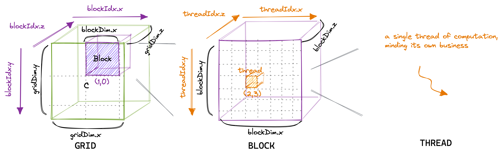

For our first kernel, we’ll use the grid, block and thread hierarchy to assign each thread a unique entry in the result matrix C. Then that thread will compute the dot product of the corresponding row of A and column of B, and write the result to C. Due to each location of C being written to by only one thread, we have to do no synchronization. We’ll launch the kernel like so:

CUDA code is written from a single-thread perspective. In the code of the kernel, we access the blockIdx and threadIdx built-in variables. These will return different values based on the thread that’s accessing them.

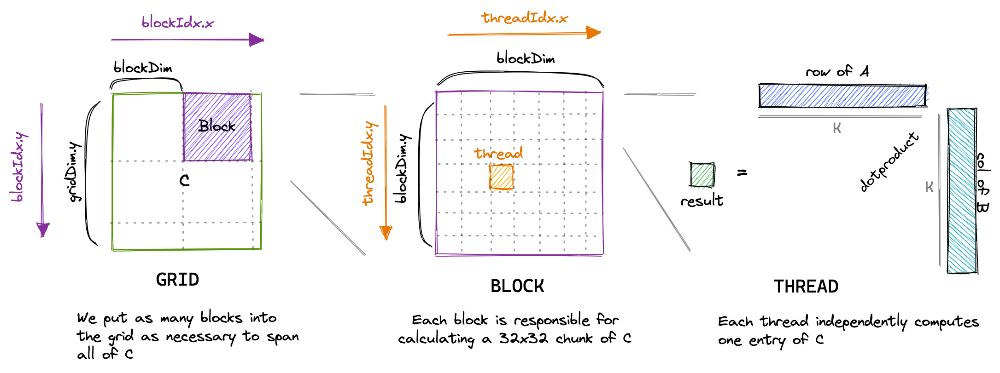

这个 Kernel 的执行方式是：
- 一个线程对应一个 C 矩阵的元素
- 每个线程计算 C[i,j] = A[i,:] * B[:,j]

### 性能分析

#### Roofline

> 计算可见 [性能计算脚本](./misc/perf.py)。

一个典型的GEMM计算是`[M, K] * [K, N]` 大小的矩阵乘法，以 `[4096, 4096] * [4096, 4096]` 大小为例分析：

- Total FLOPS: $(2K-1)*M*N + M*N = 137 GFLOPS$。每个输出矩阵的元素包括 $K$ 次乘法和 $K-1$ 次加法。
- Total data to read (minimum!): $(M * K + N * K + M * N) * 4B = 201MB$
- Total data to store: $M * N * 4B = 67MB$

> 浮点运算次数（FLOPS）的单位换算严格遵循国际单位制（SI）的 1000 进制
> 1 Kilo-FLOPS (KFLOPS) = 10³ FLOPS = 1000 次浮点运算；
> 1 Mega-FLOPS (MFLOPS) = 10⁶ FLOPS = 1000 KFLOPS；
> 1 Giga-FLOPS (GFLOPS) = 10⁹ FLOPS = 1000 MFLOPS；
> 1 Terra-FLOPS (TFLOPS) = 10¹² FLOPS = 1000 GFLOPS；
> 1 Peta-FLOPS (PFLOPS) = 10¹⁵ FLOPS = 1000 TFLOPS（均为 1000 进制）。
> 存储容量（硬盘、SSD、显存）—— 通常用 1000 进制（SI）
> 内存/显存带宽（Bandwidth）—— 使用 1000 进制

> For each of the $M*N$ entries of C, we have to perform a dot product of two vectors of size $K$, involving a multiply and an add at each step. “Multiply then add” is often mapped to a single assembly instruction called FMA (fused multiply-add), but still counts as two FLOPs.

So 268MB is the absolute minimum of memory that any implementation would have to transfer from/to global GPU memory, assuming it has a big enough cache. Let’s calculate some upper bounds on kernel performance. 

> 可以通过 `cuda/samples/1_Utilities/deviceQuery` 或者 `ncu` 查看 GPU 的相关属性。

The GPU is advertised with 11.7TFLOPs/s of fp32 compute throughput and 255.7GB/s of global memory bandwidth. 
- If we achieved those numbers, we’d need 11.75ms for the calculation and 1.05ms for the memory transfers. 

So in our napkin math, the calculation takes ~10x more time than the memory accesses. This means our final optimized kernel will be compute-bound, as long as we end up having to transfer <10x the absolute minimum memory volume of 268MB.

> About roofline model, see also [模拟计算](./misc/perf.py)

> 如果使用 Tensorcore，理论计算时间 xx ms，这样会是 memory bound. This puts into perspective just how fast the tensor cores are.

#### Memory Access Pattern of the Naive Kernel

In our kernel, two threads in the same block with ThreadIds (0, 0) and (0, 1) will load the same column of B but different rows of A. If we assume the worst case of zero caching, then each thread has to load $2 * K + 1$ floats from global memory. As we have $M*N$ threads total, this would result in $M*N*(M+N+1)*4B \approx \ldots$ of memory traffic.

Below is a visualization of the memory access pattern of our naive kernel, taking two threads A (red) and B (green) as an example:

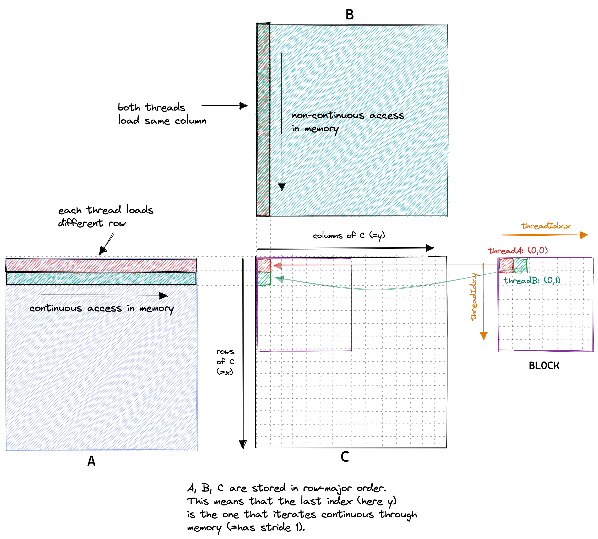

So to recap, when I run this kernel on an A6000 GPU it achieves ~300GFLOPs when multiplying two 4092x4092 float32 matrices. Pretty bad, considering that the A6000 is advertised as being able to achieve almost 30 TFLOPs. So how can we start to make this faster? One way is to optimize the memory access pattern of our kernel such that global memory accesses can be coalesced (=combined) into fewer accesses.

> NCU: > GPU Speed Of Light Throughput

> $$
> \text{Achieved Performance (GFLOPs/s)} = \frac{\text{Total FLOPs}}{\text{Execution Time (seconds)}}
> $$
>
> 实际运行计算得到的算力只有 539 GFLOPs，理论峰值利用率只有 4.6%。
> 计算见 [性能计算](./misc/perf.py)

### Global Memory Coalescing

> [!warn] 
> Before the Volta architecture, it used to be the case that all threads of a warp were fed from the same instruction stream. On a branch, the threads that didn’t take the branch were inactived using the so-called active mask. However, since Volta, it’s no longer a good idea to rely on this ‘warp-synchronous’ behaviour, as instructions from different branches may be interleaved even for the same threads within a warp.

The concept of a warp is relevant for this second kernel, as sequential memory accesses by threads that are part of the same warp can be grouped and executed as one. This is referred to as **global memory coalescing**. It’s the most important thing to keep in mind when optimizing a kernel’s GMEM memory accesses toward achieving the peak bandwidth.

Then, threads with neighbouring threadId become part of the same warp. Below I tried to illustrate this, using a smaller “warpsize” of 8 threads (real warps always contain 32 threads):

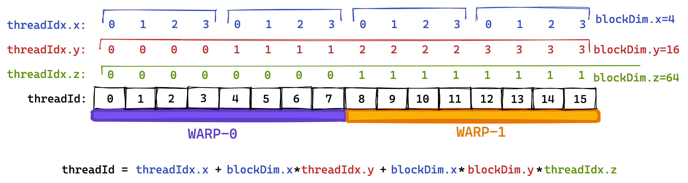

Below is an example, where consecutive memory accesses by threads in the same warp are grouped, allowing each warp to execute 8 memory accesses using only 2 32B loads:

In reality, the GPU supports 32B, 64B and 128B memory accesses. So, if each thread is loading a 32bit float from global memory, the warp scheduler (probably the MIO) can coalesce this 32*4B=128B load into a single transaction. This is only possible if the floats loaded are consecutive in memory, and if access is aligned.

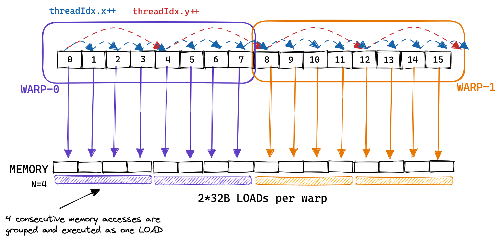

If they aren’t, or if access cannot be coalesced for some other reason, then the GPU will execute as many 32B loads as necessary to fetch all floats, leading to a lot of wasted bandwidth. Profiling our naive kernel, we can observe the detrimental effect of non-coalesced access as we achieve only 15GB/s of GMEM throughput.

Looking back at the previous kernel, we assigned threads their entry of C like so:

```c
const uint x = blockIdx.x * blockDim.x + threadIdx.x;
const uint y = blockIdx.y * blockDim.y + threadIdx.y;
```

Hence, threads of the same warp (those with consecutive threadIdx.x) were loading the rows of A non-consecutively from memory. The naive kernel’s pattern of accessing the memory of A looked more like so:

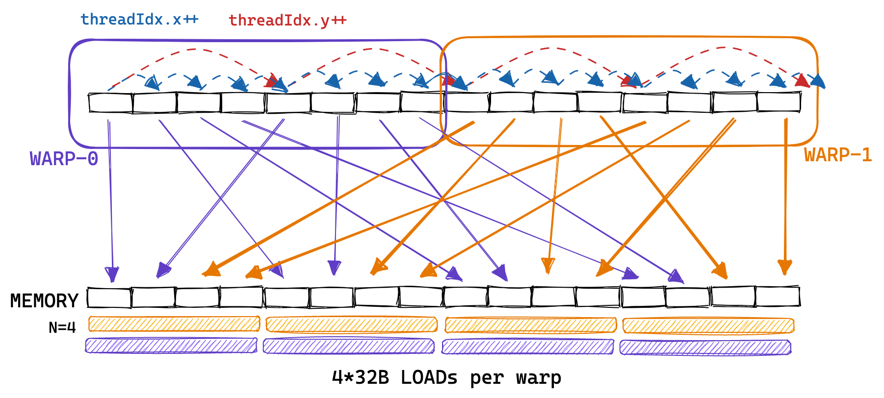

#### 访存行为

> [访存分析](./misc/mem_access.py)

To enable coalescing, we can change how we assign positions of the result matrix C to threads. This change in the global memory access pattern is illustrated below:

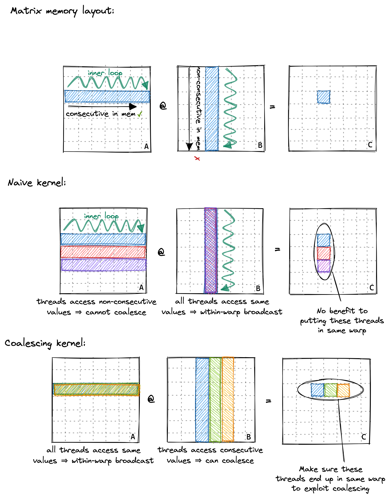

- Layout
    - $A$ 是“按行连续存储”（`consecutive in mem`），即一行内的元素在内存中是连续的；
    - $B$ 是“列不连续存储”（`non-consecutive in mem`），即一列内的元素在内存中是分散的；
    - 这种布局直接影响线程访问内存的“连续性”。
- Naive Kernel:
    - 线程加载 $A$ 时，访问的是“非连续值”（`threads access non-consecutive values`），无法触发“内存合并”；
    - 加载 $B$ 时，所有线程访问“同一个值”（`all threads access same values`），虽能利用“warp内广播”（一个warp内只需一个线程加载，其他线程直接复用），但 $A$ 的非合并访问已导致带宽浪费；
    - 最终计算 $C$ 时，线程的协作无收益（`No benefit to putting these threads in same warp`），整体性能差。
- Coalescing Kernel:
    - 加载 $A$ 时，所有线程访问“同一个值”（利用`within-warp broadcast`，减少加载次数）；
    - 加载 $B$ 时，线程访问“连续的值”（`threads access consecutive values`），触发**内存合并访问**（多个线程的内存请求被合并为少数几个大请求，提升带宽利用率）；
    - 最终要求“这些线程在同一个warp中”（`Make sure these threads end up in same warp`），才能最大化合并和广播的收益。

CUDA中GEMM的优化核心是**让线程对 $A$、$B$ 的内存访问尽可能“合并”或“广播”**：
- **内存合并（Coalescing）**：当一个warp内的线程访问**连续的、对齐的**全局内存地址时，GPU会将这些请求合并为一个（或少数几个）大请求，大幅提升带宽利用率；
- **Warp内广播（Within-warp broadcast）**：若一个warp内的所有线程访问**同一个内存地址**，GPU只需加载一次，其他线程直接“广播”复用该值，减少内存请求次数。

Global memory coalescing increases memory throughput from 15GB/s to 110GB/s. Performance reaches 2000 GFLOPS, a big improvement compared to the 300 GFLOPS of the first, naive kernel. 

## Kernel 2: Shared Memory Cache-Blocking

> [使用共享内存的实现](./csrc/2_sharedMem.cu)

这个 Kernel 的执行方式是：
- 将输出矩阵划分为 block tile，一个 block tile 对应一个 C 矩阵的一块。
- 每个 block 中 每个线程计算一个分块矩阵乘。
- 这个实现中，每个 thread 就负责一个分块矩阵中的一个元素。

> [!note] TILE_SIZE
> 具体的block大小，tile大小，需要根据硬件属性来确定，以得到最佳occupancy，见后。

Next to the large global memory, a GPU has a much smaller region of memory that is physically located on the chip, called shared memory (SMEM). Physically, there’s one shared memory per SM. Logically, this shared memory is partitioned among the blocks. This means that a thread can communicate with the other threads in its block via the shared memory chunk. As the shared memory is located on-chip, it has a much lower latency and higher bandwidth than global memory. 

> Sharemem 的带宽 NV 没有直接给出，只能推算。

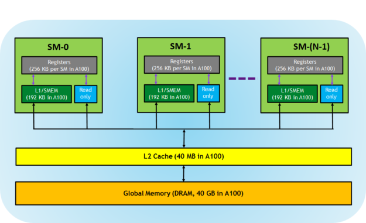

So for this next kernel, we’ll load a chunk of A and a chunk of B from global memory into shared memory. Then we’ll perform as much work as possible on the two chunks, with each thread still being assigned one entry of C. We’ll move the chunks along the columns of A and the rows of B performing partial sums on C until the result is computed.

This is illustrated below:

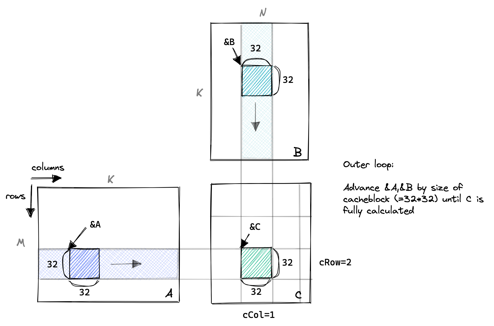

> NCU: > GPU Speed Of Light Throughput

> 性能达到 ~850 GFLOPS，是 naive kernel 的 50% 改进。改进不多，主要是因为 naive kernel 已经有了不错的 L1 缓存命中率。这个实现还远未达到理论峰值利用率。下面是原文的 roofline 模型分析：

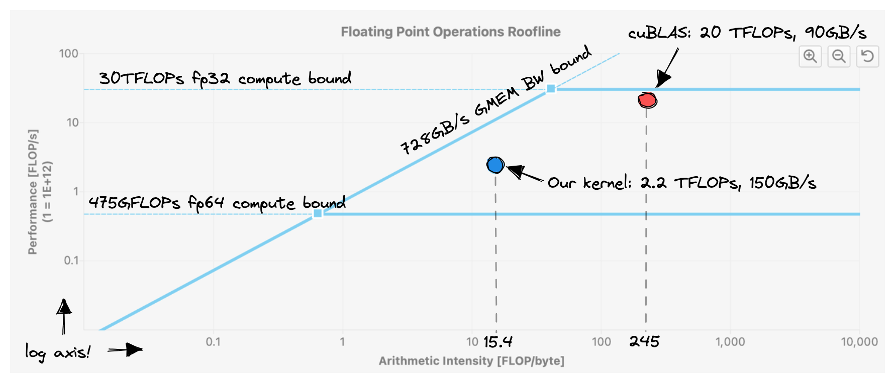

At a CHUNKSIZE of 32, this uses $2*32*32*4B=8KB$ of shared memory space.

Share memory 的使用信息可以通过编译获取 `--ptxas-options=-v`, which outputs: Used 37 registers, 8192 bytes smem, 400 bytes cmem[0]，这个大小没达到限制。

This is not necessarily a problem, as there are downsides to increasing per-block shared-memory usage. Each multiprocessor (SM) has a maximum of 100KB of SMEM available. This means that if we’d modify our kernel to use the full 48KB of SMEM available, each SM could only keep two blocks loaded at the same time. In CUDA parlance, increasing per-block SMEM utilization can decrease occupancy. Occupancy is defined as the ratio between the number of active warps per SM and the maximum possible number of active warps per SM.

High occupancy is useful because it allows us to **hide the high latency of our operations**, by having a bigger pool of issue-able instructions available. There are three main limits to keeping more active blocks loaded on an SM: register count, warp count and SMEM capacity. Let’s do an example calculation for our current kernel.

- 占用率是一个有用的指标，它受硬件资源限制。

> On GPUs, math operations like FMA have a latency of 4 cycles which is equal to 2.6ns at a 1.5GHz clock. Compare this to a recent x86 CPU, where FMA has a 6 cycle latency or 1.8ns at a 3.5GHz clock. 

### Occupancy Calculation

> CUDA 设备属性查询：https://docs.nvidia.com/cuda/cuda-runtime-api/structcudaDeviceProp.html#structcudaDeviceProp

> NCU: > Device Attributes

> 这里参照原文数据分析

| Resource | Value |
| -------- | ----- |
| max threads per block |	1024 |
| max threads per multiprocessor |	1536 |
| max regs per block |	65536 |
| max regs per multiprocessor |	65536 |
| max shared mem per block |	48 KB |
| shared mem per multiprocessor |	102400 B |
| max warps per multiprocessor |	48 |

> Surprisingly, there’s more space in the register file than in shared memory! Each block can use max 48 KB of SMEM, but 65536*4B = 262 KB of register space.

And here are the resource demands for our kernel:

| Resource | Value |
| -------- | ----- |
| Registers per Thread | 37 |
| SMEM per Block | 8192 B |
| Threads per Block | 1024 |

> 这里是近似计算，和实际运行情况不一定相同。

Work is scheduled onto the SMs on a block granularity. Each SM will load more blocks, as long as it has enough resources to accommodate them. Calculation:

- Shared memory: 8192B/Block + 1024B/Block for CUDA runtime usage = 9216B/Block. (102400B per SM) / (9216B per Block) = 11.11 ⇒ 11 Blocks upper limit.
- Threads: 1024 Threads per Block, max 1536 threads per SM ⇒ Upper limit 1 block.
- Registers: 37 regs per thread * 32 threads per warp = 1184 regs per warp. Register allocation granularity is 256 regs on a warp level, hence rounding up to 1280 regs per warp. We have (1024 threads / 32) = 32 warps per block, hence 1280 regs per warp * 32 warps per block = 40960 regs per block. Max 65536 regs per SM ⇒ upper limit 1 block. 

So this kernel is limited by the number of threads per block, and the number of registers per thread. We cannot load more than one block per SM, giving us a final occupancy of 32 active warps / 48 max active warps = 66%.

- 资源瓶颈：线程数和寄存器数量限制了 SM 只能同时加载1 个 Block（共享内存的 11 个上限未被利用）。
- 占用率计算：SM 最大活跃 Warp 数为 48，1 个 Block 含 32 个 Warp（1024 线程 ÷32 线程 / Warp） → 实际占用率 = 32÷48≈66%（反映 SM 资源的实际利用效率）。

### 性能分析

#### Occupancy

A 66% occupancy is not too bad, so this doesn’t explain why our kernel runs so slow.

在分析文本前，需先明确3个GPU性能优化的核心指标，这是理解后文的基础：

| 术语 | 定义 | 核心作用 |
|------|------|----------|
| **Occupancy（占用率）** | GPU中“活跃线程束（warp）数”与“硬件最大支持线程束数”的比值（如66%表示当前活跃线程束是硬件上限的2/3）。<br>本质是**线程并行度的利用程度**。 | 传统认知中，高占用率可掩盖“内存延迟”（通过多线程切换，让GPU在等待内存数据时不空闲），但并非所有场景都需要高占用率。 |
| **Arithmetic Intensity (AI，算术强度)** | 内核执行的“浮点运算数（FLOPs）”与“内存访问字节数（Byte）”的比值，单位是 **FLOPs/Byte**。<br>本质是**“计算密集”与“内存密集”的衡量标准**。 | AI决定了内核的瓶颈类型：<br>- 高AI（如cuBLAS的~245 FLOPs/Byte）：计算密集（GPU计算单元忙不过来，内存数据足够）；<br>- 低AI（如大量内存加载、少量计算）：内存密集（GPU计算单元等内存数据，内存带宽是瓶颈）。 |
| **Peak Throughput（峰值吞吐量）** | GPU在理想状态下的最大性能（如峰值计算吞吐量：TFLOPs；峰值内存吞吐量：GB/s）。<br>实际性能需看内核是否能“喂饱”硬件（计算单元或内存总线）。 | 判断内核是否充分利用硬件能力的基准——若未达峰值，需定位瓶颈（是计算不足还是内存太慢）。 |

- 观点：66%属于中等偏上的占用率，已能有效掩盖大部分内存延迟——因此“占用率”不是当前内核慢的原因，需排查其他因素。
- 论据：cuBLAS 是GPU计算密集型内核的典范，其AI高达~245 FLOPs/Byte——意味着每读取1字节内存数据，能进行245次浮点运算，**计算量远大于内存访问量**，此时GPU计算单元会被充分利用，性能接近峰值。“无论AI极高还是极低，都不需要高占用率就能达到峰值吞吐量”（结合Volkov论文的“尖点行为”）。
- 推论：当前内核可能是“低AI”（内存访问太多、计算太少），因此优化方向是“提升AI”（如减少冗余内存访问、增加计算密度，让计算量匹配内存带宽）。

这是GPU性能优化的关键结论，需结合“AI与瓶颈的关系”理解，背后是NVIDIA研究员V. Volkov在PhD论文中提出的“cusp behaviour（尖点行为）”——即GPU性能与占用率的关系，会随AI的变化呈现“非单调”特征，根据 [V. Volkov’s PhD thesis](https://www2.eecs.berkeley.edu/Pubs/TechRpts/2016/EECS-2016-143.pdf) ，核心逻辑如下：

| AI类型 | 内核瓶颈 | 为何不需要高占用率？ | 例子 |
|--------|----------|----------------------|------|
| **极高AI（计算密集）** | GPU计算单元（而非内存） | 此时计算量远大于内存访问量，GPU计算单元一直处于“满负荷”状态，即使占用率不高（如50%），计算单元也忙不过来，性能已达计算峰值——高占用率无法进一步提升性能（因为计算单元已成为瓶颈）。 | cuBLAS矩阵乘法（AI~245）：即使占用率80%，性能也和95%占用率几乎一致。 |
| **极低AI（内存密集）** | 内存带宽（而非计算） | 此时内存访问量远大于计算量，内存总线已跑满（达内存峰值带宽），即使占用率低，内存也无法提供更多数据——高占用率无法让内存更快，因此性能已达内存峰值，再提升占用率无用。 | 简单内存拷贝（AI≈0，仅加载/存储数据，无计算）：占用率30%和90%的内存吞吐量几乎相同。 |
| **中等AI（混合瓶颈）** | 计算与内存的“平衡瓶颈” | 此时需要高占用率：内存延迟无法被低占用率掩盖，计算单元也未跑满——需通过高占用率（多线程切换）让GPU在等待内存数据时，用其他线程的计算填充空闲时间，从而提升利用率。 | 部分图像处理内核（AI≈10-50）：需80%以上占用率才能接近峰值。 |

Volkov的“尖点行为”正是总结了这一规律：只有“中等AI”场景需要高占用率，而“极高/极低AI”场景中，占用率对性能的影响极小——这也解释了“66%占用率不低，但内核仍慢”的可能：当前内核可能是“中等AI”，但66%占用率仍未达到“平衡瓶颈”所需的阈值？或更可能是“低AI但内存未跑满”（需进一步分析）。

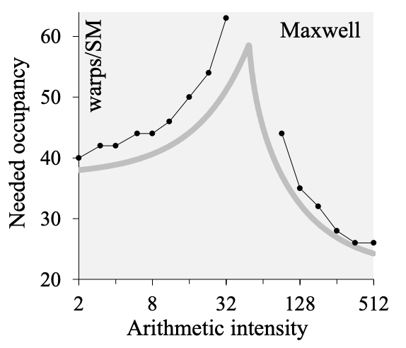


#### NCU Profiler

Looking at the profiler gives us some hints. First, if we look at the mix of executed instructions, most of them are memory loads:

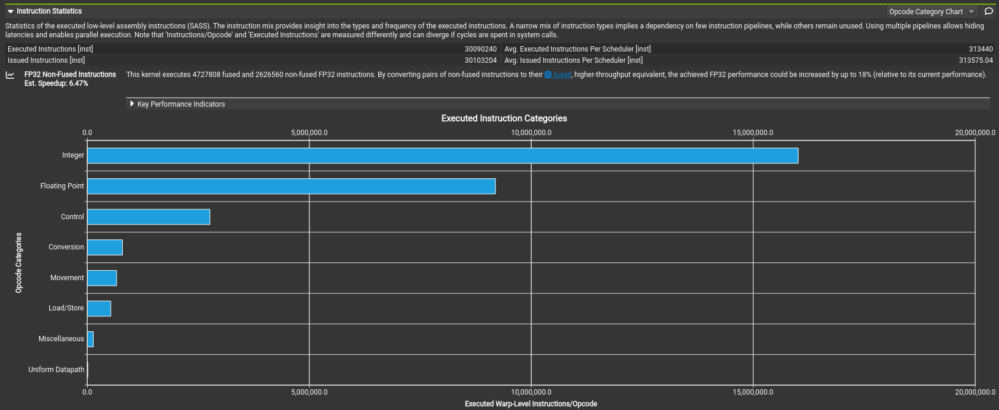

Our inner loop looks like this in PTX ([Godbolt link](https://godbolt.org/#z:OYLghAFBqd5TKALEBjA9gEwKYFFMCWALugE4A0BIEAZgQDbYB2AhgLbYgDkAjF%2BTXRMiAZVQtGIHgBYBQogFUAztgAKAD24AGfgCsp5eiyahUAV0wtyKxqiIEh1ZpgDC6embZMQAVgBs5M4AMgRM2AByngBG2KQgAMwA7OQADuhKxA5Mbh5evgFpGfZCIWGRbDFxSdbYtsVMIkQspEQ5nt7SyTbYdlmNzUSlEdGxCV1NLW15ndYTg6HDFaNJAJTW6GakqJxcAKQATPGhqB44ANS78S4SwGTESGyXuLtaAIIHR0wnFtgXV6hKIiEdBPF7vQ7HU6/S4uAFA%2BgEKKgt4fSE/P6wsxRIxKAD6ADd9gA6JDI8Gfb7nGHmSy40hmYQEDgkslgj44OhhM4uXAASSCuIAIryAGoQACy5DO4RWZyg4tlBwAQnKZQBaHiygD0qpWbLeuNxwHo6CiEkNZ3x6AImDOSmA2DYbFxSiQzWwmFxHGd2PQqAA1hBQkQzpKzsHpVKIwBpKU0E0sEMSFJu8hgs4ZzNZ7M53N5zMYJiAs7x9CJs4AKleUsLxdL5YrSrTb3zrbb%2BfrIZiTTjCZDFZcisSSvTZ1rIYjSqCAHkXNGRLyAFrPeKC%2BL7S4jlsXbdanVEJC/DZEFJmLsmgNnA/lgDuvxvxhDJDH6DYp6Iv1CV6QBCU39I2AsJgvoBqO45nGYEaoAASugN5/IKZwgf6vKYOoRLqJuYFCMWkHCGOOQIUhF4oWhRIAJ5YSiu46hIF6Jr8URmDQNCxCWZBjpsAH4ch4ZMCWLDFq67q2t6o57naboAaJjrhn%2BwnSUh2BEHezBnHR/6AZgf5fiwxF%2Bv6o6GgpHoWp2ZyvEouw%2BEqU6zvOS64JWZx2XOC7LtZgpUa8GbGVJpm4iWfYuVZNmuQ5y7OeF7nPD4XnxFu7w0d%2Bn5MGEpBnKQcEXPsfgvvQ363tgYBcAB6moNsSgZCYfHfr%2BmlAdhRYhnhT5IABQGEZciEHh1mCoeh6g5T4Lkzm5jneRm4GtQ1mCwfB3WzQNGFnDq0UTQl%2Bo%2BattGYPixjbGcaTBrEf7PgevyAgMoTAEd6SZDho4%2Bcqi0wdlFajfZMXOdGm7tnmElZTe3VvTeNbuN1WijiqL2rgR7hRWNEUriq/2toDcGQ%2BD9Agzko4uDlI5w6DiNfY5znhIT8MFR960eQlO2ZZjq6g9juMQ9R23mUQb5EVoRJQ5t26CBlQY8aRQ2LYLKpRBLGJnL9DOywNhOLXTuBDolWYSQAEiw%2BK/IBqBILNZwJraQhHjQKVnLUjrMEQOn8c9uUuaOGYSeKLD%2Br8F2zYREDdb1WnLeosp%2B7WPRngQBt8TgmHbh7%2B7oOp9AmvBxqmhIZzemQ5HlZVf4YBI2BKKgN3uxZoVKsHQHzaT42Rcq/sQ3FRHvDZtdze9CtU13eNxZNmZKtXXf17TSPfc3/et4havWTX7VaeP0p90vnWz95lcSbxXdO3Vf68Qy9gFeIxufn%2BNBmGn%2BdpKeRgfpglfGeRXx7xAepC9tGYu0TiHq0PDMMN9h/0%2Bo3JyH1whb0TozbA6go4fhtpgdAJ4sqYDMHYM4QgbbmFINxIg9B85n0PLaZClcRZygjMgogKspZ/WobQq4YDkZ/ReiAhhaFNaVwzDzFIqs4aWQXmPHu6sqYcMwm3Cs3C8wjwXuIhuyM159QHvFLWmZdiJC8jAiSYQPRXhTkoV%2BqB1LABYLpNqhsmCYClM%2BfW1pbQ0EEh%2BDKe9t46lYkQY2N0bZhHUOeAyfFzqHjHCwc%2BSkRaXXTmxPe6kyrILCM/F0Rj36fzURorR20XBCPXt3eCkClFaRUQhaRyY3TOV4VTbsekPpZM7jklelNp45JUVvTRXA1j0G4D4fg3guA6HIOgbgLgFCCh8lkkBzclAbC2NCQ4fByBEG0O0tYh4gKjA/uQf0vgtCGG4NIHpSyBncH4EoEAOzFl9PaeQOAsAUAYDfAwWIlBqD3JSI8uITB8QVR4DwZIOB8QEG2CKAg2AbzThSMwQ5dB6DONORAKIhyoihGaORbg8z7kcGENOJghDDk4DYMYY0Ox%2BmEAAr0A2pzLmBHgeYD8aL%2BAnU6VShEURSAorcDgQ5RBSBMnpWseMLBgBKGBaC8FkLeD8EEMIMQJcpCyClYoFQGhDn6H2IYQlaALBWBZacyAax0ApHqJSk5dteiOAgM4KY3geCBCsUMcolQDCFAetkdw7QnX3XqPakYcQbXdDNQ0OYVqDD%2BvqP0Fo3qli%2BtmAMYNfq5iRsdZqdYmxthSA6V0g5VLBlcGlCKFwBMflEkSALOU%2BBiAcQ%2BJqfgFydArBWVpdZawtk%2BB2Uy/Z5Ben9JzScs5Cyln1t2VwfY/A2AgGkPzPwPhEgAE5DhaH2IkeIWgfAzp8D4Tthye39suWsG5yAQD/MBdgZ5EBXnvPCOwHY4R82Fp4MWgW/APQVp5ZgAwCqZWSBkHIYQyg1CaCpaqmodQshOCscG6QAAOW1mBE2jB4D4G1zr6hxtSJ6rIcHfXSBncBnoYag1uumNB0NfQE0LAdfBxDMbJiEetdR%2BYZQfVypnWsbl2BsA2jORmrg3TN3Zu4IKbAALDoirvBlG9BazhFpLVoMthASAZSrVKNwDzGCKcOPsFYNaB0NrWXEDZWyeBaDbXs0dvgZ1EniNIfYWhEh%2BBnYkXKM6J2yC7fwbdpzzk6c2VIYzQ74hZu7ccndda1gG1IBkRw0ggA%3D)):

> NCU: > Instruction Statistics > Executed Instruction Mix

```
ld.shared.f32   %f91, [%r8+3456];
ld.shared.f32   %f92, [%r7+108];
fma.rn.f32      %f93, %f92, %f91, %f90;
```

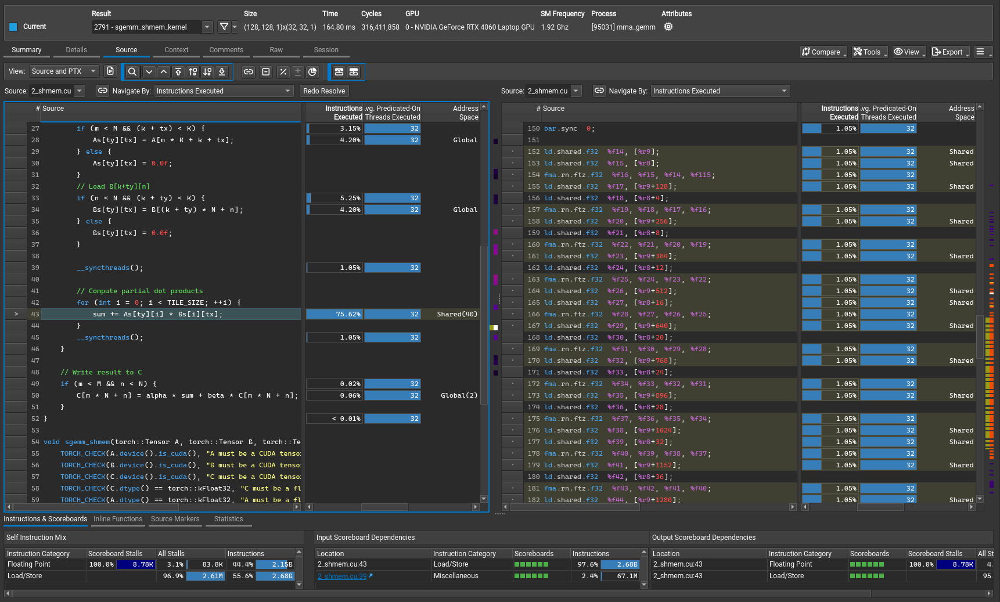

That’s not good, given that a memory load is bound to have a higher latency than a simple FMA, and given that we know our kernel should be compute bound. We see this effect when looking at the profiler’s sampling of warp states. This quantifies how many cycles were spent in each state per executed instruction:

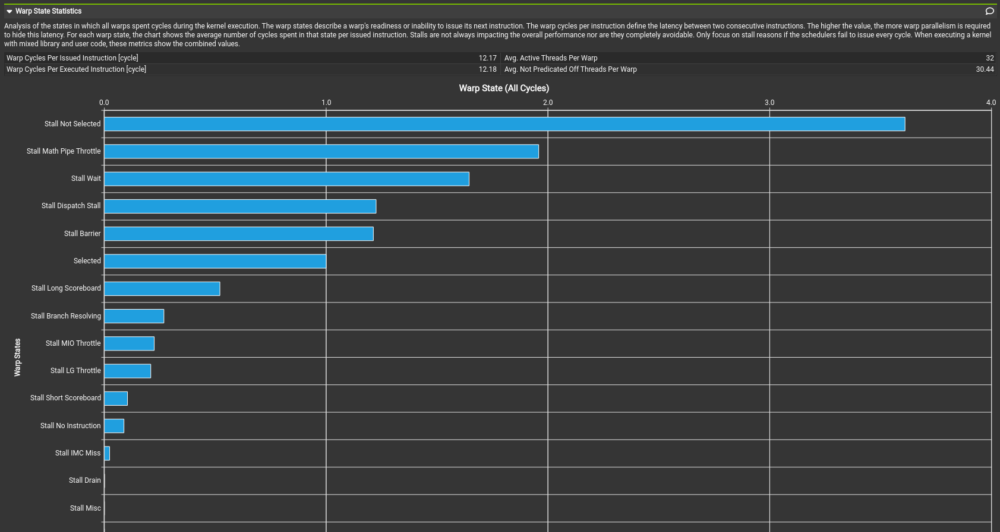

> *Stall Not Selected* means that the warp was eligible to be scheduled, but the scheduler selected another eligible warp instead. This adds evidence to our earlier hypothesis that occupancy is currently not a problem.

The meaning of the states is documented in the [Kernel Profiling Guide](https://docs.nvidia.com/nsight-compute/ProfilingGuide/index.html#metrics-reference). For Stall MIO Throttle it reads:

Warp was stalled waiting for the MIO (memory input/output) instruction queue to be not full. This stall reason is high in cases of extreme utilization of the MIO pipelines, which include special math instructions, dynamic branches, as well as shared memory instructions

We’re not using special math instructions, nor dynamic branches, so it’s clear that we’re stalling waiting for our SMEM accesses to return. So how do we make our kernel issue less SMEM instructions? One way is to have each thread compute more than one output element, which allows us to perform more of the work in registers and relying less on SMEM.

**定位真实瓶颈：内存访问（尤其是共享内存SMEM）拖累性能**，通过**指令占比**和**warp停滞状态**两个维度锁定问题：
- **指令占比失衡**：核函数的PTX指令中，共享内存加载（`ld.shared.f32`）占比远高于计算指令（`fma.rn.f32`）。而内存加载的延迟天然高于FMA运算，导致“本应是计算密集型的矩阵乘法，实际变成了内存密集型”，偏离了GPU的设计优势。
- **warp停滞原因明确**： profiler显示“Stall MIO Throttle”（等待MIO指令队列空闲）占比高，且排除了“特殊数学指令”“动态分支”的干扰，可确定是**SMEM访问过度占用MIO流水线**，导致warp频繁等待内存数据，无法持续执行计算。

**针对性优化方向：让单个线程计算更多输出元素**
核心逻辑是“减少SMEM访问依赖，提升寄存器利用率”：
- 若单个线程只算1个C矩阵元素，需反复从SMEM加载A、B矩阵的片段；若让单个线程计算多个C元素（比如后续Kernel 4的“1D分块”），可将更多A、B的中间数据暂存到寄存器（延迟更低、带宽更高），减少SMEM的加载次数。
- 本质是通过“增加单线程的计算量”提升算术强度（AI），让计算指令占比追上内存指令，把核函数从“内存瓶颈”拉回“计算瓶颈”，充分发挥GPU的计算能力。

> 矛盾点与结论：若内核是“低AI（内存密集）”，理论上应达到内存峰值吞吐量（如前文所述，低AI无需高占用率），但实际却运行缓慢——这意味着当前内核的**内存访问效率极低**（并非内存带宽不够，而是存在“冗余内存访问”，如重复加载同一数据、非合并内存访问等），导致内存带宽未被充分利用（明明是内存密集，却没跑满内存峰值）。

## Kernel 3: Tiling for Calculating Multiple Results per Thread

> [使用分块计算的实现](./csrc/3_tiling.cu)

### 1D Blocktiling

要提高 AI，那么首先我们改进，让原先一个线程计算一个元素，改进为计算一列，

So this next kernel works like our last kernel, but adds a new inner loop, for calculating multiple C entries per thread. We now use a SMEM cache size of $BM*BK + BN*BK = 64*8 + 64*8 = 1024$ floats, for a total of 4KB per block. Below a visualization. I have highlighted two of the threads and the values they access in the inner loop in orange and red.

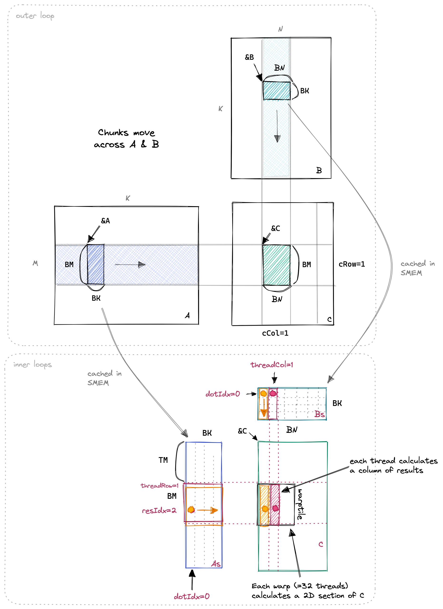

[原文源码地址](https://godbolt.org/#z:OYLghAFBqd5TKALEBjA9gEwKYFFMCWALugE4A0BIEAZgQDbYB2AhgLbYgDkAjF%2BTXRMiAZVQtGIHgBYBQogFUAztgAKAD24AGfgCsp5eiyahUAV0wtyKxqiIEh1ZpgDC6embZMQs5wBkCJmwAOU8AI2xSEAB2LXIAB3QlYgcmNw8vHwSklKEAoNC2CKjY62xbeyERIhZSInTPb1kbbDtU6tqifJDwyJi4pRq6hszmoa7AnqK%2B2IBKa3QzUlROLgBSACYAZkDUDxwAajWtlwlgMmIkNmPcNa0AQU2dpj2LbCOT8SUVOpu7x%2B2u3272OLlQg0I6D%2BDyeQLeHzBEPoBDC0IBz1eh1B5jCRiUAH0AG4bAB0SDRsJewIR5ks%2BNIZmEBA4ZIpMO2ODoQQOLlwAEk/PiACJ8gBqEAAsuQDsFZgcoBK5ZsAELy2UAWh4coA9GrZv9/vj8cB6OgwhIjQdCegCJgDkpgNg2GweEKAOq1eIAFQYgWAEECRAOUoOgZl0rDAGlpTRTSwgxJ4kgrP8Dmn0xnM1ns1mMExBgdY%2Bh4wcAFT3aV5gtFkul5UxuNBiI1cipnPtjtZmtB0suJXRZUGh5pqtBsPKiUfIUHABs0mOg%2BHB1HoeEB2VwSns/nW0X9xHQgL48jW4AHAu2yuw17J8dp%2Bfd23tbq%2BTQDgB3d6xgjxA7qA7GHaACeBxIJE7yfgcjpBgAflsWibAArAcjDfAc8SRIIpBsMYKyFmQKG1I6Bw4UQpAECsSgkk%2BupemBy5LKQzBENK8FIYWLCDJEy5CHQwBLPGqQHMwShLNgSgHEQyZNqaqAANYSe%2Blz2tgACOZjMQQEg0QcuLoPJfJChJLCoJREkYBk%2BYHOgb6qio6maRI9BAdK75IAw7xKMm5EmJJ9FKOw7ykOg77WW%2B9zUUuz4HHRnmmp%2BpA8UwfECZUTAfos9B2l5tTvBZjQSTZBwVrpZgJqZ4kSYG6DrhlZhZTpEQHEwQjqvZGlMhIJIHCINVSV%2BnFENxeYpaQglCKBnG6dgRBDYlSjxIJEgofpEjEEBOmAaBzB4SwUFMfG3F%2BBsoHEAcY1DZF%2B5JQWZhhqgABKIVbnpBmYOoJIbY%2BS4rnda6oOkL2yXJfLvSS6gXjCP2HkGf1BiQNT0A94n1UQSjKsD9iMFuE5luuwSQ9d0X7lJB12gQElMQth4otjWHLhI5hGPYvk3sJjAcMIVXpf1umYx5l4wwccPNZ4dFk%2Bj/PY3eknoIjyOifQaMY/pclY%2B8tESoTOkK6jSiqJEKvyQcuq60r%2BuROL2AsHad4y1bNsW6QRtyW2nE/EQEBMGLSASy76tTjLr1yUKzLg/q32PFFurW6gSAfp6H4MPQDP0Ezh0HFsGylmz5ROsxSiucpWfTX6fl5e4jS1AchBsFdB75mOa6k9brjuFuLc26DH3/uxG6Ew3R7N77rdPaFMud5g3fgyb%2BPa9HAH0LJGcLSZX4Ebz5ikExa7BwHgQ9RKuBa0uRo5UxmCWt2xVKGsiHKrjpbrpGd9CgPBxn952CX/ihaNuut977KhPE/fuiE36Rx0hKdAhJ3h7w8rLaawBAhMDLkVe4YAuCU2eltZUmDzKVy8G2fcKoZaPWeqAycT8X6RzTKqUhWxpwA3bqAgmtCeRHA2IORhy4x540fjKThqpmEp1YfPImuoSCYHQCAACmBdBmALFJCmiDY7x0noguMdo2Cox/NjZi5FxIASYJgRqM05rCXUPEU0Z1N4mX8gQAAXuJN23xIiewEcAwOPDg6hzruoCOe40zu3cRADc/CTx2x8cDPx4d36/TDCgyI6QSE8MntPXuGxkLAIXCbXU75PTqkYLAlOABxI%2Bk4MASHEqgP0gtG7C0SUwIIpAx6pOnOksG/5dQ5PYQktcSTSDpHoWkkeXcumcOyWw1U0UCmkHiEU7AJSDjlOPjxapShakmHqbdJpLSx4jI6WMqeEyenTKHBIxey8hp%2BTJkU1aKdxBx3XolKmetVznWwMgripA6CMDbNfSeZs0Z32VDeV%2BW41gDi0CSBC0QIF7h0osCxpp0C/hgdxYOkkPK3yXPTCAIswgg3eluBCu5dLEt7icA4NDVREu7kImWwD%2BxBPTNFRI8R6oZ15iICpDNnm4uumme4gDlSDLaREoRq4WkpIhTLR499xUhX3NQqVgzZXgPfnQ0VSr3yqlYWq5pyT3CDnATjUFur9WCJVNK419BTUIrbGmM%2BQEXiTyUBAQJFyMzRRtoSXCcCpbYCdcVRlPDemsroWG6cXin7nKhkKvJqd043IwqQdUGi3nmxDfikW0iiAMplmS1U%2BbC3UojYyrhpb3ospDWmWZ7wcJyXeLzfN8RgqYDMHYFaaLy7WTKskQ4qL4iuXcnHDitTkQ1CGoKrM0UmKKPeEVXmyoJIGJch%2BMd8dILiHSk8%2BiB89pEDYL%2Bf1pB66ZkBSenGorq3/gNTaye6RX5avTLmsMVMy3TmLZ8pQZaXAxS1uS0hXDP01qOAOOt6YgUo2zffMDEMzUMLfkuDsIrQUQCBRQwDUqENylAZErhNc5bdwhU/Y98RX1pihShxNNGQ0urdccj1Xqlz0YTfW/J5EbnIr7VmkFeKCIEo/eJL9Bwf0IYRIB3JIHlR4Yg5GnkGGsOhSfmzG18m41Sqfe4OVjCoPBPoEmPa5HjnAtFQhuVXCDPTRqHjFwymzPYfU0RzT1qiM6foC%2B9h7HHjwq4PMeg3BEL8G8FwHQ5AZFcBcAoIU%2B4HPWaI0oRYywQTbD4OQIg2gAvzDAjbPonryByRAIhOIQWuDSH4GwHw0gSSnnq1sGcTWNjRGkAATliHOcgYWItRf4EoEAcQsvhYC%2BQOAsAUAYBPR5CgVAIBTfiDNkATBCSmR4DwaI5AcCEgotgUUBBsDvgAPIYR6/wP5c0BsQDCNl8gYRAi1CAtwDLU3OZECO0wZyt2cA4RMJIEbW2CBMTaLAgbAPsDqFaGVVYGXAzlFu8iMIY1SBATcDgW7ZFmTPdG7GFgwAlD7cOyd5g2O5DCDENUqQshBDCGUGoTQAP9AbEMMYUwFgrCI4G5AeYaK0pg/VEdrYBx1RCmCEKXAyoFClOF%2BqR0LTDrqgwDgO8tQ453gW9D/Ep4ZzkCV8G/T98NdDS1zrpQbATcQvVOqeIRB1CcXVLz1It9GHqkJMLiE6vZMbf63nNojgIDOBGN4Hg5B/CTEKMUAwiRkhpSD1HnIaVugR76CHlofumAdGGIQ4PZQKjtHGEn3oURU/jDjyXzohfpjF/mMlpYKwDAFOECdgtyUot8EC8F0Lt2osylFC4AD62STRFhfKfAxACJPC1PwYbOhZi5dbgVjvFWqsgC2DwEkPANgtdPIhU80hpDRD39ELY3Xu/cH64NzL2X5jjeQCAZFnKWJzYWzN4IgVuDBD7wP9fw%2BIvf3H%2BRJgAYDTqIOIJIDIGTooCoBoLdkzuQO%2BGNPENjkviFqfgDlFkdmVI/mFL3v3gcIPr/vKG4NNowIlE8BsLMNPtfkvpVuQNVtsCSG1vVkfohC1tEDwKeBsFoJtmdpFuftYJfjPjlkViVmVtwFsF3ugfwUITfogBACgNtrtpQNQC/qQW/hwB/l/vgT/rCvwP/iQIAcAfIBTuAdTvIHTjAYziAMzmnmlE4CYmXqHiYpXpHiHtHrkGkNnvHjHqkC4Snrnq0GlJnvUF4anr7kEQXuHkXgYIMJ0I4bEXUH4dXplkxNgLaINigZIb1twEKEsrtgcITglLgd/kPiPhAGPgYZwmvtKMQYtqQVURQVQSNnPuQHljgFEIVsVqVoYNwLQbwX1gIUNtQT0VwBsCvjwFoHEP0dIcMbAqQMkI4NIEAA%3D%3D%3D)

一个线程计算一列，所以需要声明一个 `TM` 大小的数组来存储计算结果，然后循环迭代计算。

```c
// allocate thread-local cache for results in registerfile
float threadResults[TM] = {0.0};

// outer loop over block tiles
for (uint bkIdx = 0; bkIdx < K; bkIdx += BK) {
  // populate the SMEM caches (same as before)
  As[innerRowA * BK + innerColA] = A[innerRowA * K + innerColA];
  Bs[innerRowB * BN + innerColB] = B[innerRowB * N + innerColB];
  __syncthreads();

  // advance blocktile for outer loop
  A += BK;
  B += BK * N;

  // calculate per-thread results
  for (uint dotIdx = 0; dotIdx < BK; ++dotIdx) {
    // we make the dotproduct loop the outside loop, which facilitates
    // reuse of the Bs entry, which we can cache in a tmp var.
    float Btmp = Bs[dotIdx * BN + threadCol];
    for (uint resIdx = 0; resIdx < TM; ++resIdx) {
      threadResults[resIdx] +=
          As[(threadRow * TM + resIdx) * BK + dotIdx] * Btmp;
    }
  }
  __syncthreads();
}
```

> 注： 原文代码是否有问题，每个线程需要加载 A 矩阵的 `TM` 个元素，需要循环。

### Sidenote on Compiler Optimizations

Above we explicitly cached the entry of B into `Btmp` and reordered the two inner loops for efficiency. If we don’t do that, then the code looks like this:

```c
for (uint resIdx = 0; resIdx < TM; ++resIdx) {
  for (uint dotIdx = 0; dotIdx < BK; ++dotIdx) {
    threadResults[resIdx] +=
      As[(threadRow * TM + resIdx) * BK + dotIdx] * Bs[dotIdx * BN + threadCol];
  }
}
```

Interestingly, this has no adverse effect on performance. This is surprising since our inner two loops now incur BK (=8) * TM (=8) * 2 = 128 SMEM accesses, instead of the previous 72. Looking at the assembly (Godbolt link) has the answer:

The compiler unrolls both loops and then eliminates the repeated SMEM loads of the Bs entries, so we end up with the same amount of SMEM accesses as our optimized CUDA code.

> The compiler can unroll them since the loop count is known at compile time.

When the PTX is compiled to SASS, the SMEM loads from Bs are vectorized:

> This already hints at an optimization we’ll perform later: Transposing As such that we can also vectorize those loads.

```c
LDS     R26, [R35.X4+0x800] // a 32b load from As
LDS.128 R8,  [R2]           // a 128b load from Bs
LDS.128 R12, [R2+0x20]
LDS     R24, [R35.X4+0x900]
LDS.128 R20, [R2+0x60]
LDS     R36, [R35.X4+0xb00]
LDS.128 R16, [R2+0x40]
LDS.128 R4,  [R2+0x80]
LDS     R38, [R35.X4+0xd00]
```

在矩阵运算代码中，虽然未显式缓存B的值且未重排内层循环理论上会产生更多的共享内存(SMEM)访问（128次 vs 优化版的72次），但实际性能却没有受到负面影响。

原因在于编译器进行了两项关键优化：
1. 由于循环次数在编译时已知，编译器将两个循环都展开了
2. 编译器消除了对Bs数组的重复共享内存加载，使得实际SMEM访问次数与优化后的代码相同

从汇编代码可以看到，当PTX编译为SASS（CUDA的底层汇编）时，对Bs的共享内存加载被矢量化了（如`LDS.128`指令一次加载128位数据），这大大提高了效率。

这也暗示了后续可以进行的优化：转置As数组，以便也能对其加载进行矢量化处理。

### Areas of Improvement: Arithmetic Intensity

Our current kernel still suffers from the same stalling-for-memory problem as kernel 3, just to a lesser extent. So we’ll just apply the same optimization again: computing even more results per thread. The main reason this makes our kernel run faster is that it increases arithmetic intensity.

> arithmetic intensity: Defined as the number of FLOPs executed per byte transferred (load + store!) between GMEM and SMEM.

Below I tried to make it more immediately obvious why calculating more results per thread raises arithmetic intensity:

> It’s more efficient to calculate a square of results per thread than a column of results because we can share more of the inputs:
“计算正方形结果块比列状结果更高效”，本质是正方形块能最大化输入数据的复用率，进一步减少内存传输开销。


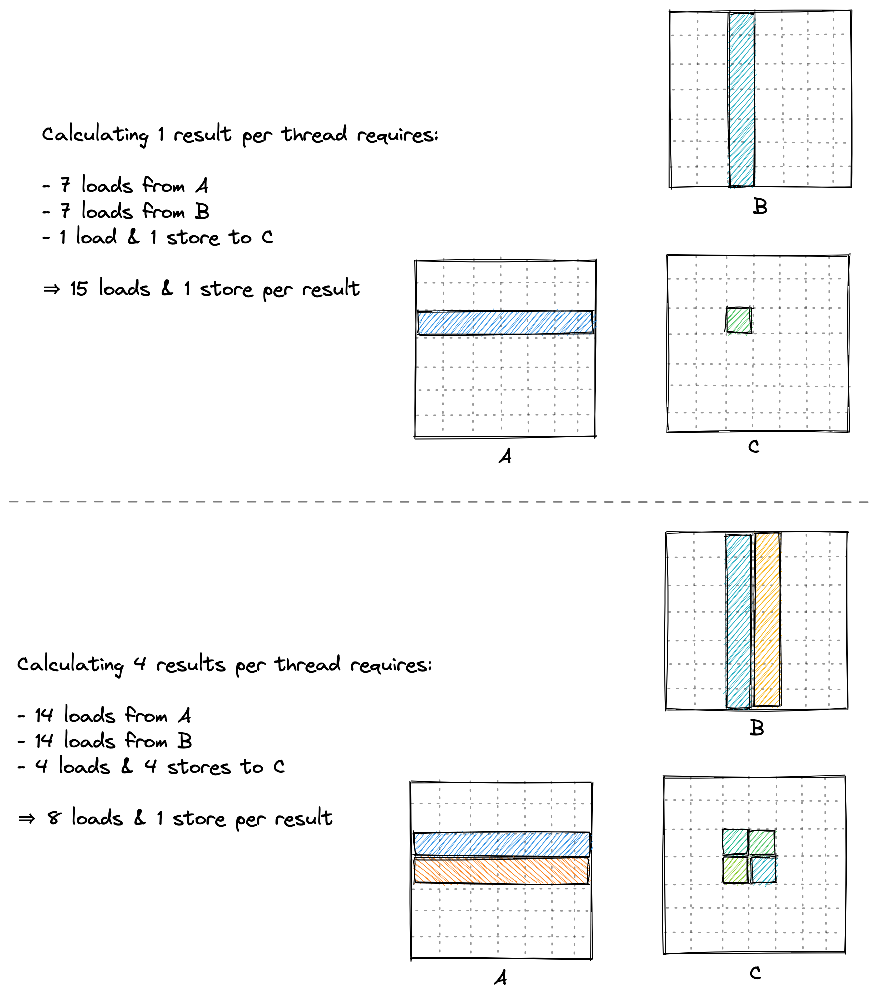

In conclusion, all our kernels perform the same number of FLOPs, but we can reduce the number of GMEM accesses by calculating more results per thread. We’ll continue optimizing arithmetic intensity for as long as we’re still memory bound.

当前核函数仍存在和Kernel 3类似的“内存等待停滞”问题（线程因等待内存数据而闲置），只是程度减轻。让线程计算更多结果（如从1个到多个），能让**相同的内存传输量**支撑更多浮点运算：例如，线程计算1个结果时，需加载对应行/列数据；计算多个结果时，可复用已加载的部分输入数据（如共享矩阵A/B的部分块），减少重复的GMEM访问，最终提升算术强度。  

计算的总浮点运算量（FLOPs）固定（因矩阵乘法的计算量由矩阵尺寸决定），但通过每个线程计算更多结构可减少GMEM访问次数；只要核函数仍处于“内存受限”状态（即性能瓶颈在内存传输而非计算能力），就可以持续通过提升算术强度来优化。

### Increasing Arithmetic Intensity via 2D Blocktiling

> 进一步改进，每个线程计算 `8*8` 大小的C。

The first stage of the kernel is for all threads to work together to populate the SMEM cache. We’ll have each thread load multiple elements. This code looks like so:

```c
for (uint loadOffset = 0; loadOffset < BM; loadOffset += strideA) {
  As[(innerRowA + loadOffset) * BK + innerColA] =
      A[(innerRowA + loadOffset) * K + innerColA];
}
for (uint loadOffset = 0; loadOffset < BK; loadOffset += strideB) {
  Bs[(innerRowB + loadOffset) * BN + innerColB] =
      B[(innerRowB + loadOffset) * N + innerColB];
}
__syncthreads();
```

Here’s a graphical representation of the GMEM loading:

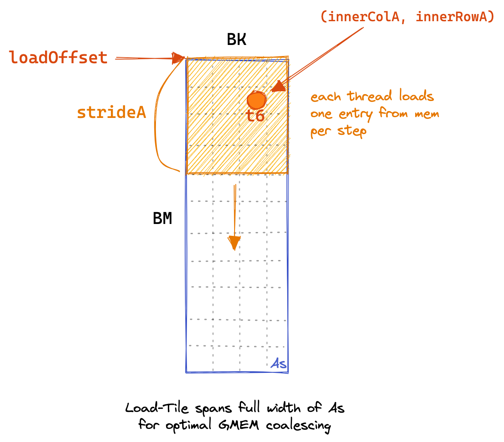

Now that the SMEM cache is populated, we have each thread multiply its relevant SMEM entries and accumulate the result into local registers. Below I illustrated the (unchanged) outer loop along the input matrices, and the three inner loops for the dot product and the `TN` and `TM` dimension:

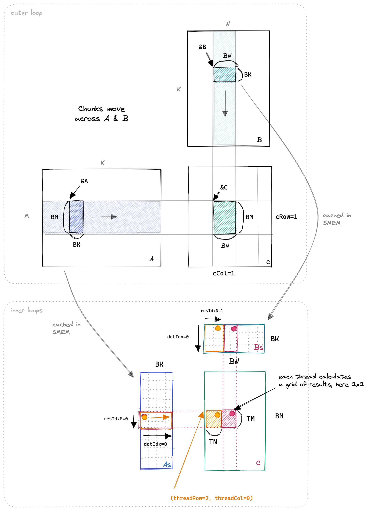

In the inner loop, we can reduce the number of SMEM accesses by making dotIdx the outer loop, and explicitly loading the values we need for the two inner loops into registers. Below is a drawing of the dotIdx loop across time, to visualize which SMEM entries get loaded into thread-local registers at each step:

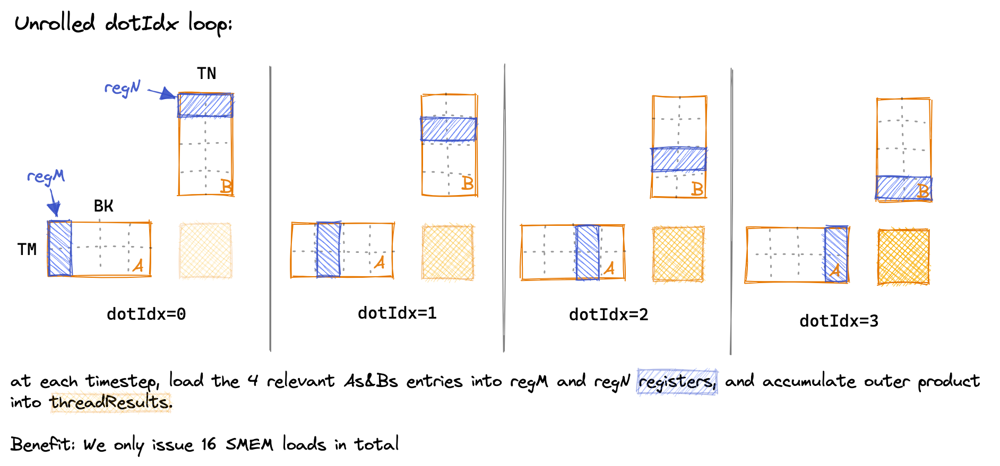

### 性能分析

根据 [共享内存实现](./csrc/2_shmem.cu)，计算上一个 kernel 每个 thread 的访存行为，每个 kernel 即是一个 thread：

- GMEM: `K/TILE_SIZE` iterations of outer loop * 2 loads
- SMEM: `K/TILE_SIZE` iterations of outer loop * `TILE_SIZE(=32)` * 2 loads
- Memory accesses per result: `K/TILE_SIZE * 2` GMEM, `K * 2` SMEM

对于 1D tiling 改进，如上，`BK = 8TM = 8`，注意每个内部循环中，`Btmp`可以缓存，每个线程计算 `BK` 个结果：

- GMEM: `K/BK` iterations of outer loop * 2 loads
- SMEM: `K/BK` iterations of outer loop * `BK(=8) * (1 + TM(=8))`
- Memory accesses per result: `K/BK * 2` GMEM, `K * (1 +TM)` SMEM

这个改进下，现在每个线程的指令停顿减少了，由于减轻了访存压力：

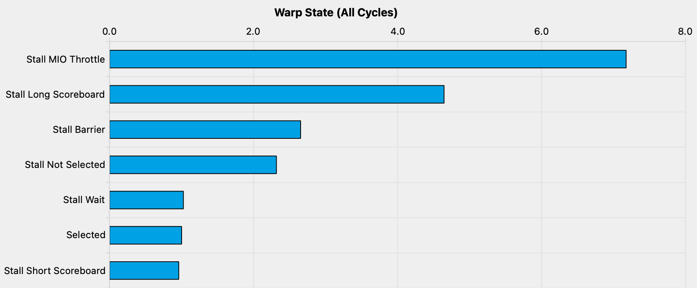

对于 2D tiling 改进，对于`TM*TN = 8 * 8 = 64`，再次进行访存行为计算：

- GMEM: `K/8` (outer loop iters) * 2 (A+B) * `1024/256` (sizeSMEM/numThreads) loads
- SMEM: `K/8` (outer loop iters) * 8 (dotIdx) * 2 (A+B) * 8 loads
- Memory accesses per result: `K/64` GMEM, `K/4` SMEM

Slowly performance is reaching acceptable levels, however, warp stalls due to memory pipeline congestion are still too frequent.

For kernel 6 we’ll take two measures to try to improve that: Transposing As to enable auto-vectorization of SMEM loads, and promising the compiler alignment on the GMEM accesses.

Resulting performance: 16TFLOPs, another 2x improvement.


# 访存优化

在引入了单线程更多数据后，提升了算术强度，上一个 kernel 的性能比共享内存又好了很多，但是又出现了新的问题——访存。

针对访存优化问题，基础理论与分析，见[](../basics/：

### Low Compression Rate（低压缩率）
- 情况：发送到L2压缩单元的3584.0字节中，仅7.14%成功压缩。
- 解读：内存压缩能减少数据量，提升传输效率。低压缩率意味着内存数据可压缩性差，或压缩策略不够好。
- 优化建议：标记那些包含最多零值和/或最均匀值的内存区域为可压缩区域，以此提高压缩成功率。

### L1TEX Global Load Access Pattern（L1TEX全局加载访问模式）
- 情况：L1TEX全局加载的内存访问模式可能非最优，每个线程平均仅利用每个扇区传输的32字节中的7.0字节。
- 解读：这表明内存加载时存在资源浪费，线程没有充分利用每次传输的数据，可能是线程间的步幅（stride）问题导致未合并的全局加载。
- 优化建议：提高每个扇区平均被利用的字节数，使其接近32字节；同时，L1TEX吞吐量越高，该问题可能越严重，需关注内存访问模式以减少未合并加载。

### L1TEX Global Store Access Pattern（L1TEX全局存储访问模式）
- 情况：L1TEX全局存储的内存访问模式可能非最优，每个线程平均仅利用每个扇区传输的32字节中的4.0字节。
- 解读：和全局加载类似，全局存储也存在数据利用不充分的情况，同样可能由线程间步幅问题引发未合并的全局存储。
- 优化建议：提高每个扇区平均被利用的字节数，向32字节靠拢；L1TEX吞吐量越高，问题也越突出，要优化存储的内存访问模式。

### Shared Load Bank Conflicts（共享加载存储体冲突）
- 情况：共享加载的内存访问模式可能非最优，在335544320次共享加载请求中，平均存在3.2路的存储体冲突，导致536870912次存储体冲突，占共享加载总wavefronts（波前）的50.00%。
- 解读：存储体冲突会降低内存访问效率，因为多个请求竞争同一存储体资源，导致等待。
- 优化建议：减少共享加载的存储体冲突；L1/TEX缓存吞吐量越高，该问题越严重，需优化共享加载的内存访问以减少未合并的情况。

### Shared Store Bank Conflicts（共享存储存储体冲突）
- 情况：共享存储的内存访问模式可能非最优，在33554432次共享存储请求中，平均存在5.0路的存储体冲突，导致134217728次存储体冲突，占共享存储总wavefronts的80.00%。
- 解读：共享存储的存储体冲突情况比共享加载更严重，对性能影响更大。
- 优化建议：减少共享存储的存储体冲突；L1/TEX缓存吞吐量越高，问题越严重，要优化共享存储的内存访问来减少未合并的情况。

总的来说，这份报告通过各项指标，揭示了GPU内存在压缩、全局加载/存储访问模式、共享加载/存储体冲突等方面的性能瓶颈，为后续的性能优化提供了方向，比如优化内存数据的可压缩性、调整线程间内存访问的步幅以减少未合并访问、降低存储体冲突等。

## 优化

- 没有考虑硬件执行时是按照 warp 发射的。
- 全局内存。访问可以进一步合并，在 NCU 调试会发现， `float4`
- 共享内存。 bank conflict，这个会在后续 warp tiling 进一步展开。
- 异步拷贝。
- 数据预取。
- 已经有了 5 个参数，这几个参数会一直贯彻后续的优化，那么这些参数到底怎么选择，有没有 Autotuning 的方法？

关于 warp tiling、mma、bank conflict 将在后续解决，并且通过引入 warp 级的 tensor core 加速分析这些问题。

本节关注的问题是从 global memory 到 shared memory 这个过程。


## 性能分析

上面的内容就已经把多级分块和迭代的理论设计介绍完毕，但是对 block warp 的大小、分块的大小对性能的影响是怎样的还需要再次分析。

#### 分块大小

要解答这个问题，需要先破除一个核心误解：**“缩小WM/WN（warp级分块尺寸）以避免迭代”与“增加block内warp数量”之间没有直接因果关系**，且前者会触发更严重的性能矛盾——破坏GPU的“计算-内存带宽平衡”和“硬件资源利用率”。本质上，warptiling的迭代设计不是“无奈之举”，而是在“硬件固定限制”（warp大小32、寄存器/带宽上限）和“性能目标”（接近cuBLAS的TFLOPs）之间的最优权衡。以下从3个关键维度展开分析：


### 一、先明确：Block内warp数量由“block尺寸”决定，与WM/WN无关
首先需要厘清“block内warp数量”的计算逻辑——它只由**block的thread总数**和**硬件固定warp大小（32）** 决定，与WM/WN（warp负责的任务尺寸）无关：  
- 公式：`block内warp数 = (blockDim.x × blockDim.y × blockDim.z) / 32`（需整除，CUDA要求block尺寸是32的倍数以避免warp分化）。  
- 示例：若block是`128×16`（共2048个thread），则block内warp数=2048/32=64；若block是`64×8`（共512个thread），则warp数=512/32=16。  

因此，“增加block内warp数量”的唯一方式是**扩大block的thread总数**（例如从1024thread/block增至2048thread/block），而非缩小WM/WN。而缩小WM/WN只是改变“每个warp负责的任务范围”，不会增加block内的warp数——这是理解问题的前提。


### 二、矛盾1：缩小WM/WN会导致“计算量不足”，无法隐藏内存延迟
GPU性能的核心瓶颈是**内存延迟**（全局内存GMEM延迟≈100-200ns，shared内存SMEM延迟≈10-20ns），而隐藏延迟的唯一方式是**让计算单元（CUDA核心）持续有任务可做**——即“计算量必须足够大，覆盖内存访问的等待时间”。  

若强行缩小WM/WN至“无需迭代”（例如`WM=4`、`WN=4`），会导致两个致命问题：  
#### 1. 每个warp的计算量骤降，延迟隐藏失效
- 正常warptiling（如`WM=32`、`WN=32`、`TM=TN=8`）：每个warp需执行 `(32×32) / (8×8) × 32（K维度迭代）= 512次FMA计算`（每个thread负责8×8=64个C元素，warp共32×64=2048个元素，每个元素需32次FMA）。  
- 缩小后（`WM=4`、`WN=4`、`TM=TN=8`）：每个warp仅需执行 `(4×4)/(8×8) ×32= 8次FMA计算`——计算量仅为原来的1/64。  

此时，计算单元会在极短时间内完成任务，随后进入“空闲等待”（等待下一轮内存加载），内存延迟完全无法隐藏，最终性能由“内存带宽”而非“计算能力”决定（即“带宽绑定”），TFLOPs会暴跌至峰值的10%以下。


#### 2. 内存访问频率激增，带宽被“无效访问”占满
缩小WM/WN后，为了完成整个矩阵乘法，需要：  
- 更频繁地从GMEM加载数据到SMEM（每次加载的block级分块更小，总加载次数增加）；  
- 更频繁地从SMEM加载数据到寄存器（每次加载的warp级分块更小，总加载次数增加）。  

这些“高频小尺寸访问”会产生大量**无效开销**（如地址计算、指令发射），且GPU的内存控制器更擅长“低频大尺寸访问”（例如一次加载128字节的向量，而非多次加载4字节的标量）。最终，内存带宽会被这些无效访问占满，真正用于计算的数据传输占比下降，进一步拉低性能。


### 三、矛盾2：缩小WM/WN会破坏“寄存器利用率”，导致资源浪费
GPU的**寄存器是按block分配的**（例如A100每个SM的寄存器总量为65536×4=262144个，每个block最多使用65536个），且“寄存器利用率”直接影响“SM可同时运行的block数”（即**occupancy**）。  

若缩小WM/WN以避免迭代，会导致：  
#### 1. 寄存器占用量“不随任务缩小而线性下降”
每个thread的寄存器占用量由两部分决定：  
- **固定开销**：存储thread的索引（`x`/`y`）、block级分块的偏移量、函数参数等，这部分不随WM/WN缩小而减少；  
- **可变开销**：存储从SMEM加载的A/B子分块数据（`regM`/`regN`）和C的中间结果（`threadResults`）。  

当WM/WN缩小时，可变开销的减少幅度远小于任务量的减少幅度——例如：  
- 正常情况：`WM=32`、`WN=32`，`regM`需32个float寄存器，`threadResults`需64个float寄存器，总占用≈100个寄存器/thread；  
- 缩小后：`WM=4`、`WN=4`，`regM`需4个float寄存器，`threadResults`需4个float寄存器，但固定开销仍需20个寄存器，总占用≈28个寄存器/thread。  

此时，每个thread的寄存器占用量仅从100降至28（减少72%），但任务量却从512次FMA降至8次（减少98%）——寄存器的“有效利用率”（用于计算的寄存器占比）暴跌。


#### 2. Block级寄存器浪费，Occupancy不升反降
由于block的寄存器总量是固定上限（如65536个），当thread寄存器占用量从100降至28时，一个block可容纳的thread数从 `65536/100≈656` 增至 `65536/28≈2340`——但CUDA要求block的thread数必须是32的倍数，且最大不超过1024（硬件限制）。  

因此，实际block的thread数仍被限制在1024，寄存器占用量从 `1024×100=102400`（超出上限，编译器会压缩）降至 `1024×28=28672`（远低于65536的上限）——大量寄存器被闲置浪费。  

更糟的是，SM可同时运行的block数由“寄存器总量”和“block寄存器占用量”决定：若SM寄存器总量为262144，正常情况可运行 `262144/102400≈2` 个block，缩小后可运行 `262144/28672≈9` 个block——但SM的“warp调度器数量”是固定的（如A100每个SM有4个调度器，最多同时调度4个block），多余的block会排队等待，Occupancy（实际运行的warp数/最大支持warp数）并未提升，反而因任务量小导致“调度开销占比增加”。


### 四、矛盾3：缩小WM/WN会失效“向量加载”，SMEM带宽利用率暴跌
GPU的SMEM支持**向量加载指令**（如SASS的`LDS.128`），可一次加载128字节（4个float）的数据，前提是“warp内32个thread的访问地址连续”——这是SMEM带宽的核心优化点，而WM/WN的设计直接决定了是否能满足这一前提。  

若缩小WM/WN（例如`WM=4`、`WN=4`），会导致：  
- 每个warp的thread在SMEM中访问的地址范围变小，且分散在不同的“存储体（bank）”；  
- 原本连续的向量访问（如32个thread访问SMEM的`0-127`字节），会变成离散的标量访问（如访问`0`、`16`、`32`...字节），无法触发`LDS.128`指令；  
- 离散访问还会增加SMEM的“bank冲突”（多个thread同时访问同一bank），导致SMEM访问延迟从10ns增至50ns以上。  

最终，SMEM带宽利用率会从80%以上降至20%以下，成为新的性能瓶颈——这与“优化SMEM访问”的初衷完全相悖。


### 五、总结：Warptiling迭代是“平衡资源与性能”的最优解
通过以上分析可明确：**“缩小WM/WN以避免迭代”会以“牺牲计算量、浪费寄存器、暴跌带宽利用率”为代价，最终性能远低于“迭代方案”**。而warptiling中`WMITER`/`WNITER`的迭代设计，本质是在三个核心约束下的最优选择：  
1. **硬件约束**：warp大小固定32、寄存器/带宽有限；  
2. **性能目标**：最大化计算量以隐藏内存延迟，最大化向量加载以利用带宽；  
3. **资源平衡**：让寄存器、SMEM、CUDA核心的利用率均处于峰值区间。  


# Warptiling

Currently, our loop structure looks like this:


We’ll now add another hierarchy of tiling, in between our blocktiling and threadtiling loops: warptiling. We can calculate a given thread’s `warpId` as `warpId=threadIdx.x % warpSize`, where `warpSize` is a built-in variable that is equal to 32 on any current CUDA GPU.

Warps are relevant for performance since (among other reasons):

- Warps are the unit of scheduling that is mapped to the warp-schedulers that are part of the SM. 
- Shared-memory bank conflicts (I’ll cover those in a future post) happen only between threads that are in the same warp.
- There’s a register cache on recent GPUs, and tighter threadtiling gives us more register cache locality.

> On A6000, there are four warp schedulers in each SM. This is how I imagine this looks: 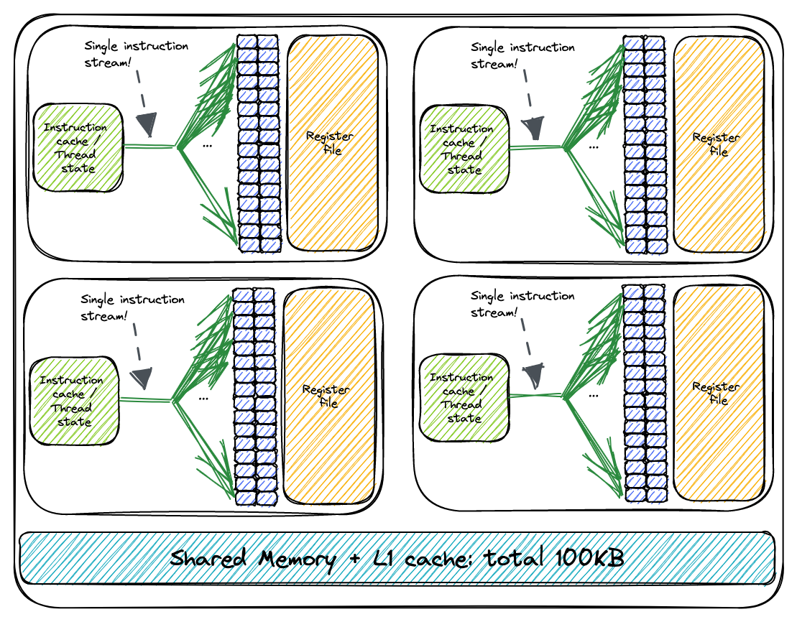  

Warptiling is elegant since we now make explicit all levels of parallelism:

- Blocktiling: Different blocks can execute in parallel on different SMs.
- Warptiling: Different warps can execute in parallel on different warp schedulers, and concurrently on the same warp scheduler.
- Threadtiling: (a very limited amount of) instructions can execute in parallel on the same CUDA cores (= instruction-level parallelism aka ILP).

The warptiling looks like this in the CUDA code:[Godbolt link](https://godbolt.org/#z:OYLghAFBqd5TKALEBjA9gEwKYFFMCWALugE4A0BIEAZgQDbYB2AhgLbYgDkAjF%2BTXRMiAZVQtGIHgBYBQogFUAztgAKAD24AGfgCsp5eiyahUAV0wtyKxqiIEh1ZpgDC6embZMQAVnLOAGQImbAA5TwAjbFIpACZyAAd0JWIHJjcPL19E5NShIJDwtiiYnnibbDs0kSIWUiIMz28/CqqhGrqiArDI6LjrWvrGrJbBruCe4r6ygEprdDNSVE4uAFJYgGZg1A8cAGpVjZcJYDJiJDZD3FWtAEF1raYdi2wDo/ElFXqrm/vN7d2r0OLlQSiIhHQPzuDwBLzeILBmHoBAiUL%2Bj2e%2B2B5giRiUAH0AG6xAB0SDRMKegPh5ks%2BNIZmEBA4ZIp0M2ODoIT2LlwAEkAviACJ8gBqEAAsuQ9qEZnsoJK5esAELy2UAWh4coA9GqZjNfhgmGC9sEiHsAOq3ABKqhEfIAWrg3kK9htYodVdrdQB3OoJEQEABerwISj2THQ5qNYOw6gSpF%2Bv21ACpfnsU3sAAJEBJ1dh7ZUSvYAFSQryISFI2BYmFx6FQAGs9ikQ3tBKQ9sXCBxjWk9iIJbhi%2BJUEhgsASenMzm86QC8rQqXy3tK9Xa/Wmy3g68OzK9j3mCkhAOhyOWGOJ1O7hns7n82xCwBpZcVqs1uv0BvN1u7sh7F9Dz7E9B2HPZR3HExr1uW9ZwfS1i27Zk9nQGhwPkYIzAWcN7EYdC2ASMwiGwTA9giABPPYazHPY/VIBJpzvOcCwtJclx7FC0KNewmCwswcIYV4MAIoiSLIyjqKQWj/UYuD50fC0JT5EtcGtV8I16TtUJbMwIjohJVwYCcW2IhJw2CLsD2ZI80mg2D73ky1QmU1T1N4qYtLQpRdP0wzkRMEzsDM00mH3IDjyYOyZwcgsS2LMtXgSaJ1TXD8/NeX923/JDewiqKmPgkslwSvYktIFL31rdLtzbPd2Os4DIunbUkzuGNzTMM0ZQUCV8RLAAJa1cFuIURBdPYygADk9VrbnxfFgC/CIJHmvZCXQAhSPmoxGTHfEIgWJhMAJfEIFCHq%2BsG4bRoNG89nupRgGwNg2Atf1cInCAuqlELzVCaUuqfaUaC/FhzQkBIkCsdtQfNFNbmB2GM2Vch03u9GMcxzGQfQMGyOwWpEdxuGXCVAB2ZU0favZOuEQsl0OV0ppmu7qdp80i3GgA2aQWZg9DjQ6rrlRfRm9mmjZKdZoQTXZpzud5yWqZloW6cU8b3T5%2B62a61iXLUsWPSV6XBZprqivGxWpf5nW6biy2%2BeV025dQa10B9cbN0bPlMHUElyK1gXZa61AMk9r8mx9v31Edu7vT2VQjGWXtzW0ytXl8iz09XSrP2/dKneDun9Kj8bUtrKOSXUPZdStW17SdT0a91bPfMrMMc/XUiO%2BCQvVfNfSw7FkvfYOWIfHlRca6cg1jZtlWzeL/03Y94f/VL3UICn2vZVj/n48ytOV187yIlw7A%2B7jBNF/NRT9fGiB1czVidXlOu7UdZ1M3t7%2Bl2f5yVLWlntbbWKsr6djlhaEQChOZi3VrXJSgCm7xx5tqI2QpNYm1jPGCButoFTzgUuHe%2BtkG6ndGgxmPAuazXuvHROF5nrMFTmhbO5du6hVbv6HSZ9BJ9xvp3D8Uc%2BRMDevRMuudK7V3WBPd%2BDdriSyxujeOqwfDKi0NKDYPAVFCj4XLNhGRhGiIMmLNhQiRFcOkW/fBRDSy7wUfHAg0iIBUO1NIW689nZdTYSvQxFiNiulMb7XxYjN5QJgTYoqwDm6mlcTQ6JEgI5gwynmZYWVOzZ3MKQasdMvbnxCqeYcaN5pKChtWTAq0cZ41uEoFRypOaZhFtowOxTSkkQqUjZUNTVEi1vIuJpc80bxwlOgQkrxcmCVXOgfGwBghMGMtpW4YAuDhlIO7PYxhSLKiWeGDAmQmBoxgiqMWrs1kNOLJmJ8gdVRHP8eBMODTQiByGSM14Lh8QJCIOkqZ%2BltkoSIoRc0580YuDHpTW5EATkezOaC6S9EV63kUnKTMDNYiqlDu4XpKLVSDwxf/PetDdTiHoOYIwPFgA51DEdAgywcJQ0BeOWlXdaIMHoHsUG7CSAFIlIM302Aln0FZeyiasRJoRGINPd0YrzRi2kFRRgKdwxlQEVVPGklAoMSwf3EKIRSAr0ObcwJ0dp5bxfLqNxgdbbmlmdEDI%2BqAkSN9lXMeE8TXT3NXPUBgtwH8NWT6GopBNrYDtWqC6A0hojTGpmNx09GkeqDlq61ur3bXINQ6o1m9t57HdSA%2BN/DE0ZBTfarukjnWTxsdmy%2BOCfXu39YGwt3VephuumNDN5bgFxPjgkhsSTlWYHVIk1lEE/ydmrN5egRBzKhWrDM2MpA6CMDRpU%2BlXdrTYDHRO2pd9AG3h/k5e%2Bv9tHjVWBTLQJItDHp0XG%2BOPohIXhXGaKZ06wzEVIOGE8nD6J5MYKM%2Bgi6kbTu5aordrlv6AddGLY9aiz0XsDkuvY07HlAYASB2xh6IMnug2TS91seV/JfeqNgyRzRfnQAZF5nYvbpRqXdPcEA5YRG9qPMW56FEMdLsCACTc2NMdRWLEW5Mc33Vo3LVCNAVDStuSx1UonxMwt9bWnA%2BqXB8e5QomTBNQVi3k58wNtwBNowxku2VRACLjWrGaaICYCb4g%2BEQYERmMxXAgAZxR6wub3FUV9JgOq9UwvU0QJFAEYX5vcDBKN2iDSqPPT4bDLmCWrnnMaJIKg9gwR9OOPCYIzgBWIHF1LXTlReZ1ba28sqVR7C0IF2BqLtXRF8%2BV/zaGDUESroHDG1TalFZtaF0rMKtS9OLOVxN9WauNZi2XFrAc43tYK110gJWo0wtiFVwbNXhvu0OaNmgYmCZNYCS1oMbX0Ydc8yF%2BgYWs0wo2Ct4L3m6sbb89t8Te3VwtZ9EdmD0I7pCf/HRrq/nxpSc4jt6VNXtMBpwCm5TtzY3Saexpm5rpwd1v0999G5nhCWerEQGzLAwT2dhrKtMGxcDObR1jNznTOvrZ9NcrbIOqtYtq/N9wqpwsxci2ovbeWMYY5fVZnHtmCfEyJ05nnrnYhc0pqdu7SbaePYZ7eJnZ22dZoi7U6LsW0eff5vdYp5EnhsKUBAdtX3ddpPlHLTAUZ2OSabtbogtuQWw806ih3UdUfm/i0kQipLXhPtneGPc6X3AZ3erw8nFu/vFxELpHxTG7cKL9XH92TuEIkIUUc1FyeIjx/UJ7xRUe5YEEB03EvHG4pNyz8qAgBfC/wewMAQDyoc9553at1UjjxuM3F1jE7hX3ejzOUqGr%2Bl4XPw77RWPufU9D8tPgjvvfC/eNT%2BYsRoHgv9ME5jHXFOsN5eE11HPBiE%2BuiB8f9wae9ZIMz7x7P0%2BT/54OBTcXh%2B6bl8T53%2BEqHb%2BU1RbX5/bfLGBDWpC/egUuX%2BTfbvfxJfDGKnTzQfauB5EfbFf0e5eWcrMAiA%2BfcJTTSPeve6fRS/NfAySAobLfcXXfHfffM3LGeOOMSoUSWFD5CZNgMGNgMwX9SPN/AeafNvZjJuVvWfKRI4dPG/OnP/FvPg4QuvLGHgqfXSR/UvJPB/S/BPEFa/VSKvO/KQxQtQp/SDJfeOIlElHtMqCqJlUdTgjdfA9GeQ0dKOQbT/BvJQRw7/SvX/FUBw32CUWQ%2BvewtdKOBmZw7w9QYIkFIqbQyQ0I2UQA2A9GbxNdaw2bIQn0bA%2B2crUI3w28R%2BZDNSX%2BFA%2BIggrGCALAufSJOTQI32RDcDXjGA2wgggDUA6QtI8oyfLIw9NMBo%2BvEA1RMopA2xSo1w6oig7o%2B6KgwvCY6gnRSPKYqYzbMFV0F3DGeOQjUZZ8dCPZHCR9AgYAJAOzNHCQvjF8ZFUhPYNY14HpX1cMa3H0fZNHfXQ3XOY3U3fmHXXDH0ANYiPDClFw5IxdX7OWVI23M/QQloq/RBLQzw%2B/FPVogwl/NHeQ/o5Q7FVQ8A9QvdcQ13XQiIR/Pw%2BLC4nkUqDaTHL5cCRYbJAeLhU%2BIFbgpGFMN5CzANR8MWEFcrUo8EufMJIsQLJnZE5%2BaxI7H7TsaPc0LIlElwtwivVTVUcUxHCafEuwwErqGIiU1UivR5BRdUuo10aNQw7o%2BOIVEFUZOwf8B9BvGdF9ajL3bGQnV7YxW5PnLHazIXI4BzYnUnIoseLmRk0k5kTrFfNIkg9vIYxw3kvAm04o5fXOAxYMsgsHKosI9XKLUYyMpRXUMqDsR8AAcWHGLDMASEsG%2BIsmnSX2pi6g/1dA5NhPSPaMTOyMzFyP3VsUKLGKjIUNxP0J3SZxiKFMxhMwSCdTFghihlvESPXQK3Lxq01xhSiFqDHJaxjmm0UQHP9nGhHJYDHNzlXQnNqSnNVC0W7xqznM3MzFXKmyAP7IO3XPoEhlPN7R3P%2BNUX3L2A9CPNVBPIXMHMO2XKxlXNXluQ3K3JXSSPHUnKuzQ2PIJnvP/L7JWN9C%2BLGQvEbCXydPomx1x3xzdLtI9LJzTIp0l19JfX9M80DOCVINLDrOGPUAbP3COTbPbKIPALjMGMyMTJqM5xnJMQIjgufxmJtLmJoLeKEovS4DmHoG4B8H4G8C4B0HIHQG4BcAUCFBgmUx0JbAWCWCBE2D4HICIG0DErmEbF8FPUmjJg2E0XMo2AAE5YgeAfANgyYuZDBuBpB%2BA2AQAyYyYSQeZJppARVpAtAfAyhYhNhyAZK5KFKuB%2BAlAQB1F9LZKxLyA4BYAUAFhcwiJKBqBhIEhBJSBQh2AVgJQAg%2BQ1JSNzQZAz0SQpL/BCASAIcDBBBhAxAJBOAZA5BhBlA1BNBEryB9AeByBPiWAEhuA%2BBxLJLpKDL5LuAAB5f5IiTiGUUUFwEFMoKqngeUNwAiPKseTRGYfgBKnQOYCAFAHKvKrKiFdAbaxgGIJgQkVAVAMoLQMwAanAQkalbAUUAgbAH0GapKCK/gedK06gCIKasVVgUgciUa/gcGuociGaiIXQSoBK3S4SFOGapgegKG3qnANgkwSQHGggasKoUZWK3qhg8wYiaGygTHCS3q5ECIecSGtwHAKanTDy3gJKkGFgYAJQL6n6v65gampq0QIlNq2QEWrqjQKa/qwwYwUwCwKwBm2KyAOYcqtIMm9UGajYPYdUIUUIIUXAZUBQbM3W9UJ6HVJJdUDAHARmOoMcRmHK0SfESaZym2i%2BGA1RJ24iF25ypQNgX2w9dUdUD5dQPHdUdWmWRmdUQkXWxER26vHgMmGK7AWwewRwCAZwYYbwAawICYIoEoAwZLPIdIdwJoIu3IdOpgboAu6YawVO5G6oMYbOgwVoKujoeoGuzSVu5usurIAasEToLujyKQOYJQTS5YUelyrgGqgG6argJala4Vda%2BUfAYgf8B4LUA6gy/UcgcsWsPoE3aety8gDy0KkkDYYKnwMmey6y6QMyry5yueqKmKgwQ6wy8gYynwU9WIayngHgIKry6y8yvysmaejYSa3ql%2BvSne5KxAE6kAN6j6i6s6m6gqjgbgUIZa1a0kU9XSpByergEQW4EQMaCAf232/a2q9ehqgakWlqyQdqyWlQaW3q2WtutIJwI6Fu3Oo6Yewuga4uqunhnIFIKu/huujh9oXuvZVuhutoJgDu8YQobugemR8utRoe/O1RuYT5bAbATaOK8ameyByK7gIUbAd61Jfmm9TsLBpetavB1euqjenS6ULa3Km63aremBxK3e4y6QaykkMmLQSaSaO%2B0KrQSXey2QOmk%2B5%2B7gV%2B%2BKne4x2IUx/gaB9%2B3e0ZV9Th6QIAA%3D).

```c
// dotIdx loops over contents of SMEM
for (uint dotIdx = 0; dotIdx < BK; ++dotIdx) {
  // populate registers for this thread's part of the warptile
  for (uint wSubRowIdx = 0; wSubRowIdx < WMITER; ++wSubRowIdx) {
    for (uint i = 0; i < TM; ++i) {
      regM[wSubRowIdx * TM + i] =
          As[(dotIdx * BM) + warpRow * WM + wSubRowIdx * WSUBM +
             threadRowInWarp * TM + i];
    }
  }
  for (uint wSubColIdx = 0; wSubColIdx < WNITER; ++wSubColIdx) {
    for (uint i = 0; i < TN; ++i) {
      regN[wSubColIdx * TN + i] =
          Bs[(dotIdx * BN) + warpCol * WN + wSubColIdx * WSUBN +
             threadColInWarp * TN + i];
    }
  }

  // execute warptile matmul. Later this will map well to
  // warp-wide matrix instructions, executed on tensor cores.
  for (uint wSubRowIdx = 0; wSubRowIdx < WMITER; ++wSubRowIdx) {
    for (uint wSubColIdx = 0; wSubColIdx < WNITER; ++wSubColIdx) {
      // calculate per-thread results with register-cache locality
      for (uint resIdxM = 0; resIdxM < TM; ++resIdxM) {
        for (uint resIdxN = 0; resIdxN < TN; ++resIdxN) {
          threadResults[(wSubRowIdx * TM + resIdxM) * (WNITER * TN) +
                        (wSubColIdx * TN) + resIdxN] +=
              regM[wSubRowIdx * TM + resIdxM] *
              regN[wSubColIdx * TN + resIdxN];
        }
      }
    }
  }
}
```

Each warp will compute a chunk of size (WSUBN * WNITER) x (WSUBM * WMITER). Each thread computes WNITER * WMITER many chunks of size TM*TN.

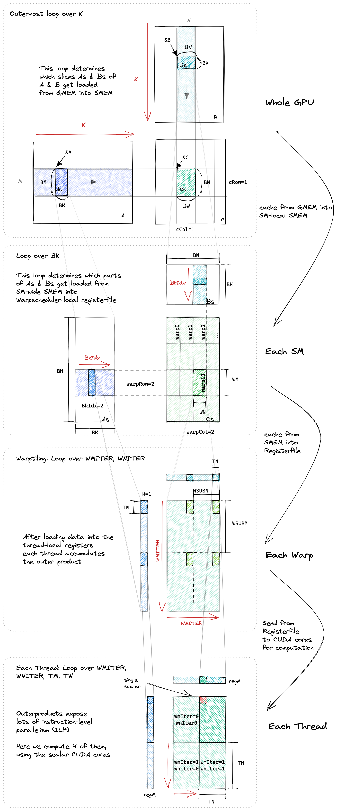

## MMA

结合前文所有的分块层级，这个 kernel 的执行方式为：

- 将输出矩阵划分为 block tile，一个 block tile 对应一个 `BM*BN` 大小 C 的分块矩阵。
- 不同 block 之间是独立的，block 在 k 维度上外积迭代累加。
- k 维度跨度 `BK`，每次取 `BM*BK` `BK*BN` 大小的输入矩阵到 shared memory。
- 将 block 划分到多个 warp，每个 warp 负责计算一个 `WM*WN` 的分块矩阵。
- 不同 warp 的计算是独立的，在 k 维度上外积迭代累加
- k 维度 stride 是 1，每次负责 `WM*1` `1*BN` 大小的输入矩阵，后面迭代取到寄存器。
- 一次 k 的迭代内， warp 内部会迭代 `WMITER*WNITER` 次，直到这个 `WM*WN` 矩阵计算完。
- 每个 warp 内有 32 个 thread，每次迭代，每个 thread 负责计算一个 `TM*TN` 的矩阵块。
- 每个 thread 取 `TM*1` `1*TN` 大小的输入矩阵 fragment 到寄存器。

到本节，其实就把 GEMM 分层设计介绍完全，但是具体到 warp 级别的操作，上面的方法是基于 CUDA core 控制每个线程的乘累加，实际上也可以基于 tensor core 加速计算，提供几倍到百倍的加速。那么使用它的方法有 MMA/cutlass/CUTE，这三种方式实际上是提供了不同级别的抽象。还有若干优化方法本文没有涉及，如合并访存、bank conflict 等，这些优化方法会在 warp 级别的实现中考虑。后续基于 TC 的优化见 cutlass/cute 目录。

> The [CUTLASS docs](https://github.com/NVIDIA/cutlass/blob/main/media/docs/cpp/efficient_gemm.md) about efficient GEMMs go even more in-depth into warptiling, and their visualizations are illuminating.
