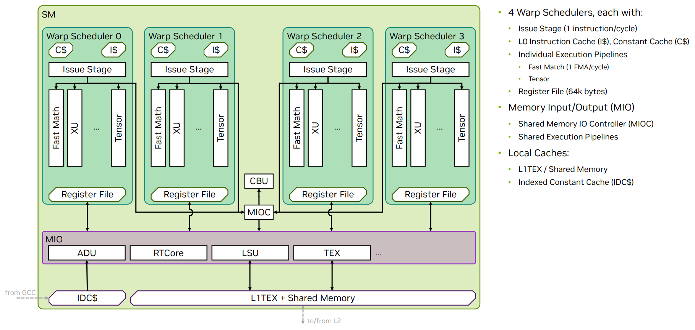
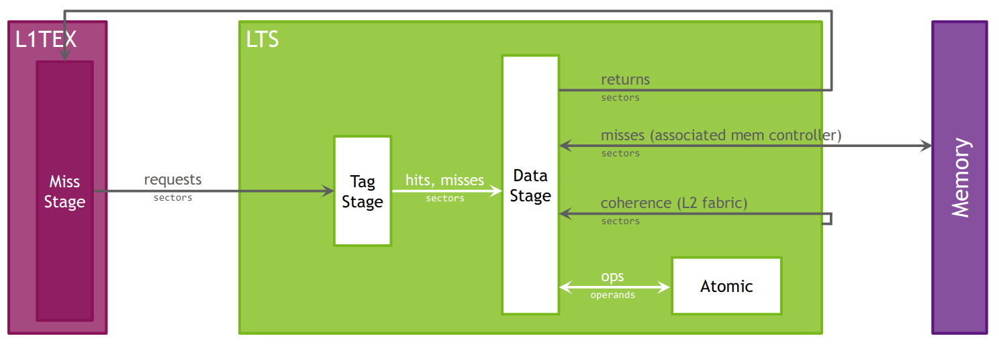
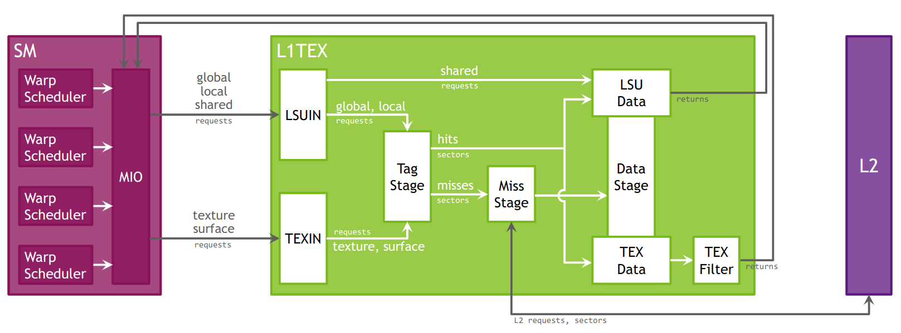
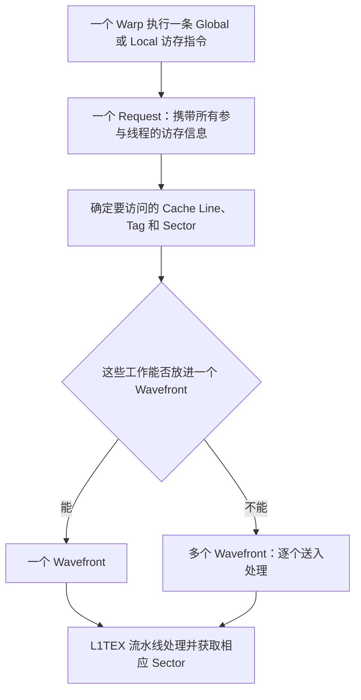

# NCU 硬件模型：计算、执行单元与内存体系

> https://www.youtube.com/watch?v=nYSdsJE2zMs
> https://bluewaters.ncsa.illinois.edu/webinars/petascale-computing/nsight-compute
> https://www.youtube.com/watch?v=WA8C48FJi3c&t=2s
> https://bluewaters.ncsa.illinois.edu/webinars/petascale-computing/nsight

理解 Nsight Compute（NCU）性能指标，需要先回答三个问题：线程如何组织，SM 如何执行线程，数据如何经过内存与缓存。本文围绕这条主线介绍 GPU 硬件模型，并将关键概念与 NCU 的分析入口对应起来。

正文以中文为主，关键定义配有英文表述，专业术语采用中英文对照。本文可独立阅读，不要求先读完 12 课；只需具备基本函数、数组、线程以及 cache、DRAM、PTX 知识，其他分析所需概念在相关位置解释。

NCU 读取硬件事件并计算 **Metric（指标）**，如执行指令数、流量或比例；**Section** 是按主题组织的一组指标。它不是无扰动录像：为收集不能同时测量的事件，工具可能在不同 **Pass（采集轮次）**中 **Replay（重放）**目标，并影响缓存、频率和并发条件。本文只解释硬件与指标的关系，不提供本次实测结论；应用实际是否加速仍要在 NCU 外重复计时、核对结果。

> **适用范围**：涉及具体硬件组织时，以 Turing 架构为例。SM 的分区数量、可驻留 warp 数、虚拟地址宽度和缓存行为均可能随架构变化，不能将示例数值直接套用到所有 GPU。

## 图片索引

| 图号 | 图片 | 对应章节 |
| --- | --- | --- |
| 图 1 | [SM 硬件结构（SM Architecture）](assets/ncu-sm-architecture.png) | 2.2 SM 子分区 |
| 图 2 | [L2 缓存模型（L2 Cache Model）](assets/ncu-l2-cache.png) | 5.1 L2 缓存 |
| 图 3 | [L1TEX 加载／存储与纹理流水线（Load/Store and Texture Pipelines）](assets/ncu-l1tex-pipelines.png) | 5.3 L1 的请求来源 |

## 1. 计算模型（Compute Model）

### 1.1 主机与设备

所有 NVIDIA GPU 都支持一种通用的**异构并行编程模型（Heterogeneous Parallel Programming Model）**，通常称为 **Compute（计算模型）**。它将 GPU 从传统图形流水线中解耦，使 GPU 能作为通用的并行多处理器使用。

“异构”表示系统中存在不同类型的处理器：

- **主机（Host）**：这里指 CPU，负责管理主机与设备之间的资源，并向设备提交任务。
- **设备（Device）**：这里指 GPU，负责并行执行提交的任务。

### 1.2 Grid、Block 与 Thread 层级

**Kernel** 是 GPU 上由多个线程执行的函数，一次提交称为 **Launch（启动）**。计算模型的核心是 **Grid → Block → Thread** 层级，它规定了这次工作的组织方式。先认识表中硬件：**SM（Streaming Multiprocessor，流式多处理器）**是接纳线程块并执行指令的单元；**Warp（线程束）**是同块内最多 32 个线程组成的执行群组，**Lane** 是线程在 Warp 中的位置，不是固定的一颗计算核心。

| 层级 | 组织方式 | 执行关系 |
| --- | --- | --- |
| Grid（线程网格） | 一次 kernel 启动产生的全部线程块，按一维、二维或三维排列 | 线程块可分布到多个 SM，也可分批执行 |
| Block / CTA（线程块） | 一组协作线程，按一维、二维或三维排列 | 同一块的线程在同一个 SM 上执行，可通过块内共享内存与屏障协作 |
| Thread（线程） | 执行 kernel 的一个线程实例 | 拥有自己的线程索引和私有状态，作为 warp 的一部分接受调度 |

**CTA** 是 *Cooperative Thread Array*（协作线程数组）的缩写，在 CUDA 中对应线程块。

这一层级的目的，是表达一组线程之间的**局部性（Locality）**：同一个线程块中的线程可以协作。**Shared Memory（共享内存）**是同块线程显式共用的片上工作区，**同步屏障（Barrier）**要求参与线程到齐再继续，并按操作语义保证相关内存可见性。例如各线程先写入自己的中间结果，再会合，随后读取同伴结果；不是只因放进同一块就自动同步。

启动一个 Grid 后，同一 CTA 中的线程会被安排在同一个 SM 上执行。

> **补充说明：并发不等于同一时刻执行。** 同一线程块内的线程以 warp 为单位接受调度，并非所有线程同时发射指令。也不要把“同一 CTA 位于同一 SM”理解为一个 SM 只能执行一个 CTA。

网格和线程块的配置可在 NCU 的 **Launch Statistics（启动统计）** 中查看。

### 1.3 资源限制与 Occupancy

这里“同时容纳”叫**驻留（Resident）**：已分配执行状态和资源，尚未结束，即使等数据也仍可能占着位置。**寄存器（Register）**是保存线程私有中间值的快速小存储，如加法的输入和结果。每个 SM 能同时容纳多少个 CTA，取决于 CTA 所需的物理资源，包括：

- 线程数量；
- 寄存器数量；
- 共享内存用量；
- 硬件同步屏障资源。

每个 SM 同时驻留的 CTA 数量称为 **CTA occupancy（线程块驻留数量）**，受上述资源共同限制。NCU 的 **Occupancy（占用率）** 部分可以帮助判断哪种资源限制了驻留数量。

> **补充说明：区分数量与比例。** CUDA 性能分析中常说的 occupancy，通常指“活跃 warp 数占硬件最大支持 warp 数的比例”。例如假设某架构每 SM 最多 64 Warp，资源允许 4 CTA、每 CTA 8 Warp，则理论 Occupancy 为 `4×8/64=50%`（这组假设不是 Turing 规格）；这不是计算单元忙碌比例。每 SM 驻留 CTA 数与它相关，但不是同一个量；较高的 occupancy 也不必然意味着较高的性能。

**Theoretical Occupancy（理论占用率）**是给定资源与启动配置的容量上界；**Achieved Occupancy（实际占用率）**由运行中的活跃 Warp 计数及所选周期、实例聚合而来。Grid 太小或收尾时工作不足，实际驻留可偏离上界，但不能用总逻辑 Warp 数除以全 GPU 槽位数当作 NCU 的精确读数。活动周期与全部经过周期的分母不同，未工作 SM 如何参与平均也要查指标说明。课程第 03 课处理静态资源预算，第 04 课再处理实际驻留与发射，二者不混为一个诊断。

### 1.4 CTA 的调度与独立性

> Each CTA can be scheduled on any of the available SMs, where there is no guarantee in the order of execution.

一个 CTA 可以被调度到任意可用的 SM 上，**不同 CTA 的执行顺序没有保证（no guarantee in the order of execution）**。

因此，在普通的线程块执行模型中，CTA 必须能够独立完成工作，不能依赖另一个 CTA 先被调度并产生结果。这使 CPU 可以启动一个远大于 GPU 同时容纳能力的 Grid：线程块分批执行，仍能完成计算并产生正确结果。

> **补充说明：不要用跨块忙等代替同步。** 一个已驻留的线程块若一直等待尚未被调度的线程块，可能导致死锁。跨块协作需要采用满足条件的专门机制，例如分成多次 kernel 启动，或使用受支持的 cooperative launch 与网格同步；不能由普通 CTA 的调度顺序推导正确性。

### 1.5 Warp 与 Wave

CTA 会进一步划分为 **Warp（线程束）**，每个 warp 包含 32 个线程位置。如果 CTA 的线程数不是 32 的整数倍，最后一个 warp 只有部分位置对应有效线程。

**Wave（一波线程块）** 指给定 GPU 在当前 kernel 资源约束下能够同时执行的一批 CTA。其容量取决于：

1. GPU 可用的 SM 数量；
2. 当前 kernel 在每个 SM 上可驻留的 CTA 数量。

例如有 80 个 SM、每 SM 可驻留 4 CTA，全 GPU 一波容量是 320 CTA；Grid 有 400 CTA，容量比为 `400/320=1.25 waves`。它描述工作量相对于驻留容量，不是访问共享内存时的内部服务包 Wavefront（第 4.3 节）。

> **补充说明**：Wave 是理解网格规模与硬件容量的分析概念，不表示硬件必须等整波 CTA 全部结束，才开始下一波。

## 2. 流式多处理器（Streaming Multiprocessor，SM）

### 2.1 SM 与 SIMT 执行模型

SM 是 GPU 的核心处理单元，面向多种负载进行优化，包括通用计算、深度学习、光线追踪，以及光照和着色。

> The SM is designed to simultaneously execute multiple CTAs. CTAs can be from different grid launches.

一个 SM 可以并发执行多个 CTA；在支持并发执行且资源允许时，这些 CTA 也可以来自**不同的 Grid 启动（different grid launches）**。

> **补充说明**：一次 kernel 启动产生一个 Grid；同一个 kernel 函数启动两次，也会产生两个不同的 Grid。SM 是执行线程块的硬件，不由某个 Grid 独占。Stream（流）是提交 GPU 操作的有序队列。不同 stream 中无依赖的启动可能并发，但不保证它们的 CTA 一定同时驻留在同一个 SM 上；同一 stream 中的两次 kernel 启动则按顺序执行。

SM 采用 **SIMT（Single Instruction Multiple Threads，单指令多线程）** 执行模型：以 Warp 组织指令执行，各线程仍保有自己的数据与条件分支。比如 32 个 Lane 执行同一条加法，分别处理自己的数组元素；遇到条件分支时，它们仍可能选择不同路径。

Turing SM 延续了**独立线程调度（Independent Thread Scheduling）**模型：

- SM 为每个线程保存**执行状态（Execution State）**。**PC（Program Counter，程序计数器）**指示指令地址，用于知道当前推进到哪里；**调用栈（Call Stack）**保留函数调用的返回位置等状态，例如从被调用函数回到调用点。
- GPU 可以暂停某个线程的执行，以更有效地利用执行资源。
- 线程也可以等待其他线程产生的数据；数据生产者可能位于同一个 warp 中。

> **补充说明**：独立线程调度不代表无需同步。依赖 warp 内线程交换数据的代码，仍需使用符合参与线程与内存可见性要求的同步或 `_sync` 类操作。

**SASS** 是面向具体 GPU 的机器指令，PTX 则是虚拟指令表示，源码、PTX 和 SASS 并非一一对应。**Predication（谓词执行）**是用条件控制哪些线程真正执行操作，例如只有 `i<N` 的线程读最后一批数组元素。**PC Sampling** 定期记录 Warp 所处的指令位置和状态，不是逐条指令精确计时；若加法在等前面的加载，等待样本可能落在加法处。

采集 **Source Counters（源码计数器，`SourceCounters`）** 后，可以在 **Source Page（源码页面）** 关联源码、指令执行、谓词执行和采样信息。目的在于寻找代码证据，不是把某行的样本占比直接当作该行消耗的 Kernel 时间。

### 2.2 SM 子分区

看图前先认识各部分用途。**SMSP（SM Subpartition，SM 子分区）**组织一部分调度与执行资源；**Warp Scheduler** 从它管理的 Warp 中选下一条指令；**Register File** 是保存寄存器值的存储集合。**Pipeline（流水线）**把执行分为多个阶段，让不同指令重叠推进。整数/浮点单元处理相应运算，Load/Store 单元处理读写，SFU（特殊函数单元）处理部分专门数学运算，Tensor Core 执行支持的矩阵运算；它们不是每个线程各占一个的 CPU 核。

例如一个 Warp 读数据、另一个做浮点乘法，可能使用不同执行路径；能否重叠取决于调度、依赖和资源。**Issue Stage（发射阶段）**把选中的指令交给执行路径，不等于结果完成。**FMA（融合乘加）**计算 `x*a+b`，一条线程指令通常计 2 FLOPs（浮点操作），但 Warp 级指令、线程级操作与每秒操作速率不是同一数量。图内 `1 instruction/cycle`、`1 FMA/cycle` 必须先确认所指的调度或执行口径，不能直接当作每线程、每 SM 或整卡峰值；图中文字与 `64k bytes` 都不替代目标 GPU 的规格。

图中的 **L1TEX** 指一级缓存、纹理及相关访存处理硬件整体。**MIO（Memory Input/Output）**标出内存与部分共享执行路径，**MIOC** 是共享内存输入输出控制部分，**LSU** 是加载/存储路径，**TEX** 是纹理路径，RT Core 用于光线追踪。图中的 ADU、CBU、XU 等是地址、控制或特殊操作的细分路径标签，本篇不据此推算各单元吞吐。**I$** 缓存指令，**C$/IDC$** 是常量数据相关缓存，图中的 GCC 指上游常量缓存而非主机的 GCC 编译器；这些缩写用于辨认路径，不要求背诵。共享内存虽与 L1TEX 共用部分片上资源，仍是程序显式管理的不同地址空间；纹理按坐标取数等用途在第 8 节展开。



*图 1：SM 硬件结构（SM Architecture）。展示四个 warp 调度器、寄存器文件、执行流水线及共享的 L1TEX／共享内存资源；这是简化模型，并未包含所有硬件单元。*

以 Turing 为例，一个 SM 分成四个 **SM 子分区（SM Subpartition，SMSP）**。每个子分区是 SM 的主要处理组成部分，包含：

- **Warp Scheduler（线程束调度器）**；
- **Register File（寄存器文件）**，即寄存器存储集合；
- **执行单元／流水线／计算核心（Execution Units / Pipelines / Cores）**：
  - 整数执行单元（Integer Execution Units）；
  - 浮点执行单元（Floating Point Execution Units）；
  - 内存加载／存储单元（Memory Load/Store Units）；
  - 特殊函数单元（Special Function Unit）；
  - Tensor Core（张量核心）。

同一 SM 的四个子分区共享以下资源：

- 统一的 L1 数据缓存／共享内存资源；
- 纹理单元；
- RT Core（光线追踪核心，如果该 GPU 配备）。

> **架构差异**：以上结构用于理解调度器、寄存器与执行流水线的关系，并不表示所有 GPU 都具有相同的单元数量和布局。

### 2.3 Warp 的驻留、就绪与发射

> A warp is allocated to a sub partition and resides on the sub partition from launch to completion.

在这里讨论的普通执行模型中，Warp 分配到某个子分区后保留其驻留状态直到完成，不应想象成每周期任意迁移。**Issue（发射）**是调度器把指令交给执行路径；**Eligible（可发射）**表示输入等条件已满足、能参与选择；发射后还要经过执行，结果才可用。例如一个 Warp 的加载已发射，随后使用加载结果的加法可能仍需等待。

| 状态 | 判断条件 | 不代表什么 |
| --- | --- | --- |
| Active / Resident（活跃／驻留） | warp 已分配到子分区，占用驻留资源 | 不代表下一条指令已经就绪 |
| Eligible（可发射） | warp 已满足下一条指令的发射条件 | 不代表本周期一定被调度器选中 |
| Issuing（正在发射） | 调度器已选择该 warp，并发射其指令 | 不代表该指令的执行结果已经返回 |

每个子分区维护一个容量固定的 warp 池。**在 Turing 架构上，该池的容量为 8 个 warp**。

> Active warps can be in eligible state if the warp is ready to issue an instruction.

活跃 warp 只有准备好**发射指令（issue an instruction）**，才能进入 **Eligible（可发射）**状态，需要满足：

1. 已有一条解码完成的指令（Decoded Instruction）；
2. 该指令的所有输入依赖都已满足（All Input Dependencies Resolved）；
3. 所需的功能单元可用（Function Unit Available）。

这些状态的统计可在 **Scheduler Statistics（调度器统计）** 中查看。

### 2.4 Warp 为什么停顿

当 warp 等待以下条件时，会处于 **Stall（停顿）** 状态：

- 指令取回（Instruction Fetch）；
- 内存依赖（Memory Dependency）满足，即等待内存指令的结果；
- 执行依赖（Execution Dependency）满足，即等待先前指令的结果；
- 同步屏障（Synchronization Barrier）满足。

**Scoreboard（依赖跟踪机制）**记录尚未完成的结果。例如先读 `x` 再算 `x+1`，后一条是消费者、前一条是生产者；消费者不能在输入返回前发射。**Bank Conflict（存储体冲突）**则是共享内存同一服务中，不同地址落到同一存储分组而需要分次处理的现象；地址小例见第 4.3 节。二者分别描述“等结果”与“服务被拆分”，不能直接画等号。

表中的全局内存指各线程可寻址的共享数据空间，局部内存指线程私有、通常由显存承载的空间，纹理加载指按纹理接口取数；具体布局在第 4～6 节展开。NCU 的 **Warp State Statistics（线程束状态统计）** 将等待原因进一步细分。例如先从数组读取 `x` 再做加法，加法等待读回结果时可能表现为 Long Scoreboard；不能仅凭这个状态判断加载究竟由哪个缓存层服务。下面列出几种常见状态，便于把报告中的英文名称与硬件行为对应起来：

| 状态名称 | 等待对象 | 解读要点 |
| --- | --- | --- |
| Long Scoreboard | L1TEX 路径上尚未完成的操作产生的数据依赖，常见于全局、局部或纹理加载 | 不能仅凭此项判断是否访问了 DRAM，需结合缓存与流量指标 |
| Short Scoreboard | 非 L1TEX 路径上的数据依赖，常见于共享内存等操作 | 不等同于 bank conflict，需结合共享内存指标判断 |
| Barrier | 同一线程块的其他线程到达同步屏障 | 可检查屏障前是否存在负载不均或耗时差异 |
| Wait | 固定延迟执行依赖满足 | 可检查是否存在较长的指令依赖链 |
| Not Selected | warp 已具备发射条件，但本周期未被选中 | 不表示数据未就绪；可能只是有其他 warp 获得了发射机会 |

上述状态是定位等待来源的线索，不是根因结论；可用分类随 GPU 和 NCU 版本变化。**Long/Short** 是路径分类名称，不是报告中所有操作实测延迟的长短排名。

读指标时先查单位与分母：每次采样属于哪个状态、分母是全部有效样本还是其他集合；另一些指标可能是每条已发射指令对应的等待周期数。比如 100 个样本中 40 个处于 Long Scoreboard，并不能推出它占了 40% Kernel 墙钟时间。**Issue Active** 常统计有发射的周期比例；指令数还可能按 Warp 而非线程计，求和/平均也可能针对 SM 或 SMSP。不能把这些比例与 Occupancy 混用。

> **补充说明**：某个 warp 停顿，不等于整个 SM 都空闲。调度器可能利用其他可发射 warp 隐藏等待时间，因此不能只凭某项 stall 比例较高就断定性能瓶颈。

### 2.5 寄存器分配

kernel 使用的寄存器数量，是编译器能够影响的重要硬件资源之一。

每个子分区拥有一组 **32 位寄存器**，硬件以固定大小的分配粒度分配这些寄存器，而不是任意逐个分配。kernel 的寄存器用量可在 **Launch Statistics** 中查看。

## 3. 计算抢占（Compute Preemption）

> The execution context (registers, shared memory, etc.) is saved at preemption and restored later.

发生**抢占（Preemption）**时，GPU 会保存当前**执行上下文（Execution Context）**，例如寄存器和共享内存；稍后恢复上下文并继续执行。

在支持指令级抢占的 GPU 上，**上下文切换（Context Switch）**可以细化到**指令级粒度（Instruction-level Granularity）**。在受支持的系统上，可以使用 **exclusive-process（独占进程）计算模式**，避免多个计算进程之间的上下文切换。

> **补充说明**：抢占能力和计算模式支持情况与 GPU、驱动及运行环境有关。独占进程模式不能理解为系统中绝对不会发生任何形式的抢占。

## 4. 内存类型（Memory）

NVIDIA GPU 使用多种内存类型，包括全局内存、局部内存、共享内存、常量内存、纹理内存、表面内存，以及寄存器。它们在容量、延迟和访问方式等方面各不相同。常量内存是设备代码读取只读数据的地址空间，例如所有线程共用的系数表，并不表示数据永远不能由主机更新。

理解这些名称时，要区分**程序中的地址空间**与**实际的硬件存储位置**。地址空间规定谁可以怎样寻址，硬件位置则说明数据由哪里承载。例如，“局部内存”表示线程私有，并不表示它像寄存器一样位于芯片内部。

### 4.1 全局内存（Global Memory）

**虚拟地址（Virtual Address）**是程序使用的地址，硬件与系统把它翻译到实际存储位置的**物理地址（Physical Address）**；程序看到的地址不等于某颗显存芯片的直接编号。全局内存通过虚拟地址访问，可映射到：

- 设备上的物理内存；
- 页锁定系统内存（Pinned System Memory，即不会被操作系统换出的主机内存）；
- 对等设备内存（Peer Memory，例如另一张 GPU 的内存）。

全局内存对 GPU 中的所有线程可寻址；本地设备内存访问通常由 SM 的访存路径与缓存体系服务，远端或主机地址不能一律解释成经过本卡 L2 再到本卡 DRAM。

> **地址与可见性**：虚拟地址宽度取决于架构与运行环境，不应视为固定常量。具体访问是否使用 L1，还取决于指令与缓存策略。“对所有线程可见”只说明地址空间可共享，不代表线程之间自动满足数据访问顺序与同步要求。

### 4.2 局部内存（Local Memory）

> Local memory is thread-private memory: each CUDA thread has its own dedicated portion of local memory.

局部内存是**线程私有的内存（Thread-private Memory）**：每个 CUDA 线程都有自己的局部内存区域。

对于函数内部声明、未带有 `__device__`、`__shared__` 或 `__constant__` 地址空间修饰符的自动变量，如果它们无法放入寄存器，或者编译器出于其他原因选择局部内存，就可能产生局部内存访问。

编译器容易将以下变量放入局部内存：

- 无法确定使用常量下标访问的数组；
- 占用过多寄存器空间的大型结构体或数组；
- 寄存器不足时被移出的变量，这称为 **Register Spilling（寄存器溢出）**。

> **补充说明**：出现局部内存访问，不一定意味着发生了寄存器溢出；数组寻址等原因也可能使编译器选择局部内存。

局部内存空间位于设备内存中，因此其访问性能特征与全局内存相近。**AGU（Address Generation Unit，地址生成单元）**负责将局部内存地址转换为全局虚拟地址。

#### 局部内存的布局与合并访问

**Coalescing（合并访存）**把 Warp 中多个线程的访问组合成较少的硬件传输。局部内存采用一种适合这种访问的排列方式：相邻线程各自对象的相同相对位置，可以排列为连续的 32 位字。例如每个线程都有私有数组 `a`，线程 0～31 同时读各自的 `a[2]`，私有性不变，但底层地址可连续。

> Accesses are fully coalesced as long as all threads in a warp access the same relative address.

只要同一个 warp 中的线程访问各自局部对象的**相同相对地址（Same Relative Address）**，例如相同的数组下标或结构体成员，这些访问就可以**充分合并（Fully Coalesced）**。

**Sector（扇区）**是相关流量指标常用的数据单元，典型大小为 32B；**Request（请求）**是某层硬件接收的一次访问工作。在 32 Lane 全参与、每 Lane 读 4B、首地址 128B 对齐的简化例子中，连续数据覆盖 128B，即 4 个 32B Sector；这不是 32 次独立 DRAM 访问。请求拆分、缓存命中与实际下级流量还要分别看。

#### 减少局部内存访问开销的建议

先理解下面的编译约束：`__maxnreg__` 给编译器设置每线程寄存器上限；`__launch_bounds__` 声明预期的最大块线程数等启动约束，帮助编译器作资源取舍。它们不保证某一 Occupancy，也不是把正在运行的线程强行搬走。下面是出现局部访存后可检验的候选方案，不是无需测量的优化清单。

| 调整方法 | 适用场景与做法 | 需要注意的代价或限制 |
| --- | --- | --- |
| 优先使用寄存器 | 对频繁访问的小型私有变量，使用便于编译器分析的标量或固定下标访问 | 是否分配到寄存器仍由编译器决定 |
| 合理使用共享内存 | 将块内共享、重复使用的数据显式放入共享内存 | 需要同步，并占用块级资源；不是私有变量的通用替代品 |
| 调整寄存器约束 | 若设置了过紧的 `__maxnreg__` 上限，可尝试放宽；也可根据实际启动规模调整 `__launch_bounds__` | 寄存器用量增加可能降低 occupancy；launch bounds 必须与实际启动匹配 |
| 调整 L1 容量偏好 | 在支持配置的架构上，通过 `cudaFuncSetCacheConfig` 请求更偏向 L1 的资源划分 | 这是偏好而非保证，还需考虑共享内存容量需求 |
| 让全局加载绕过 L1 | 全局加载挤占 L1 时，尝试 `--def-load-cache=cg`，观察是否减轻缓存竞争 | 可能失去全局数据的 L1 复用收益，必须测量取舍 |

```bash
nvcc -Xptxas --def-load-cache=cg ...
```

- `-Xptxas`：将后面的选项传给 CUDA 的设备代码汇编器 `ptxas`。
- `--def-load-cache=cg`：设置默认加载缓存策略；对相应的全局加载使用 L2 缓存，而不是普通的 L1 缓存路径。
- `...`：表示此处省略了源码、架构和输出文件等参数，这不是完整的可执行命令。

> **使用限制**：`cg` 不是“不使用任何缓存”，更不是同步机制。寄存器上限、launch bounds 与缓存偏好都不保证加速，需要检查生成代码并实际测量。`__maxnreg__` 与 `__launch_bounds__` 不能在同一个 kernel 上同时使用。

### 4.3 共享内存（Shared Memory）

**延迟（Latency）**是一次操作从发起到结果可用的等待时间；**带宽（Bandwidth）**是单位时间搬运的字节数，例如 GB/s，两者不是互为倒数，因为可以有许多请求同时在途。共享内存位于 **SM 片上（On-chip）**，相比由显存承载的局部/全局内存，通常有更高带宽、更低延迟；具体访问还受缓存等影响。一个 CTA 内的线程可以通过共享内存交换数据。

当一个线程写入数据、另一个线程随后读取时，需要使用适当的同步操作，确保写入对读取者可见。块级协作中常见的操作是：

```cpp
__syncthreads();
```

它让线程块内的参与线程在屏障处会合，并提供相应的内存可见性保证。

**内存位置不决定同步范围。** 同一线程块通过全局内存交换数据，也可以使用符合条件的块级同步；跨块通信则需要适当作用域的原子操作、内存顺序与同步协议。内存栅栏本身不等于所有线程会合，`__syncthreads()` 也不能同步不同线程块。

#### Bank 的组织方式

共享内存由 **32 个 Bank（存储体）**组成，连续的 32 位字依次映射到连续的 bank。不同 bank 可以并行处理访问。

对于一个包含 32 个地址的 32 位读写请求，如果所有地址分别落在 32 个不同的 bank 中，就可以并行处理。在这个简化模型下，总带宽可达到单个 bank 请求带宽的 32 倍。

若请求中的不同地址落入同一个 bank，则可能产生 **Bank Conflict（存储体冲突）**，需要拆分处理，从而降低有效带宽。

例如按 4B 字编号映射，地址 0、4、8 分别进入 Bank 0、1、2，地址 128 又回到 Bank 0。两个 Lane 读地址 0 和 128 是同 Bank 不同字；两个 Lane 都读地址 0 则属于下面的广播情况。

NCU 的 **Wavefront** 是 L1TEX 路径内部一次服务工作包。在共享内存统计中，一个请求可能拆成多份：宽访问即使无冲突也可能需要多个理想 Wavefront，冲突还可能增加服务份数。应区分理想拆分与额外拆分；它不同于第 1.5 节的线程块工作波次 Wave。第 6 节将结合官方 **Quantities（计数量）**定义，进一步解释 Instruction、Request、Sector、Tag 和 Wavefront 的区别。

#### 同一个 32 位字的特殊情况

同一 warp 的多个线程访问同一个 32 位字中的地址，不会仅因这些地址属于同一 bank 就产生 bank conflict。

- **读取同一位置**：硬件可以将数据**广播（Broadcast）**给多个线程。
- **非原子地写入同一位置**：多个线程的写入存在竞争，不能保证最终保留哪个线程的值。

> **补充说明**：不能依赖多个线程对同一位置的普通写入顺序。这不是安全的通信或归约方式。**归约（Reduction）**是把多个值汇总，例如求和；**原子操作（Atomic）**使指定对象的一次读改写不可分割，例如多个线程各加 1 时避免更新互相覆盖。原子性不自动解决所有跨线程顺序与会合问题，仍需正确的同步协议。

详细的内存指标可在 **Memory Workload Analysis（内存工作负载分析）** 中查看。

## 5. 缓存（Caches）

### 5.1 L2 缓存

> The L2 cache sits between on-chip memory clients and the framebuffer. L2 works in physical-address space.

GPU 各单元通过 **L2（二级缓存）**与设备主存通信。L2 位于**片上的内存请求方（On-chip Memory Clients）**与**显存（Framebuffer）**之间，并在地址翻译后的**物理地址空间（Physical-address Space）**中工作。请求方指向存储系统提交读写工作的硬件，例如 SM 的访存路径。

除了缓存数据，L2 还包含支持以下功能的硬件：

- 数据压缩；
- 全局原子操作。

可以把这一关系简化为：**片上的内存请求方 → L2 → 显存**。请求命中 L2 时，通常无需继续访问显存。这里的 framebuffer 指设备显存，并不局限于存放屏幕图像的缓冲区。

图中的 **LTS** 是 L2 相关硬件切片标识；**Tag Stage（标签检查阶段）**检查所需地址的数据是否已在缓存中，**Data Stage（数据阶段）**处理对应数据。**Miss Stage** 处理缓存未命中的工作，Memory Controller（内存控制器）安排对显存的访问，returns 表示数据返回；coherence 标出缓存一致性相关的数据交互路径，不意味着程序无需同步。例如重复读取同一地址，若数据仍命中 L2，就通常不用再去 DRAM 获取。图中的 **Sector** 是按 32B 边界对齐的数据区段，各箭头多按它统计；阶段计数不可简单当作多份程序读写量相加。第 6 节再完整区分 Sector、Tag、Request 和 Wavefront 的计数语义。



*图 2：L2 缓存模型（L2 Cache Model）。展示来自 L1TEX 的请求、标签检查（Tag Stage）、数据处理（Data Stage）、原子操作单元，以及通往显存的访问路径。*

### 5.2 L1 数据缓存与统一资源

**L1（一级数据缓存）**所在的硬件体系参与处理全局、局部、共享、纹理和表面内存的读写，以及归约和原子操作。

在 Turing 架构上，每个 **TPC（Texture Processing Cluster，纹理处理簇）**包含两个 L1 缓存，每个 SM 对应一个。

表面内存（Surface）提供对特定资源按坐标读写的接口；纹理（Texture）接口还可提供过滤等取数功能，第 8 节展开。它们不是各自独立的一片物理显存。在 Turing 的统一片上存储设计中，L1 数据缓存、共享内存与纹理数据缓存共用相关硬件资源。讨论访问路径时，需要进一步区分缓存服务与显式管理的共享内存。

> **补充说明**：“统一资源”不等于“同一种内存语义”。共享内存由程序显式管理，L1 缓存由硬件管理；共享内存访问也不能直接解释为普通的 L1 cache hit 或 miss。

### 5.3 L1 的请求来源

L1 接收两类单元发出的请求：

| 请求来源 | 访问类型 | 典型操作 |
| --- | --- | --- |
| SM（流式多处理器） | 全局内存、局部内存 | 加载数组元素、读取局部数组、读写寄存器溢出数据 |
| TEX（纹理单元） | 纹理、表面内存 | 纹理获取与过滤、表面数据加载与存储 |

上述需要访问全局地址空间的数据请求，经由 L1 路径与下一级 L2 缓存交互。

**缓存命中率（Cache Hit Rate）**、**未命中率（Cache Miss Rate）**和**数据传输量（Data Transfers）**可在 **Memory Workload Analysis** 中查看。查清命中率按请求还是 Sector 计、是否仅限某类读写；`Sectors/Req` 是同层同类 Sector 数除以请求数，不能把 L1 比值套到 L2。逻辑字节、L1TEX/L2 流量与 DRAM 字节也不可互换；L2 命中可能降低 DRAM 流量，却不能仅凭命中率推算等待时间。

**L1TEX** 可以理解为与一级缓存、纹理处理及相关内存访问流水线有关的硬件整体。因此，NCU 中带有 `l1tex` 的指标不一定只描述纹理访问，也可能涉及普通全局加载或共享内存操作。

图中 **LSUIN/TEXIN** 分别是读写请求与纹理请求的入口；本节解释的 Tag、Miss、Data 阶段分别检查地址、处理未命中、服务数据。**TEX Filter** 按纹理配置组合邻近采样值，例如插值得到一个结果，不是普通全局加载必须经历的步骤。追踪一个普通数组读取时，只沿 global 路径看命中与返回；不要把图中所有路径或箭头的流量加到一起。



*图 3：L1TEX 加载／存储与纹理流水线（Load/Store and Texture Pipelines）。展示 SM 发出的全局、局部、共享、纹理与表面访问请求，以及缓存命中、未命中和数据返回路径。*

## 6. 计数量（Quantities）

看内存报告时，先问“这个数在数什么”。一条指令、一次请求、一块数据和一份管线工作不是同一个对象，不能只因为它们都与同一行数组读取代码有关，就认为计数应当相等。下面按 NVIDIA Nsight Compute [Profiling Guide](https://docs.nvidia.com/nsight-compute/ProfilingGuide/index.html) 的 **Quantities** 说明整理，保留关键英文定义。本节具体的 L1TEX 简化处理模型适用于 **Turing 及更新架构的 Global / Local Memory 访问**，不把它直接推广成所有指令、所有地址空间的统一规则。

### 6.1 Instruction：汇编指令

> An assembly (SASS) instruction. Each executed instruction may generate zero or more requests.
>
> 一条汇编（SASS）指令。每条实际执行的指令可能产生零个或多个请求。

这里的 **Instruction** 指 GPU 执行的机器指令，不是“一行 CUDA C++”，也不是“一个线程”。例如加法指令通常不会产生内存请求；数组读取则可能编译为加载指令，由访存路径处理。一行源代码也可能变成多条机器指令。因此，不能用源代码行数或总指令数直接代替访存 Request 数。

### 6.2 Request：交给硬件单元的请求

> A command into a HW unit to perform some action, e.g. load data from some memory location. Each request accesses one or more sectors.
>
> 向硬件单元提交的一项操作命令，例如从某个内存位置加载数据；本节的访存请求访问一个或多个 Sector。

**HW** 是 Hardware（硬件）的缩写。Request 描述“请这个单元做什么”，而不是规定这项工作一定一次做完。比如一个 Warp 的参与线程各自读取一个数组元素，它们的地址信息可合在一个发给 L1TEX 的 Request 中。必须标清请求所属的单元：**L1TEX Request 不等于 L2 Request，更不等于一次 DRAM 传输**。

### 6.3 Sector：对齐的 32B 数据区段

> Aligned 32 byte-chunk of memory in a cache line or device memory. An L1 or L2 cache line is four sectors, i.e. 128 bytes.
>
> Cache Line 或设备内存中按 32 字节边界对齐的数据区段。此模型中的一条 L1/L2 Cache Line 包含四个 Sector，即 128 字节。

**Cache Line（缓存行）**是缓存按地址组织数据的一组区段；它包含多个 Sector，不表示每次请求都一定使用整行。以字节地址 0 开始的一行为例：

| Cache Line 的地址范围 | Sector 地址范围 | Sector 大小 |
| --- | --- | --- |
| 0～127 | 0～31、32～63、64～95、96～127 | 每个 32B |

地址 20 属于第一个 Sector，地址 36 属于第二个。所谓 **Aligned（对齐）**是区段起点为对应大小的整数倍：Sector 起点是 32 的整数倍，Cache Line 起点是 128 的整数倍。一个 Request 内多个线程访问同一个 Sector，并不意味着每个线程都要另外算一个不同 Sector。

Sector 的命中还要区分“行的标签在”与“所需数据在”。先理解下一项 Tag，再看这个官方判定：

> Sector accesses are classified as hits if the tag is present and the sector-data is present within the cache line. Tag-misses and tag-hit-data-misses are all classified as misses.
>
> 只有 Tag 存在，并且缓存行中所需 Sector 的数据也存在，Sector 访问才算 Hit（命中）。Tag Miss（标签未命中）和 Tag Hit / Data Miss（标签命中但数据缺失）都算 Sector Miss（Sector 未命中）。

### 6.4 Tag：标识缓存行的键

> Unique key to a cache line. A request may look up multiple tags, if the thread addresses do not all fall within a single cache line-aligned region.
>
> 唯一标识一条缓存行的键。如果各线程的地址不全落在同一个按缓存行边界对齐的区域内，一项请求可能查询多个 Tag。

缓存需要知道“这里存的是哪段地址的数据”，**Tag（标签）**就是用来识别这个地址区域的元数据。此处 L1 和 L2 的缓存行都是 128B；Tag 查询也可以分别统计为 Hit 或 Miss。Tag 命中只说明找到了对应的行标识，不能据此认定这一行的四个 Sector 数据都已在缓存中。

例如，缓存已有地址 0～127 这一行的 Tag，但只有 0～31 这个 Sector 的数据有效。读取地址 16 可以是 Sector Hit；读取地址 80 则可能是 **Tag Hit / Data Miss**，仍算 Sector Miss。若连 0～127 的 Tag 都不存在，便是 Tag Miss，也算 Sector Miss。因此 **Tag Hit Rate 与 Sector Hit Rate 不能直接互换**，即使它们都叫缓存命中率。

再看跨行请求：线程访问地址 124 和 128 时，两个地址相邻，却分属 0～127 和 128～255 两条 Cache Line，需要查询不同 Tag；不能仅凭“地址挨着”就算成同一行。

### 6.5 Wavefront：管线一轮处理的工作包

> Unique “work package” generated at the end of the processing stage for requests. All work items of a wavefront are processed in parallel, while work items of different wavefronts are serialized and processed on different cycles. At least one wavefront is generated for each request.
>
> 对请求进行处理划分后生成的一份独立“工作包”。同一 Wavefront 内的工作项并行处理；不同 Wavefront 的工作项串行安排在不同周期处理。每个请求至少生成一个 Wavefront。

这里的 **Cycle（周期）**是一拍硬件时钟。Wavefront 表示管线能一次处理多少工作，**不是固定字节数，也不是线程组**；它既不同于第 1.5 节的 Grid 工作波次 Wave，也不同于 AMD 对线程执行组使用的同名术语。一个 Request 可以包含多个 Sector，但这些工作未必都能装进同一个 Wavefront。

### 6.6 Turing 及更新架构的 L1TEX 简化处理模型

先沿着一次普通数组读取走一遍。假设一个 Warp 的 32 个线程都要读取一个 4B 的 `float`。当 SM 为这个 Warp 执行一条 Global 或 Local Memory 指令时，**向 L1TEX 发送一个 Request**；请求携带全部参与线程的信息，最多 32 个线程，而不是每个线程独立发送一个这样的 Warp 级 Request。实际有些线程未参与时，请求只包含参与者的信息。

L1TEX 根据这些线程的访问地址和长度，确定需要访问哪些 Cache Line，以及这些行内的哪些 Sector。其内部不是一个瞬间完成全部工作的黑盒，而是有多个处理阶段的 **Pipeline（流水线）**：工作依次通过各阶段，不同阶段可以同时推进不同的工作包。

> A wavefront is the maximum unit that can pass through that pipeline stage per cycle.
>
> Wavefront 是该管线阶段每周期能够通过的最大工作单位。

如果所需 Cache Line 或 Sector 不能在一个 Wavefront 内处理，就生成多个 Wavefront，逐个送入处理。限制不只取决于数据量：一个工作包可能要求一致的 **Memory Space（地址空间，例如 Global 或 Local）**，也可能受一次能访问的 Cache Line 数量及其他内部处理条件限制。每个 Wavefront 随后沿 L1TEX 流水线推进，获取由它负责的 Sector。



本模型中三个关键数量的关系是：

| 关系 | 官方写法 | 应如何理解 |
| --- | --- | --- |
| 一个请求涉及的数据区段 | `requests:sectors = 1:N` | 一个 Request 访问一个或多个 Sector |
| 一份工作包处理的数据区段 | `wavefronts:sectors = 1:N` | 一个 Wavefront 可以处理一个或多个 Sector |
| 一个请求拆出的工作包 | `requests:wavefronts = 1:N` | 一个 Request 需要一个或多个 Wavefront |

各行的 N 表示各自的数量，不是三行必须共用同一个 N；这个表也不是说整个程序只有一个 Request。`Sectors/Request` 表示同层同类的 Sector 计数除以 Request 计数，描述参与线程访问模式带来的区段需求；`Wavefronts/Request` 则描述这些请求需要多少份管线处理工作。

### 6.7 同样四个 Sector，为什么可能需要不同数量的 Wavefront

若 32 个线程连续读取从 128B 对齐起点开始的 32 个 `float`，一次 Warp 读取覆盖 128B，也就是一条 Cache Line 内的四个 Sector。**这只能从地址推导出四个 Sector，不能单凭这一点推导 Wavefront 数。** 官方给出的重要反例是：

> It is possible to have a memory instruction that requires 4 sectors per request in 1 wavefront. However, you can also have a memory instruction having 4 sectors per request, but requiring 2 or more wavefronts.
>
> 一条访存指令可以每个请求访问四个 Sector，用一个 Wavefront 处理；也可以同样每个请求访问四个 Sector，却需要两个或更多 Wavefront。

下面仅列两种可能的处理结果，不把它们绑定为某个未经验证的地址模式或特定 GPU 实测：

| 情形 | Request 数 | Sector 数 | Wavefront 数 | 可以说明什么 |
| --- | ---: | ---: | ---: | --- |
| A | 1 | 4 | 1 | 四个 Sector 的工作能一次通过相应阶段 |
| B | 1 | 4 | 2 或更多 | 同样的 Sector 数，因内部处理条件需要分轮推进 |

所以，`Sectors/Request` 相同，不保证 `Wavefronts/Request` 相同；仅凭 Sector 数少，也不能证明管线处理轮数已经最少。

### 6.8 Wavefront 数对应哪一种“周期”

> Wavefronts therefore represent the number of cycles required to process the requests, while the number of sectors per request is a property of the access pattern of the memory instruction for all participating threads.
>
> 在这个每周期处理一个 Wavefront 的模型中，Wavefront 数表示处理请求所需的周期工作量；每个请求的 Sector 数则是全部参与线程的访存地址模式的属性。

这句话强调**处理吞吐与工作量**：若一项请求拆成两个 Wavefront，就需要两个相应的处理轮次，而不是一个。它不是“加载结果恰好两周期返回”的保证。完整 Load Latency 还可能包含排队、流水线传播、缓存未命中后访问 L2/DRAM，以及数据返回等等待；Kernel 总时间还受到其他指令、并行执行和同步的影响。因此要分别回答“触及多少 Sector”“需要几轮管线工作”“结果多久可用”，不能把 Wavefront 数当成完整访存延迟或整个 Kernel 的耗时。

## 7. Roofline 图表（Roofline Charts）

### 7.1 为什么需要 Roofline：既要算得快，也要供得上数据

前两节分别解释了数据经过哪些缓存，以及指令、请求、数据区段和处理工作包怎样计数。现在进一步问：**做这么多计算、搬这么多数据，理论上最快能多快？实际执行离这个上限还有多远？**

GPU 有很高的计算速度，并不表示每个 Kernel 都能用满。好比工厂每秒能加工很多零件，但如果原料送得慢，机器仍会等。**Roofline（屋顶线）**把计算能力和数据搬运能力画在同一张图上，结合 Kernel 每搬运一个字节能完成多少运算，给出一个性能上界。它不是逐周期调度模拟，也不是单凭一个点就能证明根因的诊断器。

> A typical roofline chart combines the peak performance and memory bandwidth of the GPU, with a metric called Arithmetic Intensity (a ratio between Work and Memory Traffic), into a single chart.
>
> 典型 Roofline 图将 GPU 的峰值计算性能、内存带宽，以及 Arithmetic Intensity（算术强度，即计算工作量与内存流量之比）结合在一张图中。

本节按 NVIDIA [Profiling Guide — Roofline Charts](https://docs.nvidia.com/nsight-compute/ProfilingGuide/index.html#roofline-charts) 的 Overview 与 Analysis 整理，保留关键术语和原文。下面数值均为教学假设，不是当前 GPU 或某份报告的实测。

> **官方用途限制 / Export-control note**
>
> The values of operations/second … are not calculated in the same way as the operations/second used for export control purposes and should not be relied upon to assess performance against the export control limits.
>
> 本文所述 NVIDIA 开发工具网站及数据中心监控工具给出的 operations/second，与出口管制用途的计算口径不同，不能据此评估是否达到出口管制限值。

### 7.2 从一次乘加，认识 Work、Memory Traffic 和 Arithmetic Intensity

先把计算量和速度分开。**FLOP（Floating Point Operation）**是一次浮点运算的计量单位；**FLOP/s** 是每秒完成的浮点运算数，表示速度，图中也常写作 FLOPS。一次浮点加法或乘法通常计一个 FLOP；一条 **FMA（Fused Multiply-Add，融合乘加）**计算 `a*b+c`，按通常的浮点运算口径计两个 FLOP，但它仍可以是一条机器指令。不能把指令数直接当作 FLOP 数；不同精度和执行路径还要使用匹配的运算计数规则。

用 F 表示一次 Kernel 的浮点工作量，Q 表示选定内存层次的传输字节数，t 表示同一次受测执行的秒数：

$$
P=\frac{F}{t},\qquad B_{\mathrm{achieved}}=\frac{Q}{t},\qquad I=\frac{F}{Q}=\frac{F/t}{Q/t}.
$$

P 是 **Achieved Performance（达到的性能）**，单位 FLOP/s；`B_achieved` 是相应层次的实测字节率，单位 B/s；I 是 **Arithmetic Intensity（算术强度）**，单位 FLOP/B。这里 Q 必须大于零；若所选层次的计数字节数为零，不应直接画出一个普通的有限强度点，而应检查计数范围、缓存驻留和工具处理方式。

原文用 Work 的 FLOP/s 除以 Memory Traffic 的 B/s 来解释横轴。因为两者取自同一个时间窗口，t 抵消，得到的就是 F/Q；**算术强度不是另一个速度，而是每字节对应的计算量**。

例如 `c[i]=a[i]*b[i]+d[i]`，每项一次乘法、一次加法，计两个 FLOP；若只按三个 4B 输入和一个 4B 输出算逻辑读写，则每项 16B，逻辑算术强度为 `2/16=0.125 FLOP/B`。缓存复用、访问分散等会使某一硬件层实际流量不同，因此这不是自动测得的 DRAM 算术强度。读图前必须先确认：**F 数的是什么运算，Q 取的是算法逻辑字节，还是 L1、L2、DRAM 的计数字节？**

### 7.3 坐标与两段屋顶：怎样把数字放进图里

**Vertical Axis（纵轴）**表示达到的 FLOP/s。常用前缀是 GFLOP/s（每秒十亿次）和 TFLOP/s（每秒万亿次），这里 G 为 `10^9`、T 为 `10^12`。**Horizontal Axis（横轴）**表示 I，单位 FLOP/B。

两轴通常采用 **Logarithmic Scale（对数刻度）**：相同的横向或纵向距离代表相同倍数，而不是相同加法差值。例如 1→10 和 10→100 间距相同。这样才能同时容纳相差多个数量级的性能与强度；零和负值不能直接放到这样的对数轴上。

用 `P_peak` 表示与当前精度和指令路径匹配的峰值计算速度，用 `B_peak` 表示选定内存层次的带宽上界，则简单 Roofline 模型是：

$$
P_{\mathrm{roof}}(I)=\min\left(P_{\mathrm{peak}},\;B_{\mathrm{peak}}I\right).
$$

为什么要取较小值？同一份工作既不能超过计算单元的处理能力，也不能以超出供数能力的速度执行。`B_peak × I` 的单位是 `(B/s) × (FLOP/B) = FLOP/s`，与计算峰值相同，才能比较。

| 图中组成 | 英文名称 | 含义与公式 |
| --- | --- | --- |
| 左侧倾斜段 | **Memory Bandwidth Boundary** | 内存带宽边界，`P=B_peak×I`；每字节做的计算越多，相同供数速度能支持的 FLOP/s 越高 |
| 右侧水平段 | **Peak Performance Boundary** | 峰值计算性能边界，`P=P_peak`；数据再充足，也不能超出所选计算路径的峰值 |
| 两段交点 | **Ridge Point** | 屋脊点，其横坐标 `I_ridge=P_peak/B_peak`，纵坐标为 `P_peak` |
| Kernel 的测量点 | **Achieved Value** | 坐标为 `(I, P)`，由所选执行的运算数、流量和时间计算 |

在对数坐标中，带宽边界是一条斜率为 1 的直线；带宽大小决定它的位置，带宽翻倍会把它整体向上移动。不要把线性坐标中“带宽等于斜率”的直觉直接套到对数图的可见倾角上。

NCU 图表的默认边界由设备相关的峰值计算能力和内存传输率确定。官方允许在 **`SpeedOfLight_RooflineChart.section`** 中自定义相关值；这是工具用于定义采集指标和图表的 Section 文件，不是 Kernel 源码。本节仅解释这个配置入口，不要求修改。自定义边界前应先说明数值来源、单位、精度与频率假设，否则图上“更接近屋顶”可能只是换了屋顶。

有的报告会显示多条屋顶，例如不同计算精度或不同数据路径。不能把一个普通 FP32 Kernel 的点拿去和不匹配的 Tensor Core 峰值直接比较。Tensor Core 是执行矩阵乘加等操作的专用单元，和普通标量浮点路径的运算形态、计数及峰值不同。

### 7.4 用一个完整算例读 Ridge Point 和 Achieved Value

假设所选计算路径的峰值为 **20 TFLOP/s**，所选内存带宽为 **1 TB/s**。此处 TB 是十进制 `10^12 B`，不是 TiB。屋脊点横坐标为：

$$
I_{\mathrm{ridge}}=\frac{20\times10^{12}\ \mathrm{FLOP/s}}{1\times10^{12}\ \mathrm{B/s}}=20\ \mathrm{FLOP/B}.
$$

于是这条屋顶的部分坐标为：

| I（FLOP/B） | 带宽允许的性能（TFLOP/s） | 最终屋顶（TFLOP/s） | 由哪项限制模型上界 |
| ---: | ---: | ---: | --- |
| 1 | 1 | 1 | 带宽 |
| 4 | 4 | 4 | 带宽 |
| 20 | 20 | 20 | 两条边界交汇 |
| 40 | 40 | 20 | 计算峰值 |

再假设某 Kernel 完成 F=`8×10^9 FLOP`，所选层次流量 Q=`2×10^9 B`，耗时 t=`0.004s`。其点为：

$$
I=4\ \mathrm{FLOP/B},\qquad P=2\ \mathrm{TFLOP/s}.
$$

该强度下屋顶是 4 TFLOP/s，当前点只有其一半。若工作量与强度都不变，模型允许的时间下界是 `8×10^9 / (4×10^12) = 0.002s`，即 2ms；当前是 4ms。因此相对这个屋顶存在约两倍的性能空间，**但这不是保证能获得两倍加速**，更没有告诉我们该改哪一行代码。

### 7.5 Analysis：区域、距离和优化方向怎么理解

> The ridge point partitions the roofline chart into two regions.
>
> Ridge Point 将 Roofline 图分成两个区域。

屋脊点左侧的斜线下方是 **Memory Bound Region（带宽受限区域）**，右侧水平线下方是 **Compute Bound Region（计算受限区域）**。这些名称首先表示：在这个模型、当前强度和所选边界下，哪项资源给出更紧的上界。原图用蓝色和绿色区分两区；理解时看边界与坐标，不必依赖颜色。

**落在左边不等于已经打满显存带宽，落在右边也不等于计算流水线已经满载。** 点离屋顶很远时，还可能受依赖等待、请求并发不足、发射间隙、同步或规模过小限制。应再结合前面介绍的实际驻留、Eligible、Issue、Wavefront、流量和相关执行路径利用率来判断。Roofline 给方向，不能代替这些证据。

点到对应屋顶的竖向差距表示潜在改进空间。在对数图上，应主要读**倍数**：本例 `P_roof/P=4/2=2`，不是把图上的几毫米距离直接解释成多少毫秒。若点已贴近所选屋顶，相同工作量和强度下，仅靠“把实现写得更快”通常难以继续明显提高 FLOP/s。

> An achieved value that lies on the Memory Bandwidth Boundary but is not yet at the height of the ridge point would indicate that any further improvements in overall FLOP/s are only possible if the Arithmetic Intensity is increased at the same time.
>
> 若测量点已位于带宽边界，但仍低于屋脊点，则要进一步提高整体 FLOP/s，需要同时提高算术强度。

这段话的前提是**设备与所选带宽上界不变，且模型适用**。例如 I=4 的点已达到 4 TFLOP/s，则同样带宽下要到 8 TFLOP/s，至少需要 I=8。有效的数据复用可能减少同样计算所需的搬运字节；但故意增加无用浮点运算也会提高 F 和 I，却不一定缩短任务时间。因此最终仍要比较相同正确任务的耗时，而不是只追求点向右上方移动。

### 7.6 Baseline：用同一张图跟踪优化，而不是只比较点高低

**Baseline（基线）**是保留下来供比较的一次报告或结果。NCU 的基线功能可以把多个执行结果的 Achieved Value 叠加到同一张 Roofline 图中；绘制点的轮廓颜色可用于识别它来自哪个 Baseline。

例如保存“原版”和“减少重复读取版”，分别记录 F、Q、t、I、P，再看点是否移动。比较前要确认输入、正确结果、浮点精度、运算计数方式、内存层次和测量条件一致；如果代码改动使 F 改变，就不能只凭 FLOP/s 增大宣称加速。若两份报告使用不同峰值或带宽边界，也不能把点与屋顶的距离变化全归因于代码优化。

基线叠图适合追踪多轮改动，但分析器中的 Duration 和普通运行计时仍需分开，不能把不同计时环境的数字拼成一个点。

### 7.7 图形不符合预期时，先核对执行路径和计数

看到异常点，例如预期 Tensor Core 计算却得到很少 FLOP、或者点明显高于所选屋顶，先不要宣布硬件突破极限。按以下顺序核查：

1. **Section 是否匹配数据路径。** 普通浮点 Roofline 和 Tensor Roofline 使用的运算计数与峰值可能不同；Tensor Core Kernel 应检查适用的 tensor roofline section，而不是默认普通 FP32 图已包含它的全部计算。具体 Section 名称和支持条件以本机工具为准。
2. **运算量是否真的执行。** 用 operation counters（运算计数器）核对相应操作数，再结合 Source（源码关联页）或 SASS 检查循环是否被优化、线程是否参与、FMA 是否按两个运算计，以及矩阵指令的工作量换算。静态指令条数不等于整个 Kernel 的动态运算总数。
3. **频率与峰值假设是否匹配。** 交叉检查分析器报告的 SM Frequency（SM 时钟频率），不要把某个固定频率假设下的峰值当成任何运行状态都精确成立的边界。
4. **流量和时间是否同口径。** 核查 Bytes 来自哪一级、读写如何计入、单位前缀和时间范围是否一致；不要把另一次运行的时间或逻辑字节代入当前图。

这类核查路径可参阅 [Compute Triage Guide](https://docs.nvidia.com/nsight-compute/ComputeTriage/index.html) 中的 **“Roofline appears inconsistent with expected FLOPs”** 说明。

### 7.8 Hierarchical Roofline：分清 L1、L2、DRAM 的屋顶与横坐标

**Hierarchical Roofline（分层屋顶线）**把不同层次的带宽上界叠加起来。例如缓存复用好时，许多请求在 L1/L2 就被满足，不能只用 DRAM 带宽评价所有数据服务能力。分层图帮助区分目前更接近哪条路径的上限，但仍需核对工具使用的计数与坐标定义。

改善复用后，同样的计算可能更少访问 DRAM，从而获得接近 L2/L1 路径所支持的更高吞吐。**处在 DRAM 屋顶附近只说明所选强度下接近 DRAM 供数上界；缓存效率低是值得检查的原因，不是唯一结论。** 对只读一次、没有可利用复用的数据，低命中率可能完全合理。

对原文中的 “without changing arithmetic intensity（不改变算术强度）”，必须说明强度的分母。若以算法的逻辑字节固定横坐标，计算和逻辑访问不变而缓存效率提高，点可以保持横坐标不变、向上移动。但若横坐标采用各层实际计数字节，减少该层流量就会改变相应的强度：

$$
I_{L1}=F/Q_{L1},\qquad I_{L2}=F/Q_{L2},\qquad I_{DRAM}=F/Q_{DRAM}.
$$

例如 F 固定为 `8×10^9 FLOP`，优化后 DRAM 字节从 `2×10^9` 降至 `1×10^9`，则 `I_DRAM` 从 4 增至 8 FLOP/B，不能仍称 DRAM 算术强度未变；若算法逻辑字节没变，逻辑强度则可以不变。L1/L2 的流量是否同时减少，必须分别看计数，不能由 DRAM 数字反推。

因此，看到分层叠图时，先确定它采用固定强度还是按层计算的强度，再讨论“向上移动”“向右移动”或“转向另一层屋顶”。把图、运算计数、分层流量与独立计时接在一起，才是可检查的归因。

**理解检查：** 在第 7.4 节的假设设备上，若 I=40 FLOP/B，而实测仅为 2 TFLOP/s，能否断言计算单元已经打满？不能；模型的计算屋顶是 20 TFLOP/s，点仍远低于它，应继续检查实际执行路径、依赖、发射与工作规模。若改进缓存复用使 DRAM 字节减半而 F 不变，`I_DRAM` 怎样变？增为两倍，但这不保证耗时也恰好减半。

## 8. 纹理与表面内存（Texture / Surface）

### 8.1 TEX 单元的职责

> The TEX unit performs texture fetching and filtering.

**TEX（纹理单元）**负责**纹理获取（Texture Fetching）**和**过滤（Filtering）**，即按坐标取数，以及按规则组合邻近数据。例如坐标落在图像两个采样点之间时，可按配置插值得到结果，而不只是读取一个原始元素。除了读数据，它还执行以下操作：

- 寻址（Addressing）；
- **LOD（Level of Detail，细节层级）**选择：在多分辨率数据中选合适层级；
- 坐标环绕（Wrap）与边界处理：例如越过图像边界时按配置重复或钳制坐标；
- 过滤（Filter）；
- 数据格式转换（Format Conversion）。

TEX 通过输入接口从 SM 接收两大类请求：

1. 纹理请求；
2. 表面内存加载／存储请求。

### 8.2 数据布局与边界检查

纹理与表面内存的底层数据位于设备内存中，并通过 L1 缓存。

CUDA 数组所承载的二维、二维数组和三维纹理／表面资源，可采用 **Block-linear（块线性）**布局。这类布局按小块组织空间上相邻的数据，使二维邻域访问具有更好的存储局部性。

> **资源类型**：纹理对象也支持其他资源类型，不能把块线性布局视为所有纹理访问的共同前提。

在访问内存之前，TEX 会检查表面访问的边界。纹理路径还支持相应的坐标寻址与环绕模式。

### 8.3 局部性与访问延迟

纹理路径中的 L1 针对**二维空间局部性（2D Spatial Locality）**进行了优化。因此，同一 warp 内的线程读取二维空间中相邻的纹理或表面地址时，有利于获得更好的性能。

纹理路径适合流式数据获取。缓存命中可以减少对 **DRAM（动态随机存取存储器，此处指设备显存）**带宽的需求，但不保证获取延迟按相同比例下降。分析这类访问时，应区分“减少了多少显存流量”与“线程等待了多久”。

> **补充说明**：这段讨论针对纹理／表面访问路径，不能推广为“所有 L1 命中都不会降低延迟”。实际效果仍与架构、访问路径和工作负载有关。

因此，通过纹理或表面路径读取设备内存，在某些场景下可能比普通全局或常量内存读取更合适，但不是通用的性能保证。

相关信息可在 **Memory Workload Analysis** 中查看。

## 9. NCU Section 速查

下表汇总正文涉及的界面名称与常用 Section 标识。具体可用项以本机 NCU 版本为准。

| 分析目标 | 重点查看的内容 | NCU 界面名称与 Section 标识 |
| --- | --- | --- |
| 确认启动配置 | Grid 与 Block 大小、每线程寄存器用量、每块共享内存用量 | Launch Statistics（启动统计）／`LaunchStats` |
| 判断静态驻留上限（03 课） | 每块资源需求、理论 occupancy、限制资源 | Launch Statistics／`LaunchStats`；Occupancy／`Occupancy` |
| 判断实际驻留（04 课） | 实测活跃 Warp、Grid/Waves、启动退出与负载分布，核对统计窗口 | Occupancy／`Occupancy`；Launch Statistics／`LaunchStats` |
| 检查发射机会 | 活跃、可发射和实际发射的 warp 统计 | Scheduler Statistics（调度器统计）／`SchedulerStats` |
| 定位等待来源 | 数据依赖、屏障等待和其他 warp 状态 | Warp State Statistics（线程束状态统计）／`WarpStateStats` |
| 关联源码与指令 | 指令执行、谓词执行和采样信息 | Source Counters（源码计数器）／`SourceCounters` |
| 分析数据访问 | 缓存命中、各层流量、共享内存 bank conflict | Memory Workload Analysis（内存工作负载分析）／`MemoryWorkloadAnalysis` |
| 阅读 Roofline | 核对运算路径、算术强度、计算/带宽边界与基线点 | GPU Speed Of Light Roofline Chart／`SpeedOfLight_RooflineChart`；Tensor 与分层图按本机可用 Section 选择 |

**阅读主线**：先弄清线程如何组织，再看 SM 如何调度 warp，最后追踪指令访问了哪一类内存。只有把启动配置、执行状态和内存行为联系起来，才能解释 NCU 指标，而不是仅凭某个百分比判断瓶颈。
