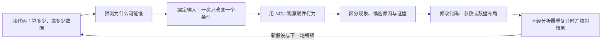
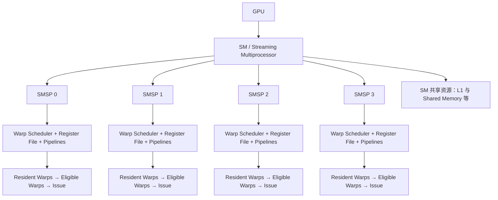
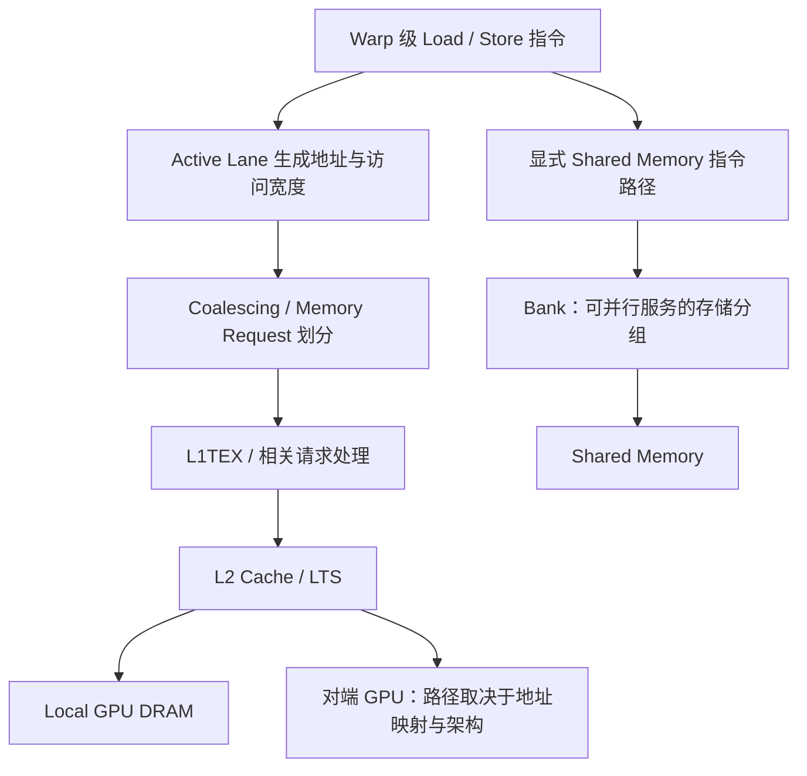
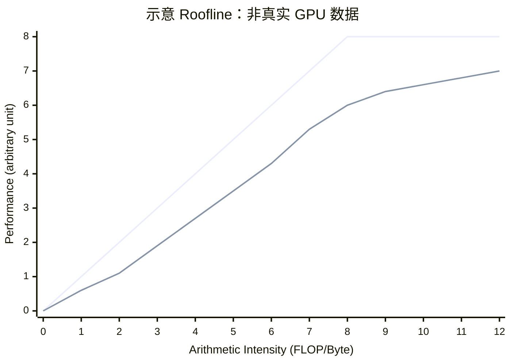
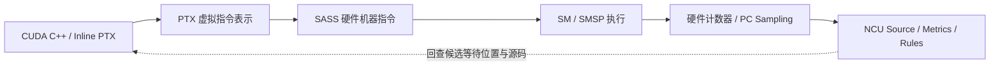
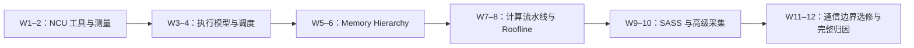
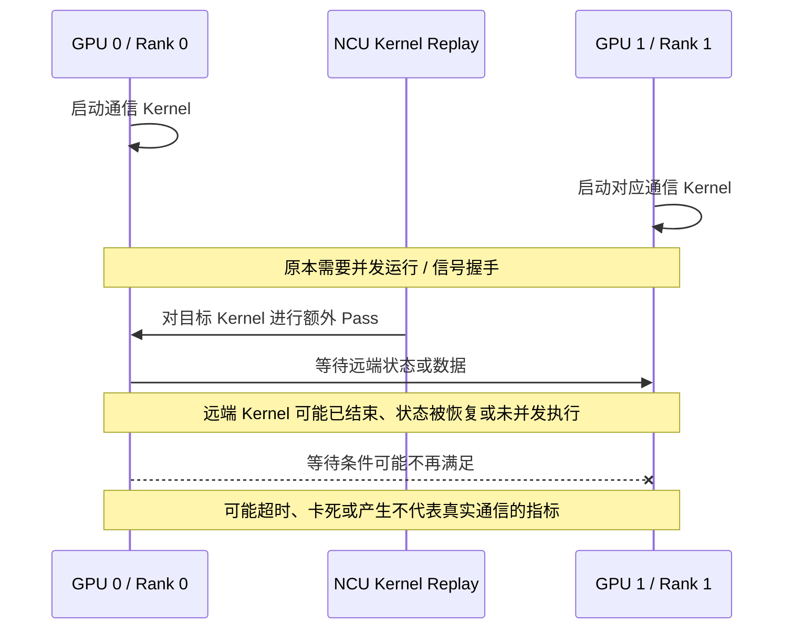
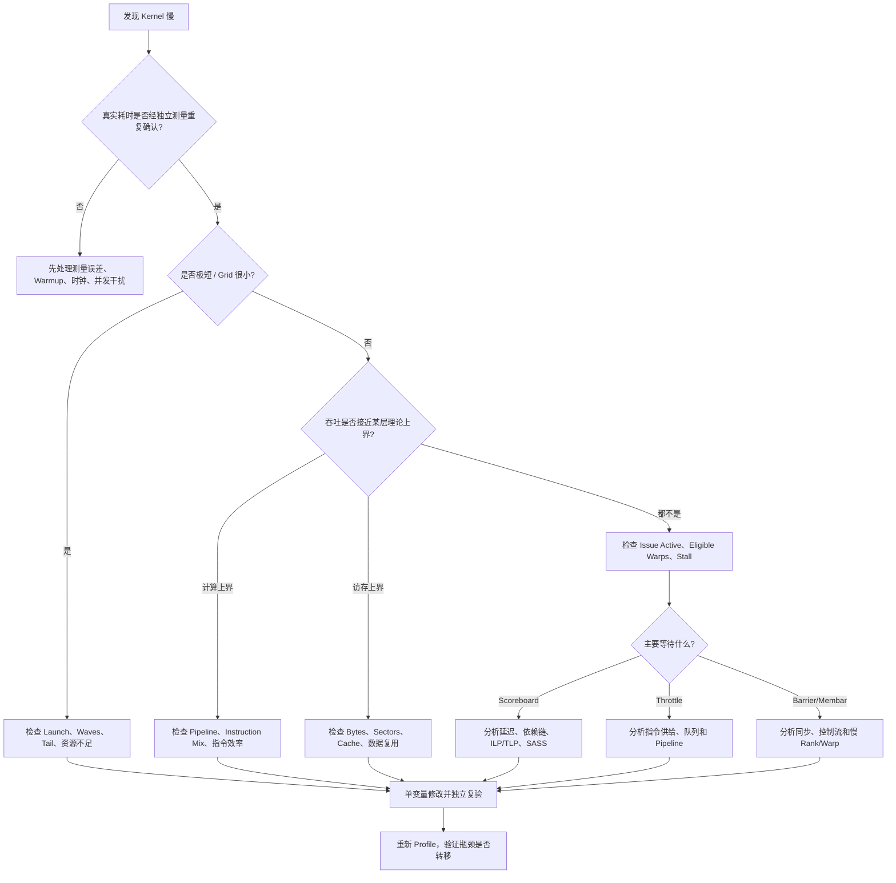

# Nsight Compute（NCU）系统学习与 GPU Kernel 性能分析实验指南

> 适用对象：具有基本函数、数组与线程知识的大一学生，以及希望系统学习 GPU 性能分析的工程师。Kernel 是由许多 GPU 线程执行的函数；本文不要求先读完 12 课，除 cache、DRAM、PTX 基础外，分析所需概念在相关正文就地解释。  
> 主线范围：先以单 GPU、常规 CUDA Core Kernel 为基础；SM90+ 的 TMA/WGMMA、CUDA Graph、多 GPU / NCCL / DeepEP / NVSHMEM 作为进阶专题。  

参考资料：
- https://docs.nvidia.com/nsight-compute/NsightCompute/index.html： 如何使用 ncu 的各个功能 
- https://docs.nvidia.com/nsight-compute/ComputeTriage/index.html: 拿到 ncu 报告后如何分析
- https://www.youtube.com/watch?v=nYSdsJE2zMs: ncu/nsys 讲解视频
---

## 1. 总目标：从“会用 NCU”到“能够证明优化有效”

NCU（NVIDIA Nsight Compute）不是用于寻找 C++ 逻辑 Bug 的传统调试器，而是用于分析 **GPU Kernel 微架构行为**的性能分析工具。“微架构行为”在这里指硬件怎样调度线程、执行指令和搬运数据，而不是算法是否算对。下面先列学习问题与目标，术语将随正文展开，不要求现在背下。它帮助回答：Kernel 的时间主要消耗在哪里？Warp 为什么不能持续发射指令？Global Memory 访问为何产生额外 Sector？Shared Memory 是否产生 Bank Conflict？Occupancy 受什么资源限制？实际性能距离吞吐上限有多远？

建议把能力目标分成三个层次：

1. **硬件层（How GPU executes）**：理解 SM/SMSP、Warp Scheduler、Instruction Pipeline、Registers、L1/L2/DRAM、Shared Memory，以及延迟隐藏机制。
2. **观测层（What NCU measures）**：理解 Section、Metric、硬件计数器、派生指标、PC Sampling、Replay、Cache Control 的测量含义与局限。
3. **归因层（Why performance changes）**：从源码构建性能模型，提出假设，选择计数器，设计对照实验，在 SASS 中寻找证据，并以独立 Benchmark 验证优化收益。

### 图 1：完整性能分析闭环（代码图）



**核心原则**：不能仅因为某个 NCU 数值“高/低”就宣称发现根因。一个合理的归因应把理论预测、硬件记录、代码行为和优化前后的独立测量相互核对。例如预测“减少数据搬运会加速”，就要同时检查流量是否减少、结果是否正确、真实耗时是否下降。机器指令层面的证据将在第 6 节引入。

### 三种工具的职责边界

**Benchmark（基准测量）**是固定输入、重复执行并记录耗时的测试；“独立”指不在 NCU 控制下计时。**Launch** 是 CPU 提交一次 Kernel 执行请求，**Stream** 是 GPU 操作的有序队列，**Memcpy** 是数据复制。比如 CPU 提交太慢，两次 Kernel 之间出现空白，这叫 launch gap；需要时间线工具看，而不是先查单条 GPU 指令。

`nsys` 是 Nsight Systems 的命令入口，`ncu` 是 Nsight Compute 的命令入口；前者看应用时间线，后者主要看所选 GPU 工作负载的内部行为。

| 工具 | 分析对象 | 最适合回答的问题 | 不擅长的事情 |
|---|---|---|---|
| `cuda-gdb` | 线程、变量、调用栈与程序状态 | 代码为什么执行错误？哪个线程状态异常？ | 定量解释微架构性能 |
| `nsys` | CPU/GPU 时间线、CUDA API、Stream、Kernel、Memcpy | Kernel 什么时候执行？有没有 CPU launch gap？计算与通信是否重叠？ | 指令与流水线细节 |
| `ncu` | 一个或一组受支持的 CUDA 工作负载的硬件指标 | 为什么 Kernel 达不到预期性能？资源、访存、调度瓶颈在哪里？ | 在所有配置下无扰动地还原应用并发与网络行为 |

推荐顺序是 **独立 Benchmark/NSYS 确定真实问题 → NCU 定位微架构原因 → 独立 Benchmark 验证修改**。

---

## 2. NCU 的知识地图

此表是导航，不是诊断表；英文是后续主题或工具页面名称。先理解下文机制，再按问题选择页面，不需要先学完表中所有模块。**Metric（指标）**是一个有明确单位与统计口径的数值；硬件计数器记录事件，派生指标再做除法等计算。**Section** 将相关指标组织成一个专题，例如启动统计；**Set** 则是一组 Section 的采集集合。

| 模块 | 核心知识 | NCU 关联组件 |
|---|---|---|
| M0 Profiling 基础 | CUDA Launch、采集开销、Replay、Cache Control、权限与环境 | CLI、UI、LaunchStats |
| M1 GPU 执行模型 | GPU → SM → SMSP → Warp → Lane，驻留与发射 | SchedulerStats、LaunchStats |
| M2 Occupancy | Registers、Shared Memory、Blocks、Resident Warps、Waves | Occupancy、LaunchStats |
| M3 Warp Scheduling | Active/Eligible/Issued Warp，Scoreboard，Instruction Dependency | SchedulerStats、WarpStateStats |
| M4 Global Memory | Coalescing、Request、Sector、Cache Hit、DRAM Traffic | MemoryWorkloadAnalysis |
| M5 Shared Memory | Banks、Conflict、Broadcast、Multicast、Wavefront | MemoryWorkloadAnalysis、Source |
| M6 Compute Pipeline | FP32/INT/SFU/Tensor Core、IPC、Throughput、ILP | ComputeWorkloadAnalysis、InstructionStats |
| M7 性能模型 | Roofline、Arithmetic Intensity、Bandwidth/Latency、Launch Overhead | SpeedOfLight、Roofline |
| M8 指令级归因 | CUDA C++、PTX、SASS、寄存器分配与 Spill、PC Sampling | SourceCounters、Source View |
| M9 高级采集 | Kernel/Application/Range Replay、NVTX、CUDA Graph、多进程 | CLI、Replay 功能 |
| M10 通信扩展 | P2P、NVLink、Polling、Fence、跨 GPU 同步、异步引擎 | NCU + NSYS + 链路计数器 |
| M11 工程化 | 报告导出、脚本、对照组、版本与日志追溯 | `ncu -o`、`.ncu-rep`、报告 API |

建议先建立 M0–M5 的基本认知，再用 M7 串联所有现象，随后进入 M6/M8 的指令级研究；最后再将方法应用于 M9–M11 的真实工作负载。

---

## 3. GPU 执行模型：理解 NCU 在观测什么

### 先认识任务、资源与调度

一次 Kernel Launch 创建一个 **Grid（网格）**，由许多 **Block（线程块，也称 CTA）**组成。普通 Block 的线程在同一个 **SM（Streaming Multiprocessor，流式多处理器）**上执行；SM 是接纳线程块、保存状态并执行指令的硬件单元。一个 Block 内每 32 个线程位置组成一个 **Warp（线程束）**，位置编号叫 **Lane**。例如每块 128 个线程就是 4 个 Warp，Lane 不等于固定的一颗物理计算核心。

**寄存器（Register）**保存线程的中间值；**寄存器文件（Register File）**是这些存储的集合。**Shared Memory（共享内存）**是同一 Block 线程显式共用的片上工作区。Block 必须取得相应资源才能**驻留（Resident / Active）**，即保留执行状态、尚未完成；等待数据时也通常仍驻留。

**SMSP（SM 子分区）**组织 SM 内的一部分调度与执行资源。**Warp Scheduler（调度器）**选择下一步可推进的 Warp；**Pipeline（流水线）**是分阶段处理指令的硬件通道，可让不同指令重叠推进。**Eligible（可发射）**表示指令输入等条件已满足，**Issue（发射）**表示调度器真正把它交给执行路径，不等于结果已经完成。例如 8 个 Warp 驻留，其中 7 个等数据、1 个就绪：Active 为 8，Eligible 为 1；只有被选中才发生 Issue。

### 图 2：SM、SMSP、Warp 的关系（代码图）



> 这是教学化的结构图：在多代 NVIDIA 架构中，典型 SM 包含四个 SMSP，但不同架构的执行单元组合、资源配额、流水线和共享组织存在差异；不要把此图当作所有 NVIDIA GPU 的晶体管级拓扑。

理解三个层次的数量非常重要：

- **Resident / Active Warps**：当前驻留在 SMSP 上的 Warp，并不意味着这些 Warp 在每个周期都具备发射条件。
- **Eligible Warps**：已准备好指令、依赖已满足且相关执行资源可用的 Warp。
- **Issued Warps / Instructions**：本周期实际被选中并发射的 Warp 指令。提高驻留数量可能改善延迟隐藏，也可能因资源压力反而损害性能。

**Occupancy（占用率）**是驻留 Warp 数占硬件可支持 Warp 上限的比例，不是“算术单元忙了多少时间”。`Theoretical Occupancy` 由资源预算推导：假设每 SM 最多 64 Warp，而当前资源只允许 4 块、每块 8 Warp，则理论值为 `4×8/64=50%`。这是第 03 课的静态问题。

`Achieved Occupancy` 是运行中活跃 Warp 的测量值按指定周期和硬件实例聚合、归一化得到的比例。第 04 课才分析实际工作不足、启动退出及负载不均造成的差距，再分析就绪与发射。它不能直接用“总 Warp 数/全 GPU 容量”替代；某些指标按活动周期而非全部经过周期归一化，未工作的单元如何进入分母必须查指标说明。**优化目标不是最大化 Occupancy，而是提高有用工作吞吐并降低真实耗时。**

### 常见 Warp Stall 解释

**Stall（停顿）**表示 Warp 的下一条指令暂时不能发射。**Scoreboard（依赖跟踪机制）**记录尚未完成的结果：例如 `x=load(a)` 从地址 a 读数据，后面的 `y=x+1` 必须等 `x` 返回，后者是消费者（Consumer），前者是生产者（Producer）。**Issue Slot（发射机会）**是调度器可提交指令的机会；一个 Warp 等待时，其他就绪 Warp 可能接替，因此局部等待不等于全 SM 停工。

表中 **L1TEX** 是包含 L1、纹理及相关访存处理路径的硬件整体；**MIO** 指共享内存、部分特殊操作等使用的内部指令处理路径，具体分类随架构变化。**Throttle** 是队列或执行路径暂时无法继续接收指令。**Barrier** 要求参与线程在同步点会合；**Membar（内存栅栏）**约束内存操作顺序，不等于线程全都到齐。**Issue Active** 通常描述有指令发射的周期占指定周期的比例，不是浮点运算吞吐。下面先区分等待类型，地址、流量和共享内存冲突的机制在第 4 节展开。

| 现象 | 通常表示什么 | 不能直接推断什么 | 推荐交叉检查 |
|---|---|---|---|
| Long Scoreboard 高 | 等待 L1TEX 路径操作产生的依赖结果 | 带宽是单位时间搬运字节数；等待久不能直接等价于 DRAM 带宽饱和 | 第 4 节各层流量、Eligible Warps、第 6 节消费者指令 |
| Short Scoreboard 高 | 等待 MIO 路径操作的依赖，常见于 Shared Memory 等 | 不能一概归因于共享内存访问冲突 | 第 4 节共享内存拆分与冲突、第 6 节机器指令 |
| LG Throttle 高 | 局部/全局内存访问的发射队列压力；局部内存是线程私有但通常由显存承载的地址空间 | 不一定是 DRAM 吞吐已经达到极限 | 读/写指令频率、局部内存流量、访存分析页面 |
| MIO Throttle 高 | MIO 相关指令队列压力 | 不一定仅由 Shared Memory 导致 | 共享访问、特殊指令、运行时分支与各类指令的比例 |
| Math Pipe Throttle 高 | 所需计算流水线暂时不能接收指令 | 不代表全 GPU 计算利用率必然接近峰值 | 计算分析页面、各种指令所占比例 |
| Barrier / Membar 高 | 等待线程同步或内存顺序约束 | 不一定是 Barrier 指令本身执行成本高 | 机器指令、各线程走的分支是否不均、同步点前的慢路径 |
| Not Selected 高 | Warp 可发射，但本周期选择了其他 Warp | **不是严格意义的 Stall 根因** | Issue Active、活跃 Warp、实际耗时 |

Warp Stall 统计需要结合采样与分母解释。**采样**只在若干观察时刻记录状态，不是连续给每条指令计时。若某类状态占 100 个有效样本中的 40 个，只能先说该口径下占 40%，不能说它消耗了 Kernel 时间的 40%。有些指标给的是每条已发射指令对应的等待周期数，而不是百分比；须核对单位、采样总体、活动/经过周期、按 SM 还是 SMSP 求和或平均。重点是检验发射机会是否空转、减少等待后是否真的加速。

---

## 4. Memory Hierarchy：从 Lane 地址到实际数据流量

**Load / Store** 是读/写数据的指令。一个 Warp 执行访存指令时，参与的 Lane 各自给出地址。**Coalescing（合并访存）**把相邻地址组合处理，以减少额外搬运；**Request（请求）**是某层硬件接收的一次工作，**Sector（扇区）**是流量统计常用的固定大小数据单元，本文简化例子按 32B 计。例如 32 个线程各读 4B 连续数据，覆盖 128B，即 4 个 Sector；不是 32 次独立 DRAM 读取。

全局内存是各线程可寻址的数据空间；访问具体经过哪些缓存取决于指令、地址和策略。图中的 **LTS** 是 L2 相关硬件切片的指标前缀；**P2P（Peer-to-Peer）**指直接访问另一 GPU 的内存，因此不是每条全局访问最后都到本卡 DRAM。Shared Memory 则走显式的块内共享访问路径。图中 Bank（存储体）是可并行服务的共享内存分组，冲突与广播的例子随后解释。

### 图 3：Global Memory 与 Shared Memory 路径（代码图）



> 逻辑示意，省略多级队列、片上网络、内存分区、缓存策略与具体协议。Shared Memory 是显式可编程存储空间，不是 Global Load 必经的下一级 Cache。

### Coalescing 的基础推导

对一个 Warp 中的 32 个 Lane，如果每个 Lane 访问一个 4B 元素：

- 若地址 128B 对齐且完全连续，覆盖 `32 × 4B = 128B`，在典型 32B Sector 模型下涉及 **4 个 Sector**。
- 若相邻 Lane 间隔 8B，访问地址为 `base + lane × 8B`，在相同对齐前提下可涉及 **8 个 Sector**。
- 若相邻 Lane 间隔 32B，则可涉及 **32 个 Sector**。

上述是教学模型中的单条 Load 指令、单次访问地址覆盖结果；实际计数受对齐、指令宽度、Cache、架构与 Request 划分方式影响。**Predication（谓词执行）**是用条件决定哪些 Lane 真正执行该操作，例如只有 `i<N` 的 Lane 参与最后一次读。实验任务是在运行前给出预测，再将 NCU 中相关 L1TEX Request/Sector 指标与预测值对照。

统计时必须分层：程序需要的逻辑字节、L1TEX 请求/扇区、L2 流量和 DRAM 传输量不相等。`Sectors/Req` 是同层、同类操作的扇区数除以请求数，单位是 Sector/Request；不能把 L1 的比值直接套到 L2。缓存命中率也要查是按请求还是按 Sector 计数，限定了读、写还是全部操作，不能由“命中 80%”直接推算耗时减少 80%。

### Shared Memory Bank 模型

Shared Memory 的 **Bank** 可并行服务不同数据。**Bank Conflict（存储体冲突）**指同一次服务中，同一 Bank 的不同字需要分次处理；例如两个 Lane 读相隔 128B 的不同 4B 字，在典型模型下会映射到同一 Bank。**Broadcast（广播）**则是多个 Lane 读同一个字时共用一次服务；多个这样的读者组常称 Multicast（多播）。这与不同地址的冲突不同。

**Wavefront** 是共享内存等 L1TEX 路径的一次内部服务工作包，用来描述请求要拆成多少份处理；宽访问即使没有冲突，也可能需要多份。因此应比较实际拆分数与该访问宽度的理想拆分数，不能把所有 Wavefront 都算成冲突。它也不是第 5 节表示整批线程块容量的 Wave。

对典型 32 Bank、每个 Word 为 4B 的模型，可用下式理解访问映射：

```text
bank_id = floor(byte_address / 4) mod 32
```

式中 `byte_address` 是字节地址，先除以 4 取整得到字编号，再对 32 取余得到 Bank 编号。例如地址 0 和 4 对应 Bank 0 和 1，地址 128 又回到 Bank 0。这里的 `stride` 表示相邻 Lane 相隔多少个元素，可通过 `1, 2, 4, 8, 16, 32` 构造对照。**Vectorized Access（向量化访问）**指每线程一条指令读写多个标量，可能需要多个理想 Wavefront；**不能简单地把“多个 Lane 映射到同一 Bank”一律判定为 N 路冲突**。

转置常把矩阵分成小块暂存到 Shared Memory，这叫 **Tiling（分块）**。**Padding（填充）**给每行增加不用作输出的存储，例如 `tile[32][33]` 比 `tile[32][32]` 每行多一个字，使读列时的 Bank 映射错开；代价是更多 Shared Memory，可能影响驻留容量。

---

## 5. 性能模型：吞吐、带宽与延迟

**延迟（Latency）**是单次操作从发起到结果可用的时间；**吞吐（Throughput）**是单位时间完成多少工作，**带宽（Bandwidth）**是以 Byte/s 计的数据吞吐。例如一条路径每次读取需等待 100ns，却能重叠处理许多请求，因此不能用 `1/100ns` 当作整条路径的总吞吐。

### 5.1 Roofline

**FLOP** 是一次浮点算术操作；**FLOPs** 表示操作总数，**FLOP/s** 表示每秒操作数。FP32 是 32 位浮点数；一次 **FMA（融合乘加）**计算 `x*a+b`，通常计 2 FLOPs，但可能是一条指令，不是两个发射机会。整数寻址不计入浮点 FLOPs。

**算术强度（Arithmetic Intensity，I 或 AI）**表示每搬运一字节做多少 FLOP，用于判断计算与数据搬运哪个上限更紧。比如 `C[i]=A[i]*B[i]` 每元素 1 FLOP，FP32 逻辑读写共 12B，所以逻辑 AI 为 `1/12 FLOP/Byte`；实际 DRAM 字节还要测量。

**Roofline（屋顶线）**把计算吞吐上限和数据带宽上限画成一条“屋顶”，用于估计性能上界，而不是直接认定瓶颈。下面 `P` 是 FLOP/s，`P_peak` 是所选精度/指令类型的峰值算力，`B_peak` 是所选存储层的 Byte/s；`I×B_peak` 的单位也是 FLOP/s。两种上限必须同时满足，所以取较小值：

$$
P_{\text{attainable}} = \min\left(P_{\text{peak}},\ I\cdot B_{\text{peak}}\right), \qquad
I = \frac{\text{FLOPs}}{\text{Bytes}}.
$$

要先明确 `Bytes` 的统计层次：以 DRAM 字节计算得到的算术强度，与以 L2 / L1 流量计算的算术强度不是一回事。对于很短的 Kernel、长依赖链、频繁同步、通信轮询和资源不足的情况，简单 Roofline 不足以解释实际延迟。

### 图 4：Roofline 示意图（Mermaid 数据图代码）



第一条线表示理论 Roofline 上界，第二条线表示假设的实测吞吐。曲线和单位仅作概念展示，真实实验应使用本机 FLOP/s 与 Bytes/s；Mermaid 版本不支持 `xychart-beta` 时，可直接阅读数组，或改用 Python/Matplotlib 输出。

### 5.2 另外三类必须掌握的模型

1. **ILP 与 TLP：如何用其他工作填补等待。** ILP（Instruction-Level Parallelism，指令级并行）来自同一线程的独立操作：`x=fma(x,a,b)` 要等旧 `x`，而独立的 `y=fma(y,a,b)` 可提供另一个推进机会。TLP（Thread-Level Parallelism，线程级并行）来自不同线程/Warp 的工作：一个 Warp 等待，调度器可选另一个。两者都可能隐藏延迟，但更多累加器会消耗寄存器，更多 Warp 也受资源上限限制。
2. **Little's Law（在途数量直觉）**：在稳定条件下，平均在途数量约等于完成速率乘以平均延迟。例如每周期要完成 1 个请求、每个请求平均延迟 100 周期，就约需 100 个在途请求。这里的“在途”指已发出尚未完成，必须使用同类请求、同一观测边界；不能把字节速率直接乘周期得到请求数。
3. **Launch / Sync / Tail Overhead**：分别是启动、同步和尾部不均衡开销。**Wave（工作波次）**用 Grid 块数除以全 GPU 同时可驻留块容量估计，例如容量 320 块、Grid 400 块，约为 `1.25 waves`；不是硬件必须等整波完成才开启下一波。**Tail（尾部）**是后续工作耗尽、只剩少量慢块或慢 Warp 的阶段。微秒级 Kernel 可能主要受这些因素影响，而非峰值算力。

---

## 6. 从 CUDA 到 SASS：建立代码与指标的联系

PTX 是虚拟指令表示，**SASS** 是编译后面向具体 GPU 的机器指令。例如源码一次 `fmaf` 可能对应一条 `FFMA`，而一次复杂表达式可能对应多条指令。分析 SASS 是为了确认实际执行了什么，而不是把源码行数当作工作量。

**PC（Program Counter，程序计数器）**指示指令地址；**PC Sampling** 定期观察 Warp 所处的指令位置及状态。若消费者 `y=x+1` 因加载结果未返回而等待，样本可能落在消费者处，不能因此断言加法本身很慢。Source 页面把源码行、PTX、SASS 及相关观测联系起来；**Rules** 是根据指标给出提示的分析规则，不是根因证明。

**Register Spill（寄存器溢出）**是编译器把部分本想保留在寄存器的值放到线程私有的 Local Memory。Local Memory 还可能来自数组等原因，因此有局部内存访问不等于已经证明 Spill。须结合编译器报告和实际读写指令判断。

### 图 5：源码到硬件行为（代码图）



**PTX 与 SASS 并非一一映射**。编译器可能合并、展开、重排和改变指令形态；应优先分析最终机器指令与真实观测结果，而不是仅从 PTX 文本估计工作量。

下列为编译/查看模板，不是本目录现成程序的命令：先把 `kernel.cu`、输出名替换成实际路径，并按目标 GPU 与工具链选择架构；编译成功后才能查看本次产物。`nvcc` 是 CUDA 编译器，`-O3` 开启优化，`-lineinfo` 保留源码行映射，`-Xptxas=-v` 请求设备代码汇编器报告资源用量；`-o` 指定输出文件，`-ptx` 只生成 PTX。`cuobjdump --dump-sass` 用于从二进制读取机器指令，不会运行 Kernel：

```bash
nvcc -O3 -lineinfo -Xptxas=-v kernel.cu -o kernel

# 查看二进制中的 SASS（需要 CUDA 工具支持）
cuobjdump --dump-sass ./kernel

# 如果需要查看 PTX，可直接生成 PTX 文件
nvcc -O3 -lineinfo -ptx kernel.cu -o kernel.ptx
```

`-lineinfo` 主要用于源代码行号映射，通常不需要为了性能分析使用改变代码生成行为的 `-G`。SourceCounters、InstructionStats、Source/SASS 视图要与程序实际编译参数保持一致。

---

## 7. 学习路线

### 先理解一次采集会怎样改变程序

**Profiling（性能采集）**让工具记录运行行为。硬件同时能采的事件有限，NCU 可能把所需指标分成多组；采一组的一轮叫 **Pass**。**Replay（重放）**是为补采而重复执行 Kernel、应用或指定范围的机制。例如一个报告需要三组互不兼容的计数器，就可能经历多 Pass；报告中的数值不一定来自同一次物理执行。第 10 节再比较各模式。

**Warmup（预热）**先执行几次以完成初始化、首次编译等。**Cache Control** 决定采集时是否主动刷新缓存；刷新称 Cache Flush。**Clock Control** 尝试控制 GPU 运行频率，支持与实际效果受环境限制。它们用于提高可比性，但也可能改变正常程序条件。**CUDA Event** 是插入 GPU 操作队列的时间标记，两标记间的时间用于独立计时；它与分析器测到的 Duration（采集对象耗时）、整个命令的墙钟时间都不是同一口径。

**NVTX（NVIDIA Tools Extension）**让程序给代码区间贴名字，例如把五次矩阵乘命名为 `target_gemm`，工具便可按名字选择区间；标注本身不会让 GPU 同步。**CUDA Graph** 把一组操作及依赖预先表示为图再提交，用于降低重复提交开销，是否支持相应采集模式须查版本。NCU 的 **CLI/UI** 分别是命令行/图形界面；Details 看概要，Raw 看原始指标，Source 看源码与指令，Baseline 是用于比较的参考报告。这样就能理解下表中的采集任务，而不必先读完 12 课。

### 图 6：六阶段学习流程（代码图）



以下 W1–W12 对应 `01_`–`12_` 课程目录，每课包含 `lecNN.md`、`labNN.md`、`kernels/main.cu` 和本课 `commands/` 日志路径。具体实验以 [12 课配套实验总纲](README_experiment_curriculum.md) 为准；[文件索引](README.md#12-课课程目录)列出一一对应的路径。12 课的最小源码与实验设计已提供；当前状态及历史验证范围见 [README](README.md#本次验证范围)，各课细节见 lab。历史日志不验证改后的源码，静态预测也不是实测。

| 顺序 / 目录 | 核心主题 | 实验 | 必须交付的结果 |
|---|---|---|---|
| [W1](01_ncu_basics/) | CLI/UI、Section、Metric、Kernel 过滤 | A：Vector Multiply（旧 Vector Add 数据仅作历史记录） | 第一份 `.ncu-rep`、Raw 导出与指标解释 |
| [W2](02_replay_and_measurement/) | Replay、Cache Control、测量误差 | Warmup、Cold/Warm Cache、不同 Pass | 实验误差与 Replay 影响说明 |
| [W3](03_occupancy/) | GPU → SM → SMSP 硬件分层、存储作用域、静态资源约束与理论 Occupancy | 根据 Block Size、寄存器与 Shared Memory 需求手算，并用编译报告/Occupancy API 核对 | 每项资源允许的驻留块数、限制因素与理论 Occupancy 计算表 |
| [W4](04_warp_scheduling/) | 实际驻留与 Tail、Active → Eligible → Issued、Scoreboard 与运行时等待 | D：串行/多链 FMA；C：Reduction；对照理论容量、实际驻留与发射 | 区分驻留不足和就绪不足，完成 Stall/Issue 与 ILP 的因果分析 |
| [W5](05_global_memory/) | Request/Sector/Wavefront、Cache/DRAM | 仅 A：连续、偏移、跨步读/写、仅 b 广播 | 地址预测与分层指标口径解释，不以性能优化为主 |
| [W6](06_shared_memory_and_transpose/) | Shared Memory、Transpose、Bank Conflict | Naive/Tiled/Padded Transpose | Global 和 Shared 访存优化报告 |
| [W7](07_compute_pipeline/) | 计算流水线、各类指令的组成比例 | D：单链/多链 FMA | 指令吞吐与 Pipeline 分析 |
| [W8](08_roofline_and_performance_models/) | Roofline、带宽上界与延迟模型 | A/D：访存与计算参考；B：Transpose | FLOPs/Bytes、性能上界与耗时下界模型 |
| [W9](09_ptx_sass_and_source/) | PTX/SASS、SourceCounters、寄存器 Spill | D：依赖与寄存器压力；B/C：访存和同步指令 | Source↔SASS↔Metric 证据链 |
| [W10](10_advanced_profiling/) | NVTX、Replay 模式、CUDA Graph、进程与报告 | Python/PyTorch/多进程 | 不同执行模式采集方案对照 |
| [W11](11_multi_gpu_communication_async_engines/) | 通信与异步引擎观测边界（选修） | 硬件具备时做最小 P2P Copy | NCU/NSYS 与系统指标的观测边界 |
| [W12](12_end_to_end_performance_attribution/) | 完整归因验收 | B：Naive/Tiled/Padded；C 或 D：迁移验证 | 可复现的完整性能归因报告 |

### 阶段一（W1–2）：NCU 工具与测量科学

重点掌握 `ncu --set basic`、Kernel Name 过滤、`-s/-c`、`--section/--metrics`、NVTX、报告导出、GUI Details/Source/Baseline，以及 Profiling 时可能发生的多次 Replay、Cache Flush、Kernel 序列化（把原本可能重叠的执行改为依次执行）和时钟控制。需要区分 CUDA Event、NSYS 和 NCU 测得的 Kernel Duration；如果数字不同，先核查测量模型，而非立即修改代码。

**验收**：同一个简单 Kernel 生成至少三种报告（Basic、Memory、Scheduler）；能解释 Metric 的测量单位、归一化方法、采集 Pass 与误差来源。

### 阶段二（W3–4）：GPU 执行、Occupancy、Warp 调度

**W3 先回答“硬件最多装得下多少工作”。** 从 GPU 整体硬件分层与存储作用域开始，区分软件的 Grid/Block/Warp/Thread 和硬件的 SM/SMSP/执行单元。取得设备资源上限和编译后的 Kernel 资源需求，分别计算线程、Warp、块槽位、寄存器和 Shared Memory 允许的驻留块数，取最小值推导理论 Occupancy，再检查分配粒度与 Occupancy API 的核对结果。此时不展开逐周期调度和 Stall 诊断。

**W4 再回答“实际装了多少，以及装进去的工作能否推进”。** 先分析 Grid 规模、启动退出、负载不均与尾部效应为何使实际驻留偏离静态上限，再学习 Active → Eligible → Issued、Scoreboard、延迟隐藏和 Stall 分类。必须区分两种差距：Theoretical 与 Achieved 的差距是实际驻留问题；Active 与 Eligible 的差距是下一条指令的就绪问题。等待数据或同步的 Warp 通常仍保持驻留，不能把 Stall 直接解释成 Occupancy 下降。实验保持计算任务不变，逐一改变 `blockDim`、独立依赖链数等变量，结合独立计时检验假设。

**验收**：能解释“低 Occupancy 但高吞吐”和“高 Occupancy 但严重 Long Scoreboard”两类情况，而不是把 Occupancy 当作最终目标。

### 阶段三（W5–6）：Global / Shared Memory

W5 只用向量乘法的两读一写理解 Lane 地址、Request/Sector/Wavefront、Cache Hit/Miss 和 L1TEX/L2/DRAM 流量，不以性能优化为主。W6 再引入 Transpose、Shared Memory Bank Mapping、Broadcast/Multicast 和 Padding，对照同一转置算法的不同实现。所有 Memory 实验先写理论地址表，再采集 NCU。

W5 已在本课 [vector_access.cuh](05_global_memory/kernels/vector_access.cuh) 实现连续、偏移、跨步读、跨步写及仅 b 广播，复用共享 kernel、计时与 RAII，每次编译只选一个版本。当前仅完成静态检查，尚未 CUDA 编译、运行或采集；接口、命令、地址预测和待测表统一见 [lab05](05_global_memory/lab05.md)。

**验收**：W5 能手算部分/完整/尾部 Warp，区分 Load/Store、Lane 逻辑字节、唯一输入、分配足迹及各层流量，不把静态地址模型当作运行正确性测试，不跨参与 Lane、访问宽度或读写口径机械比较比值。W6 再通过 Naive→Tiled→Padded Transpose 展示 Global Memory 和 Shared Memory 两个层次的变化。

### 阶段四（W7–8）：指令流水线与性能模型

**Instruction Mix** 是各种指令的组成比例。FP32 路径处理单精度浮点运算，INT 处理整数，SFU（特殊函数单元）处理部分专门数学运算，Tensor Core 处理支持的矩阵运算；它们的峰值不能混作一个上限。**IPC（Instructions Per Cycle）**是指定统计范围的指令数除以周期数，必须核对按 Warp 还是线程计数、按 SM 还是 SMSP、按活动还是经过周期。重点掌握这些路径、IPC、ILP、算术强度和分层 Roofline。还要学习小规模 Kernel 受启动、Waves 和同步制约时的延迟模型。

**验收**：可独立计算一个简单 Kernel 的 FLOPs、理论 Bytes、AI、算力/带宽性能上界，并说明实测值偏离模型的原因。

### 阶段五（W9–10）：SASS / Source 与复杂采集

通过 `-lineinfo`、NCU Source View、`nvdisasm` / `cuobjdump` 分析指令选择、寄存器与 Spill、指令依赖和源码映射；进一步了解 Kernel Replay、Application Replay、Range Replay，NVTX 和 CUDA Graph 的采集范围。Range Replay 的指标可能属于 **整个范围**，不能默认分摊给单个 Kernel。

**验收**：对一个热点函数，能够从 CUDA 代码行指出相关 SASS、目标指标和优化操作，并解释 Replay 对结果的影响。

### 阶段六（W11–12）：通信边界选修与完整归因

第 11 课为通信与异步引擎观测边界选修，硬件满足时开展最小 P2P Copy；不将单卡四例冒充多 GPU 通信实验。第 12 课复用 B 的 Naive/Tiled/Padded Transpose，完成“假设 → 修改 → NCU 证据 → 独立性能收益 → 局限”，再用 C 或 D 验证方法迁移。源码、实验文档与各动作日志都在所属课程路径中对应。

**验收**：交付一份他人可复现的性能归因报告，而非只提交 NCU 截图或一个优化后的数字。

---

## 8. 建议实现的实验库

这是主题候选清单，不代表 13 个独立工程都已实现。主线仍复用第 7 节的 A/B/C/D；空 Kernel、额外 Load-Use 等只在需要隔离问题时作为扩展。表中 **Reduction（归约）**把多个元素汇总为一个值，例如求和；**Warp Shuffle** 让同 Warp 的线程直接交换寄存器值，避免必须经共享内存中转。实际入口与实现状态以各课文档为准。

| 实验编号 | Kernel / 工作负载 | 控制变量 | 主要观察项 | 需要写下的归因问题 |
|---|---|---|---|---|
| E01 | 空 Kernel 与 Vector Add | Grid/Block、循环次数 | Duration、LaunchStats | 最小可测时间与分析工具开销？ |
| E02 | Occupancy Microbenchmark | Block Size、Registers、Shared Memory | Occupancy、LaunchStats | 哪个资源限制 Resident Warps？ |
| E03 | FMA 依赖链 | 独立累加器个数、展开 | SchedulerStats、WarpStateStats | 提升 ILP 是否提高 Issue Active？ |
| E04 | Load-Use 依赖 | Working Set、并发 Warp 数 | Long Scoreboard、Memory | 延迟限制和带宽限制如何区分？ |
| E05 | Coalescing | 连续、Stride、错位地址 | L1TEX Sectors/Requests | 实际 Sector 与计算预测是否相符？ |
| E06 | Cache Hierarchy | Working Set、重用次数、Cache Policy | L1/L2 Hit、DRAM Traffic | 热缓存与冷缓存的测量是否可比？ |
| E07 | Shared Memory | Stride、Padding、同址广播 | Wavefront、Bank Conflict | Bank Conflict 何时变成性能瓶颈？ |
| E08 | Matrix Transpose | Naive、Tiled、Padded | Memory、Shared、Duration | 优化是减少无效流量还是减少冲突？ |
| E09 | Reduction | Warp Shuffle、Block Reduce、同步策略 | Occupancy、Stall、Instruction | 同步与指令数量是否是主要限制？ |
| E10 | Arithmetic Intensity | FLOPs/Byte、数据规模 | Roofline、ComputeWorkload | 实际落点距离理论上界多远？ |
| E11 | PTX/SASS 对比 | Load Width、展开、Register Pressure | SASS、SourceCounters、Spill | PTX 变化是否真的转化为机器指令收益？ |
| E12 | Python/PyTorch/NVTX | Warmup、捕获范围、进程数 | 采集正确性与 Replay 行为 | 目标 Kernel 是否被准确采集？ |
| E13（进阶） | P2P Copy / 轮询（反复读状态） | 消息大小、对端数、同步方式 | GPU 指令 + NSYS 时间线 | GPU 局部 Stall 与端到端延迟如何关联？ |

### 重点实验 A：Coalescing

按 [lab05](05_global_memory/lab05.md) 先画五种地址模式的 Lane 读写地址，分开计算 a/b/c 的 Sector，再对照分层指标。保持逻辑输出数与值不变；时间仅作辅助，分析时同时记录足迹、唯一输入、对齐、缓存与可能的代码生成差异。

### 重点实验 B：Warp Scheduler

在控制总体运算量尽量相同的前提下，将单一累加器的串行 FMA 链改成多个独立累加器，观察 Issue Active、Eligible Warps 和相关 Stall 是否改善。随后再增加寄存器压力，观察 ILP 提高是否可能因 Occupancy 下降而出现收益拐点。

### 重点实验 C：Transpose

从 W6 开始比较三种版本：Naive（Global Store 不合并）、Tiled（使用 Shared Memory 改变数据布局）、Padded（降低可能的 Bank Conflict）。不要只比较最终带宽，要对每个版本说明 Global Sector、Shared Wavefront、Occupancy 和总时间的变化方向。

---

## 9. NCU 常用命令模板（按实际程序与环境替换）

本节代码块采用 Bash 写法，**不是一套可原样运行的现成实验**。9.1 的工具查询命令在已安装 NCU 的环境可直接调用；其余必须先确定工作目录，替换 `kernel.cu`、`./kernel`、`test.py`、`bench.py`、`multi.py`、`train.py` 等示例文件名，以及 `my_kernel`、`my_compute_kernel` 等过滤表达式。这些不是仓库承诺存在的文件或函数；本课程的真实路径见 [README](README.md#12-课课程目录)，应先显式编译对应入口，再使用实际产物。

还需满足 CUDA/驱动、计数器权限、Python/PyTorch 或多 GPU 等相应前提，按实际程序替换输入参数，并确认目标至少启动了足够次数。`-k` 选 Kernel，`-c` 限制采集次数，`-s` 跳过匹配的启动；`--section`/`--set` 选采集内容，`-o` 指定 `.ncu-rep` 格式报告名，`-i` 导入已有报告。Raw 页面可导出 CSV（用逗号分隔字段的表格文本），便于核对原始值。先用少量指标确认对象，输出目录须存在；不要覆盖被引用的旧报告。多进程、NVTX 等选项的具体支持须查本机 `ncu --help`，不能把模板当作兼容性验证。

### 9.1 检查版本与可用 Section

```bash
ncu --version
ncu --list-sets
ncu --list-sections
ncu --query-metrics
```

### 9.2 C++/CUDA 程序：先发现，再精确分析

```bash
# 编译：保留源代码行号
nvcc -O3 -lineinfo kernel.cu -o kernel

# 基础扫描
ncu --set basic -c 10 ./kernel

# 跳过前 10 次目标 Kernel，只分析随后 1 次
ncu --set full \
    --kernel-name-base function \
    -k 'regex:my_kernel' \
    -s 10 -c 1 \
    -o kernel_full \
    ./kernel
```

`-s 10` 只对满足过滤条件的 Kernel launch 计数，而非无条件跳过程序的前十个 Kernel。

### 9.3 只采集访存或调度相关 Section

```bash
# 访存
ncu --section MemoryWorkloadAnalysis \
    --section SpeedOfLight \
    -k 'regex:my_kernel' -c 1 \
    -o memory_report ./kernel

# Scheduler 与 Occupancy
ncu --section SchedulerStats \
    --section WarpStateStats \
    --section Occupancy \
    -k 'regex:my_kernel' -c 1 \
    -o scheduler_report ./kernel

# SASS 与指令分析
ncu --section SourceCounters \
    --section InstructionStats \
    -k 'regex:my_kernel' -c 1 \
    -o source_report ./kernel
```

各 Section/Metric 是否支持，取决于 NCU 版本和目标 GPU 架构；遇到不可用项时以 `--list-sections`、`--query-metrics` 为准。

### 9.4 Python / PyTorch

```bash
# Python 程序中调用 CUDA Kernel 时，可直接用 ncu 启动解释器
ncu -k 'regex:my_kernel' -c 1 \
    -o python_kernel \
    python test.py --batch-size 32

# 用 CUDA Profiler Start/Stop 包围目标区间时
ncu --profile-from-start off \
    -k 'regex:my_kernel' -c 1 \
    -o pytorch_target \
    python bench.py
```

PyTorch 中通过 NVTX 选取目标代码段的示例（需自行保存为实际脚本，例如 `bench.py`；它与上面仅含文件名的模板不是同一份已提供程序）。前一个 `--profile-from-start off` 模板另要求应用实际调用 `cudaProfilerStart/Stop` 或框架对应接口，否则不会自动开始采集。下面的 NVTX 示例则不依赖该开关；`synchronize()` 用于等待 GPU 工作完成，区间名末尾的 `/` 按 NCU 的 push/pop 范围匹配语法使用：

```python
import torch

x = torch.randn(4096, 4096, device="cuda")
w = torch.randn(4096, 4096, device="cuda")

for _ in range(10):
    y = x @ w

torch.cuda.synchronize()
torch.cuda.nvtx.range_push("target_gemm")

for _ in range(5):
    y = x @ w

torch.cuda.synchronize()
torch.cuda.nvtx.range_pop()
```

```bash
ncu --nvtx --nvtx-include 'target_gemm/' \
    --set basic -c 1 \
    -o target_gemm \
    python bench.py
```

### 9.5 Python 子进程与 torchrun

**子进程**是当前程序启动的另一个进程；`torchrun` 是 PyTorch 的多进程启动工具，**Worker/Rank** 是参与任务的进程及其编号。例如两 GPU 常各有一个 Rank，双方通信时可能必须共同推进。以下仅展示采集方案，脚本须已实现相应逻辑，`--nproc_per_node=2` 也要求实际资源与程序配置匹配。

```bash
# 捕获当前进程及其子进程中可被 NCU 跟踪的 CUDA 工作负载
ncu --target-processes all \
    -k 'regex:my_kernel' -c 1 \
    -o multiprocess \
    python multi.py

# 单机 torchrun 示例：先用独立计算 Kernel 验证采集
ncu --target-processes all \
    -k 'regex:my_compute_kernel' -c 1 \
    -o torchrun_compute \
    torchrun --standalone --nproc_per_node=2 train.py
```

对于真正需要多个 Rank 同时运行的通信 Kernel，不要默认使用普通 Kernel Replay；某一 Rank 被重复执行时可能等待其他 Rank 而超时或卡死。支持相应功能的 NCU 版本提供单机进程树的共享内存协调模式，示意命令如下：

```bash
# 进阶：要求版本/系统支持，且实际匹配的并发工作负载满足协调采集约束
ncu --communicator shmem \
    --communicator-shmem-num-peers 2 \
    --target-processes all \
    -k 'regex:nccl.*' \
    -c 1 -o nccl_concurrent \
    torchrun --standalone --nproc_per_node=2 train.py
```

这个模式不是多卡通信 Profiling 的通用开关，必须核查目标 NCU 版本的支持矩阵、允许的 Replay 类型、进程数量、NVTX/Kernel Filter 和同步要求；跨节点 MPI 需要独立考虑 TCP 协调与输出命名。

### 9.6 报告查看、导出与比对

```bash
# 报告以 .ncu-rep 格式存储
ncu -i kernel_full.ncu-rep

# 导出文本/CSV 形式的原始指标（导出形式依版本支持）
ncu -i kernel_full.ncu-rep --page raw --csv > kernel_full_metrics.csv

# 在具备图形界面的环境使用 ncu-ui 打开
ncu-ui kernel_full.ncu-rep
```

---

## 10. 正确解释 NCU：采集方法与误差

### 10.1 Replay 机制

第 7 节已说明为何要多 Pass。这里按**重复执行的对象**区分模式：Kernel 是单个 GPU 函数的执行，Application 是包含 CPU 准备过程的整个应用，Range 是选定的一段 CUDA 操作。例如两条本来并发的 Kernel 若需要整体观察，应核查范围级采集能否保留其关系，而不是假定分别重放后仍代表原应用。

| 模式 | 行为概念 | 适用情况 | 风险或注意点 |
|---|---|---|---|
| Kernel Replay | 同一 Kernel 通过多次 Pass 收集指标；保存/恢复部分内存状态 | 独立、确定性的计算 Kernel | 可能破坏跨进程同步、缓存与并发条件 |
| Application Replay | 多 Pass 重新运行应用并匹配 Kernel | 依赖宿主侧交互或应用准备状态的场景 | 应用重新启动成本大；需要可重复执行 |
| Range Replay | 捕获并重放指定 CUDA API/Kernel 范围 | 需要保留范围内并发行为的工作负载 | 指标针对整个 Range，不一定能逐 Kernel 归属 |
| Application Range Replay | 多次重新运行应用并采集选定范围 | 复杂、可重复的范围级工作负载 | 支持约束和时间成本需核查 |

NCU 默认可能锁定 SM 时钟、在 Replay 间刷新 Cache、序列化被采集的 Kernel；具体取决于模式、版本和系统支持。NCU Duration 与 CUDA Event、NSYS Duration 不相同是可能的，应明确测量环境和模式。对于对 Cache Warmup 敏感的实验，考虑合适的 `--cache-control none` 与 Application/Range Replay，并让比较组使用相同采集配置。

### 图 7：多 GPU 通信与 Replay 风险（代码图）



对 DeepEP/NCCL/NVSHMEM 等工作负载，优先用 NSYS 与独立通信 Benchmark 建立真实时间线；NCU 更适合分析局部 Pack/Unpack、Reduce、Memory Instruction、Warp Scheduling 等可隔离部分。

### 10.2 七类容易误判的现象

| 表面现象 | 更谨慎的解释方式 |
|---|---|
| Occupancy 很低 | 检查 Block 数、Grid Waves、寄存器、Shared Memory，再评估是否真的阻碍延迟隐藏 |
| Long Scoreboard 很高 | 优先判断内存延迟与在途请求是否不足，不能直接归因为 DRAM 带宽满载 |
| DRAM Throughput 不高 | 可能是 L2 命中、少量数据、访问链路不是 DRAM、或者延迟受限 |
| SM Throughput 高 | 可能某个 Pipeline 很忙，不意味着所有计算资源都高效工作 |
| Stall Not Selected 高 | 常表示存在足够 Eligible Warps；它不必然是坏事 |
| Source 行 Stall 高 | 采样常归属于等待数据的消费者指令，不必然是产生数据的指令 |
| NCU 比 Benchmark 慢或计数异常 | 检查多 Pass、Cache Flush、时钟、并发序列化、短 Kernel 与 Spin Loop（反复检查条件的忙等循环） |

### 图 8：性能瓶颈诊断决策树（代码图）



这是思路树，不是只凭一个指标自动给出根因的规则引擎；如果一个 Kernel 同时存在多个限制因素，需要实验隔离。

---

##  进阶：把 NCU 方法迁移到 GPU 通信

完成单 GPU 基础之后，再研究通信：NCCL 是多 GPU 集合通信库（例如各卡求和），NVSHMEM 提供 GPU 可发起的远端内存操作，DeepEP 面向专家模型的数据分发与合并；GPU-initiated communication 表示通信由 GPU 侧代码发起，而不只是 CPU 提交复制。此时应区分 **GPU Kernel 局部微架构效率** 与 **端到端通信效率**：前者包含指令、访存、调度与同步；后者还包含拓扑、消息大小、链路带宽、通信协议、远端进度、Rank 间负载和计算通信重叠。

下表的 **Pack/Unpack** 是把待发送数据打包/解包，Dispatch/Combine 是分发/合并；Token 是模型处理的数据项。**Polling** 是反复读状态等待变化，Flag 是状态标志，Doorbell 是通知对方处理新工作的信号；**Fence** 约束内存顺序，**Atomic** 是对指定对象不可分割的读改写操作，它们都不能单独证明远端已完成。

**NVLink/PCIe** 是设备互联路径；**NIC** 是网络适配器，**RDMA** 允许经网络直接访问远端内存。**Copy Engine（CE）**是执行数据搬运的专用引擎，**TMA** 是受支持架构上的张量内存异步搬运机制，不等于普通 Warp 发射的读写指令。例如远端通过网络迟迟没更新 Flag，本卡可能出现轮询等待；NCU 的本地状态不足以判断究竟是远端计算慢还是网络慢。

| 真实工作负载 | NCU 主要负责 | 额外需要的观测 |
|---|---|---|
| P2P `ld/st` Copy | GPU 指令数、Local/L1/L2 行为、Warp Stall | NVLink/PCIe 链路带宽、端到端时间 |
| DeepEP Dispatch / Combine | Pack/Unpack、Reduce、Global/Shared Memory 效率 | 每 Rank 时间线、Token 分布、通信等待 |
| Polling / Doorbell / Flag | Load/Fence/Atomic 指令、依赖与调度 | 远端进度、轮询次数、同步协议 |
| NVSHMEM / GPU-initiated RDMA | GPU 发起端的局部指令与等待行为 | NIC/RDMA 计数器、传输完成语义 |
| TMA / Copy Engine / 异步路径 | 发起、同步和 SM 部分的开销 | 引擎级指标、异步重叠、设备支持 |

注意：某些 NVLink、RDMA 或 Copy Engine 的流量并不直接等价于 `dram__throughput` 或 `sm__throughput`；应先查清指标观测的是哪个物理单元，再对照真实数据通路。

### 进阶项目建议

以一个“可独立测试的 P2P Copy + 同步”程序为研究对象，先只做两 GPU，分离纯数据搬运、远端等待和同步三段；分别测量单 Rank 局部 Kernel 指标、两个 Rank 时间线、消息大小—带宽曲线，随后尝试对比 GPU 指令发起、数据复用与同步策略。不要直接在复杂多节点 NCCL 任务上第一次尝试 NCU 全指标采集。

### NVIDIA 官方文档

1. [Nsight Compute CLI User Guide](https://docs.nvidia.com/nsight-compute/NsightComputeCli/index.html)：命令、过滤、NVTX、多进程、报告。
2. [Nsight Compute Profiling Guide](https://docs.nvidia.com/nsight-compute/ProfilingGuide/index.html)：硬件指标、调度、内存模型、Replay 与测量开销。
3. [Nsight Compute User Guide（UI）](https://docs.nvidia.com/nsight-compute/NsightCompute/index.html)：Details、Source、Baseline、Roofline。
4. [Compute Triage Guide](https://docs.nvidia.com/nsight-compute/ComputeTriage/)：从症状到候选瓶颈的诊断路径。
5. [Nsight Compute Customization Guide](https://docs.nvidia.com/nsight-compute/CustomizationGuide/index.html)：自定义 Sections / Rules。
6. [Nsight Compute Python Report Interface](https://docs.nvidia.com/nsight-compute/PythonReportInterface/index.html)：程序化解析报告。
7. [CUDA C++ Best Practices Guide](https://docs.nvidia.com/cuda/cuda-c-best-practices-guide/)：访存、并发、Occupancy 与性能最佳实践。
8. [PTX ISA](https://docs.nvidia.com/cuda/parallel-thread-execution/)：虚拟指令语义与对应条件。

---

## 14. 最终验收清单

- [ ] 能用 `ncu` 分析 CUDA C++、Python/PyTorch 与适用的多进程程序，并准确选中目标 Kernel。
- [ ] 能说明 NCU Replay、Cache Flush、时钟和序列化为什么可能改变观测结果。
- [ ] 能读懂 LaunchStats、Occupancy、SchedulerStats、WarpStateStats、MemoryWorkloadAnalysis 与 SourceCounters 的主要输出。
- [ ] 能区分低 Occupancy、低 Issue Active、内存延迟受限、带宽饱和、Pipeline 饱和和同步限制。
- [ ] 能根据 Lane 地址预测 Coalescing 的 Sector 覆盖，构建并验证 Shared Memory Bank Conflict 实验。
- [ ] 能计算简单 Kernel 的 FLOPs、Bytes、Arithmetic Intensity 和 Roofline 上界。
- [ ] 能通过 CUDA → PTX → SASS → Counter 形成指令级解释，而不是仅凭源码猜测。
- [ ] 能在优化之前明确预测哪些指标应改变，在优化之后用独立 Benchmark 检验速度提升。
- [ ] 能为每项结论提供代码版本、命令、原始报告、指标、对照组与可复现实验。
- [ ] 能明确指出 NCU 对多 GPU 通信、异步引擎与端到端链路行为的可观测边界。

**最终能力标准**：面对一个从未见过的 Kernel，即使尚未打开 NCU，也能根据源码、数据布局、指令与硬件规格提出若干可验证的瓶颈假设；打开 NCU 后，能够用数值与 SASS 逐项证伪或支持这些假设，并设计下一轮改动。此时 NCU 才真正成为性能归因工具，而不是指标展示工具。
